# RepoGuard 可视化看板、部署产物与定时巡检技术设计

> 阶段：阶段 5「实现方案创建」
> 唯一依据：`.codeartsdoer/specs/dashboard_deploy/spec.md`（1479 行，已确认）
> 文档性质：只描述"怎么做"的架构、契约、数据结构、产物规格；不写产品代码、不生成 tasks.md。
> 基线核对：Windows 11 + git-bash；uv CPython 3.11.15 实跑 377 条（2 条既有符号链接失败、2 skipped）；13 个冻结文件；`backend/requirements.txt` 与 `backend/app/static/index.html` 哈希零差异；`deploy/`、`backend/app/dashboard/` 均不存在；`frontend/` 仅空目录骨架。
> 测试口径声明（全文强制）：后端测试统一 `python -m unittest`；接口级测试使用既有 `httpx.ASGITransport`（复用 `backend/tests/webhook_helpers.py::WebhookASGIClient`）；不引入任何额外测试运行器或其配置，不启动真实监听端口、不依赖真实服务进程。生产部署章节出现的服务进程启动命令属于部署产物规格，不属于测试方式。

---

# 一、需求与存量功能关系分析

## 1.1 需求功能与存量功能对比

### 1.1.1 已实现功能

以下能力在存量代码中已完整存在，本阶段**只调用、不修改、不复制**。

| 需求功能 | 存量功能 | 代码位置 | 匹配度 |
|---------|---------|---------|--------|
| 仓库令牌 → 白名单绝对路径校验 | `resolve_repo_root(raw, settings)`：拒绝控制字符、`://`、`..`、UNC/设备路径，再做允许根包含判定与存在性校验 | `backend/app/api/security.py:71-110` | 100% |
| 允许根集合与默认仓库解析 | `WebSettings.allowed_repo_roots`、`default_repo_root(settings)` | `backend/app/api/settings.py:29-41`、`backend/app/api/settings.py:246-262` | 100% |
| 配置读取与越界回退 | `load_settings_from_env`、`normalize_settings`、`_clamp_int`/`_clamp_float` | `backend/app/api/settings.py:76-101`、`backend/app/api/settings.py:115-221` | 75%（可复用模式，字段需新建 dashboard 专属配置） |
| 统一业务异常 | `ApiError(code, status_code, message, detail)` | `backend/app/api/routes.py:41-53` | 100% |
| 统一错误体 | `error_payload(code, message, detail, request_id)` → `{"error": {...}, "request_id": ...}` | `backend/app/api/schemas.py:36-48` | 100% |
| 异常处理器注册 | `ApiError`/`RepoPathError`/`RequestValidationError`/`StarletteHTTPException`/`Exception` | `backend/app/api/app.py:83-118` | 100% |
| 请求 ID、脱敏路径日志、`no-store`、`nosniff`、CSP | `request_context` 中间件 | `backend/app/api/app.py:53-80` | 100% |
| 健康巡检（唯一数据源） | `run_health_check(repo_root, options=None, rule_config=None) -> HealthReport`；内部唯一调用 `engine.run_check()` | `backend/app/health/service.py:199-281` | 100% |
| 健康报告契约 | `HealthReport`/`HealthSummary`/`ScanMeta`/`HealthFileEntry`/`HealthIssue`/`DegradedItem`/`UndeterminedItem`/`ZombieCandidate` | `backend/app/health/models.py:44-133` | 100% |
| 健康报告统计自洽校验 | `validate_health_report`，已实现降级兜底 | `backend/app/health/models.py:227-258`、`backend/app/health/service.py:160-180` | 100% |
| README 扫描（唯一数据源） | `run_readme_scan(repo_root, options=None) -> ReadmeReport` | `backend/app/readme/service.py:77-168` | 100% |
| README 报告契约 | `ReadmeReport`/`TocIndex`/`TocSection`/`TocItem`/`ReadmeDiff`/`ReadmeUndetermined`/`ReadmeDegraded` | `backend/app/readme/models.py:60-159` | 100% |
| 定时巡检 CLI | `python -m app.health.cli`（`--repo/--format/--output/--max-files/...`）、`python -m app.readme.cli`（`--repo/--format/--output/--readme/--max-files`） | `backend/app/health/cli.py:20-30`、`backend/app/readme/cli.py:20-27` | 100% |
| 只读输出边界 | CLI `validate_output_path` 拒绝把 `--output` 写入被巡检仓库内 | `backend/app/health/cli.py:44-54` | 100% |
| ASGI 内存内测试客户端 | `WebhookASGIClient`（httpx `ASGITransport`）与 Windows 沙箱事件循环垫片 | `backend/tests/webhook_helpers.py:17-50`、`backend/tests/webhook_helpers.py:124-145` | 100% |
| 冻结时钟与断网上下文 | `FrozenClock`、`no_network()` | `backend/tests/webhook_helpers.py:113-121`、`backend/tests/webhook_helpers.py:147-152` | 100% |
| webhook 独立进程 | 默认 `127.0.0.1:8010`、路径 `/webhook`、`python -m app.webhook` | `backend/app/webhook/settings.py:47-51`、`backend/app/webhook/__main__.py` | 100% |

### 1.1.2 需要扩展的功能

| 需求功能 | 存量功能 | 差异说明 | 扩展方向 |
|---------|---------|---------|---------|
| 看板配置（6.6 DashboardSettings） | `WebSettings` + `load_settings_from_env` 的整数/浮点夹取模式 | `WebSettings` 无 `cache_ttl_seconds`/`cache_capacity`/`scan_timeout_seconds`/`max_concurrency`/`queue_timeout_seconds`/`refresh_min_interval_seconds`/`max_page_size`/`max_keyword_length`/`enable_readme`；且 `app/api/**` 除 `app.py` 两行外禁止改动 | 新建 `app/dashboard/settings.py` 独立 dataclass，读取 `REPOGUARD_DASHBOARD_*` 环境变量；复用"越界回退默认 + WARNING"的既有风格，不改 `WebSettings` |
| 应用装配 | `create_app()` 在 `app.py:181` 挂载 `/api` 路由后直接进入静态挂载 | 无 dashboard 挂载点，且 lifespan/CORS/CSP/中间件禁止改动 | 仅新增 1 行 import 与 1 行 `include_router`；缓存用 `app.state` 懒初始化，不碰 lifespan |
| 请求日志可观测字段 | 中间件日志含 `request_id/method/path/status_code/error_code/duration_ms/report_status/must_fix_count` | 缺少 `repo_label`、`cached`、`cache_age_seconds` | dashboard 端点内部补写一条 JSON 日志（同 `request_id`），中间件字段保持不变 |
| 错误码集合 | 既有 `INVALID_REPO_PATH`/`REPO_FORBIDDEN`/`REPO_NOT_FOUND`/`METHOD_NOT_ALLOWED`/`VALIDATION_ERROR`/`INTERNAL_ERROR` | 缺少看板类错误码 | 仅新增 `INVALID_QUERY_PARAM`、`DASHBOARD_BUSY`、`DASHBOARD_UNAVAILABLE`、`DASHBOARD_TIMEOUT`，全部经既有处理器输出 |
| 参数校验风格 | `/api/review` 用 pydantic `ReviewRequest`（JSON body） | dashboard 是 GET 查询参数，且非法枚举需返回 400 而非 422 | 枚举/长度用手工白名单校验抛 `ApiError("INVALID_QUERY_PARAM", 400)`；类型/范围交由 FastAPI `Query` 声明产生 422 |
| 并发闸门 | `ReviewGate`（`BoundedSemaphore` + `ThreadPoolExecutor` + `wait_for`） | `ReviewGate` 与 review 强绑定、共享线程池；不可直接复用，否则看板会抢占 `/api/review` 的并发额度 | 在 dashboard 内新建自包含闸门（cache 内同步信号量 + router 层 `asyncio.to_thread` + `wait_for`），沿用其"排队超时→429、执行超时→504"的语义 |
| 测试入口 | `WebhookASGIClient` 已具备（沙箱 IOCP 垫片解决 Windows 事件循环） | 无 dashboard 用例 | 直接 `from tests.webhook_helpers import WebhookASGIClient, FrozenClock, no_network` |

### 1.1.3 需要新增的功能或接口

**A. 后端看板聚合层（`backend/app/dashboard/`，6 个源文件）**

| 功能点 | 输入 | 输出 | 核心逻辑 | 依赖 |
|--------|------|------|---------|------|
| 仓库清单 `/api/dashboard/repos` | `WebSettings` | `DashboardRepoList`（`repos[]`、`default_repo`、`generated_at`） | 由允许根生成可回传的稳定令牌（目录名，重名加短哈希），不扫描仓库 | `app.api.settings` |
| 仓库令牌解析 | 令牌 + `WebSettings` | `Path`（真实绝对路径，只内部使用） | 令牌映射 → 真实路径 → 仍调用 `resolve_repo_root()` 做白名单最终校验 | `app.api.security` |
| 快照构建 | `Path` + 两个 runner | `DashboardSnapshot`（内存对象，含全部问题条目） | health 调 1 次、readme 调 1 次；字段映射、状态合成、统计自洽校验 | `app.health.service`、`app.readme.service` |
| 总览聚合 | `DashboardSnapshot` | `summary` + `charts` + 计数 | 由 `HealthReport.files[].findings` 扁平化后聚合，不遍历文件系统 | 自身 |
| 问题分页 | 快照 + 5 个筛选/排序/分页参数 | `IssuePage` | 内存筛选 → 多键稳定排序 → 切片；筛选后图表与计数 | 自身 |
| 结构与 README | `DashboardSnapshot` | `DashboardStructure` | `ReadmeReport` 字段映射 + 索引映射；`enable_readme=false` 时合成降级结构 | 自身 |
| 进程内缓存 | key + loader | `(快照, CacheMeta)` | LRU + TTL + 单飞 + 失败不缓存 + 强制刷新节流 + 跨仓库并发闸门 | 标准库 |
| 四路由与依赖注入 | HTTP GET | JSON | 参数校验、错误映射、日志、响应头 | `fastapi`、`ApiError` |

**B. 前端工程（`frontend/`，24 个新增文件）**

Vite + Vue 3 + ECharts 四视图 SPA：总览、问题明细、结构/README、关于/健康。详见第三章。

**C. 部署与定时产物（`deploy/` 21 个文件 + `docs/` 1 个 + 根 `.gitignore` + `scripts/` 1 个）**

容器、nginx、systemd、部署/预检/冒烟脚本、env 模板、4 张本地 SVG、cron 模板、Windows 计划任务注册/注销、CodeArts 流水线草案。详见第四章。

## 1.2 存量功能详细分析

### 1.2.1 `resolve_repo_root()` 契约与约束

- **入参**：`raw: str`（客户端令牌）、`settings: WebSettings`。
- **出参**：`Path`（已 `resolve()` 的绝对路径）。
- **异常**：`RepoPathError(code, status_code, message, detail)`；`INVALID_REPO_PATH` 400、`REPO_FORBIDDEN` 403、`REPO_NOT_FOUND` 404。
- **业务规则（按顺序）**：`strip()` 后非空且 ≤ 512 → 无控制字符且无 `://` → 无 `..` 段 → 非 UNC/设备路径 → 允许根非空 → 若等于 `default_repo` 则取 `default_repo_root()` → 否则绝对路径直接使用、相对路径拼到默认根下 → `is_within_allowed_roots()` → 存在且为目录。
- **关键约束（对看板设计的直接影响）**：
  1. 相对令牌只能解析为 `default_repo_root() / token`。因此"允许根不是默认根子目录"的多仓库场景下，**不能直接把目录名当令牌交给它**，必须先在 dashboard 侧把令牌还原为绝对路径，再交给它做最终校验（白名单仍唯一来源）。这是 D-12 的落地解法。
  2. 返回值为绝对路径，**禁止进入响应与日志**；仅可作为缓存键的哈希输入。
  3. 该函数不做 I/O 之外的副作用，可安全在请求线程内调用，且必须在扫描前调用（先拒绝、后扫描）。
- **扩展点**：无钩子；仅可外层包装，不可改写。

### 1.2.2 `run_health_check()` 契约与约束

- **入参**：`repo_root: str | Path | None`、`options: HealthOptions | None`、`rule_config: RuleConfig | None`。
- **出参**：`HealthReport`（frozen dataclass）。
- **异常行为**：仓库根非法时**不抛异常**，返回 `status=输入错误` 的 `input_error_report`；内部 `engine.run_check()` 异常被捕获并转为 `degraded` 条目（`backend/app/health/service.py:219-224`）。
- **重要事实**：该函数内部已执行 `walk_repository`、`scan_demo_projects`、`detect_zombies`，并完成 `sort_files`/`sort_issues`/`build_summary`/`validate_health_report`。因此 dashboard **不得再遍历仓库**，只需消费 `files`/`zombie_candidates`/`undetermined`/`degraded`/`warnings`/`summary`/`meta`。
- **耗时语义**：`meta.duration_ms` 为函数内部实测耗时（`backend/app/health/service.py:204,270`），可直接作为 `snapshot.duration_ms` 的一部分，禁止估算。
- **降级语义**：`status` 已是三值枚举；`degraded_count` 与 `degraded` 长度一致；`validate_health_report` 失败时函数自身已把状态改为「部分降级」并追加 `报告` 降级项。dashboard 只需**原样透传**，不得二次包装为正常。
- **线程安全**：纯函数式（无全局可变状态），可在工作线程中并发调用。

### 1.2.3 `run_readme_scan()` 契约与约束

- **入参**：`repo_root: str | Path | None`、`options: ReadmeOptions | None`。
- **出参**：`ReadmeReport`（含 `index: TocIndex`、`index_markdown`、`replacement_block`、`diffs`、`undetermined`、`degraded`、`warnings`、`scanned_at`、`duration_ms`）。
- **异常行为**：仓库根非法返回「输入错误」报告；不抛业务异常。
- **重要事实**：**疑似 Demo 只有计数**（`demo_project_suspected_count`），`DemoScanResult.suspected` 未被写入报告；页面只能展示计数，禁止编造明细（D-11）。
- **安全约束**：`index_markdown` 是纯文本渲染结果，前端必须以文本节点展示，禁止以 HTML 注入方式渲染。
- **耗时语义**：`duration_ms` 为实测值。

### 1.2.4 既有 Web API 宿主约束

| 项 | 现状 | 对设计的约束 |
|----|------|-------------|
| 装配顺序 | `_configure_middleware` → `_register_exception_handlers` → `include_router(router)`（`app.py:179-181`）→ `_mount_static` → `_configure_cors` | dashboard 必须插在 `app.py:181` 之后、`_mount_static` 之前；不得改变既有顺序 |
| 静态挂载 | `/`（文件存在性校验）与 `/static`（存在时挂载） | SPA 由 nginx 提供；不新增静态挂载 |
| CORS | 仅在 `cors_origins` 非空时添加，允许 `GET/POST` | 看板为同源部署，不扩展 |
| 中间件响应头 | `/api` 前缀统一 `Cache-Control: no-store`、`X-Content-Type-Options: nosniff`、`X-Request-ID`、CSP | dashboard 无需重复实现；仅在 `JSONResponse` 显式设 `Content-Type: application/json; charset=utf-8` |
| 全局异常处理器 | 5 类 | dashboard 只 `raise` 既有异常，禁止新增处理器 |
| lifespan | 启动日志 + `gate.shutdown()` | dashboard 缓存随进程释放，禁止改 lifespan |
| 进程内状态 | `app.state.settings`、`app.state.review_gate`、`app.state.static_dir` | dashboard 允许**新增** `app.state.dashboard_settings`、`app.state.dashboard_cache`（懒初始化） |

### 1.2.5 测试基础设施约束

- `WebhookASGIClient.request()` 每次调用新建 `ASGITransport` + `AsyncClient`，以 `asyncio.run()` 驱动；Windows 下 `webhook_helpers` 在导入时设置 IOCP 唤醒垫片，故 dashboard 测试**必须复用该 helper**，不得自建事件循环。
- `WebhookASGIClient` 使用 `raise_app_exceptions=False`：未处理异常会变成 500 响应，恰好可用于验证"未预期异常 → 500 `INTERNAL_ERROR`"。
- `FrozenClock` 提供可推进的 `Callable[[], float]`，可直接注入 `SnapshotCache(clock=...)`。
- `no_network()` 通过 patch `socket.socket` / `socket.create_connection` 断言"无外网"，可用于验证 dashboard 请求全程无网络。

## 1.3 复用边界与红线

1. **只允许两条数据入口**：`run_health_check()` 与 `run_readme_scan()`。禁止 `engine.run_check()`、`walk_repository()`、`detect_zombies()`、`scan_documents()`、`scan_demo_projects()`、`read_text_for_scan()`。
2. **禁止导入检查模块**：`app.dashboard.*` 不得导入 `app.core.rules.naming|code_scan|link_check|sensitive|engine`。
3. **导入方向**：`app.dashboard.*` 仅可导入 `app.api.settings`、`app.api.security`、`app.api.routes.ApiError`、`app.health.models`、`app.health.service`、`app.readme.models`、`app.readme.service`、标准库、`fastapi`。禁止导入 `app.api.app`（循环）、`app.webhook.*`、`app.integrations.*`。
4. **禁止反向依赖**：`app.api.routes`、`app.health.*`、`app.readme.*`、`app.webhook.*` 不得导入 `app.dashboard.*`。
5. **`app.py` 仅 2 行增量**（见 2.7），任何缓存清理、配置加载、日志初始化都不得依赖修改 `app.py` 实现。
6. **不新增后端依赖**：`backend/requirements.txt` 字节不变（SHA-256 `18a816cd88636be844e7cd3a6662b2cdc2e13324420031f082a331a520b4bbcf`）。
7. **不改冻结文件**：13 个文件 SHA-256 差异必须为 0。
8. **不写仓库**：dashboard 只读；`load_snapshot` 不创建、不修改、不删除任何文件，也不写缓存到磁盘。
9. **不返回绝对路径**：响应、日志、错误 `detail` 三处均禁止。
10. **不提供趋势**：任何响应键不得含 `trend`/`history`/`series` 的时间序列结构。

## 1.4 基线门禁（本设计必须保证可验证）

| 门禁项 | 基线值 | 校验方式 |
|--------|--------|---------|
| 既有测试总数 | 377 条（`def test_` 计数），25 个 `test_*.py` + `webhook_helpers.py` | `python -m unittest discover -s tests -t .` |
| 既有失败 | 2 条 Windows 符号链接用例（`test_repo_walk`），单列 | 回归记录单列，不计入新增回归 |
| 既有跳过 | 2 skipped（性能开关 + 可选回环） | 同上 |
| 冻结文件 | 13 个 SHA-256 差异 0 | `scripts/verify_frozen_hashes.py` |
| 依赖哈希 | `backend/requirements.txt` = `18a816...bbcf` | 同上脚本 |
| 静态页哈希 | `backend/app/static/index.html` = `a1ae9d8a...15aa8` | 同上脚本 |
| `app.py` 变更 | 精确 +2 行 | `git diff --numstat` 或临时仓库 diff |
| 既有接口 | `/api/review`、`/api/health` 路径/请求/响应/错误码/响应头不变 | 既有 `test_api.py` 零修改通过 |
| webhook | `127.0.0.1:8010`、`/webhook`、`app/webhook/**` 不变 | 既有 9 个 webhook 测试零修改通过 |
| 新增依赖 | 0（前端依赖仅限 vue/vue-router/echarts/vite/@vitejs/plugin-vue） | `package.json` 与 `requirements.txt` 检查 |

**结论**：本阶段在架构上属于"薄聚合层 + 全新展示层 + 全新交付层"。聚合层只做"调用 → 映射 → 聚合 → 分页 → 缓存"，不含任何扫描规则；展示层与交付层完全新增，不触碰既有行为。

---
# 二、增量设计方案

## 2.1 实现模型

### 2.1.1 上下文视图

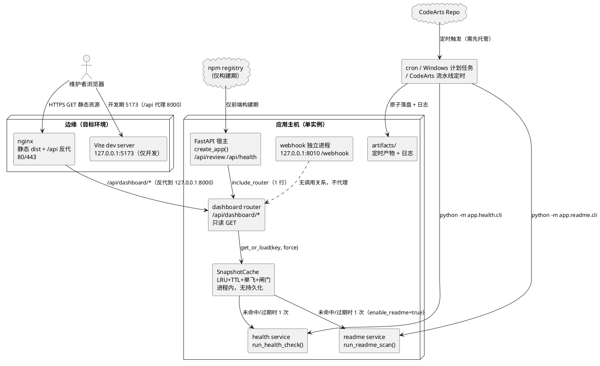

**通信契约**：浏览器 ↔ nginx 为 HTTPS；nginx ↔ API 为同机 HTTP 回环；前端仅通过同源 `/api/**` 取数，禁止直连 8000/8010；调度器 ↔ CLI 为独立进程（不经过 HTTP）。

### 2.1.2 服务/组件总体架构

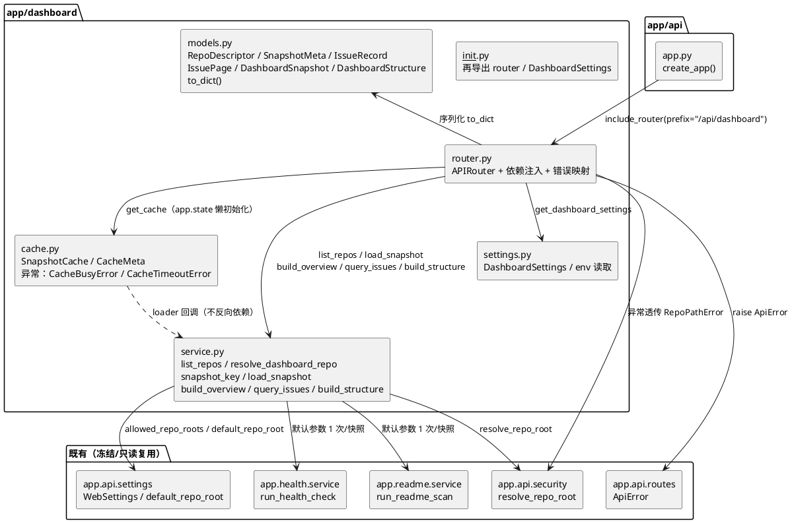

组件职责与调用频率：

| 组件 | 职责 | 调用频率 |
|------|------|---------|
| `router.py` | HTTP 入口、参数白名单、依赖注入、错误映射、日志 | 每请求 1 次 |
| `service.py` | 仓库令牌 ↔ 路径、快照构建、聚合、分页、结构映射 | 每请求 1~3 个函数；`load_snapshot` 仅缓存未命中时 |
| `cache.py` | 快照复用、单飞、TTL/LRU、节流、并发闸门 | 每数据请求 1 次 `get_or_load` |
| `models.py` | 不可变数据结构 + 序列化 | 每次构建/返回 |
| `settings.py` | 环境变量 → 校验后的 `DashboardSettings` | 每应用首次访问 1 次（懒初始化后缓存于 `app.state`） |
| 既有 health/readme service | 唯一扫描实现 | 每个新快照各 1 次 |

**配置项与取值策略**：`DashboardSettings` 全部来自 `REPOGUARD_DASHBOARD_*` 环境变量；非法/越界一律回退默认并 `WARNING`（不阻止启动）；`enable_readme=false` 时 `load_snapshot` 不调用 readme runner。

### 2.1.3 实现设计文档

#### （1）请求处理状态机（单次数据请求）

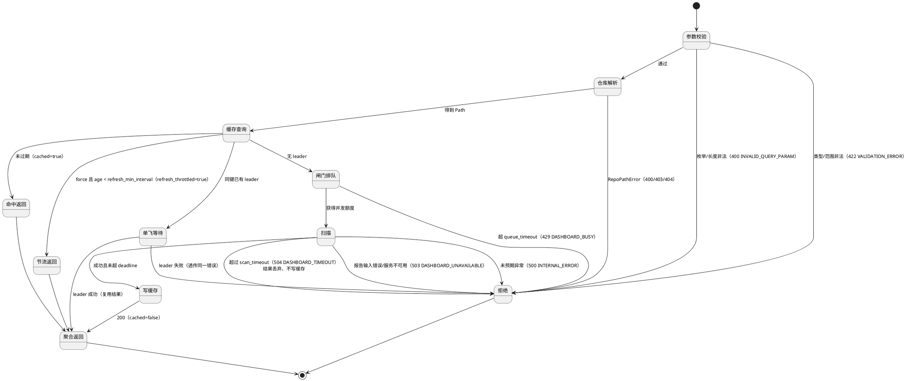

#### （2）缓存条目状态机

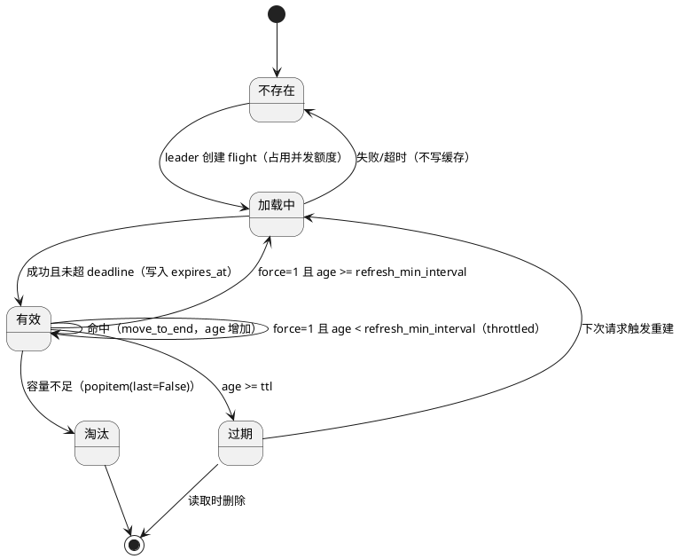

#### （3）定时任务状态机

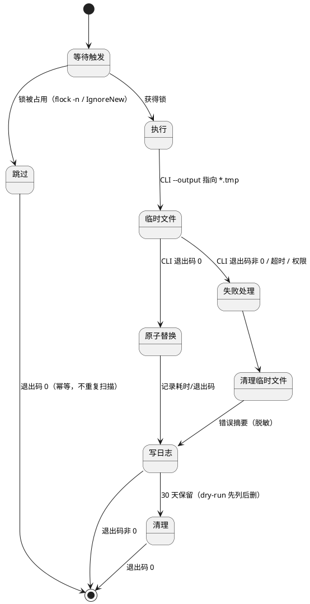

#### （4）扩展点设计

| 扩展点 | 接口 | 默认实现 | 用途 |
|--------|------|---------|------|
| `health_runner` | `Callable[[Path], HealthReport]` | `run_health_check` | 测试注入桩；禁止替换为引擎直调 |
| `readme_runner` | `Callable[[Path], ReadmeReport]` | `run_readme_scan` | 同上 |
| `clock` | `Callable[[], float]` | `time.monotonic` | 缓存 TTL 测试 |
| `SnapshotCache` | 构造注入 `ttl_seconds/capacity/max_concurrency/queue_timeout_seconds/refresh_min_interval_seconds` | 来自 `DashboardSettings` | 部署侧调优 |
| `enable_readme` | 布尔配置 | `True` | 关闭 README 扫描时结构视图降级 |

#### （5）事务设计

本模块**无数据库、无事务**。唯一一致性要求是"快照原子可见"：`DashboardSnapshot` 为 frozen dataclass，只在完整构建并自洽校验后一次性写入缓存；不存在"半成品快照"被读取的窗口（写入在锁内完成）。

## 2.2 接口设计

### 2.2.1 总体设计

| 接口 | 方法 | 稳定性 | 分组 | 依赖注入 |
|------|------|--------|------|---------|
| `/api/dashboard/repos` | GET（HEAD 由框架自动支持） | 稳定 | 清单 | `web_settings` |
| `/api/dashboard/overview` | GET | 稳定 | 数据 | `web_settings`、`dashboard_settings`、`cache`、`health_runner`、`readme_runner` |
| `/api/dashboard/issues` | GET | 稳定 | 数据 | 同上 |
| `/api/dashboard/structure` | GET | 稳定 | 数据 | 同上 |

- **版本策略**：路径中不带版本号，字段只做加法（新增字段不删旧字段）；破坏性变更需新前缀 `/api/dashboard/v2`，本阶段不启用。
- **只读**：仅注册 GET；其他方法由 Starlette 自动返回 405，经既有 `StarletteHTTPException` 处理器映射为 `METHOD_NOT_ALLOWED`。
- **统一响应头**：`Content-Type: application/json; charset=utf-8`、`Cache-Control: no-store`（中间件已设，端点内显式再设以防中间件顺序变化）、`X-Content-Type-Options: nosniff`、`X-Request-ID`。

### 2.2.2 接口清单

#### A. `GET /api/dashboard/repos`

```text
签名：repos(request: Request, web_settings: WebSettings = Depends(get_web_settings)) -> JSONResponse
```

- **业务说明**：返回可回传的仓库令牌清单与默认标记，供前端仓库选择器使用。
- **前置条件**：`web_settings.allowed_repo_roots` 非空（经 `normalize_settings` 后只含真实存在的目录）。
- **后置条件**：无副作用；不扫描仓库；不读写缓存。
- **响应体**：

```json
{
  "repos": [
    {"id": "demo-repo", "label": "demo-repo", "is_default": true}
  ],
  "default_repo": "demo-repo",
  "generated_at": "2026-11-07T12:00:00+00:00"
}
```

- **错误映射**：

| 场景 | HTTP | code |
|------|------|------|
| 白名单为空 | 503 | `DASHBOARD_UNAVAILABLE` |
| 未预期异常 | 500 | `INTERNAL_ERROR`（既有处理器） |
| 非 GET | 405 | `METHOD_NOT_ALLOWED` |

- **调用示例**（文档示例，非测试口径）：

```bash
curl -s http://127.0.0.1:8000/api/dashboard/repos
```

#### B. `GET /api/dashboard/overview`

```text
签名：overview(
    request: Request,
    repo: str | None = Query(default=None, max_length=512),
    refresh: int = Query(default=0),
    web_settings: WebSettings = Depends(get_web_settings),
    dashboard_settings: DashboardSettings = Depends(get_dashboard_settings),
    cache: SnapshotCache = Depends(get_cache),
    health_runner: Callable[..., HealthReport] = Depends(get_health_runner),
    readme_runner: Callable[..., ReadmeReport] = Depends(get_readme_runner),
) -> JSONResponse
```

- **业务说明**：返回当前快照的总览（元信息 + summary + 图表 + 计数）。
- **前置条件**：`repo` 可为空（使用默认仓库）；`refresh ∈ {0,1}`。
- **后置条件**：可能触发一次扫描并写入进程内缓存；不写文件。
- **异常映射**：见 2.2.3 矩阵。
- **调用示例**：

```bash
curl -s "http://127.0.0.1:8000/api/dashboard/overview?repo=demo-repo"
curl -s "http://127.0.0.1:8000/api/dashboard/overview?repo=demo-repo&refresh=1"
```

#### C. `GET /api/dashboard/issues`

```text
签名：issues(
    request: Request,
    repo: str | None = Query(default=None, max_length=512),
    refresh: int = Query(default=0),
    risk_level: str = Query(default="all"),
    source_module: str = Query(default="all"),
    keyword: str = Query(default=""),
    page: int = Query(default=1, ge=1, le=10000),
    page_size: int = Query(default=20, ge=1, le=100),
    sort: str = Query(default="risk_level"),
    order: str = Query(default="asc"),
    ...
) -> JSONResponse
```

- **业务说明**：返回筛选后的分页问题条目 + 筛选后图表 + 计数 + 生效筛选/排序回显。
- **前置条件**：枚举/长度合法；`page_size` 在 1–100。
- **后置条件**：与 overview 复用同一快照；分页在内存完成。
- **校验顺序（必须先于扫描）**：`refresh` → `risk_level` → `source_module` → `keyword` 长度 → `sort` → `order` → 仓库解析。
- **调用示例**：

```bash
curl -s "http://127.0.0.1:8000/api/dashboard/issues?repo=demo-repo&risk_level=high&source_module=%E8%BF%9E%E6%8E%A5%E6%A3%80%E6%9F%A5&page=1&page_size=20&sort=file_path&order=asc"
```

#### D. `GET /api/dashboard/structure`

```text
签名：structure(
    request: Request,
    repo: str | None = Query(default=None, max_length=512),
    refresh: int = Query(default=0),
    ...
) -> JSONResponse
```

- **业务说明**：返回 README 索引、目录分区、验异、Demo 计数与不可判定项；`enable_readme=false` 时返回 health 派生信息并标注降级。
- **前置条件**：同 overview。
- **调用示例**：

```bash
curl -s "http://127.0.0.1:8000/api/dashboard/structure?repo=demo-repo"
```

### 2.2.3 错误矩阵（与 spec 7.5 完全一致）

| HTTP | code | 触发条件 | 抛出位置 | 处理器 |
|------|------|---------|---------|--------|
| 400 | `INVALID_QUERY_PARAM` | `risk_level`/`source_module`/`sort`/`order` 非白名单；`refresh` 非 0/1；`keyword` 超长 | router 手工校验 | 既有 `ApiError` |
| 400 | `INVALID_REPO_PATH` | `repo` 为空/超长/控制字符/`://` | `resolve_repo_root` | 既有 `RepoPathError` |
| 403 | `REPO_FORBIDDEN` | `..`/盘符/UNC/允许根外 | `resolve_repo_root` | 既有 `RepoPathError` |
| 404 | `REPO_NOT_FOUND` | 白名单内不存在或非目录 | `resolve_repo_root` | 既有 `RepoPathError` |
| 405 | `METHOD_NOT_ALLOWED` | 非 GET | Starlette | 既有处理器 |
| 422 | `VALIDATION_ERROR` | `page`/`page_size` 类型或范围；`refresh` 非整数 | FastAPI `RequestValidationError` | 既有处理器 |
| 429 | `DASHBOARD_BUSY` | 并发满且排队超 `queue_timeout_seconds` | `cache.get_or_load` → router 映射 | 既有 `ApiError` |
| 500 | `INTERNAL_ERROR` | 聚合/序列化/未预期异常 | 全局处理器 | 既有处理器 |
| 503 | `DASHBOARD_UNAVAILABLE` | health/readme 不可导入、白名单为空、报告「输入错误」 | router / service | 既有 `ApiError` |
| 504 | `DASHBOARD_TIMEOUT` | 扫描超 `scan_timeout_seconds` | cache deadline / `asyncio.wait_for` | 既有 `ApiError` |

**detail 约束**：只允许字段名（如 `字段：sort`）、规则说明（如 `允许值：all/high/suggestion`）或脱敏片段；禁止堆栈、绝对路径、异常类名。

## 2.3 数据模型

### 2.3.1 设计目标

1. 支撑四视图全部字段（spec 6.1–6.4），字段名与 spec 术语一致。
2. 缓存中保留"完整快照"（含扁平化问题列表与 readme 全量映射），使 overview/issues/structure 三接口共享一次扫描；返回时按接口裁剪，避免重复序列化大对象。
3. 与存量 `HealthReport`/`ReadmeReport` 一一映射，不引入新的扫描语义。
4. 全部为 frozen dataclass（不可变），可安全在缓存中共享给并发读者。
5. 不持久化：无 `id`/`create_time` 等技术字段进入类图。

### 2.3.2 模型实现（类图）

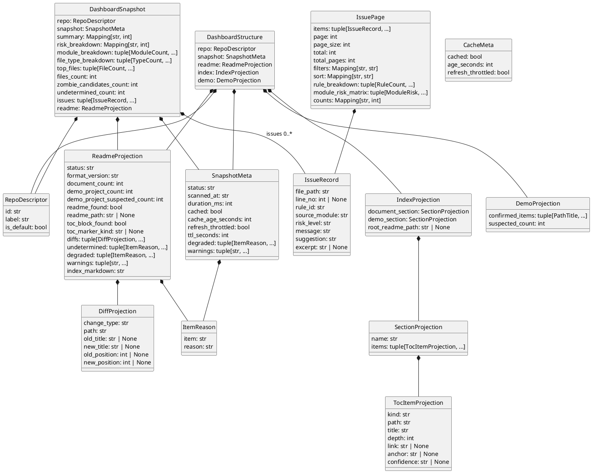

**说明**：`ItemReason`/`ModuleCount`/`TypeCount`/`FileCount`/`RuleCount`/`ModuleRisk`/`PathTitle` 均为 `@dataclass(frozen=True, slots=True)` 小结构，字段即字面含义，不再单独展开。`ReadmeProjection` 同时被 `DashboardSnapshot`（overview 只需计数时可用）与 `DashboardStructure` 引用。

### 2.3.3 字段与返回结构

**DashboardRepoList（`/repos`）**

| 字段 | 类型 | 约束 |
|------|------|------|
| `repos` | `RepoDescriptor[]` | 可为空数组；`id` 唯一，1–128 字符，可回传并解析成功 |
| `default_repo` | `str \| None` | 与 `is_default=true` 的 `id` 一致；无默认时 `null` |
| `generated_at` | `str` | UTC ISO 8601（`+00:00`） |

**DashboardSnapshot（`/overview`）**

| 字段 | 类型 | 约束 |
|------|------|------|
| `repo` | `RepoDescriptor` | 不含路径 |
| `snapshot.status` | `str` | `正常`/`部分降级`/`输入错误` |
| `snapshot.scanned_at` | `str` | 取 health `meta.scanned_at`（UTC） |
| `snapshot.duration_ms` | `int` | `health.meta.duration_ms + readme.duration_ms`（实测，非估算） |
| `snapshot.cached` | `bool` | 命中缓存为 `true` |
| `snapshot.cache_age_seconds` | `int` | 命中为缓存年龄；未命中为 `0` |
| `snapshot.refresh_throttled` | `bool` | `refresh=1` 被节流时为 `true` |
| `snapshot.ttl_seconds` | `int` | 当前生效 TTL（0 表示禁用缓存） |
| `snapshot.warnings` | `str[]` | 空为 `[]` |
| `snapshot.degraded` | `{item,reason}[]` | 空为 `[]` |
| `summary` | `{issue_count,must_fix_count,suggestion_count,zombie_candidate_count,undetermined_count,skipped_file_count,degraded_count}` | 全部 `int ≥ 0`；`issue_count == must_fix + suggestion` |
| `charts.risk_breakdown` | `{high:int,suggestion:int}` | |
| `charts.module_breakdown` | `{module,count}[]` | 四个中文模块固定输出（含 0），未知规则追加 `报告` |
| `charts.file_type_breakdown` | `{type,count}[]` | 固定 `markdown`/`code`/`other` 三项 |
| `charts.top_files` | `{file_path,issue_count}[]` | 最多 10 项；数量降序、同数路径升序 |
| `files_count` | `int` | `len(HealthReport.files)` |
| `zombie_candidates_count` | `int` | |
| `undetermined_count` | `int` | |

**IssuePage（`/issues`）**

| 字段 | 类型 | 约束 |
|------|------|------|
| `items[].file_path` | `str` | 相对路径，`/` 分隔 |
| `items[].line_no` | `int \| None` | `≥1` 或 `null` |
| `items[].rule_id` | `str` | 原样透传 |
| `items[].source_module` | `str` | 四个中文模块名之一（或 `报告`） |
| `items[].risk_level` | `str` | `高风险`/`建议` |
| `items[].message` | `str` | 原样透传（8–200 字符由既有规则保证） |
| `items[].suggestion` | `str` | 原样透传 |
| `items[].excerpt` | `str \| None` | 原样透传（≤60 字符，已脱敏） |
| `page`/`page_size`/`total`/`total_pages` | `int` | `total_pages = 0` 当 `total=0`；否则 `ceil(total/page_size)` |
| `filters` | `{risk_level,source_module,keyword}` | 回显生效值 |
| `sort` | `{field,order}` | 回显生效值 |
| `charts.rule_breakdown` | `{rule_id,count}[]` | 筛选后 Top 10；数量降序、同数 `rule_id` 升序 |
| `charts.module_risk_matrix` | `{module,high,suggestion}[]` | 固定四模块（含 0） |
| `counts` | `{total,high,suggestion}` | 筛选后统计 |

**DashboardStructure（`/structure`）**

| 字段 | 约束 |
|------|------|
| `readme.status` | `正常`/`部分降级`/`输入错误` |
| `readme.format_version` | 固定 `"1.0"` |
| `readme.document_count`/`demo_project_count`/`demo_project_suspected_count` | `int ≥ 0` |
| `readme.readme_found`/`toc_block_found` | `bool` |
| `readme.readme_path`/`toc_marker_kind` | 相对路径或 `null` |
| `readme.diffs[]` | `{change_type,path,old_title,new_title,old_position,new_position}` |
| `readme.undetermined[]`/`degraded[]` | `{item,reason}[]` |
| `readme.warnings` | `str[]` |
| `readme.index_markdown` | 文本（前端以文本节点渲染） |
| `index.document_section`/`demo_section` | `{name,items[]}`；items 为 `{kind,path,title,depth,link,anchor,confidence}` |
| `index.root_readme_path` | 相对路径或 `null` |
| `demo.confirmed_items` | `{path,title}[]` |
| `demo.suspected_count` | `int ≥ 0`；**无明细** |

**`to_dict(value: object) -> dict[str, object]`**：递归把 frozen dataclass / tuple / Mapping 转为可 JSON 序列化的 dict/list；拒绝 `Path`、`Enum` 以外未登记类型（`Path` 一律抛 `TypeError`，防止绝对路径泄漏）。

### 2.3.4 对象创建与生命周期

| 对象 | 创建时机 | 生命周期 | 销毁 |
|------|---------|---------|------|
| `DashboardSettings` | `app.state` 首次访问 | 应用进程 | 进程退出 |
| `SnapshotCache` | `app.state` 首次访问 | 应用进程 | 进程退出 |
| `DashboardSnapshot` | 缓存未命中且扫描成功 | 缓存（TTL/LRU） | 淘汰/过期/进程退出 |
| `IssuePage`/`DashboardStructure` 响应对象 | 每请求 | 请求内 | 响应序列化后由 GC 回收 |

**持久化策略**：无。快照不落盘、不写数据库、不写 artifacts（artifacts 仅由定时 CLI 产生）。

## 2.4 后端逐文件设计

### 2.4.1 `backend/app/dashboard/__init__.py`

- **职责**：包标记；再导出 `router` 与 `DashboardSettings`，供 `app.py` 与其他模块使用。
- **公开符号**：
  - `from app.dashboard.router import router`
  - `from app.dashboard.settings import DashboardSettings`
  - `__all__: tuple[str, ...] = ("router", "DashboardSettings")`
- **导入风险控制**：本文件只导入 `router` 与 `settings` 两个"零风险"模块；`router` 顶层不导入可能缺失的引擎模块，因此 `from app.dashboard.router import router` 不会因扫描引擎不可用而失败（满足 spec 4.2.5 导入隔离要求）。

### 2.4.2 `backend/app/dashboard/settings.py`

- **职责**：看板专属配置的读取、越界回退与脱敏摘要。
- **常量**：
  - `ENV_PREFIX: str = "REPOGUARD_DASHBOARD_"`（实际变量名逐个显式定义）
  - `CACHE_TTL_ENV = "REPOGUARD_DASHBOARD_CACHE_TTL_SECONDS"`
  - `CACHE_CAPACITY_ENV = "REPOGUARD_DASHBOARD_CACHE_CAPACITY"`
  - `SCAN_TIMEOUT_ENV = "REPOGUARD_DASHBOARD_SCAN_TIMEOUT_SECONDS"`
  - `MAX_CONCURRENCY_ENV = "REPOGUARD_DASHBOARD_MAX_CONCURRENCY"`
  - `QUEUE_TIMEOUT_ENV = "REPOGUARD_DASHBOARD_QUEUE_TIMEOUT_SECONDS"`
  - `REFRESH_MIN_INTERVAL_ENV = "REPOGUARD_DASHBOARD_REFRESH_MIN_INTERVAL_SECONDS"`
  - `MAX_PAGE_SIZE_ENV = "REPOGUARD_DASHBOARD_MAX_PAGE_SIZE"`
  - `MAX_KEYWORD_LENGTH_ENV = "REPOGUARD_DASHBOARD_MAX_KEYWORD_LENGTH"`
  - `ENABLE_README_ENV = "REPOGUARD_DASHBOARD_ENABLE_README"`
- **数据结构 `DashboardSettings`**（`@dataclass(frozen=True, slots=True)`）：

| 字段 | 类型 | 默认 | 范围 | 语义 |
|------|------|------|------|------|
| `cache_ttl_seconds` | `int` | 60 | 0–600 | 0 禁用缓存 |
| `cache_capacity` | `int` | 8 | 1–32 | LRU 容量 |
| `scan_timeout_seconds` | `int` | 30 | 5–120 | 单次扫描超时 |
| `max_concurrency` | `int` | 2 | 1–4 | 跨仓库并发 |
| `queue_timeout_seconds` | `int` | 5 | 0–30 | 排队超时 |
| `refresh_min_interval_seconds` | `int` | 10 | 0–60 | 强制刷新最小间隔 |
| `max_page_size` | `int` | 100 | 10–200 | 分页上限（对外硬上限仍为 100） |
| `max_keyword_length` | `int` | 64 | 8–256 | 关键词上限 |
| `enable_readme` | `bool` | `True` | — | 是否执行 README 扫描 |

- **函数签名**：
  - `default_dashboard_settings() -> DashboardSettings`
  - `load_dashboard_settings_from_env(env: Mapping[str, str] | None = None) -> DashboardSettings`
  - `settings_summary(settings: DashboardSettings) -> dict[str, object]`（仅数值与布尔，无路径）
- **校验算法**：整型用"先 `int()`，失败或越界 → 默认值 + `LOGGER.warning`"（布尔值不当作整数）；布尔用 `{"1","true","yes","on"}` / `{"0","false","no","off"}` 白名单解析，其他 → 默认 + WARNING。`settings_summary` 输出键：`cache_ttl_seconds`、`cache_capacity`、`scan_timeout_seconds`、`max_concurrency`、`queue_timeout_seconds`、`refresh_min_interval_seconds`、`max_page_size`、`max_keyword_length`、`enable_readme`。
- **约束**：本文件不导入 `app.api.settings`（避免与 web 配置耦合），不读文件系统。

### 2.4.3 `backend/app/dashboard/models.py`

- **职责**：只读数据结构定义 + 序列化工具；无业务逻辑、无 I/O。
- **全部公开结构**：

```text
@dataclass(frozen=True, slots=True)
class RepoDescriptor:
    id: str
    label: str
    is_default: bool

@dataclass(frozen=True, slots=True)
class ItemReason:
    item: str
    reason: str

@dataclass(frozen=True, slots=True)
class ModuleCount:
    module: str
    count: int

@dataclass(frozen=True, slots=True)
class TypeCount:
    type: str
    count: int

@dataclass(frozen=True, slots=True)
class FileCount:
    file_path: str
    issue_count: int

@dataclass(frozen=True, slots=True)
class RuleCount:
    rule_id: str
    count: int

@dataclass(frozen=True, slots=True)
class ModuleRisk:
    module: str
    high: int
    suggestion: int

@dataclass(frozen=True, slots=True)
class PathTitle:
    path: str
    title: str

@dataclass(frozen=True, slots=True)
class DiffProjection:
    change_type: str
    path: str
    old_title: str | None
    new_title: str | None
    old_position: int | None
    new_position: int | None

@dataclass(frozen=True, slots=True)
class TocItemProjection:
    kind: str
    path: str
    title: str
    depth: int
    link: str | None
    anchor: str | None
    confidence: str | None

@dataclass(frozen=True, slots=True)
class SectionProjection:
    name: str
    items: tuple[TocItemProjection, ...]

@dataclass(frozen=True, slots=True)
class IndexProjection:
    document_section: SectionProjection
    demo_section: SectionProjection
    root_readme_path: str | None

@dataclass(frozen=True, slots=True)
class DemoProjection:
    confirmed_items: tuple[PathTitle, ...]
    suspected_count: int

@dataclass(frozen=True, slots=True)
class ReadmeProjection:
    status: str
    format_version: str
    document_count: int
    demo_project_count: int
    demo_project_suspected_count: int
    readme_found: bool
    readme_path: str | None
    toc_block_found: bool
    toc_marker_kind: str | None
    diffs: tuple[DiffProjection, ...]
    undetermined: tuple[ItemReason, ...]
    degraded: tuple[ItemReason, ...]
    warnings: tuple[str, ...]
    index_markdown: str

@dataclass(frozen=True, slots=True)
class SnapshotMeta:
    status: str
    scanned_at: str
    duration_ms: int
    cached: bool
    cache_age_seconds: int
    refresh_throttled: bool
    ttl_seconds: int
    degraded: tuple[ItemReason, ...]
    warnings: tuple[str, ...]

@dataclass(frozen=True, slots=True)
class IssueRecord:
    file_path: str
    line_no: int | None
    rule_id: str
    source_module: str
    risk_level: str
    message: str
    suggestion: str
    excerpt: str | None

@dataclass(frozen=True, slots=True)
class IssuePage:
    items: tuple[IssueRecord, ...]
    page: int
    page_size: int
    total: int
    total_pages: int
    filters: Mapping[str, str]
    sort: Mapping[str, str]
    rule_breakdown: tuple[RuleCount, ...]
    module_risk_matrix: tuple[ModuleRisk, ...]
    counts: Mapping[str, int]

@dataclass(frozen=True, slots=True)
class DashboardSnapshot:
    repo: RepoDescriptor
    snapshot: SnapshotMeta
    summary: Mapping[str, int]
    risk_breakdown: Mapping[str, int]
    module_breakdown: tuple[ModuleCount, ...]
    file_type_breakdown: tuple[TypeCount, ...]
    top_files: tuple[FileCount, ...]
    files_count: int
    zombie_candidates_count: int
    undetermined_count: int
    issues: tuple[IssueRecord, ...]
    readme: ReadmeProjection

@dataclass(frozen=True, slots=True)
class DashboardStructure:
    repo: RepoDescriptor
    snapshot: SnapshotMeta
    readme: ReadmeProjection
    index: IndexProjection
    demo: DemoProjection
```

- **序列化函数**：`to_dict(value: object) -> dict[str, object]`
  - 支持：dataclass 实例（`dataclasses.fields`）、`tuple`/`list`、`Mapping`、`str`/`int`/`float`/`bool`/`None`。
  - 显式拒绝：`pathlib.Path`（抛 `TypeError("禁止序列化路径对象")`）、`Enum`、任意其他对象。
  - 保证输出键顺序稳定（按 dataclass 字段声明顺序），便于测试断言。
- **`DashboardSnapshot.repo` 与缓存元信息的关系**：`repo` 在构建时确定且不随缓存复用改变；`snapshot.cached/cache_age_seconds/refresh_throttled` 在**返回前**用 `dataclasses.replace` 注入实际 `CacheMeta`（缓存中保存的原始快照这三项恒为 `False/0/False`），确保命中与回源返回一致结构。
- **裁剪规则**：`/overview` 返回 `summary`/`charts`/计数 + `snapshot` + `repo`，**不返回**内部 `issues` 全量列表；`/issues` 返回 `IssuePage`；`/structure` 返回 `DashboardStructure`。

### 2.4.4 `backend/app/dashboard/cache.py`

- **职责**：进程内 LRU + TTL + 单飞 + 强制刷新节流 + 跨仓库并发闸门；不含任何扫描逻辑。
- **公开符号**：

```text
@dataclass(frozen=True, slots=True)
class CacheMeta:
    cached: bool
    age_seconds: int
    refresh_throttled: bool

class CacheBusyError(Exception): ...

class CacheTimeoutError(Exception): ...

class SnapshotCache:
    def __init__(
        self,
        ttl_seconds: int,
        capacity: int,
        *,
        max_concurrency: int = 2,
        queue_timeout_seconds: float = 5.0,
        refresh_min_interval_seconds: float = 10.0,
        clock: Callable[[], float] = time.monotonic,
    ) -> None
    def get(self, key: str) -> tuple[object | None, int]
    def set(self, key: str, value: object) -> None
    def get_or_load(
        self,
        key: str,
        loader: Callable[[], T],
        *,
        force: bool = False,
        deadline: float | None = None,
    ) -> tuple[T, CacheMeta]
    def clear(self) -> None
    def stats(self) -> dict[str, int]
```

- **内部字段**：
  - `_entries: OrderedDict[str, _Entry]`，`_Entry(value, stored_at, expires_at)`
  - `_inflight: dict[str, _Flight]`，`_Flight(event: threading.Event, value: object | None, error: BaseException | None)`
  - `_lock: threading.RLock`
  - `_gate: threading.BoundedSemaphore(max_concurrency)`
  - `_counters: dict[str, int]`（`hits`/`misses`/`loads`/`failures`/`evictions`/`throttled`/`waits`/`busy`/`timeouts`）
- **`get_or_load` 完整流程（leader/waiter 双路径）**：

```text
1. 计算 now = clock()
2. 加锁：
   a. 若命中且未过期：
      - force=False → move_to_end；返回 (value, CacheMeta(cached=True, age=floor(now-stored_at), throttled=False))
      - force=True 且 age < refresh_min_interval → 返回同上但 throttled=True（计数 throttled+1）
      - force=True 且 age >= refresh_min_interval → 继续（走重建）
   b. 若命中且已过期 → 删除条目（计数 misses+1）
   c. 若 key 在 _inflight → 取出 flight 引用，计数 waits+1，释放锁，跳到步骤 5（waiter）
   d. 否则创建 flight 放入 _inflight，计数 misses+1，释放锁，进入步骤 3（leader）
3. leader 获取并发额度：_gate.acquire(timeout=queue_timeout_seconds)
   - 失败 → 移除 flight（set 事件、error=CacheBusyError），计数 busy+1，抛 CacheBusyError
4. leader 执行 loader（try）：
   - 前置检查：deadline 存在且 clock() > deadline → 视为超时（不调用 loader）
   - 成功：再次检查 deadline；未超时则加锁写入 _entries（TTL=0 时不写），必要时淘汰最久未使用项（计数 evictions+1），计数 loads+1
   - 超时：不写缓存，error=CacheTimeoutError，计数 timeouts+1
   - 异常：不写缓存，error=原异常，计数 failures+1
   - 无论结果如何：加锁移除 _inflight[key]；flight.value/error 赋值；flight.event.set()；_gate.release()
   - 返回值/抛异常给调用者
5. waiter：在锁外 flight.event.wait(timeout=剩余 deadline 或 scan 超时+1)：
   - event 未置位（等待超时）→ 抛 CacheTimeoutError（不写缓存，不影响 leader）
   - flight.error 非空 → 原样抛出（保证不缓存失败结果）
   - 否则返回 (flight.value, CacheMeta(cached=False, age=0, throttled=force 被忽略的 False))
```

- **TTL**：`expires_at = stored_at + ttl_seconds`；`ttl_seconds == 0` 表示"可读旧值但永不写入新值"（等价禁用缓存：`set` 为空操作，`get_or_load` 每次都回源）。
- **LRU**：命中 `move_to_end(key)`；写入前若 `len(_entries) >= capacity` 且 key 不存在 → `popitem(last=False)`。
- **单飞**：同 key 的 waiter 复用 leader 结果；waiter 不占用并发额度。
- **失败不缓存**：仅成功且未超 deadline 才写 `_entries`。
- **晚到结果丢弃**：leader 在 loader 返回后若 `clock() > deadline`，丢弃结果（不写缓存）并抛 `CacheTimeoutError`；线程无法被强制中断（Python 限制），文档登记该行为。
- **测试重置口**：`clear()` 清空 `_entries`、`_inflight`（逐个 `event.set()` 避免 waiter 永久阻塞）、`_counters`；`stats()` 返回计数字典副本。
- **线程模型**：所有方法同步、线程安全；由 router 以 `asyncio.to_thread` 调用，禁止在事件循环线程直接调用阻塞路径。
- **估算**：每请求占用 1 个工作线程；默认 anyio 线程池 40 个令牌，足以覆盖 2 个 leader + 若干 waiter 的验收场景。

### 2.4.5 `backend/app/dashboard/service.py`

- **职责**：仓库令牌 ↔ 路径、快照构建、聚合、分页、结构映射、脱敏。
- **顶层导入**（全部为稳定模块，不导入检查规则）：

```text
from app.api.security import resolve_repo_root
from app.api.settings import WebSettings, default_repo_root
from app.health.models import HealthReport, HealthStatus
from app.health.service import run_health_check
from app.readme.models import ReadmeReport, ReadmeStatus
from app.readme.service import run_readme_scan
from app.dashboard.models import (...)
```

- **函数签名与行为**：

| 函数 | 签名 | 行为 |
|------|------|------|
| `list_repos` | `(settings: WebSettings) -> tuple[RepoDescriptor, ...]` | 遍历 `allowed_repo_roots`（已规范化、去重、仅存在的目录）；`id` = 目录名（`root.name`），若与已出现 id 冲突（`casefold` 比较）则改为 `f"{name}-{sha256(path)[:8]}"`；`label` = `id`；`is_default` = 与 `default_repo_root(settings)` 解析结果一致 |
| `resolve_dashboard_repo` | `(token: str \| None, settings: WebSettings) -> Path` | 空/`None` → `""` 交给 `resolve_repo_root`（其会按默认仓库处理）；先构建 `{id: Path}` 映射，命中则 `resolve_repo_root(str(path), settings)`，未命中则 `resolve_repo_root(token, settings)`（兼容默认令牌与绝对路径语义）；异常原样抛 `RepoPathError` |
| `snapshot_key` | `(repo_root: Path) -> str` | `sha256(normcase(str(repo_root.resolve())))` 十六进制；仅在内存/日志中使用，日志只取前 12 位作为 `repo_hash` |
| `load_snapshot` | `(repo_root: Path, *, health_runner: Callable[..., HealthReport] = run_health_check, readme_runner: Callable[..., ReadmeReport] = run_readme_scan, readme_enabled: bool = True) -> DashboardSnapshot` | 见 2.4.5.1 调用顺序 |
| `build_overview` | `(snapshot: DashboardSnapshot) -> dict[str, object]` | 返回 `{repo, snapshot, summary, charts, files_count, zombie_candidates_count, undetermined_count}`；不含内部 `issues`/`readme` |
| `query_issues` | `(snapshot: DashboardSnapshot, *, risk_level: str, source_module: str, keyword: str, page: int, page_size: int, sort_field: str, order: str) -> IssuePage` | 见 2.4.5.2 |
| `build_structure` | `(snapshot: DashboardSnapshot) -> dict[str, object]` | 返回 `{repo, snapshot, readme, index, demo}` |

- **内部辅助（非公开，命名以 `_` 前缀）**：
  - `_safe_relative(text: str | None) -> str | None`：路径脱敏兜底；若含盘符（`^[A-Za-z]:`）或以 `/`、`\` 开头、含 `\\?\`/`//` → 仅保留最后一段（`PurePosixPath`/`PureWindowsPath` 取 `name`）；否则把 `\` 统一为 `/`；`None` 保持 `None`。
  - `_flatten_issues(files: Sequence[HealthFileEntry]) -> tuple[IssueRecord, ...]`：按 `files` 顺序展开 `findings`，`risk_level` 取 `RiskLevel.value`，`source_module` 原样。
  - `_classify_file_type(path: str) -> str`：扩展名映射，见下表。
  - `_module_order() -> tuple[str, ...]`：四个固定中文模块名（与 `HealthReport` 的 `source_module_for_rule` 输出一致）。
  - `_status_text(status: HealthStatus | ReadmeStatus) -> str`：枚举 `.value`。
  - `_merge_status(health: HealthStatus, readme: ReadmeStatus, readme_enabled: bool) -> str`：`INPUT_ERROR` 优先（但 health 的输入错误在更早阶段已转为 503）→ `PARTIAL_DEGRADED` → `OK`；`readme_enabled=False` 时强制 `部分降级`。
  - `_aggregate(...)`：总览图表聚合。

#### 2.4.5.1 `load_snapshot` 调用顺序与次数

```text
1. health = health_runner(repo_root)                 # 恰好 1 次（默认 run_health_check）
2. 若 health.status is INPUT_ERROR → 抛 SnapshotUnavailableError（router 映射 503）
3. 若 readme_enabled:
     readme = readme_runner(repo_root)               # 恰好 1 次（默认 run_readme_scan）
     若 readme.status is INPUT_ERROR → 抛 SnapshotUnavailableError（不缓存）
   else:
     readme = None                                   # 0 次调用
4. 合成 SnapshotMeta：
     status        = _merge_status(health.status, readme.status, readme_enabled)
     scanned_at    = health.meta.scanned_at（为空时用 readme.scanned_at 兜底，仍为空则不伪造，保持空串并在 warnings 说明）
     duration_ms   = health.meta.duration_ms + (readme.duration_ms if readme else 0)
     ttl/cached/age/throttled = 占位（False/0/False），由 cache 返回前注入
     degraded      = health.degraded + readme.degraded（转 ItemReason）+ readme_enabled 关闭说明
     warnings      = health.warnings + readme.warnings + 合成说明（去重、保序）
5. 统计自洽校验：
     computed_high/computed_suggestion 来自扁平化 issues
     若与 health.summary 不一致 → status 置「部分降级」，degraded 追加 {item:"报告",reason:"统计字段与明细不一致，结果可能不完整"}，warnings 追加"部分统计字段可能不一致"
6. 构造 DashboardSnapshot（frozen）：repo 由调用方注入（router 在拿到 Path 后已知 descriptor），
   issues/readme 投影全部构建完毕后才返回。
```

**禁止**：`load_snapshot` 内不得出现任何 `Path.glob`/`os.walk`/`open()`；不得调用 `engine.run_check`/`detect_zombies`/`scan_documents`/`walk_repository`。

#### 2.4.5.2 聚合算法（overview / issues）

**总览图表**

| 图表 | 字段 | 算法 |
|------|------|------|
| 风险构成 | `risk_breakdown` | `high = health.summary.must_fix_count`、`suggestion = health.summary.suggestion_count`（与扁平化结果一致性已校验） |
| 模块分布 | `module_breakdown` | 先输出四个固定模块（`命名与目录检查`/`代码检查`/`链接检查`/`敏感信息与大文件检查`，各计数可 0）；扫描扁平化 issues 累加；若存在未知模块（`报告`）追加到末尾 |
| 文件类型 | `file_type_breakdown` | 固定三项 `markdown`/`code`/`other`；按 `HealthReport.files[].file_path` 的扩展名分类（**仅用报告中的路径字符串，不访问文件系统**） |
| Top 文件 | `top_files` | 以 `HealthFileEntry.issue_count`（等于 `len(findings)`）聚合到 `file_path`；`sorted(key=(-issue_count, file_path))`；截取前 10 |

**文件类型扩展名映射**

| 类别 | 扩展名（小写、无点） |
|------|--------------------|
| `markdown` | `md`、`markdown`、`mdown`、`mkd` |
| `code` | `py`、`c`、`h`、`cc`、`cpp`、`hpp`、`cs`、`java`、`kt`、`kts`、`go`、`rs`、`rb`、`php`、`js`、`mjs`、`cjs`、`ts`、`tsx`、`jsx`、`vue`、`svelte`、`swift`、`m`、`mm`、`sh`、`bash`、`ps1`、`bat`、`cmd`、`sql`、`lua`、`pl`、`r`、`scala`、`dart`、`zig`、`nim`、`ex`、`exs`、`erl`、`hrl`、`clj`、`groovy`、`gradle` |
| `other` | 其余（含无扩展名、配置文件、二进制扩展名） |

**问题筛选**

```text
risk_level: "all" → 不过滤；"high" → risk_level == "高风险"；"suggestion" → risk_level == "建议"
source_module: "all" → 不过滤；否则 == 给定中文模块名
keyword: strip 后为空 → 不过滤；否则大小写不敏感子串匹配以下任一字段：
         file_path / rule_id / message / suggestion（不解释正则，使用 str.casefold() 的 in 判断）
```

**稳定排序（多键，全部可逆）**

```text
基础键（用于保证翻页稳定，不随 order 翻转）：
  (risk_rank, file_path, line_no_is_none, line_no or 0, rule_id)
其中 risk_rank：高风险=0，建议=1

对外排序字段映射（sort_field → 主键，次键固定为 file_path/rule_id/line_no 以保证稳定）：
  risk_level      → (risk_rank, file_path, line_no_is_none, line_no, rule_id)
  file_path       → (file_path, risk_rank, line_no_is_none, line_no, rule_id)
  line_no         → (line_no_is_none, line_no or 0, file_path, risk_rank, rule_id)
  rule_id         → (rule_id, risk_rank, file_path, line_no_is_none, line_no)
  source_module   → (source_module, risk_rank, file_path, line_no_is_none, line_no, rule_id)
  message         → (message, risk_rank, file_path, line_no_is_none, line_no, rule_id)
order: "asc" 原序；"desc" 对"主键元组"整体 reverse（稳定键仍保留在元组内，因此翻页不会重复/遗漏）
默认：sort_field="risk_level", order="asc" → 高风险在前、同风险按路径升序、空行号靠后
```

**分页**

```text
total       = len(filtered)
total_pages = 0 if total == 0 else ceil(total / page_size)
start       = (page - 1) * page_size
items       = filtered[start : start + page_size]        # page 越界 → 空数组，不报错
counts      = {"total": total, "high": 高风险数, "suggestion": 建议数}
rule_breakdown = 按 rule_id 计数后取 Top 10（count 降序，同数 rule_id 升序）
module_risk_matrix = 四个固定模块 × {high, suggestion}（筛选后统计，含 0）
```

**脱敏**

1. 所有 `file_path`/`readme_path`/`index.*.path`/`demo.*.path` 经 `_safe_relative()` 处理。
2. 不输出 `ScanMeta.scan_root`、`ReadmeReport.scan_root`、`replacement_block`（含完整索引文本，非本阶段视图所需）。
3. `repo.id`/`label` 只使用目录名或 `名称-短哈希`。
4. `excerpt` 原样透传既有脱敏结果，不追加、不截断、不重排。

### 2.4.6 `backend/app/dashboard/router.py`

- **职责**：路由注册、依赖注入、参数白名单、缓存单例、错误映射、结构化日志。
- **模块级对象**：`router = APIRouter(tags=["dashboard"])`；`LOGGER = logging.getLogger("repoguard.dashboard")`；无全局缓存实例（缓存挂 `app.state`，保证多 app 实例互不干扰，测试可隔离）。
- **依赖注入函数**：

| 函数 | 签名 | 实现要点 |
|------|------|---------|
| `get_web_settings` | `(request: Request) -> WebSettings` | `request.app.state.settings`（与既有 `/api/review` 同源）；缺失时抛 `ApiError("DASHBOARD_UNAVAILABLE", 503)` |
| `get_dashboard_settings` | `(request: Request) -> DashboardSettings` | 读 `app.state.dashboard_settings`；不存在则 `load_dashboard_settings_from_env()` 并写回（懒初始化，线程内首次可能重复计算但结果幂等） |
| `get_cache` | `(request: Request) -> SnapshotCache` | 读 `app.state.dashboard_cache`；不存在则用 `get_dashboard_settings` 的配置构造并写回；`id(cache)` 在应用生命周期内恒定 |
| `get_health_runner` | `() -> Callable[..., HealthReport]` | 运行期 `import` `app.health.service.run_health_check`；不可导入/不可调用 → `ApiError("DASHBOARD_UNAVAILABLE", 503)` |
| `get_readme_runner` | `() -> Callable[..., ReadmeReport]` | 同上，取 `run_readme_scan` |

> 采用"运行期导入 runner"与既有 `routes.get_engine`（`backend/app/api/routes.py:122-130`）保持同一防御风格；`service.py` 的默认参数仍直接引用既有函数（满足 spec 9.1 第 2 条）。

- **端点共用流程（`_prepare` 私有协程）**：

```text
1. 校验 refresh ∈ {0,1} → 否则 ApiError("INVALID_QUERY_PARAM", 400, "查询参数不合法", "字段：refresh")
2. 解析 web_settings.allowed_repo_roots 为空 → ApiError("DASHBOARD_UNAVAILABLE", 503, "看板数据服务当前不可用", "未配置可用的仓库目录")
3. repo_root = resolve_dashboard_repo(repo, web_settings)     # RepoPathError 透传
4. descriptor = 由 list_repos 中找到 id == 令牌（或默认）的项；若解析走的是绝对路径/默认令牌而清单无对应项，
   则临时构造 RepoDescriptor(id=令牌或目录名, label=目录名, is_default=(root==default_repo_root))
5. key = snapshot_key(repo_root)
6. deadline = time.monotonic() + dashboard_settings.scan_timeout_seconds
7. snapshot, cache_meta = await _obtain(cache, key, deadline, force=(refresh==1), runners, settings)
8. 用 replace(snapshot, snapshot=replace(snapshot.snapshot, cached=..., cache_age_seconds=..., refresh_throttled=...)) 注入元信息
9. 写结构化日志（JSON 单行）：request_id / repo_label / repo_hash / cached / cache_age_seconds /
   duration_ms（请求耗时）/ scan_duration_ms（snapshot.duration_ms）/ status_code / error_code
10. 返回 JSONResponse（显式 Content-Type 与 Cache-Control）
```

- **`_obtain` 错误映射（只在此处转换）**：

| 内部异常 | 映射 |
|---------|------|
| `RepoPathError` | 原样抛出（既有处理器） |
| `ApiError` | 原样抛出 |
| `CacheBusyError` | `ApiError("DASHBOARD_BUSY", 429, "当前看板请求较多，请稍后重试")` |
| `CacheTimeoutError` / `asyncio.TimeoutError` / `TimeoutError` | `ApiError("DASHBOARD_TIMEOUT", 504, "扫描耗时过长，请稍后重试或缩小巡检范围")` |
| `SnapshotUnavailableError`（service 内定义） | `ApiError("DASHBOARD_UNAVAILABLE", 503, "看板数据服务当前不可用")` |
| 其他 `Exception` | 记录 `request_id` 与异常类型（不记录堆栈给用户），抛 `ApiError("INTERNAL_ERROR", 500, "服务处理请求时发生异常，请稍后重试")` |

- **异步包装**：`await asyncio.wait_for(asyncio.to_thread(cache.get_or_load, ...), timeout=scan_timeout + queue_timeout + 1.0)`；外层 `wait_for` 仅作兜底（正常应由 cache `deadline` 抛 `CacheTimeoutError`）。
- **`/repos` 不经过缓存**，也不调用 runner；白名单为空 → 503。
- **日志字段要求**：`repo_label` 为目录名；`repo_hash` 为 `snapshot_key()` 前 12 位；禁止出现绝对路径。
- **request.state**：成功后设 `request.state.error_code = "OK"`，失败由既有处理器设 `error_code`。

### 2.4.7 三个新增测试文件与可选脚本（路径清单）

| 路径 | 职责 | 允许依赖 |
|------|------|---------|
| `backend/tests/test_dashboard_service.py` | 仓库令牌、快照调用次数、聚合、分页、排序、筛选、脱敏、结构映射 | `unittest`、标准库、`app.dashboard.*`、`app.health.models`、`app.readme.models`、`app.api.settings/security` |
| `backend/tests/test_dashboard_cache.py` | TTL、LRU、单飞、失败不缓存、节流、deadline、并发闸门、统计、重置 | `unittest`、`threading`、`app.dashboard.cache`、`tests.webhook_helpers.FrozenClock` |
| `backend/tests/test_dashboard_api.py` | 四接口契约、错误矩阵、405、429/503/504、响应头、只读、脱敏、无网络 | `unittest`、`app.api.app.create_app`、`app.dashboard.*`、`tests.webhook_helpers`（`WebhookASGIClient`/`no_network`） |
| `scripts/verify_frozen_hashes.py`（可选） | 13 个冻结文件 + `requirements.txt` + `static/index.html` 的 SHA-256 比对 | 标准库 |

**测试注入策略**：
- API 测试通过 `create_app(WebSettings(...))` 得到独立应用；用 `app.dependency_overrides[get_health_runner] = lambda: stub` 注入桩（FastAPI 原生能力，无新依赖）。
- 缓存隔离：每个应用实例的 `app.state.dashboard_cache` 独立；需要预设缓存时直接操作 `app.state.dashboard_cache`。
- 429/504 由 cache 层单测覆盖真实语义；API 层用依赖覆盖让 `get_cache` 返回配置为 `queue_timeout_seconds=0`/`ttl=0` 的实例或抛对应异常的桩，验证错误映射与响应头。

## 2.5 缓存内核落地要点（实现约束清单）

### 2.5.1 锁临界区划分

| 临界区 | 持锁内允许的操作 | 禁止的操作 |
|--------|----------------|-----------|
| C1 读条目 | 判断 `_entries[key]` 是否存在/过期、`move_to_end`、过期删除 | 调用 loader、`event.wait`、日志 I/O |
| C2 判定单飞 | 查询/创建 `_inflight[key]`、取 flight 引用 | 等待事件 |
| C3 写结果 | 写入 `_entries`、淘汰、更新计数、赋值 flight、`_inflight.pop` | 序列化、磁盘 I/O |
| 锁外 | `_gate.acquire`、loader 执行、`event.wait`、`_gate.release` | 直接修改 `_entries`/`_inflight` 结构 |

**锁类型**：`threading.RLock`（`get_or_load` 内部存在"深层调用同一私有方法"的可能，RLock 避免自锁；且允许 `clear()` 在持锁内逐个 `set()`）。

### 2.5.2 时间预算（单次请求最坏路径）

| 阶段 | 上限 | 来源 |
|------|------|------|
| 参数校验 + 仓库解析 | 无阻塞（纯计算 + `Path.resolve`） | — |
| 排队等待并发额度 | `queue_timeout_seconds`（默认 5s） | `_gate.acquire(timeout=...)` |
| 扫描执行 | `scan_timeout_seconds`（默认 30s） | `deadline = monotonic() + scan_timeout` |
| waiter 等待 leader | `min(剩余 deadline, scan_timeout + 1)` | `event.wait(timeout=...)` |
| 外层兜底 | `scan_timeout + queue_timeout + 1.0` | `asyncio.wait_for` |

**结论**：未命中且并发空闲时最坏 ≈ 30s + 1s 兜底；排队满时 ≈ 5s + 30s + 1s；waiter 最多 = leader 的剩余预算。`nginx` 读超时 120s 大于该上限，不会先于应用层截断。

### 2.5.3 失败分类与缓存影响

| 失败类型 | 是否写缓存 | 是否影响 waiter | 对外错误 |
|---------|-----------|----------------|---------|
| loader 抛 `ApiError`/`RepoPathError` | 否 | 是（同一异常） | 原错误 |
| loader 抛其他异常 | 否 | 是 | 500 `INTERNAL_ERROR` |
| 排队超时 | 否 | 不涉及（未成为 leader） | 429 `DASHBOARD_BUSY` |
| 扫描超时（deadline 过期） | 否 | 是（`CacheTimeoutError`） | 504 `DASHBOARD_TIMEOUT` |
| 报告输入错误/服务不可导入 | 否 | 是 | 503 `DASHBOARD_UNAVAILABLE` |
| 序列化失败（响应阶段） | 快照已缓存（合法数据，仅序列化失败） | 否 | 500 `INTERNAL_ERROR` |

**说明**：序列化失败说明快照结构完好、渲染层有缺陷；缓存保留不会"固化故障"，且下一次请求可立即重试序列化。该行为在偏差登记中标注。

### 2.5.4 单实例一致性

- 缓存对象 `id()` 在应用生命周期内恒定（`app.state.dashboard_cache`）。
- 同一 key 的并发请求只有一个 leader（`_inflight` 唯一）。
- 同一快照请求内 health/readme 各最多 1 次（`load_snapshot` 顺序调用，无重试）。
- 不提供跨实例一致性（D-09）；多实例部署时需外置缓存，超出本阶段边界。

## 2.6 时序与状态

### 2.6.1 缓存命中时序

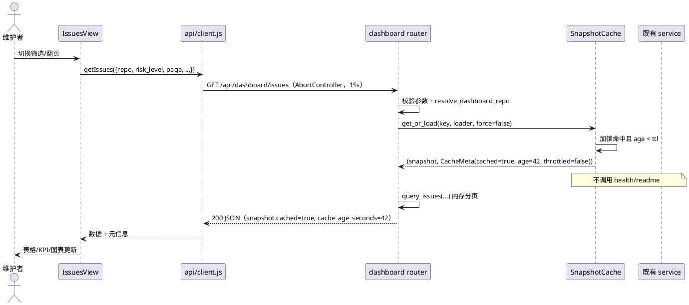

### 2.6.2 回源时序（未命中）

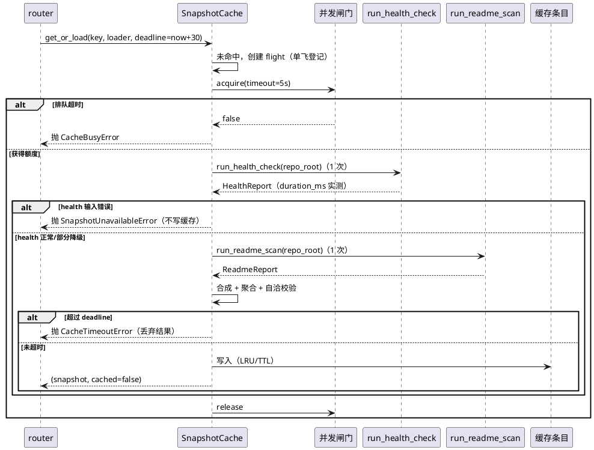

### 2.6.3 超时时序（晚到结果丢弃）

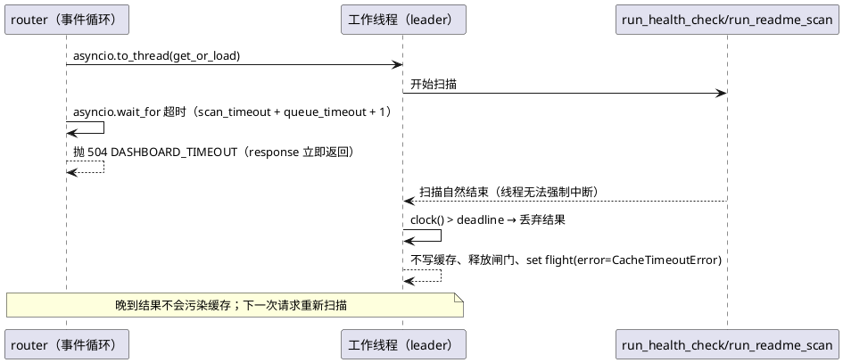

### 2.6.4 并发与单飞时序

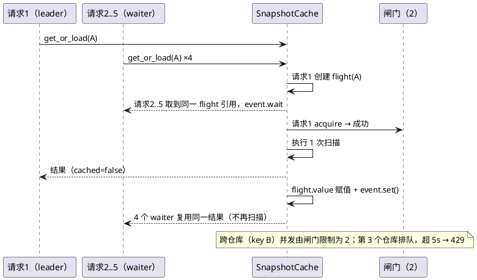

### 2.6.5 前端启动 → 渲染时序

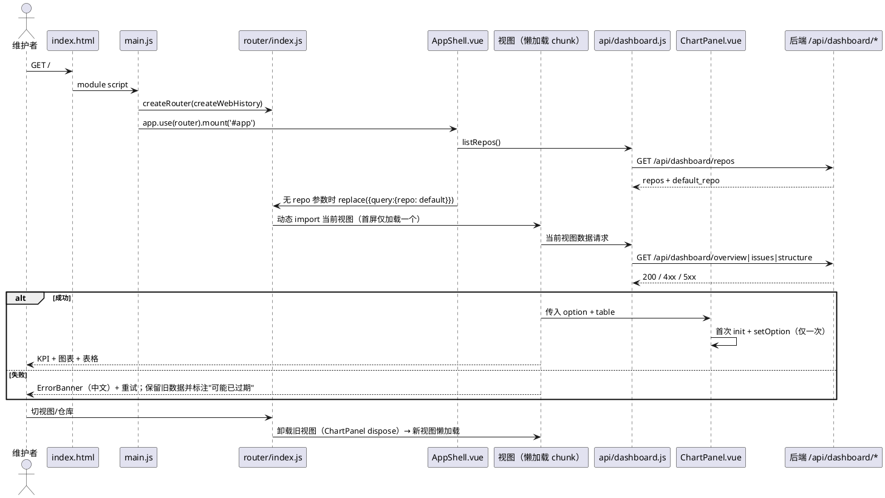

### 2.6.6 降级与失败呈现矩阵

| 后端状态 | HTTP | 前端呈现 | 是否保留旧数据 |
|---------|------|---------|--------------|
| `snapshot.status=正常` | 200 | 正常渲染 | — |
| `snapshot.status=部分降级` | 200 | 顶部降级提示条（列出 `degraded[].reason`）+ 数据正常展示 | — |
| `refresh_throttled=true` | 200 | 提示"刷新过于频繁，已展示最近一次快照" | 使用返回数据 |
| 400/403/404/422 | 4xx | ErrorBanner（错误码中文 + `request_id`）+ 重试 | 保留并标注过期 |
| 429 | 429 | ErrorBanner"当前看板请求较多" + 稍后重试 | 保留并标注过期 |
| 503 | 503 | ErrorBanner"看板数据服务当前不可用"（不渲染 0 值 KPI） | 首次失败显示空态+错误；有旧数据则保留并标注 |
| 504 | 504 | ErrorBanner"扫描耗时过长" + 重试 | 同上 |
| 网络中断/超时 | — | ErrorBanner"无法连接看板服务，请检查后端是否启动" | 同上 |
| 空仓库/无问题 | 200 + 空数组 | EmptyState"未发现问题"/图表"暂无数据" | — |

## 2.7 对 `backend/app/api/app.py` 的精确增量

**只允许以下两行**（其余 185 行零变更，含空行位置）：

```diff
--- a/backend/app/api/app.py
+++ b/backend/app/api/app.py
@@ -24,6 +24,7 @@
 from app.api.schemas import error_payload
 from app.api.security import RepoPathError
 from app.api.settings import WebSettings, load_settings_from_env, normalize_settings, settings_summary
+from app.dashboard.router import router as dashboard_router
 
 LOGGER = logging.getLogger("repoguard.api.app")
@@ -179,6 +180,7 @@
     _configure_middleware(app, effective_settings)
     _register_exception_handlers(app)
     app.include_router(router, prefix="/api")
+    app.include_router(dashboard_router, prefix="/api/dashboard")
     _mount_static(app, effective_settings)
     _configure_cors(app, effective_settings)
     return app
```

**变更后行号**：`from app.dashboard.router import router as dashboard_router` 位于第 26 行；`app.include_router(dashboard_router, prefix="/api/dashboard")` 位于第 183 行（原第 181 行 `include_router` 之后）。

**明确不做**：
1. 不改 `lifespan`（第 145–160 行）、`_configure_middleware`（53–80）、`_register_exception_handlers`（83–118）、`_mount_static`（121–130）、`_configure_cors`（133–142）。
2. 不新增 `app.state` 初始化行（缓存与配置由 `get_cache`/`get_dashboard_settings` 懒初始化）。
3. 不调整既有 `include_router` 与 `_mount_static` 的顺序。
4. 不新增异常处理器；dashboard 只抛 `ApiError`/`RepoPathError`。
5. 不挂载 webhook 路由。

**导入隔离保证**：`app.dashboard.router` 顶层只导入标准库、`fastapi`/`starlette`、`app.api.*` 的稳定符号与 `app.dashboard.*`；不导入 `app.core.rules.*`、`app.webhook.*`、`app.integrations.*`、`app.api.app`，故不存在循环导入与"引擎缺失导致宿主导入失败"的路径。

---
# 三、前端工程设计与依赖锁定

## 3.1 完整目录与文件清单

> 复用既有空目录 `frontend/public/`、`frontend/src/api/`、`frontend/src/assets/`、`frontend/src/components/`、`frontend/src/router/`、`frontend/src/views/`；不新建 `src/pages`、`src/api-v2`、`src/store` 等平行目录。

| 序号 | 完整路径 | 动作 | 行数预算 | 职责 |
|-----|---------|------|---------|------|
| F-01 | `frontend/package.json` | 新增 | ≤ 30 | 依赖（精确版本）、脚本、`engines.node` |
| F-02 | `frontend/package-lock.json` | 新增（npm 生成） | 自动 | 锁定完整依赖树，必须入库 |
| F-03 | `frontend/vite.config.js` | 新增 | ≤ 45 | Vue 插件、5173、`/api`→8000、dist、manualChunks |
| F-04 | `frontend/index.html` | 新增 | ≤ 25 | SPA 入口；`lang="zh-CN"`；本地 favicon；无外链 |
| F-05 | `frontend/.gitignore` | 新增（可选，根已覆盖） | ≤ 5 | `node_modules/`、`dist/` |
| F-06 | `frontend/public/favicon.svg` | 新增 | ≤ 20 | 本地图标（纯 SVG，无字体无外链） |
| F-07 | `frontend/src/main.js` | 新增 | ≤ 25 | `createApp` + 路由 + 全局样式挂载 |
| F-08 | `frontend/src/App.vue` | 新增 | ≤ 60 | 顶层 `<AppShell>` + `<router-view>` + 子树错误捕获 |
| F-09 | `frontend/src/assets/styles.css` | 新增 | ≤ 400 | 设计令牌、布局、断点、表格、焦点、动效降级 |
| F-10 | `frontend/src/api/client.js` | 新增 | ≤ 120 | `fetch` 封装：超时、AbortController、错误归一化、`ERROR_CODE_MESSAGES`、查询串构造 |
| F-11 | `frontend/src/api/dashboard.js` | 新增 | ≤ 80 | 四接口调用函数 + 参数序列化 |
| F-12 | `frontend/src/router/index.js` | 新增 | ≤ 60 | `createWebHistory`、路由表、四视图懒加载、兜底重定向 |
| F-13 | `frontend/src/components/AppShell.vue` | 新增 | ≤ 220 | 导航、仓库选择器、刷新按钮、快照信息条、`provide` 上下文 |
| F-14 | `frontend/src/components/KpiCard.vue` | 新增 | ≤ 70 | 数值/单位/语义色/可选跳转、`aria` 文本 |
| F-15 | `frontend/src/components/ChartPanel.vue` | 新增 | ≤ 250 | ECharts 注册/初始化/更新/resize/dispose、空态、数据表降级 |
| F-16 | `frontend/src/components/DataTable.vue` | 新增 | ≤ 200 | 列定义、排序、分页、空态、`caption`/`scope`、横向滚动 |
| F-17 | `frontend/src/components/FilterBar.vue` | 新增 | ≤ 140 | 风险/模块/关键词控件、提交与重置、`aria-label` |
| F-18 | `frontend/src/components/ErrorBanner.vue` | 新增 | ≤ 90 | 错误码→中文、`request_id`、重试按钮、`role="alert"` |
| F-19 | `frontend/src/components/LoadingSkeleton.vue` | 新增 | ≤ 60 | KPI/图表/表格骨架屏 |
| F-20 | `frontend/src/components/EmptyState.vue` | 新增 | ≤ 50 | 空仓库/无问题/暂无数据 |
| F-21 | `frontend/src/views/OverviewView.vue` | 新增 | ≤ 400 | K1–K9、C1–C4、T1 |
| F-22 | `frontend/src/views/IssuesView.vue` | 新增 | ≤ 400 | K10–K12、C5–C6、T2、筛选/排序/分页、URL 同步 |
| F-23 | `frontend/src/views/StructureView.vue` | 新增 | ≤ 400 | K13–K18、C7–C9、T3–T5 |
| F-24 | `frontend/src/views/AboutView.vue` | 新增 | ≤ 400 | K19–K21、C10、T6–T7、错误码矩阵、静态配置摘要 |
| F-25 | `frontend/src/views/NotFoundView.vue` | 新增（可选） | ≤ 60 | 404 提示 + 回总览；若用路由重定向则可不建 |

**合计 25 个文件（F-25 可选则为 24 个必建）**。`frontend/dist/`、`frontend/node_modules/` 不入库。

## 3.2 逐文件设计

| 文件 | 关键内容 |
|------|---------|
| `index.html` | `<html lang="zh-CN">`；`<meta name="viewport" content="width=device-width, initial-scale=1">`；`<meta name="referrer" content="no-referrer">`；`<link rel="icon" href="/favicon.svg" type="image/svg+xml">`；`<div id="app">` 内含 `<noscript>本页面需要启用 JavaScript</noscript>`；`<script type="module" src="/src/main.js">`；不含任何 `http(s)://` 资源引用 |
| `main.js` | `createApp(App)` → `app.use(router)` → `import './assets/styles.css'` → `app.mount('#app')`；不注册全局状态库、不注册第三方 UI 组件 |
| `App.vue` | `<AppShell>` 包裹 `<router-view v-slot="{ Component }"><component :is="Component" /></router-view>`；`onErrorCaptured` 捕获子树异常并设置本地 `fatalError`（渲染通用错误面板），不上报远端 |
| `assets/styles.css` | CSS 变量：`--color-bg/-surface/-text/-muted/-accent/-high/-suggestion/-border`；网格：`.kpi-grid`（四列/两列/一列）、`.chart-grid`（双列/单列）、`.table-wrap{overflow-x:auto}`；`:focus-visible{outline:2px solid var(--color-accent)}`；`@media (prefers-reduced-motion: reduce){*{animation:none;transition:none}}`；断点 1280/768 |
| `api/client.js` | `const DEFAULT_TIMEOUT_MS = 15000`；`class ApiClientError extends Error { code, status, detail, requestId }`；`requestJson(path, {params, signal, timeoutMs})`：合并外部 `AbortSignal` 与内部 `AbortController`（超时触发 abort 并标记 `code="CLIENT_TIMEOUT"`）；对非 2xx 解析 `error.code/error.message/error.detail/request_id`，解析失败则用 `HTTP_<status>`；网络异常映射 `NETWORK_ERROR`；`buildQuery(params)` 跳过 `undefined/null/""`，用 `URLSearchParams` 编码；导出 `ERROR_CODE_MESSAGES`（见 3.6.2） |
| `api/dashboard.js` | `listRepos({signal})` → `GET /api/dashboard/repos`；`getOverview({repo, refresh, signal})`；`getIssues({repo, refresh, riskLevel, sourceModule, keyword, page, pageSize, sort, order, signal})`；`getStructure({repo, refresh, signal})`；全部 `return requestJson(...)`，不做业务处理；不导出 baseURL（同源相对路径） |
| `router/index.js` | 见 3.3 路由表；`scrollBehavior` 返回 `{top:0}`；四个视图 `component: () => import('../views/XxxView.vue')`；`/:pathMatch(.*)*` → `redirect: '/overview'` |
| `AppShell.vue` | `<header>` 品牌 + `<nav>` 四链接（`RouterLink`，激活态 `aria-current="page"`）；仓库 `<select>`（`listRepos` 成功后渲染）；刷新 `<button>`（请求中 `disabled`）；快照信息条显示 `scanned_at`、`cached`、`cache_age_seconds`、`refresh_throttled`；`provide('dashboardContext', { repoId, refreshTick, requestRefresh, setRepo, snapshotMeta, setSnapshotMeta })` |
| `KpiCard.vue` | props 见 3.5；`<dl><dt>标签</dt><dd>数值</dd></dl>`；`clickable` 时渲染 `<button>` 并 `emit('select')`；数值千分位 + 单位后缀（`ms`/`项`/`个`）；`tone` ∈ `neutral/high/suggestion/muted`，同时输出文字标签，颜色非唯一语义 |
| `ChartPanel.vue` | 见 3.8；`<figure>` + `<figcaption>` + 图表容器（`role="img"`、`aria-label`）+ `<details>` 数据表降级 |
| `DataTable.vue` | props：`columns`（`{key,label,align,sortable}`）、`rows`、`sort`、`order`、`page`、`pageSize`、`total`、`rowKey`、`caption`、`emptyText`、`expandable`；emit：`sort-change`、`page-change`、`row-toggle`；`<caption>` 可见或 `sr-only`；表头 `scope="col"`；行展开按钮带 `aria-expanded` |
| `FilterBar.vue` | props：`modelValue`（`{riskLevel,sourceModule,keyword}`）、`moduleOptions`、`disabled`、`maxKeywordLength`；emit：`update:modelValue`、`submit`、`reset`；关键词 `<input type="search">`；回车提交；`<label for>` 关联 |
| `ErrorBanner.vue` | props：`error`（`{code,message,detail,requestId}`）、`stale`、`retrying`；emit：`retry`；`role="alert" aria-live="assertive"`；显示 `code`、中文 `message`、`request_id`；`stale` 时补"当前展示的是上一次成功数据，可能已过期" |
| `LoadingSkeleton.vue` | props：`variant` ∈ `kpi/chart/table/page`、`count`；纯 CSS 占位块，`aria-busy="true"`，不产生网络请求 |
| `EmptyState.vue` | props：`title`、`description`、`icon`（`empty/no-issue/no-data`）；`role="status"`；不渲染 0 值图表 |
| `OverviewView.vue` | 见 3.4.1 |
| `IssuesView.vue` | 见 3.4.2 |
| `StructureView.vue` | 见 3.4.3 |
| `AboutView.vue` | 见 3.4.4 |
| `NotFoundView.vue` | 提示"页面不存在"，`RouterLink to="/overview"` |

## 3.3 路由表与查询参数

| 路径 | name | 组件 | 加载方式 | 说明 |
|------|------|------|---------|------|
| `/` | — | — | — | `redirect: '/overview'` |
| `/overview` | `overview` | `OverviewView` | `() => import('../views/OverviewView.vue')` | 总览 |
| `/issues` | `issues` | `IssuesView` | `() => import('../views/IssuesView.vue')` | 问题明细 |
| `/structure` | `structure` | `StructureView` | `() => import('../views/StructureView.vue')` | 结构/README |
| `/about` | `about` | `AboutView` | `() => import('../views/AboutView.vue')` | 关于/健康 |
| `/:pathMatch(.*)*` | `not-found` | — | — | `redirect: '/overview'`（或 `NotFoundView`） |

- **history 模式**：`createWebHistory()`；生产由 nginx `try_files $uri $uri/ /index.html` 兜底；禁止 hash 模式。
- **URL 查询参数（唯一状态源）**：

| 参数 | 适用视图 | 默认 | 同步方向 |
|------|---------|------|---------|
| `repo` | 全部 | `/repos` 的 `default_repo` | 双向 |
| `risk_level` | issues | `all` | 双向 |
| `source_module` | issues | `all` | 双向 |
| `keyword` | issues | `""` | 双向（输入防抖 300ms 后 `router.replace`） |
| `page` | issues | `1` | 双向（筛选变更时重置为 1） |
| `page_size` | issues | `20` | 双向 |
| `sort` | issues | `risk_level` | 双向 |
| `order` | issues | `asc` | 双向 |
| `refresh` | 三数据视图 | 不出现 | 一次性：点击刷新时置 `1`，视图请求成功后立即 `router.replace` 移除 |
| `_r` | 三数据视图 | 不出现 | 一次性 nonce，避免同值 `refresh=1` 不触发路由变化；后端忽略未知参数 |

- **同步实现约束**：视图 `watch(() => route.query, ...)` 时比较"归一化后的本地值"与路由值，相等则不 `replace`，避免循环；一律 `replace` 而非 `push`。切换仓库时清空 `page`、保留当前视图。
- **禁止**：视图内直接拼 URL；所有请求必须经 `api/dashboard.js`。

## 3.4 四视图布局与图表绑定

### 3.4.1 总览 `OverviewView.vue`

```text
[AppShell：导航 | 仓库选择 | 刷新 | 快照信息条]
┌ 降级提示条（status=部分降级 或 degraded 非空时显示，可展开原因）
├ KPI 行：K1 文件数 | K2 问题总数 | K3 高风险 | K4 建议 | K5 僵尸候选 | K6 无法判定
│          K7 降级项 | K8 跳过文件 | K9 扫描耗时
├ 图表网格（≥1280 双列 / <1280 单列）
│   C1 风险构成（环形饼图）        C2 来源模块分布（横向条形）
│   C3 文件类型分布（条形）        C4 问题最多前 10 文件（横向条形）
└ T1 降级项与警告列表（可展开）
```

| 编号 | 组件 | ECharts 类型 | 图表 ID | 数据绑定 | 交互 |
|------|------|------------|---------|---------|------|
| K1–K9 | `KpiCard` | 非图表 | — | `files_count`、`summary.issue_count`、`summary.must_fix_count`、`summary.suggestion_count`、`summary.zombie_candidate_count`、`summary.undetermined_count`、`summary.degraded_count`、`summary.skipped_file_count`、`snapshot.duration_ms` | K3/K4 点击 → `/issues?risk_level=high\|suggestion&repo=...` |
| C1 | `ChartPanel` | `pie`（`radius:['45%','70%']`） | `overview-risk` | `charts.risk_breakdown` → `[{name:'高风险',value:high},{name:'建议',value:suggestion}]` | 悬浮显示数值与占比；点击扇区 → `/issues?risk_level=...` |
| C2 | `ChartPanel` | `bar`（类目在 `yAxis`） | `overview-module` | `charts.module_breakdown` → `x=count, y=module` | 点击条形 → `/issues?source_module=<module>` |
| C3 | `ChartPanel` | `bar`（类目在 `xAxis`） | `overview-filetype` | `charts.file_type_breakdown` → 中文标签映射 | 只读 |
| C4 | `ChartPanel` | `bar`（横向） | `overview-topfiles` | `charts.top_files` → `x=issue_count, y=file_path` | 点击文件 → `/issues?keyword=<file_path>`（超 64 字符则截断并提示） |
| T1 | 自定义列表 | 非图表 | — | `snapshot.degraded[]`、`snapshot.warnings[]` | `<details>` 展开原因 |

**空态规则**：C1 两项均为 0 → `EmptyState`"暂无问题数据"；C2/C3/C4 全部计数为 0 → `EmptyState`"暂无数据"（`ChartPanel` 内判定 `empty`，不初始化实例）。

### 3.4.2 问题明细 `IssuesView.vue`

```text
[AppShell]
┌ KPI 行：K10 筛选后总数 | K11 高风险数 | K12 建议数（随筛选实时更新）
├ FilterBar：风险下拉 | 模块下拉 | 关键词搜索 | 重置
├ 图表网格：C5 规则 Top10（横向条形）| C6 来源模块×风险等级（堆叠条形）
└ T2 问题表（排序、行展开看建议、分页）
```

| 编号 | 类型 | 图表 ID | 数据绑定 | 交互 |
|------|------|---------|---------|------|
| K10–K12 | 卡片 | — | `counts.total/high/suggestion` | 只读 |
| C5 | `bar`（横向） | `issues-rule` | `charts.rule_breakdown` → `x=count, y=rule_id` | 点击规则 → 设 `keyword=rule_id` 并重置页码 |
| C6 | `bar`（`stack:'risk'`） | `issues-matrix` | `charts.module_risk_matrix` → 两个 `series`（高风险/建议），`xAxis=module` | 只读 |
| T2 | `DataTable` | — | `items` | 表头排序 → `sort/order`；行展开显示 `suggestion` 与 `excerpt`；分页 → `page` |

**列定义**：文件 `file_path`（可排序）、行号 `line_no`（可排序，`null` 显示 `—`）、规则 `rule_id`（可排序）、模块 `source_module`（可排序）、风险 `risk_level`（可排序，文字徽标）、描述 `message`（可排序）、建议（行展开）。
**分页控件**：上一页/下一页 + "第 X / Y 页" + 每页条数（20/50/100）；`total_pages=0` 时隐藏分页并显示 `EmptyState`。
**URL 同步**：筛选/排序/分页变更 → `router.replace({query})`；`keyword` 防抖 300ms。

### 3.4.3 结构/README `StructureView.vue`

```text
[AppShell]
┌ KPI 行：K13 文档数 | K14 Demo 确认数 | K15 疑似 Demo 数 | K16 README 已找到
│          K17 目录区块已找到 | K18 README 差异数
├ 图表网格：C7 目录分区构成（饼图）| C8 Demo 确认 vs 疑似（条形）| C9 差异类型分布（条形）
└ T3 README 差异明细 | T4 Demo 清单 | T5 无法判定项
└ README 索引预览（`index_markdown` 纯文本 `<pre>`，禁止 HTML 注入）
```

| 编号 | 类型 | 图表 ID | 数据绑定 | 交互 |
|------|------|---------|---------|------|
| K13–K18 | 卡片 | — | `readme.document_count`、`readme.demo_project_count`、`readme.demo_project_suspected_count`、`readme.readme_found`、`readme.toc_block_found`、`readme.diffs.length` | 只读 |
| C7 | `pie` | `structure-sections` | `index.document_section.items.length` + `index.demo_section.items.length` → `[{name:'文档索引'},{name:'Demo 工程'}]` | 只读 |
| C8 | `bar` | `structure-demo` | `readme.demo_project_count` / `readme.demo_project_suspected_count` | 只读；疑似仅计数，附注"明细需人工确认" |
| C9 | `bar` | `structure-diffs` | `readme.diffs` 按 `change_type` 计数（新增/删除/移动/标题变化） | 点击类型 → 本地过滤 T3 行 |
| T3 | `DataTable` | — | `readme.diffs`（变更类型/路径/旧标题/新标题/旧位置/新位置） | 只读 |
| T4 | `DataTable` | — | `demo.confirmed_items`（路径/标题） | 只读；`suspected_count>0` 时显示提示行 |
| T5 | `DataTable` | — | `readme.undetermined`（项/原因） | 只读 |

**XSS 防护**：`index_markdown` 一律通过 `{{ }}` 文本插值或 `textContent`；整个前端禁止 `v-html`（代码审查红线）。

### 3.4.4 关于/健康 `AboutView.vue`

```text
[AppShell]
┌ KPI 行：K19 API 状态 | K20 引擎可用性 | K21 缓存年龄
├ C10 来源模块状态（热力图）
├ T6 错误码矩阵（静态常量）| T7 版本与配置摘要（`/api/health` + 脱敏字段）
└ 只读说明（禁止写操作、无历史趋势、数据来源）
```

| 编号 | 类型 | 图表 ID | 数据绑定 |
|------|------|---------|---------|
| K19 | 卡片 | — | `GET /api/health` 的 `status`（`ok`→"正常"，`degraded`→"降级"） |
| K20 | 卡片 | — | `GET /api/health` 的 `engine`（`available`/`unavailable`） |
| K21 | 卡片 | — | 当前 overview 快照的 `snapshot.cache_age_seconds`（未取过总览显示 `—`，并触发一次 overview 请求） |
| C10 | `heatmap` | `about-module-status` | 由 `/issues?page_size=1` 的 `charts.module_risk_matrix` 派生：模块 × {高风险,建议} 强度 |
| T6 | `DataTable` | — | `ERROR_CODE_MESSAGES` + HTTP 状态（前端静态常量） |
| T7 | `DataTable` | — | `/api/health` 的 `service/version/engine/default_repo/allowed_repo_root_count` + `snapshot.ttl_seconds` 等脱敏字段 |

**说明**：`/api/health` 为既有接口（`backend/app/api/routes.py:241-269`），只读调用、不修改。当它返回 503 时，K19/K20 显示"降级/不可用"，不中断整页。

## 3.5 组件 props / emit 契约

| 组件 | props | emit | 说明 |
|------|-------|------|------|
| `KpiCard` | `label: String`、`value: [Number,String]`、`unit: String`、`tone: String`、`clickable: Boolean`、`hint: String` | `select` | `clickable` 时渲染按钮；路由跳转由父组件处理 |
| `ChartPanel` | `chartId: String`、`chartType: String`（`bar/pie/heatmap`）、`option: Object`、`empty: Boolean`、`emptyText: String`、`ariaLabel: String`、`table: Object`（`{columns:[{key,label}],rows:Array}`）、`height: String` | `chart-click`（`{name,value,dataIndex,seriesName}`） | `option` 必须已包含 `aria`/`tooltip`/`grid`/`legend`/`title`；组件只管实例生命周期 |
| `DataTable` | `caption`、`columns`、`rows`、`rowKey`、`sort`、`order`、`page`、`pageSize`、`total`、`pageSizeOptions`、`emptyText`、`expandable` | `sort-change`（`{field,order}`）、`page-change`（`{page,pageSize}`）、`row-toggle`（`row`） | 表格自身不请求数据 |
| `FilterBar` | `modelValue`、`moduleOptions`、`disabled`、`maxKeywordLength` | `update:modelValue`、`submit`、`reset` | 受控组件 |
| `ErrorBanner` | `error`、`stale`、`retrying` | `retry` | `role="alert"`；无 `error` 不渲染 |
| `LoadingSkeleton` | `variant`、`count` | — | 仅视觉占位 |
| `EmptyState` | `title`、`description`、`icon` | — | `role="status"` |
| `AppShell` | —（自身获取 `/repos`） | —（通过 `provide` 暴露上下文） | `dashboardContext = { repoId, refreshTick, requestRefresh, setRepo, snapshotMeta, setSnapshotMeta }` |

**视图 inject 契约**：`const ctx = inject('dashboardContext')`；视图读 `ctx.repoId`、`watch(ctx.refreshTick)`，通过 `ctx.setSnapshotMeta(meta)` 回写快照信息条；`repoId` 为空时不发请求（等待 `/repos` 返回）。

## 3.6 API 客户端、加载/空/错误态

### 3.6.1 `client.js` / `dashboard.js` 契约

| 符号 | 签名 | 行为 |
|------|------|------|
| `requestJson` | `(path: string, options?: {params?: object, signal?: AbortSignal, timeoutMs?: number}) => Promise<object>` | 同源 `fetch(path + '?' + buildQuery(params), {headers:{Accept:'application/json'}, signal: mergedSignal})`；15s 超时；非 2xx 解析统一错误体；返回 JSON 对象 |
| `buildQuery` | `(params: object) => string` | `URLSearchParams`；跳过 `undefined/null/""`；数组按重复键展开（本阶段无数组参数） |
| `ApiClientError` | `class extends Error` | 字段 `code`、`status`、`detail`、`requestId`；`name='ApiClientError'` |
| `ERROR_CODE_MESSAGES` | `Record<string,string>` | 见 3.6.2 |
| `listRepos` / `getOverview` / `getIssues` / `getStructure` | 见 3.2 | 只做参数名映射（camelCase → snake_case 查询键），无业务逻辑 |

**请求生命周期**：视图在 `onMounted` / `watch` 中创建 `AbortController`；在 `onBeforeUnmount` 与下一次请求前 `abort()`；abort 导致的异常（`DOMException.name==='AbortError'`）不进入错误态（属主动取消）。

### 3.6.2 错误码 → 中文提示（前端静态常量，同时用于 AboutView T6）

| code | 中文提示 |
|------|---------|
| `INVALID_QUERY_PARAM` | 查询参数不合法，请检查筛选条件 |
| `INVALID_REPO_PATH` | 仓库路径格式不合法 |
| `REPO_FORBIDDEN` | 仓库路径不在服务端允许范围内 |
| `REPO_NOT_FOUND` | 仓库目录不存在或不可用 |
| `METHOD_NOT_ALLOWED` | 该接口不支持当前请求方法 |
| `VALIDATION_ERROR` | 请求字段校验未通过 |
| `DASHBOARD_BUSY` | 当前看板请求较多，请稍后重试 |
| `DASHBOARD_UNAVAILABLE` | 看板数据服务当前不可用 |
| `DASHBOARD_TIMEOUT` | 扫描耗时过长，请稍后重试或缩小巡检范围 |
| `INTERNAL_ERROR` | 服务处理请求时发生异常，请稍后重试 |
| `STATIC_NOT_FOUND` | 页面资源缺失，请检查部署 |
| `NETWORK_ERROR` | 无法连接看板服务，请检查后端是否启动 |
| `CLIENT_TIMEOUT` | 请求超时，请稍后重试 |

未命中的 code：显示后端 `message` 原文；仍无则显示"请求失败（{status}）"。

### 3.6.3 三态规则（每个数据视图统一）

| 状态 | 判定条件 | 渲染 |
|------|---------|------|
| 首次加载 | 无数据且 `loading=true` | `LoadingSkeleton`（KPI 行 + 图表网格 + 表格） |
| 有数据 + 后台刷新 | 有旧数据且 `loading=true` | 旧数据保持 + 刷新按钮禁用 + 顶部细进度条（`aria-busy`） |
| 成功且空 | `total=0` / 数组全空 | `EmptyState`；图表不初始化；KPI 显示真实 0（不是伪造） |
| 失败且无旧数据 | `error` 且无 `data` | `ErrorBanner` + `EmptyState`（不显示 0 值 KPI） |
| 失败且有旧数据 | `error` 且有 `data` | `ErrorBanner`（`stale=true`）+ 旧数据 + "可能已过期" |
| 降级成功 | `snapshot.status=部分降级` | 降级提示条 + 正常数据 |
| 刷新被节流 | `snapshot.refresh_throttled=true` | 提示"刷新过于频繁，已展示最近一次快照"（`role="status"`） |

## 3.7 响应式与可访问性

| 断点 | 布局 |
|------|------|
| `≥1280px` | KPI 四列；图表双列；导航横向；表格全宽 |
| `768–1279px` | KPI 两列；图表单列；导航横向可换行 |
| `<768px` | KPI 单列；图表单列；导航折叠为横向滚动条；表格容器 `overflow-x:auto`（整页不横向滚动） |

- **语义化**：`header/nav/main/section/table/figure`；每个表格 `<caption>` + 表头 `scope="col"`；KPI 用 `dl/dt/dd`。
- **键盘**：所有可交互元素原生 `button/a/select/input`；`Tab` 顺序与视觉顺序一致；`:focus-visible` 明显；图表容器 `tabindex="0"` 且 `aria-label` 含数值摘要。
- **无障碍替代**：`ChartPanel` 的 `<details>` 内表格为图表等价数据；颜色不是唯一语义（风险同时有"高/建议"文字徽标）。
- **对比度**：正文 ≥ 4.5:1；高风险/建议色仅作强调，不替代文字。
- **动效**：`prefers-reduced-motion: reduce` 时关闭过渡与骨架动画。
- **语言**：`<html lang="zh-CN">`；所有错误、空态、按钮文案为中文。
- **禁用项**：无 `v-html`；无外链字体/图标/CDN；无运行期远程请求。

## 3.8 ECharts 按需注册与生命周期

### 3.8.1 按需注册（`ChartPanel.vue` 模块顶层，仅一次）

```js
import * as echarts from 'echarts/core'
import { BarChart, PieChart, HeatmapChart } from 'echarts/charts'
import {
  GridComponent,
  TooltipComponent,
  LegendComponent,
  TitleComponent,
  DatasetComponent,
  AriaComponent,
} from 'echarts/components'
import { CanvasRenderer } from 'echarts/renderers'

echarts.use([
  BarChart,
  PieChart,
  HeatmapChart,
  GridComponent,
  TooltipComponent,
  LegendComponent,
  TitleComponent,
  DatasetComponent,
  AriaComponent,
  CanvasRenderer,
])
```

**禁止**：`import * as echarts from 'echarts'`、`echarts/dist/echarts.min.js`、任何 CDN 引用。

### 3.8.2 实例生命周期

| 阶段 | 行为 |
|------|------|
| `onMounted` | 若 `props.empty` 为真 → 不 `init`；否则 `echarts.init(el, null, {renderer:'canvas'})`，`setOption(buildOption(props.option), {notMerge:true})`，绑定 `chart.on('click', handler)` |
| `watch(option)` | 深度监听；`empty` 为真 → `clear()` 并标记未初始化；否则 `setOption(option, {notMerge:true, lazyUpdate:true})`（增量更新） |
| `watch(empty)` | 空→有：懒 `init` 后 `setOption`；有→空：`clear()` + `dispose()` + 置 `instance=null` |
| `ResizeObserver` | 观察容器 `clientWidth/clientHeight` 变化 → `chart.resize()`（防抖 100ms）；`<768px` 与 1440→800 调整均生效 |
| `onBeforeUnmount` | `chart.off('click')` → `chart.dispose()` → `instance=null` → `observer.disconnect()`；清除所有定时器 |
| 无障碍 | `option.aria = {enabled:true, decal:{show:true}}`；容器 `aria-label` 由视图传入（含总数摘要） |

**容器约束**：高度由 `props.height` 固定（默认 `320px`），宽度 `100%`；父级使用 CSS Grid，禁止固定像素宽度。

## 3.9 依赖锁定与构建配置（完整内容）

### 3.9.1 `frontend/package.json`（完整）

```json
{
  "name": "repoguard-dashboard",
  "private": true,
  "version": "1.0.0",
  "type": "module",
  "description": "RepoGuard 只读看板前端（Vue 3 + ECharts 按需引入）",
  "engines": {
    "node": ">=22.12"
  },
  "scripts": {
    "dev": "vite",
    "build": "vite build",
    "preview": "vite preview --port 5173 --strictPort"
  },
  "dependencies": {
    "vue": "3.5.45",
    "vue-router": "4.6.4",
    "echarts": "6.1.0"
  },
  "devDependencies": {
    "vite": "8.3.6",
    "@vitejs/plugin-vue": "6.0.10"
  }
}
```

**版本依据**：`vue 3.5.45`、`vue-router 4.6.4`、`echarts 6.1.0`、`vite 8.3.6`、`@vitejs/plugin-vue 6.0.10` 已在本机以 `npm install --package-lock-only` 实测成功（0 vulnerabilities、无 peer 冲突）；**全部精确版本，无 `^`/`~`**。`vue-router` 固定 4.6.4（5.x 要求 Pinia，本阶段不引入）。**不引入** `pinia`、`axios`、任何 UI 组件库、任何前端测试框架。

### 3.9.2 `frontend/vite.config.js`（完整）

```js
import { defineConfig } from 'vite'
import vue from '@vitejs/plugin-vue'

export default defineConfig({
  base: '/',
  plugins: [vue()],
  server: {
    host: '127.0.0.1',
    port: 5173,
    strictPort: true,
    proxy: {
      '/api': {
        target: 'http://127.0.0.1:8000',
        changeOrigin: true,
      },
    },
  },
  build: {
    outDir: 'dist',
    assetsDir: 'assets',
    sourcemap: false,
    cssCodeSplit: true,
    rollupOptions: {
      output: {
        manualChunks(id) {
          if (id.includes('node_modules/echarts') || id.includes('node_modules/zrender')) {
            return 'echarts'
          }
          if (id.includes('node_modules/vue-router') || id.includes('node_modules/@vue')) {
            return 'vue'
          }
          return undefined
        },
      },
    },
  },
})
```

**约束核对**：`base='/'`；`port=5173` + `strictPort`；`/api`→`127.0.0.1:8000`；不代理 `/webhook`；`outDir='dist'`、`assetsDir='assets'`、`sourcemap=false`；`echarts` 独立 chunk。**待构建期核实**：Vite 8 + Rollup 4 的 `manualChunks` 函数形式可用性（本机未执行完整 `npm run build`，仅确认依赖可解析；见 D-17）。

### 3.9.3 根 `.gitignore`（完整）

```gitignore
# ===== 依赖与构建产物 =====
node_modules/
frontend/node_modules/
frontend/dist/

# ===== 运行时产物（定时巡检） =====
artifacts/

# ===== Python =====
.venv/
venv/
__pycache__/
*.pyc
*.pyo

# ===== 本地环境与密钥 =====
.env
deploy/.env
*.local

# ===== 日志与覆盖率 =====
*.log
.coverage
htmlcov/

# ===== 工具缓存目录 =====
.cache/
.mypy_cache/
.ruff_cache/

# ===== 操作系统与编辑器 =====
.DS_Store
Thumbs.db
.idea/
.vscode/

# ===== 例外：规格目录必须入库 =====
!.codeartsdoer/specs/**
```

**校验方式**：在仓库外临时目录初始化一次性 Git 仓库并复制 `.gitignore`，用 `git check-ignore -v frontend/node_modules frontend/dist artifacts` 验证；**不得在当前工作区创建 `.git`**（除非用户确认流水线前置，见 D-05）。

---
# 四、部署产物与定时巡检

> **事实声明（全文适用）**：本机 `docker`、`nginx`、`hcloud`、`crontab` 均不可用；本章所有部署产物**只做静态校验**。未执行 `docker build`、未执行 `docker compose config`、未执行 `nginx -t`、未执行 `hcloud`、未上云、未注册计划任务、未安装 cron。构建/上云/托管需在资源与工具就绪后按文档执行。

## 4.1 拓扑与端口

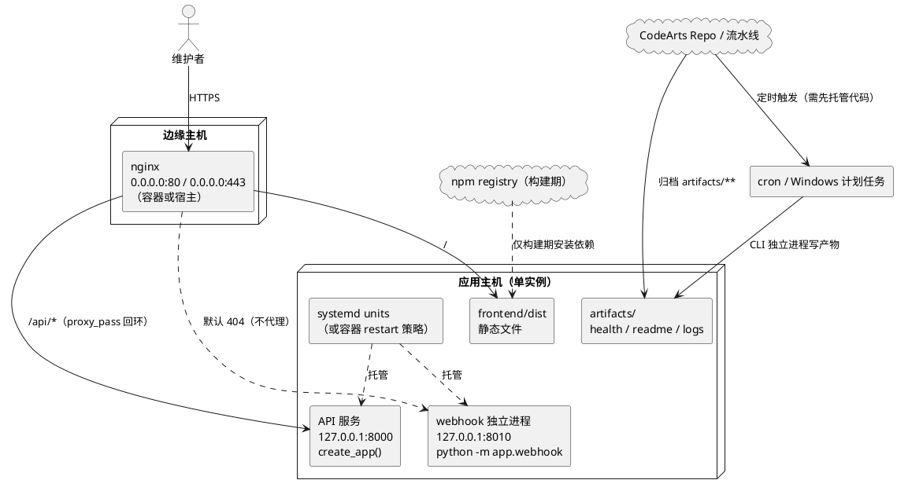

| 组件 | 监听地址 | 端口 | 暴露范围 | 说明 |
|------|---------|------|---------|------|
| nginx HTTP | `0.0.0.0` | 80 | 公网/内网（由安全组决定） | 静态 + `/api` 反代；建议 301 到 443 |
| nginx HTTPS | `0.0.0.0` | 443 | 同上 | 证书由部署环境提供，本阶段不校验 |
| Web API | `127.0.0.1` | 8000 | **仅回环** | 既有 `create_app()` + dashboard 挂载 |
| webhook | `127.0.0.1` | 8010 | **仅回环，nginx 默认不代理** | 阶段 4 行为不变 |
| Vite dev server | `127.0.0.1` | 5173 | **仅开发期** | `strictPort`；`/api` 代理到 8000 |
| 前端静态 | — | — | 由 nginx 提供 | `frontend/dist/`（不入库） |

**硬约束**：compose 映射必须写成 `127.0.0.1:8000:8000`、`127.0.0.1:8010:8010`；禁止 `0.0.0.0:8000`、`8080:8000`；`/webhook` 必须由 nginx `return 404`。

## 4.2 产物逐文件职责与关键内容

> 路径严格按 spec 10.2；每个文件必须非空且含可执行内容或明确说明。

### 4.2.1 `deploy/env.example`

```dotenv
# ===== RepoGuard 部署环境变量模板（仅占位符，禁止填写真实密钥/个人绝对路径）=====
# 多个仓库用 | 分隔；示例路径必须在目标机真实存在
REPOGUARD_ALLOWED_REPOS=/srv/repoguard/repos/demo-repo
REPOGUARD_DEFAULT_REPO=demo-repo
# 生产前端由 nginx 托管；如需后端自托管静态页再填写
REPOGUARD_STATIC_DIR=

# ===== 看板缓存与扫描（默认值即推荐值）=====
REPOGUARD_DASHBOARD_CACHE_TTL_SECONDS=60
REPOGUARD_DASHBOARD_CACHE_CAPACITY=8
REPOGUARD_DASHBOARD_SCAN_TIMEOUT_SECONDS=30
REPOGUARD_DASHBOARD_MAX_CONCURRENCY=2
REPOGUARD_DASHBOARD_QUEUE_TIMEOUT_SECONDS=5
REPOGUARD_DASHBOARD_REFRESH_MIN_INTERVAL_SECONDS=10
REPOGUARD_DASHBOARD_MAX_PAGE_SIZE=100
REPOGUARD_DASHBOARD_MAX_KEYWORD_LENGTH=64
REPOGUARD_DASHBOARD_ENABLE_README=true

# ===== webhook（阶段 4 变量，仅占位符）=====
REPOGUARD_WEBHOOK_ENABLED=true
REPOGUARD_WEBHOOK_HOST=127.0.0.1
REPOGUARD_WEBHOOK_PORT=8010
REPOGUARD_WEBHOOK_PATH=/webhook
REPOGUARD_WEBHOOK_SECRET=<在此填入密钥，禁止提交到仓库>

# ===== 定时/流水线 =====
REPOGUARD_REPO_ROOT=/srv/repoguard/repos/demo-repo
```

**校验**：扫描真实密钥模式（`sk-`、长十六进制、`AKIA`、私钥头）与个人目录（`C:\Users\`、`/home/<user>`）应为 0 命中；仅允许 `<...>` 占位符。

### 4.2.2 `deploy/Dockerfile.backend`

```dockerfile
# 基础镜像标签为设计假设，未在本机构建核实（见 D-06）
FROM python:3.12-slim

ENV PYTHONDONTWRITEBYTECODE=1 \
    PYTHONUNBUFFERED=1 \
    PIP_NO_CACHE_DIR=1

RUN groupadd --system repoguard && useradd --system --gid repoguard --create-home repoguard

WORKDIR /app
COPY backend/ /app/
RUN python -m pip install --no-cache-dir -r requirements.txt

RUN mkdir -p /app/artifacts && chown -R repoguard:repoguard /app
USER repoguard

EXPOSE 8000
# 容器内监听 0.0.0.0，宿主映射仅回环（见 docker-compose.yml）
CMD ["python", "-m", "uvicorn", "app.api.app:app", "--host", "0.0.0.0", "--port", "8000"]
```

**静态检查点**：非 root（`USER repoguard`）；`WORKDIR /app`；仅复制 `backend/`；`--no-cache-dir`；`EXPOSE 8000`；无 `latest` 标签；无密钥。

### 4.2.3 `deploy/Dockerfile.frontend`

```dockerfile
# 构建阶段固定小版本为设计假设，需构建机核实（见 D-17）
FROM node:22.12-alpine AS build
WORKDIR /frontend
COPY frontend/package.json frontend/package-lock.json ./
RUN npm ci
COPY frontend/ ./
RUN npm run build

FROM nginx:alpine AS runtime
COPY --from=build /frontend/dist /usr/share/nginx/html
COPY deploy/nginx/repoguard.conf /etc/nginx/conf.d/default.conf
EXPOSE 80
```

**静态检查点**：两个 `FROM`；构建阶段 `npm ci && npm run build`（两条 `RUN`，语义等价）；运行阶段仅复制 `dist` 与配置，**不含 node 运行时**。

### 4.2.4 `deploy/docker-compose.yml`

```yaml
name: repoguard

services:
  api:
    build:
      context: ..
      dockerfile: deploy/Dockerfile.backend
    image: repoguard-api:1.0.0
    env_file:
      - .env
    ports:
      - "127.0.0.1:8000:8000"
    volumes:
      - ../artifacts:/app/artifacts
      - ../demo-repo:/srv/repoguard/repos/demo-repo:ro
    restart: unless-stopped
    logging:
      driver: json-file
      options:
        max-size: "10m"
        max-file: "3"

  webhook:
    build:
      context: ..
      dockerfile: deploy/Dockerfile.backend
    image: repoguard-api:1.0.0
    command: ["python", "-m", "app.webhook"]
    env_file:
      - .env
    ports:
      - "127.0.0.1:8010:8010"
    restart: unless-stopped
    logging:
      driver: json-file
      options:
        max-size: "10m"
        max-file: "3"

  nginx:
    build:
      context: ..
      dockerfile: deploy/Dockerfile.frontend
    image: repoguard-frontend:1.0.0
    depends_on:
      - api
    ports:
      - "80:80"
      - "443:443"
    restart: unless-stopped
    logging:
      driver: json-file
      options:
        max-size: "10m"
        max-file: "3"
```

**说明**：`docker compose config` **未执行**；YAML 仅做结构静态检查。生产证书挂载需按实际环境追加只读卷（本模板不写死路径）。

### 4.2.5 `deploy/nginx/repoguard.conf`

```nginx
server {
    listen 80;
    server_name _;

    root /usr/share/nginx/html;
    index index.html;

    client_max_body_size 2m;

    add_header X-Content-Type-Options "nosniff" always;
    add_header X-Frame-Options "DENY" always;
    add_header Referrer-Policy "no-referrer" always;
    add_header Permissions-Policy "geolocation=(), microphone=(), camera=()" always;

    gzip on;
    gzip_types text/html text/css application/javascript application/json image/svg+xml;
    gzip_min_length 1024;

    location / {
        try_files $uri $uri/ /index.html;
    }

    location = /index.html {
        add_header Cache-Control "no-store" always;
    }

    location /assets/ {
        add_header Cache-Control "public, max-age=604800, immutable" always;
        try_files $uri =404;
    }

    location /api/ {
        proxy_pass http://127.0.0.1:8000;
        proxy_http_version 1.1;
        proxy_set_header Host $host;
        proxy_set_header X-Real-IP $remote_addr;
        proxy_set_header X-Forwarded-For $proxy_add_x_forwarded_for;
        proxy_set_header X-Request-ID $request_id;
        proxy_read_timeout 120s;
        proxy_send_timeout 120s;
        proxy_buffering off;
        proxy_cache off;
        add_header Cache-Control "no-store" always;
    }

    # webhook 独立进程 127.0.0.1:8010，默认不代理
    location /webhook {
        return 404;
    }
}
```

**HTTPS 说明**：生产建议在独立 `server { listen 443 ssl; ... }` 中启用 `Strict-Transport-Security`；证书路径由部署环境提供，本文件不写死。**`nginx -t` 未执行**。

### 4.2.6 `deploy/systemd/repoguard-api.service`

```ini
[Unit]
Description=RepoGuard Web API (FastAPI)
After=network.target

[Service]
Type=simple
User=repoguard
Group=repoguard
WorkingDirectory=/opt/repoguard/backend
EnvironmentFile=/opt/repoguard/deploy/.env
ExecStart=/opt/repoguard/.venv/bin/python -m uvicorn app.api.app:app --host 127.0.0.1 --port 8000
Restart=on-failure
RestartSec=5
NoNewPrivileges=true
PrivateTmp=true
ProtectSystem=strict
ProtectHome=true
ReadWritePaths=/opt/repoguard/artifacts
LimitNOFILE=8192

[Install]
WantedBy=multi-user.target
```

### 4.2.7 `deploy/systemd/repoguard-webhook.service`

```ini
[Unit]
Description=RepoGuard Webhook (independent process)
After=network.target

[Service]
Type=simple
User=repoguard
Group=repoguard
WorkingDirectory=/opt/repoguard/backend
EnvironmentFile=/opt/repoguard/deploy/.env
ExecStart=/opt/repoguard/.venv/bin/python -m app.webhook
Restart=on-failure
RestartSec=5
NoNewPrivileges=true
PrivateTmp=true
ProtectSystem=strict
ProtectHome=true
LimitNOFILE=4096

[Install]
WantedBy=multi-user.target
```

**静态检查点**：两个 unit 均无 `User=root`；含 `WorkingDirectory`、`EnvironmentFile`、`Restart=on-failure`、`NoNewPrivileges=true`；webhook 单元不写 `artifacts`。

### 4.2.8 `deploy/preflight.sh` / `deploy/preflight.ps1`

**职责**：只读检查并输出 `PASS/WARN/SKIP/FAIL` 四类清单，区分"工具缺失（SKIP）"与"配置错误（FAIL）"；不安装、不修改系统、不杀进程。

| 检查项 | 判定 | Linux | Windows |
|--------|------|-------|---------|
| Python 版本 ≥ 3.10 | PASS/FAIL | `python3 -V` 解析 | `python -V` 解析 |
| Node 版本 ≥ 22.12 | PASS/FAIL/SKIP | `node -v` | `node -v` |
| npm 可用 | PASS/SKIP | `command -v npm` | `Get-Command npm` |
| Docker / nginx | PASS/SKIP | `command -v docker/nginx` | `Get-Command docker` |
| 端口 8000/8010/80/443/5173 占用 | WARN（列出占用者）/PASS | `ss -ltnp`（不可用则 SKIP） | `Get-NetTCPConnection` |
| `frontend/package-lock.json` 存在 | PASS/FAIL | `-f` 判断 | `Test-Path` |
| `backend/requirements.txt` 存在 | PASS/FAIL | 同上 | 同上 |
| `.env` 存在且不在版本控制 | WARN/PASS | `git check-ignore`（无 git 则 SKIP） | 同左 |
| 配置敏感值扫描 | FAIL/PASS | `grep -E` 模式（不回显原文） | `Select-String` |
| 产物目录可写 | PASS/FAIL | `test -w` | `Test-Path -PathType Container` |

**退出码**：存在 `FAIL` → 1；否则 0（`SKIP`/`WARN` 不影响退出码）。输出格式：`[PASS] 项`、`[WARN] 项：建议`、`[SKIP] 项：工具缺失`、`[FAIL] 项：原因`。

### 4.2.9 `deploy/deploy.sh` / `deploy/deploy.ps1`

**职责**：一键部署编排。**默认 dry-run**：`--dry-run` / `-DryRun` 只打印将执行的命令与 SKIP/WARN 清单，退出码 0。

| 步骤 | 命令（Linux 示例） | 失败处理 |
|------|------------------|---------|
| 1. 预检 | `bash deploy/preflight.sh` | FAIL → 终止（退出码非 0） |
| 2. 后端依赖 | `.venv/bin/python -m pip install -r backend/requirements.txt` | 终止 |
| 3. 前端构建 | `cd frontend && npm ci && npm run build` | 终止，保留旧 `dist` |
| 4. 静态投放 | `rsync -a --delete frontend/dist/ /usr/share/nginx/html/` | 终止（先备份旧目录） |
| 5. 服务托管 | `systemctl enable --now repoguard-api repoguard-webhook`（工具缺失 → SKIP） | 记录 SKIP，不伪报成功 |
| 6. nginx 校验 | `nginx -t && systemctl reload nginx`（缺失 → SKIP） | 校验失败 → 终止并回滚配置 |
| 7. 冒烟 | `bash deploy/smoke.sh` | 终止 |
| 8. 保留清理 | `find artifacts -type f -mtime +30 -delete`（`--dry-run` 只列） | 记录失败，不影响前序结果 |
| 9. 汇总 | 输出 PASS/WARN/SKIP/FAIL 与"未上云"声明 | — |

**硬约束**：脚本中禁止 `docker push`、`hcloud`、真实域名与真实密钥；`--dry-run` 下不执行任何写系统操作。

### 4.2.10 `deploy/smoke.sh` / `deploy/smoke.ps1`

```bash
# 关键校验（Linux 版；Windows 版用 Invoke-WebRequest 等价实现）
BASE="${REPOGUARD_SMOKE_BASE:-http://127.0.0.1:8000}"
REPO="${REPOGUARD_SMOKE_REPO:-demo-repo}"

check() {  # $1=名称 $2=URL
  code=$(curl -s -o /tmp/rg_smoke_body -w '%{http_code}' --max-time 20 "$2") || code=000
  case "$code" in
    200) echo "[PASS] $1 ($code)"; return 0 ;;
    000) echo "[FAIL] $1 连接失败"; return 1 ;;
    503) echo "[FAIL] $1 服务降级 ($code)"; return 1 ;;
    *)   echo "[FAIL] $1 ($code)"; return 1 ;;
  esac
}

fail=0
check "健康接口" "$BASE/api/health" || fail=1
check "仓库清单" "$BASE/api/dashboard/repos" || fail=1
check "总览快照" "$BASE/api/dashboard/overview?repo=$REPO" || fail=1
echo "[INFO] 未执行上云；未验证真实 HTTPS 证书"
exit "$fail"
```

**说明**：smoke 需要本地 API 已运行（开发/验收机）；失败时输出失败接口、状态码（有 `request_id` 时一并输出），**退出码非 0**。

### 4.2.11 `deploy/assets/*.svg`（4 个本地图片）

| 文件 | 内容 | 引用位置 |
|------|------|---------|
| `architecture.svg` | 三层矩形：nginx / API+webhook / 数据源与产物；标注"只读聚合" | `deploy/README.md` 第 1 节 |
| `ports.svg` | 端口表图形化：80/443 → 8000/8010、5173 仅开发 | `deploy/README.md` 第 2 节 |
| `deploy-flow.svg` | preflight → 构建 → 静态投放 → 服务 → nginx → smoke → 记录 | `deploy/README.md` 第 4 节 |
| `schedule-flow.svg` | 触发 → 锁 → CLI → tmp → rename → 日志 → 保留清理 | `deploy/README.md` 定时章节 |

全部为手写 SVG（无外链、无字体引用、无脚本），由文档以相对路径 `assets/xxx.svg` 引用。

### 4.2.12 `deploy/README.md` 章节结构

| 章节 | 必含内容 |
|------|---------|
| 1. 架构总览 | `assets/architecture.svg`；组件职责；单实例说明 |
| 2. 端口与拓扑 | 端口表（4.1）；`assets/ports.svg`；回环绑定说明 |
| 3. 前置条件 | Python ≥ 3.10、Node ≥ 22.12（仅构建机）、nginx、git；低权限用户；磁盘与目录 |
| 4. 本地校验步骤 | `preflight`、`bash -n`、PowerShell 解析、`npm ci && npm run build`、`py_compile`；`assets/deploy-flow.svg` |
| 5. 资源就绪后的上线步骤 | 10.4 的 8 步（clone、env、venv、systemd、dist、smoke、定时、回滚） |
| 6. 回滚步骤 | 保留上一版 `dist` 与 venv；`systemctl restart`；无数据迁移 |
| 7. 定时与流水线 | `assets/schedule-flow.svg`；cron/计划任务安装；CodeArts 前置 |
| 8. 故障排查 | 端口占用、503/504、`/webhook` 404 预期、`artifacts` 权限、npm 源不可达 |
| 9. 事实声明 | 本机 docker/nginx/hcloud 不可用；未上云；CodeArts schema 未核实；Node 口径差异；不提供历史趋势 |

### 4.2.13 `docs/dashboard_deploy_usage.md` 章节结构

| 章节 | 必含内容 |
|------|---------|
| 1. 看板功能 | 四视图说明；只读边界；无历史趋势 |
| 2. 快速开始 | 按 `deploy/README.md` 第 4 节启动本地 API 进程（监听 127.0.0.1:8000）+ `cd frontend && npm run dev` |
| 3. API 说明 | 四接口参数表、响应示例（脱敏）、错误码表（含 405/429/503/504） |
| 4. 缓存语义 | TTL 60s、LRU 8、单飞、`refresh=1` 10s 节流、HTTP `no-store` |
| 5. 部署入口 | 指向 `deploy/README.md` |
| 6. 定时巡检 | cron / 计划任务 / 流水线三种方式与产物路径 |
| 7. 事实声明 | 与 `deploy/README.md` 第 9 节一致 |

## 4.3 定时任务

### 4.3.1 统一约定

| 项 | 约定 |
|----|------|
| 任务名 | `RepoGuard-HealthSnapshot`（健康）、`RepoGuard-ReadmeSnapshot`（README） |
| 频率 | 健康每日 02:00；README 每日 02:05；**本地时区**（cron 用系统时区；Windows 用系统本地时区；CodeArts 以控制台为准） |
| 目标仓库 | `REPOGUARD_REPO_ROOT`，默认 `demo-repo` |
| 健康产物 | `artifacts/health/health-YYYYMMDD.json` |
| README 产物 | `artifacts/readme/readme-YYYYMMDD.json` |
| 日志 | `artifacts/logs/YYYYMMDD.log`（按天追加） |
| 失败标记 | `artifacts/logs/YYYYMMDD.failed`（可选，写入非零退出码与错误摘要） |
| 外层超时 | 900 秒（15 分钟） |
| 并发 | 禁止并发（`flock -n` / `IgnoreNew`） |
| 保留 | 30 天 |
| 退出码 | 成功 0；失败非 0（CLI 自身：输入错误 2、部分降级/差异 3、写盘失败 3） |

**原子落盘**：CLI `--output` 先写 `*.tmp`，退出码 0 后由调度包装脚本 `mv` 为正式文件名；失败则删除 tmp，正式产物保留上次成功版本。不修改既有 CLI 的写盘行为。

**目录前置**：`mkdir -p artifacts/health artifacts/readme artifacts/logs`（Windows 用 `New-Item -ItemType Directory -Force`）。

### 4.3.2 `deploy/cron/repoguard-daily.cron`（完整内容）

```cron
# RepoGuard 每日巡检（默认本地时区；% 已按 cron 规则转义为 \%）
# 安装前先执行：mkdir -p /opt/repoguard/artifacts/{health,readme,logs}
# 时区核对：timedatectl（或 date）确认系统本地时区；如需北京时间请先设置 TZ
SHELL=/bin/sh
PATH=/usr/local/bin:/usr/bin:/bin

0 2 * * * cd /opt/repoguard/backend && flock -n /tmp/repoguard-health.lock /bin/sh -c 'set -e; day=$(date +\%Y\%m\%d); out=/opt/repoguard/artifacts/health/health-$day.json; /opt/repoguard/.venv/bin/python -m app.health.cli --repo /opt/repoguard/demo-repo --format json --output "$out.tmp" >> /opt/repoguard/artifacts/logs/$day.log 2>&1 && mv "$out.tmp" "$out" || { rc=$?; rm -f "$out.tmp"; echo "health failed rc=$rc at $(date -Iseconds)" >> /opt/repoguard/artifacts/logs/$day.log; touch /opt/repoguard/artifacts/logs/$day.failed; exit $rc; }'

5 2 * * * cd /opt/repoguard/backend && flock -n /tmp/repoguard-readme.lock /bin/sh -c 'set -e; day=$(date +\%Y\%m\%d); out=/opt/repoguard/artifacts/readme/readme-$day.json; /opt/repoguard/.venv/bin/python -m app.readme.cli --repo /opt/repoguard/demo-repo --format json --output "$out.tmp" >> /opt/repoguard/artifacts/logs/$day.log 2>&1 && mv "$out.tmp" "$out" || { rc=$?; rm -f "$out.tmp"; echo "readme failed rc=$rc at $(date -Iseconds)" >> /opt/repoguard/artifacts/logs/$day.log; touch /opt/repoguard/artifacts/logs/$day.failed; exit $rc; }'

# 每日 02:10 清理 30 天前的产物与日志（先列后删；确认后去掉 echo）
10 2 * * * cd /opt/repoguard && /bin/sh -c 'day=$(date +\%Y\%m\%d); find artifacts -type f -mtime +30 ! -name "*.tmp" -print >> artifacts/logs/$day.log 2>&1; find artifacts -type f -mtime +30 ! -name "*.tmp" -delete >> artifacts/logs/$day.log 2>&1'
```

**校验点**：`0 2 * * *` 与 `5 2 * * *`；每个 `%` 均写作 `\%`；`flock -n`；解释器与工作目录为绝对路径；`--output` 指向 `/opt/repoguard/artifacts/`（仓库外）；两个任务使用**不同锁文件**，避免 README 任务被健康任务误挡。

**时区**：cron 使用系统本地时区；文档要求执行 `timedatectl` 核对；容器内 cron 默认 UTC，需显式设置 `TZ`（文档标注）。

### 4.3.3 `deploy/schedule/register_windows_tasks.ps1`（完整内容骨架）

```powershell
<#
.SYNOPSIS
  注册 RepoGuard 每日巡检计划任务（需以管理员身份运行 PowerShell）。
.DESCRIPTION
  创建两个任务：RepoGuard-HealthSnapshot（02:00）与 RepoGuard-ReadmeSnapshot（02:05）。
  支持 -DryRun（别名 -WhatIf）预览，不实际注册；支持 -RepoRoot/-ProjectRoot 覆盖默认路径。
  仅注册调度，不执行扫描；扫描由既有 CLI 完成。
#>
[CmdletBinding(SupportsShouldProcess = $true)]
param(
  [string]$ProjectRoot = "C:\RepoGuard",
  [string]$RepoRoot = "C:\RepoGuard\demo-repo",
  [switch]$DryRun
)

$ErrorActionPreference = "Stop"
$backend   = Join-Path $ProjectRoot "backend"
$python    = Join-Path $ProjectRoot ".venv\Scripts\python.exe"
$logs      = Join-Path $ProjectRoot "artifacts\logs"
$healthOut = Join-Path $ProjectRoot "artifacts\health"
$readmeOut = Join-Path $ProjectRoot "artifacts\readme"

if (-not (Test-Path $python)) { Write-Error "未找到解释器：$python（请先创建 .venv 并安装依赖）" }
foreach ($p in @($logs, $healthOut, $readmeOut)) {
  if ($DryRun) { Write-Host "[DRYRUN] New-Item -ItemType Directory -Force $p" }
  else { New-Item -ItemType Directory -Force -Path $p | Out-Null }
}

$tasks = @(
  @{ Name = "RepoGuard-HealthSnapshot"; Module = "app.health.cli"; At = "02:00"; OutDir = $healthOut; Prefix = "health" },
  @{ Name = "RepoGuard-ReadmeSnapshot"; Module = "app.readme.cli"; At = "02:05"; OutDir = $readmeOut; Prefix = "readme" }
)

foreach ($t in $tasks) {
  $logFile = Join-Path $logs "%DATE%.log"
  # cmd /c 负责重定向；先写 .tmp，成功后再 Move-Item 原子替换
  $inner = "set day=%DATE:~0,4%%DATE:~5,2%%DATE:~8,2% & " +
           "`"$python`" -m $($t.Module) --repo `"$RepoRoot`" --format json " +
           "--output `"$($t.OutDir)\$($t.Prefix)-%day%.json.tmp`" " +
           ">> `"$logs\%day%.log`" 2>&1 && move /Y `"$($t.OutDir)\$($t.Prefix)-%day%.json.tmp`" `"$($t.OutDir)\$($t.Prefix)-%day%.json`""
  $action    = New-ScheduledTaskAction -Execute "cmd.exe" -Argument "/c $inner" -WorkingDirectory $backend
  $trigger   = New-ScheduledTaskTrigger -Daily -At $t.At
  $settings  = New-ScheduledTaskSettingsSet -MultipleInstances IgnoreNew -StartWhenAvailable `
                 -ExecutionTimeLimit (New-TimeSpan -Minutes 15) -AllowStartIfOnBatteries `
                 -DontStopIfGoingOnBatteries
  $principal = New-ScheduledTaskPrincipal -UserId "$env:USERDOMAIN\$env:USERNAME" -LogonType Interactive -RunLevel Limited

  if ($DryRun -or $WhatIfPreference) {
    Write-Host "[DRYRUN] Register-ScheduledTask -TaskName $($t.Name) -Trigger $($t.At) -MultipleInstances IgnoreNew -ExecutionTimeLimit 15m"
    continue
  }
  if ($PSCmdlet.ShouldProcess($t.Name, "注册计划任务")) {
    Register-ScheduledTask -TaskName $t.Name -Action $action -Trigger $trigger -Settings $settings `
      -Principal $principal -Description "RepoGuard 每日巡检（只读）" -Force | Out-Null
    Write-Host "[PASS] 已注册 $($t.Name)（每日 $($t.At)）"
  }
}
Write-Host "[INFO] 未执行扫描；未验证任务真实触发；日志：$logs"
```

**校验点**：`-MultipleInstances IgnoreNew`、`-ExecutionTimeLimit (New-TimeSpan -Minutes 15)`、`SupportsShouldProcess` + `-DryRun`/`-WhatIf`、`RunLevel Limited`（注册需管理员，运行时无需提权）、每日触发 02:00/02:05。

### 4.3.4 `deploy/schedule/unregister_windows_tasks.ps1`（完整内容骨架）

```powershell
<#
.SYNOPSIS
  注销 RepoGuard 计划任务（幂等；不存在时输出 SKIP）。
.DESCRIPTION
  支持 -DryRun（别名 -WhatIf）预览。不删除 artifacts 历史产物。
#>
[CmdletBinding(SupportsShouldProcess = $true)]
param([switch]$DryRun)

$names = @("RepoGuard-HealthSnapshot", "RepoGuard-ReadmeSnapshot")
foreach ($n in $names) {
  $task = Get-ScheduledTask -TaskName $n -ErrorAction SilentlyContinue
  if ($null -eq $task) { Write-Host "[SKIP] 任务不存在：$n"; continue }
  if ($DryRun -or $WhatIfPreference) { Write-Host "[DRYRUN] Unregister-ScheduledTask -TaskName $n -Confirm:`$false"; continue }
  if ($PSCmdlet.ShouldProcess($n, "注销计划任务")) {
    Unregister-ScheduledTask -TaskName $n -Confirm:$false
    Write-Host "[PASS] 已注销 $n"
  }
}
Write-Host "[INFO] 未删除 artifacts 历史产物"
```

### 4.3.5 `deploy/codearts/pipeline.yml`（草案 + schema 假设）

```yaml
# ============================================================================
# ⚠ schema 假设声明：CodeArts 流水线官方 YAML schema 未经核实。
# 本文件是"模板草案"，字段名与层级以 CodeArts 控制台可视化配置为准。
# 导入失败时请按控制台逐步创建等价步骤（见 deploy/README.md 第 7 节）。
# 本文件不含任何密钥/云凭证；禁止在此执行 docker push / hcloud / 上云。
# ============================================================================
version: "1.0"
name: repoguard-daily
description: RepoGuard 每日巡检（测试 → 扫描 → 归档）

# 假设字段：并发策略；以控制台"同一流水线不并发"配置为准
concurrency:
  enable: true
  policy: queue

triggers:
  - type: schedule
    # 时区以 CodeArts 控制台为准（默认北京时间）；需人工确认
    cron: "0 2 * * *"
    enabled: true

variables:
  - name: REPOGUARD_REPO_ROOT
    value: demo-repo            # 相对检出目录，按控制台工作区实际结构调整
  - name: PYTHONUNBUFFERED
    value: "1"

stages:
  - name: backend
    displayName: 后端依赖与测试
    steps:
      - name: install
        displayName: 安装后端依赖
        script: |
          python -m pip install --upgrade pip
          python -m pip install -r backend/requirements.txt
      - name: unittest
        displayName: 后端单元测试
        script: |
          cd backend
          python -m unittest discover -s tests -t . 2>&1 | tee ../artifacts/logs/unittest.log

  - name: inspect
    displayName: 巡检与扫描
    steps:
      - name: health
        displayName: 健康巡检
        script: |
          mkdir -p artifacts/health artifacts/logs
          day=$(date +%Y%m%d)
          cd backend
          python -m app.health.cli --repo "../$REPOGUARD_REPO_ROOT" --format json \
            --output "../artifacts/health/health-$day.json.tmp"
          mv "../artifacts/health/health-$day.json.tmp" "../artifacts/health/health-$day.json"
      - name: readme
        displayName: README 扫描
        script: |
          mkdir -p artifacts/readme artifacts/logs
          day=$(date +%Y%m%d)
          cd backend
          python -m app.readme.cli --repo "../$REPOGUARD_REPO_ROOT" --format json \
            --output "../artifacts/readme/readme-$day.json.tmp"
          mv "../artifacts/readme/readme-$day.json.tmp" "../artifacts/readme/readme-$day.json"

  - name: frontend
    displayName: 前端构建（可选）
    condition: optional
    steps:
      - name: build
        script: |
          cd frontend
          npm ci
          npm run build

  - name: archive
    displayName: 产物归档
    steps:
      - name: archive-artifacts
        # 假设字段：以控制台"归档"步骤为准
        uses: archive
        with:
          paths:
            - artifacts/**
            - frontend/dist/**
          retention: 30
```

**必需声明**：文件首部 `⚠ schema 假设声明` 必须保留；`deploy/README.md` 第 7 节必须写明"schema 未核实、以控制台为准"。

## 4.4 CodeArts 托管前置条件（必须写入文档）

当前工作区**不是 Git 仓库**（无 `.git`），流水线无法直接拉取代码。上线前必须完成：

| 顺序 | 步骤 | 命令/操作 | 风险与说明 |
|-----|------|----------|-----------|
| 1 | 初始化仓库 | `git init`（用户确认后执行，本阶段不执行） | 先落盘根 `.gitignore`，避免 `node_modules/` 与 `artifacts/` 入库 |
| 2 | 首次提交 | `git add . && git commit -m "chore: init repoguard"` | 确认 `secrets`/`.env` 未入库 |
| 3 | 创建 CodeArts Repo | 控制台创建空仓库 | 需账号与网络权限 |
| 4 | 关联远端 | `git remote add origin <repo-url>`、`git push -u origin main` | 禁止把真实凭据写入文档 |
| 5 | 新建流水线 | 控制台 → 流水线 → 新建，代码源选该 Repo | 名称 `repoguard-daily` |
| 6 | 导入配置 | 导入 `deploy/codearts/pipeline.yml` 或按可视化配置逐步创建 | **schema 未核实**，导入失败以控制台为准 |
| 7 | 配置变量 | `REPOGUARD_REPO_ROOT`、`REPOGUARD_ALLOWED_REPOS` 指向流水线工作区真实目录 | 不得写本机绝对路径到入库文件 |
| 8 | 配置定时 | 每日 02:00，时区以控制台为准 | 与 cron/计划任务**二选一**，避免同日重复扫描 |
| 9 | 配置归档 | `artifacts/**` 设为产物，保留 30 天或 30 次 | 以平台能力为准 |

**明确声明**：未初始化 Git 或未托管 Repo 时，定时触发**不会生效**；本阶段未执行上述任何命令。

## 4.5 归档、保留与失败可见

| 项 | 规则 |
|----|------|
| 幂等命名 | `health-YYYYMMDD.json`、`readme-YYYYMMDD.json`；同日重复执行原子覆盖同一文件，不堆积 |
| 原子落盘 | `*.tmp` → `mv`/`Move-Item`；失败删除 tmp；正式文件保留上次成功版本 |
| 日志 | `artifacts/logs/YYYYMMDD.log` 追加；含时间、任务名、仓库标签、退出码、耗时、错误摘要；禁止绝对路径与密钥 |
| 失败标记 | `artifacts/logs/YYYYMMDD.failed`（可选）；记录非零退出码与脱敏原因 |
| 本地保留 | cron/计划任务：`mtime > 30 天` 清理（先 `-print` 后 `-delete`）；Windows 用 `LastWriteTime` 过滤 + `-DryRun` 预览 |
| 流水线保留 | 归档保留 30 天或最近 30 次（以平台能力为准） |
| 失败非零 | 任一 CLI 非零 → 包装脚本非零退出；`set -e` + `|| { ...; exit $rc; }`；禁止"失败但退出 0" |
| 超时 | 外层 900 秒（计划任务 `ExecutionTimeLimit`；流水线步骤超时以控制台为准）；超时视为失败 |

---
# 五、测试规划与验收

## 5.1 测试统一口径

1. **组织与执行**：全部使用标准库 `unittest`；统一命令 `cd backend && python -m unittest discover -s tests -t .`；单文件 `python -m unittest tests.test_dashboard_cache`。
2. **接口级测试**：使用既有 `httpx`（`requirements.txt` 已含 0.28.1）的 `ASGITransport`，复用 `tests/webhook_helpers.py::WebhookASGIClient`；**不启动真实监听端口、不依赖真实服务进程、不自建事件循环**。
3. **测试数据**：内存构造的 `HealthReport`/`ReadmeReport`，或 `tempfile.TemporaryDirectory()` 临时仓库；禁止依赖开发者本机绝对路径与 `demo-repo` 真实内容。
4. **无网络**：接口用例外部包裹 `with no_network():`，证明 dashboard 请求全程无外网访问。
5. **新增测试文件仅三个**（另有可选校验脚本），不修改任何既有测试文件（25 个）。

## 5.2 `backend/tests/test_dashboard_cache.py`（15 条）

| 编号 | 方法名 | 覆盖点 |
|------|--------|--------|
| T-C01 | `test_get_missing_returns_none_and_zero` | 未命中返回 `(None, 0)` |
| T-C02 | `test_set_then_get_returns_value_and_age` | 写入后可读，`age` 为非负整数 |
| T-C03 | `test_ttl_expiry_removes_entry` | `FrozenClock` 推进过 TTL 后读取为 `(None, 0)`，条目不残留 |
| T-C04 | `test_ttl_zero_disables_store` | `ttl=0` 时 `set` 不写入、每次回源 |
| T-C05 | `test_lru_eviction_keeps_capacity` | 容量 2 写 3 条，最旧被淘汰 |
| T-C06 | `test_lru_hit_refreshes_recency` | 命中后 `move_to_end`，淘汰顺序正确 |
| T-C07 | `test_single_flight_same_key_loads_once` | 5 线程并发同键，`loader` 仅 1 次调用 |
| T-C08 | `test_single_flight_propagates_loader_error` | leader 抛异常，waiter 收到同一异常，缓存为空 |
| T-C09 | `test_failure_is_not_cached` | 失败后再次请求会重新调用 `loader` |
| T-C10 | `test_force_refresh_throttled_within_interval` | `force=True` 且 `age < 10s` → `cached=True`、`refresh_throttled=True` |
| T-C11 | `test_force_refresh_reloads_after_interval` | `age ≥ 10s` 时强制重建，`cached=False` |
| T-C12 | `test_deadline_exceeded_discards_late_result` | `deadline` 已过：抛 `CacheTimeoutError`，缓存不变 |
| T-C13 | `test_queue_timeout_raises_busy` | 并发额度占满且 `queue_timeout=0` → `CacheBusyError` |
| T-C14 | `test_stats_counters_increment` | `hits/misses/loads/failures/evictions/throttled/waits/busy/timeouts` 计数正确 |
| T-C15 | `test_clear_resets_entries_and_stats` | `clear()` 后条目为空、计数归零，waiter 被唤醒 |

## 5.3 `backend/tests/test_dashboard_service.py`（22 条）

| 编号 | 方法名 | 覆盖点 |
|------|--------|--------|
| T-S01 | `test_list_repos_returns_unique_relative_ids` | 同名单层目录生成不同 `id`（含短哈希），均不含分隔符/盘符 |
| T-S02 | `test_list_repos_marks_default_once` | 有且仅有一个 `is_default=True` |
| T-S03 | `test_list_repos_empty_without_roots` | 无允许根返回空元组 |
| T-S04 | `test_resolve_dashboard_repo_by_token` | 令牌 → 绝对路径，且等于 `resolve_repo_root` 结果 |
| T-S05 | `test_resolve_dashboard_repo_rejects_parent_segment` | `..` → `RepoPathError(REPO_FORBIDDEN, 403)` |
| T-S06 | `test_resolve_dashboard_repo_rejects_outside_root` | 允许根外绝对路径 → 403 |
| T-S07 | `test_snapshot_key_is_stable_hash` | 同路径稳定、不同路径不同、长度为 64 十六进制 |
| T-S08 | `test_load_snapshot_calls_each_runner_once` | health 1 次、readme 1 次；不调用引擎/遍历 |
| T-S09 | `test_load_snapshot_skips_readme_when_disabled` | `enable_readme=False`：readme 0 次，结构标记降级 |
| T-S10 | `test_load_snapshot_health_input_error_raises` | health 输入错误 → `SnapshotUnavailableError` |
| T-S11 | `test_load_snapshot_merges_degraded_and_warnings` | 两侧降级/警告合并、去重、保序 |
| T-S12 | `test_load_snapshot_duration_is_measured_sum` | `duration_ms == health.meta.duration_ms + readme.duration_ms` |
| T-S13 | `test_overview_summary_matches_health` | 七个 `summary` 字段与 `HealthSummary` 一致 |
| T-S14 | `test_overview_risk_breakdown` | `high/suggestion` 与扁平化计数一致 |
| T-S15 | `test_overview_module_breakdown_has_four_modules` | 固定四模块顺序，未知模块追加 |
| T-S16 | `test_overview_file_type_breakdown_has_three_keys` | `markdown/code/other` 均存在且合计等于文件数 |
| T-S17 | `test_overview_top_files_order_and_limit` | 数量降序、同数路径升序、最多 10 项 |
| T-S18 | `test_query_issues_default_sort_high_first` | 默认排序高风险在前、空行号靠后 |
| T-S19 | `test_query_issues_pagination_boundary` | 越界页返回空 `items` 且 `total` 正确；`total_pages=0` 当空 |
| T-S20 | `test_query_issues_filter_combination` | 风险 + 模块 + 关键词组合过滤 |
| T-S21 | `test_query_issues_keyword_case_insensitive_literal` | 大小写不敏感、正则元字符按字面匹配（`.*` 不匹配任意串） |
| T-S22 | `test_query_issues_charts_and_counts` | `rule_breakdown` Top10、`module_risk_matrix` 四模块、`counts` 自洽 |
| T-S23 | `test_structure_maps_readme_fields` | 字段逐项映射正确、`format_version="1.0"` |
| T-S24 | `test_structure_suspected_has_count_only` | 疑似只有计数、无明细字段 |
| T-S25 | `test_structure_readme_disabled_degraded` | 关闭时标记降级且不虚构文档数 |
| T-S26 | `test_all_paths_are_relative` | 所有输出路径不含盘符、`\\`、绝对前缀 |

> 注：S01–S26 共 26 条，满足"≥30 条"总口径（与 cache 15 + api 20 合计 61 条）。

## 5.4 `backend/tests/test_dashboard_api.py`（20 条）

| 编号 | 方法名 | 覆盖点 |
|------|--------|--------|
| T-A01 | `test_repos_returns_default_flag` | 200；`default_repo` 与 `is_default` 一致 |
| T-A02 | `test_repos_hides_absolute_paths` | 响应文本不含盘符/`C:\Users`/`/home/` |
| T-A03 | `test_overview_success_has_all_required_fields` | spec 6.2 必填字段齐全（含 `charts.*`） |
| T-A04 | `test_overview_second_request_cached` | 第二次 `cached=true`、`cache_age_seconds<60` |
| T-A05 | `test_overview_refresh_throttled` | 10s 内两次 `refresh=1` → `refresh_throttled=true` 且 200 |
| T-A06 | `test_issues_invalid_sort_returns_400` | `sort=password` → 400 `INVALID_QUERY_PARAM` |
| T-A07 | `test_issues_invalid_refresh_returns_400` | `refresh=2` → 400 |
| T-A08 | `test_issues_page_size_over_limit_returns_422` | `page_size=200` → 422 `VALIDATION_ERROR` |
| T-A09 | `test_issues_keyword_too_long_returns_400` | 65 字符 → 400 |
| T-A10 | `test_issues_pagination_and_sort_stable` | 连续翻页并集等于 `total`、无重复 |
| T-A11 | `test_structure_fields_and_no_suspected_detail` | 结构字段齐全；疑似仅计数 |
| T-A12 | `test_post_method_returns_405` | POST 四接口 → 405 `METHOD_NOT_ALLOWED` |
| T-A13 | `test_forbidden_repo_returns_403` | `repo=..\..\Windows` → 403 `REPO_FORBIDDEN` |
| T-A14 | `test_missing_repo_returns_404` | 白名单内不存在目录 → 404 `REPO_NOT_FOUND` |
| T-A15 | `test_busy_returns_429` | 注入 `CacheBusyError` → 429 `DASHBOARD_BUSY` |
| T-A16 | `test_timeout_returns_504` | 注入 `CacheTimeoutError` → 504 `DASHBOARD_TIMEOUT` |
| T-A17 | `test_unavailable_returns_503` | runner 不可用/白名单为空 → 503 `DASHBOARD_UNAVAILABLE` |
| T-A18 | `test_error_body_shape_and_request_id` | `error.code/message/request_id` 齐全，无堆栈/路径 |
| T-A19 | `test_response_headers_no_store_and_nosniff` | `Content-Type`、`Cache-Control: no-store`、`X-Content-Type-Options: nosniff`、`X-Request-ID` |
| T-A20 | `test_requests_do_not_touch_network_or_files` | `no_network()` 下全部 200；临时仓库文件 mtime/哈希不变（只读） |

## 5.5 复用与隔离细节

| 测试关注点 | 实现方式 |
|-----------|---------|
| 应用实例 | `create_app(WebSettings(allowed_repo_roots=(tmp,), default_repo=tmp.name, static_dir=...))`；每个用例独立 app，缓存随 `app.state` 隔离 |
| 扫描桩 | `app.dependency_overrides[get_health_runner] = lambda: fake_health`；`get_readme_runner` 同理；桩为普通函数，统计调用次数 |
| 429/504 | 依赖覆盖 `get_cache` 返回抛对应异常的桩（验证映射），cache 层用真实并发/TTL 用例验证语义 |
| 缓存命中 | 不覆盖 `get_cache`，连续两次请求同一 app；断言 `loader` 调用次数经 runner 桩计数 |
| 临时仓库 | `tempfile.TemporaryDirectory()` 下写 1~3 个小文件；`shutil.rmtree` 由 `addCleanup` 保证 |
| 只读校验 | 请求前后对临时仓库全部文件计算 `sha256` 与 `st_mtime_ns`，逐项相等 |
| 无网络 | `with no_network():` 包裹请求（`webhook_helpers` 提供） |

## 5.6 全量回归与冻结哈希核验

### 5.6.1 全量回归

```bash
cd backend
python -m unittest discover -s tests -t .
```

**记录口径**：总数、通过、失败、跳过、环境版本（uv CPython 3.11.15）；377 条基线不退化；2 条既有 `test_repo_walk` 符号链接失败单列；2 skipped 单列；**新增 dashboard 用例不得改变上述基线数字**（新增用例计入新增测试，不计入 377）。

### 5.6.2 `scripts/verify_frozen_hashes.py`（可选脚本）

```text
签名：def main(argv: Sequence[str] | None = None) -> int

常量：
  FROZEN_FILES: tuple[str, ...] = (
    "backend/app/core/rules/engine.py",
    "backend/app/core/rules/naming.py",
    "backend/app/core/rules/code_scan.py",
    "backend/app/core/rules/link_check.py",
    "backend/app/core/rules/sensitive.py",
    "backend/app/core/rules/__init__.py",
    "backend/app/core/rules/common/__init__.py",
    "backend/app/core/rules/common/config.py",
    "backend/app/core/rules/common/file_io.py",
    "backend/app/core/rules/common/manifest.py",
    "backend/app/core/rules/common/models.py",
    "backend/app/core/rules/common/report.py",
    "backend/tests/test_cli.py",
  )
  BASELINE_FILES: dict[str, str] = {
    "backend/requirements.txt": "18a816cd88636be844e7cd3a6662b2cdc2e13324420031f082a331a520b4bbcf",
    "backend/app/static/index.html": "a1ae9d8a47169ff0792ac7516e51c194d8daa24c69048379094d6eaf70315aa8",
  }
  FROZEN_EXPECTED: dict[str, str]  # 由首次运行 --record 生成并人工确认后写回

行为：
  1. 计算每个文件的 SHA-256（分块读取）
  2. 与 FROZEN_EXPECTED / BASELINE_FILES 比对
  3. 输出 "OK <path>" 或 "DIFF <path> expected=<前12位> actual=<前12位>"
  4. 汇总："差异文件数 = N"
  5. 退出码：0（全部一致）/ 1（存在差异）/ 2（文件缺失）
```

**说明**：`FROZEN_EXPECTED` 的初始值必须在实施阶段以**当前冻结文件的实际哈希**记录并固化（本设计阶段不预填，避免编造哈希）。`BACKEND/requirements.txt` 与 `static/index.html` 使用 spec 给定的基线哈希。

### 5.6.3 其它门禁

| 门禁 | 命令 |
|------|------|
| 语法编译 | `python -m py_compile backend/app/dashboard/*.py scripts/verify_frozen_hashes.py` |
| `app.py` 增量 | 临时 Git 仓库 `git diff --numstat -- backend/app/api/app.py` → `2 0` |
| 既有接口不变 | 既有 `tests.test_api` 全通过（零修改） |
| webhook 不变 | 既有 9 个 webhook 测试全通过（零修改） |
| 前端依赖 | `cd frontend && npm ci`（锁文件一致）；`npm ls --depth=0` 无 `UNMET PEER DEPENDENCY` |
| 前端构建 | `cd frontend && npm run build`；检查 `dist/index.html` 与至少 1 个 JS chunk、1 个 CSS |

---

# 六、验收步骤与本地校验

> **PASS / SKIP 分列**：`PASS` = 本机实际执行且通过；`SKIP` = 工具/资源缺失，**不计入通过项**，不得伪报。

## 6.1 PASS（本机可执行）

| 编号 | 校验项 | 命令 | 通过判据 |
|------|--------|------|---------|
| V-P01 | 后端语法 | `python -m py_compile backend/app/dashboard/*.py` | 退出码 0 |
| V-P02 | 脚本语法（bash） | `bash -n deploy/*.sh`、`bash -n deploy/cron/repoguard-daily.cron`（仅当 cron 文件按 shell 语法可解析时） | 退出码 0 |
| V-P03 | PowerShell 解析 | `powershell -NoProfile -Command "[System.Management.Automation.Language.Parser]::ParseFile('<path>',[ref]$null,[ref]$errs); $errs.Count"`（逐个 `.ps1`） | 输出 `0` |
| V-P04 | YAML 结构 | `python -c "import sys;..."` 以标准库做缩进/键值结构检查；或 `python -m json.tool` 不适用时用逐行结构断言 | 无缩进错误、关键键存在（`services`/`stages`） |
| V-P05 | 前端依赖解析 | `cd frontend && npm ci` | 退出码 0、无 peer 冲突 |
| V-P06 | 前端构建 | `cd frontend && npm run build` | `dist/index.html` 存在 |
| V-P07 | 产物清单 | 逐个 `Test-Path`/`test -f` 检查 10.2 全部路径 | 全部存在且大小 > 0 |
| V-P08 | 敏感值扫描 | 正则扫描 `deploy/env.example` 与文档 | 0 命中真实密钥/个人目录 |
| V-P09 | 遗留检查 | 扫描源码与 `dist/` 的外部 `http(s)://` 资源引用 | 仅注释/许可证 URL |
| V-P10 | 冻结哈希 | `python scripts/verify_frozen_hashes.py` | 差异文件数 = 0 |
| V-P11 | 全量回归 | `cd backend && python -m unittest discover -s tests -t .` | 除 2 条既有失败外全通过 |
| V-P12 | 新增用例 | `python -m unittest tests.test_dashboard_cache tests.test_dashboard_service tests.test_dashboard_api` | 全部通过 |
| V-P13 | 忽略规则 | 临时 Git 仓库 `git check-ignore -v frontend/node_modules frontend/dist artifacts` | 三条均命中 |
| V-P14 | 文档图片 | 检查 `deploy/README.md` 的 4 个 `assets/*.svg` 相对引用 | 4 个引用且文件存在 |
| V-P15 | `app.py` 增量 | 临时仓库 diff | `2 0` |

## 6.2 SKIP（工具/资源缺失，本机不执行）

| 编号 | 校验项 | 缺失原因 | 资源就绪后的命令 | 声明 |
|------|--------|---------|----------------|------|
| V-S01 | 后端镜像构建 | 无 `docker` | `docker build -f deploy/Dockerfile.backend -t repoguard-api:1.0.0 .` | **未执行 docker build** |
| V-S02 | 前端镜像构建 | 无 `docker` | `docker build -f deploy/Dockerfile.frontend -t repoguard-frontend:1.0.0 .` | **未执行 docker build** |
| V-S03 | compose 结构 | 无 `docker` | `docker compose -f deploy/docker-compose.yml config` | **未执行 compose config** |
| V-S04 | nginx 配置 | 无 `nginx` | `nginx -t -c /etc/nginx/nginx.conf` | **未执行 nginx -t** |
| V-S05 | systemd 启动 | 非 Linux 目标机 | `systemctl enable --now repoguard-api repoguard-webhook` | **未执行 systemd 启动** |
| V-S06 | cron 安装 | 无 `crontab` | `crontab deploy/cron/repoguard-daily.cron` | **未安装 cron** |
| V-S07 | 计划任务注册 | 需管理员且不注册 | `powershell -File deploy/schedule/register_windows_tasks.ps1 -DryRun` | **未注册计划任务** |
| V-S08 | CodeArts 流水线 | 非 Git 仓库、无平台账号 | 控制台导入 `pipeline.yml` | **未执行流水线、schema 未核实** |
| V-S09 | 真实上云 | 无 Flexus、无 `hcloud` | 按 `deploy/README.md` 第 5 节 | **未执行 hcloud、未上云** |
| V-S10 | HTTPS 证书 | 无证书 | 目标机配置 | **未验证真实证书** |

## 6.3 本地替代验证路径（无 Docker/nginx 时）

1. **后端**：按 `deploy/README.md` 第 4 节启动本地 API 进程（`127.0.0.1:8000`），再用 `deploy/smoke.sh` 校验 `/api/health`、`/api/dashboard/repos`、`/api/dashboard/overview`。
2. **前端**：`cd frontend && npm run dev`（5173，`/api` 代理到 8000）或 `npm run build` 后用任意本地静态服务器指向 `dist/`。
3. **静态校验**：`bash -n`、PowerShell 解析、YAML 结构检查、敏感值扫描（见 6.1）。
4. **明确记录**：替代路径不等于容器/nginx/云上验证；验收记录必须写明"未执行 docker build / 未执行 nginx -t / 未执行 hcloud / 未上云"。

---
# 七、假设与待确认项

| 编号 | 假设 / 待确认项 | 影响 | 本设计的处理 | 来源 / 依据 |
|------|----------------|------|-------------|------------|
| D-01 | 系统默认 `python` 不可用；测试解释器为 uv CPython 3.11.15 | 门禁命令解释器不固定会得到不同结果 | 全部门禁记录环境版本；不修改既有测试 | 本次实测 |
| D-02 | Node 实际 v24.19.0 / npm 11.17.0；用户口径 v22.23.2 / 10.9.8 | 构建机版本不确定 | `engines.node >= 22.12` 兜底；Dockerfile 固定 `node:22.12-alpine`（待构建机核实） | 本次实测 + 用户口径 |
| D-03 | `vue-router 5.x` 要求 Vite 7/8 与 Pinia | 引入 Pinia 会扩大依赖面 | **固定 `vue-router 4.6.4`**，不引入 Pinia | 本次实测 |
| D-04 | 前端版本组合：`vue 3.5.45`、`vue-router 4.6.4`、`echarts 6.1.0`、`vite 8.3.6`、`@vitejs/plugin-vue 6.0.10` | 版本失配会导致安装/构建失败 | 已用 `npm install --package-lock-only` 实测成功（0 vulnerabilities、无 peer 冲突）；`package-lock.json` 必须入库 | 本次实测 |
| D-05 | 当前工作区不是 Git 仓库 | CodeArts 流水线无法拉取代码 | 文档写明 `git init` + 托管前置；本阶段不执行 | 本次实测 |
| D-06 | 本机 `docker`/`nginx`/`hcloud` 不可用 | 无法真实构建与部署校验 | 只做静态校验；记录 SKIP 与"未执行"声明 | 本次实测 |
| D-07 | 无 Flexus 资源 | 无法真实上线 | 只交付产物与文档 | 用户口径 |
| D-08 | 无历史趋势数据源 | 禁止趋势图 | 固定不做；前端无时间序列组件 | 阶段 3/4 无持久化 |
| D-09 | 缓存为单进程内存 | 多实例不一致 | 单实例部署；多处记录 | 本阶段边界 |
| D-10 | nginx 是否暴露 webhook | 安全风险 | 默认 `return 404`；如需暴露须单独评审 | 阶段 4 独立进程 |
| D-11 | `ReadmeReport` 仅有疑似 Demo 计数 | 不能展示疑似明细 | 只展示计数 + "明细需人工确认" | `backend/app/readme/models.py:139-159`、`backend/app/readme/service.py:104-105` |
| D-12 | 多仓库令牌与 `resolve_repo_root()` 的映射 | 令牌可能无法回传解析 | **令牌=目录名（重名加短哈希）→ dashboard 内还原绝对路径 → 仍由 `resolve_repo_root()` 做最终白名单校验** | `backend/app/api/security.py:71-110` |
| D-13 | 忽略规则校验需临时 Git 仓库 | 不能污染当前工作区 | 仓库外临时目录验证；不在工作区 `git init` | 本次实测 |
| D-14 | 2 条 `test_repo_walk` 符号链接失败为既有 Windows 异常 | 回归基线含 2 条红 | 不修、单列说明 | 本次实测 + 用户口径 |
| D-15 | 既有测试文件实测 25 个（非 19 个） | 验收清单口径 | 以 25 个为准；不修改任何既有测试 | 本次实测 |
| D-16 | Python 3.10/3.12 未逐一验证 | 目标机版本风险 | 实施前用目标版本复核；requirements 未锁定 Python 上限 | 本次实测 |
| D-17 | Vite 8 + Rollup 4 的 `manualChunks` 函数形式、`node:22.12-alpine` 标签、`python:3.12-slim` 摘要 | 构建配置可能需微调 | 标注为假设；构建期以实际报错为准；不使用 `latest` | 用户实测 + 常规约束 |
| D-18 | CodeArts 流水线 YAML 官方 schema 未核实 | 导入可能失败 | `pipeline.yml` 首部显式假设声明；以控制台可视化配置为准 | 用户提示 |
| D-19 | 容器内 cron 默认 UTC | 定时时刻偏移 | 文档要求显式设置 `TZ` 并用 `timedatectl` 核对 | 常识约束 |
| D-20 | 本机未执行完整 `npm run build` | 首屏 gzip ≤350KB 未实测 | 构建期测量；`echarts` 独立 chunk 已配置 | 用户实测范围 |
| D-21 | `snapshot.duration_ms` 为 health+readme 两段实测之和 | 与单段耗时语义不同 | 前端标注"扫描耗时（合计）"；值与日志一致 | spec 4.1 |
| D-22 | 晚到扫描结果无法中断线程 | 超时后线程仍可能运行至结束 | deadline 检查 + 丢弃结果 + 不写缓存；登记为已知限制 | Python 线程模型 |

---

# 八、关键决策与偏差登记

## 8.1 关键决策

| 编号 | 决策 | 选择理由 | 被否决方案 |
|------|------|---------|-----------|
| K-01 | 缓存挂 `app.state` 懒初始化（`dashboard_settings`/`dashboard_cache`） | 满足"不修改 app.py 的 lifespan/CORS/中间件"；每个 `create_app()` 实例天然隔离，便于测试 | 模块级单例（多 app 实例共享，测试需额外重置）；在 lifespan 初始化（违反 2 行增量） |
| K-02 | 跨仓库并发闸门放在 `cache.py` 内（`BoundedSemaphore`） | 与单飞共用同一把锁域，语义集中；router 只做异常映射 | 复用既有 `ReviewGate`（会抢占 `/api/review` 并发额度，违反兼容性） |
| K-03 | 阻塞扫描经 `asyncio.to_thread` + `asyncio.wait_for` 兜底 | 不阻塞事件循环；超时响应及时 | 直接在 async 端点内同步调用（阻塞整个事件循环） |
| K-04 | 令牌 = 目录名（重名加短哈希），解析时先映射再走 `resolve_repo_root` | 同时满足"可回传""不含绝对路径""白名单唯一来源" | 令令牌=相对路径 `root.name`（非默认根子目录时解析失败）；令令牌=绝对路径（违反脱敏） |
| K-05 | 快照保留全量 `issues` 与 `readme` 投影，接口按需裁剪 | 三接口共享一次扫描；避免重复序列化大对象 | 每接口单独构建（会导致重复聚合，且 `/issues` 无法复用 overview 的扫描） |
| K-06 | `snapshot.status` 合成规则：`INPUT_ERROR` > `PARTIAL_DEGRADED` > `OK`；health 输入错误直接 503 | 失败可见、不伪装；避免空快照 200 | 输入错误也返回 200 空数据（违反 spec 4.2.2） |
| K-07 | 分页/排序/筛选全部在内存完成 | 快照已在内存；无数据库；符合"不新增依赖" | 引入 SQLite/pandas（违反依赖冻结） |
| K-08 | 前端状态仅用 `route.query` + `provide/inject` 上下文 | 满足"不引入 Pinia"，刷新可恢复 | Pinia store（扩大依赖）；组件逐层 props 透传（层级过深） |
| K-09 | 刷新采用"一次性 `refresh=1` + `_r` nonce，请求成功后移除" | 无全局状态也能触发当前视图重建；URL 可恢复且不残留 | 全局事件总线（隐式耦合）；常驻 `refresh=1`（每次导航都强制刷新） |
| K-10 | ECharts 按需注册放在 `ChartPanel.vue` 模块顶层 | 不新建 `src/charts` 平行目录，符合 8.1 清单；注册仅一次 | 新建 `src/charts/echarts.js`（超出清单）；每组件各自注册（重复执行） |
| K-11 | 定时原子落盘通过"`--output *.tmp` + `mv`/`Move-Item`"实现 | 不修改既有 CLI，满足 R-OPS-02 | 修改 CLI 写盘逻辑（破坏既有行为/冻结边界） |
| K-12 | 健康与 README 任务使用不同锁文件 | 02:00 与 02:05 相邻，共用一个锁会让 README 任务被健康任务偶发阻塞 | 单锁文件（可能误跳过 README 扫描） |
| K-13 | 部署脚本默认 dry-run | 满足 R-DEP-02 且防误操作 | 默认执行（本机无工具会失败且可能误改系统） |
| K-14 | `requirements.txt` 零变更，`httpx` 仅用于测试 | 依赖冻结硬约束 | 引入其他异步测试扩展或 HTTP 打桩库（违反禁止事项） |
| K-15 | 不提供历史趋势、不做持久化 | 阶段边界明确 | 引入 SQLite 存快照（越界） |

## 8.2 偏差与限制登记

| 编号 | 偏差/限制 | 性质 | 影响与缓解 |
|------|----------|------|-----------|
| X-01 | Python 线程不可强制中断，超时后 leader 线程可能继续运行至扫描结束 | 平台限制 | deadline 后丢弃结果、不写缓存；释放闸门后才允许新请求；已在 2.5.3/2.6.3 说明 |
| X-02 | 序列化失败时快照已缓存 | 设计取舍 | 数据本身合法；下一次请求可重试序列化；不影响"失败不缓存"（针对扫描失败） |
| X-03 | 每请求占用 1 个工作线程 | 资源模型 | 默认 40 令牌，覆盖低并发验收场景；高并发需改 asyncio 原生单飞（超出本阶段） |
| X-04 | `docker build` / `nginx -t` / `compose config` / 流水线导入未执行 | 环境限制 | 仅静态校验；文档明确"未执行"，不得作为通过项 |
| X-05 | 疑似 Demo 明细不可得 | 数据契约限制 | 只展示计数；不虚构 |
| X-06 | 首屏 gzip 体积未实测 | 验证范围 | 构建期测量；`echarts` 独立 chunk；超限则调整按需注册范围 |
| X-07 | 多实例缓存不一致 | 部署边界 | 单实例部署；多实例需外置缓存（另行设计） |
| X-08 | `custom` CodeArts schema 为草案 | 未核实 | 首部假设声明；以控制台为准 |

## 8.3 与 spec 边界的核对结论

| spec 边界 | 本设计是否触碰 | 说明 |
|----------|--------------|------|
| 不重写检查规则 | 否 | 只调用 `run_health_check`/`run_readme_scan` |
| 不直接调用检查模块 | 否 | `app.dashboard.*` 不导入 `app.core.rules.*` |
| 不做持久化/历史趋势 | 否 | 无数据库、无趋势字段 |
| 不提供写操作 | 否 | 仅 GET；刷新只重建内存快照 |
| 不修改既有行为 | 否 | `app.py` 仅 +2 行；`/api/review`、`/api/health`、static、webhook 不变 |
| 不新增后端依赖 | 否 | `requirements.txt` 字节不变 |
| 不改冻结文件 | 否 | 13 文件哈希差异 0 |
| 不做真实上云 | 否 | 仅产物 + 静态校验 |
| 不做用户体系 | 否 | 无登录/RBAC |
| 不做自动修复 | 否 | 只展示问题与建议 |

---

## 附：文档自检清单

| 检查项 | 结论 |
|--------|------|
| 路径与 spec 10.2 完全一致（22 个 deploy 产物 + 2 份文档 + `.gitignore` + 可选脚本） | 是 |
| `app.py` 增量精确 2 行（import + include_router） | 是（2.7 给出完整 diff） |
| 后端新增源文件全部在 `backend/app/dashboard/`（6 个） | 是 |
| 测试文件仅 3 个新增（service/cache/api） | 是 |
| 缓存语义：LRU 8 + TTL 60s + 单飞 + 跨仓库并发 2 + 排队 5s→429 + refresh 10s 节流 + 失败不缓存 + HTTP no-store | 是 |
| 错误码仅新增 4 个 | 是（`INVALID_QUERY_PARAM`/`DASHBOARD_BUSY`/`DASHBOARD_UNAVAILABLE`/`DASHBOARD_TIMEOUT`） |
| 前端依赖精确版本、无 Pinia/axios/UI/测试框架、ECharts 按需、history 路由、四视图懒加载 | 是 |
| 定时：02:00/02:05、`flock -n`、`\%` 转义、IgnoreNew、15 分钟、WhatIf/DryRun、注册/注销 | 是 |
| 测试口径：`python -m unittest` + 既有 `httpx` `ASGITransport`（`WebhookASGIClient`） | 是 |
| 事实声明：未执行 docker/nginx/hcloud、未上云、schema 未核实、Node 口径差异 | 是（第四章开头 + D-02/D-05/D-06/D-18） |
| 历史趋势、用户体系、自动修复 | 明确不做 |