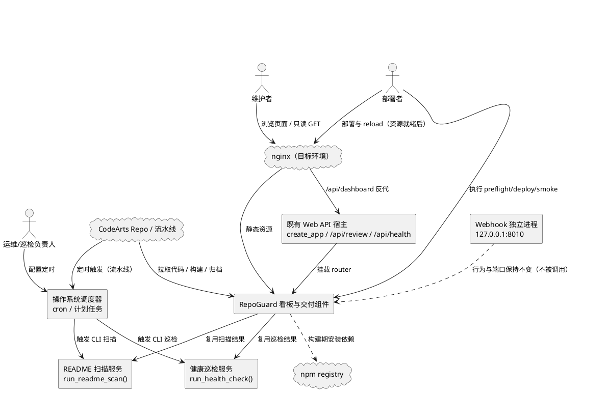
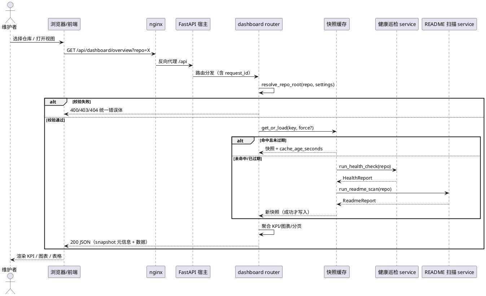
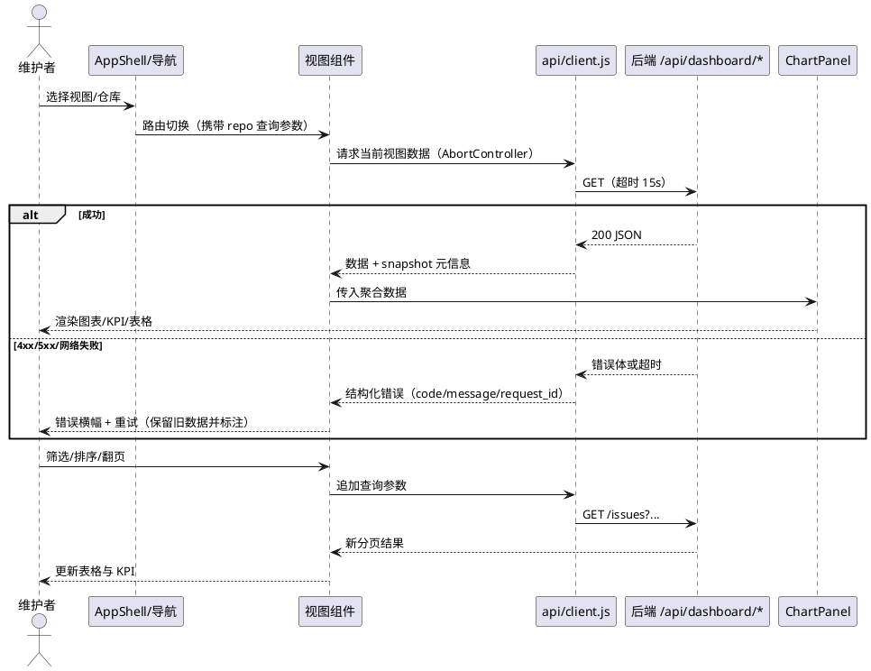
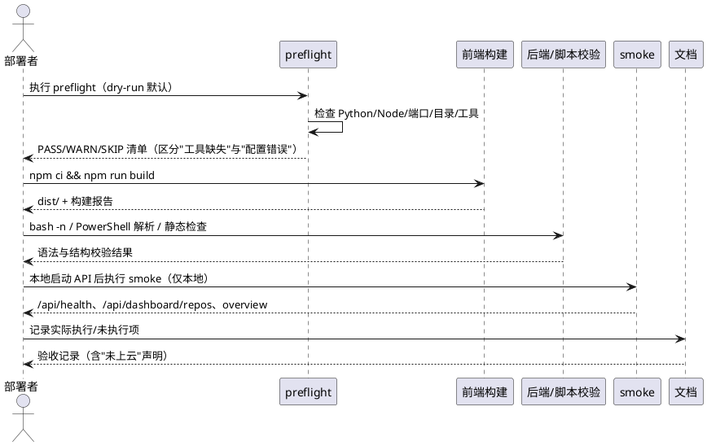
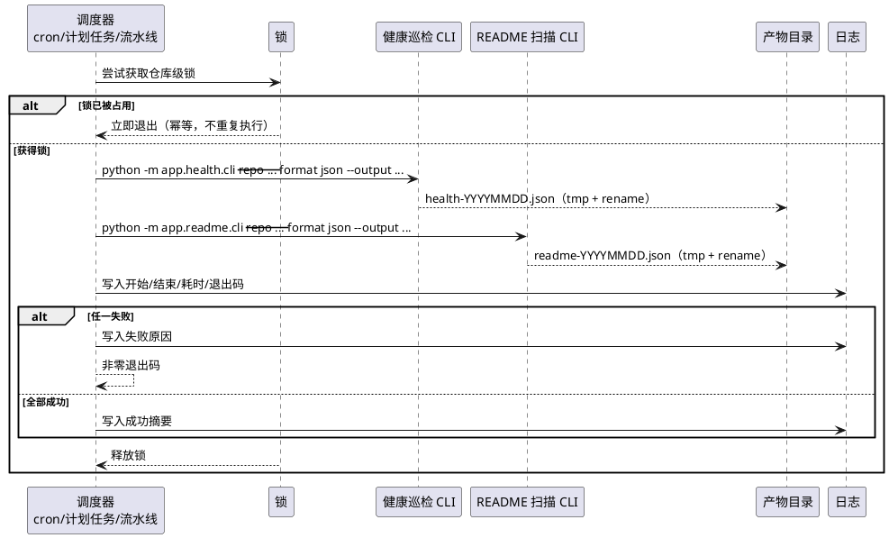
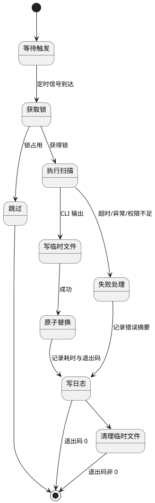
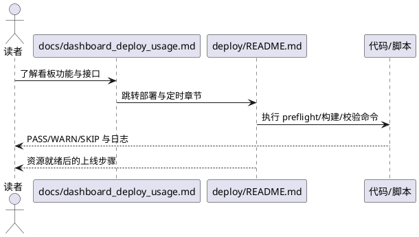
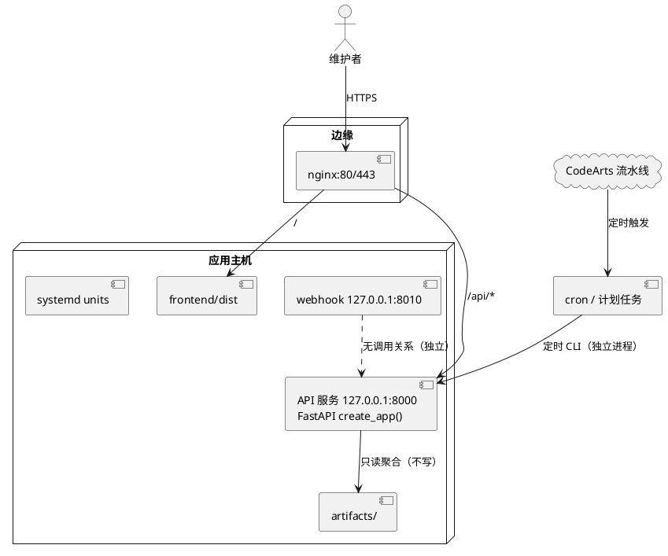

# RepoGuard 可视化看板、部署产物与定时巡检流水线需求规格

> 阶段：阶段 5（需求规格设计）
> 文档性质：只描述"做什么"与可验收的外部行为；"怎么做"由 design.md 决定。
> 本阶段禁止：写产品代码、生成 design.md/tasks.md、修改既有冻结文件、执行真实上云。
> 基线核对日期：2026-11-07；核对环境：Windows 11 + git-bash，Node v24.19.0、npm 11.17.0；系统默认 `python` 不可用，测试使用 uv CPython 3.11.15。

# **1. 组件定位**

## **1.1 核心职责**

本组件负责把既有健康巡检与 README 扫描结果以只读多视图看板呈现，并交付可复用的部署与定时巡检产物。

## **1.2 核心输入**

1. **浏览器只读请求**：来源为维护者浏览器，内容为 `GET /api/dashboard/repos|overview|issues|structure` 及查询参数（仓库令牌、筛选、分页、排序、刷新标记）。
2. **前端静态资源请求**：来源为浏览器，内容为 `index.html`、构建后的 JS/CSS/字体/图标等同源静态资源。
3. **定时触发信号**：来源为 Linux crontab、Windows 计划任务、CodeArts 流水线定时器，内容为"对指定仓库执行一次健康巡检 / README 扫描"的触发。
4. **部署配置输入**：来源为 `deploy/env.example` 对应的环境变量与命令行参数（允许仓库白名单、默认仓库、缓存 TTL、扫描超时等）。
5. **既有服务数据（组件内部输入）**：来源为阶段 3 已冻结的 `app.health.service.run_health_check()` 与 `app.readme.service.run_readme_scan()` 返回值，内容为 `HealthReport` 与 `ReadmeReport`。

## **1.3 核心输出**

1. **看板 JSON 响应**：返回给前端，内容为仓库清单、总览聚合、问题分页、结构/README 摘要，均附带快照元信息。
2. **前端静态产物**：`frontend/dist/`（不入库），由 nginx 或本地静态服务器提供。
3. **部署产物**：`deploy/` 下的 Dockerfile、compose、nginx 配置、systemd unit、部署/预检/冒烟脚本、env 模板、图文部署文档。
4. **定时扫描产物**：`artifacts/health/health-YYYYMMDD.json`、`artifacts/readme/readme-YYYYMMDD.json`、`artifacts/logs/*.log`（均不入库）。
5. **流水线配置**：`deploy/codearts/pipeline.yml` 与 `deploy/cron/repoguard-daily.cron`、`deploy/schedule/register_windows_tasks.ps1`。

## **1.4 职责边界**

本组件**不负责**以下事项，任何实现不得越界：

1. **不重写检查规则**：健康巡检的五类检查、评分与降级判定完全由阶段 1/3 既有模块负责；本组件只能调用 `run_health_check()` 与 `run_readme_scan()`，禁止复制、改写或旁路检查逻辑。
2. **不直接调用检查模块**：禁止 `app.dashboard.**` 直接导入 `app.core.rules.naming|code_scan|link_check|sensitive`，禁止自行拼装 `CheckReport`。
3. **不做数据持久化与历史趋势**：本阶段只展示"当前快照"；禁止把快照写入数据库、禁止返回按时间聚合的趋势序列、禁止用示意图伪造历史曲线。
4. **不提供写操作**：所有看板接口只读，禁止 POST/PUT/PATCH/DELETE，禁止触发扫描之外的副作用（刷新只重建内存快照）。
5. **不修改既有行为**：`/api/review`、`/api/health`、`backend/app/static/index.html`、webhook 独立进程（`127.0.0.1:8010`）的行为、路由、返回结构保持不变。
6. **不新增后端第三方依赖**：`backend/requirements.txt` 内容与哈希必须不变；不得引入 pandas、redis、apscheduler、pydantic-settings 等新包。
7. **不改动冻结文件**：第 1.5 节列出的 13 个冻结文件 SHA-256 差异必须为 0。
8. **不做真实上云**：不申请 Flexus 资源、不执行 `hcloud`、不执行 `docker build/push`、不执行真实 `nginx -t` 与线上 reload；只交付可复用产物并做本地静态校验。
9. **不做用户体系**：不实现登录、RBAC、多租户；访问控制由部署层（内网、反向代理、VPN）承担。
10. **不做代码自动修复**：看板只展示问题与建议，禁止提供"一键修复/自动提交"。

## **1.5 基线调研结果与现状差距**

> 本节为阶段 5 的强制输入核对结论。"实测"指本次会话实际读取/执行的结果；与上级任务口径不一致处一律以实测为准，并登记为待确认项（见第 13 章）。

| 编号 | 基线项 | 实测结果 | 与阶段 5 目标的差距 | 本阶段动作 |
|----|--------|---------|------------------|-----------|
| B-01 | 前端骨架 | `frontend/` 仅含空目录 `public/`、`src/api/`、`src/assets/`、`src/components/`、`src/router/`、`src/views/`；无 `package.json`、无 `vite.config.*`、无 `index.html`、无任何 `.vue/.js` 文件 | 无任何可运行页面 | 复用空目录，新建完整 Vite + Vue3 + ECharts 工程 |
| B-02 | 根 `.gitignore` | 根目录不存在 `.gitignore`；仅 `.codeartsdoer/.gitignore`，内容为 `*` | 无法忽略 `node_modules/`、`dist/`、`artifacts/` | 新建根 `.gitignore` 并写忽略规则 |
| B-03 | 部署目录 | 无 `deploy/`；`scripts/` 为空目录；`docs/` 仅有 4 份 `*_usage.md` | 无任何部署产物 | 新建 `deploy/`、`docs/dashboard_deploy_usage.md` |
| B-04 | 看板后端包 | 无 `backend/app/dashboard/` | 无只读聚合接口 | 新建 `app/dashboard/` 包 |
| B-05 | 既有测试 | `backend/tests/test_*.py` 实测 **25 个**；阶段 3 为 17 个文件 310 条，阶段 4 新增 8 个文件 67 条，合计 **377 条**（按 `def test_` 计数） | 任务口径"19 个测试文件"与实测不符；以 25 个为准 | 不修改任何既有测试文件；仅新增 dashboard 测试 |
| B-06 | 可执行测试 | 系统默认 `python` 指向不存在的 `D:\python`；使用 uv CPython 3.11.15 且已安装既有依赖，实跑 **377 条**：2 条符号链接用例失败（既有 Windows 平台异常）、2 skipped（性能开关 + 可选回环），其余通过 | 基线可复现 | 门禁统一使用该解释器；不修改这 2 条旧测试 | 本次实测 |
| B-07 | Node/npm | 实测 `node v24.19.0`、`npm 11.17.0`；用户口径为 Node v22.23.2、npm 10.9.8 | 版本口径不一致 | 兼容目标定为 Node >= 22.12；登记 D-02 |
| B-08 | npm 版本探测 | `npm view` 实测：vue **3.5.45**、vue-router **5.4.0**、echarts **6.1.0**、vite **8.3.6**、@vitejs/plugin-vue **6.0.10**；plugin-vue peer 支持 Vite 5～8，vue-router 5 peer 要求 Vite 7/8/Pinia | 版本组合需锁定 | design 阶段用 `npm ci` 实测锁定；默认不引入 Pinia/axios；vue-router 4.6.4 为兼容备选 | 本次实测 |
| B-09 | 本机工具链 | `docker`、`hcloud`、`nginx` 均不可用；`git` 2.55.0 可用；`crontab` 不可用 | 无法容器构建、无法 nginx 校验、无云 CLI | 部署产物只做静态校验；定时任务只交付脚本与模板 |
| B-10 | 工作区版本控制 | 当前目录**不是 Git 仓库**（无 `.git`） | CodeArts 流水线无法直接拉取代码 | 文档写明 `git init` + 托管 CodeArts Repo 的前置条件；登记 D-05 |
| B-11 | 依赖冻结 | `backend/requirements.txt` SHA-256 = `18a816cd88636be844e7cd3a6662b2cdc2e13324420031f082a331a520b4bbcf` | 必须保持零差异 | 验收时逐字节校验 |
| B-12 | 静态页冻结 | `backend/app/static/index.html` SHA-256 = `a1ae9d8a47169ff0792ac7516e51c194d8daa24c69048379094d6eaf70315aa8` | 必须保持零差异 | 验收时逐字节校验 |
| B-13 | 13 个冻结文件 | `core/rules/engine.py`、`naming.py`、`code_scan.py`、`link_check.py`、`sensitive.py`、`rules/__init__.py`、`common/__init__.py`、`common/config.py`、`common/file_io.py`、`common/manifest.py`、`common/models.py`、`common/report.py`、`tests/test_cli.py` | 必须保持 SHA-256 差异 0 | 新增只读校验脚本，验收时逐行比对 |
| B-14 | 可复用接口 | `app/api/app.py::create_app()`、`/api/review`、`/api/health`、`app/api/security.py::resolve_repo_root()`、`app/health/service.py::run_health_check()`（内部唯一调用 `engine.run_check()`）、`app/readme/service.py::run_readme_scan()` | 可直接复用 | 只读聚合层复用，不复制规则 |
| B-15 | 既有数据契约 | `HealthReport`（status/meta/summary/files/zombie_candidates/undetermined/degraded/warnings）、`ReadmeReport`（status/index/diffs/undetermined/degraded/warnings 等） | 可作为看板唯一数据源 | 字段映射见 6.2/6.4，不新增扫描逻辑 |
| B-16 | webhook 进程 | 独立进程，默认 `127.0.0.1:8010`，路径 `/webhook`，配置见 `app/webhook/settings.py` | 不得改变其行为与端口 | 部署拓扑中保持独立；nginx 默认不代理 |

**现状差距结论**：阶段 5 是"从 0 到 1"的展示层与交付层建设——后端只增加薄聚合层，前端全量新建，部署与定时产物全量新建；既有检查能力与数据契约是稳定输入，不需要也不允许重做。

# **2. 领域术语**

**看板快照**
: 看板快照是对某一仓库执行一次健康巡检与一次 README 扫描后得到的只读数据集合，包含统计、文件问题、僵尸候选、降级项、README 索引与差异。

**快照 TTL**
: 快照在服务进程内存中可被复用的最长时长，超过该时长后下一次请求必须重新扫描；TTL 默认 60 秒。

**单飞**
: 当多个请求在同一时刻请求同一仓库的同一快照时，只允许一个扫描任务执行，其余请求等待并复用同一结果，避免重复扫描。

**仓库令牌**
: 客户端传给看板接口的仓库标识，取值语义与 `/api/review` 的 `repo` 字段一致，必须能通过既有 `resolve_repo_root()` 白名单校验；响应中不得出现绝对路径。

**冻结文件**
: 阶段 1 至阶段 4 已验收且本阶段禁止修改的 13 个源码/测试文件（清单见 1.5 B-13），以 SHA-256 零差异作为门禁。

**部署产物**
: 可在目标资源就绪后直接使用的容器、反向代理、服务托管、部署脚本与文档文件，本阶段只生成与静态校验，不执行真实部署。

**定时巡检**
: 由操作系统调度器或流水线定时器触发的、对指定仓库执行健康巡检与 README 扫描并落盘产物的任务。

**历史趋势**
: 跨多个时间点的指标序列。本阶段明确**不提供**历史趋势，任何图表不得展示跨快照的时间序列。

**降级快照**
: 巡检结果状态为「部分降级」的快照。降级快照必须原样暴露降级原因，不得包装为正常。

**问题条目**
: 看板中的一个可定位问题，由 `HealthFileEntry.findings` 展开得到，包含文件、行号、规则、来源模块、风险等级、描述与建议。

# **3. 角色与边界**

## **3.1 核心角色**

1. **维护者**：浏览总览、问题明细、结构/README、关于/健康四类视图；选择仓库、刷新快照、筛选与分页问题。
2. **部署者**：准备环境、执行 preflight 与部署脚本、执行 smoke 校验、按文档完成上线与回滚。
3. **运维/巡检负责人**：配置定时任务与流水线、查看扫描产物与日志、处理失败任务。

## **3.2 外部系统**

1. **既有 RepoGuard Web API（宿主）**：提供 `create_app()`、既有中间件与异常处理、`/api/review`、`/api/health`；本阶段以新增 router 方式挂载 `/api/dashboard`。
2. **健康巡检服务**：`app.health.service.run_health_check()`，提供 `HealthReport`。
3. **README 扫描服务**：`app.readme.service.run_readme_scan()`，提供 `ReadmeReport`。
4. **仓库路径白名单**：`app.api.security.resolve_repo_root()` 与 `WebSettings.allowed_repo_roots`。
5. **nginx**：目标环境的静态托管与 `/api` 反向代理；本机不可用，仅交付配置。
6. **npm registry**：前端依赖来源；构建机需可联网。
7. **CodeArts 流水线 / Repo**：定时触发与产物归档；当前工作区非 Git 仓库，需先托管。
8. **操作系统调度器**：Linux crontab 与 Windows 计划任务。
9. **Docker/容器运行时**：未来部署载体；本机不可用，仅交付产物。
10. **Webhook 独立进程**：既有 `127.0.0.1:8010` 服务，本阶段只读引用，不改变、不代理、不合并进程。

## **3.3 交互上下文**



# **4. DFX 约束**

## **4.1 性能**

| 指标 | 目标值 | 验收条件 |
|------|--------|---------|
| `GET /api/dashboard/overview` 首次（缓存未命中） | ≤ 8000 ms（demo-repo 规模，≤ 5000 文件） | 当缓存为空且仓库为 demo-repo 时，接口应在 8 秒内返回完整快照或明确的 504 |
| `overview/issues/structure` 缓存命中 | P95 ≤ 300 ms | 当缓存年龄未超 TTL 时，连续 20 次请求的中位耗时 ≤ 300 ms |
| 前端首屏（本地构建产物，开发机） | ≤ 2.5 s 可交互 | 当以 `npm run build` 产物由本地静态服务器提供时，首屏主内容应在 2.5 秒内出现 |
| 首屏 JS（gzip 后） | ≤ 350 KB | 构建报告显示首屏 chunk gzip ≤ 350 KB；ECharts 必须按需引入 |
| 单次全仓扫描超时 | 默认 30 s，可配置 5–120 s | 当扫描超过上限时，接口应返回 504 且不得返回部分拼接数据 |

1. **禁止伪造耗时**：响应中的 `duration_ms` 必须来自实际扫描测量，禁止硬编码或估算。
   a. 验收条件：当返回快照时，`snapshot.duration_ms` 应为非负整数且与日志中的扫描耗时一致。

## **4.2 可靠性**

1. **降级不伪装**：当巡检状态为「部分降级」或存在 `degraded` 条目时，接口仍返回 HTTP 200，但响应体 `snapshot.status` 必须为「部分降级」且 `snapshot.degraded` 非空；禁止把降级包装成「正常」。
   a. 验收条件：当健康报告含降级项时，看板响应应保留全部降级原因。
2. **失败可见**：当无法生成快照（引擎不可用、仓库不存在、扫描超时、序列化失败）时，必须返回对应 4xx/5xx 错误响应，禁止返回空数据加 200。
   a. 验收条件：当 `run_health_check` 抛异常时，接口应返回 500/503，不得返回 `summary` 全 0 的"成功"响应。
3. **缓存失败不写入**：扫描失败的结果禁止进入缓存，避免故障被固化。
   a. 验收条件：当加载器抛异常时，缓存中该键应保持原值或不存在，后续请求应重新尝试。
4. **单实例一致性**：单进程内同一仓库的快照必须唯一，禁止同一请求内重复扫描两次。
   a. 验收条件：当一次 overview 请求结束时，健康巡检与 README 扫描各最多执行一次。
5. **可用性目标**：单实例部署，看板可用性依赖宿主 API 可用性；目标为计划内可维护停机之外不因看板新增代码导致既有接口不可用。
   a. 验收条件：当 dashboard router 导入失败时，既有 `/api/review` 与 `/api/health` 的测试应仍全部通过（导入隔离由 design 保证）。

## **4.3 安全性**

1. **只读边界**：`/api/dashboard/**` 只允许 GET；其他方法必须返回 405。
   a. 验收条件：当以 POST 访问 `/api/dashboard/overview` 时，应返回 405 与 `METHOD_NOT_ALLOWED`。
2. **路径脱敏**：响应、日志、错误详情中禁止出现绝对路径、盘符、UNC 前缀、用户主目录。
   a. 验收条件：当仓库位于 `C:\Users\...\demo-repo` 时，响应中只能出现 `demo-repo` 或哈希标识。
3. **白名单唯一来源**：仓库必须经 `resolve_repo_root()` 校验；禁止根据请求参数推断当前目录。
   a. 验收条件：当传入 `..\..\Windows` 时，应返回 403，且不读取任何文件。
4. **敏感内容**：问题 `excerpt` 必须沿用健康巡检既有脱敏结果；禁止额外回显文件全文、原始 webhook payload、令牌、环境变量原文。
   a. 验收条件：当问题来自敏感信息规则时，响应中不得出现完整的疑似密钥字符串。
5. **响应头**：`/api/dashboard/**` 必须返回 `Content-Type: application/json; charset=utf-8`、`Cache-Control: no-store`、`X-Content-Type-Options: nosniff`；沿用既有请求 ID 中间件。
   a. 验收条件：当任意 dashboard 请求完成时，响应应包含上述头与 `X-Request-ID`。
6. **前端无外链**：禁止 CDN、外链字体、外链图标、运行期远程请求；所有资源必须同源或随包构建。
   a. 验收条件：当构建完成后，`dist/` 内不得存在指向外部域名的资源引用。

## **4.4 可维护性**

1. **结构化日志**：dashboard 请求日志必须包含 `request_id`、`repo_label`、`cached`、`cache_age_seconds`、`duration_ms`、`status_code`、`error_code`；禁止记录绝对路径。
   a. 验收条件：当日志落盘时，单行可被 JSON 解析，字段齐全。
2. **可观测指标**：至少可观测请求数、错误码分布、缓存命中率、扫描耗时 P95；本阶段以日志字段承载，不引入监控依赖。
   a. 验收条件：当日志样本累积后，应能据此计算缓存命中率与错误码分布。
3. **前端可维护**：视图、组件、API 客户端、图表封装分层清晰；单个视图文件不得超过 400 行；禁止在视图中直接拼装 URL。
   a. 验收条件：当变更某视图时，无需修改其他视图的数据请求代码。
4. **文档可执行**：部署文档中的每条命令必须可直接复制执行，并标注"本机不可用/需资源就绪"的工具。
   a. 验收条件：当按文档执行本地校验章节时，命令应全部可在 Windows/macOS/Linux 之一完成或明确跳过原因。

## **4.5 兼容性**

1. **后端兼容**：Python >= 3.10；不新增第三方依赖；`requirements.txt` 字节级不变；既有 377 条测试不退化（2 条符号链接用例单列）。
   a. 验收条件：当执行 `python -m unittest discover -s tests -t .` 时，除既有 2 条符号链接失败外应全部通过。
2. **接口兼容**：既有 `/api/review` 与 `/api/health` 的路径、请求、响应、错误码、响应头不得变化。
   a. 验收条件：当新增 router 后，既有 `test_api.py` 的 30 条用例应零修改通过。
3. **webhook 兼容**：`app/webhook/**` 的行为、默认端口 `127.0.0.1:8010`、路由 `/webhook` 不得变化。
   a. 验收条件：当执行 webhook 相关测试时，应零修改通过。
4. **前端兼容**：Node >= 22.12（兼容目标）；构建机需可联网安装依赖；产物面向现代浏览器（Chrome/Edge/Firefox/Safari 最近两个大版本）。
   a. 验收条件：当在 Node 22.12+ 环境执行 `npm ci && npm run build` 时，应成功产出 `dist/index.html`。

# **5. 核心能力**

## **5.1 看板数据接口（只读聚合）**

### **5.1.1 业务规则**

1. **R-API-01 只读性**：所有看板接口必须只读，禁止产生文件写入、禁止调用 review 接口、禁止触发 webhook。
   a. 验收条件：当调用任一 dashboard 接口时，仓库文件 mtime 与内容不得变化。

2. **R-API-02 数据唯一来源**：overview/issues/structure 的数据必须来自一次快照；快照必须由 `run_health_check()` 与 `run_readme_scan()` 产出，禁止在本层重新遍历仓库计算统计。
   a. 验收条件：当注入桩函数时，service 应且仅应各调用一次健康巡检与 README 扫描。

3. **R-API-03 快照复用**：同一仓库在 TTL 内重复请求必须复用内存快照，并返回 `cached=true` 与 `cache_age_seconds`。
   a. 验收条件：当 60 秒内连续两次请求 overview 时，第二次应返回 `cached=true` 且 `cache_age_seconds < 60`。

4. **R-API-04 单飞与并发上限**：同一仓库并发请求必须合并为一次扫描；跨仓库扫描并发默认 2，排队超过 5 秒必须返回 429。
   a. 验收条件：当 5 个并发请求同时请求同一仓库时，扫描应只执行一次；当并发占满且排队超时，应返回 429 与 `DASHBOARD_BUSY`。

5. **R-API-05 强制刷新节流**：`refresh=1` 表示请求重建快照；若该仓库快照年龄小于 10 秒，必须忽略强制刷新、返回现有快照并置 `refresh_throttled=true`，禁止报错。
   a. 验收条件：当 10 秒内连续两次 `refresh=1` 时，第二次应返回缓存且 `refresh_throttled=true`。

6. **R-API-06 仓库白名单**：`repo` 参数必须经 `resolve_repo_root()` 解析；为空时使用默认仓库；解析失败必须透传既有 400/403/404 错误码。
   a. 验收条件：当 `repo` 指向白名单外目录时，应返回 403 `REPO_FORBIDDEN`。

7. **R-API-07 字段稳定性**：响应必须包含本文第 7 章定义的全部必填字段；空数据必须以空数组或 0 表示，禁止省略字段或返回 `null` 作为整个响应。
   a. 验收条件：当仓库无任何问题时，`summary` 各项应为 0，`items` 应为空数组，`total=0`。

8. **R-API-08 分页与排序**：`issues` 必须服务端分页与排序；`page_size` 默认 20、范围 1–100；`page` 从 1 开始；排序字段只允许白名单，非法值必须 400。
   a. 验收条件：当 `page_size=200` 时，应返回 422 或 400（不得静默截断）；当 `sort=password` 时，应返回 400 `INVALID_QUERY_PARAM`。

9. **R-API-09 筛选**：`risk_level`、`source_module`、`keyword` 必须可组合；`keyword` 长度上限 64，匹配范围限定为文件路径、规则 ID、问题描述、建议，必须不区分大小写，禁止正则解释。
   a. 验收条件：当 `keyword="link-003"` 时，应只返回规则 ID 含该串的条目，且不因特殊字符报错。

10. **R-API-10 无历史趋势**：响应中禁止出现按时间序列的指标数组；`snapshot.scanned_at` 只表示当前快照时间。
    a. 验收条件：当序列化响应时，不得存在键名含 `trend`、`history`、`series` 的时间序列结构。

11. **R-API-11 快照一致性**：响应中的 `summary.issue_count` 必须等于 `must_fix_count + suggestion_count`，且与文件明细聚合一致；不一致时必须标记降级并在 `warnings` 中说明。
    a. 验收条件：当注入不一致报告时，响应应保持统计自洽或明确标为部分降级，禁止静默返回矛盾数据。

12. **R-API-12 仓库清单**：`/repos` 必须返回可回传的仓库令牌与默认标记；令牌数量必须与允许根的实际可用条目一致；不得返回绝对路径。
    a. 验收条件：当把 `/repos` 返回的任一 `id` 回传给 overview 时，应成功得到该仓库快照。

### **5.1.2 交互流程**



### **5.1.3 异常场景**

1. **仓库越权**
   a. 触发条件：`repo` 含 `..`、盘符、UNC 或指向白名单外目录。
   b. 系统行为：在读取文件前由 `resolve_repo_root()` 拒绝，不执行扫描，不写缓存。
   c. 用户感知：403 `REPO_FORBIDDEN` 或 400 `INVALID_REPO_PATH`，中文提示，不含绝对路径。

2. **仓库不存在**
   a. 触发条件：白名单内目录被删除或不是目录。
   b. 系统行为：透传 404，不执行扫描。
   c. 用户感知：404 `REPO_NOT_FOUND`，中文提示。

3. **扫描超时**
   a. 触发条件：健康巡检或 README 扫描超过 `scan_timeout_seconds`。
   b. 系统行为：终止等待、不写入缓存、记录耗时与仓库标签。
   c. 用户感知：504 `DASHBOARD_TIMEOUT`，提示缩小巡检范围或稍后重试。

4. **扫描并发占满**
   a. 触发条件：跨仓库扫描并发已满且排队超过 `queue_timeout_seconds`。
   b. 系统行为：不启动扫描，不写缓存。
   c. 用户感知：429 `DASHBOARD_BUSY`。

5. **引擎不可用/服务导入失败**
   a. 触发条件：`run_health_check` 或 `run_readme_scan` 不可导入、白名单为空。
   b. 系统行为：不返回空快照，记录异常摘要（不含堆栈给用户）。
   c. 用户感知：503 `DASHBOARD_UNAVAILABLE`。

6. **报告序列化失败**
   a. 触发条件：报告对象含不可序列化字段或聚合计算异常。
   b. 系统行为：记录 request_id 与异常类型，返回通用错误。
   c. 用户感知：500 `INTERNAL_ERROR`。

7. **非法查询参数**
   a. 触发条件：`risk_level`/`source_module`/`sort`/`order` 取非白名单值，或 `keyword` 超长。
   b. 系统行为：不执行扫描，直接拒绝。
   c. 用户感知：400 `INVALID_QUERY_PARAM`（类型/范围错误由框架返回 422 `VALIDATION_ERROR`）。

8. **部分降级**
   a. 触发条件：健康巡检或 README 扫描返回「部分降级」。
   b. 系统行为：正常返回 200，保留 `degraded`/`undetermined`/`warnings`，标记 `snapshot.status`。
   c. 用户感知：页面出现降级提示条，数据正常展示但明确"结果可能不完整"。

## **5.2 多视图看板前端**

### **5.2.1 业务规则**

1. **R-UI-01 四类视图齐全**：必须提供总览、问题明细、仓库结构/README、关于/健康四类视图，并可通过顶部导航在任意视图间切换。
   a. 验收条件：当访问 `/`、`/issues`、`/structure`、`/about` 时，应分别渲染对应视图且导航高亮正确。

2. **R-UI-02 仓库选择**：所有数据视图必须共用同一仓库选择器；切换仓库后必须重新请求当前视图数据，并同步到 URL 查询参数。
   a. 验收条件：当从 `demo-repo` 切换到另一仓库并刷新页面时，页面应恢复该仓库与视图。

3. **R-UI-03 刷新语义**：必须提供"刷新"按钮；点击后以 `refresh=1` 请求；刷新期间必须显示加载状态并禁用重复点击。
   a. 验收条件：当点击刷新时，按钮进入禁用态，返回后展示新的 `scanned_at` 或 `refresh_throttled` 提示。

4. **R-UI-04 只展示当前快照**：所有指标必须标注快照时间 `scanned_at` 与缓存年龄；禁止绘制跨快照趋势线、禁止用随机或示意数据填充。
   a. 验收条件：当快照只有一次时，页面不得出现"近 7 天趋势"类图表。

5. **R-UI-05 ECharts 图表清单**：图表类型、数据来源、交互必须按下表实现；无数据时必须显示空状态，不得渲染空坐标系冒充数据。

| 视图 | 编号 | 组件/指标 | 图表类型（ECharts） | 数据来源（API 字段） | 交互 |
|------|------|----------|------------------|-------------------|------|
| 总览 | K1–K9 | KPI 卡片：文件数、问题总数、高风险、建议、僵尸候选、无法判定、降级项、跳过文件、扫描耗时 | 非图表（卡片） | `summary`、`snapshot.duration_ms` | 点击"高风险/建议"卡片跳转问题明细并带筛选 |
| 总览 | C1 | 风险构成 | 环形饼图 | `charts.risk_breakdown` | 悬浮显示数值与占比；点击扇区跳转问题明细 |
| 总览 | C2 | 问题来源模块分布 | 横向条形图 | `charts.module_breakdown` | 点击条形跳转问题明细并按模块筛选 |
| 总览 | C3 | 文件类型分布 | 条形图 | `charts.file_type_breakdown` | 只读 |
| 总览 | C4 | 问题最多的前 10 个文件 | 横向条形图 | `charts.top_files` | 点击文件跳转问题明细并按文件筛选 |
| 总览 | T1 | 降级项与警告 | 列表 | `snapshot.degraded`、`snapshot.warnings` | 展开查看原因 |
| 问题明细 | K10–K12 | 筛选后总数、高风险数、建议数 | 非图表（卡片） | `total` 与 `counts` | 随筛选实时更新 |
| 问题明细 | C5 | 规则 Top 10 | 横向条形图 | `charts.rule_breakdown` | 点击规则跳转并按规则筛选 |
| 问题明细 | C6 | 来源模块 × 风险等级 | 堆叠条形图 | `charts.module_risk_matrix` | 只读 |
| 问题明细 | T2 | 问题表 | 表格（非图表） | `items` | 排序、筛选、分页、行展开查看建议 |
| 结构/README | K13–K18 | 文档数、Demo 确认数、疑似 Demo 数、README 是否找到、目录区块是否找到、README 差异数 | 非图表（卡片） | `readme.*` | 只读 |
| 结构/README | C7 | 目录分区构成 | 饼图 | `index.document_section.items`、`index.demo_section.items` | 只读 |
| 结构/README | C8 | Demo 确认 vs 疑似 | 条形图 | `readme.demo_project_count`、`demo_project_suspected_count` | 只读；疑似仅计数 |
| 结构/README | C9 | README 差异类型分布 | 条形图 | `readme.diffs[].change_type` | 点击跳转差异明细 |
| 结构/README | T3–T5 | README 差异明细 / Demo 清单 / 无法判定项 | 表格 | `readme.diffs`、`index.demo_section.items`、`readme.undetermined` | 只读 |
| 关于/健康 | K19–K21 | API 状态、引擎可用性、缓存年龄 | 非图表（卡片） | `/api/health` 与 dashboard 快照元信息 | 手动刷新 |
| 关于/健康 | C10 | 来源模块状态 | 热力图/状态矩阵 | `charts.module_status` | 只读 |
| 关于/健康 | T6–T7 | 错误码矩阵、版本与配置摘要 | 表格 | 前端静态常量 + `settings_summary` 脱敏字段 | 只读 |

6. **R-UI-06 图表实现约束**：ECharts 必须按需引入，禁止全量 `import * as echarts from 'echarts'`；图表必须在容器尺寸变化时自适应，在路由离开时销毁实例。
   a. 验收条件：当窗口宽度从 1440 调整到 800 时，图表应重新布局且无溢出；离开视图后不得残留定时器或实例。

7. **R-UI-07 数据表降级**：每个图表必须提供可展开的数据表或文本摘要作为无障碍替代；颜色不得作为唯一语义载体。
   a. 验收条件：当用户使用屏幕阅读器时，应能获取图表对应的数值列表。

8. **R-UI-08 响应式**：≥1280 px 为四列 KPI、双列图表；768–1279 px 为两列 KPI、单列图表；<768 px 为单列、表格横向滚动。
   a. 验收条件：当视口宽度为 375 px 时，页面不得出现横向整页滚动。

9. **R-UI-09 错误降级**：请求失败时必须显示中文错误横幅与重试按钮；不得把失败渲染为 0 或空白成功页；若已有上次成功数据，可保留并标注"数据可能已过期"。
   a. 验收条件：当接口返回 503 时，页面应显示明确错误而非全 0 KPI。

10. **R-UI-10 无运行时外链与无内置测试框架**：禁止 CDN、禁止远程字体、禁止引入 axios/Pinia（除非 design 阶段以书面理由变更并经确认）；本阶段不引入 Vitest/Playwright 等测试框架。
    a. 验收条件：当检查 `dist/` 与源码时，不得出现外部 URL 资源引用；`package.json` 不得出现 axios、pinia、vitest、playwright。

### **5.2.2 交互流程**



### **5.2.3 异常场景**

1. **后端不可达**
   a. 触发条件：网络中断、nginx 502、连接超时。
   b. 系统行为：前端在 15 秒内中止请求，记录非敏感错误摘要，保留上一份数据的"已过期"标记。
   c. 用户感知：错误横幅"无法连接看板服务，请检查后端是否启动"，提供重试按钮。

2. **接口 503/504**
   a. 触发条件：引擎不可用或扫描超时。
   b. 系统行为：不渲染 0 值 KPI；显示错误码与中文提示。
   c. 用户感知：明确"本次未获取到快照"，可重试。

3. **空仓库/无问题**
   a. 触发条件：仓库无文件或所有检查均通过。
   b. 系统行为：展示空状态与"未发现问题"，图表显示"暂无数据"。
   c. 用户感知：不出现错误，不出现伪造数据。

4. **规则 ID 未知**
   a. 触发条件：后端返回前端未内置的 `rule_id`。
   b. 系统行为：按原样展示，不隐藏、不改写；来源模块使用后端字段。
   c. 用户感知：表格中显示原始规则 ID。

5. **刷新被节流**
   a. 触发条件：10 秒内重复点击刷新。
   b. 系统行为：展示 `refresh_throttled=true` 提示，继续使用现有数据。
   c. 用户感知：提示"刷新过于频繁，已展示最近一次快照"。

6. **路由不存在**
   a. 触发条件：访问未定义路径。
   b. 系统行为：重定向到总览视图。
   c. 用户感知：看到总览页与导航。

## **5.3 部署产物**

### **5.3.1 业务规则**

1. **R-DEP-01 产物齐全**：必须交付第 10.2 节列出的全部部署产物；缺失任一文件即不通过验收。
   a. 验收条件：当执行产物清单校验时，所有路径应存在且非空。

2. **R-DEP-02 不真实上云**：所有部署动作必须支持 `--dry-run`/`-DryRun`；在没有 Docker/nginx/hcloud 的机器上，默认只做静态校验与本地前端构建，禁止输出"部署成功""已上云"等结论。
   a. 验收条件：当在无 Docker 环境执行 `deploy.sh --dry-run` 时，应输出 SKIP/WARN 清单与退出码 0，且不修改系统服务。

3. **R-DEP-03 端口隔离**：前端静态由 nginx 提供（80/443）；API 监听 127.0.0.1:8000；webhook 监听 127.0.0.1:8010；Vite dev server 仅开发期使用 5173；禁止将 8000/8010 直接暴露到公网。
   a. 验收条件：当检查 nginx 配置与 compose 端口映射时，8000/8010 必须绑定回环地址。

4. **R-DEP-04 nginx 路由**：`/` 必须服务 SPA（`try_files $uri $uri/ /index.html`）；`/api/` 必须反代到 `127.0.0.1:8000`；`/webhook` 默认**不代理**；禁止把 `/api/dashboard` 单独指向其他上游。
   a. 验收条件：当访问不存在的前端路径时，应返回 `index.html`；当访问 `/webhook` 时，应由 nginx 返回 404 而非转发到 8010。

5. **R-DEP-05 安全头与限制**：nginx 必须设置 `X-Content-Type-Options`、`X-Frame-Options`、`Referrer-Policy`、`Permissions-Policy`；HTTPS 站点启用 HSTS；请求体上限 2 MB；`/api/` 代理读超时 120 秒。
   a. 验收条件：当以 HTTP 响应头检查时，应包含上述安全头。

6. **R-DEP-06 配置外置**：所有可变配置必须通过 `deploy/env.example` 对应的环境变量注入；禁止在 Dockerfile、nginx 配置、脚本中硬编码仓库绝对路径、密钥、真实域名。
   a. 验收条件：当扫描部署产物时，不得出现真实密钥或个人目录路径。

7. **R-DEP-07 图文文档**：`deploy/README.md` 必须包含架构图、端口表、前置条件、本地校验步骤、资源就绪后的上线步骤、回滚步骤、故障排查；图片必须为仓库内相对路径引用的本地图片，禁止外链。
   a. 验收条件：当检查文档时，至少包含 4 张本地图片引用与 1 张端口/拓扑表。

8. **R-DEP-08 systemd 托管**：必须提供 API 与 webhook 两个 unit；必须使用独立低权限用户、`WorkingDirectory`、`EnvironmentFile`、`Restart=on-failure`、`NoNewPrivileges`。
   a. 验收条件：当静态检查 unit 时，应包含上述指令且无 `User=root`。

9. **R-DEP-09 前端构建配置**：Dockerfile.frontend 必须为多阶段（Node 构建 + nginx 托管），构建阶段执行 `npm ci && npm run build`，运行阶段仅复制 `dist` 与 nginx 配置。
   a. 验收条件：当静态检查 Dockerfile 时，应包含两个 `FROM` 阶段且最终阶段不含 node 运行时。

10. **R-DEP-10 禁止声明的结论**：文档与脚本输出必须明确标注"本机未执行 docker build、未执行 hcloud、未执行 nginx -t、未上云"。
    a. 验收条件：当检查验收记录时，应包含上述四项"未执行"声明。

### **5.3.2 交互流程**



### **5.3.3 异常场景**

1. **Node 版本不足**
   a. 触发条件：构建机 Node < 22.12。
   b. 系统行为：preflight 输出 FAIL 并给出版本要求；不自动安装 Node。
   c. 用户感知：明确错误与升级建议。

2. **npm 源不可达**
   a. 触发条件：`npm ci` 网络失败。
   b. 系统行为：不生成 `dist/`，不删除已有产物，记录失败日志。
   c. 用户感知：构建失败信息与重试建议。

3. **Docker/nginx 不存在**
   a. 触发条件：本机缺少工具。
   b. 系统行为：标记 SKIP 并说明"仅静态校验"，不伪报成功。
   c. 用户感知：WARN 清单与后续资源就绪步骤。

4. **端口占用**
   a. 触发条件：8000/8010/80/443/5173 已被占用。
   b. 系统行为：preflight 报告占用进程提示（不自动杀进程）。
   c. 用户感知：明确端口冲突与处理建议。

5. **smoke 失败**
   a. 触发条件：API 未启动或健康检查降级。
   b. 系统行为：记录失败接口、状态码、request_id；退出码非 0。
   c. 用户感知：失败清单与排查入口。

6. **配置含绝对路径或密钥**
   a. 触发条件：静态扫描发现真实路径/密钥模式。
   b. 系统行为：preflight 报 FAIL 并阻止后续步骤。
   c. 用户感知：指出文件与行号（不回显密钥原文）。

## **5.4 定时巡检流水线**

### **5.4.1 业务规则**

1. **R-JOB-01 双形态交付**：必须同时交付 Linux crontab 与 Windows 计划任务脚本，二者执行同等巡检内容。
   a. 验收条件：当检查产物时，`deploy/cron/repoguard-daily.cron` 与 `deploy/schedule/register_windows_tasks.ps1` 均应存在且语法可解析。

2. **R-JOB-02 复用既有 CLI**：定时任务必须调用既有 `python -m app.health.cli` 与 `python -m app.readme.cli`，禁止新写扫描脚本、禁止复制检查逻辑。
   a. 验收条件：当检查定时脚本时，调用的模块路径应为既有 CLI。

3. **R-JOB-03 只读边界**：定时任务只能读取被巡检仓库；`--output` 必须指向被巡检仓库之外；禁止执行修复、格式化、删除。
   a. 验收条件：当巡检目标为 `demo-repo` 时，产物应写入 `artifacts/`，且 `demo-repo` 内文件哈希不变。

4. **R-JOB-04 频率**：默认每日 02:00 执行一次健康巡检与 README 扫描；时区以调度器本地时区或 CodeArts 控制台配置为准，文档必须写明时区假设。
   a. 验收条件：当检查 cron 行与计划任务触发器时，应可读出每日一次、02:00。

5. **R-JOB-05 输出位置**：健康 JSON 写入 `artifacts/health/health-YYYYMMDD.json`；README JSON 写入 `artifacts/readme/readme-YYYYMMDD.json`；日志写入 `artifacts/logs/YYYYMMDD.log`。
   a. 验收条件：当任务成功执行后，上述文件应存在且为合法 JSON/文本。

6. **R-JOB-06 CodeArts 前置条件**：当前工作区不是 Git 仓库，流水线配置必须配套文档说明：初始化 Git、托管到 CodeArts Repo、创建流水线、导入配置、配置定时触发、配置环境变量。
   a. 验收条件：当阅读 `deploy/codearts/pipeline.yml` 相关文档时，应包含上述完整前置步骤与"未托管则定时无法生效"的说明。

7. **R-JOB-07 流水线任务内容**：流水线至少包含：检出 → 安装后端依赖 → 执行后端单元测试 → 执行健康巡检与 README 扫描 → 归档 `artifacts/`；前端任务可选（安装依赖 + 构建 + 归档 dist）。
   a. 验收条件：当检查 pipeline.yml 时，应能识别上述阶段或步骤。

8. **R-JOB-08 schema 不臆造**：CodeArts 流水线 YAML schema 未核实，配置必须标注"以控制台可视化配置为准"的适配说明，禁止声称与官方 schema 完全一致。
   a. 验收条件：当检查配置与文档时，应存在明确的 schema 假设声明。

9. **R-JOB-09 失败可见**：任务失败必须以非零退出码结束，并写入日志与失败标记；本阶段不实现邮件/IM 告警，依赖流水线红灯或调度器通知。
   a. 验收条件：当扫描失败时，日志应包含失败原因，退出码非 0。

### **5.4.2 交互流程**



### **5.4.3 异常场景**

1. **任务重入**
   a. 触发条件：上一次任务未结束，下一次触发到来。
   b. 系统行为：锁失败立即退出，不排队、不并发扫描。
   c. 用户感知：日志记录"已有任务在执行"，不产生重复产物。

2. **扫描超时**
   a. 触发条件：任务运行超过 15 分钟。
   b. 系统行为：调度器终止进程；已写临时文件不得替换正式产物。
   c. 用户感知：日志与失败标记；正式产物保留上次成功版本。

3. **仓库路径不存在**
   a. 触发条件：白名单目录被移动或删除。
   b. 系统行为：CLI 返回输入错误退出码，日志记录脱敏路径标识。
   c. 用户感知：流水线红灯或任务失败记录。

4. **产物目录不可写**
   a. 触发条件：权限不足或磁盘满。
   b. 系统行为：不写半成品，立即失败。
   c. 用户感知：明确错误与权限/空间建议。

5. **流水线未配置代码源**
   a. 触发条件：当前工作区未初始化 Git 或未托管 CodeArts Repo。
   b. 系统行为：流水线无法拉起代码，定时触发不生效。
   c. 用户感知：文档中的前置步骤与检查清单。

6. **cron 中 `%` 未转义**
   a. 触发条件：cron 行使用 `date +%Y%m%d` 未写成 `\%`。
   b. 系统行为：命令被截断。
   c. 用户感知：文档与模板中统一使用转义写法，静态校验检查该模式。

## **5.5 幂等、超时、失败处理、日志与归档**

### **5.5.1 业务规则**

1. **R-OPS-01 幂等键**：定时产物以「仓库标识哈希 + 日期（YYYYMMDD）」命名；同一天重复执行必须原子覆盖同一文件，不产生重复堆积。
   a. 验收条件：当同一天执行两次时，产物文件数量不增加，内容为最后一次成功结果。

2. **R-OPS-02 原子落盘**：必须写临时文件后重命名；失败时不得留下可被误读的半成品 JSON。
   a. 验收条件：当进程在写入中被终止时，正式产物应为上一次的完整文件或不存在。

3. **R-OPS-03 锁与并发**：Linux 使用 `flock -n`；Windows 计划任务使用 `-MultipleInstances IgnoreNew`；流水线配置并发策略为"同一流水线不并发"。
   a. 验收条件：当并发触发两次时，只应有一个任务执行扫描。

4. **R-OPS-04 超时**：单仓库扫描超时 15 分钟（外层）；看板接口扫描超时默认 30 秒；二者必须分别可配置。
   a. 验收条件：当超过外层超时时，任务应失败且日志记录超时。

5. **R-OPS-05 日志留存**：日志按天分文件，保留 30 天；日志内容包含时间、任务名、仓库标签、退出码、耗时、错误摘要；禁止记录绝对路径与密钥。
   a. 验收条件：当检查日志样本时，应可解析且无敏感信息。

6. **R-OPS-06 产物归档**：本地 cron 保留 30 天；流水线归档最近 30 天或最近 30 次运行（以平台能力为准）；过期文件可按脚本清理。
   a. 验收条件：当执行清理逻辑（dry-run）时，应列出待删除文件而不实际删除。

7. **R-OPS-07 不伪造成功**：任何失败不得以退出码 0 结束；HTTP 降级不得伪装 200 正常；脚本在工具缺失时只能标记 SKIP，不能标记 PASS。
   a. 验收条件：当扫描失败时，退出码应非 0；当日志显示 SKIP 时，验收记录不得计入通过项。

### **5.5.2 交互流程**



### **5.5.3 异常场景**

1. **磁盘写入失败**：系统行为为保留上次产物并失败退出；用户感知为明确错误。
2. **日志目录缺失**：系统行为为自动创建（仅限 `artifacts/` 下）或失败退出；不得写入被巡检仓库。
3. **时区/夏令时**：系统行为为按调度器本地时间执行；文档写明时区假设与 CodeArts 控制台时区需人工确认。
4. **产物内容损坏**：系统行为为下次成功执行时覆盖；不得自动"修复"历史文件。

## **5.6 文档交付**

### **5.6.1 业务规则**

1. **R-DOC-01 三份文档**：必须交付 `docs/dashboard_deploy_usage.md`（使用说明）与 `deploy/README.md`（部署图文），并在根 `README` 缺失时以 `docs/` 文档为唯一入口；禁止创建未经要求的额外 Markdown 散落在源码目录。
   a. 验收条件：当检查文档路径时，两份文档均存在且包含目录。

2. **R-DOC-02 图文要求**：部署文档必须包含架构图、端口与拓扑表、本地校验流程图、定时任务流程图、回滚流程；图片使用仓库内相对路径。
   a. 验收条件：当渲染文档时，至少 4 张图片可显示。

3. **R-DOC-03 事实标注**：文档必须如实标注"本机 docker/nginx/hcloud 不可用""未上云""CodeArts schema 未核实""Node 版本口径差异"。
   a. 验收条件：当检索文档关键词时，应能命中上述声明。

4. **R-DOC-04 命令可执行**：文档中的命令必须区分开发、本地校验、生产上线三种场景，禁止把生产命令伪装成本机已验证。
   a. 验收条件：当按"本地校验"章节执行时，不应依赖 Docker 或云 CLI。

### **5.6.2 交互流程**



### **5.6.3 异常场景**

1. **读者环境无 Node**：文档提供"仅阅读产物与静态校验"路径，不要求构建。
2. **读者环境无 Docker**：文档提供本地进程 + nginx 的替代路径，并标注未验证。
3. **图片缺失**：验收时阻止通过，必须补齐本地图片。

# **6. 数据约束**

## **6.1 仓库清单（DashboardRepoList）**

| 字段 | 类型 | 必填 | 约束 |
|------|------|------|------|
| `repos` | 数组 | 是 | 每项为 `RepoDescriptor`；可为空数组（无可用仓库） |
| `repos[].id` | 字符串 | 是 | 1–128 字符；可直接回传给 `repo` 参数并解析成功；禁止绝对路径 |
| `repos[].label` | 字符串 | 是 | 1–128 字符；面向用户展示；禁止绝对路径 |
| `repos[].is_default` | 布尔 | 是 | 有且仅有一个默认仓库为 true；无默认仓库时全部 false |
| `default_repo` | 字符串或 `null` | 是 | 与 `is_default=true` 的 `id` 一致；无默认时为 `null` |
| `generated_at` | 字符串 | 是 | UTC ISO 8601 |

1. **唯一性**：`repos[].id` 必须唯一；重名时必须追加短哈希后缀。
   a. 验收条件：当两个允许根同名时，清单中应出现两个不同 id。

## **6.2 快照与总览（DashboardSnapshot）**

| 字段 | 类型 | 必填 | 约束 |
|------|------|------|------|
| `repo` | 对象 | 是 | `RepoDescriptor`（id/label/is_default） |
| `snapshot.status` | 字符串 | 是 | 仅取「正常」「部分降级」「输入错误」 |
| `snapshot.scanned_at` | 字符串 | 是 | UTC ISO 8601；来自健康报告 |
| `snapshot.duration_ms` | 整数 | 是 | ≥ 0；实际扫描耗时 |
| `snapshot.cached` | 布尔 | 是 | 是否命中服务端缓存 |
| `snapshot.cache_age_seconds` | 整数 | 是 | ≥ 0；命中时为缓存年龄，未命中为 0 |
| `snapshot.refresh_throttled` | 布尔 | 是 | 请求 `refresh=1` 是否被节流 |
| `snapshot.ttl_seconds` | 整数 | 是 | 当前生效 TTL，≥ 0 |
| `snapshot.warnings` | 字符串数组 | 是 | 无内容为空数组 |
| `snapshot.degraded` | 数组 | 是 | 每项 `{item,reason}`；无内容为空数组 |
| `summary` | 对象 | 是 | 见下 |
| `charts.risk_breakdown` | 对象 | 是 | `{high:int, suggestion:int}`，均 ≥ 0 |
| `charts.module_breakdown` | 数组 | 是 | 每项 `{module:string,count:int}`，模块名为四个中文来源模块 |
| `charts.file_type_breakdown` | 数组 | 是 | 每项 `{type:string,count:int}`，至少包含 `markdown`、`code`、`other` |
| `charts.top_files` | 数组 | 是 | 最多 10 项，每项 `{file_path:string,issue_count:int}`，按问题数降序、同数按路径升序 |
| `files_count` | 整数 | 是 | ≥ 0；有问题文件条目总数（含 0 问题的条目如存在） |
| `zombie_candidates_count` | 整数 | 是 | ≥ 0 |
| `undetermined_count` | 整数 | 是 | ≥ 0 |

`summary` 字段必须与 `HealthReport.summary` 一致，包含：`issue_count`、`must_fix_count`、`suggestion_count`、`zombie_candidate_count`、`undetermined_count`、`skipped_file_count`、`degraded_count`；均 ≥ 0，且 `issue_count == must_fix_count + suggestion_count`。

1. **禁止泄露**：禁止出现 `scan_root` 的绝对路径；`scan_root` 若返回只能是目录名。
   a. 验收条件：当仓库位于深层目录时，响应中不得出现 `/` 开头的绝对路径或盘符。

## **6.3 问题条目（DashboardIssueItem / IssuePage）**

| 字段 | 类型 | 必填 | 约束 |
|------|------|------|------|
| `items` | 数组 | 是 | 当前页问题条目；无内容为空数组 |
| `items[].file_path` | 字符串 | 是 | 相对仓库根，`/` 分隔；禁止绝对路径 |
| `items[].line_no` | 整数或 `null` | 是 | ≥ 1 或 `null` |
| `items[].rule_id` | 字符串 | 是 | 与阶段 1 一致，如 `code-004` |
| `items[].source_module` | 字符串 | 是 | 「命名与目录检查」「代码检查」「链接检查」「敏感信息与大文件检查」之一 |
| `items[].risk_level` | 字符串 | 是 | 「高风险」或「建议」 |
| `items[].message` | 字符串 | 是 | 中文描述，8–200 字符 |
| `items[].suggestion` | 字符串 | 是 | 中文建议，≤ 300 字符 |
| `items[].excerpt` | 字符串或 `null` | 是 | ≤ 60 字符；沿用既有脱敏结果 |
| `page` | 整数 | 是 | ≥ 1 |
| `page_size` | 整数 | 是 | 1–100 |
| `total` | 整数 | 是 | ≥ 0 |
| `total_pages` | 整数 | 是 | ≥ 0；`total=0` 时为 0 |
| `filters` | 对象 | 是 | 回显生效筛选：`risk_level`、`source_module`、`keyword` |
| `sort` | 对象 | 是 | `{field,order}`，回显生效排序 |
| `charts.rule_breakdown` | 数组 | 是 | 筛选后规则 Top 10：`{rule_id,count}` |
| `charts.module_risk_matrix` | 数组 | 是 | `{module,high,suggestion}` |
| `counts` | 对象 | 是 | 筛选后 `{total,high,suggestion}` |

1. **稳定排序**：默认按风险等级（高风险在前）→ 文件路径升序 → 行号（空值靠后）→ 规则 ID 排序；翻页不得出现重复或遗漏。
   a. 验收条件：当同一筛选下连续翻页时，条目并集应等于 `total` 且无重复。

2. **分页越界**：`page > total_pages` 时必须返回空 `items` 与正确的 `total`，不得报错。
   a. 验收条件：当请求第 999 页时，应返回 200 与空数组。

## **6.4 结构摘要（DashboardStructure）**

| 字段 | 类型 | 必填 | 约束 |
|------|------|------|------|
| `readme.status` | 字符串 | 是 | 仅取「正常」「部分降级」「输入错误」 |
| `readme.format_version` | 字符串 | 是 | 固定 `"1.0"` |
| `readme.document_count` | 整数 | 是 | ≥ 0 |
| `readme.demo_project_count` | 整数 | 是 | ≥ 0 |
| `readme.demo_project_suspected_count` | 整数 | 是 | ≥ 0 |
| `readme.readme_found` | 布尔 | 是 | — |
| `readme.readme_path` | 字符串或 `null` | 是 | 相对路径；禁止绝对路径 |
| `readme.toc_block_found` | 布尔 | 是 | — |
| `readme.toc_marker_kind` | 字符串或 `null` | 是 | — |
| `readme.diffs` | 数组 | 是 | 每项 `{change_type,path,old_title,new_title,old_position,new_position}`；无内容为空数组 |
| `readme.undetermined` | 数组 | 是 | 每项 `{item,reason}` |
| `readme.degraded` | 数组 | 是 | 每项 `{item,reason}` |
| `readme.warnings` | 字符串数组 | 是 | — |
| `readme.index_markdown` | 字符串 | 是 | 只读预览文本；前端禁止以 `v-html` 直接渲染未经净化的 HTML |
| `index.document_section` | 对象 | 是 | `{name,items[]}`；items 每项 `{kind,path,title,depth,link,anchor,confidence}` |
| `index.demo_section` | 对象 | 是 | 同上 |
| `index.root_readme_path` | 字符串或 `null` | 是 | 相对路径 |
| `demo.confirmed_items` | 数组 | 是 | 来自 Demo 索引的确认项；每项 `{path,title}` |
| `demo.suspected_count` | 整数 | 是 | ≥ 0；**仅有计数，无明细** |

1. **不虚构明细**：`ReadmeReport` 未提供疑似 Demo 明细，接口与页面禁止编造疑似列表。
   a. 验收条件：当疑似计数 > 0 时，页面只展示计数与"明细需人工确认"说明。

2. **XSS 防护**：`readme.index_markdown` 必须按纯文本或经净化后的 Markdown 展示，禁止直接插入 HTML。
   a. 验收条件：当 README 标题包含 `<script>` 时，页面不得执行脚本。

## **6.5 查询参数（DashboardQuery）**

| 参数 | 适用接口 | 类型 | 默认 | 约束 |
|------|---------|------|------|------|
| `repo` | overview/issues/structure | 字符串 | 默认仓库 | 0–512 字符；语义与 `/api/review` 的 `repo` 一致 |
| `refresh` | overview/issues/structure | 0/1 | 0 | 仅接受 `0`、`1`；其他值 400 |
| `risk_level` | issues | 字符串 | `all` | `all`/`high`/`suggestion`；其他 400 |
| `source_module` | issues | 字符串 | `all` | `all` + 四个中文模块名；其他 400 |
| `keyword` | issues | 字符串 | 空 | 0–64 字符；禁止正则解释 |
| `page` | issues | 整数 | 1 | 1–10000；越界 422 |
| `page_size` | issues | 整数 | 20 | 1–100；越界 422 |
| `sort` | issues | 字符串 | `risk_level` | `risk_level`/`file_path`/`line_no`/`rule_id`/`source_module`/`message`；其他 400 |
| `order` | issues | 字符串 | `asc` | `asc`/`desc`；其他 400 |

1. **未知参数**：未列出的查询参数必须被忽略，不得导致 500。
   a. 验收条件：当附加 `foo=bar` 时，行为应与不附加一致。

## **6.6 看板配置（DashboardSettings）**

| 配置项 | 默认 | 范围 | 说明 |
|--------|------|------|------|
| `cache_ttl_seconds` | 60 | 0–600 | 0 表示禁用缓存 |
| `cache_capacity` | 8 | 1–32 | 进程内快照条目上限，LRU |
| `scan_timeout_seconds` | 30 | 5–120 | 单次快照扫描超时 |
| `max_concurrency` | 2 | 1–4 | 跨仓库扫描并发 |
| `queue_timeout_seconds` | 5 | 0–30 | 排队超时，超时返回 429 |
| `refresh_min_interval_seconds` | 10 | 0–60 | 强制刷新最小间隔 |
| `max_page_size` | 100 | 10–200 | 分页上限 |
| `max_keyword_length` | 64 | 8–256 | 关键词上限 |
| `enable_readme` | true | 布尔 | 关闭时结构视图只返回 health 派生信息并标注降级 |

1. **非法值回退**：非法或越界配置必须回退默认值并记录 WARNING，不得导致启动失败。
   a. 验收条件：当设置 `cache_ttl_seconds=99999` 时，应以 60 启动并记录警告。

## **6.7 部署环境变量（env.example）**

| 变量 | 必填 | 说明 |
|------|------|------|
| `REPOGUARD_ALLOWED_REPOS` | 是 | 允许仓库根，多个用 `|` 或系统路径分隔符；禁止写真实个人目录到入库文件 |
| `REPOGUARD_DEFAULT_REPO` | 否 | 默认仓库令牌，默认 `demo-repo` |
| `REPOGUARD_STATIC_DIR` | 否 | 前端/静态目录；生产指向 nginx 托管的 `dist` 或保留默认 |
| `REPOGUARD_CORS_ORIGINS` | 否 | 仅前端与 API 分离时配置精确 origin |
| `REPOGUARD_DASHBOARD_CACHE_TTL_SECONDS` | 否 | 默认 60 |
| `REPOGUARD_DASHBOARD_SCAN_TIMEOUT_SECONDS` | 否 | 默认 30 |
| `REPOGUARD_DASHBOARD_MAX_CONCURRENCY` | 否 | 默认 2 |
| `REPOGUARD_DASHBOARD_QUEUE_TIMEOUT_SECONDS` | 否 | 默认 5 |
| `REPOGUARD_WEBHOOK_*` | 否 | 沿用阶段 4 变量；`env.example` 只放占位符，禁止真实密钥 |
| `REPOGUARD_REPO_ROOT` | 否 | 定时/流水线使用；默认 `demo-repo` |

1. **禁止入库真实值**：`env.example` 只能包含占位符与说明；真实 `.env` 必须被 `.gitignore` 忽略。
   a. 验收条件：当扫描 `env.example` 时，不得出现真实密钥或个人绝对路径。

## **6.8 定时任务配置（ScheduleSpec）**

| 字段 | 约束 |
|------|------|
| 任务名 | `repoguard-health-snapshot`、`repoguard-readme-snapshot` |
| 频率 | 每日一次，默认 02:00 本地时区 |
| 目标仓库 | 来自 `REPOGUARD_REPO_ROOT`，默认 `demo-repo` |
| 健康输出 | `artifacts/health/health-YYYYMMDD.json` |
| README 输出 | `artifacts/readme/readme-YYYYMMDD.json` |
| 日志 | `artifacts/logs/YYYYMMDD.log` |
| 失败标记 | `artifacts/logs/YYYYMMDD.failed`（可选） |
| 超时 | 外层 900 秒 |
| 并发 | 禁止并发执行 |
| 保留 | 30 天 |

# **7. 接口契约与状态码矩阵**

## **7.1 GET /api/dashboard/repos**

| 项 | 约定 |
|----|------|
| 方法/路径 | `GET /api/dashboard/repos` |
| 查询参数 | 无（`refresh` 忽略） |
| 成功响应 | HTTP 200，`DashboardRepoList` |
| 数据来源 | `WebSettings.allowed_repo_roots`、`default_repo_root()` |
| 缓存 | 不扫描仓库；响应头 `Cache-Control: no-store` |
| 副作用 | 无 |
| 错误 | 503 `DASHBOARD_UNAVAILABLE`（白名单为空/配置不可用） |

## **7.2 GET /api/dashboard/overview**

| 项 | 约定 |
|----|------|
| 方法/路径 | `GET /api/dashboard/overview` |
| 查询参数 | `repo`、`refresh` |
| 成功响应 | HTTP 200，`DashboardSnapshot` |
| 数据来源 | `run_health_check()` + `run_readme_scan()`（快照），字段映射见 6.2 |
| 缓存 | 服务端 TTL 60 秒；HTTP `no-store` |
| 副作用 | 仅重建内存快照 |
| 错误 | 400/403/404/405/422/429/500/503/504，见 7.5 |

## **7.3 GET /api/dashboard/issues**

| 项 | 约定 |
|----|------|
| 方法/路径 | `GET /api/dashboard/issues` |
| 查询参数 | `repo`、`refresh`、`risk_level`、`source_module`、`keyword`、`page`、`page_size`、`sort`、`order` |
| 成功响应 | HTTP 200，`IssuePage`（含筛选/排序回显与筛选后图表） |
| 数据来源 | 快照中 `files[].findings` 扁平化；不重复调用扫描服务 |
| 缓存 | 复用同一快照；分页/筛选在内存中完成 |
| 错误 | 同 7.2；非法枚举 400；类型/范围 422 |

## **7.4 GET /api/dashboard/structure**

| 项 | 约定 |
|----|------|
| 方法/路径 | `GET /api/dashboard/structure` |
| 查询参数 | `repo`、`refresh` |
| 成功响应 | HTTP 200，`DashboardStructure` |
| 数据来源 | `run_readme_scan()` 结果 + 健康报告的 meta；不新增目录遍历 |
| 缓存 | 复用同一快照 |
| 错误 | 同 7.2；`enable_readme=false` 时返回降级结构并标注 |

## **7.5 HTTP 状态码与错误码矩阵**

| HTTP | error.code | 触发条件 | 中文提示要点 |
|------|-----------|---------|-------------|
| 400 | `INVALID_QUERY_PARAM` | `risk_level`/`source_module`/`sort`/`order` 非白名单；`refresh` 非 0/1；`keyword` 超长 | 查询参数不合法 |
| 400 | `INVALID_REPO_PATH` | `repo` 为空、超长、含控制字符、含 `://` | 仓库路径格式不合法 |
| 403 | `REPO_FORBIDDEN` | 越出允许根、含 `..`、盘符/UNC/设备路径 | 仓库路径不在服务端允许范围内 |
| 404 | `REPO_NOT_FOUND` | 白名单内路径不存在或不是目录 | 仓库目录不存在或不可用 |
| 405 | `METHOD_NOT_ALLOWED` | 非 GET 访问任一 dashboard 接口 | 该接口不支持当前请求方法 |
| 422 | `VALIDATION_ERROR` | `page`/`page_size` 类型错误或越界；参数结构不合法 | 请求字段校验未通过 |
| 429 | `DASHBOARD_BUSY` | 跨仓库扫描并发已满且排队超时 | 当前看板请求较多，请稍后重试 |
| 500 | `INTERNAL_ERROR` | 聚合/序列化/未预期异常 | 服务处理请求时发生异常，请稍后重试 |
| 503 | `DASHBOARD_UNAVAILABLE` | 引擎/扫描服务不可导入、白名单为空、配置不可用 | 看板数据服务当前不可用 |
| 503 | `STATIC_NOT_FOUND` | 既有静态页缺失（沿用） | 页面资源缺失，请检查部署 |
| 504 | `DASHBOARD_TIMEOUT` | 扫描超过 `scan_timeout_seconds` | 扫描耗时过长，请稍后重试或缩小巡检范围 |

1. **错误体统一**：必须复用既有 `error_payload` 结构：`{"error": {"code","message","detail"?}, "request_id"}`。
   a. 验收条件：当任一错误发生时，响应体应包含 `error.code`、`error.message`、`request_id`。

2. **禁止泄露**：`detail` 只能包含字段名、脱敏片段或规则说明；禁止堆栈、绝对路径、异常类名。
   a. 验收条件：当发生 500 时，响应体不得出现文件路径或 traceback。

## **7.6 只读白名单与安全约束**

1. **方法白名单**：仅 `GET`、`HEAD`（由框架自动支持）；其余 405。
2. **仓库白名单**：唯一来源为 `WebSettings.allowed_repo_roots`；必须调用 `resolve_repo_root()`，禁止自行比较字符串前缀。
3. **路径脱敏**：所有响应字段（`repo.id`、`repo.label`、`snapshot`、`files[].file_path`、`readme.readme_path`、`index.*.path`）必须是相对路径或目录名。
4. **日志脱敏**：仅记录 `repo_label` 与内部哈希键；禁止绝对路径。
5. **缓存键**：内部使用解析后真实路径的 SHA-256，禁止把真实路径写入响应或日志。
6. **禁止项**：禁止接受任意 URL 作为仓库来源；禁止通过请求头覆盖配置；禁止返回原始 `CheckReport` 对象或 webhook payload。

## **7.7 挂载方式与既有接口不变性**

1. **挂载方式**：必须新增 `backend/app/dashboard/router.py::router`，并在既有 `create_app()` 中以 `app.include_router(dashboard_router, prefix="/api/dashboard")` 挂载；必须置于既有 `app.include_router(router, prefix="/api")` 之后。
   a. 验收条件：当启动应用后，`/api/dashboard/repos` 可访问，`/api/review` 与 `/api/health` 行为不变。

2. **对 `app/api/app.py` 的改动限额**：仅允许新增 1 行 import 与 1 行 `include_router`；禁止修改中间件、异常处理器、静态挂载、CORS、lifespan 与既有路由。
   a. 验收条件：当 diff `app.py` 时，除上述两行外不得有其他变更。

3. **异常处理器复用**：dashboard 必须复用既有 `ApiError` 与 `RepoPathError` 处理器；禁止新增全局异常处理器覆盖既有行为。
   a. 验收条件：当 dashboard 抛 `RepoPathError` 时，应返回与 review 一致的错误体。

4. **webhook 独立性**：禁止在 `create_app()` 中挂载 webhook 路由；禁止修改 `app/webhook/**`；webhook 进程仍以 `127.0.0.1:8010` 独立运行。
   a. 验收条件：当检查应用路由表时，不得出现 `/webhook`；webhook 测试零修改通过。

## **7.8 分页、排序与缓存语义汇总**

1. **分页**：服务端分页；`total` 为筛选后总数；`total_pages = ceil(total / page_size)`；`total=0` 时 `total_pages=0`。
2. **排序**：白名单字段 + `asc/desc`；多键稳定排序，默认 `risk_level asc, file_path asc`；`line_no` 空值在升序时排末尾。
3. **缓存**：服务端进程内 LRU，TTL 默认 60 秒，容量 8；HTTP 始终 `no-store`；`refresh=1` 受 10 秒节流；失败不缓存。
4. **并发**：同仓库单飞；跨仓库并发 2；排队 5 秒超时 → 429。

# **8. 前端工程结构与依赖策略**

## **8.1 目录与文件清单**

> 复用既有空目录：`frontend/public/`、`frontend/src/api/`、`frontend/src/assets/`、`frontend/src/components/`、`frontend/src/router/`、`frontend/src/views/`。以下均为阶段 5 规划路径（"新增"指本阶段创建）。

| 路径 | 动作 | 职责 |
|------|------|------|
| `frontend/package.json` | 新增 | 依赖、脚本（`dev`/`build`/`preview`）、`engines.node >= 22.12` |
| `frontend/package-lock.json` | 新增（由 npm 生成） | 锁定完整依赖树，必须入库 |
| `frontend/vite.config.js` | 新增 | Vue 插件、dev server 5173、`/api` 代理 8000、构建输出 `dist` |
| `frontend/index.html` | 新增 | SPA 入口；本地字体/图标；无外链 |
| `frontend/.gitignore` | 新增（可选，根 .gitignore 已覆盖） | 本地忽略 `node_modules/`、`dist/` |
| `frontend/public/favicon.svg` | 新增 | 本地图标 |
| `frontend/src/main.js` | 新增 | 创建应用、注册路由、挂载 |
| `frontend/src/App.vue` | 新增 | 顶层布局与 `<router-view>` |
| `frontend/src/assets/styles.css` | 新增 | 设计令牌、布局、响应式、可访问性样式 |
| `frontend/src/api/client.js` | 新增 | 原生 `fetch` 封装：超时、AbortController、错误归一化、请求 ID 透传 |
| `frontend/src/api/dashboard.js` | 新增 | 四个接口的调用函数与查询参数序列化 |
| `frontend/src/router/index.js` | 新增 | `createRouter` + `createWebHistory`；路由表与懒加载 |
| `frontend/src/components/AppShell.vue` | 新增 | 导航、仓库选择器、刷新按钮、快照信息条 |
| `frontend/src/components/KpiCard.vue` | 新增 | KPI 卡片（数值、单位、语义色、可点击跳转） |
| `frontend/src/components/ChartPanel.vue` | 新增 | ECharts 初始化/更新/resize/dispose；空状态与数据表降级 |
| `frontend/src/components/DataTable.vue` | 新增 | 通用表格：列定义、排序、分页、空状态、可访问性 |
| `frontend/src/components/FilterBar.vue` | 新增 | 风险/模块/关键词筛选控件 |
| `frontend/src/components/ErrorBanner.vue` | 新增 | 错误码 → 中文提示、重试按钮、`aria-live` |
| `frontend/src/components/LoadingSkeleton.vue` | 新增 | 首屏与图表加载骨架 |
| `frontend/src/components/EmptyState.vue` | 新增 | 无数据/无问题状态 |
| `frontend/src/views/OverviewView.vue` | 新增 | 总览视图（K1–K9、C1–C4、T1） |
| `frontend/src/views/IssuesView.vue` | 新增 | 问题明细视图（K10–K12、C5–C6、T2、筛选分页） |
| `frontend/src/views/StructureView.vue` | 新增 | 结构/README 视图（K13–K18、C7–C9、T3–T5） |
| `frontend/src/views/AboutView.vue` | 新增 | 关于/健康视图（K19–K21、C10、T6–T7） |
| `frontend/src/views/NotFoundView.vue` | 新增（可选） | 404 提示并引导回总览；也可用路由重定向替代 |

1. **目录复用**：必须使用既有空目录，禁止平行再建 `src/api-v2`、`src/pages` 等重复目录。
   a. 验收条件：当检查目录时，API、组件、路由、视图分别位于既有目录中。

2. **文件规模**：单文件建议 ≤ 400 行；`ChartPanel.vue` 不得超过 250 行；禁止把四个视图塞进单文件。
   a. 验收条件：当统计行数时，应满足上限。

## **8.2 package.json 依赖与版本策略**

1. **运行依赖（必须）**：`vue`、`vue-router`、`echarts`。
2. **开发依赖（必须）**：`vite`、`@vitejs/plugin-vue`。
3. **默认不引入**：`pinia`（状态仅限单视图局部状态 + URL 参数，无需全局 store）、`axios`（原生 `fetch` 足够且可减少依赖）、任何 UI 组件库（自建样式）、任何测试框架（本阶段只做构建校验）。
   a. 验收条件：当检查 `package.json` 时，不得出现 `pinia`、`axios`、`element-plus`、`ant-design-vue`、`vitest`、`playwright`。

4. **版本策略**：必须使用**精确版本**（不带 `^`/`~`），并提交 `package-lock.json`；`npm ci` 必须可复现安装。
   a. 验收条件：当执行 `npm ci` 时，安装版本应与 lock 完全一致，无 peer 冲突告警导致失败。

5. **候选版本（待 design 锁定，非最终承诺）**：vue 3.5.x、echarts 6.1.x、vite 8.3.x、@vitejs/plugin-vue 6.0.x、vue-router 4.x 或 5.x。**约束**：`@vitejs/plugin-vue 6.x` 的 peer 支持范围与 `vue-router 5.x` 的 Vite/Pinia 要求必须由 design 实测确认；若 `vue-router 5.x` 强制要求 Pinia 或仅支持 Vite 7/8，则在"vue-router 4.x + 当前 Vite"与"vue-router 5.x + Pinia"之间二选一，默认选择不引入 Pinia 的组合。
   a. 验收条件：当执行 `npm ls --depth=0` 时，不得出现 `UNMET PEER DEPENDENCY`。

6. **Node 兼容**：`engines.node` 必须为 `>=22.12`；不得声明仅支持 24.x。
   a. 验收条件：当使用 Node 22.12 执行构建时，应成功。

## **8.3 Vite 配置**

1. `base` 必须为 `/`（部署在根路径）；若后续子路径部署，仅允许通过构建参数覆盖，不在源码写死。
2. `server.port` 必须为 5173；`server.strictPort` 必须为 true，避免端口漂移。
3. `server.proxy` 必须配置 `/api` → `http://127.0.0.1:8000`，`changeOrigin: true`；禁止代理 `/webhook`。
4. `build.outDir` 必须为 `dist`；`build.assetsDir` 为 `assets`；`build.sourcemap` 默认 false。
5. `build.rollupOptions.output.manualChunks` 必须将 `echarts` 拆为独立 chunk，避免首屏过大。
6. 禁止任何 CDN 插件、禁止 `vite-plugin-*` 外链注入。

## **8.4 路由与视图**

| 路径 | 视图 | 说明 |
|------|------|------|
| `/` | 重定向到 `/overview` | — |
| `/overview` | `OverviewView` | 总览 KPI 与 4 张图 |
| `/issues` | `IssuesView` | 问题明细、筛选、分页 |
| `/structure` | `StructureView` | README/结构、差异与 Demo |
| `/about` | `AboutView` | 版本、健康、错误码、只读说明 |
| `/:pathMatch(.*)*` | 重定向 `/overview` | 或 `NotFoundView` |

1. **懒加载**：四个视图必须使用动态 `import()` 路由级懒加载。
2. **查询参数**：`repo`、`risk_level`、`source_module`、`keyword`、`page`、`page_size`、`sort`、`order` 必须与 URL 同步，刷新后可恢复。
3. **禁止**：禁止 hash 路由（`createWebHashHistory`）用于生产；使用 history 模式并由 nginx `try_files` 兜底。

## **8.5 ECharts 按需引入**

1. 必须从 `echarts/core` 引入 `use`，仅注册：`BarChart`、`PieChart`、`HeatmapChart`（如 C10 实现为热力图）、`CanvasRenderer`、`GridComponent`、`TooltipComponent`、`LegendComponent`、`TitleComponent`、`DatasetComponent`、`AriaComponent`。
2. 禁止 `import * as echarts from 'echarts'` 与 `echarts/dist/echarts.min.js`。
3. `ChartPanel.vue` 必须：初始化一次、`setOption` 增量更新、`ResizeObserver` 自适应、`onBeforeUnmount` 调用 `dispose`、空数据时不初始化。
4. 必须启用 `aria` 配置并配合外部数据表降级。

## **8.6 响应式与可访问性**

1. 断点：`>=1280`、`768–1279`、`<768`；使用 CSS Grid/Flex，禁止固定像素宽度导致横向滚动。
2. 语义化：`header/nav/main/section/table`；表格必须有 `<caption>` 与 `scope`。
3. 键盘：所有交互元素可 Tab 到达，`focus-visible` 样式明显；图表容器可聚焦并朗读摘要。
4. 对比度：正文 ≥ 4.5:1；风险色不得单独承载语义，必须配文字/图标。
5. 动效：尊重 `prefers-reduced-motion: reduce`，禁用非必要动画。
6. 语言：`<html lang="zh-CN">`；所有错误提示中文。

## **8.7 前端构建与忽略规则**

1. 根 `.gitignore` 必须包含：`node_modules/`、`frontend/node_modules/`、`frontend/dist/`、`artifacts/`、`.venv/`、`__pycache__/`、`*.pyc`、`.env`、`deploy/.env`、`*.log`、测试缓存目录、`.coverage`。
2. 必须忽略 `node_modules/` 与 `dist/`，但 `package-lock.json` 必须入库。
3. 禁止忽略 `.codeartsdoer/specs/**`。
4. 校验方式：在仓库外临时目录初始化一次性 Git 仓库并复制 `.gitignore`，使用 `git check-ignore -v` 验证；不得在当前工作区创建 `.git`（除非用户确认流水线前置）。

# **9. 后端新增文件与函数签名**

## **9.1 文件清单与职责**

> 以下为接口级契约（路径、公开符号、输入输出），具体算法与内部实现由 design 决定。所有新增文件必须位于 `backend/app/dashboard/`。

| 路径 | 动作 | 职责 | 公开符号（签名） | 允许依赖 |
|------|------|------|----------------|---------|
| `backend/app/dashboard/__init__.py` | 新增 | 包标记与再导出 | `router`（再导出）、`DashboardSettings`（再导出） | `app.dashboard.router`、`app.dashboard.settings` |
| `backend/app/dashboard/models.py` | 新增 | 只读数据结构与序列化 | `@dataclass(frozen=True, slots=True) class RepoDescriptor`（`id: str`、`label: str`、`is_default: bool`）；`class SnapshotMeta`（`status/scanned_at/duration_ms/cached/cache_age_seconds/refresh_throttled/ttl_seconds/degraded/warnings`）；`class IssueRecord`；`class IssuePage`；`class DashboardSnapshot`；`class DashboardStructure`；`def to_dict(value: object) -> dict[str, object]` | 标准库 |
| `backend/app/dashboard/settings.py` | 新增 | 看板配置读取与校验 | `@dataclass(frozen=True, slots=True) class DashboardSettings`（字段见 6.6）；`def default_dashboard_settings() -> DashboardSettings`；`def load_dashboard_settings_from_env(env: Mapping[str,str] \| None = None) -> DashboardSettings`；`def settings_summary(settings: DashboardSettings) -> dict[str, object]`（脱敏） | 标准库 |
| `backend/app/dashboard/cache.py` | 新增 | 进程内 LRU + TTL + 单飞 | `class SnapshotCache`：`__init__(self, ttl_seconds: int, capacity: int, clock: Callable[[], float] = time.monotonic)`；`get(self, key: str) -> tuple[object \| None, int]`；`set(self, key: str, value: object) -> None`；`get_or_load(self, key: str, loader: Callable[[], T], *, force: bool = False) -> tuple[T, CacheMeta]`；`clear(self) -> None`；`stats(self) -> dict[str, int]`；`@dataclass(frozen=True, slots=True) class CacheMeta`（`cached: bool`、`age_seconds: int`、`refresh_throttled: bool`） | 标准库 |
| `backend/app/dashboard/service.py` | 新增 | 仓库解析、快照构建、聚合、分页 | `def list_repos(settings: WebSettings) -> tuple[RepoDescriptor, ...]`；`def resolve_dashboard_repo(token: str \| None, settings: WebSettings) -> Path`（内部复用 `resolve_repo_root`）；`def snapshot_key(repo_root: Path) -> str`（SHA-256，内部使用）；`def load_snapshot(repo_root: Path, *, health_runner: Callable[..., HealthReport] = run_health_check, readme_runner: Callable[..., ReadmeReport] = run_readme_scan, readme_enabled: bool = True) -> DashboardSnapshot`；`def build_overview(snapshot: DashboardSnapshot) -> dict[str, object]`；`def query_issues(snapshot: DashboardSnapshot, *, risk_level: str, source_module: str, keyword: str, page: int, page_size: int, sort_field: str, order: str) -> IssuePage`；`def build_structure(snapshot: DashboardSnapshot) -> dict[str, object]` | 标准库、`app.api.settings`、`app.api.security`、`app.health.models`、`app.health.service`、`app.readme.models`、`app.readme.service`、`app.dashboard.*` |
| `backend/app/dashboard/router.py` | 新增 | 路由、依赖注入、缓存单例、错误映射 | `router: APIRouter`；`def get_dashboard_settings(request: Request) -> DashboardSettings`；`def get_health_runner() -> Callable[..., HealthReport]`；`def get_readme_runner() -> Callable[..., ReadmeReport]`；`def get_cache(request: Request) -> SnapshotCache`；`@router.get("/repos")`、`@router.get("/overview")`、`@router.get("/issues")`、`@router.get("/structure")` | `fastapi`、`starlette`、`app.api.routes.ApiError`、`app.api.security.RepoPathError`、`app.dashboard.*` |
| `backend/tests/test_dashboard_service.py` | 新增 | 聚合、分页、排序、字段映射、脱敏测试 | 测试类/方法由 design 定义；用 `python -m unittest` 执行 | `unittest`、标准库、`app.dashboard.*`、`app.health.models`、`app.readme.models` |
| `backend/tests/test_dashboard_cache.py` | 新增 | TTL、LRU、单飞、失败不缓存测试 | 同上 | `unittest`、`app.dashboard.cache` |
| `backend/tests/test_dashboard_api.py` | 新增 | 四接口契约、错误码、只读、405 测试 | 同上；接口级测试允许复用既有 `httpx` 依赖的 ASGI 传输，不新增依赖 | `unittest`、`app.api.app`、`app.dashboard.*`、既有 `httpx` |
| `scripts/verify_frozen_hashes.py` | 新增（可选） | 13 个冻结文件 + 2 个基线文件 SHA-256 比对 | `def main(argv: Sequence[str] \| None = None) -> int` | 标准库 |

1. **签名一致性**：上述公开符号的名称、参数名、返回类型必须与 design 阶段确认版本一致；实现阶段不得擅自改名。
   a. 验收条件：当导入模块并检查签名时，应与本表一致（允许新增可选参数，不得删减必填参数）。

2. **默认依赖即既有 service**：`load_snapshot` 的 `health_runner`/`readme_runner` 默认值必须直接引用既有 `run_health_check`/`run_readme_scan`，禁止包装后再复制规则。
   a. 验收条件：当调用 `load_snapshot(root)` 时，应各执行一次既有 service。

3. **缓存单例**：缓存必须为进程级单例（模块级或应用状态），不得按请求创建；其配置来自 `DashboardSettings`。
   a. 验收条件：当连续请求时，`id(cache)` 应保持不变。

## **9.2 复用契约**

1. **健康数据**：`load_snapshot` 必须调用 `run_health_check(repo_root)`，使用其 `status/meta/summary/files/zombie_candidates/undetermined/degraded/warnings`；`meta.scanned_at`、`meta.duration_ms` 用于快照元信息。
2. **README 数据**：必须调用 `run_readme_scan(repo_root)`，使用其 `status/format_version/document_count/demo_project_count/demo_project_suspected_count/readme_found/readme_path/toc_block_found/toc_marker_kind/index/index_markdown/diffs/undetermined/degraded/warnings`。
3. **禁止**：禁止调用 `engine.run_check()` 直接取数（避免绕过健康巡检的降级与汇总口径）；禁止调用 `detect_zombies()`、`scan_documents()`、`walk_repository()` 重新遍历；禁止导入四个检查模块。
4. **禁止新增扫描逻辑**：本层只允许"调用 + 映射 + 聚合 + 分页"，不得实现任何新的文件遍历、内容读取或规则判断。

## **9.3 对 `backend/app/api/app.py` 的最小增量**

1. 必须在 import 区新增：`from app.dashboard.router import router as dashboard_router`。
2. 必须在 `app.include_router(router, prefix="/api")` 之后新增：`app.include_router(dashboard_router, prefix="/api/dashboard")`。
3. 禁止：新增中间件、修改 CSP、修改 CORS、修改 lifespan、修改静态挂载、修改既有异常处理器、调整既有路由顺序。
4. 若 design 认为必须增加 dashboard 缓存的生命周期清理，只能通过 dashboard 模块内部实现（如懒初始化 + 进程退出自然释放），不得改动 `app.py` 的 lifespan。
   a. 验收条件：当对 `app.py` 执行 diff 时，变更行数必须 ≤ 2 行。

## **9.4 导入方向约束**

1. `app.dashboard.*` 允许导入：`app.api.settings`、`app.api.security`、`app.api.routes.ApiError`、`app.health.service`、`app.health.models`、`app.readme.service`、`app.readme.models`。
2. `app.dashboard.*` 禁止导入：`app.core.rules.naming|code_scan|link_check|sensitive`、`app.webhook.*`、`app.integrations.*`、`app.api.app`（避免循环）。
3. `app.api.routes` 禁止导入 `app.dashboard`；`app.health.*`、`app.readme.*` 禁止导入 `app.dashboard`；`app.webhook.*` 禁止导入 `app.dashboard`。
4. `app.dashboard.router` 可以导入 `app.api.routes.ApiError` 以复用异常处理器，但不得导入 `app.api.app`。
5. 前端禁止访问文件系统与 webhook 端口，只能通过同源 `/api/dashboard/**` 取数。

## **9.5 错误映射实现约束**

1. 仓库解析失败必须直接抛出既有 `RepoPathError`，由其处理器返回 400/403/404；禁止在 dashboard 内重新定义同类错误。
2. 业务性参数错误必须抛出既有 `ApiError(code, status_code, message, detail)`；新增错误码仅限 `INVALID_QUERY_PARAM`、`DASHBOARD_BUSY`、`DASHBOARD_UNAVAILABLE`、`DASHBOARD_TIMEOUT`。
3. 超时必须由本层控制（`asyncio.wait_for` 或线程超时），不得依赖客户端断开。
4. 未预期异常必须由既有全局处理器转换为 500；dashboard 只记录 `request_id` 与异常摘要。

# **10. 部署拓扑与产物**

## **10.1 拓扑与端口规划**

| 组件 | 监听地址 | 端口 | 说明 |
|------|---------|------|------|
| nginx HTTP | 0.0.0.0 | 80 | 静态站点 + `/api` 反代；可重定向到 443 |
| nginx HTTPS | 0.0.0.0 | 443 | 生产建议；证书路径由部署环境提供 |
| Web API（ASGI） | 127.0.0.1 | 8000 | 既有 `create_app()`，含 `/api/dashboard` 挂载 |
| Webhook 独立进程 | 127.0.0.1 | 8010 | 阶段 4 行为不变；nginx 默认不代理 |
| Vite dev server | 127.0.0.1 | 5173 | 仅开发期；`/api` 代理到 8000 |
| 前端静态目录 | — | — | `frontend/dist/`（不入库），由 nginx 提供 |

1. **禁止公网暴露**：8000/8010 必须绑定回环；Docker 端口映射写为 `127.0.0.1:8000:8000`。
   a. 验收条件：当检查 compose/unit 时，不得出现 `0.0.0.0:8000` 或 `8080:8000` 等公网映射。

2. **拓扑图**：



## **10.2 产物完整路径清单**

| 路径 | 用途 | 本机可校验方式 |
|------|------|--------------|
| `deploy/README.md` | 图文部署文档（架构、端口、上线、回滚、排障） | 文本/图片链接检查 |
| `deploy/env.example` | 环境变量模板（仅占位符） | 键名与敏感值扫描 |
| `deploy/Dockerfile.backend` | 后端镜像（python:3.12-slim，非 root，ASGI 服务 8000） | 静态指令检查 |
| `deploy/Dockerfile.frontend` | 前端多阶段（node 构建 → nginx 托管） | 静态指令检查 |
| `deploy/docker-compose.yml` | api/webhook/nginx 三服务编排 | YAML 结构静态检查（无 docker 时不做 `compose config`） |
| `deploy/nginx/repoguard.conf` | 静态托管 + `/api` 反代 + 安全头 + SPA fallback | 静态检查（无 nginx 时不做 `nginx -t`） |
| `deploy/systemd/repoguard-api.service` | API 托管 | 指令静态检查 |
| `deploy/systemd/repoguard-webhook.service` | webhook 托管（既有行为） | 指令静态检查 |
| `deploy/deploy.sh` | Linux 一键部署（支持 `--dry-run`） | `bash -n` |
| `deploy/deploy.ps1` | Windows 一键部署（支持 `-DryRun`） | PowerShell 解析器 |
| `deploy/preflight.sh` | Linux 预检 | `bash -n` |
| `deploy/preflight.ps1` | Windows 预检 | PowerShell 解析器 |
| `deploy/smoke.sh` | Linux 冒烟 | `bash -n` |
| `deploy/smoke.ps1` | Windows 冒烟 | PowerShell 解析器 |
| `deploy/cron/repoguard-daily.cron` | crontab 模板 | 行格式与 `%` 转义检查 |
| `deploy/schedule/register_windows_tasks.ps1` | 注册计划任务（需管理员） | PowerShell 解析器 |
| `deploy/schedule/unregister_windows_tasks.ps1` | 注销计划任务 | PowerShell 解析器 |
| `deploy/codearts/pipeline.yml` | CodeArts 流水线模板（schema 待核实） | 结构静态检查 + 假设声明 |
| `deploy/assets/architecture.svg` | 架构图（本地） | 文件存在与引用检查 |
| `deploy/assets/ports.svg` | 端口/拓扑图 | 同上 |
| `deploy/assets/deploy-flow.svg` | 部署流程图 | 同上 |
| `deploy/assets/schedule-flow.svg` | 定时流程图 | 同上 |
| `docs/dashboard_deploy_usage.md` | 看板使用、API 示例、定时与部署入口 | 目录与命令检查 |
| `.gitignore` | 忽略 `node_modules/`、`dist/`、`artifacts/` 等 | 临时 Git 仓库 `git check-ignore` |
| `scripts/verify_frozen_hashes.py` | 冻结文件哈希校验（可选） | `python -m py_compile` |

1. **禁止占位空文件**：每个产物必须含可执行内容或明确说明，不得提交 0 字节文件。
   a. 验收条件：当检查产物时，文件大小应 > 0 且包含关键指令/章节。

2. **图片格式**：使用 SVG 或 PNG，仓库内相对路径；禁止外链。
   a. 验收条件：当渲染文档时，图片均可显示。

## **10.3 无 Docker / 无云 CLI 下的校验口径**

1. **允许执行**：`bash -n`、PowerShell `Parser::ParseFile`、`python -m py_compile`、YAML 结构静态检查、文件存在性/大小/敏感值扫描。
2. **禁止声称**：不得声称已执行 `docker build`、`docker compose config`、`nginx -t`、`hcloud`、真实 systemd 启动、真实证书校验。
3. **必须记录**：验收记录必须写明"工具缺失 → SKIP"与"静态检查 → PASS"的区别。
   a. 验收条件：当阅读验收报告时，SKIP 与 PASS 分列，不混淆。

4. **替代路径**：无 Docker 时，文档提供"本地 venv + 既有 ASGI 服务 + 本地静态服务器"验证路径；无 nginx 时，文档提供"仅验证 API 与前端构建"路径。

## **10.4 资源就绪后的上线步骤（只写入文档，不执行）**

1. 准备 Flexus/云主机：安装 Python 3.10+、Node 22.12+（仅构建机）、nginx、git；创建低权限运行用户。
2. 拉取代码：`git clone` CodeArts Repo；复制 `deploy/env.example` 为 `deploy/.env` 并填入真实白名单与默认仓库。
3. 后端：创建 venv，`pip install -r backend/requirements.txt`；安装 systemd units；`systemctl enable --now repoguard-api repoguard-webhook`。
4. 前端：`npm ci && npm run build`；将 `frontend/dist` 放到 nginx 根目录；安装 `deploy/nginx/repoguard.conf` 并 `nginx -t && systemctl reload nginx`。
5. 校验：执行 `smoke.sh`/`smoke.ps1`；确认 `/api/health` 正常、`/api/dashboard/repos` 有仓库、首页 200。
6. 定时：安装 cron 或注册计划任务；手动触发一次并确认 `artifacts/` 产物。
7. 回滚：保留上一版 `dist` 与 venv 备份；`git checkout` 上一版本 → 重新构建/安装 → reload；数据库无变更，回滚不涉及数据迁移。
8. **安全**：不在文档写入真实密钥；首次上线后轮换示例占位符。

## **10.5 nginx 路由与安全头**

1. `location /`：`try_files $uri $uri/ /index.html`；静态资源缓存 7 天（带内容哈希的文件可长缓存），`index.html` 不缓存。
2. `location /api/`：`proxy_pass http://127.0.0.1:8000;`；`proxy_set_header X-Request-ID` 透传/生成；读超时 120 秒；关闭代理缓存。
3. `location /webhook`：默认 `return 404;`（不代理 8010）；若未来需内网暴露，必须单独 server 块 + IP 白名单 + HTTPS，且不在本阶段启用。
4. 安全头：`X-Content-Type-Options: nosniff`、`X-Frame-Options: DENY`、`Referrer-Policy: no-referrer`、`Permissions-Policy: geolocation=(), microphone=(), camera=()`；HTTPS 启用 `Strict-Transport-Security`。
5. gzip：至少 `text/html`、`text/css`、`application/javascript`、`application/json`、`image/svg+xml`。

## **10.6 Docker / compose 约定**

1. `Dockerfile.backend`：基础镜像固定标签（待 design 核实可用标签与摘要）；非 root 用户；`WORKDIR /app`；仅复制 `backend/`；`pip install --no-cache-dir -r requirements.txt`；`EXPOSE 8000`；CMD 使用 requirements 中既有的 ASGI 服务启动 `app.api.app:app` 并监听 8000（具体启动模块由 design 固定；容器内监听 0.0.0.0，宿主映射仅回环）。
2. `Dockerfile.frontend`：构建阶段 `node:22-alpine` 执行 `npm ci && npm run build`；运行阶段 `nginx:alpine` 复制 `dist` 与 `repoguard.conf`；不保留 node 运行时。
3. `docker-compose.yml`：三服务 `api`、`webhook`、`nginx`；`nginx` 依赖 `api`；`api`/`webhook` 端口映射到 `127.0.0.1`；`env_file: .env`；日志驱动与轮转（`max-size: 10m`、`max-file: 3`）；`restart: unless-stopped`。
4. **禁止**：禁止在镜像中写入真实密钥；禁止 `latest` 标签（除本地开发明确标注）；禁止 `privileged: true`。

# **11. 定时任务与流水线清单**

## **11.1 CodeArts 流水线（含定时触发）**

### **11.1.1 前置条件（必须写入文档）**

1. 当前工作区**不是 Git 仓库**：必须先 `git init`、添加根 `.gitignore`、首次提交。
2. 在 CodeArts Repo 创建仓库并 `git remote add origin` + `git push`；需用户账号与网络权限。
3. 在 CodeArts 流水线控制台新建流水线，代码源选择该 Repo；导入 `deploy/codearts/pipeline.yml`（或按控制台可视化配置逐步创建）。
4. 配置环境变量：`REPOGUARD_REPO_ROOT`（流水线工作区内仓库路径，通常为检出目录下的 `demo-repo`）、`REPOGUARD_ALLOWED_REPOS`（必须指向流水线环境真实存在目录）。
5. 配置定时触发：每日 02:00（时区以控制台为准，默认北京时间）；保存并启用。
6. 归档：将 `artifacts/**` 设为流水线产物；保留策略由平台配置。

### **11.1.2 任务内容**

| 阶段 | 步骤 | 命令（示例） | 失败处理 |
|------|------|-------------|---------|
| 检出 | 拉取代码 | 平台内置 | 失败即终止 |
| 后端依赖 | 安装依赖 | `python -m pip install -r backend/requirements.txt` | 终止并保留日志 |
| 后端测试 | 单元测试 | `cd backend && python -m unittest discover -s tests -t .` | 2 条符号链接失败单列；其余失败终止 |
| 巡检 | 健康巡检 | `cd backend && python -m app.health.cli --repo ../demo-repo --format json --output ../artifacts/health/health-$(date +\%Y\%m\%d).json` | 非零退出即失败 |
| 巡检 | README 扫描 | `cd backend && python -m app.readme.cli --repo ../demo-repo --format json --output ../artifacts/readme/readme-$(date +\%Y\%m\%d).json` | 非零退出即失败 |
| 归档 | 产物归档 | 平台内置 archive | 失败即终止 |
| 前端（可选） | 构建 | `cd frontend && npm ci && npm run build` | 失败即终止 |

1. **schema 假设**：`pipeline.yml` 为"模板草案"，字段名与结构以 CodeArts 控制台为准；文档必须声明"未核实官方 schema"。
   a. 验收条件：当检查配置与文档时，应有"以控制台为准"的明确声明。

2. **禁止**：禁止在流水线中执行 `docker push`、`hcloud`、真实上云；禁止把密钥写入 YAML。

## **11.2 Linux crontab**

模板 `deploy/cron/repoguard-daily.cron`：

```cron
# RepoGuard 每日巡检（默认 02:00，本地时区）
0 2 * * * cd /opt/repoguard/backend && flock -n /tmp/repoguard-daily.lock /opt/repoguard/.venv/bin/python -m app.health.cli --repo /opt/repoguard/demo-repo --format json --output /opt/repoguard/artifacts/health/health-$(date +\%Y\%m\%d).json >> /opt/repoguard/artifacts/logs/$(date +\%Y\%m\%d).log 2>&1
5 2 * * * cd /opt/repoguard/backend && flock -n /tmp/repoguard-daily.lock /opt/repoguard/.venv/bin/python -m app.readme.cli --repo /opt/repoguard/demo-repo --format json --output /opt/repoguard/artifacts/readme/readme-$(date +\%Y\%m\%d).json >> /opt/repoguard/artifacts/logs/$(date +\%Y\%m\%d).log 2>&1
```

1. **`%` 必须转义**为 `\%`，否则 cron 截断命令。
2. 必须使用 `flock -n` 防重入；必须使用绝对路径的 venv 解释器与工作目录。
3. 日志与产物目录必须在首次执行前创建（脚本/doc 说明 `mkdir -p`）。
4. 时区：cron 使用系统本地时区；文档必须提示 `timedatectl` 核对。

## **11.3 Windows 计划任务**

`deploy/schedule/register_windows_tasks.ps1` 要求：

1. 必须以管理员 PowerShell 运行；创建两个任务：`RepoGuard-HealthSnapshot`、`RepoGuard-ReadmeSnapshot`。
2. 触发器：`New-ScheduledTaskTrigger -Daily -At 02:00`；时区为系统本地时区。
3. 动作：调用项目内 venv 的 `python.exe`，参数为既有 CLI；工作目录为 `backend`。
4. 设置：`-MultipleInstances IgnoreNew`（防重入）、`-StartWhenAvailable`、`-ExecutionTimeLimit (New-TimeSpan -Minutes 15)`、`-RunLevel Limited`（无需提权运行扫描；注册需管理员）。
5. 日志：动作通过 `cmd /c "... >> artifacts\logs\YYYYMMDD.log 2>&1"` 重定向，或由包装脚本写日志。
6. 必须提供 `unregister_windows_tasks.ps1` 以幂等注销。
7. 脚本必须支持 `-WhatIf`/`-DryRun` 预览，不实际注册。

## **11.4 任务清单汇总**

| 任务 | 载体 | 频率 | 内容 | 输出 | 失败感知 |
|------|------|------|------|------|---------|
| 健康巡检 | cron / 计划任务 / 流水线 | 每日 02:00 | `python -m app.health.cli` | `artifacts/health/health-YYYYMMDD.json` | 非零退出码 + 日志 |
| README 扫描 | cron / 计划任务 / 流水线 | 每日 02:05（cron）/ 02:05（计划任务） | `python -m app.readme.cli` | `artifacts/readme/readme-YYYYMMDD.json` | 非零退出码 + 日志 |
| 后端回归 | 流水线 | 每次触发 | `python -m unittest discover` | 控制台日志 | 流水线红灯 |
| 前端构建 | 流水线（可选） | 每次触发 | `npm ci && npm run build` | `frontend/dist` | 流水线红灯 |
| 产物归档 | 流水线 | 每次触发 | 归档 `artifacts/**` | 平台归档 | 流水线红灯 |

1. **只读边界**：所有任务只读被巡检仓库；`--output` 必须在仓库外；禁止 `--config` 指向缺失文件导致隐式修改。
2. **禁止**：禁止在定时任务中调用 `/api/review`（避免与扫描重复），禁止调用 webhook。

# **12. 验收口径**

## **12.1 前端验收**

1. **安装与构建**：在 `frontend/` 执行 `npm ci` 成功；`npm run build` 成功；`frontend/dist/index.html` 存在。
   a. 验收条件：构建日志无 error；产物包含入口 HTML 与至少 1 个 JS chunk 与 1 个 CSS 文件。
2. **忽略规则**：`node_modules/` 与 `dist/` 被忽略；`package-lock.json` 入库。
   a. 验收条件：临时 Git 仓库中 `git check-ignore -v frontend/node_modules frontend/dist` 命中。
3. **无外链**：`dist/` 与源码中不得出现外部域名资源引用（允许注释中的许可证 URL）。
   a. 验收条件：扫描 `https?://` 命中仅出现在注释/许可证文本。
4. **页面可运行**：本地静态服务器 + API 运行时，四个路由均可打开；KPI、图表、表格、错误态、空态可见。
   a. 验收条件：四视图逐项核对第 5.2.1 图表清单。
5. **可访问性**：键盘可遍历主要控件；图表有文本替代；对比度达标。
   a. 验收条件：Tab 顺序合理，焦点可见，无仅颜色语义。

## **12.2 后端回归与冻结门禁**

1. **既有测试**：`python -m unittest discover -s tests -t .` 全量 377 条不退化；仅允许 2 条既有 Windows 符号链接用例（`test_repo_walk`）失败，且必须单列说明，禁止计入新增回归。
   a. 验收条件：回归记录列出总数、通过数、2 条既有失败、2 条 skip；使用 uv CPython 3.11.15。
2. **新增测试**：新增 dashboard 测试 ≥ 30 条，覆盖缓存 TTL/LRU/单飞、四接口契约、错误码、分页排序、脱敏、405、降级。
   a. 验收条件：新增测试独立文件，全部通过。
3. **冻结文件**：13 个冻结文件 SHA-256 与基线逐行比对，差异 0。
   a. 验收条件：`scripts/verify_frozen_hashes.py` 输出差异文件数 = 0。
4. **基线文件**：`backend/requirements.txt` SHA-256 = `18a816cd88636be844e7cd3a6662b2cdc2e13324420031f082a331a520b4bbcf`；`backend/app/static/index.html` SHA-256 = `a1ae9d8a47169ff0792ac7516e51c194d8daa24c69048379094d6eaf70315aa8`。
   a. 验收条件：两者哈希零差异。
5. **未修改清单**：既有 17 个测试文件、webhook 9 个测试文件、`app/webhook/**`、`app/api/**`（`app.py` 仅允许 2 行增量）、`static/index.html`、`requirements.txt` 均未修改。
   a. 验收条件：diff 清单与允许变更清单一致。
6. **导入检查**：新增模块可通过 `python -m py_compile` 与导入检查（依赖完整环境）。
   a. 验收条件：`python -m py_compile backend/app/dashboard/*.py` 成功。

## **12.3 新增看板测试**

1. 必须覆盖：`/repos` 默认标记与脱敏；`/overview` 字段完整与统计一致；`/issues` 分页边界、排序稳定性、筛选组合、非法参数；`/structure` 疑似明细不虚构、XSS 文本处理；缓存命中/过期/失败不缓存；单飞并发；405；429；503；504。
2. 测试必须使用 `python -m unittest` 组织与执行；不得引入其他测试运行器或其配置文件。
3. 测试数据必须使用内存构造的 `HealthReport`/`ReadmeReport` 或临时仓库，不得依赖真实用户目录。

## **12.4 部署产物验收**

1. 清单存在性：第 10.2 节全部路径存在且非空。
2. 脚本语法：`bash -n deploy/*.sh`；PowerShell 解析器检查 `deploy/**/*.ps1`；`python -m py_compile scripts/verify_frozen_hashes.py`。
3. nginx/Docker/Compose：在工具缺失时只做静态结构检查，并记录"未执行 `nginx -t`/`docker build`/`docker compose config`"。
4. 敏感值：`deploy/env.example` 与文档不得包含真实密钥、个人绝对路径、真实域名。
5. 安全头与端口：nginx 配置包含安全头与 SPA fallback；compose/unit 不公网暴露 8000/8010。
6. 文档：至少 4 张本地图片、端口表、上线步骤、回滚步骤、排障章节。

## **12.5 定时产物验收**

1. cron 行：`0 2 * * *` 与 `5 2 * * *` 可读；`%` 已转义；含 `flock -n`；路径为绝对路径或文档变量。
2. PowerShell：脚本可被解析器解析；含 `-MultipleInstances IgnoreNew`、`-ExecutionTimeLimit`、`-DryRun`。
3. pipeline.yml：阶段/步骤可识别；含 schema 假设声明；不含真实密钥与云凭证。
4. 文档：写明"当前非 Git 仓库 → 需 git init + 托管 Repo + 创建流水线 + 配置定时"完整前置。
5. 本机不实际注册计划任务、不实际安装 cron、不触发真实 CodeArts 流水线；只做语法与结构校验。

## **12.6 文档验收**

1. `docs/dashboard_deploy_usage.md`：含看板功能、四视图说明、API 示例（curl 或浏览器地址）、错误码表、定时与部署入口。
2. `deploy/README.md`：含架构图、端口表、前置条件、本地校验、上线步骤、回滚、排障、未上云声明。
3. 事实声明：Node 口径差异、Docker/nginx/hcloud 不可用、CodeArts schema 未核实、历史趋势不提供，均需出现。

## **12.7 明确不做的验收（防止夸大）**

1. 不验收"已上云"、不验收真实 HTTPS 证书、不验收真实 systemd 运行、不验收真实 Docker 镜像构建。
2. 不验收历史趋势、不验收多实例缓存一致性、不验收用户登录与权限。
3. 不验收"自动修复"与"自动提交"。

# **13. 假设与待确认项**

| 编号 | 假设/待确认项 | 影响 | 建议确认时点 | 来源/依据 |
|------|-------------|------|------------|----------|
| D-01 | 系统默认 `python` 不可用；已用 uv CPython 3.11.15 复现 **377 条**（2 条既有符号链接失败、2 skipped） | 门禁解释器需固定 | 实施与门禁统一使用该解释器；不修改旧测试 | 本次实测 |
| D-02 | Node 实际 v24.19.0 / npm 11.17.0；用户口径 v22.23.2 / 10.9.8 | 构建机版本不确定 | design 阶段确认构建机，并以 `engines.node >=22.12` 兜底 | 本次实测 + 用户口径 |
| D-03 | vue-router 5.x 与 Vite 8 / Pinia 的 peer 关系已查到：router5 要求 Vite 7/8 与 Pinia | 可能导致安装冲突 | design 阶段优先尝试 vue-router 4.6.4；若用 5.x 必须实测并说明 Pinia 取舍 | 本次实测 |
| D-04 | 已实测候选版本：vue 3.5.45、vue-router 5.4.0、echarts 6.1.0、vite 8.3.6、@vitejs/plugin-vue 6.0.10 | 版本组合仍需 `npm ci` 验证 | design 阶段锁定并提交 package-lock.json | 本次实测 |
| D-05 | CodeArts 流水线 YAML 官方 schema 未核实 | 配置导入可能失败 | design 阶段查官方文档或改控制台可视化配置 | 用户提示 + 常识约束 |
| D-06 | 本机 docker/nginx 不可用 | 无法真实构建与校验 | 上线前在目标机执行 | 本次实测 |
| D-07 | 无 Flexus 资源、无 hcloud | 无法真实上云 | 资源就绪后按文档执行 | 用户口径 |
| D-08 | 无历史趋势数据源 | 禁止趋势图；避免伪造 | 本阶段固定不做 | 阶段 3/4 无持久化 |
| D-09 | 缓存为单进程内存 | 多实例不一致 | 多实例部署时另行设计外置缓存 | 本阶段边界 |
| D-10 | nginx 是否暴露 webhook | 安全风险 | 默认不暴露；如需暴露须单独评审 | 阶段 4 独立进程 |
| D-11 | `ReadmeReport` 仅有疑似 Demo 计数，无明细 | 页面不能展示疑似明细 | 如实展示计数 | 代码实测 |
| D-12 | 多仓库令牌生成与 `resolve_repo_root()` 的映射细节 | 可能导致 repo 参数不可解析 | design 阶段确定适配层并测试 | 阶段 2 契约 |
| D-13 | 当前工作区无 `.git`，忽略规则校验需临时仓库 | 流水线前置未完成 | 用户确认后初始化并托管 | 本次实测 |
| D-14 | `test_repo_walk` 2 条符号链接失败为既有 Windows 平台异常 | 回归基线含 2 条红 | 保持不修，单列说明 | 本次实测 + 用户口径 |
| D-15 | 既有测试文件实测 25 个（非 19 个）；阶段 3 为 17 个 | 验收清单口径 | 以 25 个为准，不修改任何既有测试 | 本次实测 |
| D-16 | Python 3.11.15 已实测可运行 377 条；Python 3.10/3.12 兼容性未逐一验证 | 构建机 Python 版本风险 | 实施前用目标版本复核（requirements 未锁定 Python 上限） | 本次实测 |

# **14. 测试口径与禁止事项**

## **14.1 测试口径**

1. **后端测试统一命令**：`cd backend && python -m unittest discover -s tests -t .`（或 `python -m unittest tests.test_dashboard_api`）。
2. **新增测试框架**：仅使用标准库 `unittest`；可使用既有 `httpx` 依赖进行 ASGI 接口级调用；不得新增测试依赖。
3. **前端测试**：本阶段只做 `npm ci` + `npm run build` 构建校验；不引入 Vitest/Playwright/Cypress；页面正确性以人工验收清单为准。
4. **测试数据**：使用内存构造的报告对象或临时仓库；不得依赖开发者本机绝对路径。
5. **回归记录**：必须记录总数、通过、失败、跳过、既有失败单列、环境版本。

## **14.2 禁止事项（硬约束）**

1. 文档中禁止把 Web 框架内置同步测试客户端、其他测试运行器、真实服务启动列为测试方式。
2. 禁止修改 13 个冻结文件。
3. 禁止修改既有 17 个阶段 3 测试文件与 8 个阶段 4 测试文件（共 25 个）。
4. 禁止修改 `backend/requirements.txt`。
5. 禁止修改 `backend/app/static/index.html`。
6. 禁止修改 `backend/app/webhook/**` 与 webhook 进程行为/端口。
7. 禁止新增后端第三方依赖。
8. 禁止在 `app/api/app.py` 之外改动 `app/api/**`（`app.py` 仅允许 2 行增量）。
9. 禁止执行 `docker build/push`、`hcloud`、真实 `nginx -t`/reload、真实 systemd 启动、真实上云。
10. 禁止在代码或文档中编造未核实的官方 API/schema/版本；未核实处必须标注为假设。
11. 禁止在响应、日志、文档示例中出现真实密钥、绝对路径、原始 webhook payload。
12. 禁止提供历史趋势图或伪造数据。
13. 禁止本阶段生成 `design.md`、`tasks.md` 或任何产品代码。

# **15. 交付物清单（本阶段仅 spec.md）**

| 路径 | 状态 | 说明 |
|------|------|------|
| `.codeartsdoer/specs/dashboard_deploy/spec.md` | 本阶段交付 | 本需求规格 |
| design.md / tasks.md | 不在本阶段 | 由后续阶段代理生成 |
| 前端、后端、部署、定时源码/产物 | 不在本阶段 | 待需求确认后进入设计阶段 |

**本阶段完成判据**：spec.md 写入指定路径、覆盖第 1–14 章、首尾完整、用户确认无进一步修改。