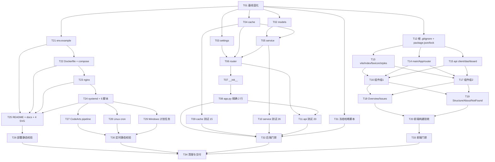

# RepoGuard 可视化看板、部署产物与定时巡检 — 编码任务清单

> 阶段：阶段 5「编码任务规划」
> 唯一依据：`.codeartsdoer/specs/dashboard_deploy/spec.md`（1479 行，已确认）、`.codeartsdoer/specs/dashboard_deploy/design.md`（2849 行，已确认）
> 文档性质：只描述"做什么、做到什么程度、如何验收"；本阶段不写产品代码。
> 仓库根：`C:\Users\anshuai\Desktop\RepoGuard`（下文所有"完整路径"均相对该根目录）
> 基线（已实测，T01 再次固化）：uv CPython 3.11.15 实跑 **377 条**（25 个 `test_*.py` + `webhook_helpers.py`），其中 **2 条既有符号链接失败**（`test_repo_walk`）、**2 skipped**；13 个冻结文件；`backend/requirements.txt` SHA-256 `18a816cd88636be844e7cd3a6662b2cdc2e13324420031f082a331a520b4bbcf`；`frontend/` 仅空目录骨架；根目录无 `.gitignore`；`deploy/` 与 `backend/app/dashboard/` 不存在；Node 实测 v24.19.0 / npm 11.17.0（兼容目标 `engines.node >= 22.12`）。

## 0. 全局约定（34 个任务共用）

### 0.1 测试口径（全文强制）
- 后端测试统一 `python -m unittest`：全量 `cd backend && $PY -m unittest discover -s tests -t .`；单文件 `cd backend && $PY -m unittest tests.test_dashboard_cache`。
- 接口级测试复用既有 `backend/tests/webhook_helpers.py::WebhookASGIClient`（内部为 `httpx.ASGITransport`，`raise_app_exceptions=False`），配合 `FrozenClock` 与 `no_network()`。
- **禁止**：以框架内置同步测试客户端组织用例、使用任何第三方测试运行器或其配置文件、启动真实监听端口、依赖独立服务进程、自建事件循环。
- 生产部署章节出现的服务进程启动命令（容器 CMD、systemd `ExecStart`、本地替代验证）属于**部署产物规格**，不得作为测试方式引用。
- 新增测试用例 61 条（T09 15 + T10 26 + T11 20）；全量预期 **377 + 61 = 438** 运行，其中 **434 通过 / 2 失败（既有符号链接，单列不修） / 2 skipped**。

### 0.2 解释器与工具
- `$PY` 表示 T01 固化的 uv CPython 3.11.15 解释器完整路径；T01 必须记录实际调用命令，后续所有后端命令以 `$PY` 替换字面 `python`。
- 系统默认 `python` 不可用（指向不存在的 `D:\python`），禁止使用。
- Node/npm 使用实测 v24.19.0 / npm 11.17.0；构建机需可联网执行 `npm ci`。
- 本机 `docker`、`nginx`、`hcloud`、`crontab` 均不可用：T21–T30 只做静态校验，`SKIP` 不得计入通过项。

### 0.3 变更边界（红线，任一违反即整体不通过）
- 禁止修改 **13 个冻结文件**：`backend/app/core/rules/engine.py`、`naming.py`、`code_scan.py`、`link_check.py`、`sensitive.py`、`rules/__init__.py`、`common/__init__.py`、`common/config.py`、`common/file_io.py`、`common/manifest.py`、`common/models.py`、`common/report.py`、`backend/tests/test_cli.py`。
- 禁止修改 **既有 25 个测试文件**（`backend/tests/test_*.py`）与 `backend/tests/webhook_helpers.py`。
- 禁止修改 `backend/requirements.txt`、`backend/app/static/index.html`、`backend/app/webhook/**`、`backend/app/api/**`（**仅 `app.py` 允许精确 +2 行**）。
- 禁止新增任何后端第三方依赖；禁止引入 `pinia`/`axios`/UI 组件库/前端测试框架。
- 禁止修改 `demo-repo/`、`docs/` 既有 4 份 `*_usage.md`、`.merkle-snapshot.json`、`.arts/`、`codearts_proof/`。
- 禁止真实上云、`docker build/push`、`hcloud`、真实 `nginx -t`/reload、真实 systemd 启动、真实注册计划任务、真实安装 cron。
- 禁止把 `frontend/node_modules/`、`frontend/dist/`、`artifacts/` 入库。
- 禁止修改 `spec.md` 与 `design.md`；禁止在本阶段写产品代码。
- 复用红线：`app.dashboard.*` **只允许**调用 `app.health.service.run_health_check()` 与 `app.readme.service.run_readme_scan()`，不得重写/复制/旁路检查规则，不得导入 `app.core.rules.*`、不得调用 `engine.run_check`/`walk_repository`/`detect_zombies`/`scan_documents`/`scan_demo_projects`。

### 0.4 分阶段门禁节奏
每个里程碑结束**停下等待用户确认**，确认后进入下一里程碑；不得跳阶段，不得先写下一篇文档或代码。

## 1. 任务拓扑、关键路径与里程碑

### 1.1 任务拓扑图



### 1.2 关键路径
`T01 → T02 → T04 → T05 → T06 → T07 → T08 → T11 → T32 → T34`
（后端主干最长；任一环节阻塞即整体阻塞。T09/T10 与主干并行，但 T32 依赖其完成。）

### 1.3 并行组

| 组 | 任务 | 说明 |
|----|------|------|
| G1 后端核心 | T02、T03、T04 | 三个文件互不依赖，可并行；T05 等 T02+T04 |
| G2 后端测试 | T09、T10、T11 | T09 只依赖 T04；T10 依赖 T05；T11 依赖 T06+T08 |
| G3 前端 | T13、T14、T15 → T16、T17 → T18、T19 | T12 为单一前置（依赖锁定）；T13/T14/T15 可并行 |
| G4 部署 | T21 → T22 → T23 → T24 | 也可 T21/T22/T23 并行起草，最终由 T24 依赖它们 |
| G5 定时 | T27、T28、T29 | 三者可并行；T30 串行汇总 |
| G6 门禁 | T31（可与 T12–T30 并行） | T32/T33/T34 串行收口 |

### 1.4 四个里程碑与确认点

| 里程碑 | 范围 | 达成判据 | 确认点 |
|--------|------|---------|--------|
| **M1 后端接口 + 测试** | T01–T11 | 四接口可导入；新增 61 条测试全通过；`app.py` 精确 +2 行；既有接口零修改 | **确认点 C1**（T01 后基线确认）与 **C2**（M1 后契约确认） |
| **M2 前端构建** | T12–T20 | `npm ci` + `npm run build` 成功；`dist/index.html` 存在；无外链；依赖精确锁定 | **确认点 C3** |
| **M3 部署 + 定时静态验收** | T21–T30 | 22 个 deploy 产物齐全非空；静态校验 PASS、工具缺失 SKIP 分列；4 项"未执行"声明齐备 | **确认点 C4** |
| **M4 全部门禁 / 交付** | T31–T34 | 438 运行（434 通过 / 2 既有失败单列 / 2 skipped）；冻结哈希差异 0；前端构建通过；临时文件已清理 | **确认点 C5**（最终交付） |

> 推荐分批确认：C1（基线）→ C2（后端）→ C3（前端）→ C4（部署与定时）→ C5（交付）。每个确认点须由用户明确回复"确认/OK"后才继续。

## 2. 后端基线与核心（T01–T07）

## T01 固化基线快照与环境记录

- **目标**：在动手前把不可回退的基线数字化固化，供后续所有门禁比对，避免"事后基线漂移"。
- **完整路径**：`artifacts/baseline/`（临时目录，已被 `.gitignore` 忽略；T12 前可先手工创建）
- **前置依赖**：无（起点）
- **执行步骤**：
  - [ ] 1. 确认 `.codeartsdoer/specs/dashboard_deploy/spec.md`（1479 行）与 `design.md`（2849 行）存在且未被修改。
  - [ ] 2. 记录 uv CPython 3.11.15 的完整解释器路径与实际调用命令，写入 `artifacts/baseline/env.txt`（作为全文 `$PY` 的来源）。
  - [ ] 3. 用 `$PY -c` 的 `hashlib` 分块计算并记录 13 个冻结文件、`backend/requirements.txt`、`backend/app/static/index.html` 的 SHA-256 到 `artifacts/baseline/hashes.txt`。
  - [ ] 4. 备份 `backend/app/api/app.py` 为 `artifacts/baseline/app.py.orig`（供 T08 精确 2 行 diff 使用）。
  - [ ] 5. 记录既有测试清单（25 个 `test_*.py` + `webhook_helpers.py`）与 `def test_` 计数（预期 377），以及 `test_repo_walk` 的 2 条符号链接失败明细。
  - [ ] 6. 记录 `node -v`、`npm -v` 实测值；确认 `frontend/` 仅有 `public/`、`src/{api,assets,components,router,views}` 空目录；确认根无 `.gitignore`、`deploy/` 与 `backend/app/dashboard/` 不存在。
  - [ ] 7. 记录本机工具可用性矩阵（docker/nginx/hcloud/crontab 均不可用；git 可用）。
- **验收标准**：
  - [ ] `artifacts/baseline/hashes.txt` 中 `backend/requirements.txt` 等于 `18a816cd88636be844e7cd3a6662b2cdc2e13324420031f082a331a520b4bbcf`，`static/index.html` 等于 `a1ae9d8a47169ff0792ac7516e51c194d8daa24c69048379094d6eaf70315aa8`。
  - [ ] 13 个冻结文件哈希全部记录成功，无缺失（缺失即停）。
  - [ ] 测试计数为 377；若实测不等于 377，立即停止并登记差异，不得自行改口径。
  - [ ] `artifacts/baseline/app.py.orig` 与当前 `app.py` 完全一致（`git diff --no-index --numstat` 输出为空差异）。
  - [ ] 本任务不修改任何受版本管理的文件。
- **并行**：不可并行（全局前置）；**下一任务**：T02（T02–T04 可并行启动）

## T02 实现看板数据模型 `models.py`

- **目标**：提供全部只读数据结构与安全序列化函数，作为缓存与响应的唯一数据载体；不含业务逻辑与 I/O。
- **完整路径**：`backend/app/dashboard/models.py`
- **前置依赖**：T01
- **公开签名（必须与 design 2.4.3 逐字一致）**：
  ```text
  @dataclass(frozen=True, slots=True)
  class RepoDescriptor: id: str; label: str; is_default: bool
  class ItemReason: item: str; reason: str
  class ModuleCount: module: str; count: int
  class TypeCount: type: str; count: int
  class FileCount: file_path: str; issue_count: int
  class RuleCount: rule_id: str; count: int
  class ModuleRisk: module: str; high: int; suggestion: int
  class PathTitle: path: str; title: str
  class DiffProjection: change_type: str; path: str; old_title: str|None; new_title: str|None; old_position: int|None; new_position: int|None
  class TocItemProjection: kind: str; path: str; title: str; depth: int; link: str|None; anchor: str|None; confidence: str|None
  class SectionProjection: name: str; items: tuple[TocItemProjection, ...]
  class IndexProjection: document_section: SectionProjection; demo_section: SectionProjection; root_readme_path: str|None
  class DemoProjection: confirmed_items: tuple[PathTitle, ...]; suspected_count: int
  class ReadmeProjection: status: str; format_version: str; document_count: int; demo_project_count: int; demo_project_suspected_count: int; readme_found: bool; readme_path: str|None; toc_block_found: bool; toc_marker_kind: str|None; diffs: tuple[DiffProjection, ...]; undetermined: tuple[ItemReason, ...]; degraded: tuple[ItemReason, ...]; warnings: tuple[str, ...]; index_markdown: str
  class SnapshotMeta: status: str; scanned_at: str; duration_ms: int; cached: bool; cache_age_seconds: int; refresh_throttled: bool; ttl_seconds: int; degraded: tuple[ItemReason, ...]; warnings: tuple[str, ...]
  class IssueRecord: file_path: str; line_no: int|None; rule_id: str; source_module: str; risk_level: str; message: str; suggestion: str; excerpt: str|None
  class IssuePage: items: tuple[IssueRecord, ...]; page: int; page_size: int; total: int; total_pages: int; filters: Mapping[str, str]; sort: Mapping[str, str]; rule_breakdown: tuple[RuleCount, ...]; module_risk_matrix: tuple[ModuleRisk, ...]; counts: Mapping[str, int]
  class DashboardSnapshot: repo: RepoDescriptor; snapshot: SnapshotMeta; summary: Mapping[str, int]; risk_breakdown: Mapping[str, int]; module_breakdown: tuple[ModuleCount, ...]; file_type_breakdown: tuple[TypeCount, ...]; top_files: tuple[FileCount, ...]; files_count: int; zombie_candidates_count: int; undetermined_count: int; issues: tuple[IssueRecord, ...]; readme: ReadmeProjection
  class DashboardStructure: repo: RepoDescriptor; snapshot: SnapshotMeta; readme: ReadmeProjection; index: IndexProjection; demo: DemoProjection
  def to_dict(value: object) -> dict[str, object]
  ```
- **执行步骤**：
  - [ ] 1. 创建目录 `backend/app/dashboard/`（不新建其他平行包）。
  - [ ] 2. 按上表声明顺序实现 19 个 frozen dataclass，字段顺序不得调整（序列化键序依赖它）。
  - [ ] 3. 实现 `to_dict`：支持 dataclass（按 `dataclasses.fields` 顺序）、`tuple`/`list`、`Mapping`、`str`/`int`/`float`/`bool`/`None`；遇到 `pathlib.Path` 抛 `TypeError("禁止序列化路径对象")`；遇到 `Enum` 或其他对象抛 `TypeError`。
  - [ ] 4. 不导入 `pathlib` 以外任何第三方模块；不访问文件系统。
- **验收标准**：
  - [ ] `$PY -m py_compile backend/app/dashboard/models.py` 退出码 0。
  - [ ] `$PY -c` 断言 `RepoDescriptor.__dataclass_fields__` 键序为 `id,label,is_default`，`DashboardSnapshot` 末字段为 `readme`。
  - [ ] `to_dict(DashboardSnapshot(...))` 输出为纯 JSON 可序列化对象，且 `json.dumps(..., ensure_ascii=False)` 成功。
  - [ ] `to_dict(Path("x"))` 抛 `TypeError`，错误文本为"禁止序列化路径对象"。
  - [ ] 文件内无 `open(`、无 `Path.glob`、无 `os.walk`。
- **并行**：与 T03、T04 可并行；**下一任务**：T05（T05 依赖本任务）

## T03 实现看板配置 `settings.py`

- **目标**：独立实现看板专属配置读取与越界回退，不修改 `app/api/settings.py`，不与其耦合。
- **完整路径**：`backend/app/dashboard/settings.py`
- **前置依赖**：T01
- **公开签名（必须与 design 2.4.2 一致）**：
  ```text
  ENV_PREFIX: str = "REPOGUARD_DASHBOARD_"
  CACHE_TTL_ENV / CACHE_CAPACITY_ENV / SCAN_TIMEOUT_ENV / MAX_CONCURRENCY_ENV
  QUEUE_TIMEOUT_ENV / REFRESH_MIN_INTERVAL_ENV / MAX_PAGE_SIZE_ENV / MAX_KEYWORD_LENGTH_ENV / ENABLE_README_ENV
  @dataclass(frozen=True, slots=True) class DashboardSettings:
      cache_ttl_seconds: int = 60
      cache_capacity: int = 8
      scan_timeout_seconds: int = 30
      max_concurrency: int = 2
      queue_timeout_seconds: int = 5
      refresh_min_interval_seconds: int = 10
      max_page_size: int = 100
      max_keyword_length: int = 64
      enable_readme: bool = True
  def default_dashboard_settings() -> DashboardSettings
  def load_dashboard_settings_from_env(env: Mapping[str, str] | None = None) -> DashboardSettings
  def settings_summary(settings: DashboardSettings) -> dict[str, object]
  ```
- **执行步骤**：
  - [ ] 1. 实现 9 个环境变量常量，取值分别为 `REPOGUARD_DASHBOARD_CACHE_TTL_SECONDS`、`..._CACHE_CAPACITY`、`..._SCAN_TIMEOUT_SECONDS`、`..._MAX_CONCURRENCY`、`..._QUEUE_TIMEOUT_SECONDS`、`..._REFRESH_MIN_INTERVAL_SECONDS`、`..._MAX_PAGE_SIZE`、`..._MAX_KEYWORD_LENGTH`、`..._ENABLE_README`。
  - [ ] 2. 整型解析遵循"失败或越界 → 默认值 + `LOGGER.warning`"，`bool` 不得当作整数；范围：TTL 0–600、容量 1–32、扫描 5–120、并发 1–4、排队 0–30、刷新间隔 0–60、分页 10–200、关键词 8–256。
  - [ ] 3. 布尔解析白名单 `{"1","true","yes","on"}` / `{"0","false","no","off"}`，其他回退默认并 WARNING。
  - [ ] 4. `settings_summary` 只输出 9 个数值/布尔键，不含路径。
  - [ ] 5. 不导入 `app.api.settings`，不读文件系统，不抛异常中断启动。
- **验收标准**：
  - [ ] `$PY -m py_compile backend/app/dashboard/settings.py` 退出码 0。
  - [ ] `load_dashboard_settings_from_env({}) == DashboardSettings()` 为真。
  - [ ] `load_dashboard_settings_from_env({"REPOGUARD_DASHBOARD_CACHE_TTL_SECONDS": "99999"})` 得到 `cache_ttl_seconds == 60`，且日志出现一条 WARNING。
  - [ ] `ENABLE_README=maybe` 回退为 `True` 并 WARNING；`ENABLE_README=off` 为 `False`。
  - [ ] `settings_summary()` 键集合恰为 9 个，且无任何 `Path`/绝对路径。
- **并行**：与 T02、T04 可并行；**下一任务**：T06（T06 依赖本任务）

## T04 实现快照缓存 `cache.py`

- **目标**：实现进程内 LRU + TTL + 单飞 + 强制刷新节流 + 跨仓库并发闸门；失败结果永不入缓存。
- **完整路径**：`backend/app/dashboard/cache.py`
- **前置依赖**：T01
- **公开签名（必须与 design 2.4.4 一致）**：
  ```text
  @dataclass(frozen=True, slots=True) class CacheMeta: cached: bool; age_seconds: int; refresh_throttled: bool
  class CacheBusyError(Exception)
  class CacheTimeoutError(Exception)
  class SnapshotCache:
      def __init__(self, ttl_seconds: int, capacity: int, *, max_concurrency: int = 2,
                   queue_timeout_seconds: float = 5.0, refresh_min_interval_seconds: float = 10.0,
                   clock: Callable[[], float] = time.monotonic) -> None
      def get(self, key: str) -> tuple[object | None, int]
      def set(self, key: str, value: object) -> None
      def get_or_load(self, key: str, loader: Callable[[], T], *, force: bool = False,
                      deadline: float | None = None) -> tuple[T, CacheMeta]
      def clear(self) -> None
      def stats(self) -> dict[str, int]
  ```
- **执行步骤**：
  - [ ] 1. 内部结构：`_entries: OrderedDict[str, _Entry(value, stored_at, expires_at)]`、`_inflight: dict[str, _Flight(event, value, error)]`、`_lock: RLock`、`_gate: BoundedSemaphore(max_concurrency)`、`_counters`（`hits/misses/loads/failures/evictions/throttled/waits/busy/timeouts`）。
  - [ ] 2. 命中路径：`force=False` 直接返回 `CacheMeta(cached=True, age_seconds=floor(age), refresh_throttled=False)`；`force=True` 且 `age < refresh_min_interval` 返回 `refresh_throttled=True` 并 `throttled+1`；否则走重建。
  - [ ] 3. 单飞：同键已有 flight 时作为 waiter，`event.wait` 复用 leader 结果；leader 异常原样抛给 waiter。
  - [ ] 4. 闸门：leader `_gate.acquire(timeout=queue_timeout_seconds)` 失败 → 抛 `CacheBusyError` 并 `busy+1`。
  - [ ] 5. 时间预算：`deadline` 存在且已过 → 不调用 loader 直接 `CacheTimeoutError`；loader 返回后若已过 deadline → 丢弃结果、不写缓存、抛 `CacheTimeoutError`。
  - [ ] 6. TTL/LRU：`expires_at = stored_at + ttl_seconds`；`ttl_seconds == 0` 时 `set` 为空操作且每次回源；写入前若满则 `popitem(last=False)` 并 `evictions+1`。
  - [ ] 7. `clear()` 清空条目、逐个 `event.set()` 唤醒 waiter、计数归零；`stats()` 返回副本。
  - [ ] 8. 锁临界区严格按 design 2.5.1：持锁内禁止调用 loader、`event.wait`、日志 I/O。
- **验收标准**：
  - [ ] `$PY -m py_compile backend/app/dashboard/cache.py` 退出码 0。
  - [ ] 不依赖 `app.*` 任何模块（仅标准库），`$PY -c "import ast..."` 或 `grep` 断言文件内无 `from app.`。
  - [ ] `get_or_load` 在 `ttl_seconds=0` 时连续两次均调用 loader。
  - [ ] 无任何文件写入/网络调用。
- **并行**：与 T02、T03 可并行；**下一任务**：T05、T06、T09（均依赖本任务）

## T05 实现看板聚合服务 `service.py`

- **目标**：完成"仓库令牌 ↔ 路径、一次快照构建、总览聚合、问题分页、结构映射、脱敏"的全部纯函数逻辑。
- **完整路径**：`backend/app/dashboard/service.py`
- **前置依赖**：T02、T04（T04 仅用于异常类复用约定；无循环导入）
- **公开签名（必须与 spec 9.1 / design 2.4.5 一致）**：
  ```text
  def list_repos(settings: WebSettings) -> tuple[RepoDescriptor, ...]
  def resolve_dashboard_repo(token: str | None, settings: WebSettings) -> Path
  def snapshot_key(repo_root: Path) -> str
  def load_snapshot(repo_root: Path, *, health_runner: Callable[..., HealthReport] = run_health_check,
                    readme_runner: Callable[..., ReadmeReport] = run_readme_scan,
                    readme_enabled: bool = True) -> DashboardSnapshot
  def build_overview(snapshot: DashboardSnapshot) -> dict[str, object]
  def query_issues(snapshot: DashboardSnapshot, *, risk_level: str, source_module: str, keyword: str,
                   page: int, page_size: int, sort_field: str, order: str) -> IssuePage
  def build_structure(snapshot: DashboardSnapshot) -> dict[str, object]
  class SnapshotUnavailableError(Exception)   # design 2.4.6 错误映射所需
  ```
- **执行步骤**：
  - [ ] 1. 顶层导入仅限：`app.api.security.resolve_repo_root`、`app.api.settings.WebSettings/default_repo_root`、`app.health.models`、`app.health.service.run_health_check`、`app.readme.models`、`app.readme.service.run_readme_scan`、`app.dashboard.*`、标准库。
  - [ ] 2. `list_repos`：遍历 `allowed_repo_roots`（已规范化），`id = root.name`，`casefold` 冲突时改 `f"{name}-{sha256(path)[:8]}"`，`label = id`，`is_default` 与 `default_repo_root()` 一致。
  - [ ] 3. `resolve_dashboard_repo`：先建 `{id: Path}` 映射；命中则 `resolve_repo_root(str(path), settings)`；未命中则 `resolve_repo_root(token, settings)`；`None`/空串交给 `resolve_repo_root("")` 走默认仓库；异常原样抛出。
  - [ ] 4. `snapshot_key`：`sha256(normcase(str(repo_root.resolve())))` 十六进制 64 位；仅内部使用。
  - [ ] 5. `load_snapshot` 严格按 design 2.4.5.1：health 恰好 1 次 → `INPUT_ERROR` 抛 `SnapshotUnavailableError` → `readme_enabled` 时 readme 恰好 1 次（`INPUT_ERROR` 同样抛）→ 合成 `SnapshotMeta`（`duration_ms = health.meta.duration_ms + readme.duration_ms`）→ 统计自洽校验（不一致则置「部分降级」+ `报告` 降级项 + warning）→ 返回 frozen 快照。`cached/age/throttled` 恒为 `False/0/False`（由 router 注入）。
  - [ ] 6. 聚合：`risk_breakdown` 取 `summary.must_fix_count/suggestion_count`；`module_breakdown` 固定四模块顺序（`命名与目录检查`、`代码检查`、`链接检查`、`敏感信息与大文件检查`），未知模块（`报告`）追加末尾；`file_type_breakdown` 固定 `markdown/code/other`（扩展名映射按 design 2.4.5.2，只用路径字符串不访问文件系统）；`top_files` 按 `(-issue_count, file_path)` 取前 10。
  - [ ] 7. 筛选：`risk_level`（all/high/suggestion）、`source_module`（all/中文模块）、`keyword`（strip 后为空不过滤；`casefold()` 子串匹配 `file_path/rule_id/message/suggestion`，不解释正则）。
  - [ ] 8. 排序：按 design 2.4.5.2 六种 `sort_field` 的主键元组；`order=desc` 整体 reverse；默认 `risk_level asc`（高风险在前、同风险路径升序、空行号靠后）。
  - [ ] 9. 分页：`total=len(filtered)`；`total_pages = 0 if total == 0 else ceil(total/page_size)`；越界返回空 `items`；`counts` 与 `rule_breakdown`（Top 10）、`module_risk_matrix`（固定四模块）均基于筛选后集合。
  - [ ] 10. 脱敏：`_safe_relative()` 覆盖 `file_path/readme_path/index.*.path/demo.*.path`；不输出 `scan_root`、`replacement_block`；`excerpt` 原样透传。
  - [ ] 11. 结构映射：`build_structure` 返回 `{repo, snapshot, readme, index, demo}`；`readme_enabled=False` 时合成降级结构并标注，不虚构文档数；`demo` 只含 `confirmed_items` 与 `suspected_count`（无明细）。
- **验收标准**：
  - [ ] `$PY -m py_compile backend/app/dashboard/service.py` 退出码 0。
  - [ ] `$PY -c "import inspect; from app.dashboard.service import load_snapshot; print(inspect.signature(load_snapshot))"` 输出含 `health_runner=run_health_check`、`readme_runner=run_readme_scan`、`readme_enabled=True`。
  - [ ] 静态扫描本文件：无 `engine.run_check`、`walk_repository`、`detect_zombies`、`scan_documents`、`scan_demo_projects`、`os.walk`、`.glob(`、`open(`。
  - [ ] 静态扫描本文件：无 `from app.core.rules`、`import app.core.rules`。
  - [ ] `grep -n "run_health_check\|run_readme_scan"` 中，仅出现在导入与 `load_snapshot` 默认参数处，无二次包装。
- **并行**：不可与 T02/T04 并行（依赖其完成）；与 T03 无依赖，可并行；**下一任务**：T06、T10

## T06 实现看板路由 `router.py`

- **目标**：暴露 4 个只读 GET 端点，完成参数白名单、依赖注入、缓存单例、错误映射与结构化日志；不触碰既有中间件与处理器。
- **完整路径**：`backend/app/dashboard/router.py`
- **前置依赖**：T03、T04、T05
- **公开签名（必须与 design 2.4.6 一致）**：
  ```text
  router: APIRouter = APIRouter(tags=["dashboard"])
  LOGGER = logging.getLogger("repoguard.dashboard")
  def get_web_settings(request: Request) -> WebSettings
  def get_dashboard_settings(request: Request) -> DashboardSettings
  def get_cache(request: Request) -> SnapshotCache
  def get_health_runner() -> Callable[..., HealthReport]
  def get_readme_runner() -> Callable[..., ReadmeReport]
  @router.get("/repos")     -> JSONResponse
  @router.get("/overview")  -> JSONResponse
  @router.get("/issues")    -> JSONResponse
  @router.get("/structure") -> JSONResponse
  ```
- **执行步骤**：
  - [ ] 1. 模块级只创建 `router` 与 `LOGGER`，**不创建全局缓存实例**；缓存挂 `app.state.dashboard_cache`，配置挂 `app.state.dashboard_settings`（懒初始化）。
  - [ ] 2. `get_web_settings` 读 `request.app.state.settings`，缺失抛 `ApiError("DASHBOARD_UNAVAILABLE", 503)`。
  - [ ] 3. `get_health_runner`/`get_readme_runner` 运行期 `import` 既有 service 函数，不可导入/不可调用时抛 `ApiError("DASHBOARD_UNAVAILABLE", 503)`（与既有 `get_engine` 同风格）。
  - [ ] 4. `_prepare` 顺序固定：`refresh ∈ {0,1}` → 白名单非空 → `resolve_dashboard_repo` → 构造 `RepoDescriptor` → `snapshot_key` → `deadline = monotonic() + scan_timeout_seconds` → 取缓存 → `dataclasses.replace` 注入 `cached/cache_age_seconds/refresh_throttled`。
  - [ ] 5. 参数校验顺序：`refresh` → `risk_level` → `source_module` → `keyword` 长度 ≤ `max_keyword_length` → `sort` → `order` → 仓库解析；非法枚举抛 `ApiError("INVALID_QUERY_PARAM", 400, "查询参数不合法", "字段：<name>")`。
  - [ ] 6. 类型/范围交由 `Query(ge/le)` 声明（`page` 1–10000、`page_size` 1–100），由既有处理器返回 422 `VALIDATION_ERROR`。
  - [ ] 7. `_obtain` 错误映射唯一入口：`RepoPathError`/`ApiError` 原样；`CacheBusyError` → 429 `DASHBOARD_BUSY`；`CacheTimeoutError`/`TimeoutError` → 504 `DASHBOARD_TIMEOUT`；`SnapshotUnavailableError` → 503 `DASHBOARD_UNAVAILABLE`；其他 → 记录 `request_id` 后 500 `INTERNAL_ERROR`。
  - [ ] 8. 阻塞调用经 `await asyncio.wait_for(asyncio.to_thread(cache.get_or_load, ...), timeout=scan_timeout + queue_timeout + 1.0)`。
  - [ ] 9. `/repos` 不经过缓存、不调用 runner；白名单为空返回 503。
  - [ ] 10. 每个数据端点写一条 JSON 单行日志：`request_id`、`repo_label`、`repo_hash`（key 前 12 位）、`cached`、`cache_age_seconds`、`duration_ms`、`scan_duration_ms`、`status_code`、`error_code`。
  - [ ] 11. 响应显式设置 `Content-Type: application/json; charset=utf-8` 与 `Cache-Control: no-store`；不新增中间件与异常处理器。
- **验收标准**：
  - [ ] `$PY -m py_compile backend/app/dashboard/router.py` 退出码 0。
  - [ ] `$PY -c "from app.dashboard.router import router; print([(r.path, sorted(r.methods)) for r in router.routes])"` 输出 4 条路由，方法集合均为 `{'GET'}`。
  - [ ] `$PY -c "import sys; import app.dashboard.router; assert not any(m.startswith('app.core.rules') for m in sys.modules)"` 退出码 0（导入隔离）。
  - [ ] 静态扫描：无 `app.api.app` 导入、无 `app.webhook` 导入、无 `app.core.rules` 导入。
  - [ ] 静态扫描：无新增全局异常处理器（无 `@app.exception_handler`）。
- **并行**：不可并行（依赖 T03/T04/T05）；**下一任务**：T07

## T07 实现包导出 `__init__.py`

- **目标**：提供包标记与零风险再导出，保证宿主导入不因引擎缺失而失败。
- **完整路径**：`backend/app/dashboard/__init__.py`
- **前置依赖**：T06
- **公开签名（必须与 design 2.4.1 一致）**：
  ```text
  from app.dashboard.router import router
  from app.dashboard.settings import DashboardSettings
  __all__: tuple[str, ...] = ("router", "DashboardSettings")
  ```
- **执行步骤**：
  - [ ] 1. 只写两条再导出与 `__all__`，不加任何初始化副作用（不建缓存、不读环境变量）。
  - [ ] 2. 不导入 `app.core.rules.*`、`app.webhook.*`、`app.api.app`。
- **验收标准**：
  - [ ] `$PY -m py_compile backend/app/dashboard/__init__.py` 退出码 0。
  - [ ] `$PY -c "from app.dashboard import router, DashboardSettings; print(router.prefix)"` 退出码 0（`prefix` 为空串，由宿主注入 `/api/dashboard`）。
  - [ ] `$PY -c "import sys, app.dashboard; assert 'app.core.rules.engine' not in sys.modules"` 退出码 0。
- **并行**：不可并行；**下一任务**：T08

## 3. 挂载与后端测试（T08–T11）

## T08 在 `app.py` 精确新增 2 行挂载

- **目标**：以最小增量把 dashboard router 挂到 `/api/dashboard`，保持既有中间件、异常处理器、静态挂载、CORS、lifespan 与 `/api/review`、`/api/health` 行为完全不变。
- **完整路径**：`backend/app/api/app.py`（唯一允许改动的既有文件）
- **前置依赖**：T07
- **精确 diff（只允许这两行）**：
  ```diff
  --- a/backend/app/api/app.py
  +++ b/backend/app/api/app.py
  @@ -24,6 +24,7 @@
   from app.api.schemas import error_payload
   from app.api.security import RepoPathError
   from app.api.settings import WebSettings, load_settings_from_env, normalize_settings, settings_summary
  +from app.dashboard.router import router as dashboard_router
  
   LOGGER = logging.getLogger("repoguard.api.app")
  @@ -179,6 +180,7 @@
       _configure_middleware(app, effective_settings)
       _register_exception_handlers(app)
       app.include_router(router, prefix="/api")
  +    app.include_router(dashboard_router, prefix="/api/dashboard")
       _mount_static(app, effective_settings)
       _configure_cors(app, effective_settings)
       return app
  ```
- **执行步骤**：
  - [ ] 1. 在第 25 行后新增 import 行（变更后位于第 26 行）。
  - [ ] 2. 在既有 `app.include_router(router, prefix="/api")` 之后新增 `include_router` 行（变更后位于第 183 行），且仍位于 `_mount_static` 之前。
  - [ ] 3. 不做任何其他改动：不碰 `lifespan`（145–160）、`_configure_middleware`（53–80）、`_register_exception_handlers`（83–118）、`_mount_static`（121–130）、`_configure_cors`（133–142）、不新增 `app.state` 初始化、不挂载 webhook。
- **验收标准**：
  - [ ] `git diff --no-index --numstat artifacts/baseline/app.py.orig backend/app/api/app.py` 输出新增行数 2、删除行数 0（形如 `2	0`）。
  - [ ] `git diff --no-index -U0 artifacts/baseline/app.py.orig backend/app/api/app.py` 仅显示上述 2 个 `+` 行，无其他 `+`/`-`。
  - [ ] 文件总行数 187 → 189。
  - [ ] `$PY -m py_compile backend/app/api/app.py` 退出码 0。
  - [ ] `$PY -c "from app.api.app import create_app; app = create_app(); print([r.path for r in app.routes if 'dashboard' in r.path])"` 输出 4 条 `/api/dashboard/*` 路径，且不含 `/webhook`。
  - [ ] `git diff --no-index --numstat` 对 13 个冻结文件与 `requirements.txt`、`static/index.html` 均为空差异。
- **并行**：不可并行；与 T09/T10 可并行（测试只依赖各自模块）；**下一任务**：T11、T32

## T09 编写缓存测试 `test_dashboard_cache.py`（15 条）

- **目标**：用标准库 `unittest` 覆盖 TTL/LRU/单飞/失败不缓存/节流/deadline/闸门/计数/重置，全部使用 `FrozenClock` 与线程同步，不使用真实端口。
- **完整路径**：`backend/tests/test_dashboard_cache.py`
- **前置依赖**：T04
- **覆盖清单（15 条，方法名必须一致）**：

  | 编号 | 方法名 | 覆盖点 |
  |------|--------|--------|
  | T-C01 | `test_get_missing_returns_none_and_zero` | 未命中返回 `(None, 0)` |
  | T-C02 | `test_set_then_get_returns_value_and_age` | 写入后可读，`age` 为非负整数 |
  | T-C03 | `test_ttl_expiry_removes_entry` | `FrozenClock` 推进过 TTL 后为 `(None, 0)`，条目删除 |
  | T-C04 | `test_ttl_zero_disables_store` | `ttl=0` 时 `set` 不写入、每次回源 |
  | T-C05 | `test_lru_eviction_keeps_capacity` | 容量 2 写 3 条，最旧被淘汰 |
  | T-C06 | `test_lru_hit_refreshes_recency` | 命中后 `move_to_end`，淘汰顺序正确 |
  | T-C07 | `test_single_flight_same_key_loads_once` | 5 线程并发同键，`loader` 只 1 次 |
  | T-C08 | `test_single_flight_propagates_loader_error` | leader 异常被 waiter 原样收到，缓存为空 |
  | T-C09 | `test_failure_is_not_cached` | 失败后再次请求重新调用 `loader` |
  | T-C10 | `test_force_refresh_throttled_within_interval` | `force=True` 且 `age<10s` → `cached=True`、`refresh_throttled=True` |
  | T-C11 | `test_force_refresh_reloads_after_interval` | `age>=10s` 时重建，`cached=False` |
  | T-C12 | `test_deadline_exceeded_discards_late_result` | deadline 已过：抛 `CacheTimeoutError`，缓存不变 |
  | T-C13 | `test_queue_timeout_raises_busy` | 额度占满且 `queue_timeout=0` → `CacheBusyError` |
  | T-C14 | `test_stats_counters_increment` | 9 个计数器各自递增正确 |
  | T-C15 | `test_clear_resets_entries_and_stats` | `clear()` 后条目为空、计数归零、waiter 被唤醒 |

- **执行步骤**：
  - [ ] 1. 从 `tests.webhook_helpers` 导入 `FrozenClock`（复用既有 helper，不改动该文件）。
  - [ ] 2. 每个用例独立构造 `SnapshotCache`，禁止跨用例共享状态；并发用例使用 `threading.Barrier` 对齐起跑。
  - [ ] 3. 断言只针对公开行为（返回值、异常类型、`stats()` 计数），不访问私有字段。
  - [ ] 4. 不使用 `sleep` 做时间推进（一律 `FrozenClock.advance`）；线程等待使用 `Event`/`Barrier`，设置合理超时避免挂死。
- **验收标准**：
  - [ ] `cd backend && $PY -m unittest tests.test_dashboard_cache` 输出 `Ran 15 tests`，`OK`。
  - [ ] `$PY -m unittest discover -s tests -t .` 中新增用例不改变既有 377 条计数口径。
  - [ ] 文件不含 `time.sleep` 之外的真实时钟依赖；无网络调用；无临时文件写入。
  - [ ] 未修改 `webhook_helpers.py` 与任何既有测试文件。
- **并行**：与 T08、T10、T11 可并行；**下一任务**：T32

## T10 编写服务测试 `test_dashboard_service.py`（26 条）

- **目标**：覆盖仓库令牌映射、快照调用次数与合并语义、总览聚合、分页排序筛选、结构映射与路径脱敏。
- **完整路径**：`backend/tests/test_dashboard_service.py`
- **前置依赖**：T05
- **覆盖清单（26 条；design 5.3 标题写"22 条"为笔误，以本清单 26 条为准）**：

  | 编号 | 方法名 | 覆盖点 |
  |------|--------|--------|
  | T-S01 | `test_list_repos_returns_unique_relative_ids` | 同名目录生成不同 `id`（短哈希），不含分隔符/盘符 |
  | T-S02 | `test_list_repos_marks_default_once` | 有且仅有一个 `is_default=True` |
  | T-S03 | `test_list_repos_empty_without_roots` | 无允许根返回空元组 |
  | T-S04 | `test_resolve_dashboard_repo_by_token` | 令牌 → 绝对路径，等于 `resolve_repo_root` 结果 |
  | T-S05 | `test_resolve_dashboard_repo_rejects_parent_segment` | `..` → `RepoPathError(REPO_FORBIDDEN, 403)` |
  | T-S06 | `test_resolve_dashboard_repo_rejects_outside_root` | 允许根外绝对路径 → 403 |
  | T-S07 | `test_snapshot_key_is_stable_hash` | 同路径稳定、异路径不同、64 位十六进制 |
  | T-S08 | `test_load_snapshot_calls_each_runner_once` | health 1 次、readme 1 次 |
  | T-S09 | `test_load_snapshot_skips_readme_when_disabled` | `enable_readme=False`：readme 0 次，结构降级 |
  | T-S10 | `test_load_snapshot_health_input_error_raises` | health 输入错误 → `SnapshotUnavailableError` |
  | T-S11 | `test_load_snapshot_merges_degraded_and_warnings` | 两侧降级/警告合并、去重、保序 |
  | T-S12 | `test_load_snapshot_duration_is_measured_sum` | `duration_ms == health.meta.duration_ms + readme.duration_ms` |
  | T-S13 | `test_overview_summary_matches_health` | 7 个 `summary` 字段一致 |
  | T-S14 | `test_overview_risk_breakdown` | `high/suggestion` 与扁平化计数一致 |
  | T-S15 | `test_overview_module_breakdown_has_four_modules` | 固定四模块顺序，未知模块追加 |
  | T-S16 | `test_overview_file_type_breakdown_has_three_keys` | `markdown/code/other` 存在且合计等于文件数 |
  | T-S17 | `test_overview_top_files_order_and_limit` | 数量降序、同数路径升序、最多 10 项 |
  | T-S18 | `test_query_issues_default_sort_high_first` | 默认高风险在前、空行号靠后 |
  | T-S19 | `test_query_issues_pagination_boundary` | 越界页空 `items` 且 `total` 正确；空集 `total_pages=0` |
  | T-S20 | `test_query_issues_filter_combination` | 风险 + 模块 + 关键词组合过滤 |
  | T-S21 | `test_query_issues_keyword_case_insensitive_literal` | 大小写不敏感；`.*` 按字面匹配 |
  | T-S22 | `test_query_issues_charts_and_counts` | `rule_breakdown` Top10、`module_risk_matrix` 四模块、`counts` 自洽 |
  | T-S23 | `test_structure_maps_readme_fields` | 字段逐项映射正确、`format_version="1.0"` |
  | T-S24 | `test_structure_suspected_has_count_only` | 疑似只有计数、无明细字段 |
  | T-S25 | `test_structure_readme_disabled_degraded` | 关闭时标记降级且不虚构文档数 |
  | T-S26 | `test_all_paths_are_relative` | 所有输出路径不含盘符、`\\`、绝对前缀 |

- **执行步骤**：
  - [ ] 1. 用内存构造的 `HealthReport`/`ReadmeReport`（冻结 dataclass）做主要夹具，必要时用 `tempfile.TemporaryDirectory()` 建临时仓库；禁止依赖 `demo-repo` 真实内容与开发者绝对路径。
  - [ ] 2. 用普通函数桩替代 `health_runner`/`readme_runner`，并统计调用次数（`list.append` 计数），断言"恰好一次/零次"。
  - [ ] 3. 聚合断言覆盖 7 个 `summary` 字段与 4 张总览图表字段；分页断言使用连续翻页并集等于 `total` 且无重复。
  - [ ] 4. 脱敏断言显式使用 Windows 盘符、UNC 前缀、POSIX 绝对路径三种输入，断言输出只剩相对路径。
  - [ ] 5. 所有临时目录用 `addCleanup(shutil.rmtree)` 清理。
- **验收标准**：
  - [ ] `cd backend && $PY -m unittest tests.test_dashboard_service` 输出 `Ran 26 tests`，`OK`。
  - [ ] 用例中无 `http`/`httpx`/端口/服务进程依赖；无 `sleep`。
  - [ ] 未修改任何既有测试文件与被测源码（本任务只新增测试文件）。
- **并行**：与 T08、T09、T11 可并行；**下一任务**：T32

## T11 编写接口测试 `test_dashboard_api.py`（20 条）

- **目标**：验证 4 个端点契约、错误矩阵、405、429/503/504、响应头、只读性与无网络，全部经既有 `WebhookASGIClient`（`httpx.ASGITransport`）在内存内调用。
- **完整路径**：`backend/tests/test_dashboard_api.py`
- **前置依赖**：T06、T08
- **覆盖清单（20 条）**：

  | 编号 | 方法名 | 覆盖点 |
  |------|--------|--------|
  | T-A01 | `test_repos_returns_default_flag` | 200；`default_repo` 与 `is_default` 一致 |
  | T-A02 | `test_repos_hides_absolute_paths` | 响应文本不含盘符/`C:\Users`/`/home/` |
  | T-A03 | `test_overview_success_has_all_required_fields` | spec 6.2 必填字段齐全（含 `charts.*`） |
  | T-A04 | `test_overview_second_request_cached` | 第二次 `cached=true`、`cache_age_seconds<60` |
  | T-A05 | `test_overview_refresh_throttled` | 10s 内两次 `refresh=1` → `refresh_throttled=true` 且 200 |
  | T-A06 | `test_issues_invalid_sort_returns_400` | `sort=password` → 400 `INVALID_QUERY_PARAM` |
  | T-A07 | `test_issues_invalid_refresh_returns_400` | `refresh=2` → 400 |
  | T-A08 | `test_issues_page_size_over_limit_returns_422` | `page_size=200` → 422 `VALIDATION_ERROR` |
  | T-A09 | `test_issues_keyword_too_long_returns_400` | 65 字符 → 400 |
  | T-A10 | `test_issues_pagination_and_sort_stable` | 连续翻页并集等于 `total`、无重复 |
  | T-A11 | `test_structure_fields_and_no_suspected_detail` | 结构字段齐全；疑似仅计数 |
  | T-A12 | `test_post_method_returns_405` | POST 四接口 → 405 `METHOD_NOT_ALLOWED` |
  | T-A13 | `test_forbidden_repo_returns_403` | `repo=..\..\Windows` → 403 `REPO_FORBIDDEN` |
  | T-A14 | `test_missing_repo_returns_404` | 白名单内不存在目录 → 404 `REPO_NOT_FOUND` |
  | T-A15 | `test_busy_returns_429` | 注入 `CacheBusyError` → 429 `DASHBOARD_BUSY` |
  | T-A16 | `test_timeout_returns_504` | 注入 `CacheTimeoutError` → 504 `DASHBOARD_TIMEOUT` |
  | T-A17 | `test_unavailable_returns_503` | runner 不可用/白名单为空 → 503 `DASHBOARD_UNAVAILABLE` |
  | T-A18 | `test_error_body_shape_and_request_id` | `error.code/message/request_id` 齐全，无堆栈/路径 |
  | T-A19 | `test_response_headers_no_store_and_nosniff` | `Content-Type`、`Cache-Control: no-store`、`X-Content-Type-Options: nosniff`、`X-Request-ID` |
  | T-A20 | `test_requests_do_not_touch_network_or_files` | `no_network()` 下均 200；临时仓库文件 `sha256`/`st_mtime_ns` 不变 |

- **执行步骤**：
  - [ ] 1. 每个用例用 `create_app(WebSettings(allowed_repo_roots=(tmp,), default_repo=tmp.name, static_dir=tmp))` 构造独立应用，缓存随 `app.state` 隔离。
  - [ ] 2. 用 `app.dependency_overrides[get_health_runner]`/`[get_readme_runner]` 注入普通函数桩并计数；429/504 用 `get_cache` 覆盖为抛对应异常的桩。
  - [ ] 3. 用 `WebhookASGIClient(app)` 发请求；断言状态码、`error.code`、`request_id`、响应头。
  - [ ] 4. 只读断言：请求前后对临时仓库全部文件计算 `sha256` 与 `st_mtime_ns` 并逐项对比。
  - [ ] 5. `no_network()` 包裹需要断网的用例；不自行创建事件循环（helper 已处理 Windows 垫片）。
  - [ ] 6. 临时目录用 `addCleanup(shutil.rmtree)` 清理。
- **验收标准**：
  - [ ] `cd backend && $PY -m unittest tests.test_dashboard_api` 输出 `Ran 20 tests`，`OK`。
  - [ ] 用例未启动真实监听端口、未使用服务进程、未新增测试依赖（仅标准库 + 既有 `httpx`）。
  - [ ] 断言 400 与 422 的区别：枚举/长度非法 400 `INVALID_QUERY_PARAM`；类型/范围非法 422 `VALIDATION_ERROR`。
  - [ ] 未修改 `webhook_helpers.py` 与任何既有测试文件。
- **并行**：与 T09、T10 可并行；**下一任务**：T32

## 4. 前端工程（T12–T20）

> 复用既有空目录 `frontend/public/`、`frontend/src/{api,assets,components,router,views}`；不新建 `src/pages`、`src/api-v2`、`src/store`、`src/charts` 等平行目录。
> 依赖锁定（精确版本，无 `^`/`~`）：`vue 3.5.45`、`vue-router 4.6.4`、`echarts 6.1.0`、`vite 8.3.6`、`@vitejs/plugin-vue 6.0.10`。默认不引入 `pinia`/`axios`/UI 组件库/测试框架。

**前端文件到任务映射（F-01–F-25，共 25 个；F-25 可选）**：

| 编号 | 完整路径 | 任务 | 行数预算 |
|------|---------|------|---------|
| F-01 | `frontend/package.json` | T12 | ≤30 |
| F-02 | `frontend/package-lock.json` | T12 | 自动生成 |
| F-03 | `frontend/vite.config.js` | T13 | ≤45 |
| F-04 | `frontend/index.html` | T13 | ≤25 |
| F-05 | `frontend/.gitignore` | T13（可选） | ≤5 |
| F-06 | `frontend/public/favicon.svg` | T13 | ≤20 |
| F-07 | `frontend/src/main.js` | T14 | ≤25 |
| F-08 | `frontend/src/App.vue` | T14 | ≤60 |
| F-09 | `frontend/src/assets/styles.css` | T13 | ≤400 |
| F-10 | `frontend/src/api/client.js` | T15 | ≤120 |
| F-11 | `frontend/src/api/dashboard.js` | T15 | ≤80 |
| F-12 | `frontend/src/router/index.js` | T14 | ≤60 |
| F-13 | `frontend/src/components/AppShell.vue` | T16 | ≤220 |
| F-14 | `frontend/src/components/KpiCard.vue` | T16 | ≤70 |
| F-15 | `frontend/src/components/ChartPanel.vue` | T16 | ≤250 |
| F-16 | `frontend/src/components/DataTable.vue` | T17 | ≤200 |
| F-17 | `frontend/src/components/FilterBar.vue` | T17 | ≤140 |
| F-18 | `frontend/src/components/ErrorBanner.vue` | T17 | ≤90 |
| F-19 | `frontend/src/components/LoadingSkeleton.vue` | T17 | ≤60 |
| F-20 | `frontend/src/components/EmptyState.vue` | T17 | ≤50 |
| F-21 | `frontend/src/views/OverviewView.vue` | T18 | ≤400 |
| F-22 | `frontend/src/views/IssuesView.vue` | T18 | ≤400 |
| F-23 | `frontend/src/views/StructureView.vue` | T19 | ≤400 |
| F-24 | `frontend/src/views/AboutView.vue` | T19 | ≤400 |
| F-25 | `frontend/src/views/NotFoundView.vue` | T19（可选） | ≤60 |

## T12 建立根忽略规则与前端依赖清单

- **目标**：先锁定依赖版本与忽略边界，避免后续构建产物、临时目录污染仓库。
- **完整路径**：
  - `.gitignore`
  - `frontend/package.json`
  - `frontend/package-lock.json`（由 npm 生成，必须入库）
- **前置依赖**：T01
- **执行步骤**：
  - [ ] 1. 新建根 `.gitignore`，必须包含：`node_modules/`、`frontend/node_modules/`、`frontend/dist/`、`artifacts/`、`.venv/`、`venv/`、`__pycache__/`、`*.pyc`、`*.pyo`、`.env`、`deploy/.env`、`*.local`、`*.log`、`.coverage`、`htmlcov/`、`.cache/`、`.mypy_cache/`、`.ruff_cache/`、`.DS_Store`、`Thumbs.db`、`.idea/`、`.vscode/`，并保留 `!.codeartsdoer/specs/**` 例外。
  - [ ] 2. 新建 `frontend/package.json`，字段与 design 3.9.1 一致：`name=repoguard-dashboard`、`private=true`、`version=1.0.0`、`type=module`、`engines.node=">=22.12"`、`scripts.dev=vite`、`scripts.build=vite build`、`scripts.preview=vite preview --port 5173 --strictPort`；`dependencies` 仅 `vue/vue-router/echarts`，`devDependencies` 仅 `vite/@vitejs/plugin-vue`，全部精确版本。
  - [ ] 3. 在 `frontend/` 执行 `npm install --package-lock-only`（联网）生成 `package-lock.json`；不得手工编辑 lock。
  - [ ] 4. 不创建 `frontend/node_modules/`（由 T20 的 `npm ci` 产生，且被忽略）。
- **验收标准**：
  - [ ] `node -e "JSON.parse(require('fs').readFileSync('frontend/package.json'))"` 退出码 0。
  - [ ] 版本字符串均无 `^`/`~`；`package.json` 文本不含 `pinia`、`axios`、`element-plus`、`ant-design-vue`、`vitest`、`playwright`、`jest`。
  - [ ] `package-lock.json` 存在且 `lockfileVersion` 有效；`npm ls --package-lock-only --depth=0` 无 `UNMET PEER DEPENDENCY`。
  - [ ] 临时目录 `git check-ignore -v frontend/node_modules frontend/dist artifacts` 三条均命中（具体在 T20 执行）。
  - [ ] 若 `npm install --package-lock-only` 因网络失败：停止并登记 SKIP，不得伪造 lock 文件。
- **并行**：不可并行（前端唯一前置）；**下一任务**：T13、T14、T15

## T13 建立构建配置、HTML 入口、图标与样式基座

- **目标**：让工程可构建、开发期 `/api` 代理正确、首屏无外链、样式与响应式令牌就绪。
- **完整路径**：
  - `frontend/vite.config.js`
  - `frontend/index.html`
  - `frontend/.gitignore`（可选，≤5 行）
  - `frontend/public/favicon.svg`
  - `frontend/src/assets/styles.css`
- **前置依赖**：T12
- **执行步骤**：
  - [ ] 1. `vite.config.js`：`base:'/'`、`plugins:[vue()]`、`server.host='127.0.0.1'`、`port:5173`、`strictPort:true`、`proxy['/api']={target:'http://127.0.0.1:8000',changeOrigin:true}`（不配置 `/webhook`）；`build.outDir='dist'`、`assetsDir='assets'`、`sourcemap=false`、`cssCodeSplit=true`；`manualChunks` 将 `echarts`+`zrender` 拆为 `echarts`，`vue`/`vue-router`/`@vue` 拆为 `vue`。
  - [ ] 2. `index.html`：`<html lang="zh-CN">`、viewport、`<meta name="referrer" content="no-referrer">`、`<link rel="icon" href="/favicon.svg" type="image/svg+xml">`、`<div id="app">` + `<noscript>本页面需要启用 JavaScript</noscript>`、`<script type="module" src="/src/main.js">`；不含任何 `http(s)://` 资源引用。
  - [ ] 3. `favicon.svg`：纯手写 SVG，无字体、无外链、无脚本。
  - [ ] 4. `styles.css`：CSS 变量（`--color-bg/-surface/-text/-muted/-accent/-high/-suggestion/-border`）、`.kpi-grid`（四/两/一列）、`.chart-grid`（双/单列）、`.table-wrap{overflow-x:auto}`、`:focus-visible` 明显轮廓、`@media (prefers-reduced-motion: reduce)` 关闭动画、断点 1280/768。
- **验收标准**：
  - [ ] 三份源码文件均非空且不含外部 URL（`grep -n "https\?://" frontend/index.html frontend/src/assets/styles.css frontend/public/favicon.svg` 无命中）。
  - [ ] `vite.config.js` 含 `port: 5173`、`strictPort: true`、`127.0.0.1:8000`，且不含 `webhook`。
  - [ ] `index.html` 含 `lang="zh-CN"` 与 `/src/main.js`。
  - [ ] `styles.css` 含 `--color-`、`@media`、`focus-visible`、`overflow-x: auto`。
- **并行**：与 T14、T15 可并行；**下一任务**：T16、T17

## T14 建立应用入口、顶层布局与路由表

- **目标**：实现应用挂载、顶层布局容器与四视图懒加载路由，查询参数为唯一状态源。
- **完整路径**：
  - `frontend/src/main.js`
  - `frontend/src/App.vue`
  - `frontend/src/router/index.js`
- **前置依赖**：T12
- **执行步骤**：
  - [ ] 1. `main.js`：`createApp(App)` → `app.use(router)` → `import './assets/styles.css'` → `app.mount('#app')`；不注册全局状态库或 UI 库。
  - [ ] 2. `App.vue`：`<AppShell>` 包裹 `<router-view v-slot="{ Component }"><component :is="Component" /></router-view>`；`onErrorCaptured` 捕获子树异常并渲染通用错误面板，不上报远端。
  - [ ] 3. `router/index.js`：`createRouter({history: createWebHistory(), routes, scrollBehavior: () => ({top:0})})`；路由：`/` redirect `/overview`；`/overview`/`/issues`/`/structure`/`/about` 四个动态 `import()`；`/:pathMatch(.*)*` redirect `/overview`；禁止 hash 模式。
- **验收标准**：
  - [ ] 三个文件存在且非空；`router/index.js` 中四个视图均为函数式 `import()`（`grep -c "() => import("` ≥ 4）。
  - [ ] `grep "createWebHistory"` 命中，`createWebHashHistory` 无命中。
  - [ ] `App.vue` 含 `router-view` 与 `onErrorCaptured`；`main.js` 含 `mount('#app')`。
- **并行**：与 T13、T15 可并行；**下一任务**：T16、T17

## T15 建立同源 API 客户端与四接口封装

- **目标**：所有数据请求经单一客户端出口，统一超时、取消、错误归一化与查询串构造；视图内禁止拼 URL。
- **完整路径**：
  - `frontend/src/api/client.js`
  - `frontend/src/api/dashboard.js`
- **前置依赖**：T12
- **执行步骤**：
  - [ ] 1. `client.js`：`DEFAULT_TIMEOUT_MS = 15000`；`class ApiClientError extends Error {code,status,detail,requestId}`；`requestJson(path,{params,signal,timeoutMs})` 合并外部 `AbortSignal` 与内部 `AbortController`（超时置 `code="CLIENT_TIMEOUT"`）；非 2xx 解析 `error.code/error.message/error.detail/request_id`，解析失败用 `HTTP_<status>`；网络异常映射 `NETWORK_ERROR`；`AbortError` 视为主动取消不进入错误态。
  - [ ] 2. `buildQuery(params)` 用 `URLSearchParams`，跳过 `undefined/null/""`。
  - [ ] 3. 导出 `ERROR_CODE_MESSAGES`，覆盖 13 个码：`INVALID_QUERY_PARAM`、`INVALID_REPO_PATH`、`REPO_FORBIDDEN`、`REPO_NOT_FOUND`、`METHOD_NOT_ALLOWED`、`VALIDATION_ERROR`、`DASHBOARD_BUSY`、`DASHBOARD_UNAVAILABLE`、`DASHBOARD_TIMEOUT`、`INTERNAL_ERROR`、`STATIC_NOT_FOUND`、`NETWORK_ERROR`、`CLIENT_TIMEOUT`（中文文案按 design 3.6.2）。
  - [ ] 4. `dashboard.js`：`listRepos({signal})`、`getOverview({repo,refresh,signal})`、`getIssues({repo,refresh,riskLevel,sourceModule,keyword,page,pageSize,sort,order,signal})`、`getStructure({repo,refresh,signal})`；camelCase → snake_case 查询键；不导出 baseURL，全部同源相对路径；不含业务逻辑。
- **验收标准**：
  - [ ] 两个文件存在且非空；`grep -n "axios" frontend/src/api/*.js` 无命中。
  - [ ] `ERROR_CODE_MESSAGES` 键数为 13（可用 `node` 静态解析或人工核对）。
  - [ ] `dashboard.js` 中四个函数均调用 `requestJson`，路径以 `/api/dashboard/` 开头。
  - [ ] 无 `http://`/`https://` 绝对地址。
- **并行**：与 T13、T14 可并行；**下一任务**：T16、T17

## T16 实现外壳与图表组件（AppShell / KpiCard / ChartPanel）

- **目标**：提供全局导航与仓库上下文、KPI 卡片、ECharts 按需生命周期封装（含空态与数据表降级）。
- **完整路径**：
  - `frontend/src/components/AppShell.vue`（≤220 行）
  - `frontend/src/components/KpiCard.vue`（≤70 行）
  - `frontend/src/components/ChartPanel.vue`（≤250 行）
- **前置依赖**：T13、T14、T15
- **执行步骤**：
  - [ ] 1. `AppShell.vue`：`<header>` 品牌 + `<nav>` 四链接（`RouterLink`，激活态 `aria-current="page"`）；仓库 `<select>`（`listRepos` 成功后渲染）；刷新 `<button>`（请求中 `disabled`）；快照信息条显示 `scanned_at/cached/cache_age_seconds/refresh_throttled`；`provide('dashboardContext', {repoId, refreshTick, requestRefresh, setRepo, snapshotMeta, setSnapshotMeta})`；无 repo 参数时 `router.replace({query:{repo: default}})`。
  - [ ] 2. `KpiCard.vue`：props `label/value/unit/tone/clickable/hint`，`<dl><dt><dd>` 结构；`clickable` 渲染 `<button>` 并 `emit('select')`；千分位与单位后缀；`tone∈{neutral,high,suggestion,muted}` 同时输出文字标签（颜色非唯一语义）。
  - [ ] 3. `ChartPanel.vue`：模块顶层按需注册 `BarChart/PieChart/HeatmapChart` + `GridComponent/TooltipComponent/LegendComponent/TitleComponent/DatasetComponent/AriaComponent` + `CanvasRenderer`；禁止 `import * as echarts from 'echarts'`。
  - [ ] 4. `ChartPanel.vue` 生命周期：`onMounted` 空数据不 `init`；`watch(option)` 深度监听 `setOption(...,{notMerge:true,lazyUpdate:true})`；`watch(empty)` 空↔有切换时 `dispose`/懒 `init`；`ResizeObserver` 防抖 100ms `resize()`；`onBeforeUnmount` 依次 `off('click')`、`dispose()`、`disconnect()`、清定时器。
  - [ ] 5. `ChartPanel.vue` 模板：`<figure>` + `<figcaption>` + 容器 `role="img"`/`aria-label`/`tabindex="0"` + `<details>` 内数据表降级；`option.aria={enabled:true,decal:{show:true}}` 由视图传入。
- **验收标准**：
  - [ ] 三个文件存在且非空，行数不超预算（`ChartPanel.vue` ≤250 行）。
  - [ ] `grep -n "import \* as echarts" frontend/src/components/ChartPanel.vue` 无命中；`from 'echarts/core'` 命中。
  - [ ] `ChartPanel.vue` 含 `ResizeObserver`、`dispose()`、`onBeforeUnmount`、`aria`、`<details>`。
  - [ ] `AppShell.vue` 含 `provide('dashboardContext'`、`aria-current`、`listRepos`。
  - [ ] 组件内不出现 `fetch(` 与 `/api/` 字面路径（数据请求只经 `api/dashboard.js`）。
- **并行**：与 T17 可并行（同依赖 T13/T14/T15）；**下一任务**：T18、T19

## T17 实现表格、筛选、错误、加载与空态组件

- **目标**：提供可访问、可复用、数据驱动的通用交互组件，统一三态（加载/空/错误）呈现。
- **完整路径**：
  - `frontend/src/components/DataTable.vue`（≤200 行）
  - `frontend/src/components/FilterBar.vue`（≤140 行）
  - `frontend/src/components/ErrorBanner.vue`（≤90 行）
  - `frontend/src/components/LoadingSkeleton.vue`（≤60 行）
  - `frontend/src/components/EmptyState.vue`（≤50 行）
- **前置依赖**：T13、T14、T15
- **执行步骤**：
  - [ ] 1. `DataTable.vue`：props `columns/rows/rowKey/sort/order/page/pageSize/total/pageSizeOptions/emptyText/expandable/caption`；emit `sort-change/page-change/row-toggle`；`<caption>` 可见或 `sr-only`、表头 `scope="col"`、行展开按钮 `aria-expanded`；`total_pages=0` 时显示 `emptyText`；表格不请求数据。
  - [ ] 2. `FilterBar.vue`：props `modelValue{riskLevel,sourceModule,keyword}/moduleOptions/disabled/maxKeywordLength`；emit `update:modelValue/submit/reset`；`<input type="search">` 回车提交；`<label for>` 关联；受控组件。
  - [ ] 3. `ErrorBanner.vue`：props `error{code,message,detail,requestId}/stale/retrying`；emit `retry`；`role="alert" aria-live="assertive"`；显示 code、中文 message（查 `ERROR_CODE_MESSAGES`）、`request_id`；`stale` 时补"当前展示的是上一次成功数据，可能已过期"。
  - [ ] 4. `LoadingSkeleton.vue`：`variant∈{kpi,chart,table,page}`、`count`；纯 CSS 占位，`aria-busy="true"`，不发请求。
  - [ ] 5. `EmptyState.vue`：`title/description/icon∈{empty,no-issue,no-data}`；`role="status"`；不渲染 0 值图表。
- **验收标准**：
  - [ ] 五个文件存在且非空，行数不超预算。
  - [ ] `DataTable.vue` 含 `<caption`、`scope="col"`、`aria-expanded`；`FilterBar.vue` 含 `type="search"` 与 `<label`。
  - [ ] `ErrorBanner.vue` 含 `role="alert"`、`ERROR_CODE_MESSAGES`；`EmptyState.vue` 含 `role="status"`。
  - [ ] 组件内无 `fetch(`、无 `v-html`。
- **并行**：与 T16 可并行；**下一任务**：T18、T19

## T18 实现总览与问题明细视图（K1–K9、C1–C4、T1；K10–K12、C5–C6、T2）

- **目标**：交付两个核心数据视图，绑定 design 3.4.1/3.4.2 的 KPI、图表与表格，并与 URL 查询参数双向同步。
- **完整路径**：
  - `frontend/src/views/OverviewView.vue`（≤400 行）
  - `frontend/src/views/IssuesView.vue`（≤400 行）
- **前置依赖**：T16、T17
- **执行步骤**：
  - [ ] 1. `OverviewView.vue`：`inject('dashboardContext')`；`watch([repoId, refreshTick])` 请求 `getOverview`；KPI 行 K1–K9 绑定 `files_count`、`summary.*`、`snapshot.duration_ms`；K3/K4 点击跳 `/issues?risk_level=high|suggestion&repo=...`。
  - [ ] 2. `OverviewView.vue` 图表：C1 环形饼图（`charts.risk_breakdown`，扇区点击跳 issues）、C2 横向条形（`charts.module_breakdown`，点击按模块筛选）、C3 条形（`charts.file_type_breakdown`，只读）、C4 横向条形（`charts.top_files`，点击以 `keyword=<file_path>` 跳转，超 64 字符截断并提示）；图表 ID 为 `overview-risk/overview-module/overview-filetype/overview-topfiles`。
  - [ ] 3. `OverviewView.vue`：降级提示条（`status=部分降级` 或 `degraded` 非空）；T1 用 `<details>` 展开 `snapshot.degraded` 与 `snapshot.warnings`；`refresh_throttled` 显示"刷新过于频繁，已展示最近一次快照"（`role="status"`）。
  - [ ] 4. `IssuesView.vue`：K10–K12 绑定 `counts.total/high/suggestion`；`FilterBar` 受控；C5 规则 Top10（点击设 `keyword=rule_id` 并重置 `page=1`）、C6 堆叠条形（两个 series）；T2 `DataTable` 列定义与行展开显示 `suggestion`/`excerpt`。
  - [ ] 5. 两个视图的筛选/排序/分页/关键词均写入 `route.query`（`router.replace`），`keyword` 防抖 300ms，筛选变更重置 `page=1`；请求成功/失败经 `ctx.setSnapshotMeta` 回写快照信息条。
  - [ ] 6. 三态：首次加载 `LoadingSkeleton`；失败无旧数据 `ErrorBanner + EmptyState`（不渲染 0 值 KPI）；失败有旧数据 `ErrorBanner(stale)`；空数据 `EmptyState` 且图表不初始化；`AbortController` 在卸载/下次请求前 `abort()`。
- **验收标准**：
  - [ ] 两个文件存在且非空，均 ≤400 行。
  - [ ] `grep -c "KpiCard\|ChartPanel\|DataTable\|FilterBar\|ErrorBanner\|LoadingSkeleton\|EmptyState"` 每视图 ≥ 4 类组件被使用。
  - [ ] 图表 ID 与 design 一致（`overview-risk`、`overview-module`、`overview-filetype`、`overview-topfiles`、`issues-rule`、`issues-matrix`）。
  - [ ] 视图中无 `fetch(`、无 `/api/` 字面路径、无 `v-html`；均在 400 行内。
- **并行**：T18 与 T19 可并行（同依赖 T16/T17）；**下一任务**：T20

## T19 实现结构、关于与兜底视图（K13–K18、C7–C9、T3–T5；K19–K21、C10、T6–T7）

- **目标**：交付 README/结构视图与关于/健康视图，明确疑似 Demo 只有计数、`index_markdown` 纯文本渲染、错误码矩阵与只读说明。
- **完整路径**：
  - `frontend/src/views/StructureView.vue`（≤400 行）
  - `frontend/src/views/AboutView.vue`（≤400 行）
  - `frontend/src/views/NotFoundView.vue`（≤60 行，可选；若用路由 redirect 可省略）
- **前置依赖**：T16、T17
- **执行步骤**：
  - [ ] 1. `StructureView.vue`：K13–K18 绑定 `readme.document_count/demo_project_count/demo_project_suspected_count/readme_found/toc_block_found/diffs.length`；C7 目录分区饼图（`index.document_section.items.length` 与 `demo_section.items.length`）、C8 Demo 确认 vs 疑似条形（疑似附注"明细需人工确认"）、C9 差异类型分布条形（点击本地过滤 T3）。
  - [ ] 2. `StructureView.vue`：T3 差异明细表、T4 Demo 清单（`demo.confirmed_items`，`suspected_count>0` 时显示提示行）、T5 无法判定项表；`readme.index_markdown` 用 `<pre>{{ }}</pre>` 纯文本渲染。
  - [ ] 3. `AboutView.vue`：K19/K20 调既有 `/api/health`（只读），K21 显示 overview 快照 `cache_age_seconds`（未取过显示 `—` 并触发一次 overview）；C10 热力图由 `getIssues({pageSize:1})` 的 `charts.module_risk_matrix` 派生；T6 错误码矩阵来自 `ERROR_CODE_MESSAGES`；T7 版本/配置摘要来自 `/api/health` 与 `snapshot.ttl_seconds`；含只读说明（无写操作、无历史趋势、数据来源）。
  - [ ] 4. `/api/health` 返回 503 时 K19/K20 显示"降级/不可用"，不中断整页。
  - [ ] 5. `NotFoundView.vue`：提示"页面不存在" + `RouterLink to="/overview"`（若选择路由 redirect 方案，则本文件不建，并在交付清单注明）。
- **验收标准**：
  - [ ] 文件存在且非空（`NotFoundView.vue` 若省略需在 T34 清单中标注理由），视图均 ≤400 行。
  - [ ] `grep -n "v-html" frontend/src` 无命中（全前端红线）。
  - [ ] `StructureView.vue` 含 `index_markdown`、`suspected_count`、`diffs`；`AboutView.vue` 含 `/api/health` 调用与 `ERROR_CODE_MESSAGES`。
  - [ ] 视图中无 `fetch(` 直调、无 `/api/dashboard/` 字面路径。
- **并行**：与 T18 可并行；**下一任务**：T20

## T20 前端构建验收（install / build / 忽略 / 无外链）

- **目标**：以锁定版本完成可复现安装与构建，产出 `dist/`，并验证忽略规则与零外链。
- **完整路径**：
  - `frontend/node_modules/`（生成物，不入库）
  - `frontend/dist/`（生成物，不入库）
- **前置依赖**：T18、T19
- **执行步骤**：
  - [ ] 1. `cd frontend && npm ci`（必须使用 `package-lock.json`，联网）。
  - [ ] 2. `npm ls --depth=0` 检查无 `UNMET PEER DEPENDENCY`。
  - [ ] 3. `npm run build`，确认 `dist/index.html`、至少 1 个 JS chunk、至少 1 个 CSS 文件；确认存在独立 `echarts` chunk。
  - [ ] 4. 忽略规则：在仓库外临时目录 `git init`，复制根 `.gitignore`，创建 `frontend/node_modules`、`frontend/dist`、`artifacts` 三个目录，执行 `git check-ignore -v` 验证三条命中；不创建 `frontend/package-lock.json` 的忽略规则（必须入库）。
  - [ ] 5. 外链扫描：`grep -rn "https\?://" frontend/src frontend/index.html frontend/dist`，命中仅允许出现在注释/许可证文本；发现资源型外链即失败。
  - [ ] 6. 记录构建报告中的首屏 chunk gzip 体积（目标 ≤350KB）；若超限，登记偏差并说明调整方向。
- **验收标准**：
  - [ ] `npm ci` 退出码 0；`npm ls --depth=0` 无 `UNMET PEER DEPENDENCY`。
  - [ ] `npm run build` 退出码 0；`frontend/dist/index.html` 存在且非空；`frontend/dist/assets/` 含至少 1 个 `.js` 与 1 个 `.css`。
  - [ ] `git check-ignore -v` 三条均命中；`package-lock.json` 未被忽略。
  - [ ] 外链扫描无资源型命中；`package.json` 无禁用依赖。
  - [ ] 若 `npm ci` 因网络失败：标记 SKIP 并停止后续前端门禁，**不得**以旧 `dist/` 冒充本次构建。
- **并行**：不可并行（前端收口）；**下一任务**：T21（M3 可与前端验收并行推进）；T33 做前端最终门禁

## 5. 部署产物（T21–T26）

> 事实声明：本机 `docker`、`nginx`、`hcloud`、`crontab` 均不可用。T21–T26 只做**静态校验**；未执行 `docker build`、未执行 `docker compose config`、未执行 `nginx -t`、未执行 `hcloud`、未上云。`SKIP` 不得计入通过项。

## T21 编写部署环境变量模板

- **目标**：提供仅含占位符的配置模板，覆盖既有 Web/Webhook 变量与全部看板变量。
- **完整路径**：`deploy/env.example`
- **前置依赖**：T01
- **执行步骤**：
  - [ ] 1. 写入 `REPOGUARD_ALLOWED_REPOS`（示例 `/srv/repoguard/repos/demo-repo`）、`REPOGUARD_DEFAULT_REPO=demo-repo`、`REPOGUARD_STATIC_DIR=`（空）。
  - [ ] 2. 写入 9 个看板变量：`CACHE_TTL_SECONDS=60`、`CACHE_CAPACITY=8`、`SCAN_TIMEOUT_SECONDS=30`、`MAX_CONCURRENCY=2`、`QUEUE_TIMEOUT_SECONDS=5`、`REFRESH_MIN_INTERVAL_SECONDS=10`、`MAX_PAGE_SIZE=100`、`MAX_KEYWORD_LENGTH=64`、`ENABLE_README=true`。
  - [ ] 3. 写入 webhook 占位：`REPOGUARD_WEBHOOK_ENABLED/HOST/PORT/PATH` 与 `SECRET=<在此填入密钥，禁止提交到仓库>`。
  - [ ] 4. 写入 `REPOGUARD_REPO_ROOT=/srv/repoguard/repos/demo-repo`；每段加中文注释说明用途。
- **验收标准**：
  - [ ] 文件非空，含全部键名（逐键 `grep -c` 命中）。
  - [ ] 敏感值扫描 0 命中：`sk-`、`AKIA`、私钥头（`-----BEGIN`）、`C:\Users\`、`/home/<用户名>` 形式；仅允许 `<...>` 占位符。
  - [ ] 不含真实域名与真实绝对个人路径。
- **并行**：可与 T22/T23 并行起草；**下一任务**：T22

## T22 编写后端/前端镜像与编排文件

- **目标**：交付可构建的后端镜像、多阶段前端镜像与三服务编排，端口仅回环暴露。
- **完整路径**：
  - `deploy/Dockerfile.backend`
  - `deploy/Dockerfile.frontend`
  - `deploy/docker-compose.yml`
- **前置依赖**：T21
- **执行步骤**：
  - [ ] 1. `Dockerfile.backend`：`FROM python:3.12-slim`（标签为设计假设，需构建机核实）；非 root 用户 `repoguard`；`WORKDIR /app`；仅 `COPY backend/ /app/`；`pip install --no-cache-dir -r requirements.txt`；`EXPOSE 8000`；CMD 使用既有 ASGI 应用并监听 0.0.0.0:8000；无 `latest`、无密钥。
  - [ ] 2. `Dockerfile.frontend`：两阶段 `FROM node:22.12-alpine AS build` → `npm ci` → `npm run build`；`FROM nginx:alpine AS runtime` → 复制 `dist` 与 `deploy/nginx/repoguard.conf`；运行阶段不含 node。
  - [ ] 3. `docker-compose.yml`：`name: repoguard`；三服务 `api`/`webhook`/`nginx`；`api` 端口 `127.0.0.1:8000:8000`、`webhook` 端口 `127.0.0.1:8010:8010`；`nginx` 依赖 `api`，`80:80`/`443:443`；`env_file: .env`；`artifacts` 与 `demo-repo` 只读/可写卷按 design 4.2.4；`restart: unless-stopped`；日志 `json-file` + `max-size:10m`/`max-file:3`。
- **验收标准**：
  - [ ] 三个文件非空；`Dockerfile.frontend` 含 2 个 `FROM`，最终阶段为 `nginx:alpine`。
  - [ ] `Dockerfile.backend` 含 `USER repoguard`、`--no-cache-dir`、`EXPOSE 8000`；不含 `USER root`。
  - [ ] `docker-compose.yml` 含 `127.0.0.1:8000:8000` 与 `127.0.0.1:8010:8010`；不含 `0.0.0.0:8000`、`8080:8000`、`privileged`。
  - [ ] 敏感值扫描 0 命中；无 `latest` 镜像标签。
- **并行**：T21 完成后与 T23 并行；**下一任务**：T23

## T23 编写 nginx 配置

- **目标**：提供 SPA 静态托管 + `/api` 反代 + 安全头 + `/webhook` 显式 404。
- **完整路径**：`deploy/nginx/repoguard.conf`
- **前置依赖**：T22
- **执行步骤**：
  - [ ] 1. `server { listen 80; server_name _; }`；`root /usr/share/nginx/html`；`index index.html`；`client_max_body_size 2m`。
  - [ ] 2. 安全头：`X-Content-Type-Options: nosniff`、`X-Frame-Options: DENY`、`Referrer-Policy: no-referrer`、`Permissions-Policy: geolocation=(), microphone=(), camera=()`（均 `always`）；HTTPS/HSTS 以注释说明由部署环境提供证书。
  - [ ] 3. `location / { try_files $uri $uri/ /index.html; }`；`location = /index.html { Cache-Control no-store; }`；`location /assets/ { max-age=604800, immutable; }`。
  - [ ] 4. `location /api/ { proxy_pass http://127.0.0.1:8000; proxy_read_timeout 120s; proxy_send_timeout 120s; proxy_buffering off; proxy_cache off; Cache-Control no-store; }`，透传 `X-Request-ID`。
  - [ ] 5. `location /webhook { return 404; }`；gzip 类型含 `text/html text/css application/javascript application/json image/svg+xml`。
- **验收标准**：
  - [ ] 文件非空，含 `try_files $uri $uri/ /index.html`、`proxy_pass http://127.0.0.1:8000`、`return 404`（webhook 段）。
  - [ ] 四个安全头齐全；`proxy_read_timeout 120s` 存在。
  - [ ] 不含真实域名、证书路径、个人绝对路径。
  - [ ] 记录 `[SKIP] nginx -t 未执行（本机无 nginx）`，不得标记 PASS。
- **并行**：与 T22 可并行；**下一任务**：T24

## T24 编写 systemd 托管与部署/预检/冒烟脚本

- **目标**：交付两个低权限 systemd unit 与 6 个可 dry-run、可静态校验的运维脚本。
- **完整路径**：
  - `deploy/systemd/repoguard-api.service`
  - `deploy/systemd/repoguard-webhook.service`
  - `deploy/preflight.sh`、`deploy/preflight.ps1`
  - `deploy/deploy.sh`、`deploy/deploy.ps1`
  - `deploy/smoke.sh`、`deploy/smoke.ps1`
- **前置依赖**：T23
- **执行步骤**：
  - [ ] 1. 两个 unit：`User=repoguard`/`Group=repoguard`、`WorkingDirectory=/opt/repoguard/backend`、`EnvironmentFile=/opt/repoguard/deploy/.env`、`Restart=on-failure`、`RestartSec=5`、`NoNewPrivileges=true`、`PrivateTmp=true`、`ProtectSystem=strict`、`ProtectHome=true`；api 单元 `ReadWritePaths=/opt/repoguard/artifacts`；webhook 单元不含 artifacts 写权限。
  - [ ] 2. `preflight.sh`/`.ps1`：输出 `[PASS]/[WARN]/[SKIP]/[FAIL]` 四类；检查 Python ≥3.10、Node ≥22.12、npm、docker/nginx、端口 8000/8010/80/443/5173、`package-lock.json`、`requirements.txt`、`.env` 忽略状态、敏感值扫描、产物目录可写；存在 FAIL 退出码 1，否则 0。
  - [ ] 3. `deploy.sh`/`.ps1`：**默认 dry-run**（`--dry-run`/`-DryRun`）；步骤为预检 → 后端依赖 → 前端构建 → 静态投放 → 服务托管（工具缺失 SKIP）→ nginx 校验（缺失 SKIP）→ 冒烟 → 30 天清理（dry-run 只列）→ 汇总；dry-run 下不执行任何写系统操作，退出码 0。
  - [ ] 4. `smoke.sh`/`.ps1`：校验 `/api/health`、`/api/dashboard/repos`、`/api/dashboard/overview?repo=<repo>`；任一非 200 → 退出码非 0；输出含"未执行上云；未验证真实 HTTPS 证书"。
  - [ ] 5. 全部脚本不含真实密钥、真实域名、`docker push`、`hcloud`。
- **验收标准**：
  - [ ] 两个 unit 均无 `User=root`，含上述必需指令（逐项 grep）。
  - [ ] `bash -n deploy/preflight.sh`、`bash -n deploy/deploy.sh`、`bash -n deploy/smoke.sh` 均退出码 0。
  - [ ] 三个 `.ps1` 经 `[System.Management.Automation.Language.Parser]::ParseFile` 解析，错误数为 `0`。
  - [ ] 脚本含 `--dry-run`/`-DryRun` 与 `[PASS]/[WARN]/[SKIP]/[FAIL]` 输出；退出码语义与 FAIL/非零一致。
  - [ ] `[SKIP]` 项记录齐全（docker、nginx、systemd、crontab），不与 PASS 混列。
- **并行**：T24 依赖 T23 后串行；可与 T21/T22 的后续修订并行；**下一任务**：T25、T27、T28、T29

## T25 编写部署图文文档、使用说明与 4 张本地图

- **目标**：交付可执行的部署图文与使用说明，图片全部本地相对路径，事实声明齐全。
- **完整路径**：
  - `deploy/assets/architecture.svg`
  - `deploy/assets/ports.svg`
  - `deploy/assets/deploy-flow.svg`
  - `deploy/assets/schedule-flow.svg`
  - `deploy/README.md`
  - `docs/dashboard_deploy_usage.md`
- **前置依赖**：T21、T22、T23、T24
- **执行步骤**：
  - [ ] 1. 四个手写 SVG（无外链、无字体、无脚本）：架构三层、端口拓扑、部署流程、定时流程。
  - [ ] 2. `deploy/README.md` 九章：架构总览（引 `assets/architecture.svg`）、端口与拓扑（端口表 + `assets/ports.svg`）、前置条件、本地校验步骤（含 `assets/deploy-flow.svg`）、上线步骤（8 步）、回滚、定时与流水线（`assets/schedule-flow.svg` + CodeArts 前置）、故障排查、事实声明。
  - [ ] 3. `docs/dashboard_deploy_usage.md` 七章：看板功能与四视图、快速开始、API 参数与响应示例（脱敏）、缓存语义、部署入口、定时巡检三方式与产物路径、事实声明。
  - [ ] 4. 事实声明必须含：本机 docker/nginx/hcloud 不可用、未上云、CodeArts schema 未核实、Node 版本口径差异（v24.19.0/npm 11.17.0 实测 vs 用户口径 v22.23.2/10.9.8）、不提供历史趋势。
  - [ ] 5. 文档中命令区分"开发 / 本地校验 / 生产上线"三种场景，生产命令标注"需资源就绪"。
  - [ ] 6. 备注：`deploy/README.md` 第 7 节引用的 `deploy/cron/*`、`deploy/schedule/*`、`deploy/codearts/*` 在 T27–T29 落盘，其存在性与语法由 T30 复核，本任务只保证引用路径文字一致。
- **验收标准**：
  - [ ] 6 个文件均存在且非空；4 个 SVG 被 `deploy/README.md` 以 `assets/*.svg` 相对路径引用（`grep -c "assets/.*\.svg"` ≥ 4）。
  - [ ] 文档含端口表（`|` 表格或列表）与至少 1 张拓扑表。
  - [ ] 事实声明关键词齐备：`docker`、`nginx`、`hcloud`、`未上云`、`schema`、`Node`、`历史趋势`。
  - [ ] 文档内无真实密钥、个人绝对路径、外链图片。
- **并行**：不可并行（依赖 T21–T24 产物路径）；**下一任务**：T26

## T26 部署产物静态校验

- **目标**：在不具备 docker/nginx 的机器上完成可核验的静态校验，并如实分列 PASS/SKIP。
- **完整路径**：校验对象为 T21–T25 已交付的 **18 个 deploy 产物** + `docs/dashboard_deploy_usage.md` + 根 `.gitignore`（共 20 个路径）。`deploy/cron/*`、`deploy/schedule/*`、`deploy/codearts/*` 共 4 个定时产物在 T27–T29 落盘，由 T30 校验，**不在本任务范围**；`scripts/verify_frozen_hashes.py` 由 T31 校验。
- **前置依赖**：T25
- **执行步骤**：
  - [ ] 1. 清单存在性：逐个检查 18 个 deploy 产物 + `docs/dashboard_deploy_usage.md` + `.gitignore`（共 20 个），确认存在且大小 > 0。
  - [ ] 2. `bash -n` 校验 `deploy/*.sh`（`preflight.sh`、`deploy.sh`、`smoke.sh`，3 个）。
  - [ ] 3. PowerShell 解析器逐个校验 `deploy/preflight.ps1`、`deploy/deploy.ps1`、`deploy/smoke.ps1`（3 个），错误数必须为 0；`deploy/schedule/*.ps1` 的解析归 T30。
  - [ ] 4. YAML 结构静态检查：`deploy/docker-compose.yml` 用**标准库逐行**校验缩进与存在 `services:`、`api:`、`webhook:`、`nginx:` 键（不引入 PyYAML）。
  - [ ] 5. 敏感值扫描 `deploy/env.example` 与 `deploy/README.md`、`docs/dashboard_deploy_usage.md`：0 命中真实密钥/个人目录/真实域名。
  - [ ] 6. 端口与安全头核对：compose/unit 无公网暴露；nginx 含四安全头与 SPA fallback。
  - [ ] 7. 输出验收记录，分列 `PASS`（本机实际执行通过）与 `SKIP`（工具缺失），逐项注明原因。
- **验收标准**：
  - [ ] 20 个路径全部存在且非空（缺一即 FAIL 并停止）。
  - [ ] `bash -n` 3 个脚本退出码 0；PowerShell 解析 3 个脚本错误数 0。
  - [ ] YAML 关键键齐全；敏感值扫描 0 命中。
  - [ ] 记录中明示 4 项"未执行"：`未执行 docker build`、`未执行 docker compose config`、`未执行 nginx -t`、`未执行 hcloud / 未上云`。
  - [ ] SKIP 项不计入通过项（禁止把 SKIP 写成 PASS）。
- **并行**：串行收口；**下一任务**：T27、T28、T29（三者不依赖本任务，可并行推进；T34 汇总本任务记录）

## 6. 定时巡检（T27–T30）

> 统一约定：任务名 `RepoGuard-HealthSnapshot`（02:00）/`RepoGuard-ReadmeSnapshot`（02:05）；产物 `artifacts/health/health-YYYYMMDD.json`、`artifacts/readme/readme-YYYYMMDD.json`、日志 `artifacts/logs/YYYYMMDD.log`、失败标记 `artifacts/logs/YYYYMMDD.failed`；外层超时 900 秒；禁止并发；保留 30 天；原子落盘（`*.tmp` → 重命名）；失败退出码非 0。

## T27 编写 CodeArts 流水线模板草案

- **目标**：交付可识别阶段/步骤的流水线草案，且明确标注 schema 未核实与托管前置条件。
- **完整路径**：`deploy/codearts/pipeline.yml`
- **前置依赖**：T24
- **执行步骤**：
  - [ ] 1. 首部写入 `⚠ schema 假设声明`：官方 YAML schema 未经核实，字段名与层级以控制台可视化配置为准；导入失败按控制台逐步创建；不含密钥/云凭证；禁止 `docker push`/`hcloud`/上云。
  - [ ] 2. 顶层键：`version`、`name: repoguard-daily`、`description`、`concurrency{enable,policy:queue}`、`triggers[{type:schedule,cron:"0 2 * * *",enabled:true}]`、`variables[REPOGUARD_REPO_ROOT, PYTHONUNBUFFERED]`。
  - [ ] 3. 阶段：`backend`（安装依赖 + `python -m unittest discover -s tests -t .`）、`inspect`（health CLI → `*.tmp` → `mv`；readme CLI → `*.tmp` → `mv`）、`frontend`（可选 `npm ci && npm run build`）、`archive`（`artifacts/**` + `frontend/dist/**`，`retention: 30`）。
  - [ ] 4. 文档侧（T25 已完成）补充"当前非 Git 仓库 → `git init` → 托管 CodeArts Repo → 新建流水线 → 导入配置 → 配置变量 → 配置定时 → 配置归档"的 9 步前置，并声明"未托管则定时不生效"。
- **验收标准**：
  - [ ] 文件非空；首部含"schema 假设"与"以控制台为准"字样。
  - [ ] 可识别到 4 个阶段与 `0 2 * * *`、`retention: 30`、`--output` 指向 `artifacts/`。
  - [ ] 不含 `docker push`、`hcloud`、真实密钥、云凭证。
  - [ ] YAML 缩进可用标准库逐行结构检查（`stages:`/`steps:` 键存在）。
- **并行**：与 T28、T29 可并行；**下一任务**：T30

## T28 编写 Linux crontab 模板（含 30 天清理）

- **目标**：交付 02:00/02:05 双任务 + 02:10 清理的 crontab 模板，`%` 全量转义、`flock -n` 防重入、绝对路径、原子落盘。
- **完整路径**：`deploy/cron/repoguard-daily.cron`
- **前置依赖**：T24
- **执行步骤**：
  - [ ] 1. 设置 `SHELL=/bin/sh`、`PATH=/usr/local/bin:/usr/bin:/bin`。
  - [ ] 2. `0 2 * * *` 健康巡检：`cd /opt/repoguard/backend && flock -n /tmp/repoguard-health.lock /bin/sh -c '...'`；`day=$(date +\%Y\%m\%d)`；`--output "$out.tmp"`；成功 `mv` 为正式文件；失败 `rm -f` tmp、写日志、`touch *.failed`、`exit $rc`。
  - [ ] 3. `5 2 * * *` README 扫描：同上，使用**独立锁文件** `/tmp/repoguard-readme.lock` 与 `readme-$day.json`。
  - [ ] 4. `10 2 * * *` 清理：`find artifacts -type f -mtime +30 ! -name "*.tmp" -print` 先列，再 `-delete`，输出追加到当日日志。
  - [ ] 5. 文件头注释写明 `mkdir -p /opt/repoguard/artifacts/{health,readme,logs}`、`timedatectl` 时区核对、容器内 cron 默认 UTC 需显式 `TZ`。
- **验收标准**：
  - [ ] `grep -c "0 2 \* \* \*"` 与 `grep -c "5 2 \* \* \*"` 各 ≥1；`10 2 * * *` 存在。
  - [ ] 文件内**每个** `%` 前均有 `\`（用正则断言未转义的 `%` 数为 0）。
  - [ ] 含 `flock -n` 两处、两个不同锁文件、`--output` 均指向 `/opt/repoguard/artifacts/`（仓库外）。
  - [ ] 含 `mv "$out.tmp" "$out"` 与失败分支 `exit $rc`、`touch` 失败标记。
  - [ ] 不含真实密钥、个人绝对路径（`/opt/repoguard` 为部署约定路径，允许）。
- **并行**：与 T27、T29 可并行；**下一任务**：T30

## T29 编写 Windows 计划任务注册/注销脚本（含清理与 DryRun）

- **目标**：交付幂等注册/注销脚本，满足 `IgnoreNew`、15 分钟、`-DryRun`/`-WhatIf`、`RunLevel Limited`、原子替换与 30 天清理预览。
- **完整路径**：
  - `deploy/schedule/register_windows_tasks.ps1`
  - `deploy/schedule/unregister_windows_tasks.ps1`
- **前置依赖**：T24
- **执行步骤**：
  - [ ] 1. `register`：`[CmdletBinding(SupportsShouldProcess=$true)]`；参数 `-ProjectRoot`、`-RepoRoot`、`-DryRun`；`$ErrorActionPreference="Stop"`；解释器缺失时报错退出。
  - [ ] 2. 目录预建：`artifacts/{logs,health,readme}`（`-DryRun` 只打印）。
  - [ ] 3. 两个任务：`RepoGuard-HealthSnapshot`（02:00，`app.health.cli`）、`RepoGuard-ReadmeSnapshot`（02:05，`app.readme.cli`）；动作经 `cmd.exe /c` 重定向日志；`--output` 写 `*.json.tmp`，成功后 `move /Y` 原子替换。
  - [ ] 4. 设置：`-MultipleInstances IgnoreNew`、`-StartWhenAvailable`、`-ExecutionTimeLimit (New-TimeSpan -Minutes 15)`、`-RunLevel Limited`、`-LogonType Interactive`；`-DryRun`/`-WhatIf` 只输出 `[DRYRUN]`。
  - [ ] 5. `unregister`：幂等；任务不存在输出 `[SKIP]`；`-DryRun` 预览；提供可选 `-CleanupArtifacts -OlderThanDays 30` 开关（默认关闭），按 `LastWriteTime` 过滤 `artifacts/` 下过期文件，`-DryRun` 只列不删，不删除 `artifacts` 目录本身。
  - [ ] 6. 脚本末尾输出 `[INFO] 未执行扫描；未验证任务真实触发`。
- **验收标准**：
  - [ ] 两个文件非空；`register` 含 `IgnoreNew`、`ExecutionTimeLimit`、`New-TimeSpan -Minutes 15`、`SupportsShouldProcess`、`$DryRun`、`02:00`、`02:05`。
  - [ ] `register` 含 `*.json.tmp` 与 `move /Y`；`unregister` 含 `Get-ScheduledTask`、`Unregister-ScheduledTask`、`[SKIP]`、`-CleanupArtifacts`。
  - [ ] 两个脚本经 PowerShell 解析器错误数 0。
  - [ ] 不含真实密钥与真实域名；不执行扫描、不删除历史产物（默认）。
- **并行**：与 T27、T28 可并行；**下一任务**：T30

## T30 定时产物静态校验

- **目标**：在无 crontab、不注册计划任务、不触发流水线的前提下完成结构与语义静态校验，并明示 SKIP。
- **完整路径**：校验对象 `deploy/cron/repoguard-daily.cron`、`deploy/schedule/*.ps1`、`deploy/codearts/pipeline.yml`
- **前置依赖**：T27、T28、T29
- **执行步骤**：
  - [ ] 1. cron 行可读性：断言 `0 2 * * *`、`5 2 * * *`、`10 2 * * *`；`%` 转义；`flock -n`；独立锁文件；`--output` 仓库外。
  - [ ] 2. Windows：`IgnoreNew`、`ExecutionTimeLimit` 15 分钟、`-DryRun`/`-WhatIf`、注册/注销幂等、清理默认关闭且 `-DryRun` 只列。
  - [ ] 3. 流水线：阶段/步骤可识别、`retention: 30`、schema 假设声明、无密钥、无上云命令。
  - [ ] 4. 原子落盘与失败非零：断言 cron/ps1/pipeline 三处均使用 `*.tmp` → 重命名，且失败分支 `exit` 非 0 或流水线红灯。
  - [ ] 5. 记录 SKIP：`未安装 cron（无 crontab）`、`未注册计划任务（需管理员且不注册）`、`未触发 CodeArts 流水线（非 Git 仓库/无平台账号）`。
  - [ ] 6. 全量产物终检：在 T21–T29 全部落盘后，复核 **22 个 deploy 产物**（T21–T25 的 18 个 + T27/T28/T29 的 4 个）+ `docs/dashboard_deploy_usage.md` + 根 `.gitignore`（共 24 个路径）均存在且非空，并与 T26 的 20 项记录合并。
- **验收标准**：
  - [ ] 上述 4 组断言全部通过（可脚本化或人工逐项记录）。
  - [ ] `bash -n deploy/cron/repoguard-daily.cron` 若可解析则通过；若因 cron 语法不可解析，标记 `SKIP` 并改用正则断言（不得伪报 PASS）。
  - [ ] 三个 SKIP 项显式列出，且不计入通过项。
  - [ ] 22 个 deploy 产物 + 1 份 docs + 根 `.gitignore` 共 24 个路径全部存在且非空（与 T26 记录合并后无缺项）。
  - [ ] 未实际安装 cron、未注册计划任务、未触发流水线。
- **并行**：串行收口；**下一任务**：T34

## 7. 验收门禁（T31–T34）

> 门禁原则：任一命令返回非预期结果即**失败即停**，不得继续后续任务、不得"手工调口径"。

## T31 实现冻结哈希校验脚本

- **目标**：提供可重复执行、可审计的冻结文件与基线文件哈希门禁。
- **完整路径**：`scripts/verify_frozen_hashes.py`
- **前置依赖**：T01
- **执行步骤**：
  - [ ] 1. 定义 `FROZEN_FILES`（13 个，路径与 design 5.6.2 完全一致）、`BASELINE_FILES`（`requirements.txt` 与 `static/index.html` 两个给定哈希）、`FROZEN_EXPECTED`（初始为空，待 `--record` 生成后人工粘贴）。
  - [ ] 2. `main(argv: Sequence[str] | None = None) -> int`：支持 `--record`（打印可直接粘贴的 `FROZEN_EXPECTED` 字典字面量与当前哈希，不修改任何文件）。
  - [ ] 3. 分块计算 SHA-256；输出 `OK <path>` 或 `DIFF <path> expected=<前12位> actual=<前12位>`；汇总"差异文件数 = N"。
  - [ ] 4. 退出码：0 全部一致；1 存在差异；2 文件缺失。
- **验收标准**：
  - [ ] `$PY -m py_compile scripts/verify_frozen_hashes.py` 退出码 0。
  - [ ] `$PY scripts/verify_frozen_hashes.py --record` 打印 13 个路径与哈希，且运行后 `git diff --no-index` 对脚本自身无差异（不自动写回）。
  - [ ] 粘贴 `FROZEN_EXPECTED` 后，`$PY scripts/verify_frozen_hashes.py` 输出"差异文件数 = 0"，退出码 0。
  - [ ] 人为篡改一个冻结文件（临时副本验证）时退出码为 1；删除文件时退出码为 2（验证后恢复）。
- **并行**：可与 T12–T30 并行；**下一任务**：T32

## T32 后端全量回归与冻结门禁

- **目标**：证明"377 不退化 + 新增 61 全通过 + 冻结零差异 + 既有接口/webhook 零修改 + app.py 精确 2 行"。
- **完整路径**：执行型任务（产出记录写入 T34 交付清单）
- **前置依赖**：T08、T09、T10、T11、T31
- **执行步骤与门禁命令（失败即停）**：

  | 序 | 校验项 | 命令 | 预期结果 |
  |----|--------|------|---------|
  | 1 | 语法编译 | `$PY -m py_compile backend/app/dashboard/*.py scripts/verify_frozen_hashes.py` | 退出码 0 |
  | 2 | 全量回归 | `cd backend && $PY -m unittest discover -s tests -t .` | `Ran 438 tests`；434 通过；**2 失败**（`test_repo_walk` 符号链接，既有，单列不修）；2 skipped |
  | 3 | 新增 61 条 | `cd backend && $PY -m unittest tests.test_dashboard_cache tests.test_dashboard_service tests.test_dashboard_api` | `Ran 61 tests`，`OK` |
  | 4 | 阶段 2 回归（既有接口） | `cd backend && $PY -m unittest tests.test_api` | 零修改全部通过（预期 30 条，以实测为准） |
  | 5 | CLI 回归（`CLI12`） | `cd backend && $PY -m unittest tests.test_cli` | **必须 12 passed**；不得以“实测条数”替代，若不为 12 立即失败 |
  | 6 | webhook 回归 | `cd backend && $PY -m unittest tests.test_webhook_api tests.test_webhook_signature tests.test_webhook_parser tests.test_webhook_service tests.test_webhook_comment tests.test_webhook_idempotency tests.test_webhook_openapi tests.test_webhook_e2e_offline` | 零修改全部通过 |
  | 7 | 冻结哈希 | `$PY scripts/verify_frozen_hashes.py` | `差异文件数 = 0`，退出码 0 |
  | 8 | `app.py` 增量 | `git diff --no-index --numstat artifacts/baseline/app.py.orig backend/app/api/app.py` | 新增 2、删除 0 |
  | 9 | 导入隔离 | `$PY -c "import sys, app.dashboard.router; assert not any(m.startswith('app.core.rules') for m in sys.modules)"` | 退出码 0 |
  | 10 | 无新增依赖 | `$PY -c` 计算 `backend/requirements.txt` 的 SHA-256 并与基线比对 | 等于 `18a816cd…b4bbcf`；无新增第三方包 |

- **验收标准**：
  - [ ] 上表 10 项全部符合预期；任一项不符立即停止并登记，不得继续 T33/T34。
  - [ ] 全量记录必须写明：解释器版本（uv CPython 3.11.15）、总数 438、通过 434、失败 2（单列 `test_repo_walk` 符号链接）、跳过 2。
  - [ ] 明确声明"既有 2 条符号链接失败未修复且不计入新增回归"。
  - [ ] 未修改任何既有测试文件、`requirements.txt`、`static/index.html`、`app/webhook/**`。
- **并行**：串行（依赖 T08/T09/T10/T11/T31）；**下一任务**：T34

## T33 前端最终门禁

- **目标**：在最终代码状态下复跑安装/构建/忽略/外链/依赖清单，确保 M2 结论可复现。
- **完整路径**：`frontend/`（生成物 `node_modules/`、`dist/` 不入库）
- **前置依赖**：T20
- **执行步骤与门禁命令（失败即停）**：

  | 序 | 校验项 | 命令 | 预期结果 |
  |----|--------|------|---------|
  | 1 | 可复现安装 | `cd frontend && npm ci` | 退出码 0 |
  | 2 | 依赖树 | `cd frontend && npm ls --depth=0` | 无 `UNMET PEER DEPENDENCY`；仅 5 个直接依赖 |
  | 3 | 禁用依赖 | `grep -nE "pinia|axios|element-plus|ant-design-vue|vitest|playwright|jest" frontend/package.json` | 0 命中 |
  | 4 | 构建 | `cd frontend && npm run build` | 退出码 0；`dist/index.html` 存在 |
  | 5 | 产物完整性 | 检查 `frontend/dist/index.html` 与 `frontend/dist/assets/*.js`、`*.css` | 均存在且非空；存在 `echarts` 独立 chunk |
  | 6 | 外链 | `grep -rn "https\?://" frontend/src frontend/index.html frontend/dist` | 仅注释/许可证文本，无资源型外链 |
  | 7 | 忽略规则 | 临时 Git 仓库 `git check-ignore -v frontend/node_modules frontend/dist artifacts` | 三条均命中 |
  | 8 | 锁文件入库 | `git check-ignore -v frontend/package-lock.json` | 未被忽略（无输出即正确） |

- **验收标准**：
  - [ ] 8 项全部符合预期；任一失败即停止。
  - [ ] 记录首屏 chunk gzip 体积（≤350KB 目标）；超限则登记偏差与调整方向，不得隐去。
  - [ ] 若 `npm ci` 网络失败：标记 `SKIP` 并停止前端门禁，T34 不得宣称前端通过。
- **并行**：串行；**下一任务**：T34

## T34 清理临时文件与最终交付清单

- **目标**：清理所有门禁临时产物，形成可审计的最终交付清单与验收记录，确认无越界变更。
- **完整路径**：
  - 清理：`artifacts/baseline/`、临时 Git 仓库目录（仓库外）
  - 交付记录：在本次会话回复中给出（不新增 Markdown 文件）
- **前置依赖**：T26、T30、T32、T33
- **执行步骤**：
  - [ ] 1. 删除 `artifacts/baseline/`（含 `env.txt`、`hashes.txt`、`app.py.orig`）；若 `artifacts/` 为空则一并删除。
  - [ ] 2. 删除仓库外临时 Git 校验目录；确认当前工作区仍无 `.git`。
  - [ ] 3. 保留 `frontend/node_modules/` 与 `frontend/dist/`（供人工验收，均被忽略），在清单中注明"生成物、不入库"。
  - [ ] 4. 生成最终交付清单，逐项勾选：后端 6 个源文件 + 3 个测试文件；前端 24–25 个文件 + lock；deploy 22 个产物；`docs/dashboard_deploy_usage.md`；根 `.gitignore`；`scripts/verify_frozen_hashes.py`。
  - [ ] 5. 汇总门禁结果：全量 438（434 通过 / 2 既有失败单列 / 2 skipped）、新增 61 全通过、冻结哈希差异 0、`app.py` +2 行、前端构建与忽略/外链通过、部署与定时静态校验 PASS/SKIP 分列。
  - [ ] 6. 汇总偏差与待确认项（见第 10 章），逐条给出处置结论（接受/待用户确认）。
  - [ ] 7. 输出四项声明：`未执行 docker build`、`未执行 nginx -t`、`未执行 hcloud`、`未上云`。
- **验收标准**：
  - [ ] `artifacts/` 与临时 Git 目录已不存在；工作区无新增 `.git`。
  - [ ] 交付清单中每个路径实际存在且非空（除可选 `frontend/src/views/NotFoundView.vue` 外）。
  - [ ] 门禁数字与 T32/T33 记录一致，无夸大；SKIP 项未计入通过。
  - [ ] 未修改 13 个冻结文件、25 个既有测试文件、`requirements.txt`、`static/index.html`、`app/webhook/**`、`spec.md`、`design.md`。
- **并行**：不可并行（最终收口）；**下一任务**：无（交付完成，等待用户确认 C5）

## 8. 需求覆盖矩阵

| 规格条目 | 覆盖任务 |
|---------|---------|
| 1.4 职责边界（不重写规则/不直调检查模块/无持久化/只读/不改既有/不新增依赖/不改冻结/不上云/无用户体系/无自动修复） | 全局约定 0.3；T05、T06、T08、T31、T32 |
| 4.1 性能（首次 ≤8s、命中 P95 ≤300ms、首屏 ≤2.5s、首屏 JS gzip ≤350KB、扫描超时可配） | T04、T06、T20、T33 |
| 4.2 可靠性（降级不伪装、失败可见、失败不缓存、单实例一致、导入隔离） | T04（失败不缓存）、T05（状态合成）、T06（映射）、T07（导入隔离）、T08、T10、T11 |
| 4.3 安全性（只读、脱敏、白名单、敏感内容、响应头、无外链） | T05（脱敏）、T06（响应头/只读）、T11（405/403/无绝对路径）、T20/T33（无外链） |
| 4.4 可维护性（结构化日志、可观测、前端分层、文档可执行） | T06（日志字段）、T13–T19（分层与行数预算）、T25 |
| 4.5 兼容性（后端/接口/webhook/前端） | T08、T20、T32、T33 |
| 5.1 R-API-01…R-API-12 | T04、T05、T06、T09、T10、T11 |
| 6.1–6.4 数据契约（RepoList/Snapshot/IssuePage/Structure） | T02、T05、T10、T11 |
| 6.5 查询参数白名单与范围 | T06、T11 |
| 6.6 看板配置默认与范围 | T03、T10 |
| 6.7 部署环境变量 | T21、T26 |
| 6.8 定时任务配置 | T27、T28、T29、T30 |
| 7.1–7.7 接口契约、错误矩阵、只读白名单、挂载方式 | T06、T08、T11 |
| 7.8 分页/排序/缓存汇总 | T04、T05、T10 |
| 8.1–8.7 前端结构、依赖、Vite、路由、ECharts 按需、响应式、构建与忽略 | T12–T20、T33 |
| 9.1–9.5 后端签名、复用契约、`app.py` 增量、导入方向、错误映射 | T02–T08、T32 |
| 10.2 部署产物清单（22 项） | T21–T26 |
| 10.3 无 Docker 校验口径 | T26、T30、T34 |
| 10.4–10.6 上线步骤、nginx 路由与安全头、Docker 约定 | T22、T23、T25 |
| 11.1–11.4 流水线、cron、计划任务、任务汇总 | T27、T28、T29、T30 |
| 12.1–12.7 验收口径与"明确不做" | T32、T33、T34、第 10 章 |
| 14.1 测试口径 | 全局约定 0.1；T09–T11、T32 |
| 14.2 禁止事项（13 项） | 全局约定 0.3；T34 最终核对 |

## 9. 测试分布汇总

| 文件 | 条数 | 编号区间 | 执行命令 | 关键约束 |
|------|------|---------|---------|---------|
| `backend/tests/test_dashboard_cache.py` | 15 | T-C01–T-C15 | `cd backend && $PY -m unittest tests.test_dashboard_cache` | 复用 `FrozenClock`；5 线程单飞用 `Barrier`；无 sleep 推进时间 |
| `backend/tests/test_dashboard_service.py` | 26 | T-S01–T-S26 | `cd backend && $PY -m unittest tests.test_dashboard_service` | 内存报告夹具 + 临时仓库；runner 桩计数；不依赖 `demo-repo` |
| `backend/tests/test_dashboard_api.py` | 20 | T-A01–T-A20 | `cd backend && $PY -m unittest tests.test_dashboard_api` | `WebhookASGIClient`（`httpx.ASGITransport`）、`dependency_overrides`、`no_network()`、只读哈希比对 |
| **合计** | **61** | — | `cd backend && $PY -m unittest tests.test_dashboard_cache tests.test_dashboard_service tests.test_dashboard_api` | 全量预期 377 + 61 = **438** |

既有基线单列：`test_repo_walk` 2 条符号链接失败（Windows 平台既有异常，**不修**）、2 skipped（性能开关 + 可选回环）。新增 61 条不得改变上述既有数字。

## 10. 偏差与待确认项

| 编号 | 事项 | 性质 | 本任务清单的处理 | 需用户确认 |
|------|------|------|----------------|-----------|
| B-01 | design 5.3 标题写"22 条"但其表格实际列 26 条（T-S01–T-S26） | 文档内部笔误 | 已用 15+26+20=61 复核，采用表格的 26 条实现 | 否（已核对总数） |
| B-02 | spec 9.1 列 router 公开符号 4 个依赖函数，design 2.4.6 实际需要 5 个（多 `get_web_settings`） | 文档粒度不一致 | 以 design 为实现依据：实现 5 个，保留 spec 要求的 4 个名称不变 | 否（design 优先） |
| B-03 | `$PY`（uv CPython 3.11.15）的确切调用命令未在 spec/design 中固定 | 环境不确定性 | T01 记录实际命令并在全部门禁复用；不猜命令 | 建议确认 |
| B-04 | 用户口径"CLI12"未在 spec/design 定义 | 术语未定义 | 已核对 `backend/tests/test_cli.py` 为 12 条；必须 **12 passed**，不得以实测条数放宽 | 否（硬性 12） |
| B-05 | Windows 计划任务 `%DATE:~0,4%%DATE:~5,2%%DATE:~8,2%` 依赖区域日期格式 | 平台假设 | 脚本内注明"日期格式假设，目标机需核实；异常时改用 PowerShell 生成日期" | 建议确认 |
| B-06 | spec 10.2 未单列 Windows 产物清理脚本 | 交付清单未覆盖 | 在 `unregister_windows_tasks.ps1` 增加可选 `-CleanupArtifacts -OlderThanDays 30`（默认关闭、支持 `-DryRun`），不新增文件 | **待确认** |
| B-07 | Vite 8 + Rollup 4 的 `manualChunks` 函数形式可用性（D-17） | 未实测 | T20 构建期验证；若报错改对象形式并登记偏差 | 建议确认 |
| B-08 | 首屏 JS gzip ≤350KB（D-20） | 未实测 | T20/T33 记录实测体积；超限登记，不隐去 | 建议确认 |
| B-09 | `snapshot.duration_ms` 为 health+readme 两段实测之和（D-21） | 语义差异 | 前端标注"扫描耗时（合计）"；不做估算 | 知会即可 |
| B-10 | `NotFoundView.vue` 为可选（design 允许用路由 redirect 替代） | 可选范围 | 默认实现文件；若省略须在 T34 清单标注理由 | 知会即可 |

## 11. 文档自查清单

| 检查项 | 结论 |
|--------|------|
| 测试口径全文统一 `python -m unittest`，单文件与全量命令均给出 | 是 |
| 测试章节未出现以框架内置同步测试客户端或第三方运行器组织用例的写法；未使用真实监听端口、未依赖独立服务进程、未自建事件循环 | 是 |
| 生产部署命令（容器 CMD、systemd、本地替代验证）已在第 0.1 节声明为"部署产物规格，非测试方式" | 是 |
| 六个后端源文件（`__init__`/`models`/`settings`/`cache`/`service`/`router`）均有独立任务、完整路径、公开签名 | 是（T02–T07） |
| `app.py` 仅 2 行增量并给出完整 diff 与验证命令 | 是（T08） |
| 三个测试文件条数 15/26/20、合计 61，逐条方法名列出 | 是（T09–T11、第 9 章） |
| 前端 25 个文件均在 T12–T19 中给出完整路径，依赖精确版本且禁用 pinia/axios/测试框架 | 是 |
| 部署 22 个产物（T21–T25 交付 18 个、T27–T29 交付 4 个）+ 1 份 docs + 根 `.gitignore` + 1 个脚本均在对应任务给出完整路径与校验方式 | 是（T21–T30、T12、T31） |
| 定时产物覆盖 02:00/02:05、`flock -n`、`%` 转义、IgnoreNew、15 分钟、WhatIf/DryRun、30 天清理、原子落盘、失败非零 | 是（T27–T30） |
| CodeArts schema 假设与"当前非 Git 仓库"托管前置均已写明 | 是（T27、T25） |
| 门禁命令、预期结果、失败即停均已明确 | 是（第 7 章 T31–T34） |
| 全量预期 438 = 377 + 61；2 条既有符号链接失败单列不修 | 是（第 0.1、9、T32、T34） |
| 13 个冻结文件、25 个既有测试、requirements/static/webhook/API 改动禁令齐备 | 是（第 0.3 章） |
| 未包含任何产品代码实现、未进入编码阶段 | 是 |