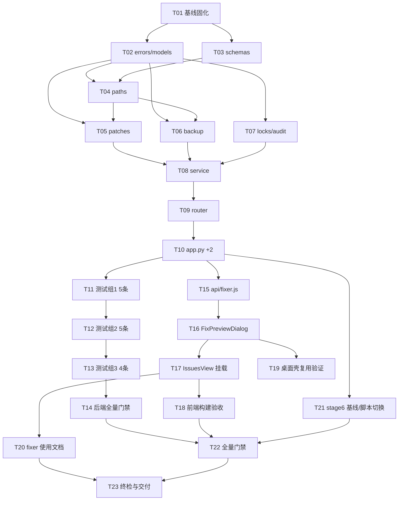

# RepoGuard 修复辅助层（fixer）— 编码任务清单

> 阶段：阶段 6「编码任务规划」
> 唯一依据：`.codeartsdoer/specs/fixer/spec.md`（484 行，已确认）、`.codeartsdoer/specs/fixer/design.md`（854 行，已确认）
> 文档性质：只描述"做什么、做到什么程度、如何验收"；本阶段不写产品代码，不改 spec/design。
> 仓库根：`<repo-root>`（下文所有"完整路径"均相对该根目录）
> 基线（已实测，T01 再次固化）：uv CPython 3.11.15 实跑 **452 条** `OK (skipped=4)`；既有 `backend/tests/test_*.py` **29 个**零改动；新增 14 条后预期 **466 条**（462 passed / 0 failed / 4 skipped）；15 项冻结哈希（13 个冻结文件 + `requirements.txt` + `static/index.html`）；`backend/app/api/app.py` 当前 **194 行**，`evidence/stage5/app.py.orig` 为 187 行（存量 **+8/-1**）；fixer 按方案 A 以 `.codeartsdoer/evidence/stage6/app.py.stage6.orig`（当前 194 行快照）为基线，自身 **+2/-0**；Node 实测 v24.19.0 / npm 11.17.0（工程目标 `engines.node >= 22.12`）；本机无 Docker/nginx/hcloud/crontab；桌面壳已有 `window.repoguard.pickDirectory()`。

## 0. 全局约定（23 个任务共用）

### 0.1 测试口径（全文强制）

- 后端测试统一 `python -m unittest`：
  - 全量：`cd backend && $PY -m unittest discover -s tests -t .`
  - 单文件：`cd backend && $PY -m unittest tests.test_fixer`
- 接口级测试复用 `backend/tests/webhook_helpers.py`：
  - `WebhookASGIClient`：内部 `httpx.ASGITransport`，`raise_app_exceptions=False`，在内存中调用应用；
  - `FrozenClock`：需要时间推进时使用；
  - `no_network()`：API 用例默认包裹，证明零网络。
- **禁止**：以框架内置同步测试客户端（如 `TestClient`）组织用例、使用第三方测试运行器（如 `pytest`）、启动真实监听端口、依赖独立服务进程、自建事件循环。
- 新增测试 14 条（T11 5 条 + T12 5 条 + T13 4 条）；全量预期 **452 + 14 = 466**，`OK (skipped=4)`，即 **462 passed / 0 failed / 4 skipped**。
- 新增用例**不得增加 skip**；符号链接用例一律用 `unittest.mock.patch` 模拟 `app.fixer.paths.os.lstat`，不真实创建链接。
- 既有 2 条 `test_repo_walk` 符号链接用例在平台间可能 failed/skipped 漂移：**单列、不修旧测试**；若全量出现这 2 条失败，按实情上报，不自行改测试或放宽门禁。
- 生产部署章节的进程启动命令（systemd、桌面后端）属于部署产物规格，不得作为测试方式引用。

### 0.2 解释器与工具

- `$PY` 表示 T01 固化的 uv CPython 3.11.15 完整路径；T01 必须记录实际调用命令，后续后端命令以 `$PY` 替换字面 `python`。
- 系统默认 `python` 指向不可用路径，禁止使用。
- Node/npm 使用实测 v24.19.0 / npm 11.17.0；`npm ci` 需可联网。
- 本机无 Docker、nginx、hcloud、crontab；本阶段不涉及部署与定时，全部能力为本地可测。

### 0.3 变更边界（红线，任一违反即整体不通过）

- 禁止修改 **15 项冻结文件**：13 个冻结文件（`backend/app/core/rules/{engine.py,naming.py,code_scan.py,link_check.py,sensitive.py,__init__.py}`、`common/{__init__.py,config.py,file_io.py,manifest.py,models.py,report.py}`）、`backend/tests/test_cli.py`、`backend/requirements.txt`、`backend/app/static/index.html`。
- 禁止修改 **既有 29 个 `backend/tests/test_*.py`** 与 `backend/tests/webhook_helpers.py`。
- 禁止修改 `backend/app/api/routes.py`、`backend/app/dashboard/**`、`backend/app/webhook/**`、`backend/app/integrations/**`；`backend/app/api/app.py` 仅允许相对 stage6 快照 **+2/-0**。
- 禁止修改 `frontend/package.json`、`frontend/package-lock.json`、`desktop/package.json`、`desktop/package-lock.json`。
- 禁止修改 `demo-repo/`、`docs/` 既有 4 份 `*_usage.md`、`deploy/` 22 个产物、`.codeartsdoer/evidence/stage5/**`。
- 禁止新增后端第三方依赖；禁止引入 UI 组件库、状态库、diff 渲染库、前端测试框架。
- 白名单**仅 `link-005`**；其余规则一律 `fixable=false`，不生成补丁、不写入。
- 禁止做历史备份列表页、备份自动清理、一键全改、git 自动提交；禁止把 fixer 暴露到 nginx/公网。
- 禁止修改 `spec.md` 与 `design.md`；本阶段不写产品代码。

### 0.4 分阶段门禁节奏

- 每个里程碑结束**停下等待用户确认**，确认后才能进入下一里程碑。
- 测试阶段先单跑 `tests.test_fixer`，确认 14 条全过且无新增 skip，再跑全量 466。
- 任一门禁失败立即停止并如实汇报，不得改测试、不得放宽门禁、不得跳过。

## 1. 任务拓扑、关键路径与里程碑

### 1.1 任务拓扑图



### 1.2 关键路径

`T01 → T02 → T04 → T05 → T06 → T08 → T09 → T10 → T11 → T12 → T13 → T14 → T15 → T16 → T17 → T18 → T21 → T22 → T23`

旁路：T03（供 T04）、T07（供 T08）、T20（文档，汇入 T23）、T19（桌面验证，与 T20 并行）。
测试 T11/T12/T13 写同一文件 `test_fixer.py`，必须串行，不得并行编辑。

### 1.3 并行组

| 组 | 任务 | 说明 |
|---|---|---|
| G1 基础类型 | T02、T03 | 不同文件；T04 依赖 T02+T03 |
| G2 备份与锁/审计 | T06、T07 | 不同文件；T08 依赖两者 |
| G3 前端 | T15、T16 | 不同文件；T15 定 API，T16 消费；T17 依赖两者 |
| G4 桌面与文档 | T19、T20 | 桌面验证与文档可并行；T20 依赖 T17 的功能定稿 |
| G5 门禁 | T21、T22、T23 | 严格串行收口 |

### 1.4 里程碑与确认点

| 里程碑 | 范围 | 达成判据 | 确认点 |
|---|---|---|---|
| **M1 基线与后端可运行** | T01–T10 | 基线证据固化；11 个 fixer 文件可编译；三个 POST 路由可导入；`app.py` 相对 stage6 精确 +2/-0；非桌面 404 | **C1**（T01 后基线）、**C2**（M1 后后端） |
| **M2 后端测试** | T11–T14 | `test_fixer.py` 14 条全过；全量 466 `OK (skipped=4)`；CLI 12 passed；冻结哈希差异 0 | **C3** |
| **M3 前端、桌面与文档** | T15–T20 | `npm ci` + `npm run build` 成功；`dist/index.html` 存在；0 `v-html`；桌面壳零改动；文档落盘 | **C4** |
| **M4 门禁与交付** | T21–T23 | stage6 基线脚本 15/15 OK + `app.py` +2/-0；全量 466；终检无残留；交付清单齐全 | **C5** |

> 推荐分批确认：C1 基线 → C2 后端 → C3 测试 → C4 前端/桌面/文档 → C5 最终交付。每个确认点须由用户明确回复后才继续。

## 2. 基线（T01）

## T01 固化基线快照与环境记录

- **目标**：在动手前把 452/29/15/194 行等基线数字化固化，供后续所有门禁比对；生成 fixer 专用 stage6 快照。
- **完整路径**：
  - `.codeartsdoer/evidence/stage6/env.txt`
  - `.codeartsdoer/evidence/stage6/hashes.txt`
  - `.codeartsdoer/evidence/stage6/baseline_tests.txt`
  - `.codeartsdoer/evidence/stage6/test_inventory.txt`
  - `.codeartsdoer/evidence/stage6/app.py.stage6.orig`
- **前置依赖**：无（起点）
- **执行步骤**：
  - [ ] 1. 确认 `spec.md`（484 行）与 `design.md`（854 行）存在且未被修改。
  - [ ] 2. 用 `$PY` 在 `backend/` 下实跑 `python -m unittest discover -s tests -t .`，记录完整 `Ran 452 tests` / `OK (skipped=4)` / 退出码 0，以及 4 条 skipped 的用例名与原因。
  - [ ] 3. 记录 uv CPython 3.11.15 完整路径与调用命令到 `env.txt`；记录 Node v24.19.0、npm 11.17.0；记录 Docker/nginx/hcloud/crontab 不可用。
  - [ ] 4. 从 `evidence/stage5/hashes.txt` 复制 15 项（13 冻结 + requirements + static）到 `stage6/hashes.txt`，逐项重算确认一致；不得改动 stage5 原文件。
  - [ ] 5. 统计既有 `backend/tests/test_*.py` 共 29 个，记录路径与 SHA-256 到 `test_inventory.txt`。
  - [ ] 6. 复制当前 `backend/app/api/app.py`（194 行）为 `app.py.stage6.orig`，记录行数与 SHA-256；同时记录 `evidence/stage5/app.py.orig` 187 行及其 SHA-256，证明 stage5 存量 +8/-1 未被改动。
  - [ ] 7. 确认当前工作区已存在 `desktop/main/main.js:15-23` 的 `repoguard:pick-directory` 与 `preload.js:5-8` 的 `window.repoguard.pickDirectory()`。
- **验收标准**：
  - [ ] 全量实测为 `Ran 452 tests` + `OK (skipped=4)` + 退出码 0；不符即停并登记，不得改口径。
  - [ ] `hashes.txt` 恰 15 行，逐项与 stage5 一致、差异 0。
  - [ ] `test_inventory.txt` 恰 29 个 `test_*.py`，无缺失。
  - [ ] `app.py.stage6.orig` 与当前 `app.py` 字节一致（SHA-256 相同）、194 行。
  - [ ] stage5 `app.py.orig` 与 15 项证据文件 SHA-256 未变。
  - [ ] 本任务不修改任何产品/测试/依赖文件。
- **并行**：不可并行（全局前置）；**下一任务**：T02、T03

## 3. 后端基础（T02–T04）

## T02 实现错误码与内部数据模型

- **目标**：提供 fixer 错误码常量、抛错辅助与全部内部数据结构，作为后续模块唯一数据载体。
- **完整路径**：
  - `backend/app/fixer/errors.py`
  - `backend/app/fixer/models.py`
- **前置依赖**：T01
- **公开签名（与 design 4.2.2/4.2.3 一致）**：
  ```text
  errors.py:
    FIXER_INVALID_SELECTION = "FIXER_INVALID_SELECTION"
    FIXER_BACKUP_DIR_FORBIDDEN / FIXER_BACKUP_PATH_FORBIDDEN / FIXER_STALE_PATCH
    FIXER_FILE_UNDECODABLE / FIXER_ROLLBACK_CONFLICT / FIXER_IO_ERROR
    UNSUPPORTED_MEDIA_TYPE / PAYLOAD_TOO_LARGE
    def raise_fixer(code: str, status: int, message: str, detail: str | None = None) -> None
  models.py:
    @dataclass(frozen=True, slots=True) class Patch
    class Selection / BackupRecord / ApplyResult / RollbackResult
    def to_dict(value: object) -> dict[str, object]
  ```
- **执行步骤**：
  - [ ] 1. `errors.py` 用运行期导入 `ApiError`（`raise_fixer` 内导入），模块顶层不导入 `app.api.*`。
  - [ ] 2. `models.py` 定义 Patch（`patch_id/file_path/line_no/rule_id/fixable/old_line/new_line/diff/reason`）、Selection（`file_path/line_no/rule_id/old_line`）、BackupRecord（`file_path/backup_path/captured_at/after_sha256`）、ApplyResult（`repo/backup_id/applied/skipped/backups`）、RollbackResult（`repo/restored/failed`）。
  - [ ] 3. `to_dict` 支持 dataclass、tuple/list、Mapping、基础标量与 None；`Path` 抛 `TypeError`；不访问文件系统。
  - [ ] 4. 仅标准库；不新增第三方依赖。
- **验收标准**：
  - [ ] 两个文件 `$PY -m py_compile` 退出码 0。
  - [ ] `$PY -c "from app.fixer.errors import raise_fixer; from app.fixer.models import Patch"` 退出码 0，且导入不触发 `app.api.app`。
  - [ ] `Patch.__dataclass_fields__` 键序与 spec 8.1 一致。
  - [ ] `json.dumps(to_dict(ApplyResult(...)), ensure_ascii=False)` 成功；`to_dict(Path("x"))` 抛 `TypeError`。
  - [ ] 文件内无 `open(`、无 `os.walk`、无 `Path.glob`。
- **并行**：与 T03 可并行；**下一任务**：T04、T05、T06、T07

## T03 实现请求体模型

- **目标**：用既有 Pydantic 定义三个接口请求体，完成 200 条数量上限与字段约束；不新增依赖。
- **完整路径**：`backend/app/fixer/schemas.py`
- **前置依赖**：T01
- **公开签名**：
  ```text
  class IssueInput(BaseModel): file_path: str; line_no: int; rule_id: str; excerpt: str | None = None
  class SelectionInput(BaseModel): file_path: str; line_no: int; rule_id: str; old_line: str
  class BackupInput(BaseModel): file_path: str; backup_path: str; after_sha256: str | None = None
  class PreviewRequest(BaseModel): repo: str; issues: list[IssueInput]; strict: bool = False
  class ApplyRequest(BaseModel): repo: str; backup_dir: str; on_stale: Literal["skip","reject"]="skip"; strict: bool=False; selections: list[SelectionInput]
  class RollbackRequest(BaseModel): repo: str; backup_dir: str; backup_id: str; force: bool=False; strict: bool=False; backups: list[BackupInput]
  ```
- **执行步骤**：
  - [ ] 1. `model_config = ConfigDict(extra="ignore")`，与 `backend/app/api/schemas.py:11-17` 风格一致。
  - [ ] 2. `issues` / `selections` / `backups` 使用 `Field(min_length=1, max_length=200)`；`repo` ≤512、`backup_dir` ≤1024、`old_line` ≤4000、`excerpt` ≤200。
  - [ ] 3. 不在此层做路径归属校验（由 T04/T08 负责）。
- **验收标准**：
  - [ ] `$PY -m py_compile backend/app/fixer/schemas.py` 退出码 0。
  - [ ] 201 条列表触发 `ValidationError`；200 条通过；1 条通过。
  - [ ] `extra` 字段被忽略；缺 `file_path`/`old_line` 触发 `ValidationError`。
  - [ ] 不新增第三方依赖（仅既有 `pydantic`）。
- **并行**：与 T02 可并行；**下一任务**：T04

## T04 实现路径规范化与归属校验

- **目标**：完成仓库、目标文件、备份目录、备份路径的规范化与归属校验，以及 `repo_label` 与符号链接检测。
- **完整路径**：`backend/app/fixer/paths.py`
- **前置依赖**：T02、T03
- **公开签名（与 design 4.2.5 一致）**：
  ```text
  def resolve_repo(raw: str, settings: object) -> Path
  def resolve_file(repo_root: Path, relative: str) -> Path
  def resolve_backup_dir(repo_root: Path, raw: str) -> Path
  def resolve_backup_path(backup_root: Path, relative: str) -> Path
  def repo_label(repo_root: Path) -> str
  def is_symlink(path: Path) -> bool
  ```
- **执行步骤**：
  - [ ] 1. `resolve_repo` 直接调用 `app.api.security.resolve_repo_root`，不重写白名单逻辑。
  - [ ] 2. `resolve_file` 复用 `security.py:31-45` 的 helper 拒绝绝对路径/盘符/UNC/设备/`..`；`resolve` 后用 `commonpath` 校验在仓库根内；符号链接 → `FIXER_INVALID_SELECTION` 400。
  - [ ] 3. `resolve_backup_dir` 校验绝对路径、存在、目录、可写、非系统敏感目录（复用 `security.py:57-70` 的等价口径）、解析后不在仓库根内；不自动创建。
  - [ ] 4. `resolve_backup_path` 只接受相对路径，解析后必须位于 `backup_root` 内；符号链接 → `FIXER_BACKUP_PATH_FORBIDDEN` 403。
  - [ ] 5. `repo_label`：安全化 `root.name` + `sha256(normcase(resolve))` 前 8 位，格式 `name-8hex`；不含盘符/分隔符。
  - [ ] 6. `is_symlink` 使用 `os.lstat` + `stat.S_ISLNK`，便于测试 patch。
- **验收标准**：
  - [ ] `$PY -m py_compile backend/app/fixer/paths.py` 退出码 0。
  - [ ] 临时目录中：`..`/盘符/UNC/设备路径全部拒绝；仓库外文件路径拒绝。
  - [ ] 备份目录位于仓库内 → `FIXER_BACKUP_DIR_FORBIDDEN` 403。
  - [ ] `backup_path` 为绝对路径或 `../x` → `FIXER_BACKUP_PATH_FORBIDDEN` 403。
  - [ ] `repo_label` 匹配 `^[A-Za-z0-9_\-\u4e00-\u9fff]+-[0-9a-f]{8}$`，不含绝对路径。
  - [ ] 不导入 `app.api.app`、`app.dashboard.*`、`app.webhook.*`。
- **并行**：与 T03 无依赖，可并行；**下一任务**：T05、T06

## 4. 补丁、备份、锁/审计与编排（T05–T09）

## T05 实现 link-005 补丁生成

- **目标**：只对 link-005 生成整行补丁，覆盖 inline/image/definition，保留 title 与尖括号，同一行多链接合并。
- **完整路径**：`backend/app/fixer/patches.py`
- **前置依赖**：T02、T04
- **公开签名（与 design 4.2.6 一致）**：
  ```text
  def decode_text(data: bytes) -> tuple[str, str]
  def build_line_patch(line: str, line_no: int, rule_id: str, file_path: str) -> PatchDraft | None
  def build_patch(repo_root: Path, issue: IssueInput, *, label: str) -> Patch
  ```
- **执行步骤**：
  - [ ] 1. `decode_text` 仅接受 UTF-8 / UTF-8 BOM；GBK/二进制抛可识别解码错误，由调用方转 `fixable=false`/skipped。
  - [ ] 2. 只读导入 `link_check` 的 `INLINE_RE`、`DEFINITION_RE`；不修改 `link_check.py`。
  - [ ] 3. inline/image：拆分 target 与 title，只替换 target 中的半角空格为 `%20`；尖括号包裹跳过。
  - [ ] 4. definition：只替换 target 中空格，title 原样保留。
  - [ ] 5. 同一行多个命中一次性替换，生成一个整行补丁；无命中返回 `None`。
  - [ ] 6. `patch_id = sha256(label|file_path|line_no|rule_id|old_line|new_line)[:16]`；`diff` 用 `difflib.unified_diff` 生成。
  - [ ] 7. 已有 `%20` 不重复编码；锚点、转义、其他字符不动。
- **验收标准**：
  - [ ] `$PY -m py_compile backend/app/fixer/patches.py` 退出码 0。
  - [ ] 手写样例中 inline/image/definition 三类均得到 `%20`，definition title 不变。
  - [ ] 尖括号包裹、非 link-005、定位不到均返回不可修复。
  - [ ] 同一行两个含空格链接只产生一个补丁，且两个目标都替换。
  - [ ] 同一输入重复生成 `patch_id` 稳定；不同行/不同内容不同。
  - [ ] 文件内无 `os.walk`、无 `open(`（读取由 `service`/`paths` 提供）。
- **并行**：与 T06 无依赖，可并行；**下一任务**：T08

## T06 实现备份、原子写与哈希

- **目标**：实现 backup_id、目录布局、原件备份、原子写入与 SHA-256 计算。
- **完整路径**：`backend/app/fixer/backup.py`
- **前置依赖**：T02、T04
- **公开签名（与 design 4.2.7 一致）**：
  ```text
  def new_backup_id(base: Path) -> str
  def backup_file(backup_root: Path, source: Path, relative: str) -> BackupRecord
  def atomic_write(path: Path, data: bytes) -> None
  def sha256_bytes(data: bytes) -> str
  ```
- **执行步骤**：
  - [ ] 1. `backup_id` 格式 `YYYYMMDD-HHMMSS-fff`；同毫秒冲突追加 `-<6位hex>`，仍冲突追加 `-<序号>`。
  - [ ] 2. 备份目标为 `<backup_dir>/<backup_id>/<repo_label>/<相对路径>`；创建父目录；`shutil.copy2` 保留字节/mtime/权限。
  - [ ] 3. 备份后计算 SHA-256 并与源文件比对；不一致抛 I/O 错误。
  - [ ] 4. `atomic_write` 同目录 `.name.repoguard.tmp` + `flush`/`fsync` + `os.replace`；保留原权限；失败删除 tmp。
  - [ ] 5. 不写备份清单文件；不自动清理。
- **验收标准**：
  - [ ] `$PY -m py_compile backend/app/fixer/backup.py` 退出码 0。
  - [ ] 生成 3 次连续 backup_id，均不重复且符合格式。
  - [ ] 备份文件与原件字节、mtime、权限一致。
  - [ ] `atomic_write` 后内容更新、无 `*.repoguard.tmp` 残留。
  - [ ] 仅标准库，不新增依赖。
- **并行**：与 T07 可并行；**下一任务**：T08

## T07 实现仓库锁与审计日志

- **目标**：按仓库进程内串行锁（5 秒超时），以及 stdout 结构化 JSON 审计日志。
- **完整路径**：
  - `backend/app/fixer/locks.py`
  - `backend/app/fixer/audit.py`
- **前置依赖**：T02
- **公开签名（与 design 4.2.8/4.2.9 一致）**：
  ```text
  locks.py:
    class RepoLockRegistry: def acquire(self, repo_root: Path, timeout: float = 5.0) -> contextmanager
    def registry() -> RepoLockRegistry
  audit.py:
    def audit(action: str, *, request_id: str, repo_label: str, files: list[dict[str, object]], result: str, duration_ms: int) -> None
  ```
- **执行步骤**：
  - [ ] 1. 锁键为 `normcase(resolve(repo_root))`；`dict[str, threading.Lock]` + 全局锁保护创建。
  - [ ] 2. `acquire` 超时 5 秒；超时抛内部 `LockTimeout`，由 router 映射 503 `FIXER_IO_ERROR`。
  - [ ] 3. 审计 logger 名 `repoguard.fixer`；`json.dumps(ensure_ascii=False)` 输出 stdout；不新增 handler、不写文件、不轮转。
  - [ ] 4. 字段：时间（ISO 8601 UTC）、`request_id`、`repo_label`、`action`、`files`（相对路径）、`rule_id`、old/new 摘要（≤200）、相对备份路径、`result`、`duration_ms`。
  - [ ] 5. 不记录绝对路径、文件全文、密钥。
- **验收标准**：
  - [ ] 两个文件 `$PY -m py_compile` 退出码 0。
  - [ ] 两线程同仓库串行，第二线程等待；timeout=0 时抛 `LockTimeout`。
  - [ ] 审计输出为单行 JSON，含必需字段；old/new 超 200 字符被截断；无绝对路径。
  - [ ] 不新增 logging handler，不创建日志文件。
- **并行**：与 T06 可并行；**下一任务**：T08

## T08 实现 preview/apply/rollback 编排

- **目标**：实现三端点业务编排：补丁重建、旧行比对、按文件去重备份、原子写、回滚冲突检测、审计。
- **完整路径**：`backend/app/fixer/service.py`
- **前置依赖**：T04、T05、T06、T07
- **公开签名（与 design 4.2.10 一致）**：
  ```text
  def preview(repo_root: Path, issues: list[IssueInput], *, strict: bool) -> dict[str, object]
  def apply(repo_root: Path, backup_dir: Path, selections: list[SelectionInput], *, on_stale: str, strict: bool, request_id: str) -> dict[str, object]
  def rollback(repo_root: Path, backup_dir: Path, backup_id: str, backups: list[BackupInput], *, force: bool, strict: bool, request_id: str) -> dict[str, object]
  ```
- **执行步骤**：
  - [ ] 1. `preview`：逐条 `build_patch`；返回 `repo`（`repo_label`）+ `patches`；`strict=true` 且不可解码 → 422；不落盘。
  - [ ] 2. `apply`：校验 selections 非空/≤200/无重复；逐条重建并比对 `old_line`；非白名单/缺字段/无法定位 → 400；陈旧默认 skipped、`on_stale=reject` → 409；不可解码 skipped、`strict` → 422。
  - [ ] 3. 按 `file_path` 分组、每文件只备份一次、按 `line_no` 升序；获取仓库锁（5 秒）。
  - [ ] 4. 备份所有待改文件 → 逐文件重读并再次校验 `old_line` → `atomic_write` → 计算 `after_sha256`。
  - [ ] 5. 多文件失败按文件粒度：已成功不回滚、已备份保留、失败记 skipped。
  - [ ] 6. `rollback`：校验 `backup_dir/backup_id/backup_path` 归属；锁串行；比对当前 sha256 与 `after_sha256`；默认 failed、`strict` 409、`force` 覆盖并标注。
  - [ ] 7. 写操作调用 `audit()`；响应只含相对路径；不返回 `backup_dir`。
- **验收标准**：
  - [ ] `$PY -m py_compile backend/app/fixer/service.py` 退出码 0。
  - [ ] 内存构造调用：preview 不写任何文件（临时仓库哈希不变）。
  - [ ] apply 先备份后写入、备份字节一致；同文件多补丁只生成一个备份目录条目。
  - [ ] 陈旧补丁默认 skipped；`on_stale=reject` 整请求不写入。
  - [ ] rollback 能还原原始字节；`backup_path` 越界 403；手工修改默认 failed。
  - [ ] 不导入 `app.api.app`、`app.dashboard.*`；不新增依赖。
- **并行**：不可并行（依赖 T04–T07）；**下一任务**：T09

## T09 实现三个 POST 路由与依赖

- **目标**：暴露 preview/apply/rollback 三个 POST，完成 desktop_mode、JSON、2MB、200 条与错误映射。
- **完整路径**：`backend/app/fixer/router.py`
- **前置依赖**：T08
- **公开签名（与 design 4.2.11 一致）**：
  ```text
  router: APIRouter
  def get_web_settings(request: Request) -> object
  def require_desktop(settings=Depends(get_web_settings)) -> object
  def require_json(request: Request) -> None
  def require_body_size(request: Request) -> None
  @router.post("/preview")
  @router.post("/apply")
  @router.post("/rollback")
  ```
- **执行步骤**：
  - [ ] 1. `get_web_settings` 读 `request.app.state.settings`；缺失 → 500 `INTERNAL_ERROR`。
  - [ ] 2. `require_desktop`：`not desktop_mode` → 404 `NOT_FOUND`；不把判定写进 `app.py`。
  - [ ] 3. `require_json`：Content-Type 非 `application/json` → 415 `UNSUPPORTED_MEDIA_TYPE`；`require_body_size`：`Content-Length > 2MB` → 413 `PAYLOAD_TOO_LARGE`。
  - [ ] 4. 端点 `async def`，I/O 经 `asyncio.to_thread`；返回 `JSONResponse`（UTF-8）；不新增异常处理器。
  - [ ] 5. 运行期导入 `ApiError`；顶层不导入 `app.api.app`、`app.dashboard.*`。
- **验收标准**：
  - [ ] `$PY -m py_compile backend/app/fixer/router.py` 退出码 0。
  - [ ] `router.routes` 恰 3 条，方法均为 `{'POST'}`，路径 `/preview`、`/apply`、`/rollback`。
  - [ ] 非桌面模式三个端点 404；桌面模式可达业务层。
  - [ ] 非 JSON 415、>2MB 413、201 条 422（由 T03 模型保障）。
  - [ ] 无 `@app.exception_handler`、无全局中间件新增。
- **并行**：不可并行；**下一任务**：T10

## 5. 挂载、后端测试与门禁（T10–T14）

## T10 在 `app.py` 精确新增 2 行并完成内存冒烟

- **目标**：把 fixer router 挂到 `/api/fixer`，保持既有中间件、异常处理器、静态挂载、CORS、lifespan 与既有路由不变。
- **完整路径**：`backend/app/api/app.py`（唯一允许改动的既有后端文件）
- **前置依赖**：T09
- **精确 diff（相对当前 194 行，只允许这两行）**：
  ```diff
  @@ imports（第 27 行 `from app.storage import init_db` 之后）
  +from app.fixer.router import router as fixer_router
  @@ create_app（第 188 行 dashboard include 之后、第 189 行 `_mount_static` 之前）
  +    app.include_router(fixer_router, prefix="/api/fixer")
  ```
- **执行步骤**：
  - [ ] 1. 新增 1 行 import + 1 行 include_router；文件 194 → 196 行。
  - [ ] 2. 不改中间件（55-82）、异常处理器（85-120）、静态挂载（123-132）、CORS（135-144）、lifespan（147-166）、既有路由（187-188）。
  - [ ] 3. 用 `create_app(WebSettings(desktop_mode=True, ...))` 做内存冒烟：preview 200；非桌面 `create_app` 三端点 404。
- **验收标准**：
  - [ ] `git diff --no-index --numstat .codeartsdoer/evidence/stage6/app.py.stage6.orig backend/app/api/app.py` 输出 `2	0`。
  - [ ] `git diff --no-index -U0` 仅两条 `+`，无其他增删。
  - [ ] `$PY -m py_compile backend/app/api/app.py` 退出码 0。
  - [ ] 路由表含 3 条 `/api/fixer/*`，既有 `/api/review`、`/api/health`、`/api/dashboard/*` 不变。
  - [ ] 非桌面模式 404；不导入 `app.dashboard` 私有函数；不新增全局处理器。
- **并行**：不可并行；**下一任务**：T11、T15、T21

## T11 测试组1：preview、路径与符号链接（5 条）

- **目标**：覆盖 link-005 三类链接、不可修复、非白名单、file_path 越界、符号链接逃逸。
- **完整路径**：`backend/tests/test_fixer.py`
- **前置依赖**：T10
- **覆盖清单**：
  | 编号 | 方法名 | 覆盖 |
  |---|---|---|
  | T-F01 | `test_preview_link005_inline_image_definition` | inline/image/definition 均 `%20`；definition title 不变 |
  | T-F02 | `test_preview_angle_wrapped_and_missing_target_not_fixable` | 尖括号/定位不到/行号越界 → `fixable=false` |
  | T-F03 | `test_preview_non_whitelisted_rule_not_fixable` | 非 link-005 → `fixable=false` |
  | T-F04 | `test_preview_rejects_file_path_outside_repo` | `..`/绝对路径 → 拒绝 |
  | T-F05 | `test_preview_rejects_symlink_escape` | mock `lstat` 符号链接 → 拒绝 |
- **执行步骤**：
  - [ ] 1. 创建 `test_fixer.py`：`unittest.TestCase`，夹具用 `tempfile.TemporaryDirectory()` 建临时仓库与仓库外备份目录，`addCleanup` 清理。
  - [ ] 2. `create_app(WebSettings(desktop_mode=True, allowed_repo_roots=(tmp,), default_repo="repo", static_dir=tmp))`；`WebhookASGIClient(app)` 发 POST。
  - [ ] 3. 所有 API 用例用 `no_network()` 包裹；符号链接用 `patch("app.fixer.paths.os.lstat", ...)`，不真实创建。
  - [ ] 4. 断言只针对响应 JSON 与文件状态，不访问私有字段。
- **验收标准**：
  - [ ] `cd backend && $PY -m unittest tests.test_fixer` 输出 `Ran 5 tests` + `OK`。
  - [ ] 无 skip、无网络、无真实端口、无独立进程。
  - [ ] 未修改任何既有测试文件。
- **并行**：不可与 T12/T13 并行（同一文件）；**下一任务**：T12

## T12 测试组2：备份与 apply（5 条）

- **目标**：覆盖备份目录越界、先备份后写、旧行陈旧、同文件去重、同行多链接合并。
- **完整路径**：`backend/tests/test_fixer.py`（追加）
- **前置依赖**：T11
- **覆盖清单**：
  | 编号 | 方法名 | 覆盖 |
  |---|---|---|
  | T-F06 | `test_backup_dir_inside_repo_rejected` | 仓库内目录 → 403 `FIXER_BACKUP_DIR_FORBIDDEN` |
  | T-F07 | `test_apply_backs_up_before_write_and_bytes_match` | 备份字节与原件一致；写入后才变化 |
  | T-F08 | `test_apply_stale_old_line_skipped` | 旧行变化 → skipped，不写 |
  | T-F09 | `test_apply_multi_patch_same_file_backs_up_once` | 同文件多补丁只备份一次 |
  | T-F10 | `test_apply_same_line_multiple_links_single_patch` | 同一行多链接合并为一个补丁 |
- **执行步骤**：
  - [ ] 1. 在既有测试类后追加方法；复用 T11 的夹具与客户端构造，不重复造应用。
  - [ ] 2. T-F07 在 apply 前后读取备份文件与目标文件字节；断言备份等于 apply 前内容。
  - [ ] 3. T-F09 用同一文件两行两个 link-005 issue，断言 `backups` 只有 1 条、内容含两处替换。
  - [ ] 4. T-F10 用同一行两个链接，断言 `patches` 1 条且 `new_line` 两处 `%20`。
- **验收标准**：
  - [ ] `cd backend && $PY -m unittest tests.test_fixer` 输出 `Ran 10 tests` + `OK`。
  - [ ] 新增用例 skip 为 0。
  - [ ] 未修改既有测试文件与产品源码（本任务只追加测试）。
- **并行**：不可并行；**下一任务**：T13

## T13 测试组3：rollback 与不可修复（4 条）

- **目标**：覆盖回滚还原、备份路径越界、手工修改冲突、不可解码/只读跳过。
- **完整路径**：`backend/tests/test_fixer.py`（追加）
- **前置依赖**：T12
- **覆盖清单**：
  | 编号 | 方法名 | 覆盖 |
  |---|---|---|
  | T-F11 | `test_rollback_restores_original_bytes` | 回滚后字节与原始一致 |
  | T-F12 | `test_rollback_backup_path_escape_rejected` | `backup_path` 越界/绝对 → 403 |
  | T-F13 | `test_rollback_detects_manual_modification` | 手工修改 → 默认 failed |
  | T-F14 | `test_apply_undecodable_and_unwritable_skipped` | GBK/二进制/只读 → skipped，不中断其他文件 |
- **执行步骤**：
  - [ ] 1. 追加 4 个方法；T-F11 复用 T-F07 的 apply 结果做回滚。
  - [ ] 2. T-F12 直接构造 `backup_path="../../outside.md"` 或绝对路径。
  - [ ] 3. T-F13 apply 后手工改写目标文件，再 rollback，断言 `failed` 且文件保持手工内容。
  - [ ] 4. T-F14 用 GBK 字节、二进制、只读文件三种输入；只读文件在 Windows 上通过 `os.chmod` 去掉写位或 mock 写入失败。
- **验收标准**：
  - [ ] `cd backend && $PY -m unittest tests.test_fixer` 输出 `Ran 14 tests` + `OK`。
  - [ ] 14 条全部运行，无 skip。
  - [ ] 未修改既有测试文件。
- **并行**：不可并行；**下一任务**：T14

## T14 后端测试全量门禁

- **目标**：确认新增 14 条与既有 452 条组成 466 条全量、冻结文件与既有测试未变。
- **完整路径**：无新增文件；执行与记录
- **前置依赖**：T13
- **执行步骤**：
  - [ ] 1. 单跑 `cd backend && $PY -m unittest tests.test_fixer`，记录 `Ran 14 tests` + `OK`。
  - [ ] 2. 全量 `cd backend && $PY -m unittest discover -s tests -t .`，记录 `Ran 466 tests` + `OK (skipped=4)` + 退出码 0。
  - [ ] 3. 跑 `$PY -m unittest tests.test_cli`，记录 12 passed。
  - [ ] 4. 用临时脚本（放 `.codeartsdoer/evidence/stage6/`，用完保留或删除由 T23 决定）重算 15 项 SHA-256，记录差异 0。
  - [ ] 5. 核对 29 个既有测试文件 SHA-256 与 T01 一致。
  - [ ] 6. `app.py` 相对 `app.py.stage6.orig` 用 `difflib` 断言 +2/-0（正式脚本切换在 T21）。
- **验收标准**：
  - [ ] 新增 14 条全过，skip 0。
  - [ ] 全量 466 `OK (skipped=4)`，462 passed / 0 failed / 4 skipped，退出码 0。
  - [ ] CLI 12 passed。
  - [ ] 15 项哈希差异 0；29 个既有测试文件未变。
  - [ ] `app.py` 196 行，相对 stage6 +2/-0。
  - [ ] 若全量出现既有符号链接 2 条失败：单列上报，不修改测试、不放宽门禁。
- **并行**：不可并行（串行收口）；**下一任务**：T22（T15–T21 完成后）

## 6. 前端（T15–T18）

## T15 实现 `api/fixer.js`

- **目标**：提供 preview/apply/rollback 三个 POST 封装与 fixer 错误码中文映射。
- **完整路径**：`frontend/src/api/fixer.js`
- **前置依赖**：T10
- **公开签名（与 design 7.2 一致）**：
  ```text
  export function previewFix({ repo, issues, strict, signal } = {})
  export function applyFix({ repo, backupDir, selections, onStale, strict, signal } = {})
  export function rollbackFix({ repo, backupDir, backupId, backups, force, strict, signal } = {})
  export const FIXER_MESSAGES
  ```
- **执行步骤**：
  - [ ] 1. 从 `./client.js` 导入 `requestJson`，全部使用 `method:'POST'`、`body`、`timeoutMs: 60000`。
  - [ ] 2. 字段映射：`backupDir→backup_dir`、`onStale→on_stale`、`backupId→backup_id`；`selections/backups/issues` 原样。
  - [ ] 3. `FIXER_MESSAGES` 覆盖 7 个 `FIXER_*` 与 `UNSUPPORTED_MEDIA_TYPE`、`PAYLOAD_TOO_LARGE`。
  - [ ] 4. 不修改 `client.js`；不引入依赖；不在本文件写 UI 逻辑。
- **验收标准**：
  - [ ] `node --check frontend/src/api/fixer.js` 退出码 0。
  - [ ] 文件内 3 处 `requestJson('/api/fixer/...`，且无 `fetch(`。
  - [ ] 无 `/api/` 之外的硬编码路径；无绝对路径。
  - [ ] 行数 ≤90。
- **并行**：与 T16 可并行；**下一任务**：T16、T17

## T16 实现 `FixPreviewDialog.vue`

- **目标**：单文件组件承载触发按钮、补丁列表、diff 预览、备份目录选择、apply/rollback；非桌面降级。
- **完整路径**：`frontend/src/components/FixPreviewDialog.vue`
- **前置依赖**：T15
- **Props/Emits（与 design 7.3 一致）**：
  ```text
  props: issue: Object; repoId: String
  emits: applied
  ```
- **执行步骤**：
  - [ ] 1. 仅当 `issue.rule_id === 'link-005'` 且 `window.repoguard?.pickDirectory` 存在时渲染按钮；否则不渲染并给降级提示。
  - [ ] 2. 点击 → `previewFix`；弹窗展示 `old_line`/`new_line`/`diff` 与勾选列表。
  - [ ] 3. "选择备份目录" 调用 `window.repoguard.pickDirectory()`；`null` 停留、不调用 apply。
  - [ ] 4. "确认写入" → `applyFix`；展示 applied/skipped/backups；成功 `emit('applied')`。
  - [ ] 5. 回滚 → `rollbackFix`（本次 `backup_id` + `backups`）；展示 restored/failed。
  - [ ] 6. diff 用 `<pre>` + `v-for` 行数组渲染；`+` 绿/`-` 红/`@@` 灰，并提供"新增/删除"文字标识；**禁止 `v-html`**。
  - [ ] 7. 错误展示 `error.code/message/detail/requestId`；不新增依赖。
- **验收标准**：
  - [ ] 文件存在且非空；`grep -c "v-html"` 为 0；`grep -c "fetch("` 为 0。
  - [ ] 含 `previewFix`/`applyFix`/`rollbackFix` 调用，未直拼 `/api/fixer`。
  - [ ] 含 `link-005` 白名单判断与 `pickDirectory` 降级分支。
  - [ ] 含 `<pre` 与 diff 行分类；行数 ≤260。
  - [ ] 未修改 `client.js`、`package.json`、lock。
- **并行**：与 T15 可并行；**下一任务**：T17、T19

## T17 在 `IssuesView.vue` 最小挂载

- **目标**：仅在问题明细的 `#detail` 插槽挂载修复组件，不承载按钮/弹窗逻辑，不改变既有筛选/分页。
- **完整路径**：`frontend/src/views/IssuesView.vue`
- **前置依赖**：T16
- **执行步骤**：
  - [ ] 1. 新增 `import FixPreviewDialog from '../components/FixPreviewDialog.vue'`（或按项目别名风格）。
  - [ ] 2. 在 `DataTable` 的 `#detail` 插槽内、既有 `<dl>` 后挂载 `<FixPreviewDialog :issue="row" :repo-id="repoId" @applied="load" />`。
  - [ ] 3. 不改 `readQuery`、筛选、排序、分页、请求、KPI、图表逻辑。
- **验收标准**：
  - [ ] 文件 368 → ≤383 行（新增 ≤15 行）。
  - [ ] 仅新增 1 个 import 与 1 个组件挂载；`git diff` 无其他逻辑改动。
  - [ ] 0 `v-html`；无 `fetch(`；无 `/api/` 字面路径。
  - [ ] `npm run build` 通过（T18 统一验收）。
- **并行**：不可并行（依赖 T15/T16）；**下一任务**：T18、T20

## T18 前端构建验收

- **目标**：确认新增组件/API 可构建、依赖未变、静态红线全绿。
- **完整路径**：无新增文件；执行与记录
- **前置依赖**：T17
- **执行步骤**：
  - [ ] 1. `cd frontend && npm ci`（联网）→ `npm run build`。
  - [ ] 2. 检查 `frontend/dist/index.html` 存在、`dist/assets/*.js`、`*.css` 非空。
  - [ ] 3. 静态扫描：全站 0 `v-html`；组件/视图 0 `fetch(` 与 `/api/` 字面路径；请求只经 `api/dashboard.js` 与 `api/fixer.js`。
  - [ ] 4. 核对 `frontend/package.json` 与 `package-lock.json` SHA-256 与 T01 一致。
  - [ ] 5. 核对 `FixPreviewDialog.vue` ≤260、`fixer.js` ≤90、`IssuesView.vue` ≤383。
- **验收标准**：
  - [ ] `npm ci` 退出码 0；`npm run build` 退出码 0；`dist/index.html` 存在。
  - [ ] 静态红线全部 0 命中；依赖文件零改动。
  - [ ] 行数预算全部达标。
- **并行**：不可并行；**下一任务**：T22

## 7. 桌面与文档（T19–T20）

## T19 桌面壳复用验证（不改代码）

- **目标**：确认桌面壳已具备目录选择能力，fixer 直接复用，不新增 IPC、不改依赖。
- **完整路径**：无新增/修改文件；执行与记录
- **前置依赖**：T16
- **执行步骤**：
  - [x] 1. 核对 `desktop/main/main.js:16` 的 `ipcMain.handle('repoguard:pick-directory', ...)` 与 `desktop/main/preload.js:6-7` 的 `contextBridge.exposeInMainWorld('repoguard', { pickDirectory })`。静态核对通过：IPC 与 preload 暴露均在。
  - [x] 2. 核对 `desktop/main/main.js` 与 `preload.js` 零二次改动。静态核对通过：壳文件随 `cb3420c` 整体落地，fixer 阶段未叠加修改。
  - [x] 3. 核对 `desktop/package.json`/lock 未变；无新增 IPC 名称。静态核对通过：IPC 仅 `repoguard:pick-directory` 一个，无 Electron 依赖版本变化。
  - [ ] **SKIP** 4. 手工验收清单（在桌面壳内）：按钮出现/取消选择/仓库内目录被拒/非桌面降级/diff 键盘操作/apply 后复扫提示/rollback 成功与冲突提示。
- **验收标准**：
  - [x] `pickDirectory` 暴露存在；`main.js`/`preload.js`/`desktop/package.json`/lock 零改动。
  - [x] 无新增 IPC；无 Electron 依赖版本变化。
  - [ ] **SKIP** 手工验收 7 项逐条记录结果；无法执行的项标 `SKIP`，不计入通过。
- **SKIP 说明（B 口径）**：桌面 GUI 手工验收无自动化覆盖；沙箱内 Electron 初始化崩溃（0xC0000005），需提权真实窗口，本轮不起壳。7 项挂起至交付前重打便携包时端到端复验。其中“按钮出现”一项受 fixer 入口未渲染问题（登记项）阻塞，复验前需先定位修复。
- **并行**：与 T20 可并行；**下一任务**：T20

## T20 编写 `docs/fixer_usage.md`

- **目标**：面向首次使用者说明 fixer 边界、桌面前提、备份选择、diff、apply/rollback、错误码、审计与限制。
- **完整路径**：`docs/fixer_usage.md`
- **前置依赖**：T17
- **执行步骤**：
  - [ ] 1. 章节覆盖：功能边界与只读例外；桌面模式前提与非桌面降级；备份目录选择与仓库外要求；diff 确认与逐条勾选；apply 与 rollback；错误码表；审计日志；限制（无历史备份列表、无自动清理、无 git 提交、无一键全改）；备份布局与手工清理。
  - [ ] 2. 示例路径用相对路径/占位符，不写真实密钥与个人绝对路径。
  - [ ] 3. 不承诺自动修复其他规则，不承诺历史备份浏览。
- **验收标准**：
  - [ ] 文件存在且非空；9 个主题均有对应章节。
  - [ ] 无真实密钥、无 `C:\Users\`、无 `/home/` 个人路径。
  - [ ] 明确写出"不做历史备份列表页、备份不自动清理、不做 git 提交"。
  - [ ] 未修改既有 4 份使用文档。
- **并行**：与 T19 可并行；**下一任务**：T23（文档进入交付清单）

## 8. 门禁与交付（T21–T23）

## T21 固化 stage6 基线并切换哈希脚本

- **目标**：将 `scripts/verify_frozen_hashes.py` 的 app.py 基线切到 stage6 快照，期望 fixer 自身 +2/-0；stage5 证据保留。
- **完整路径**：`scripts/verify_frozen_hashes.py`
- **前置依赖**：T10（此时 app.py 已 +2）
- **执行步骤**：
  - [ ] 1. 确认 `evidence/stage6/app.py.stage6.orig` 为 194 行、SHA-256 与 T01 记录一致。
  - [ ] 2. 仅修改 `DEFAULT_APP_BASELINE` 指向 `.codeartsdoer/evidence/stage6/app.py.stage6.orig`；`check_app_increment` 仍要求 `added == 2 and removed == 0`。
  - [ ] 3. 不改 15 项哈希解析、`sha256_file`、退出码语义、`--hashes`/`--app`/`--skip-app-check` 参数。
  - [ ] 4. 保留 `evidence/stage5/app.py.orig` 与 15 项证据，不动。
- **验收标准**：
  - [ ] `$PY scripts/verify_frozen_hashes.py` 输出 15/15 `OK`、`不符项 = 0`、`APP_PY added=2 removed=0`、退出码 0。
  - [ ] `stage5/app.py.orig` 与 15 项 evidence SHA-256 未变。
  - [ ] 脚本仍仅标准库；无新增依赖。
- **并行**：不可并行；**下一任务**：T22

## T22 全量门禁

- **目标**：一次性确认后端 466、CLI 12、前端构建、哈希与冻结清单全部通过。
- **完整路径**：无新增文件；执行与记录
- **前置依赖**：T14、T18、T21
- **执行步骤**：
  - [ ] 1. 后端单跑 `tests.test_fixer` → 14 passed。
  - [ ] 2. 后端全量 `discover -s tests -t .` → 466 `OK (skipped=4)`、退出码 0。
  - [ ] 3. CLI `tests.test_cli` → 12 passed。
  - [ ] 4. `$PY scripts/verify_frozen_hashes.py` → 15/15 OK + `app.py` +2/-0。
  - [ ] 5. 前端 `npm ci` + `npm run build` → 成功、`dist/index.html` 存在。
  - [ ] 6. 核对 29 个既有测试文件、`demo-repo/`、`requirements.txt`、`frontend/desktop` 依赖、既有 4 份文档零改动。
- **验收标准**：
  - [ ] 上述 6 项全部通过；无新增失败；新增 skip 0。
  - [ ] 若既有符号链接用例 failed：单列上报，不修改测试、不放宽门禁。
  - [ ] 所有命令记录完整 `Ran` 行与退出码。
- **并行**：不可并行；**下一任务**：T23

## T23 终检与交付清单

- **目标**：清理临时文件、核对交付清单、登记偏差与未执行项，停在最终确认点。
- **完整路径**：无新增产品文件；交付清单如下
- **前置依赖**：T22
- **执行步骤**：
  - [ ] 1. 清理 `__pycache__`、临时测试日志、一次性校验脚本；保留 `.codeartsdoer/evidence/stage6/` 与 `stage5/` 证据。
  - [ ] 2. 核对交付清单（22 个路径，3 项为修改）：
    - 后端新增 11：`backend/app/fixer/{__init__,errors,models,schemas,paths,patches,backup,locks,audit,service,router}.py`
    - 测试新增 1：`backend/tests/test_fixer.py`
    - 前端新增 2：`frontend/src/api/fixer.js`、`frontend/src/components/FixPreviewDialog.vue`
    - 前端修改 1：`frontend/src/views/IssuesView.vue`
    - 文档新增 1：`docs/fixer_usage.md`
    - 脚本修改 1：`scripts/verify_frozen_hashes.py`
    - 后端修改 1：`backend/app/api/app.py`（+2/-0）
    - evidence 5：`env.txt`、`hashes.txt`、`baseline_tests.txt`、`test_inventory.txt`、`app.py.stage6.orig`
  - [ ] 3. 登记偏差：stage5 存量 +8/-1；锁超时 503；415/413；桌面单机限制；无历史备份页；备份不自动清理；审计 stdout；单实例进程锁；Node 版本口径；桌面 GUI 手工验收（无自动化）。
  - [ ] 4. 输出汇报：任务总数、测试结果、文件清单、SKIP/未执行项；停止等待用户确认。
- **验收标准**：
  - [ ] 22 个路径全部存在且非空；无缺失。
  - [ ] 无临时脚本/日志/`__pycache__` 残留；evidence 保留。
  - [ ] 偏差与未执行项登记齐全；未新增计划外内容。
  - [ ] 不执行 git 提交。
- **并行**：不可并行；**下一任务**：无（停止）

## 附录 A 任务与 design 文件清单逐条对照

| design 文件 | 任务 | 动作 |
|---|---|---|
| `backend/app/fixer/__init__.py` | T09/T10 | 由 T09 建立，T10 挂载验证 |
| `backend/app/fixer/errors.py` | T02 | 新增 |
| `backend/app/fixer/models.py` | T02 | 新增 |
| `backend/app/fixer/schemas.py` | T03 | 新增 |
| `backend/app/fixer/paths.py` | T04 | 新增 |
| `backend/app/fixer/patches.py` | T05 | 新增 |
| `backend/app/fixer/backup.py` | T06 | 新增 |
| `backend/app/fixer/locks.py` | T07 | 新增 |
| `backend/app/fixer/audit.py` | T07 | 新增 |
| `backend/app/fixer/service.py` | T08 | 新增 |
| `backend/app/fixer/router.py` | T09 | 新增 |
| `frontend/src/api/fixer.js` | T15 | 新增 |
| `frontend/src/components/FixPreviewDialog.vue` | T16 | 新增 |
| `frontend/src/views/IssuesView.vue` | T17 | 最小修改 |
| `backend/tests/test_fixer.py` | T11–T13 | 新增（分三组写同一文件） |
| `docs/fixer_usage.md` | T20 | 新增 |
| `scripts/verify_frozen_hashes.py` | T21 | 基线切换（仅 app.py 期望） |
| `backend/app/api/app.py` | T10 | +2/-0 |
| `desktop/main/main.js` / `preload.js` | T19 | 零改动，仅验证 |

## 附录 B 红线自查清单（T23 使用）

- [ ] 15 项冻结文件 SHA-256 差异 0。
- [ ] 29 个既有 `test_*.py` + `webhook_helpers.py` 零改动。
- [ ] `app.py` 相对 stage6 快照 +2/-0，无其他增删。
- [ ] 未新增后端第三方依赖；前端 `package.json`/lock、`desktop/package.json`/lock 零改动。
- [ ] 白名单仅 link-005；非白名单 `fixable=false`。
- [ ] 未做历史备份列表页、未自动清理备份、未 git 提交。
- [ ] `demo-repo/`、既有 4 份使用文档、`deploy/` 22 产物零改动。
- [ ] `spec.md`、`design.md` 未被修改。
- [ ] 无真实端口/独立进程/网络测试；新增 14 条 skip 0。

## 附录 C 测试用例映射

| 组 | 任务 | 用例 | 预期 |
|---|---|---|---|
| 组1 | T11 | T-F01–T-F05 | `Ran 5 tests` + OK |
| 组2 | T12 | T-F06–T-F10 | `Ran 10 tests` + OK |
| 组3 | T13 | T-F11–T-F14 | `Ran 14 tests` + OK |
| 全量 | T14/T22 | 既有 452 + 新增 14 | `Ran 466 tests` + `OK (skipped=4)`（462 passed / 0 failed / 4 skipped） |