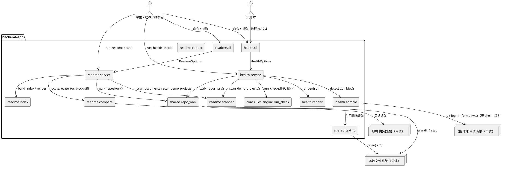
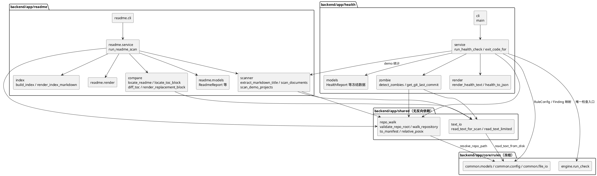
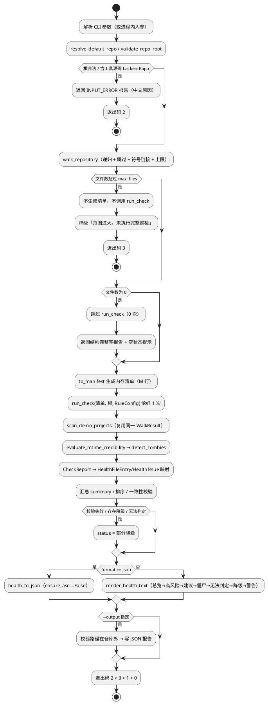
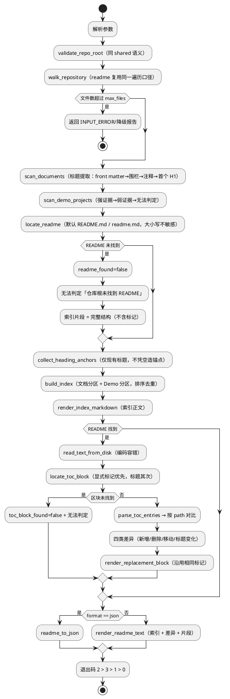
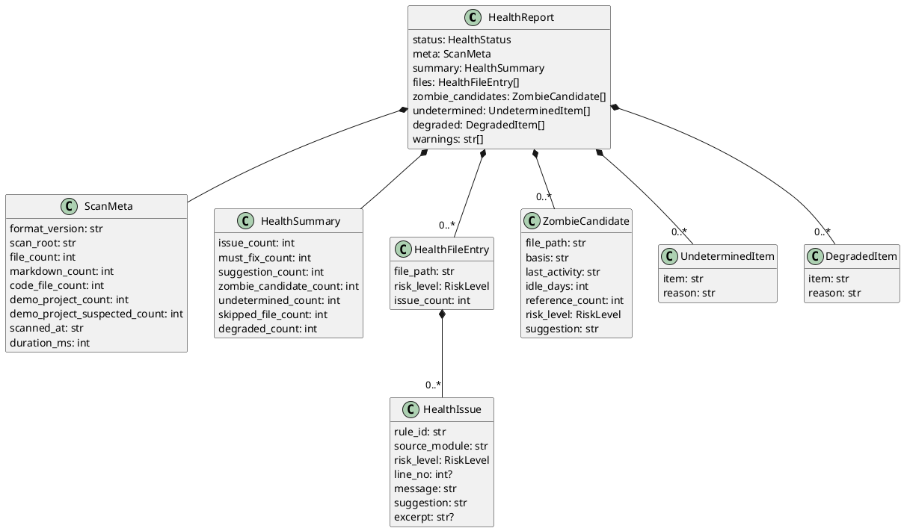
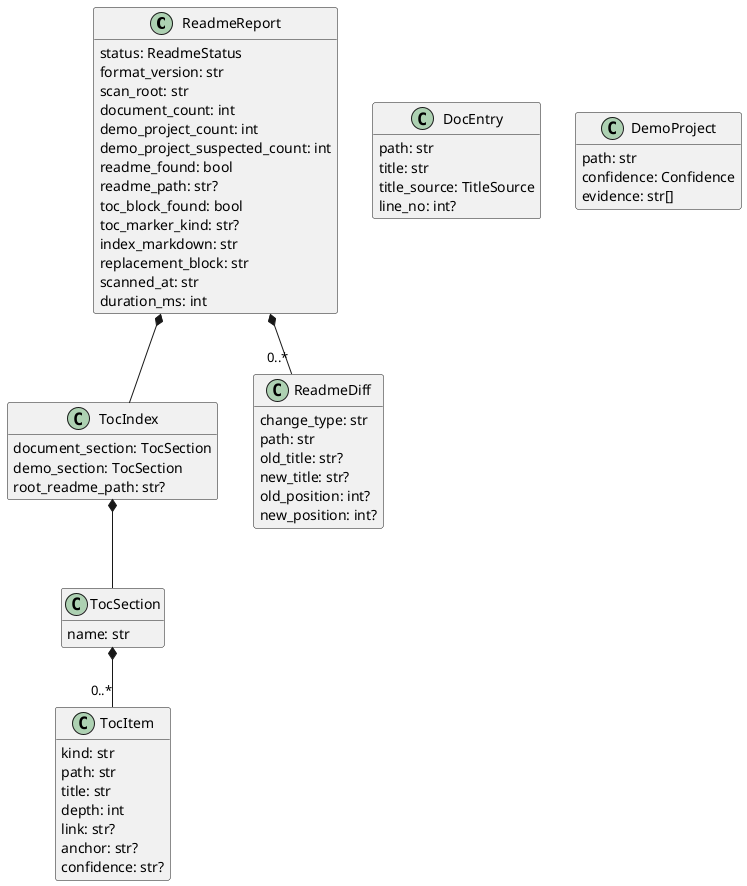
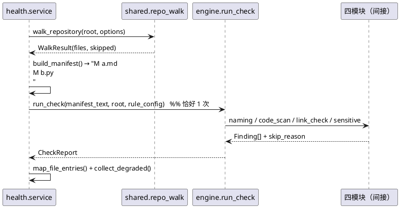
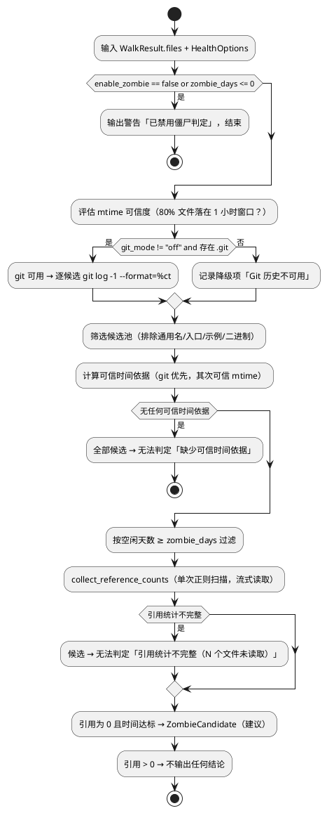

# 一、需求与存量功能关系分析

> feature：`repo_health_readme`（阶段 3）
> 唯一依据：`.codeartsdoer/specs/repo_health_readme/spec.md`、`rules_engine/spec.md` 与 `design.md`、`web_api/spec.md` 与 `design.md`、现有 `backend/app/core/rules/**`、`backend/app/api/**`、`backend/tests/test_engine.py::test_import_direction`、`backend/tests/test_cli.py`。
> 本文件只描述「如何实现」，不包含业务代码、不修改任何现有文件。

## 1.1 需求功能与存量功能对比

### 1.1.1 已实现功能

| 需求功能 | 存量功能 | 代码位置 | 匹配度 |
|---------|---------|---------|--------|
| 全仓巡检的唯一检查执行入口（一次调用完成四类检查） | `run_check(manifest_text, repo_root, config=None) -> CheckReport` | `backend/app/core/rules/engine.py:149-234` | 100% |
| 变更清单 `M <相对路径>` 行解析、路径归一化、重复合并 | `parse_manifest()` / `parse_manifest_line()` / `merge_entries()` | `backend/app/core/rules/common/manifest.py:38-109` | 100% |
| 四类规则判定（命名/代码/链接/敏感信息与大文件） | 四个 `check(entry, ctx)` 模块由 `run_check()` 统一调度 | `backend/app/core/rules/engine.py:184-225` | 100% |
| 单文件单次读取与体积/二进制判定 | `FileSnapshot` + `snapshot_cache` | `backend/app/core/rules/engine.py:173-197`、`common/file_io.py:142-226` | 100% |
| 编码容错读取（BOM → UTF-8 → GB18030 回退） | `read_text_from_disk(absolute_path, max_bytes=None) -> TextReadResult` | `backend/app/core/rules/common/file_io.py:95-121` | 100% |
| 路径安全沙箱（绝对路径、`..`、真实路径边界、Windows 大小写） | `resolve_repo_path(repo_root, relative_path) -> ResolvedPath` | `backend/app/core/rules/common/file_io.py:54-92` | 100% |
| 规则阈值与特征清单（不做第二套阈值） | `RuleConfig` / `default_config()` / `build_config()` | `backend/app/core/rules/common/config.py:52-70,199-207,357-375` | 100% |
| 问题级别与统计口径（必须修改/优化建议、一致性校验） | `IssueLevel`、`Finding`、`CheckSummary`、`build_report()`、`validate_report()` | `backend/app/core/rules/common/models.py:28-300` | 100% |
| 中文摘要与中文不转义 JSON 口径 | `render_text()` / `report_to_json()` | `backend/app/core/rules/common/report.py:19-168` | 100% |
| 退出码语义 `0/1/2/3` 与优先级 | `ExitCode` / `exit_code_for()` | `backend/app/core/rules/common/models.py:39-43`、`engine.py:267-274` | 100% |
| 单模块异常隔离与降级记录 | `_run_module()` 捕获异常写入 `DegradedModule` | `backend/app/core/rules/engine.py:63-84` | 100% |
| 阶段 2 仓库路径白名单与工作区解析 | `api/security.py` 的 `resolve_repo_root()` 语义 | `backend/app/api/security.py` | 75%（仅 Web 场景，阶段 3 不复用） |

### 1.1.2 需要扩展的功能

| 需求功能 | 存量功能 | 差异说明 | 扩展方向 |
|---------|---------|---------|---------|
| 全仓遍历 + 稳定排序 + 跳过技术目录 + 符号链接/深度/文件数上限 | 存量没有目录遍历能力；`resolve_repo_path()` 只做单路径校验 | 输入为仓库根而非清单；输出需要文件元数据（size/mtime/后缀）与跳过原因；需要自扫描拒绝 | 新增 `backend/app/shared/repo_walk.py`，复用 `resolve_repo_path()` 的边界语义，不改造该函数 |
| 健康报告文本渲染 | `common/report.py::render_text()` 面向「变更清单 + 文件分组」 | 字段集合不同：健康报告多了僵尸候选、无法判定、降级、总览；排序规则不同 | 新增 `backend/app/health/render.py`，只复用「中文不转义、`indent=2`、字段稳定」口径，不修改 `report.py` |
| 健康报告 JSON 序列化 | `report_to_dict()` / `report_to_json()` | 数据模型不同（`HealthReport` 而非 `CheckReport`），无法直接复用函数 | 新增 `health_to_dict()` / `health_to_json()`，形状按 spec 6.1 固定 |
| 配置使用方式 | `RuleConfig` 只承载检查阈值 | 僵尸阈值、git 模式、文件上限属于阶段 3 选项，不能写入 `RuleConfig` | 新增 `HealthOptions`，`RuleConfig` 仅透传给 `run_check()` |
| 阶段 1 退出码语义 | `ExitCode` 为 `IntEnum` | 阶段 3 的触发条件不同（僵尸/降级/README 差异），但数值与优先级一致 | 新增各自 `exit_code_for()`，直接返回 `int`，不改 `ExitCode` 枚举 |

### 1.1.3 需要新增的功能或接口

**A. 公共遍历与读取（`backend/app/shared/`）**

- `validate_repo_root()`：输入仓库根，输出真实 `Path`；非法时抛 `RootValidationError`（中文原因）。
- `walk_repository()`：输入仓库根与 `WalkOptions`，输出 `WalkResult`（文件清单、跳过清单、是否超限）。
- `to_manifest()`：输入文件清单，输出 `M <相对路径>` 文本（每文件一行）。
- `read_text_for_scan()` / `read_text_limited()`：输入文件路径，输出 `TextReadResult`，内部委托阶段 1 `read_text_from_disk()`。
- 与其它模块的依赖：只被 `health/**`、`readme/**` 依赖，反向不依赖。

**B. 全仓健康巡检（`backend/app/health/`）**

- `run_health_check()`：输入仓库根、`HealthOptions`、`RuleConfig`，输出 `HealthReport`；内部恰好调用一次 `run_check()`（空仓库与超限除外，见 2.5）。
- 僵尸判定：`detect_zombies()` 综合 git 只读证据、`mtime` 可信度、引用扫描三条件，输出候选/无法判定/降级。
- 报告渲染：`render_health_text()`、`health_to_json()`。
- CLI：`python -m app.health.cli`。
- 依赖方向：`health → shared`、`health → readme.scanner`（仅 Demo 统计）、`health → core.rules.engine`。

**C. README 目录生成（`backend/app/readme/`）**

- 扫描与标题提取：`scan_documents()` / `extract_markdown_title()`。
- Demo 工程识别：`scan_demo_projects()` / `classify_demo_directory()`。
- 索引构建：`build_index()` / `render_index_markdown()`。
- 对比与片段：`locate_readme()` / `locate_toc_block()` / `diff_toc()` / `render_replacement_block()`。
- CLI：`python -m app.readme.cli`。
- 依赖方向：`readme → shared`，不依赖 `health`、不依赖 `app.api`。

## 1.2 存量功能详细分析

### 1.2.1 `run_check()` 接口契约（复用核心）

| 维度 | 契约 |
|------|------|
| 签名 | `run_check(manifest_text: str, repo_root: str \| Path, config: RuleConfig \| None = None) -> CheckReport`（`engine.py:149-153`） |
| 入参 | 清单文本（每行 `A/M/D <path>`）+ 仓库根 + 可选配置；未传配置时使用 `default_config()` |
| 出参 | `CheckReport(status, summary, files, unparsed_lines, degraded_modules, warnings)` |
| 副作用 | 只读磁盘：`stat`、`open("rb")`；不写文件、不建目录、不执行被扫描代码、不联网 |
| 异常边界 | 根目录非法返回 `INPUT_ERROR`；单模块异常被 `_run_module()` 捕获并记入 `degraded_modules`；其余异常向上抛出 |
| 分组排序 | `_build_groups()`：文件按 `file_path` 升序；组内 `_finding_key()`：必须修改在前 → 有行号在前 → 行号升序 → `rule_id` → `message`（`engine.py:53-104`） |
| 读取复用 | `snapshot_cache` 保证同一相对路径内容最多读 1 次（`engine.py:173-178`） |
| 空清单 | 返回 `OK` + 空分组 + 警告「变更清单为空…」（`engine.py:165-171`） |
| 状态 | `OK`（无降级）/`PARTIAL_DEGRADED`（有模块降级）/`INPUT_ERROR`（根非法） |

**阶段 3 必须遵守的调用约束**

1. 一次巡检最多调用一次 `run_check()`，禁止逐文件复制四模块规则，禁止直接导入 `naming.py`、`code_scan.py`、`link_check.py`、`sensitive.py`。
2. 清单状态固定为 `M`；路径为相对仓库根、`/` 分隔、无 `..`、无盘符。
3. `CheckReport.summary.must_fix_count/suggestion_count` 一对一映射为健康报告统计，不重新判级。
4. `CheckReport.degraded_modules` 原样透传（模块名与中文原因不改写）。
5. `CheckReport.unparsed_lines` 在阶段 3 应为空（清单由工具生成）；若非空，作为降级项上报（说明清单构造异常）。

### 1.2.2 四模块与 `common/**` 复用边界

1. `naming.py`、`code_scan.py`、`link_check.py`、`sensitive.py`：**只允许由 `run_check()` 间接调用**；新增包静态扫描命中导入 0 次。
2. `common/file_io.py`：新增包可导入 `read_text_from_disk()`、`resolve_repo_path()`、`TextReadResult`；禁止复制 BOM/GB18030 回退逻辑。
3. `common/config.py`：只读使用 `RuleConfig`、`default_config()`、`build_config()`；禁止新增检查阈值常量。
4. `common/models.py`：只读使用 `Finding`、`IssueLevel`、`CheckReport`、`FileGroup`、`ReportStatus`；风险等级仅做一对一映射。
5. `common/report.py`：只参照 JSON 渲染口径（`ensure_ascii=False`、`indent=2`），不复用函数体、不修改。
6. `rules/__init__.py`：其惰性导出不参与阶段 3 调用（新增代码直接从 `engine.py` 相对导入），避免触发包级副作用。

**存量约束（必须识别的限制）**

- `Finding.message` 最短 8 字符、`Finding.excerpt` 最长 60 字符，阶段 3 不得二次截断或改写；只做搬运。
- `FileSnapshot.text()` 对二进制文件返回编码错误，`run_check()` 会把该文件计入 `skip_reason`；阶段 3 需把这类跳过落到 `skipped_file_count` 与降级项。
- `run_check()` 对不存在的文件只保留命名结论；阶段 3 的清单只包含磁盘上真实存在的文件，正常不会触发该分支。

### 1.2.3 阶段 1 CLI 与阶段 2 API 冻结

| 冻结对象 | 冻结内容 | 阶段 3 动作 |
|---------|---------|------------|
| `python -m app.core.rules.engine` | 参数 `--manifest/--repo/--format/--output/--config/--debug`、默认值、stdout/stderr、退出码 `0/1/2/3` | 零改动、零包装；新增 CLI 不回调 `engine.main()` |
| `backend/app/api/**` | 路由 `GET /`、`GET /api/health`、`POST /api/review`、`GET /static/{path}`、白名单、Pydantic 模型 | 零改动；不新增路由、不导入 `fastapi/uvicorn/starlette/pydantic` |
| `backend/app/static/index.html` | 单页控制台 DOM 与事件 | 零改动 |
| `backend/requirements.txt` | 三段式（引擎零依赖 / Web 依赖 / 仅测试依赖） | 零改动，不新增行 |
| `backend/tests/test_cli.py` | 12 条 CLI 回归 | 零改动 |

### 1.2.4 现有测试与冻结文件基线

**测试基线**：`cd backend && python -m unittest discover -s tests -v` → `Ran 165 tests`、`OK (skipped=1)`，即 164 passed + 1 skipped（`test_performance_500` 因 `RULES_PERF != 1` 跳过）。

**CLI 基线**：`cd backend && python -m unittest tests.test_cli -v` → 12 passed，参数/退出码/stdout/stderr 逐字节一致。

**13 个冻结文件（SHA-256 前后差异必须为 0）**：

1. `backend/app/core/rules/engine.py`
2. `backend/app/core/rules/naming.py`
3. `backend/app/core/rules/code_scan.py`
4. `backend/app/core/rules/link_check.py`
5. `backend/app/core/rules/sensitive.py`
6. `backend/app/core/rules/common/__init__.py`
7. `backend/app/core/rules/common/config.py`
8. `backend/app/core/rules/common/file_io.py`
9. `backend/app/core/rules/common/manifest.py`
10. `backend/app/core/rules/common/models.py`
11. `backend/app/core/rules/common/report.py`
12. `backend/app/core/rules/__init__.py`
13. `backend/tests/test_cli.py`

**`test_import_direction` 的判定机制（`backend/tests/test_engine.py:295-351`，本阶段不得修改）**

1. 遍历 `backend/app/**/*.py`；`backend/app/api/**` 走宽松白名单分支，其余（含新增 `shared/`、`health/`、`readme/`）走严格分支。
2. 严格分支**只检查 `ast.ImportFrom`**：
   - `node.level == 0 and node.module` → 根模块必须属于固定 18 项白名单：`__future__、argparse、ast、collections、dataclasses、enum、ipaddress、json、math、os、pathlib、re、sys、time、traceback、types、typing、unittest`。
   - `node.level >= 1 and node.module and not __init__.py` → 首段不得为 `{naming, code_scan, link_check, sensitive, engine}`（`zone="common"` 分支对新增包不适用）。
3. **结论**：`import X`（`ast.Import`）不受该测试限制；因此 `datetime、subprocess、fnmatch、hashlib` 等必须写成模块导入，并以下标访问（详见 2.10）。

### 1.2.5 存量分析结论

1. 阶段 3 的「检查」能力 100% 已在阶段 1 就绪，新增代码只承担「遍历 → 清单 → 映射 → 渲染」与「README 索引 → 差异」。
2. 唯一需要「新造」的判定逻辑是僵尸三条件与 Demo 分层识别；二者都必须保守、可降级、可解释。
3. 所有新增访问阶段 1 的能力都通过**相对导入**完成；所有新增标准库访问都满足 `test_import_direction` 的固定白名单约束，因此无需修改任何既有测试。
# 二、增量设计方案

## 2.1 实现模型

### 2.1.1 上下文视图



通信方式均为**进程内函数调用**；唯一的外部进程调用是 Git（`subprocess.run` 参数列表、`shell=False`、超时、只读子命令），调用频率为「每个僵尸候选文件最多 1 次」，整次巡检受 30 秒总预算约束。

### 2.1.2 服务/组件总体架构



**组件职责与依赖频率**

| 组件 | 职责 | 依赖频率 |
|------|------|---------|
| `shared.repo_walk` | 根校验、递归遍历、跳过、上限、清单生成 | 每次巡检 1 次 |
| `shared.text_io` | 编码容错读取包装（含 5 MB 上限与标题头部读取） | 每个文本文件 0～1 次 |
| `health.service` | 编排：根校验 → 遍历 → 清单 → `run_check()` → 映射 → 僵尸 → 汇总 | 每次巡检 1 次 |
| `health.zombie` | 时间依据、引用扫描、三条件判定、无法判定/降级 | 每次巡检 1 次 |
| `health.render` | 中文摘要 / JSON（中文不转义、字段固定） | 每次输出 1 次 |
| `readme.scanner` | 标题提取、文档条目、Demo 三层识别 | 健康巡检 1 次（仅 Demo）+ README 巡检 1 次 |
| `readme.index` | 分层索引、相对路径、锚点、排序去重、片段渲染 | 每次 README 巡检 1 次 |
| `readme.compare` | README 定位、目录区块识别、差异、替换片段 | 每次 README 巡检 1 次 |
| `readme.service` | 编排与报告组装、退出码 | 每次 README 巡检 1 次 |

### 2.1.3 请求/执行流程

**（1）全仓健康巡检主流程**



**（2）README 目录生成与对比主流程**



**（3）关键流程约束**

1. 两次组件共用 `shared.repo_walk.walk_repository()`，保证「跳过目录、符号链接、路径归一化、排序」完全一致。
2. 健康巡检不读取 README 正文；README 巡检不调用 `run_check()`，两条链路互不污染。
3. 任何阶段都不写被巡检仓库；`--output` 仅在仓库外写报告，且 README CLI 额外拒绝指向 README 本身。

## 2.2 接口设计

### 2.2.1 新文件清单与逐文件公开签名（权威口径）

> 约定：所有签名均带 `from __future__ import annotations`；`Path` 来自 `pathlib`；`Sequence/Mapping/Callable` 来自 `typing`；`datetime` 使用 `import datetime` 模块形式。默认值只写数值/常量，不写可变对象。

#### （1）`backend/app/shared/__init__.py`

| 项 | 说明 |
|----|------|
| 职责 | 包标记；再导出公共符号；不含逻辑 |
| 公开符号 | `WalkOptions`、`WalkedFile`、`WalkSkipped`、`WalkResult`、`RootValidationError`、`walk_repository`、`validate_repo_root`、`resolve_default_repo`、`to_manifest`、`relative_posix`、`is_within_root`、`scan_root_name`、`TextReadResult`、`read_text_for_scan`、`read_text_limited`、`read_title_source` |
| 函数 | 无（仅 `from .repo_walk import ...` / `from .text_io import ...` 与 `__all__`） |

#### （2）`backend/app/shared/repo_walk.py`

| 名称 | 签名 / 字段 |
|------|------------|
| 常量 | `DEFAULT_MAX_FILES: int = 5000`；`MAX_WALK_DEPTH: int = 64`；`SKIP_DIR_NAMES: frozenset[str]`；`SKIP_DIR_SUFFIXES: tuple[str, ...] = (".egg-info",)` |
| 异常 | `class RootValidationError(Exception)`；`def __init__(self, reason: str, *, scan_root: str = "<repo>") -> None` |
| 类型 | `@dataclass(frozen=True, slots=True) class WalkOptions: max_files: int = 5000; max_depth: int = 64; skip_dir_names: frozenset[str] = SKIP_DIR_NAMES; follow_dir_symlinks: bool = False; max_skipped_detail: int = 200` |
| 类型 | `@dataclass(frozen=True, slots=True) class WalkedFile: path: str; absolute_path: Path; size: int; mtime: float; suffix: str`；属性 `is_markdown -> bool`、`is_code -> bool` |
| 类型 | `@dataclass(frozen=True, slots=True) class WalkSkipped: path: str; reason: str; category: str` |
| 类型 | `@dataclass(frozen=True, slots=True) class WalkResult: root: Path; scan_root: str; files: tuple[WalkedFile, ...] = (); skipped: tuple[WalkSkipped, ...] = (); exceeded_max_files: bool = False; max_files: int = DEFAULT_MAX_FILES; directory_count: int = 0`；属性 `file_count -> int`、`markdown_count -> int`、`code_file_count -> int`、`skipped_count -> int` |
| 函数 | `def resolve_default_repo(base: str \| Path \| None = None) -> Path` |
| 函数 | `def validate_repo_root(repo_root: str \| Path, options: WalkOptions \| None = None) -> Path` |
| 函数 | `def walk_repository(repo_root: str \| Path, options: WalkOptions \| None = None) -> WalkResult` |
| 函数 | `def to_manifest(files: Sequence[WalkedFile]) -> str` |
| 函数 | `def relative_posix(root: str \| Path, path: str \| Path) -> str` |
| 函数 | `def is_within_root(root: str \| Path, candidate: str \| Path) -> bool` |
| 函数 | `def scan_root_name(root: str \| Path) -> str` |
| 函数 | `def is_tool_source_root(root: str \| Path) -> bool` |

#### （3）`backend/app/shared/text_io.py`

| 名称 | 签名 / 字段 |
|------|------------|
| 常量 | `MAX_SCAN_BYTES: int = 5 * 1024 * 1024`；`MAX_TITLE_BYTES: int = 256 * 1024`；`MAX_REFERENCE_BYTES: int = 5 * 1024 * 1024` |
| 复用类型 | `TextReadResult`（`from ..core.rules.common.file_io import TextReadResult, read_text_from_disk, is_binary_file`） |
| 函数 | `def read_text_for_scan(path: str \| Path) -> TextReadResult` |
| 函数 | `def read_text_limited(path: str \| Path, max_bytes: int) -> TextReadResult` |
| 函数 | `def read_title_source(path: str \| Path, max_bytes: int = MAX_TITLE_BYTES) -> TextReadResult` |
| 函数 | `def is_binary_path(path: str \| Path, binary_extensions: Sequence[str]) -> bool` |
| 函数 | `def normalize_newlines(text: str) -> str` |

#### （4）`backend/app/health/__init__.py`

| 项 | 说明 |
|----|------|
| 职责 | 包标记与公共 API 再导出 |
| 公开符号 | `run_health_check`、`exit_code_for`、`HealthReport`、`HealthOptions`、`HealthStatus`、`HealthSummary`、`HealthIssue`、`ZombieCandidate`、`UndeterminedItem`、`DegradedItem`、`ScanMeta` |
| 函数 | 无（`from .models import ...`、`from .service import ...`） |

#### （5）`backend/app/health/models.py`

| 名称 | 签名 / 字段 |
|------|------------|
| 枚举 | `class HealthStatus(Enum): OK = "正常"; PARTIAL_DEGRADED = "部分降级"; INPUT_ERROR = "输入错误"` |
| 枚举 | `class RiskLevel(Enum): HIGH = "高风险"; SUGGESTION = "建议"` |
| 常量 | `RISK_BY_LEVEL: Mapping[IssueLevel, RiskLevel]`；`SOURCE_MODULE_BY_PREFIX: Mapping[str, str]`；`DEGRADED_ORDER: tuple[str, ...]` |
| 类型 | `@dataclass(frozen=True, slots=True) class ScanMeta: format_version: str = "1.0"; scan_root: str = "<repo>"; file_count: int = 0; markdown_count: int = 0; code_file_count: int = 0; demo_project_count: int = 0; demo_project_suspected_count: int = 0; scanned_at: str = ""; duration_ms: int = 0` |
| 类型 | `@dataclass(frozen=True, slots=True) class HealthOptions: zombie_days: int = 365; git_mode: str = "auto"; max_files: int = 5000; max_depth: int = 64; enable_zombie: bool = True; now: datetime.datetime \| None = None` |
| 类型 | `@dataclass(frozen=True, slots=True) class HealthIssue: rule_id: str; source_module: str; risk_level: RiskLevel; line_no: int \| None; message: str; suggestion: str; excerpt: str \| None` |
| 别名 | `HealthFinding = HealthIssue` |
| 类型 | `@dataclass(frozen=True, slots=True) class HealthFileEntry: file_path: str; risk_level: RiskLevel; issue_count: int; findings: tuple[HealthIssue, ...] = ()` |
| 类型 | `@dataclass(frozen=True, slots=True) class ZombieCandidate: file_path: str; basis: str; last_activity: str; idle_days: int; reference_count: int; risk_level: RiskLevel; suggestion: str` |
| 类型 | `@dataclass(frozen=True, slots=True) class UndeterminedItem: item: str; reason: str` |
| 类型 | `@dataclass(frozen=True, slots=True) class DegradedItem: item: str; reason: str` |
| 类型 | `@dataclass(frozen=True, slots=True) class HealthSummary: issue_count: int; must_fix_count: int; suggestion_count: int; zombie_candidate_count: int; undetermined_count: int; skipped_file_count: int; degraded_count: int` |
| 类型 | `@dataclass(frozen=True, slots=True) class HealthReport: status: HealthStatus; meta: ScanMeta; summary: HealthSummary; files: tuple[HealthFileEntry, ...] = (); zombie_candidates: tuple[ZombieCandidate, ...] = (); undetermined: tuple[UndeterminedItem, ...] = (); degraded: tuple[DegradedItem, ...] = (); warnings: tuple[str, ...] = ()` |
| 函数 | `def risk_for_level(level: IssueLevel) -> RiskLevel` |
| 函数 | `def source_module_for_rule(rule_id: str) -> str` |
| 函数 | `def resolve_options(options: HealthOptions \| None) -> tuple[HealthOptions, tuple[str, ...]]` |
| 函数 | `def sort_issues(issues: Sequence[HealthIssue]) -> tuple[HealthIssue, ...]` |
| 函数 | `def sort_files(entries: Sequence[HealthFileEntry]) -> tuple[HealthFileEntry, ...]` |
| 函数 | `def sort_zombies(items: Sequence[ZombieCandidate]) -> tuple[ZombieCandidate, ...]` |
| 函数 | `def sort_undetermined(items: Sequence[UndeterminedItem]) -> tuple[UndeterminedItem, ...]` |
| 函数 | `def sort_degraded(items: Sequence[DegradedItem]) -> tuple[DegradedItem, ...]` |
| 函数 | `def build_summary(*, files: Sequence[HealthFileEntry], zombies: Sequence[ZombieCandidate], undetermined: Sequence[UndeterminedItem], degraded: Sequence[DegradedItem], skipped_file_count: int) -> HealthSummary` |
| 函数 | `def validate_health_report(report: HealthReport) -> tuple[str, ...]` |

#### （6）`backend/app/health/service.py`

| 名称 | 签名 |
|------|------|
| 常量 | `MAX_DETAILED_DEGRADED: int = 50`；`HEALTH_FORMAT_VERSION: str = "1.0"` |
| 函数 | `def run_health_check(repo_root: str \| Path \| None = None, options: HealthOptions \| None = None, rule_config: RuleConfig \| None = None) -> HealthReport` |
| 函数 | `def exit_code_for(report: HealthReport) -> int` |
| 函数 | `def resolve_repo_root(repo_root: str \| Path \| None = None) -> Path` |
| 函数 | `def build_manifest(walk_result: WalkResult) -> str` |
| 函数 | `def map_file_entries(check_report: CheckReport, walk_result: WalkResult) -> tuple[HealthFileEntry, ...]` |
| 函数 | `def collect_degraded(*, walk_result: WalkResult, check_report: CheckReport \| None, zombie_result: ZombieResult \| None, demo_result: DemoScanResult \| None, extra: Sequence[tuple[str, str]] = ()) -> tuple[DegradedItem, ...]` |
| 函数 | `def make_report(*, status: HealthStatus, meta: ScanMeta, files: Sequence[HealthFileEntry], zombies: Sequence[ZombieCandidate], undetermined: Sequence[UndeterminedItem], degraded: Sequence[DegradedItem], warnings: Sequence[str], skipped_file_count: int) -> HealthReport` |
| 函数 | `def input_error_report(reason: str, *, scan_root: str = "<repo>", duration_ms: int = 0) -> HealthReport` |

#### （7）`backend/app/health/zombie.py`

| 名称 | 签名 / 字段 |
|------|------------|
| 常量 | `DEFAULT_ZOMBIE_DAYS: int = 365`；`MIN_ZOMBIE_DAYS: int = 30`；`MAX_ZOMBIE_DAYS: int = 3650`；`BATCH_WINDOW_SECONDS: float = 3600.0`；`BATCH_RATIO: float = 0.8`；`GIT_TIMEOUT_PER_FILE: float = 2.0`；`GIT_TOTAL_BUDGET: float = 30.0`；`GENERIC_BASENAMES: frozenset[str]`；`REFERENCE_SUFFIXES: frozenset[str]`；`DEMO_HINT_WORDS: tuple[str, ...]` |
| 类型 | `@dataclass(frozen=True, slots=True) class GitActivity: available: bool; timestamp: float \| None; reason: str \| None` |
| 类型 | `@dataclass(frozen=True, slots=True) class GitBudget: deadline: float`；`def remaining(self) -> float` |
| 类型 | `@dataclass(frozen=True, slots=True) class ReferenceResult: referenced: frozenset[str]; complete: bool; unreadable_count: int; unreadable_items: tuple[str, ...]` |
| 类型 | `@dataclass(frozen=True, slots=True) class ZombieResult: candidates: tuple[ZombieCandidate, ...] = (); undetermined: tuple[UndeterminedItem, ...] = (); degraded: tuple[DegradedItem, ...] = (); mtime_credible: bool = True; git_used: bool = False; reference_complete: bool = True` |
| 函数 | `def detect_zombies(root: str \| Path, files: Sequence[WalkedFile], options: HealthOptions, text_reader: Callable[[WalkedFile], str \| None] \| None = None) -> ZombieResult` |
| 函数 | `def collect_reference_counts(root: str \| Path, candidates: Sequence[str], files: Sequence[WalkedFile], *, reader: Callable[[WalkedFile], str \| None] \| None = None) -> ReferenceResult` |
| 函数 | `def get_git_last_commit(root: str \| Path, relative_path: str, *, timeout_s: float = GIT_TIMEOUT_PER_FILE, budget: GitBudget \| None = None) -> GitActivity` |
| 函数 | `def is_git_work_tree(root: str \| Path) -> bool` |
| 函数 | `def evaluate_mtime_credibility(files: Sequence[WalkedFile]) -> tuple[bool, str \| None]` |
| 函数 | `def is_generic_basename(relative_path: str) -> bool` |
| 函数 | `def zombie_exemption_reason(relative_path: str) -> str \| None` |
| 函数 | `def compute_idle_days(last_activity_ts: float, now_ts: float) -> int` |
| 函数 | `def format_activity_date(last_activity_ts: float) -> str` |

#### （8）`backend/app/health/render.py`

| 名称 | 签名 |
|------|------|
| 函数 | `def render_health_text(report: HealthReport) -> str` |
| 函数 | `def health_to_dict(report: HealthReport) -> dict[str, object]` |
| 函数 | `def health_to_json(report: HealthReport) -> str` |

#### （9）`backend/app/health/cli.py`

| 名称 | 签名 |
|------|------|
| 函数 | `def build_arg_parser() -> argparse.ArgumentParser` |
| 函数 | `def parse_health_options(args: argparse.Namespace) -> tuple[HealthOptions, tuple[str, ...]]` |
| 函数 | `def validate_output_path(root: str \| Path, output: str \| Path) -> str \| None` |
| 函数 | `def main(argv: Sequence[str] \| None = None) -> int` |

#### （10）`backend/app/readme/__init__.py`

| 项 | 说明 |
|----|------|
| 职责 | 包标记与公共 API 再导出 |
| 公开符号 | `run_readme_scan`、`exit_code_for`、`ReadmeReport`、`ReadmeOptions`、`ReadmeStatus`、`TocIndex`、`TocItem`、`ReadmeDiff` |
| 函数 | 无 |

#### （11）`backend/app/readme/models.py`

| 名称 | 签名 / 字段 |
|------|------------|
| 枚举 | `class TitleSource(Enum): ATX = "atx"; FALLBACK_FILENAME = "fallback_filename"` |
| 枚举 | `class ReadmeStatus(Enum): OK = "正常"; PARTIAL_DEGRADED = "部分降级"; INPUT_ERROR = "输入错误"` |
| 枚举 | `class Confidence(Enum): CONFIRMED = "confirmed"; SUSPECTED = "suspected"` |
| 类型 | `@dataclass(frozen=True, slots=True) class TitleResult: title: str; source: TitleSource; line_no: int \| None; truncated: bool = False` |
| 类型 | `@dataclass(frozen=True, slots=True) class DocEntry: path: str; title: str; title_source: TitleSource; line_no: int \| None = None` |
| 类型 | `@dataclass(frozen=True, slots=True) class DemoProject: path: str; confidence: Confidence; evidence: tuple[str, ...] = ()` |
| 类型 | `@dataclass(frozen=True, slots=True) class DemoUndetermined: path: str; reason: str` |
| 类型 | `@dataclass(frozen=True, slots=True) class DemoScanResult: confirmed: tuple[DemoProject, ...] = (); suspected: tuple[DemoProject, ...] = (); undetermined: tuple[DemoUndetermined, ...] = ()` |
| 类型 | `@dataclass(frozen=True, slots=True) class TocItem: kind: str; path: str; title: str; depth: int; link: str \| None; anchor: str \| None; confidence: str \| None` |
| 类型 | `@dataclass(frozen=True, slots=True) class TocSection: name: str; items: tuple[TocItem, ...] = ()` |
| 类型 | `@dataclass(frozen=True, slots=True) class TocIndex: document_section: TocSection; demo_section: TocSection; root_readme_path: str \| None = None`；属性 `item_count -> int`、`all_items() -> tuple[TocItem, ...]` |
| 类型 | `@dataclass(frozen=True, slots=True) class TocEntryRef: path: str; title: str; depth: int; position: int; is_demo: bool = False` |
| 类型 | `@dataclass(frozen=True, slots=True) class TocBlock: start_line: int; end_line: int; marker_kind: str; heading_level: int; lines: tuple[str, ...] = ()` |
| 类型 | `@dataclass(frozen=True, slots=True) class ReadmeDiff: change_type: str; path: str; old_title: str \| None; new_title: str \| None; old_position: int \| None; new_position: int \| None` |
| 类型 | `@dataclass(frozen=True, slots=True) class ReadmeOptions: max_files: int = 5000; max_depth: int = 64; readme_path: str \| None = None; max_title_bytes: int = 262144` |
| 类型 | `@dataclass(frozen=True, slots=True) class ReadmeReport: status: ReadmeStatus; format_version: str; scan_root: str; document_count: int; demo_project_count: int; demo_project_suspected_count: int; readme_found: bool; readme_path: str \| None; toc_block_found: bool; toc_marker_kind: str \| None; index: TocIndex; index_markdown: str; replacement_block: str; diffs: tuple[ReadmeDiff, ...] = (); undetermined: tuple[UndeterminedItem, ...] = (); degraded: tuple[DegradedItem, ...] = (); warnings: tuple[str, ...] = (); scanned_at: str = ""; duration_ms: int = 0` |
| 函数 | `def empty_index() -> TocIndex` |
| 函数 | `def sort_diffs(diffs: Sequence[ReadmeDiff]) -> tuple[ReadmeDiff, ...]` |
| 函数 | `def validate_readme_report(report: ReadmeReport) -> tuple[str, ...]` |

> `ReadmeReport` 复用 `health.models` 的 `UndeterminedItem`/`DegradedItem` 会形成 `readme → health` 反向依赖（spec 9.4 禁止），因此 `readme.models` **自定义同形** `ReadmeUndetermined`/`ReadmeDegraded` 两个 dataclass（字段同为 `item`/`reason`），JSON 形状保持一致。

#### （12）`backend/app/readme/scanner.py`

| 名称 | 签名 / 字段 |
|------|------------|
| 常量 | `DOC_SUFFIX: str = ".md"`；`MAX_TITLE_LENGTH: int = 200`；`SOURCE_SUFFIXES: frozenset[str]`；`STRONG_ENTRY_FILES: frozenset[str]`；`STRONG_BUILD_FILES: frozenset[str]`；`DEMO_HINT_WORDS: tuple[str, ...] = ("demo", "example", "sample", "tutorial")`；`DEMO_EXCLUDED_DIRS: frozenset[str]`；`TEST_FILE_PATTERNS: tuple[str, ...] = ("test_*.py", "*_test.py", "*.test.js", "*.spec.js")` |
| 函数 | `def extract_markdown_title(text: str, file_path: str) -> TitleResult` |
| 函数 | `def scan_documents(root: str \| Path, walk_result: WalkResult \| None = None, options: ReadmeOptions \| None = None, warnings: list[str] \| None = None) -> tuple[DocEntry, ...]` |
| 函数 | `def scan_demo_projects(root: str \| Path, walk_result: WalkResult \| None = None, options: ReadmeOptions \| None = None, warnings: list[str] \| None = None) -> DemoScanResult` |
| 函数 | `def classify_demo_directory(relative_dir: str, entry_names: Sequence[str]) -> tuple[str, tuple[str, ...]]`（返回 `confirmed` / `suspected` / `undetermined` / `none` + 证据清单） |
| 函数 | `def is_test_file(name: str) -> bool` |

#### （13）`backend/app/readme/index.py`

| 名称 | 签名 |
|------|------|
| 函数 | `def build_index(documents: Sequence[DocEntry], demos: DemoScanResult \| Sequence[DemoProject], anchors: Mapping[str, str] \| None = None) -> TocIndex` |
| 函数 | `def render_index_markdown(index: TocIndex, with_markers: bool = False) -> str` |
| 函数 | `def render_link_target(path: str, is_directory: bool = False) -> str` |
| 函数 | `def anchor_slug(title: str) -> str` |

#### （14）`backend/app/readme/compare.py`

| 名称 | 签名 |
|------|------|
| 函数 | `def locate_readme(root: str \| Path, readme_path: str \| Path \| None = None) -> Path \| None` |
| 函数 | `def locate_toc_block(text: str) -> TocBlock \| None` |
| 函数 | `def parse_toc_entries(block: TocBlock) -> tuple[TocEntryRef, ...]` |
| 函数 | `def collect_heading_anchors(text: str) -> dict[str, str]` |
| 函数 | `def diff_toc(block: TocBlock \| None, index: TocIndex) -> tuple[ReadmeDiff, ...]` |
| 函数 | `def render_replacement_block(index: TocIndex, block: TocBlock \| None = None) -> str` |
| 函数 | `def validate_readme_path(root: str \| Path, candidate: str \| Path) -> tuple[Path \| None, str \| None]` |

#### （15）`backend/app/readme/service.py`

| 名称 | 签名 |
|------|------|
| 常量 | `README_FORMAT_VERSION: str = "1.0"` |
| 函数 | `def run_readme_scan(repo_root: str \| Path \| None = None, options: ReadmeOptions \| None = None) -> ReadmeReport` |
| 函数 | `def exit_code_for(report: ReadmeReport) -> int` |
| 函数 | `def input_error_report(reason: str, *, scan_root: str = "<repo>", duration_ms: int = 0) -> ReadmeReport` |

#### （16）`backend/app/readme/render.py`

| 名称 | 签名 |
|------|------|
| 函数 | `def render_readme_text(report: ReadmeReport) -> str` |
| 函数 | `def readme_to_dict(report: ReadmeReport) -> dict[str, object]` |
| 函数 | `def readme_to_json(report: ReadmeReport) -> str` |

#### （17）`backend/app/readme/cli.py`

| 名称 | 签名 |
|------|------|
| 函数 | `def build_arg_parser() -> argparse.ArgumentParser` |
| 函数 | `def parse_readme_options(args: argparse.Namespace) -> tuple[ReadmeOptions, tuple[str, ...]]` |
| 函数 | `def validate_output_path(root: str \| Path, output: str \| Path, readme_path: str \| Path \| None) -> str \| None` |
| 函数 | `def main(argv: Sequence[str] \| None = None) -> int` |

#### （18）测试与文档文件

| 文件 | 职责 |
|------|------|
| `backend/tests/test_repo_walk.py` | 遍历、跳过、符号链接、路径逃逸、清单、上限、自扫描拒绝 |
| `backend/tests/test_health_service.py` | `run_check` 复用次数、映射、只读、无网络、`--output` 越界 |
| `backend/tests/test_health_zombie.py` | Git/mtime/引用三条件、阈值、批量检出、通用名、无法判定 |
| `backend/tests/test_health_report.py` | text/JSON、中文不转义、稳定排序、空结果、不变量、降级透传 |
| `backend/tests/test_health_cli.py` | 退出码 0/1/2/3、默认值、`--output`、`--debug`、help |
| `backend/tests/test_readme_scan.py` | 标题提取、front matter、围栏、编码回退、Demo 三层识别与排除 |
| `backend/tests/test_readme_index.py` | 相对路径、空格、锚点、排序、去重、空目录、空分区 |
| `backend/tests/test_readme_compare.py` | 显式标记、标题区块、区块缺失、四类差异、片段一致性 |
| `backend/tests/test_readme_cli.py` | 退出码、默认对比、`--output` 拒绝覆盖 README、help |
| `docs/repo_health_readme_usage.md` | 中文使用说明、两条 CLI 命令、参数、text/JSON 示例、退出码、降级说明、人工替换流程、只读离线声明 |
## 2.3 数据模型

### 2.3.1 设计目标

1. 与 `spec.md` 第 6 章、第 7 章字段一一对齐，可无损序列化为 JSON；空结果也必须是结构完整的对象。
2. 领域术语与 `spec.md` 一致：`HealthReport`、`HealthSummary`、`HealthIssue`、`ZombieCandidate`、`UndeterminedItem`、`DegradedItem`、`ScanMeta`、`TocItem`、`ReadmeDiff`。
3. 所有对象 `frozen=True, slots=True`，构造后不可变，排序通过「新建元组」完成，便于测试与并发安全（虽然本阶段单线程）。
4. 不出现数据库思维：无自增 id、无 `create_time`、无持久化表结构；`scanned_at` 仅用于观测。

### 2.3.2 模型实现





**对象创建与生命周期**

1. `WalkResult` 由 `walk_repository()` 一次创建，随巡检结束释放；不缓存全文，仅保留路径、size、mtime、后缀。
2. `HealthFileEntry` 由 `CheckReport.files` 映射创建；`line_no`/`excerpt` 原样搬运，不二次加工。
3. `ZombieCandidate` 仅在「引用计数 0 + 时间依据可信 + 空闲 ≥ 阈值 + 非豁免」时创建；`reference_count` 恒为 0。
4. `TocIndex` 为纯值对象；`render_index_markdown()` 与 `render_replacement_block()` 都必须由同一个 `TocIndex` 派生，保证「替换片段 == 索引」。
5. 持久化：**无**。所有对象只在进程内存在，CLI 可显式写 JSON 报告到仓库外路径。

**风险等级映射（唯一来源）**

| `IssueLevel` | `RiskLevel` | JSON 值 | 是否计入高风险 |
|--------------|-------------|---------|---------------|
| `IssueLevel.MUST_FIX` | `RiskLevel.HIGH` | `高风险` | 是 |
| `IssueLevel.SUGGESTION` | `RiskLevel.SUGGESTION` | `建议` | 否 |

`rule_id` 前缀 → `source_module` 映射（`SOURCE_MODULE_BY_PREFIX`）：`naming-`→`命名与目录检查`、`code-`→`代码检查`、`link-`→`链接检查`、`sens-`→`敏感信息与大文件检查`；未知前缀 → `报告`（同时输出警告，不猜测模块）。

## 2.4 全仓遍历算法

### 2.4.1 根定位与校验

| 步骤 | 规则 |
|------|------|
| 默认根 | `resolve_default_repo(base=None)`：以当前工作目录为基准，依次尝试 `../demo-repo`、`demo-repo`，取第一个「存在且为目录」的路径；都不存在抛 `RootValidationError("未找到默认样例仓库 demo-repo，请用 --repo 指定仓库根")` |
| 显式根 | 传入即只使用该路径，不回落默认值；不存在 → `仓库根目录不存在，请检查路径参数`；非目录 → `仓库根必须是目录`；不可读（`PermissionError`）→ `仓库根没有读取权限` |
| 真实路径 | 校验通过后返回 `Path.resolve()`；后续所有边界比较都基于真实路径 |
| 自扫描拒绝 | `is_tool_source_root(root)`：`tool_app = Path(__file__).resolve().parents[1]`（即 `backend/app`）；若 `is_within_root(root, tool_app)` 为真 → 抛 `RootValidationError("巡检根不能是工具自身源码目录，请改用独立仓库")` |
| 扫描根标识 | `scan_root_name(root)`：取目录末段名称；为空/根路径 → `<repo>`；禁止绝对路径、盘符、UNC、用户主目录出现在报告 |
| 边界比较 | Windows 使用 `os.path.commonpath` + `casefold()`；POSIX 使用真实路径前缀比较；`common != root_real` 即越界 |

### 2.4.2 递归遍历规则

1. 使用 `os.scandir()` 手动递归（不用 `rglob`，避免跟随符号链接与无序），每个目录内条目先按名称 `casefold()` 排序再处理，最终文件清单再按 `path` Unicode 码点升序排序，保证跨平台稳定。
2. 目录深度：仓库根为第 0 层；`depth + 1 > options.max_depth`（默认 64）时停止展开该子树，记 `WalkSkipped(category="深度超限")`。
3. 跳过目录名（不区分大小写）：
   `.git`、`.svn`、`.hg`、`__pycache__`、`node_modules`、`.venv`、`venv`、`env`、`dist`、`build`、`target`、`out`、`.idea`、`.vscode`、`.pytest_cache`、`.mypy_cache`、`.tox`、`.eggs`，以及名称以 `.egg-info` 结尾的目录。
4. **不跳过隐藏文件**：除上述技术目录外，`.` 开头的文件（如 `.env`、`.gitignore`）纳入遍历与检查；隐藏目录（如 `.github`）默认展开（仅按名称黑名单跳过技术目录）。
5. 符号链接：
   - 目录符号链接：不跟随，记 `WalkSkipped(path, "目录符号链接，未跟随", "符号链接")`，不递归。
   - 文件符号链接：`Path.resolve()` 后必须仍在仓库根内；在根外 → 记 `"符号链接逃逸，已跳过"` 且不读取；在根内 → 以**链接相对路径**入清单（`absolute_path` 保存链接路径）。
   - 断链 → 记 `"符号链接目标不存在，已跳过"`。
6. 路径边界：每个候选文件解析真实路径后再次 `is_within_root()` 校验；越界不读取、不入清单，记降级。
7. 文件名合法性：包含 `\n`、`\r`，或首尾存在空白（`name != name.strip()`），或无法构造 `Path` → 跳过，记 `"文件名包含非法字符，无法生成清单行"`；**禁止伪造/转义清单行**。
8. 文件数上限：遍历过程中累计可纳入文件数；一旦 `count > max_files` 立即**中止遍历**，返回 `WalkResult(exceeded_max_files=True, files=())`，不保留部分清单（避免「部分巡检」）。
9. 元数据：每个文件 `stat()` 一次，取 `size`、`mtime`、`suffix.lower()`；`stat` 失败（权限/占用）→ 记 `"无法获取文件信息，已跳过"`，不入清单。
10. 只读：仅 `os.scandir`、`os.lstat/stat`、`open("rb")`（由 `run_check`/`text_io` 触发），不创建、不修改、不删除、不重命名、不 `utime`、不 `chmod`。
11. 输出：`WalkResult.files` 按 `path` 升序；`WalkResult.skipped` 按 `(category, path)` 升序；`directory_count` 为实际展开目录数（不含被跳过子树）。

### 2.4.3 路径归一化与清单生成

1. `relative_posix(root, path)`：`Path(path).resolve().relative_to(root_real)` → `as_posix()`；失败则返回空串并视为越界。
2. `to_manifest(files)`：对每个文件输出一行 `M <path>\n`，末行同样以 `\n` 结尾；空清单返回 `""`。
3. 清单行不转义、不加引号：含空格路径原样保留（`M lab/uart/UART Demo-v2.C`）；阶段 1 `parse_manifest_line()` 只在行首 `M` 后取 `strip()` 的剩余内容，内部空格不受影响。
4. 因为行首固定为 `M`，文件名以 `#` 开头不会被误判为注释行。
5. 清单只包含「通过边界检查 + 元数据获取成功 + 文件名合法」的文件；被跳过文件的 reason 由 `WalkResult.skipped` 进入健康报告降级项。

### 2.4.4 编码、超大文件与二进制

1. 遍历阶段**不读取内容**；内容读取全部交给 `run_check()` 的 `FileSnapshot`（5 MB 上限）与 `shared.text_io`（标题 256 KB、引用扫描 5 MB）。
2. 编码口径完全沿用 `read_text_from_disk()`：去 BOM → `utf-8` → `gb18030` → 失败返回 `ReadErrorKind.ENCODING`。
3. 二进制判定沿用 `RuleConfig.binary_extensions` + NUL 字节采样（`is_binary_file()`）；二进制文件只做体积检查。
4. 单文件 `stat` 或读取异常不影响其它文件；异常在 `walk_repository()` / `run_check()` / `text_io` 三层各有边界。

## 2.5 `run_check()` 复用构造

### 2.5.1 调用时序



### 2.5.2 清单构造细则

| 规则 | 实现要点 |
|------|---------|
| 状态固定 `M` | 不使用 `A`/`D`；`ChangeStatus.MODIFY` 由 `run_check` 自然得到，后续不依赖状态做分支 |
| 路径格式 | 相对仓库根、`/` 分隔、不以 `/` 开头、不含 `..`、无盘符；由 `relative_posix()` 保证 |
| 行内容 | `f"M {file.path}\n"`；不添加注释、空行、额外字段 |
| 顺序 | 按 `path` 升序（与 `WalkResult.files` 同序），保证 `CheckReport.files` 顺序确定 |
| 重复 | 每文件恰好一行；`merge_entries()` 的 `duplicate_count` 恒为 1 |
| 空清单 | 文件数为 0 时**不调用** `run_check()`（`at most once` 语义），直接构造空报告 |

### 2.5.3 异常隔离与降级透传

1. `run_check()` 自身已隔离单模块异常（`engine.py:63-84`）；阶段 3 不再包一层逐模块 try，只在 `run_check()` 调用外层包一层 `try/except Exception`：捕获后 → `status=部分降级`、`degraded += DegradedItem("检查入口", "规则引擎执行异常，结果可能不完整")`、继续产出统计为 0 的报告（不输出堆栈，`--debug` 除外）。
2. `CheckReport.degraded_modules` → `DegradedItem(module, reason)`，名称与原因**逐字保留**。
3. `CheckReport.files[*].skip_reason`：
   - `skipped_file_count` = 有 `skip_reason` 的 `FileGroup` 数；
   - 明细降级项最多列 `MAX_DETAILED_DEGRADED=50` 条（`item=file_path`，`reason=skip_reason`），超出部分合并为一条 `DegradedItem("文件读取", f"另有 N 个文件的内容检查被跳过，原因以阶段 1 跳过说明为准")`；
   - 该上限是**输出可读性**设计，不改变结论，登记于 2.14。
4. `CheckReport.unparsed_lines` 非空 → `DegradedItem("清单解析", "生成的清单存在无法解析的行，结果可能不完整")`。
5. `CheckReport.status is ReportStatus.INPUT_ERROR` → 健康报告 `status=INPUT_ERROR`、退出码 2（通常已被根校验拦截，此处兜底）。

### 2.5.4 `CheckReport → HealthReport` 映射表

| 源 | 目标 | 规则 |
|----|------|------|
| `CheckReport.status` | `HealthReport.status` | `OK→正常`、`PARTIAL_DEGRADED→部分降级`、`INPUT_ERROR→输入错误`；阶段 3 自身降级也置 `部分降级` |
| `CheckReport.files` | `HealthReport.files` | 仅保留有 `findings` 的文件；`file_path` 原样；`risk_level` = 组内取「必须先修改则高风险，否则建议」；`issue_count=len(findings)` |
| `Finding.level` | `HealthIssue.risk_level` | 一对一映射，禁止二次升降级 |
| `Finding.rule_id` | `HealthIssue.source_module` | 按前缀映射，见 2.3.2 |
| `Finding.line_no/message/suggestion/excerpt` | 同名目标字段 | 原样；`excerpt` 已由阶段 1 截断/脱敏，不再加工 |
| `CheckSummary.must_fix_count` | `HealthSummary.must_fix_count` | 直接取值 |
| `CheckSummary.suggestion_count` | `HealthSummary.suggestion_count` | 直接取值 |
| `CheckSummary.issue_count` | `HealthSummary.issue_count` | 直接取值，并与文件条目重算结果比对（不一致 → 部分降级） |
| `CheckSummary.skipped_file_count` | `HealthSummary.skipped_file_count` | 直接取值（遍历跳过另计，见下） |
| `degraded_modules` | `degraded` | 逐字透传后按固定能力顺序排序 |
| `unparsed_lines` | `degraded` | 合并为一条，见 2.5.3 |

**遍历侧附加数据**：`meta.file_count/markdown_count/code_file_count` 来自 `WalkResult`；`demo_project_count/demo_project_suspected_count` 来自 `scan_demo_projects()`；遍历跳过明细（符号链接、非法文件名、深度、stat 失败）进入 `degraded`，`skipped` 中「无法读取内容」类不计入阶段 1 的 `skipped_file_count`，避免重复计数。

## 2.6 僵尸判定算法

### 2.6.1 总体流程



### 2.6.2 阈值与配置

| 项 | 默认 | 可配置 | 非法处理 |
|----|------|--------|---------|
| `zombie_days` | 365 | `--zombie-days` / `HealthOptions.zombie_days` | 不在 30～3650 → 回退 365 + 警告「僵尸判定阈值必须在 30～3650 天之间，已回退默认值 365 天」 |
| `git_mode` | `auto` | `--git auto\|on\|off` | 非法值由 argparse 拦截（退出码 2） |
| `max_files` | 5000 | `--max-files`，范围 30～50000 | 越界 → 输入错误（退出码 2） |
| 批量检出窗口 | 3600 秒 | 设计常量（不暴露 CLI） | — |
| 批量检出比例 | 0.8 | 设计常量 | — |
| Git 单文件超时 | 2.0 秒 | 设计常量 | 超时 → 该文件降级为 mtime/无法判定 |
| Git 总预算 | 30.0 秒 | 设计常量 | 超预算 → 整体 Git 依据降级 |

### 2.6.3 Git 证据获取（唯一外部进程）

**触发条件**：`git_mode == "off"` → 直接 `GitActivity(available=False, reason="已禁用 Git 依据")`；否则先用 `is_git_work_tree(root)` 判断 `(root / ".git").exists()`（工作树文件也算），不存在 → 降级「Git 历史不可用：仓库不是 Git 工作区」。

**命令与参数**（只读、无 shell、参数列表）：

```text
git --no-pager --no-optional-locks -C <repo_root> log -1 --format=%ct -- <relative_path>
```

- `subprocess.run([...], shell=False, capture_output=True, timeout=min(2.0, budget.remaining()))`；
- 环境变量：继承当前环境并追加 `GIT_TERMINAL_PROMPT=0`、`GIT_OPTIONAL_LOCKS=0`、`GIT_CONFIG_NOSYSTEM=1`（避免写锁文件、避免交互式提示、避免系统配置干扰）；
- 输出为 `bytes`，用 `utf-8` + `errors="replace"` 解码，`strip()` 后转 `int`（Unix 时间戳）；解析失败视为不可用；
- 返回码非 0、`FileNotFoundError`（git 不在 PATH）、`subprocess.TimeoutExpired`、`OSError` → `GitActivity(available=False, reason=...)`，中文原因，不抛异常；
- `budget.remaining() <= 0` → 不再发起命令，整体降级「Git 查询超出 30 秒预算，已改用文件修改时间或无法判定」；
- **禁止**任何写命令（`add/commit/checkout/clean/fetch/pull` 等）与远程命令（`ls-remote`）。

### 2.6.4 引用扫描算法

1. **候选池**：`WalkResult.files` 中排除——
   - 通用名（`GENERIC_BASENAMES`）：`README.md/readme.md/LICENSE/.gitignore/.gitattributes/requirements.txt/pyproject.toml/setup.py/Makefile/CMakeLists.txt/package.json/index.html/main.py/app.py/main.c`，以及 `len(basename) < 4`；
   - 入口/构建强证据文件（`STRONG_ENTRY_FILES ∪ STRONG_BUILD_FILES`）；
   - 示例/教程路径：任意路径段或文件名包含 `demo/example/sample/tutorial`（大小写不敏感）→ 无法判定「示例文件不参与僵尸判定」；
   - 二进制文件（按 `RuleConfig.binary_extensions` + NUL 采样）；
   - 文件名以 `.` 开头且属于配置类（`.env`、`.env.*`、`.git*`）→ 无法判定「配置文件不适用僵尸判定」。
2. **文本扫描范围**：`REFERENCE_SUFFIXES`（`.md .py .c .h .cpp .js .ts .java .go .txt .json .toml .cfg .ini .yml .yaml .csv .sh .bat .cmake .gradle .xml .html .css .rst`）且非二进制；逐文件读取（`shared.text_io.read_text_for_scan`，5 MB 上限），**读完即释放**，不保留全文（内存上限约束）。
3. **匹配方式**：候选 needles = {相对路径, basename}；去重后转义拼接为单个正则 `re.compile("|".join(sorted(needles, key=len, reverse=True)))`，对每个文本文件执行 `finditer()`；命中即把对应候选标记为「被引用」。只取「是否被引用」的布尔结论，不统计精确次数（`reference_count` 恒为 0）。
4. **自引用排除**：扫描文件本身是候选时，忽略「needle 归属该文件自身」的命中；候选 A 引用候选 B 的正常命中保留。
5. **完整性**：任一文本文件读取失败（权限/编码/超限导致无法完整解码）→ `complete=False`、`unreadable_count += 1`，原因「引用统计不完整：N 个文本文件未能读取」；此时所有「引用为 0」的候选都输出无法判定，不输出候选。
6. **复杂度**：每个文本文件一次正则扫描，O(总文本量)；候选数为 0 时直接返回，不读取正文。

### 2.6.5 mtime 可信度判定

1. 取 `WalkResult.files` 的 mtime 数组，升序排序；
2. 双指针滑窗求「落在任意 3600 秒窗口内的最大文件数」；
3. 若 `max_in_window / total >= 0.8` 且 `total >= 2` → `credible=False`，原因「文件修改时间疑似批量检出（超过 80% 文件集中在 1 小时窗口），不作为时间依据」；
4. 否则 `credible=True`；
5. 文件数为 0/1 时 `credible=True`（无批量特征，但通常也无候选）。

### 2.6.6 三条件合取与无法判定分类

判定式为：`引用可靠 且 引用=0 且 时间依据可信 且 空闲天数 ≥ zombie_days 且 非豁免` → 候选；否则按原因降级。

| 编号 | 场景 | 输出 | 原因文案（`UndeterminedItem.reason`） |
|------|------|------|-----------------------------------|
| U1 | Git 不可用且 mtime 不可信 | 无法判定 | `缺少可信时间依据：Git 历史不可用，且文件修改时间疑似批量检出` |
| U2 | Git 不可用且 mtime 可信但未达阈值 | 不输出 | — |
| U3 | 引用统计不完整 | 无法判定 | `引用统计不完整：N 个文本文件未能读取` |
| U4 | 通用名 / 入口 / 构建文件 | 无法判定 | `入口或配置文件不适用僵尸判定` |
| U5 | 示例、教程类文件 | 无法判定 | `示例文件不参与僵尸判定` |
| U6 | 文件被引用 | 不输出 | — |
| U7 | Git 单文件查询超时/失败 | 降级 | `DegradedItem(file_path, "Git 最近提交时间查询失败，已改用文件修改时间")` |
| U8 | 无法读取文件元数据 | 降级（遍历层） | `无法获取文件信息，已跳过` |

**候选输出字段**：`file_path`、`basis`（`git`/`mtime`）、`last_activity`（`YYYY-MM-DD`，UTC 日期）、`idle_days`（整数，向下取整）、`reference_count=0`、`risk_level="建议"`、`suggestion="确认是否仍被课程使用；若不再使用，移动到 archive/ 或删除（需人工确认）"`。

**误判防护**：只有「强证据 + 双条件」才出候选；`size`、扩展名、目录名、命名风格一律不参与判定；候选只作建议，不影响退出码 1 的判定（退出码 1 只由高风险问题触发）。

### 2.6.7 时间与确定性

- `now` 优先取 `HealthOptions.now`（测试注入），否则 `datetime.datetime.now(datetime.timezone.utc)`；
- `idle_days = max(0, int((now_ts - last_ts) // 86400))`；
- `last_activity` 用 UTC 日期字符串；同一仓库两次运行在 `now` 相同的情况下候选完全一致。
## 2.7 健康报告数据模型与输出契约

### 2.7.1 JSON 顶层形状（字段顺序固定）

```json
{
  "format_version": "1.0",
  "status": "部分降级",
  "scan_root": "demo-repo",
  "file_count": 8,
  "markdown_count": 3,
  "code_file_count": 4,
  "demo_project_count": 0,
  "demo_project_suspected_count": 2,
  "summary": {
    "issue_count": 12,
    "must_fix_count": 3,
    "suggestion_count": 9,
    "zombie_candidate_count": 0,
    "undetermined_count": 6,
    "skipped_file_count": 1,
    "degraded_count": 3
  },
  "files": [
    {
      "file_path": "backend/app/example_config.py",
      "risk_level": "建议",
      "issue_count": 1,
      "findings": [
        {
          "rule_id": "code-007",
          "source_module": "代码检查",
          "risk_level": "建议",
          "line_no": 27,
          "message": "使用了裸 except，会吞掉所有异常导致难以排查",
          "suggestion": "改为 except Exception as exc: 并记录具体异常信息",
          "excerpt": null
        }
      ]
    }
  ],
  "zombie_candidates": [],
  "undetermined": [
    {"item": "README.md", "reason": "入口或配置文件不适用僵尸判定"}
  ],
  "degraded": [
    {"item": "Git 历史不可用", "reason": "仓库不是 Git 工作区，已改用文件修改时间"}
  ],
  "warnings": [],
  "scanned_at": "2026-11-07T05:00:00+00:00",
  "duration_ms": 128
}
```

> 说明：`HealthReport.meta` 在序列化时**扁平化**到顶层（`format_version`、`scan_root`、`file_count`、`markdown_count`、`code_file_count`、`demo_project_count`、`demo_project_suspected_count`、`scanned_at`、`duration_ms`），以满足 spec 6.1 的顶层字段契约；`status`、`summary`、`files`、`zombie_candidates`、`undetermined`、`degraded`、`warnings` 紧随其后。该样例为口径示意，实际内容以巡检结果为准。

### 2.7.2 字段与类型契约

| 字段 | 类型 | 空值策略 | 备注 |
|------|------|---------|------|
| `format_version` | string | 不允许空 | 固定 `"1.0"` |
| `status` | string | 不允许空 | 仅 `正常/部分降级/输入错误` |
| `scan_root` | string | 不允许空 | 目录末段或 `<repo>` |
| `file_count` / `markdown_count` / `code_file_count` | int | 空仓库为 0 | 来自 `WalkResult` |
| `demo_project_count` / `demo_project_suspected_count` | int | 0 | 来自 `scan_demo_projects()` |
| `summary.*` | int | 0 | 不变量见 2.7.4 |
| `files[].file_path` | string | 不出现 null | 相对路径 |
| `files[].risk_level` | string | 不允许空 | 文件级取组内最高（高低有序） |
| `files[].findings[].line_no` | int \| null | 命名问题可为 null | ≥ 1 |
| `files[].findings[].excerpt` | string \| null | 可为 null | ≤ 60，脱敏由阶段 1 保证 |
| `zombie_candidates[].basis` | string | 不允许空 | `git`/`mtime` |
| `zombie_candidates[].last_activity` | string | 不允许空 | `YYYY-MM-DD` |
| `zombie_candidates[].idle_days` | int | 不允许空 | ≥ 0 |
| `zombie_candidates[].reference_count` | int | 固定 0 | 与判定条件一致 |
| `undetermined[].reason` | string | 不允许空 | 中文陈述句 |
| `degraded[].reason` | string | 不允许空 | 中文陈述句 |
| `warnings` | string[] | 可为空数组 | 不改变结论 |
| `scanned_at` | string | 不允许空 | UTC ISO 8601（`...+00:00`，秒精度） |
| `duration_ms` | int | ≥ 0 | `perf_counter()` 差值 |

**禁止**：`null` 顶层对象、缺字段、英文异常类名、堆栈、绝对路径、盘符、UNC、用户主目录、额外风险等级。

### 2.7.3 排序规则（稳定且可复现）

| 集合 | 排序键 |
|------|--------|
| `files` | `file_path` Unicode 码点升序 |
| `findings` | 风险等级（高风险 0、建议 1）→ `line_no is None`（有行号先）→ `line_no` → `rule_id` → `message` |
| `zombie_candidates` | `file_path` 升序 |
| `undetermined` | `item` 升序，`item` 相同按 `reason` |
| `degraded` | 能力固定顺序 `DEGRADED_ORDER`（遍历、Git、命名与目录检查、代码检查、链接检查、敏感信息与大文件检查、Demo 识别、报告）→ `reason` 升序；`(item, reason)` 去重 |

**确定性**：同一输入两次运行，除 `scanned_at`、`duration_ms` 外逐字段一致（`git` 查询结果来自仓库历史，本身确定）。

### 2.7.4 统计不变量与自检

1. `issue_count == must_fix_count + suggestion_count`。
2. `must_fix_count` == 所有 `files[*].findings[*].risk_level == "高风险"` 条数。
3. `suggestion_count` == 所有 `files[*].findings[*].risk_level == "建议"` 条数。
4. `zombie_candidate_count == len(zombie_candidates)`。
5. `undetermined_count == len(undetermined)`。
6. `degraded_count == len(degraded)`。
7. `files[*].issue_count == len(findings)`。

`make_report()` 构造后调用 `validate_health_report()`；任一不成立 → 追加 `DegradedItem("报告", "统计一致性校验失败，结果可能不完整")`、`status=部分降级`、追加警告「部分统计字段可能不一致」，并重算可重算字段（优先保证第 1、4、5、6、7 条）。

### 2.7.5 text 输出契约

```text
RepoGuard 全仓健康巡检报告
扫描根：demo-repo    文件总数：8（Markdown 3、代码 4）    Demo 工程：已确认 0、疑似 2
发现 12 个问题：高风险 3 个、建议 9 个。请先处理高风险项。

【高风险】3 个
[高风险] backend/app/example_config.py（1 个问题）
  - 第 27 行：使用了裸 except，会吞掉所有异常导致难以排查
    修改建议：改为 except Exception as exc: 并记录具体异常信息（规则标识：code-007）

【建议】9 个
...

【僵尸候选】0 个
未发现僵尸候选。

【无法判定】6 项
  - README.md：入口或配置文件不适用僵尸判定

【降级项】3 项
  - Git 历史不可用：仓库不是 Git 工作区，已改用文件修改时间

【警告】
  - 部分文件内容检查被跳过，详见降级项
```

| 顺序 | 内容 | 空状态文案 |
|------|------|-----------|
| 1 | 总览（扫描根、文件数、Markdown/代码数、Demo 统计、问题分级） | — |
| 2 | 高风险问题（按文件） | `未发现高风险问题。` |
| 3 | 建议问题（按文件） | `未发现建议项。` |
| 4 | 僵尸候选 | `未发现僵尸候选。` |
| 5 | 无法判定 | `无无法判定项。` |
| 6 | 降级项 | `本次巡检未发生降级。` |
| 7 | 警告 | 无警告时省略该段 |

- 输入错误：仅输出「输入存在错误，本次巡检未执行：<中文原因>」，不输出其它段落。
- 文件数超限：输出总览（文件数标记为「超过上限」）+ 降级说明 + 「请缩小巡检范围后重试」。
- 空仓库：输出「仓库内未发现可巡检文件」+ 全部统计为 0 的结构化文本。
- 禁止英文堆栈；`--debug` 时堆栈只写 stderr。

### 2.7.6 退出码

| 退出码 | 条件（按优先级 2 > 3 > 1 > 0） |
|--------|------------------------------|
| 2 | `status == 输入错误`（根非法、自扫描拒绝、参数非法、`--output` 在仓库内） |
| 3 | `status == 部分降级` 或 `len(degraded) > 0` 或执行异常 |
| 1 | `summary.must_fix_count > 0` |
| 0 | 其余（无高风险、无降级） |

僵尸候选与无法判定**不触发** 1；无法判定通过 3 体现执行不完整（spec 8.3 README 列如此，健康列仅在降级时置 3，无法判定本身不置 3，避免空仓库被误判为失败）。

## 2.8 README 目录生成算法

### 2.8.1 Markdown 标题提取

**输入**：`text`（已解码，换行统一为 `\n`）、`file_path`（相对路径，用于回退标题）。
**输出**：`TitleResult(title, source, line_no, truncated)`。

| 步骤 | 规则 |
|------|------|
| S1 预处理 | `normalize_newlines()`：`\r\n`/`\r` → `\n`；保留行号（按 `split("\n")` 计数） |
| S2 YAML front matter | 仅当**首个非空行**为 `---`（允许行尾空白）时进入 front matter；向下找第一个 `---` 或 `...` 行作为结束；找到 → 从结束行之后开始扫描；未找到 → 视为普通内容（不吞全文），并输出警告「疑似未闭合的 YAML 头，已按普通内容处理」 |
| S3 HTML 注释 | 扫描过程中维护 `in_comment` 状态：`<!--` 出现则进入，`-->` 出现则退出；注释内不识别标题（同一行先闭合后继续） |
| S4 围栏代码块 | 行首 0～3 个空格后为 ` ``` ` 或 `~~~`（长度 ≥ 3）→ 进入 fence，记录字符与长度；遇到同字符且长度 ≥ 起始长度的围栏行退出；fence 内不识别标题 |
| S5 ATX 标题 | 行首 0～3 个空格 + `#{1,6}` + 至少一个空格或行尾；超过 3 个空格缩进的是代码块，不识别；`#标题`（无空格）不识别（CommonMark 口径） |
| S6 标题文本 | 去掉 `#` 前缀与前后空白 → 去掉行尾闭合序列（`[ \t]+#+[ \t]*$`）→ 折叠连续空白为单个空格 → 去掉行内代码的反引号 → 长度 > 200 截断并标记 `truncated=True`（由调用方汇总警告） |
| S7 选择 | 记录**首个一级标题**（`# `）；若全文无一级标题 → 回退文件名（去扩展名），`source=fallback_filename`；若连其它级别标题都没有 → 同样回退 |
| S8 空文档/读取失败 | `text` 为空或仅空白 → 回退文件名；`TextReadResult.text is None` → 回退文件名 + 警告「标题无法读取，已使用文件名」 |
| S9 行内代码 | 标题文本中成对反引号内容仅去除反引号，不改变文字；围栏外的行内 `` `# x` `` 不构成标题（因为行首不是 `#`），故无需额外状态机 |

**回退标题规则**：`Path(file_path).stem`；若 stem 为空 → 文件名本身；保留中文与空格，不做 URL 编码。

### 2.8.2 Demo 工程识别（保守三层）

**统计口径**：只统计某目录的**直接子文件**（不递归汇总），避免祖先目录被误判。

| 层级 | 条件 | 结果 |
|------|------|------|
| 排除 | 目录名（任一段）∈ `DEMO_EXCLUDED_DIRS` = 技术目录 ∪ `{tests, test, assets, docs, notes}`；或目录内无源码文件 | `none` |
| 强证据 | 直接子文件名（大小写不敏感）∈ `STRONG_ENTRY_FILES`（`main.py、app.py、manage.py、index.html、main.c、main.cpp、main.java、main.go`）或 `STRONG_BUILD_FILES`（`requirements.txt、pyproject.toml、setup.py、package.json、pom.xml、build.gradle、CMakeLists.txt、Makefile、Cargo.toml、go.mod`） | `confirmed`，证据 = 命中的文件名 |
| 弱证据 A | 源码文件数 ≥ 2 且存在 `README.md` | `suspected`，证据 = `["源码文件 N 个", "README.md"]` |
| 弱证据 B | 源码文件数 ≥ 1 且目录名或任一直接子文件名包含 `demo/example/sample/tutorial`（大小写不敏感） | `suspected`，证据 = `["名称含 demo/example/sample/tutorial"]` |
| 无法判定 | 源码文件数 == 1，且无 README、无入口/构建、名称无提示 | `undetermined`，原因 `只有 1 个源码文件且缺少入口文件或构建文件，无法判定是否为 Demo 工程` |
| 其它 | 不满足以上 | `none` |

**源码文件**：后缀 ∈ `{".py",".c",".h",".cpp",".js",".ts",".java",".go"}` 且**不匹配** `TEST_FILE_PATTERNS`（`test_*.py`、`*_test.py`、`*.test.js`、`*.spec.js`）。

**根目录**：不作为 Demo 工程候选（避免整个仓库被计为 Demo）；根目录中的入口文件属于「根级工程」，在报告中以 `demo_project_count=0` 体现。

**「疑似」口径**：`demo-repo/lab/uart`（`uart_demo.c` + `UART Demo-v2.C`，无 README、无构建文件、名称含 demo）→ `suspected`，索引渲染为 `[lab/uart/](lab/uart/)（疑似，待确认）`；`demo-repo/backend/app`（`example_config.py` 单源码 + 名称含 example）→ `suspected`。**不得**输出「已确认」或「这是 Demo」的确定结论。

**Demo 排除的实证**：`demo-repo/assets`（README 目录）、`demo-repo/docs`、`demo-repo/notes`（空目录）、`demo-repo/backend/tests`（测试目录）均不进入 Demo 分区。

### 2.8.3 目录索引结构

**分区固定两个**：`文档索引`、`Demo 工程`；任一为空时输出标题 + `（无）`。

**文档分区构建**：

1. 输入 `DocEntry[]`（按 `path` 升序）。
2. 根级 README：若 `path` 的 basename 匹配 `README.md`（大小写不敏感）且位于仓库根 → `title="根 README"`、`kind="document"`、`link="README.md"`、`anchor=null`，并在文本摘要中单独提示「根 README 已作为目录条目」。
3. 目录层级：按 `path` 的父目录集合构建 `kind="directory"` 项（`depth`=目录深度，`link=null`、`anchor` 仅在现有 README 存在同名标题时取用，否则 `null`），目录项只在其有直接或间接文档时出现；空目录不生成。
4. 文档项：`title`、`depth = path 段数 - 1`、`link = 相对路径`、`anchor=null`、`confidence=null`。
5. 同层排序：目录项在前、文档项在后，各自按 `path` Unicode 码点升序。
6. 去重：同一 `path` 只保留第一次出现；重复出现 → 警告「同一文档路径重复出现，已去重」。
7. 标题相同路径不同 → 不合并；链接文本使用 `标题`，若与同层其它条目标题相同 → 追加 `（路径末段）` 以区分（spec 7.3.4.3）；实现为 `render_title(item, siblings)`。

**Demo 分区构建**：

1. `confirmed` 在前、`suspected` 在后；各自按 `path` 升序。
2. 条目：`kind="demo"`、`path` 以 `/` 结尾、`title=目录名`、`depth=目录深度`、`link=目录路径（含尾 /）`、`anchor=null`、`confidence=confirmed|suspected`。
3. 疑似项标题追加 `（疑似，待确认）`，JSON 中 `confidence="suspected"`，文本中同义展示。

**相对路径与 URL 编码**：

| 场景 | 输出 |
|------|------|
| 普通路径 | `[标题](docs/xxx.md)` |
| 含空格 | `[标题](<docs/lab 03.md>)`（尖括号包裹，不额外转义） |
| 中文路径 | 原样输出，不 `percent-encode`（与阶段 1 链接检查口径一致） |
| 目录链接 | `[lab/uart/](lab/uart/)`（尾 `/`）；平台不支持目录链接时仍输出相对目录路径文本 |
| 锚点 | 仅当现有 README 有匹配标题时 `anchor="#xxx"`，文档/Demo 项 `anchor=null` |

**锚点算法**（仅用于目录项，且只对已存在的标题）：标题转小写 → 空格换 `-` → 去除非字母/数字/中文/连字符/下划线 → 合并连续 `-` → 同名按出现顺序追加 `-1`、`-2`。**禁止**为不存在的标题造锚点。

**渲染示例**（`demo-repo` 实际口径）：

```markdown
## 文档索引
- **docs/**
  - [实验二 链接示例](docs/lab02_broken_link.md)
  - [串口通信实验](docs/lab03_串口通信实验.md)
- [大文件样例目录](assets/README.md)

## Demo 工程
- [lab/uart/](lab/uart/)（疑似，待确认）
- [backend/app/](backend/app/)（疑似，待确认）
```

### 2.8.4 现有 README 对比

**README 定位**：`locate_readme(root, readme_path=None)`——

1. 显式传入：必须位于仓库根内且为文件；越界/不可读 → 由 service 转为输入错误（退出码 2）。
2. 默认：依次尝试 `README.md`、`readme.md`（Windows 大小写不敏感，但显式按两个名字尝试以兼容 Linux）。
3. 未找到：`readme_found=false`、`readme_path=null`、不做差异、`undetermined += "仓库根未找到 README，无法做目录差异对比"`、仍输出完整索引片段。

**目录区块识别（优先级）**：

| 优先级 | 识别方式 | `marker_kind` |
|--------|---------|---------------|
| 1 | 行内（去空白、大小写不敏感）为 `<!-- TOC -->` 与 `<!-- /TOC -->` | `TOC` |
| 2 | 行内为 `<!-- BEGIN TOC -->` 与 `<!-- END TOC -->` | `BEGIN_TOC` |
| 3 | 标题识别：`#{1,3}` + `目录` / `文档目录` / `Table of Contents` / `Contents`（大小写不敏感）；结束于下一个同级或更高级 ATX 标题（`#` 数量 ≤ 起始级别）之前 | `heading` |
| 4 | 未识别 | `None` |

- `TocBlock(start_line, end_line, marker_kind, heading_level, lines)` 使用 0 基行号，`end_line` 含端点；`lines` 保存原始行（用于片段与位置计算）。
- 区块未识别：`toc_block_found=false`、不做差异、`undetermined += "未识别现有目录区块，无法对比"`、输出完整片段并提示「需人工选择插入位置」。

**现有条目解析**（`parse_toc_entries`）：

1. 逐行匹配 Markdown 行内链接：`\[(?P<text>[^\]]+)\]\((?P<target><[^>]+>|[^)]+)\)`。
2. 跳过外链（`http:`、`https:`、`mailto:`、`#` 开头）与绝对路径。
3. `target` 去尖括号、去 `#anchor`、去 `./`、`\`→`/`；目录项保留尾 `/` 作为键的一部分标记（比较时用 `rstrip("/")`）。
4. `depth` = 前导空格数 `// 2`（制表符按 2 空格折算）；`position` = 解析序号（1 基）。
5. 无链接的纯文本行不产生条目（但参与 `raw` 差异展示）。

**差异计算**（`diff_toc`，仅比较 `path` 与 `title`）：

| 类型 | 条件 | 字段填充 |
|------|------|---------|
| 新增 | 新索引有、旧条目无 | `old_title=null`、`old_position=null`、`new_title/new_position` 来自索引 |
| 删除 | 旧条目有、新索引无 | `new_title=null`、`new_position=null` |
| 移动 | `path` 相同，`depth` 或父目录不同 | 两侧 `title` 均保留（相同） |
| 标题变化 | `path` 相同，`title` 文本不同（去掉 `（疑似，待确认）` 等展示后缀后比较） | 两侧 `position` 均保留 |

- 只基于路径与标题，不用文本相似度；链接文本改写但标题未变 → 不判标题变化。
- 同一路径既移动又标题变化 → 输出两条，不合并。
- 排序：`change_type` 固定顺序（新增、删除、移动、标题变化）→ `path` 升序。
- 目录键归一：`path.rstrip("/")` 作为匹配键；`is_demo` 用于区分同名目录项。

**替换片段**（`render_replacement_block(index, block=None)`）：

| 现有区块 | 片段格式 |
|---------|---------|
| `TOC` | `<!-- TOC -->` + 空行 + 索引正文 + 空行 + `<!-- /TOC -->` |
| `BEGIN_TOC` | `<!-- BEGIN TOC -->` + 空行 + 索引正文 + 空行 + `<!-- END TOC -->` |
| `heading` | 原样保留目录标题行（`## 目录` 等）+ 空行 + 索引正文 |
| 未识别/无 README | 纯索引正文（`## 文档索引` + `## Demo 工程` 两段），不带任何标记 |

- 片段正文必须与 `render_index_markdown(index)` **逐字一致**（标记/标题行除外），测试断言「片段包含全部索引项，且不含索引外条目」。
- 片段只作为报告文本输出；**不写 README**，不提供 `--write/--apply`。
- `--output` 指向 README 本身 → 输入错误（退出码 2）。

### 2.8.5 README 报告 JSON 形状（示意）

```json
{
  "format_version": "1.0",
  "status": "部分降级",
  "scan_root": "demo-repo",
  "document_count": 3,
  "demo_project_count": 0,
  "demo_project_suspected_count": 2,
  "readme_found": false,
  "readme_path": null,
  "toc_block_found": false,
  "toc_marker_kind": null,
  "index": {
    "documents": {"name": "文档索引", "items": []},
    "demos": {"name": "Demo 工程", "items": []},
    "root_readme_path": null
  },
  "index_markdown": "## 文档索引\n...",
  "diffs": [],
  "replacement_block": "## 文档索引\n...",
  "undetermined": [{"item": "README", "reason": "仓库根未找到 README，无法做目录差异对比"}],
  "degraded": [],
  "warnings": [],
  "scanned_at": "2026-11-07T05:00:00+00:00",
  "duration_ms": 42
}
```

- `diffs` 元素：`{"change_type","path","old_title","new_title","old_position","new_position"}`，不适用字段为 `null`。
- 退出码：`2`（输入错误）> `3`（存在无法判定/区块缺失/执行异常）> `1`（至少一条差异）> `0`（成功且无差异、无无法判定）。
- `readme_found=false` 或区块缺失 → 必为 3，即使没有差异。
## 2.9 CLI 规划

### 2.9.1 全仓健康巡检 CLI

```bash
cd backend
python -m app.health.cli --repo ../demo-repo --format text
python -m app.health.cli --repo ../demo-repo --format json --output ../health_report.json
python -m app.health.cli --repo ../demo-repo --zombie-days 90 --git off --max-files 2000
```

| 参数 | 类型 | 默认 | 约束与行为 |
|------|------|------|-----------|
| `--repo` | str | `None`（解析为 `../demo-repo`，不存在再尝试 `demo-repo`） | 存在、目录、可读；不得为工具源码根 |
| `--format` | str | `text` | `choices=("text","json")` |
| `--output` | str | `None` | 真实路径必须在仓库根之外；已存在目录 → 输入错误；写入失败 → 退出码 3 + 警告 |
| `--zombie-days` | int | `365` | 30～3650；越界 → 回退 365 + 中文警告（退出码不受影响） |
| `--git` | str | `auto` | `auto|on|off`；`off` 完全不调用 git |
| `--max-files` | int | `5000` | 30～50000；越界 → 输入错误（退出码 2） |
| `--config` | str | `None` | 透传给 `build_config(config_file=...)`；读取失败/非法 JSON → 使用默认配置 + 警告 |
| `--debug` | flag | 关闭 | 仅此模式允许向 stderr 打印英文堆栈 |

**stdout 行为**：只输出一份报告（text 或 JSON），末尾单个换行；`--output` 不抑制 stdout（与阶段 1 CLI 一致）；`--debug` 的堆栈与「以下为调试信息」只进 stderr。

**退出码**：`0/1/2/3`，规则见 2.7.6；参数错误由 argparse 返回 2。

**异常处理**：`main()` 整体 `try/except Exception` → 打印 `全仓健康巡检执行异常，未能完成，请稍后重试。` → 返回 3；`--debug` 追加 `traceback.print_exc(file=sys.stderr)`。

### 2.9.2 README 目录生成 CLI

```bash
cd backend
python -m app.readme.cli --repo ../demo-repo --format text
python -m app.readme.cli --repo ../demo-repo --format json --readme README.md
python -m app.readme.cli --repo ../demo-repo --output ../readme_report.json
```

| 参数 | 类型 | 默认 | 约束与行为 |
|------|------|------|-----------|
| `--repo` | str | `None`（同健康 CLI 的默认解析） | 同上 |
| `--format` | str | `text` | `choices=("text","json")` |
| `--readme` | str | `None`（自动查找） | 必须位于仓库根内且为文件；越界/不可读 → 输入错误（退出码 2） |
| `--output` | str | `None` | 必须在仓库根外，且真实路径不得等于 README；违规 → 退出码 2 |
| `--max-files` | int | `5000` | 30～50000；越界 → 输入错误 |
| `--debug` | flag | 关闭 | 同上 |

**stdout 行为**：text 模式依次输出「文档/ Demo 统计 → 文档索引 → Demo 工程 → 存在的差异 → 替换片段 → 无法判定/降级/警告」；JSON 模式输出完整 `ReadmeReport`；`--output` 额外写 JSON。

**退出码**：`2`（输入错误）> `3`（无法判定/区块缺失/执行异常）> `1`（至少一条差异）> `0`。

**只读保证**：README 只 `open("rb")` 读取；不写回、不改 mtime；`--output` 校验在写盘之前完成。

### 2.9.3 阶段 1 CLI 与阶段 2 API 零改动证据

| 证据 | 验证方式 |
|------|---------|
| `engine.py` 未被修改 | 13 文件 SHA-256 前后比对，差异 0 |
| 阶段 1 CLI 行为不变 | `python -m unittest tests.test_cli -v` → 12 passed；参数、退出码、stdout/stderr 与阶段 1 一致 |
| 新增 CLI 不包装 `engine.main()` | 静态检查：`health/cli.py`、`readme/cli.py` 中不出现 `engine.main`、`run_check_file` |
| 阶段 2 API 零改动 | `backend/app/api/**`、`static/index.html` 未出现在变更清单；`python -m unittest tests.test_api -v` 全通过 |
| 零 Web 依赖 | 新包中 `fastapi/uvicorn/starlette/pydantic` 导入命中 0 |
| 零端口 | 新包中 `uvicorn`、`socket`、`http.server` 命中 0；无监听调用 |

## 2.10 导入与测试兼容设计

### 2.10.1 两条硬规则

1. **对阶段 1 一律相对导入**：`from ..core.rules.engine import run_check`、`from ..core.rules.common.models import IssueLevel`、`from ..core.rules.common.file_io import read_text_from_disk`。禁止 `from app.core...`、`import app...`。
2. **标准库 `from` 导入只允许固定 18 项白名单**：`__future__、argparse、ast、collections、dataclasses、enum、ipaddress、json、math、os、pathlib、re、sys、time、traceback、types、typing、unittest`。白名单之外的模块（`datetime、subprocess、fnmatch、hashlib、urllib.parse、stat` 等）**只能**使用 `import X` 形式，并以下标访问（如 `datetime.datetime.now(...)`、`subprocess.run(...)`、`fnmatch.fnmatch(...)`）。

> 依据：`test_import_direction` 对非 API 子树**只遍历 `ast.ImportFrom`**；`ast.Import` 不参与断言。相对导入只检查 `node.module.split(".")[0]`，新增包的相对首段为 `core`/`shared`/`readme`/`models` 等，不在禁用集合 `{naming, code_scan, link_check, sensitive, engine}` 内，因此全部通过。`__init__.py` 的相对导入被显式豁免。

### 2.10.2 逐文件导入清单（新增产品代码）

| 文件 | `from ... import` | `import ...`（模块形式） |
|------|------------------|------------------------|
| `shared/repo_walk.py` | `__future__`、`dataclasses`、`pathlib`、`typing`、`..core.rules.common.file_io` | `os` |
| `shared/text_io.py` | `__future__`、`pathlib`、`typing`、`..core.rules.common.file_io` | — |
| `shared/__init__.py` | `.repo_walk`、`.text_io` | — |
| `health/models.py` | `__future__`、`dataclasses`、`enum`、`typing`、`..core.rules.common.models` | `datetime` |
| `health/service.py` | `__future__`、`pathlib`、`typing`、`time`、`..core.rules.common.config`、`..core.rules.common.models`、`..core.rules.engine`、`..readme.models`、`..readme.scanner`、`..shared.repo_walk`、`..shared.text_io`、`.models`、`.zombie` | `datetime` |
| `health/zombie.py` | `__future__`、`dataclasses`、`pathlib`、`time`、`typing`、`..core.rules.common.config`、`..shared.repo_walk`、`..shared.text_io`、`.models` | `datetime`、`os`、`re`、`subprocess` |
| `health/render.py` | `__future__`、`typing`、`.models` | `json` |
| `health/cli.py` | `__future__`、`argparse`、`pathlib`、`typing`、`..core.rules.common.config`、`..shared.repo_walk`、`.models`、`.render`、`.service` | `sys`、`traceback` |
| `health/__init__.py` | `.models`、`.service` | — |
| `readme/models.py` | `__future__`、`dataclasses`、`enum`、`typing` | — |
| `readme/scanner.py` | `__future__`、`pathlib`、`typing`、`..shared.repo_walk`、`..shared.text_io`、`.models` | `fnmatch`、`re` |
| `readme/index.py` | `__future__`、`typing`、`.models` | `re` |
| `readme/compare.py` | `__future__`、`pathlib`、`typing`、`..shared.repo_walk`、`..shared.text_io`、`.models` | `re` |
| `readme/service.py` | `__future__`、`pathlib`、`time`、`typing`、`..shared.repo_walk`、`..shared.text_io`、`.compare`、`.index`、`.models`、`.render`、`.scanner` | `datetime` |
| `readme/render.py` | `__future__`、`typing`、`.models` | `json` |
| `readme/cli.py` | `__future__`、`argparse`、`pathlib`、`typing`、`..shared.repo_walk`、`.compare`、`.models`、`.render`、`.service` | `sys`、`traceback` |
| `readme/__init__.py` | `.models`、`.service` | — |

**说明**：

1. `import os`、`import re`、`import json`、`import sys`、`import traceback`、`import argparse` 也可以写成 `from X import Y`（均在白名单），本设计统一用模块形式以减少差异；**`datetime`、`subprocess`、`fnmatch` 必须**用模块形式。
2. 不使用 `urllib.parse`：中文路径不强制 percent-encode（spec 7.3.2.3）；未来如需编码，必须写成 `import urllib.parse` 并调用 `urllib.parse.quote`。
3. 产品代码不使用 `hashlib`；哈希核验只在测试/验收命令中使用（`backend/tests/**` 不在 `APP_DIR` 的静态扫描范围内）。
4. 不导入 `socket`、`http.client`、`urllib.request`、`requests`、`aiohttp`、`fastapi`、`uvicorn`、`starlette`、`pydantic`。
5. `shared/**` 不得反向导入 `health`/`readme`；`readme/**` 不得导入 `health`；`health/**` 可导入 `readme.scanner`/`readme.models`（仅 Demo 统计与类型）。

### 2.10.3 为什么无需修改 `test_import_direction`

1. 该测试只读 `backend/app/**/*.py`，新增包天然被覆盖；只要满足 2.10.1，就自动通过。
2. 该测试**不检查** `ast.Import`，因此 `import datetime/subprocess/fnmatch` 不触发失败；这正是 R13 的处理方式。
3. 该测试的 `zone` 计算对新增包为 `rules`，相对导入首段 `core/shared/readme/models` 不在禁用集合内。
4. 该测试位于 `test_engine.py`，本阶段不修改其方法体、不修改断言、不修改白名单；测试方法数量保持不变。

### 2.10.4 新增测试的运行方式与基线证明

1. 新测试全部使用 `unittest`（`import unittest`、`from unittest.mock import patch`），**不引入 pytest**、不新增依赖。
2. 运行方式：
   ```bash
   cd backend
   python -m unittest tests.test_repo_walk tests.test_health_service tests.test_health_zombie \
                     tests.test_health_report tests.test_health_cli tests.test_readme_scan \
                     tests.test_readme_index tests.test_readme_compare tests.test_readme_cli -v
   ```
3. 原有基线证明（先记录、后回归）：
   ```bash
   cd backend
   python -m unittest discover -s tests -v        # 改动前：Ran 165 tests, OK (skipped=1)
   python -m unittest tests.test_cli -v           # 改动前/后：12 passed
   python -m unittest tests.test_engine tests.test_naming tests.test_code_scan \
                     tests.test_link_check tests.test_sensitive tests.test_manifest tests.test_api -v
   ```
   > 说明：新增测试文件会进入 `discover`，`Ran N tests` 的 N 会增大；「原有 164 passed + 1 skipped」通过**只运行原有测试模块**证明逐条保持通过。
4. 冻结文件哈希：
   ```bash
   cd backend
   python - <<'PY'
   import hashlib, json, pathlib
   frozen = [ ... 13 个相对路径 ... ]
   current = {p: hashlib.sha256((pathlib.Path("..")/p).read_bytes()).hexdigest() for p in frozen}
   print(json.dumps(current, ensure_ascii=False, indent=2))
   PY
   ```
   改动前后各执行一次并比对，差异文件数必须为 0（`python -` 从标准输入执行，不落盘脚本）。
5. `requirements.txt` 零新增：`git diff`/哈希比对为 0 行变更；`test_requirements_txt` 仍通过。
## 2.11 非功能设计

### 2.11.1 只读与不可变

| 约束 | 设计手段 | 验证 |
|------|---------|------|
| 不写被巡检仓库 | 产品代码不调用 `open(..., "w")`、`write_text`、`write_bytes`、`unlink`、`rename`、`replace`、`mkdir`、`rmdir`、`chmod`、`utime` | `test_health_service.test_read_only_snapshot`（size+sha256+mtime+文件列表前后一致）、`test_readme_compare.test_readme_not_modified` |
| 不生成 `__pycache__` 到被巡检仓库 | 拒绝「仓库根包含工具自身 `backend/app`」；不 `import` 被扫描 `.py` | `test_repo_walk.test_tool_source_root_rejected` |
| README 只读 | 仅 `read_text_from_disk()`；`--output` 不得指向 README | `test_readme_cli.test_readme_output_readme_rejected` |
| 不修改 mtime | 只 `stat`；引用扫描只读内容 | 只读快照断言 |

### 2.11.2 离线与零端口

1. 禁止导入 `socket`、`http.client`、`urllib.request`、`requests`、`aiohttp`；链接检查的「离线格式判定」由阶段 1 完成，阶段 3 不新增可达性判断。
2. Git 只允许本地只读子命令；禁止 `fetch/pull/ls-remote/push`。
3. 不导入 `fastapi/uvicorn/starlette/pydantic`；不启动 uvicorn、不绑定端口、不创建后台进程。
4. 测试用 `patch("socket.socket", side_effect=AssertionError)` 包裹整次巡检，验证无网络调用。

### 2.11.3 零第三方依赖

1. 新增代码仅使用 Python 3.10+ 标准库（`os/pathlib/dataclasses/enum/typing/json/re/datetime/subprocess/fnmatch/time/argparse/sys/traceback`）。
2. `backend/requirements.txt` 零改动，保持「引擎零依赖 / Web 依赖 / 仅测试依赖」三段式。
3. YAML front matter 只做行级最小识别，不引入 `pyyaml`；Markdown 只做正则行级解析，不引入 `markdown`。

### 2.11.4 性能与内存

| 项 | 设计 |
|----|------|
| 遍历 | 单次 `scandir` 递归，按目录排序；5000 文件规模下毫秒级 |
| 检查 | `run_check()` 单次调用，内部快照缓存（阶段 1 已实现），单文件预算 300 ms |
| 引用扫描 | 候选先经时间过滤再扫描；候选 needles 合并为单正则；逐文件读取后释放；不保存全文 |
| 内存峰值 | ≤ 300 MB：不缓存全文、不整体读大文件、二进制只采样 8 KB、单文件读取 ≤ 5 MB |
| 健康巡检端到端 | ≤ 60 秒（5000 文件）；超预算 → 输出警告「巡检耗时超出预算，结果仍完整」，不中断 |
| README 扫描端到端 | ≤ 20 秒（5000 文件）；超预算 → 警告 |
| Git | 单文件 ≤ 2 秒；整次 ≤ 30 秒；超时降级，不阻塞 |
| 超限 | 文件数 > `max_files` → 不做部分巡检，返回降级报告与退出码 3 |

### 2.11.5 异常隔离

| 层 | 边界 | 失败处理 |
|----|------|---------|
| 遍历 | 每个目录项 `try/except OSError` | 跳过该条目 + `WalkSkipped`，继续其它条目 |
| 检查 | `run_check()` 内部 `_run_module` 已隔离 | 降级模块透传 |
| 僵尸 | 每个 Git 查询、每个文件读取、每次引用扫描独立 `try` | 降级/无法判定，继续 |
| README | 每个文档标题提取、每个目录识别独立 `try` | 回退文件名 / 无法判定，继续 |
| CLI | 整体 `try/except Exception` | 中文提示 + 退出码 3；`--debug` 才输出堆栈 |

### 2.11.6 路径安全

1. 根校验：存在、目录、可读、非工具源码根。
2. 所有相对路径经 `is_within_root()` 真实路径比较；Windows `casefold`。
3. 符号链接：目录不跟随；文件逃逸跳过；断链跳过。
4. `--output`：`Path(output).resolve()` 必须不在 `root.resolve()` 之下；README CLI 额外 `!= readme.resolve()`；违规不写盘并返回 2。
5. 报告中不出现绝对路径、盘符、UNC、用户主目录；`scan_root` 只取末段名或 `<repo>`。
6. 清单路径不含 `..`、不以 `/` 开头、无盘符；含换行的文件名被跳过。

### 2.11.7 日志脱敏与文案

1. 不输出完整凭据；敏感信息片段沿用阶段 1 的「前 4 字符 + 掩码」口径（`excerpt` 直接搬运，不二次回显）。
2. 不输出英文异常类名或堆栈（`--debug` 除外）。
3. 所有用户可见文案为简体中文；`rule_id` 原样保留（英文标识，不翻译）。
4. 不输出「404」「链接不可访问」「超时」等可达性结论。

### 2.11.8 环境兼容

1. Windows/Linux 输出一致：路径统一 `/`，排序按键为 Unicode 码点（不受文件系统枚举顺序影响）。
2. 输出编码 UTF-8；JSON `ensure_ascii=False`、`indent=2`。
3. 仅依赖 Python 3.10+ 语法子集（与阶段 1 一致），不使用 3.11+ 专有 API。

## 2.12 测试计划

### 2.12.1 新增测试用例清单（9 个文件，全部 `unittest`）

**（1）`backend/tests/test_repo_walk.py`**

| 用例 | 断言要点 |
|------|---------|
| `test_default_root` | 在临时 `backend/` 结构下 `resolve_default_repo()` 优先返回 `../demo-repo`；不存在时回落 `demo-repo` |
| `test_explicit_root` | 显式根返回真实路径，递归发现嵌套文件 |
| `test_skip_dirs` | `.git`、`node_modules`、`__pycache__`、`venv`、`dist`、`.egg-info` 内文件不出现 |
| `test_hidden_file_included` | `.env`、`.gitignore` 纳入 `WalkResult.files` |
| `test_symlink_dir_not_followed` | 目录链接不递归，`skipped` 含「目录符号链接」 |
| `test_symlink_file_escape_skipped` | 根外文件链接被跳过，`files` 不含，`skipped` 含「符号链接逃逸」 |
| `test_relative_posix` | 输出无 `\`、无盘符、无 `./` |
| `test_manifest_line_for_space_path` | `M lab/uart/UART Demo-v2.C` 单行，路径原样 |
| `test_filename_with_newline_skipped` | 含 `\n` 名称被跳过并记降级；清单中不出现伪造行 |
| `test_max_files_exceeded` | `max_files=3` → `exceeded_max_files=True`、`files=()`、不调用 `run_check` |
| `test_invalid_root` | 不存在/非目录 → `RootValidationError`，中文原因 |
| `test_tool_source_root_rejected` | 根为工具仓库或 `backend/` → 拒绝，原因含「工具自身源码目录」 |
| `test_depth_limit` | 超过 64 层不展开，记 `深度超限` |
| `test_manifest_escaping_path_absent` | 清单中无 `..`、无绝对路径（补充项） |

**（2）`backend/tests/test_health_service.py`**

| 用例 | 断言要点 |
|------|---------|
| `test_reuses_run_check_once` | patch `app.health.service.run_check`（或 patch 被调函数）→ 调用次数 == 1 |
| `test_no_direct_module_import` | 静态 AST 扫描新包，四模块导入命中 0 |
| `test_no_rule_duplication` | 新包源码中不出现阶段 1 的规则正则/阈值常量副本（`strcpy`、`sens-004` 模式、`300`/`5 MB` 硬编码判定） |
| `test_counts_mapping` | 文件总数、Markdown、代码、Demo 已确认/疑似数与夹具一致 |
| `test_risk_level_mapping` | `必须修改 → 高风险`、`优化建议 → 建议`；文件级取组内最高 |
| `test_summary_invariants` | 2.7.4 七条不变量全部成立 |
| `test_degraded_passthrough` | 引擎 `degraded_modules` 的 `module/reason` 逐字出现 |
| `test_read_only_snapshot` | 执行前后 `size+sha256+mtime` 与文件列表完全一致 |
| `test_no_network` | `patch("socket.socket", side_effect=AssertionError)` 下巡检正常返回 |
| `test_empty_repo` | 空仓库：`run_check` 0 次、全部统计 0、结构完整、空状态提示 |
| `test_output_inside_repo_rejected` | `validate_output_path()` 返回中文错误；CLI 退出码 2 |
| `test_skip_binary_content` | 二进制文件只保留体积类结论，不尝试文本敏感匹配 |
| `test_run_check_exception_isolated` | 引擎抛异常 → 报告 `部分降级` + 降级项，不崩溃 |

**（3）`backend/tests/test_health_zombie.py`**

| 用例 | 断言要点 |
|------|---------|
| `test_git_basis_candidate` | patch `get_git_last_commit` 返回 >365 天 → 候选，`basis="git"` |
| `test_mtime_basis_candidate` | 无 git、mtime 分散且 >365 天 → 候选，`basis="mtime"` |
| `test_threshold_configurable` | `zombie_days=90` 生效，`idle_days >= 90` 即候选 |
| `test_invalid_threshold_fallback` | `0`/`20`/`4000` → 回退 365 + 警告 |
| `test_referenced_file_not_candidate` | 其他文件出现其路径或 basename → 不输出候选、不输出无法判定 |
| `test_git_unavailable_degrades` | 非 Git 仓库 → `degraded` 含「Git 历史不可用」，不直接断言僵尸 |
| `test_mtime_batch_checkout_undetermined` | 90% 文件同 1 小时窗口 + 无 git → 全部无法判定，原因含「批量检出」 |
| `test_reference_scan_incomplete_undetermined` | 某文本文件不可读 → 原因含「引用统计不完整」与数量 |
| `test_generic_basename_undetermined` | `README.md`、`requirements.txt` → 「入口或配置文件不适用僵尸判定」 |
| `test_weak_signal_not_candidate` | 仅体积小/扩展名怪 → 不输出候选 |
| `test_undetermined_has_reason` | 所有 `undetermined` 的 `reason` 非空且中文 |
| `test_candidate_risk_level_is_suggestion` | `risk_level == "建议"`、`reference_count == 0` |
| `test_demo_path_exempt` | 路径含 `demo/example/sample/tutorial` → 无法判定「示例文件不参与僵尸判定」 |
| `test_git_command_args_no_shell` | patch `subprocess.run`，断言 `shell=False`、参数为列表、无写命令 |

**（4）`backend/tests/test_health_report.py`**

| 用例 | 断言要点 |
|------|---------|
| `test_text_output_order` | 总览 → 高风险 → 建议 → 僵尸 → 无法判定 → 降级 → 警告 |
| `test_json_utf8_no_escape` | `json.loads` 后可读中文；原始字符串无 `\uXXXX` |
| `test_stable_sort` | `files`/`findings`/`zombie`/`undetermined`/`degraded` 排序符合 2.7.3 |
| `test_deterministic_excluding_time` | 两次运行除 `scanned_at`、`duration_ms` 外逐字段一致 |
| `test_empty_result_complete` | 空结果包含全部字段、列表为空数组、统计为 0 |
| `test_undetermined_not_in_issue_count` | `undetermined_count` 不影响 `issue_count` |
| `test_summary_consistency` | 不变量成立；构造不一致报告 → `部分降级` |
| `test_no_absolute_path` | 序列化文本不含盘符/`C:\`/用户目录/`\\` UNC |
| `test_json_key_order` | 顶层键顺序与契约一致（`list(dict.keys())` 断言） |

**（5）`backend/tests/test_health_cli.py`**

| 用例 | 断言要点 |
|------|---------|
| `test_health_exit_codes` | 0（干净仓库）/1（高风险）/2（根非法）/3（降级或超限） |
| `test_health_defaults` | `--repo` 缺省解析、`format=text`、`zombie_days=365`、`git=auto`、`max_files=5000` |
| `test_health_format_json` | stdout 为合法 JSON 且字段完整 |
| `test_health_output_outside_repo` | 仓库外写成功，文件存在且为 JSON |
| `test_health_output_inside_repo_rejected` | 退出码 2，仓库内无新文件 |
| `test_health_help` | help 含中文说明与全部参数 |
| `test_health_debug_no_stack` | 默认 stderr 无 `Traceback`、无英文异常类名 |
| `test_health_max_files_bounds` | `29`/`50001` → 退出码 2；`30`/`50000` 合法 |
| `test_health_zombie_days_invalid_warns` | `0` → 退出码非 2，输出中文警告，报告记录 365 |

**（6）`backend/tests/test_readme_scan.py`**

| 用例 | 断言要点 |
|------|---------|
| `test_extract_atx_title` | `# 串口通信实验` → 「串口通信实验」，`title_source="atx"` |
| `test_title_fallback_filename` | 无标题 → 文件名（去 `.md`），`fallback_filename` |
| `test_yaml_front_matter_skipped` | front matter 内 `# x` 不取；正文首个 H1 生效 |
| `test_unclosed_front_matter` | 未闭合 → 按普通内容处理 + 警告 |
| `test_code_fence_skipped` | 围栏内 `# 注释` 不取；`~~~` 同样生效 |
| `test_html_comment_skipped` | 注释内 `# 标题` 不取 |
| `test_inline_code_in_heading` | 标题内反引号去除后文本正确 |
| `test_h1_priority_over_h2` | H2 在 H1 之前仍取 H1 |
| `test_title_truncated` | >200 字符截断且 `truncated=True` |
| `test_encoding_fallback` | GB18030 文档标题可读 |
| `test_empty_document_title` | 0 字节/纯空白 → 文件名 |
| `test_demo_confirmed_by_entry` | `main.py`、`CMakeLists.txt` → `confirmed` |
| `test_demo_confirmed_by_build` | `requirements.txt`、`package.json` → `confirmed` |
| `test_demo_suspected_by_demo_name` | `uart_demo.c` 单源码 → `suspected` + 证据 |
| `test_demo_suspected_two_sources_with_readme` | 2 源码 + README → `suspected` |
| `test_demo_undetermined_single_source` | 单源码、无 README/入口/提示 → `undetermined`，不计入数量 |
| `test_tests_and_assets_excluded` | `tests/test`、`assets`、`docs`、`notes` → `none` |
| `test_test_file_not_source` | `test_demo.py` 不计入源码文件数 |

**（7）`backend/tests/test_readme_index.py`**

| 用例 | 断言要点 |
|------|---------|
| `test_relative_paths` | `docs/x.md` 形式，无绝对路径、无 `\` |
| `test_space_path_wrapped` | 含空格 → `(<docs/lab 03.md>)` |
| `test_chinese_path_not_encoded` | 中文原样，无 `%E4` |
| `test_anchor_rules` | 仅现有标题生成锚点；无标题 → `anchor=None`；重名 `-1/-2` |
| `test_sort_and_dedup` | 目录先于文档、各按 path 升序；重复 path 去重 + 警告 |
| `test_same_title_not_merged` | 标题相同路径不同 → 两条，链接文本可区分 |
| `test_demo_confirmed_before_suspected` | 已确认在前，各自 path 升序 |
| `test_empty_dir_omitted` | 空目录不生成目录项 |
| `test_empty_section_placeholder` | 空分区输出 `（无）` |
| `test_root_readme_marked` | 根 README → 「根 README」且路径 `README.md` |
| `test_markers_optional` | `with_markers=True` 时输出 TOC 标记，默认不带 |

**（8）`backend/tests/test_readme_compare.py`**

| 用例 | 断言要点 |
|------|---------|
| `test_marker_block_range` | `<!-- TOC -->`…`<!-- /TOC -->` 行范围精确，大小写/空白容错 |
| `test_begin_end_marker_range` | `BEGIN TOC/END TOC` 同样识别 |
| `test_heading_block_range` | `## 目录` 到下一个 `#`/`##` 之前 |
| `test_block_not_found` | `toc_block_found=False` + 无法判定 + 完整片段 + 插入提示 |
| `test_diff_added` | 新增一条，`old_*` 为 null |
| `test_diff_removed` | 删除一条，`new_*` 为 null |
| `test_diff_moved` | 路径相同、层级变化 → 移动 |
| `test_diff_title_changed` | 路径相同、标题变化 → 标题变化 |
| `test_diff_moved_and_renamed` | 同时变化 → 两条，不合并 |
| `test_diff_sort` | 新增→删除→移动→标题变化，再按 path |
| `test_replacement_matches_index` | 片段正文包含全部索引项且无索引外条目；标记/标题行沿用 |
| `test_readme_not_modified` | 前后 sha256 + mtime 不变 |
| `test_external_link_ignored` | `http(s)/mailto/#anchor` 不参与差异 |

**（9）`backend/tests/test_readme_cli.py`**

| 用例 | 断言要点 |
|------|---------|
| `test_readme_exit_codes` | 0（无差异无无法判定）/1（有差异）/2（根/README 非法）/3（无法判定/区块缺失） |
| `test_readme_compare_default` | 默认自动定位 README 并对比 |
| `test_readme_output_outside_repo` | 仓库外写 JSON 成功 |
| `test_readme_output_inside_repo_rejected` | 退出码 2，未写文件 |
| `test_readme_output_readme_rejected` | `--output` 指向 README → 退出码 2，README 未变 |
| `test_readme_readme_outside_rejected` | `--readme ../x.md` → 退出码 2 |
| `test_readme_help` | help 含中文说明与全部参数 |
| `test_readme_no_network` | socket patch 下正常完成 |
| `test_readme_stdout_single_report` | stdout 只有一份报告，无调试信息污染 |

### 2.12.2 基线证明步骤（必须按顺序执行）

1. **记录基线（实现前）**：
   - `cd backend && python -m unittest discover -s tests -v` → 记录 `Ran 165 tests`、`OK (skipped=1)`；
   - `python -m unittest tests.test_cli -v` → 记录 12 passed；
   - 对 13 个冻结文件计算 SHA-256 并保存到**仓库外**临时文件（或终端输出留存）。
2. **实现新增包与测试**：只新增文件，不修改冻结文件、不修改 `api/**`、不修改 `requirements.txt`。
3. **回归（实现后）**：
   - `python -m unittest tests.test_engine tests.test_naming tests.test_code_scan tests.test_link_check tests.test_sensitive tests.test_manifest tests.test_api -v` → 原有 164 passed + 1 skipped；
   - `python -m unittest tests.test_cli -v` → 12 passed；
   - 新增 9 个测试文件全通过（0 failed / 0 error）；
   - `python -m unittest discover -s tests -v` → 全部通过（数量 ≥ 165 + 新增）。
4. **冻结哈希比对**：13 个文件 SHA-256 逐行比对，差异 0。
5. **只读实测**：对 `demo-repo` 执行两条 CLI，比对执行前后文件列表 + `size + sha256 + mtime`，差异 0；README 哈希与 mtime 不变。
6. **零依赖/零端口静态检查**：新包中 `fastapi|uvicorn|starlette|pydantic|socket|http.client|urllib.request|requests|aiohttp` 命中 0；`requirements.txt` 哈希不变。
7. **输出示例**：在 `demo-repo` 上给出 text 与 JSON 的实际输出（作为验收演示，不写入被巡检仓库）。

## 2.13 风险与待确认项

| 编号 | 风险 | 影响 | 设计处理 | 待确认 |
|------|------|------|---------|--------|
| R1 | Git 不可用/非工作区 | 无法用最近提交时间 | `auto` 下检测 `.git`；不可用 → 降级 + 改用 mtime；mtime 不可信 → 无法判定 | 是否允许 `git log` 只读子进程（已确认：允许） |
| R2 | mtime 批量检出/网络盘 | 空闲时长失真 | 80% 文件落 1 小时窗口 → 不可信；无 git 时无法判定 | 80%/1 小时阈值是否可调（本阶段固定） |
| R3 | 引用计数为文本匹配 | 漏计/误计 | 只用「是否为 0」；引用扫描不完整 → 无法判定；正则单次扫描 | 文本扩展名清单是否扩充（`.rst` 已含） |
| R4 | Demo 识别歧义 | 普通示例被误判 | 强/弱/无法判定三层；弱证据标「疑似，待确认」 | `lab/uart` 显示为疑似（已确认） |
| R5 | README 无目录区块 | 无法对比 | `toc_block_found=false` + 无法判定 + 完整片段 + 插入提示 | 是否支持手工指定起止行（本阶段不做） |
| R6 | 非标准标记 | 识别失败 | 两种显式标记 + 四种目录标题；其余无法判定 | 是否支持自定义标记（不做） |
| R7 | 文件数 > 5000 | 性能/内存 | 不部分巡检，整体降级，退出码 3 | 默认上限是否调整（本阶段 5000） |
| R8 | 根含工具源码 | `__pycache__` 违规 | `is_tool_source_root()` 直接拒绝 | 是否支持「显式允许 + `-B`」（不做） |
| R9 | 文件名换行/空白 | 无法生成清单行 | 跳过 + 降级，不伪造 | 是否提供人工清单（不做） |
| R10 | 超大文件/编码失败 | 内容检查不完整 | 沿用阶段 1 阈值与跳过口径，报告说明 | 是否流式读取超大 Markdown 标题（不做） |
| R11 | 时间/耗时非确定 | JSON 不完全一致 | 约定比对时排除 `scanned_at`/`duration_ms`；测试注入 `now` | 是否提供可复现时间戳（不做） |
| R12 | README 落盘 | 用户期望一键写入 | 只输出片段，不写 README，无 `--write` | 下一阶段是否增加确认写入 |
| R13 | Git 子进程导入约束 | 可能触发导入测试 | 只用 `import subprocess`（`ast.Import` 不参与断言），不修改测试方法体 | 已接受 |
| R14 | 包名冲突 | 与既有空目录规划冲突 | 固定 `app/shared`、`app/health`、`app/readme` | 已确认 |
| R15 | 符号链接跨平台差异 | Windows 需权限创建链接 | 测试用 `os.symlink` 并在 `PermissionError/OSError` 时 `skipTest`；产品逻辑与平台无关 | — |
| R16 | 引用扫描候选过多 | 正则以千级 needles 编译变慢 | 时间阈值先过滤；候选为 0 时不读正文；超 5000 文件本就拒绝巡检 | 是否需要上限告警（超 60 秒输出警告） |
| R17 | `demo-repo` 无根 README | README 报告必为「无法判定」 | 设计已按 `readme_found=false` 分支覆盖；演示时明确提示「需人工插入」 | 是否补充样例 README（不在本阶段写盘） |
| R18 | 健康报告降级项过多 | 输出膨胀 | 明细上限 50 + 聚合一条 | 上限值可调整 |

## 2.14 关键设计决策与偏差登记

### 2.14.1 关键设计决策

| 决策 | 选择 | 理由 |
|------|------|------|
| 检查执行方式 | 构造内存清单 + 单次 `run_check()` | 唯一公共入口；规则零复制；排序/分组/降级继承；升级自动继承 |
| 遍历实现 | 自研 `os.scandir` 递归 + 稳定排序 | 可控跳过/符号链接/深度/上限；不依赖第三方 |
| 只读 Git | `subprocess.run` 参数列表 + 无 shell + 超时 + 预算 | 满足只读与离线；不可用可降级 |
| 僵尸判定 | 三条件合取 + 分层无法判定 | 保守，避免误判；只给候选 |
| Demo 识别 | 强证据 / 弱证据（疑似）/ 无法判定 | 不依据目录名主观判断；`lab/uart` 只标疑似 |
| README 输出 | 索引 + 差异 + 替换片段，不写盘 | 用户确认后再落盘；本阶段无写入参数 |
| 风险等级 | 仅「高风险 / 建议」 | 一对一映射阶段 1 级别，不新增分级 |
| 时间/耗时 | UTC ISO 8601 + 毫秒整数 | 可观测；测试排除时间字段保证确定性 |
| 报告字段 | 顶层扁平 + `indent=2` + 中文不转义 | 对齐 spec 6.1；CI 可稳定消费 |

### 2.14.2 与 spec 的偏差与理由

| 编号 | 偏差/补充 | 理由 | 影响 |
|------|----------|------|------|
| D1 | `scan_documents()` 增加可选参数 `options`、`warnings`（返回值仍为 `tuple[DocEntry, ...]`） | 需要在扫描中记录编码失败/标题截断警告，避免为收集信息再读一遍文件 | 向后兼容（可选参数），签名主体不变 |
| D2 | `scan_demo_projects()` 增加可选参数 `options`、`warnings` | 同上（读取/识别异常需要无法判定与警告） | 向后兼容 |
| D3 | 降级明细超过 50 条时聚合为一条 | 5000 文件全跳过时避免报告爆炸；不改变结论 | 明细数量受限，原因仍可读 |
| D4 | 示例/教程路径（`demo/example/sample/tutorial`）豁免僵尸判定并输出无法判定 | 课程仓库中示例文件天然低引用；按 spec「禁止硬猜」保守处理 | 少量额外无法判定项 |
| D5 | 空仓库不调用 `run_check()` | 避免引擎的「变更清单为空」警告污染健康报告；spec 为「最多一次」 | `run_check` 调用次数为 0（空仓库专用） |
| D6 | Demo 识别只统计目录直接子文件 | 防止祖先目录因递归汇总被误判为工程 | 与 spec「目录内」口径一致 |
| D7 | heading 型目录区块的替换片段保留原目录标题行 | 否则整块替换会删掉「## 目录」标题，片段不可直接使用 | 片段比「纯列表」多一行标题 |
| D8 | 根 README 标题固定为「根 README」 | spec 要求「标记为根 README 并与现有目录区块区分」 | 展示名固定 |
| D9 | `readme.models` 自定义 `ReadmeUndetermined`/`ReadmeDegraded` | 避免 `readme → health` 反向依赖（spec 9.4） | 字段与健康报告同形，JSON 一致 |
| D10 | 目录项 `anchor` 仅在现有 README 同名标题存在时生成 | spec 7.3.3.6 禁止凭空生成锚点 | 多数目录项 `anchor=null` |
| D11 | `health` 可导入 `readme.models`/`readme.scanner`；`readme` 不导入 `health` | 健康报告需要 Demo 统计；保持单向依赖 | 依赖方向固定 |
| D12 | 无法判定不触发退出码 3（仅降级/区块缺失/异常触发） | 健康报告的无法判定是保守结论，不代表执行失败；避免空仓库/非 Git 仓库总返回 3 | 与 README 的 3 语义略有差异（README 区块缺失属执行不完整） |

> 若后续阶段要求「无法判定也返回 3」，只需调整 `health.service.exit_code_for()` 一处，不影响数据结构与测试以外的行为。

## 2.15 实现自检清单（交给实现阶段逐条核对）

- [ ] 只新增 `shared/`、`health/`、`readme/` 三个包与 9 个测试文件、1 个文档；未修改任何冻结文件。
- [ ] `health/service.py` 中 `run_check` 调用点唯一，且只传内存清单 + 仓库根 + `RuleConfig`。
- [ ] 新包中四模块导入 0 次、Web 框架导入 0 次、网络库导入 0 次。
- [ ] 所有非白名单标准库使用 `import X` 形式（`datetime`、`subprocess`、`fnmatch`）。
- [ ] 报告字段顺序、中文不转义、排序、空数组、`scanned_at`/`duration_ms` 完全符合 2.7。
- [ ] 僵尸判定只输出候选，`reference_count=0`、`risk_level=建议`；依据不足全部进入无法判定。
- [ ] README 片段与索引逐字一致；README 哈希与 mtime 前后不变；无 `--write` 参数。
- [ ] CLI 退出码 `2 > 3 > 1 > 0`；`--output` 只写仓库外；`--debug` 才输出堆栈。
- [ ] 原有 164 passed + 1 skipped、CLI 12 passed、13 文件 SHA 差异 0。