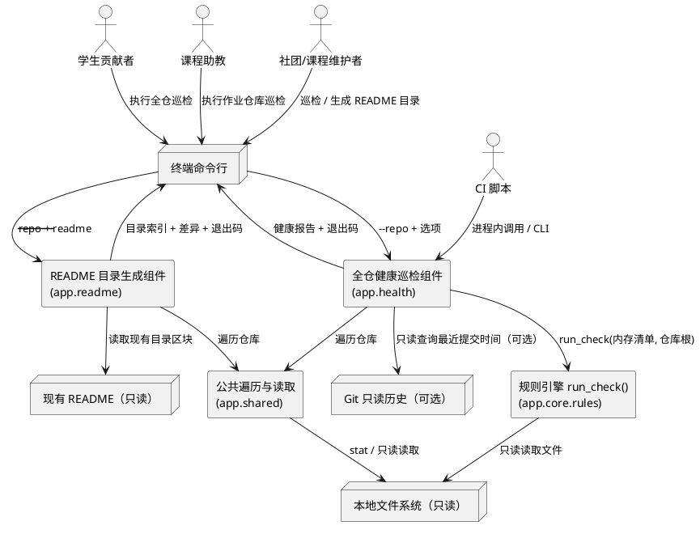

# RepoGuard 全仓健康巡检与 README 目录生成需求规格

> feature：`repo_health_readme`（阶段 3）
> 唯一实现基线：`.codeartsdoer/specs/rules_engine/spec.md`、`.codeartsdoer/specs/rules_engine/design.md`、`.codeartsdoer/specs/web_api/spec.md`、`.codeartsdoer/specs/web_api/design.md`，以及现有 `backend/app/core/rules/**` 实现。
> 本文档只描述「做什么」与「交付契约」，不包含业务代码，不修改任何现有文件；实现方案、算法细节与测试代码由后续阶段产出。

# **1. 组件定位与边界**

本规格描述 RepoGuard 学习仓库质量守护系统中的两项新增能力（阶段 3）：

1. **全仓健康巡检组件**：对一个仓库根目录做一次只读、离线的整体体检，复用阶段 1 的四个检查模块，输出结构化《仓库健康巡检报告》。
2. **README 目录生成组件**：扫描仓库中的 Markdown 文档与 Demo 工程，生成结构化目录索引，并与现有 README 对比，输出差异与可直接替换的目录片段。

两项能力都是**只读离线工具**，不监听端口、不修改被巡检仓库、不改变阶段 1 CLI 与阶段 2 FastAPI 的任何行为。

## **1.1 核心职责**

**全仓健康巡检组件**
: 本组件负责遍历指定仓库根下的全部文件，复用规则引擎的四类检查能力形成问题清单，并在依据充分时识别僵尸/废弃文件，输出带分级统计、风险等级、修复建议与降级说明的结构化健康报告。

**README 目录生成组件**
: 本组件负责扫描仓库中的 Markdown 文档与 Demo 工程、提取文档标题、生成相对路径正确的分层目录索引，并与现有 README 的目录区块做差异对比，输出可直接替换的 Markdown 片段。

两项组件的共同底线：**只读、离线、零第三方依赖、不重写任何检查规则**。

## **1.2 核心输入**

1. **仓库根目录（主要输入）**：来源为调用方显式传入的 `--repo` 参数或进程内函数参数；未传入时默认使用仓库根下的 `demo-repo/`。
2. **巡检选项（可选）**：来源为命令行参数或进程内 `HealthOptions`，包含僵尸判定阈值、git 依据开关、最大文件数、跳过目录清单等；未传入时使用本规格默认值。
3. **规则配置（可选）**：来源为阶段 1 的 `RuleConfig` 或 JSON 配置文件；未传入时使用 `default_config()`，不得在阶段 3 新增第二套检查阈值。
4. **README 定位信息（可选）**：来源为 `--readme` 参数；未传入时在仓库根查找 `README.md`（大小写不敏感）。
5. **输出格式选择**：来源为 `--format text|json`，默认 `text`。
6. **用户确认信号（仅 README 落盘相关）**：本阶段不接收自动写入指令；任何 README 修改必须由用户在工具之外手工确认并执行。

## **1.3 核心输出**

1. **仓库健康巡检报告（主要输出）**：返回给调用方的 `HealthReport`，包含扫描根标识、文件总数、Markdown 数、代码文件数、Demo 工程数、问题分级统计、按文件问题列表、僵尸候选清单、无法判定清单、降级项、警告、扫描时间与耗时。
2. **README 目录报告**：返回给调用方的 `ReadmeReport`，包含文档数、Demo 工程数、结构化目录索引、索引 Markdown 片段、现有 README 差异列表、可直接替换的目录区块、无法判定清单与警告。
3. **人类可读中文摘要**：推送给学生、助教或维护者的终端文本，按「高风险 → 建议」排序，并单列僵尸候选、无法判定与降级说明。
4. **JSON 报告**：供脚本或后续系统消费，中文不转义、字段稳定、排序稳定。
5. **退出码**：供 CI 或批处理判断本次巡检是否发现需处理项、是否存在输入错误或执行降级。

## **1.4 职责边界**

1. **不重写检查规则**：命名、代码、链接、敏感信息四类判定必须完全来自阶段 1 的 `backend/app/core/rules/`；阶段 3 新增代码禁止复制正则、阈值、级别判定或建议文案。
2. **不直接调用四个检查模块**：全仓巡检统一通过 `run_check()` 入口执行检查；新增代码不得导入 `naming.py`、`code_scan.py`、`link_check.py`、`sensitive.py`。
3. **不修改阶段 1 引擎**：`engine.py`、四个检查模块、`common/**`、`rules/__init__.py` 必须零改动。
4. **不修改阶段 2 Web API**：`backend/app/api/**`、`backend/app/static/index.html` 与既有路由必须零改动；本阶段不新增 HTTP 路由、不启动 uvicorn、不监听任何真实端口。
5. **不改变既有 CLI**：`python -m app.core.rules.engine` 的参数、默认值、退出码、stdout/stderr 必须与阶段 1 逐字节一致。
6. **不自动改写 README**：README 目录组件只输出文本与差异，不写 README；落盘修改必须由用户确认后在工具之外完成。
7. **不修改被巡检仓库**：不创建、移动、删除、重命名、改写被巡检仓库中的任何文件；不生成缓存、报告或 `__pycache__` 到被巡检仓库内。
8. **不联网**：不探测 Markdown 链接可达性、不判断 404、不访问任何外部服务。
9. **不执行被扫描代码**：不导入、不编译、不运行被巡检仓库中的 `.py`/`.c` 文件。
10. **不做企业级严苛门禁**：风险等级仅保留「高风险 / 建议」两级，不得新增「阻断 / 致命 / 严重 / 中等 / 低」等分级。
11. **不负责自动清理僵尸文件**：只给候选与建议，是否归档或删除由维护者决定。
12. **不负责 Git 写操作**：如使用 git 历史作为依据，只允许执行只读查询命令，不执行 `add`、`commit`、`checkout`、`clean` 等任何写命令。

## **1.5 与阶段 1、阶段 2 的复用与隔离**

| 对象 | 关系 | 约束 |
|------|------|------|
| `app.core.rules.engine.run_check()` | 全仓巡检的**唯一检查执行入口** | 只传内存清单与仓库根，不修改其实现 |
| `app.core.rules.common.models` 的 `Finding`/`IssueLevel`/`CheckReport` | 报告映射的**字段与语义来源** | 风险等级由 `IssueLevel` 一对一映射，不新增判定级别 |
| `app.core.rules.common.config.RuleConfig` | 检查阈值与特征清单来源 | 复用默认配置；僵尸阈值属于阶段 3 选项，不写入 `RuleConfig` |
| `app.core.rules.common.file_io.read_text_from_disk()` | README 标题提取与引用扫描的**编码容错读取器** | 直接复用，不复制 UTF-8/GB18030 回退逻辑 |
| `app.core.rules.common.file_io.resolve_repo_path()` | 路径安全沙箱参照 | 新增遍历层可复用其语义；不修改其实现 |
| `app.api.**` | 阶段 2 Web 适配层 | 不导入、不修改、不新增路由；阶段 3 是纯 CLI/进程内能力 |
| `app.core.rules.engine.main()` | 阶段 1 CLI | 不修改、不包装、不改变参数与退出码 |

**隔离结论**：阶段 3 新增代码全部位于 `backend/app/shared/`、`backend/app/health/`、`backend/app/readme/` 三个新包中；对阶段 1/2 只做「导入并调用」，不做任何修改。

# **2. 领域术语**

**全仓健康巡检**
: 全仓健康巡检是对一个仓库根目录下的全部文件执行一次完整性体检的行为，检查范围不再局限于调用方提供的变更清单。

**仓库根**
: 仓库根是本次巡检的目录边界；所有被读取文件的真实路径必须位于该目录之内，目录之外的文件一律不读取。

**扫描根标识**
: 扫描根标识是报告中用于表示被巡检仓库的短名称，只允许为目录末段名称或固定占位符，禁止出现绝对路径、盘符或用户主目录。

**健康报告**
: 健康报告是一次全仓巡检产出的完整结果，包含统计、按文件问题、僵尸候选、无法判定、降级项、警告与耗时。

**风险等级**
: 风险等级是健康报告面向读者的处置紧迫度，仅取「高风险」与「建议」两个值。
: 备注：风险等级不是新的检查级别，而是阶段 1 `IssueLevel` 的一对一映射。

**高风险**
: 高风险是「必须修改」的同义展示名，表示存在明确错误、安全风险或体积风险。

**建议**
: 建议是「优化建议」的同义展示名，表示风格、习惯或可维护性改进项。

**无法判定**
: 无法判定是业务结论因依据不足而不能给出的状态，必须附带中文原因；无法判定不是问题，不得计入高风险或建议数量。

**降级项**
: 降级项是执行能力受损的记录，例如 git 历史不可用、某类文件无法读取、文件数超过上限导致未完整巡检。

**僵尸文件**
: 僵尸文件是长期无修改且在全仓中没有被引用的文件；本规格只允许在时间依据与引用依据都可靠时给出「僵尸候选」，不得直接断言文件已废弃。

**僵尸候选**
: 僵尸候选是满足「无引用 + 可信空闲时长超过阈值」的文件，仅作为维护者复核建议，风险等级固定为「建议」。

**引用计数**
: 引用计数是仓库内可读文本文件中出现某文件相对路径或文件名的次数；本规格只使用「是否为 0」这一保守结论。

**可信时间依据**
: 可信时间依据是 git 最近提交时间或文件修改时间中，能够排除「批量检出导致时间失真」等干扰后仍可用于计算空闲时长的依据。

**Demo 工程**
: Demo 工程是仓库中可独立运行或独立打开的最小示例工程，识别依据限于入口文件、构建文件、源码文件与 README 的组合，不依据目录名的主观判断。

**已确认 Demo 工程**
: 已确认 Demo 工程是存在入口文件或构建文件等强证据的目录。

**疑似 Demo 工程**
: 疑似 Demo 工程是只有弱证据的目录，必须标注「待确认」，不得计入已确认数量。

**文档标题**
: 文档标题是 Markdown 文档用于目录展示的名称，优先取文档中的首个一级 ATX 标题，缺失时回退为文件名。

**ATX 标题**
: ATX 标题是 Markdown 中以 1～6 个 `#` 加空格开头的行标题。

**目录索引**
: 目录索引是由文档项与 Demo 工程项组成的结构化分层列表，路径必须为相对仓库根且使用 `/` 分隔。

**目录区块**
: 目录区块是现有 README 中承载目录列表的连续文本范围，可通过显式标记或目录标题识别。

**替换片段**
: 替换片段是可直接覆盖现有目录区块的完整 Markdown 文本，包含必要的起止标记与全部索引条目。

**差异类型**
: 差异类型是现有 README 目录与最新索引之间的变化分类，仅取「新增」「删除」「移动」「标题变化」四种。

# **3. 角色与典型场景**

## **3.1 核心角色**

1. **学生贡献者**：在提交前或阶段复习时对自己的学习仓库执行全仓巡检，按高风险项优先修正，并查看僵尸候选确认是否有遗留文件。
2. **课程助教**：对某次作业的仓库根执行全仓巡检，读取分级统计与按文件问题，形成面向学生的整改反馈。
3. **社团/课程维护者**：定期执行全仓巡检，审阅僵尸候选与无法判定项；在整理仓库文档时生成 README 目录索引与差异，确认后手工替换 README。
4. **CI 脚本维护者**：调用新增 CLI 并根据退出码决定是否告警；只消费 JSON 报告，不依赖终端文案。

## **3.2 外部系统**

1. **本地文件系统（只读）**：提供目录结构、文件体积、文件内容与修改时间；本组件不写入任何内容。
2. **Git 只读历史（可选）**：在仓库为 Git 工作区且 git 可执行时，提供单文件最近提交时间；不可用时降级为 mtime 依据。
3. **终端命令行**：承载新增 CLI 的参数输入、中文摘要输出与退出码。
4. **阶段 1 规则引擎**：以进程内函数调用的方式提供四类检查能力与 `CheckReport`。
5. **现有 README 文件（只读）**：提供待对比的目录区块；本组件只读取，不写入。

## **3.3 交互上下文**



## **3.4 典型场景**

1. **助教执行全仓巡检**
   a. 助教在 `backend/` 下运行 `python -m app.health.cli --repo ../demo-repo --format text`。
   b. 组件遍历全仓、复用四类检查，输出「共 N 个文件、X 个高风险、Y 条建议」。
   c. 助教先看高风险清单，再看僵尸候选与无法判定项，用于形成整改说明。

2. **维护者生成 README 目录差异**
   a. 维护者运行 `python -m app.readme.cli --repo ../demo-repo --format text`。
   b. 组件列出新增/删除/移动/标题变化的条目，并给出完整替换片段。
   c. 维护者审阅后自行复制片段替换 README；工具不自动写入。

3. **信息不足时的降级提示**
   a. 仓库不是 Git 工作区且文件 mtime 疑似批量检出，组件不猜测僵尸文件，输出「无法判定：缺少可信时间依据」。
   b. README 中没有可识别的目录区块，组件不做差异对比，输出「无法判定：未识别现有目录区块」，并给出完整可插入片段。

4. **CI 只消费 JSON**
   a. CI 调用 `--format json`，解析 `summary.must_fix_count` 与 `degraded`。
   b. 退出码为 1 时告警；为 2 或 3 时区分输入错误与执行降级。

# **4. 全仓遍历与复用契约**

## **4.1 仓库根定位与校验**

1. **默认仓库根**：未传 `--repo` 时，按顺序尝试 `../demo-repo`（工作目录为 `backend/` 时）与 `demo-repo`；两者都不存在时返回输入错误。
   a. 验收条件（EARS）：When the caller omits `--repo`, the 全仓健康巡检组件 shall 在 `../demo-repo` 与 `demo-repo` 中选取第一个存在且为目录的路径作为仓库根。
2. **显式仓库根**：调用方传入的路径必须存在、为目录且可读；否则返回输入错误报告，不进入遍历阶段。
   a. 验收条件（EARS）：When the supplied repository root does not exist or is not a directory, the 全仓健康巡检组件 shall 返回 `status="输入错误"`、中文原因与退出码 2，且不读取任何文件。
3. **禁止工具源码树作为巡检根**：若仓库根包含本工具自身源码目录 `backend/app/`，必须拒绝执行并提示「巡检根不能是工具自身源码目录」，避免 Python 运行时在被巡检仓库内生成 `__pycache__`。
   a. 验收条件（EARS）：When the repository root contains `backend/app/`, the 全仓健康巡检组件 shall 拒绝执行并返回输入错误，理由为只读保护。
4. **扫描根标识**：报告中只允许出现仓库根的末段目录名；无法取得时使用固定占位符 `<repo>`，禁止出现绝对路径、盘符或用户主目录。
   a. 验收条件（EARS）：When the repository root is `C:\work\demo-repo`, the 全仓健康巡检组件 shall 在报告中输出 `scan_root="demo-repo"` 且不出现 `C:\work`。

## **4.2 递归遍历规则**

1. **递归范围**：必须从仓库根递归遍历全部普通文件；目录本身只用于组织层级，不计入文件总数。
   a. 验收条件（EARS）：When a repository contains nested directories, the 全仓健康巡检组件 shall 递归发现每一层的普通文件并将其纳入统计。
2. **跳过目录**：必须跳过 `.git`、`.svn`、`.hg`、`__pycache__`、`node_modules`、`.venv`、`venv`、`env`、`dist`、`build`、`target`、`out`、`.idea`、`.vscode`、`.pytest_cache`、`.mypy_cache`、`.tox`、`.eggs` 以及以 `.egg-info` 结尾的目录。
   a. 验收条件（EARS）：When a repository contains `node_modules/`, the 全仓健康巡检组件 shall 不遍历该目录且不将其内文件计入文件总数。
3. **不跳过隐藏文件**：除上述技术目录外，以 `.` 开头的隐藏文件必须纳入遍历与检查，避免遗漏 `.env` 等敏感文件。
   a. 验收条件（EARS）：When a repository contains a `.env` file, the 全仓健康巡检组件 shall 将其纳入巡检并交给敏感信息检查。
4. **符号链接**：不得跟随目录符号链接；文件符号链接的真实路径若落在仓库根之外，必须跳过并记入降级项，禁止读取。
   a. 验收条件（EARS）：When a symbolic link points outside the repository root, the 全仓健康巡检组件 shall 不读取其目标并记录「符号链接逃逸，已跳过」。
5. **路径边界**：任何文件的真实路径必须位于仓库根真实路径之内；比较时 Windows 下必须大小写不敏感，路径统一以 `/` 分隔输出。
   a. 验收条件（EARS）：When a resolved file path leaves the repository root, the 全仓健康巡检组件 shall 不读取该文件且不将其纳入检查清单。
6. **不可纳入清单的文件名**：文件名包含换行符、首尾空白，或在 Windows 下无法以普通路径打开时，必须跳过并记入降级项，禁止伪造清单行。
   a. 验收条件（EARS）：When a file name contains a line break, the 全仓健康巡检组件 shall 跳过该文件并在报告中说明原因。
7. **目录深度上限**：默认最大递归深度为 64 层；超过深度上限的目录不再展开，并记入降级项。
   a. 验收条件（EARS）：When directory nesting exceeds 64 levels, the 全仓健康巡检组件 shall 停止展开更深目录并输出降级说明。
8. **文件总数上限**：默认最多巡检 5,000 个文件；超过上限时不得执行部分巡检，必须返回「范围过大，未执行完整巡检」的降级报告与退出码 3。
   a. 验收条件（EARS）：When the file count exceeds `max_files`, the 全仓健康巡检组件 shall 不生成部分清单、不调用检查入口，并明确提示缩小巡检范围。
9. **只读遍历**：遍历过程只允许 `stat`、目录列举与只读读取；禁止创建、修改、删除、重命名任何文件或目录。
   a. 验收条件（EARS）：When traversal completes, the 全仓健康巡检组件 shall 保证被巡检仓库的文件列表、体积、内容与修改时间与遍历前一致。

## **4.3 四个检查模块的复用契约**

### **4.3.1 复用方案选择**

本规格在两种方案中**选择方案 B：构造内存变更清单并调用 `run_check()`**。

| 方案 | 做法 | 结论 |
|------|------|------|
| 方案 A | 新增编排层逐文件构造 `ChangeEntry` 与 `CheckContext`，直接调用四个模块的 `check(entry, ctx)` | 不采用 |
| **方案 B（采用）** | 遍历得到文件列表后生成内存清单（每个文件一行 `M <相对路径>`），一次性调用 `run_check(manifest_text, repo_root, config)`，再把 `CheckReport` 映射为 `HealthReport` | **采用** |

**选择方案 B 的理由：**

1. **唯一公共入口**：`run_check()` 是阶段 1 已冻结、已测试、被阶段 2 Web 层验证过的唯一检查入口；复用它可以把行为差异风险降到最低。
2. **判定规则零复制**：四类规则、阈值、级别、建议文案、脱敏、聚合全部由阶段 1 承担；阶段 3 只做「遍历 → 清单 → 报告映射」。
3. **分组与排序一致性**：阶段 1 已实现按文件分组、必须修改优先、行号升序、`rule_id` 兜底排序；方案 B 自动继承这些确定性行为。
4. **文件读取一次共享**：`run_check()` 内部对同一相对路径使用同一个 `FileSnapshot` 缓存，四个模块共享体积与文本，满足「单文件最多读取一次」。
5. **异常隔离已具备**：单模块异常会被阶段 1 捕获并写入 `degraded_modules`，阶段 3 只需透传为降级项。
6. **升级自动继承**：未来阶段 1 规则升级后，全仓巡检无需同步修改，避免两套判定漂移。

**不选方案 A 的理由：**

1. 方案 A 需要新增一份按文件分组、分级排序、降级汇总的实现，等于在阶段 3 复制阶段 1 的编排语义，长期存在行为漂移风险。
2. 方案 A 直接导入四个检查模块，容易在后续维护中演变为「顺手改规则」，违反「不重写检查规则」的硬约束。
3. 方案 A 需要自行保证 `FileSnapshot` 共享、异常隔离与排序稳定性，测试成本高于方案 B。

### **4.3.2 复用约束**

1. **唯一调用方式**：全仓巡检必须调用 `app.core.rules.engine.run_check()`；一次巡检最多调用一次。
   a. 验收条件（EARS）：When a full-repository inspection runs, the 全仓健康巡检组件 shall 对 `run_check()` 的调用次数恰好为 1。
2. **禁止导入四模块**：`backend/app/health/**`、`backend/app/readme/**`、`backend/app/shared/**` 中不得出现对 `naming.py`、`code_scan.py`、`link_check.py`、`sensitive.py` 的导入。
   a. 验收条件（EARS）：When the new packages are statically scanned, the 全仓健康巡检组件 shall 在检查模块导入项上命中 0 次。
3. **禁止复制判定素材**：新增代码不得复制阶段 1 的高危写法清单、敏感信息正则、目录映射表、级别判定条件或建议文案。
   a. 验收条件（EARS）：When the new packages are reviewed, the 全仓健康巡检组件 shall 不包含与阶段 1 重复的规则正则或阈值常量。
4. **配置透传**：调用 `run_check()` 时必须传入阶段 1 的 `RuleConfig`；未显式提供时传 `None` 或 `default_config()`，不得在阶段 3 另建阈值体系。
   a. 验收条件（EARS）：When no rule config is supplied, the 全仓健康巡检组件 shall 以阶段 1 默认配置执行检查。
5. **报告映射不改变语义**：`CheckReport` 中的 `must_fix_count` 必须映射为高风险数量，`suggestion_count` 必须映射为建议数量，不得重新判定级别。
   a. 验收条件（EARS）：When the engine reports 3 must-fix findings, the 健康报告 shall 输出 `must_fix_count=3` 且不新增或删除任何问题。
6. **降级透传**：`CheckReport.degraded_modules` 必须原样映射为健康报告的降级项，模块名称与中文原因不得改写。
   a. 验收条件（EARS）：When the engine reports a degraded module, the 健康报告 shall 在 `degraded` 中保留该模块与原因。

### **4.3.3 内存清单构造规则**

1. 每个纳入巡检的文件生成一行 `M <相对路径>`；状态固定为 `M`（修改），不使用 `A` 或 `D`。
2. 相对路径必须使用 `/` 分隔、不以 `/` 或盘符开头、不含 `..` 段。
3. 清单行不得包含注释、空行或额外字段；文件路径中的空格必须原样保留。
4. 文件名以 `#` 开头时，因行首为 `M`，不得被阶段 1 误判为注释行。
5. 清单只包含遍历后确认可纳入的文件；被跳过的文件不进入清单，其跳过原因由阶段 3 自行记录。

## **4.4 文件读取、编码与超大文件策略**

1. **读取一次共享**：同一次全仓巡检中，同一相对路径的文件内容最多从磁盘读取一次；由 `run_check()` 内部的快照缓存保证。
   a. 验收条件（EARS）：When the same file is checked by multiple modules, the 全仓健康巡检组件 shall 保证其内容最多读取 1 次。
2. **编码容错**：必须沿用阶段 1 的读取口径：去除 UTF-8 BOM → 严格 `utf-8` 解码 → 失败回退 `gb18030` → 再失败标记编码不可识别并跳过内容类检查。
   a. 验收条件（EARS）：When a GB18030-encoded Markdown file is scanned, the 全仓健康巡检组件 shall 正确解码并完成链接检查。
3. **超大文件**：必须沿用阶段 1 的既有阈值：单文件文本读取上限 5 MB、代码内容扫描上限 5 MB、大文件警告 1 MB、大文件必须修改 5 MB、单文件检查预算 300 毫秒、大文本敏感扫描预算 1 秒；禁止在阶段 3 新增或放宽阈值。
   a. 验收条件（EARS）：When a file exceeds 5 MB, the 全仓健康巡检组件 shall 沿用阶段 1 的体积问题与内容跳过行为，不新增第三套阈值。
4. **二进制文件**：必须沿用阶段 1 的扩展名黑名单与 NUL 字节判定；二进制文件只做体积检查，不做文本解码与内容扫描。
   a. 验收条件（EARS）：When a `.mp4` file is scanned, the 全仓健康巡检组件 shall 只保留体积类结论，不尝试文本级敏感信息匹配。
5. **读取失败**：单文件不存在、无权限或编码不可识别时，必须跳过该文件的内容检查，保留命名类结论，并在健康报告的降级项或警告中记录原因，不得中断整体巡检。
   a. 验收条件（EARS）：When one file cannot be read, the 全仓健康巡检组件 shall 继续处理其余文件并记录该文件的跳过原因。

# **5. 巡检内容与分级**

## **5.1 Markdown 链接批量校验**

1. **复用范围**：所有纳入巡检的 `.md` 文件必须交给阶段 1 的链接检查；检查内容限于链接书写结构与仓库协作适配性。
   a. 验收条件（EARS）：When a Markdown document is included in the inspection, the 全仓健康巡检组件 shall 对其执行与阶段 1 完全一致的链接格式检查。
2. **离线口径**：禁止联网探测链接是否可访问、禁止判断 404、禁止请求 HTTP 头；链接目标只做字符串与结构判定。
   a. 验收条件（EARS）：When link checking runs on the whole repository, the 全仓健康巡检组件 shall 不发起任何网络请求。
3. **问题定位**：每条链接问题必须保留文件路径、行号、原文片段（不超过 60 字符）与规则标识。
   a. 验收条件（EARS）：When a malformed link is found on line 12, the 健康报告 shall 输出 `line_no=12` 与对应 `rule_id`。
4. **不检测 404**：报告中不得出现「链接不可访问」「404」「超时」等可达性结论；只允许出现格式、路径写法与协作适配类结论。
   a. 验收条件（EARS）：When a link target is a valid relative path but the file does not exist, the 全仓健康巡检组件 shall 不输出 404 或可达性结论。

## **5.2 代码文件规范问题汇总**

1. **复用范围**：所有纳入巡检的 `.py`、`.c`、`.h` 文件必须交给阶段 1 的代码检查，规则、级别、行号、建议文案完全沿用。
   a. 验收条件（EARS）：When a `.c` file contains `strcpy`, the 健康报告 shall 输出与阶段 1 一致的 `code-004` 必须修改问题。
2. **`.h` 级别**：`.h` 文件的检查结论必须沿用阶段 1 的「只允许优化建议」裁级规则，不得在阶段 3 升级为高风险。
   a. 验收条件（EARS）：When a `.h` file lacks a function comment, the 健康报告 shall 输出建议级问题。
3. **代码问题汇总**：健康报告必须按文件汇总代码问题，保留行号与规则来源；不得只给文件级结论。
   a. 验收条件（EARS）：When one file contains multiple code findings, the 健康报告 shall 按行号升序列出并保留每条 `rule_id`。
4. **不执行代码**：巡检过程不得导入、编译或运行被检查的代码文件。
   a. 验收条件（EARS）：When code inspection runs, the 全仓健康巡检组件 shall 只以文本方式读取内容。

## **5.3 敏感信息与大文件检查**

1. **复用范围**：所有纳入巡检的文本文件必须交给阶段 1 的敏感信息与大文件检查；二进制文件只做体积检查。
   a. 验收条件（EARS）：When a `.env` file contains a private key header, the 健康报告 shall 输出高风险问题并要求轮换凭据。
2. **脱敏**：报告中不得出现完整凭据；敏感内容只允许保留前 4 个字符并使用固定掩码。
   a. 验收条件（EARS）：When a token is detected, the 健康报告 shall 以脱敏形式展示，禁止完整回显。
3. **体积分级**：1 MB 至 5 MB 输出建议；超过 5 MB 输出高风险；与阶段 1 完全一致。
   a. 验收条件（EARS）：When a file is 8 MB, the 健康报告 shall 输出高风险体积问题。
4. **教学示例豁免**：疑似密钥的上下文包含「示例」「占位」「demo」「example」等字样时，必须沿用阶段 1 的降级规则；PEM 私钥头与已知真实令牌格式不适用豁免。
   a. 验收条件（EARS）：When a token-like string appears next to "示例占位", the 健康报告 shall 最多输出建议级问题。

## **5.4 僵尸/废弃文件判定**

### **5.4.1 判定原则**

1. **只给候选**：只能输出「僵尸候选」，不得输出「已废弃」「可删除」等确定性结论。
2. **依据充分才判定**：必须同时满足「引用计数可靠且为 0」与「可信时间依据且空闲时长达到阈值」两个条件。
3. **依据不足必须降级**：任一条件不可靠时，必须输出「无法判定」并说明具体原因，禁止用文件大小、扩展名、目录名、命名风格、主观印象等弱信号硬猜。
4. **风险等级固定为建议**：僵尸候选不得计入高风险，不得阻塞提交。
5. **只读**：判定过程不得修改文件时间、不得移动或删除文件。

### **5.4.2 可靠依据定义**

| 依据 | 可靠条件 | 不可靠时 |
|------|---------|---------|
| Git 最近提交时间 | 仓库为 Git 工作区、git 可执行、单文件查询成功且返回时间戳 | 记入降级项「Git 历史不可用」，改用 mtime 或无法判定 |
| 文件 mtime | `stat` 成功，且未检测到「批量检出」特征 | 无法判定，原因「文件修改时间不可信」 |
| 全仓引用计数 | 所有纳入引用扫描的文本文件均读取成功，且文件名字段不属于通用名 | 无法判定，原因「引用统计不完整」或「文件名过于通用」 |

**批量检出特征定义**：若仓库中超过 80% 的文件 mtime 落在同一 1 小时窗口内，视为 `mtime` 可能来自 clone、解压或批量复制，不作为可信时间依据。

**通用名定义**：`README.md`、`readme.md`、`LICENSE`、`.gitignore`、`.gitattributes`、`requirements.txt`、`pyproject.toml`、`setup.py`、`Makefile`、`CMakeLists.txt`、`package.json`、`index.html`、`main.py`、`app.py`、`main.c`，以及 basename 长度少于 4 个字符的文件名。

**入口/配置类文件**：上述通用名文件不参与僵尸判定，必须输出「不适用僵尸判定」的无法判定项，原因说明其为入口或配置文件。

### **5.4.3 判定算法（业务口径）**

1. 对每个候选文件计算引用计数：在全部可读文本文件中查找该文件的相对路径或 basename 出现次数；候选文件自身不计入。
2. 若引用计数大于 0，判定为「仍被引用」，不输出候选，也不输出无法判定。
3. 若引用计数为 0，但引用扫描存在未读取成功的文本文件，输出无法判定，原因「引用统计不完整」。
4. 若文件名属于通用名，输出无法判定，原因「入口或配置文件不适用僵尸判定」。
5. 计算空闲时长：
   a. Git 依据可用时，优先使用 Git 最近提交时间；
   b. Git 不可用且 mtime 可信时，使用 mtime；
   c. 两者都不可用时，输出无法判定，原因「缺少可信时间依据」。
6. 空闲时长达到或超过 `zombie_days` 时，输出僵尸候选；未达到时不输出任何结论。
7. `zombie_days` 必须可配置，默认 365 天，允许范围 30～3650 天；非法值回退默认并输出警告。
8. Git 查询必须使用只读命令与参数列表形式，禁止拼接 shell 字符串；单文件查询超时 2 秒，整次巡检 Git 预算 30 秒；超时或失败必须降级，不得阻塞巡检。
9. 候选清单必须包含：文件路径、时间依据类型（git/mtime）、最近活动日期、空闲天数、引用计数、建议动作。
10. 建议动作固定为「确认是否仍被课程使用；若不再使用，移动到 archive/ 或删除（需人工确认）」，不得自动执行。

### **5.4.4 验收条件**

1. **无引用 + 可信 mtime 超阈值**：When a file has zero references and a credible mtime older than `zombie_days`, the 全仓健康巡检组件 shall 输出一条僵尸候选，风险等级为建议。
2. **无引用 + Git 超阈值**：When Git history is available and the last commit is older than `zombie_days`, the 全仓健康巡检组件 shall 优先使用 Git 时间并输出候选。
3. **有引用**：When a file is referenced by any readable text file, the 全仓健康巡检组件 shall 不将其列为候选。
4. **Git 不可用**：When Git is unavailable or the repository is not a Git work tree, the 全仓健康巡检组件 shall 输出降级项并尝试 mtime 依据，不得直接断言为僵尸。
5. **mtime 批量检出**：When more than 80% of files share a one-hour mtime window, the 全仓健康巡检组件 shall 判定 mtime 不可信，并在缺少 Git 依据时输出无法判定。
6. **引用统计不完整**：When any reference-scan text file cannot be read, the 全仓健康巡检组件 shall 输出无法判定，原因包含未读取文件数量。
7. **通用名**：When the candidate is `README.md`, the 全仓健康巡检组件 shall 输出无法判定，原因说明其为入口文件。
8. **阈值可配置**：When `--zombie-days 90` is supplied, the 全仓健康巡检组件 shall 使用 90 天作为判定阈值并在报告中记录该阈值。
9. **非法阈值**：When `--zombie-days 0` is supplied, the 全仓健康巡检组件 shall 回退默认 365 天并输出中文警告。
10. **禁止硬猜**：When only weak signals such as small size or unusual extension exist, the 全仓健康巡检组件 shall 不输出僵尸候选。

## **5.5 风险等级与 Finding 级别映射**

| 阶段 1 问题级别 | 健康报告风险等级 | 是否计入高风险统计 | 处置建议 |
|----------------|----------------|------------------|---------|
| `必须修改` | 高风险 | 是 | 提交前优先处理 |
| `优化建议` | 建议 | 否 | 自主采纳 |
| 无对应问题 | 无法判定 | 否 | 补充依据或人工确认 |

1. **一对一映射**：风险等级只允许由上述映射产生，禁止根据文件名、目录、文件大小二次升级或降级。
   a. 验收条件（EARS）：When a finding has level `优化建议`, the 健康报告 shall 输出 `risk_level="建议"`，不得输出「高风险」。
2. **禁止新增级别**：报告中不得出现「阻断」「致命」「严重」「中等」「低」「警告」等额外风险等级。
   a. 验收条件（EARS）：When the health report is serialized, the 健康报告 shall 只出现「高风险」「建议」两个风险等级值。
3. **无法判定独立计数**：无法判定项必须单独统计与展示，不得混入问题总数。
   a. 验收条件（EARS）：When 2 items are undetermined, the 健康报告 shall 输出 `undetermined_count=2` 且 `issue_count` 不包含这 2 项。

# **6. 报告数据契约**

## **6.1 健康报告（HealthReport）**

健康报告必须为可无损序列化为 JSON 的冻结数据结构，字段如下：

| 字段 | 类型 | 必填 | 约束 |
|------|------|------|------|
| `format_version` | 字符串 | 是 | 固定为 `"1.0"` |
| `status` | 字符串 | 是 | 仅取「正常」「部分降级」「输入错误」 |
| `scan_root` | 字符串 | 是 | 仓库根标识，禁止绝对路径 |
| `file_count` | 整数 | 是 | 纳入巡检的普通文件总数，≥ 0 |
| `markdown_count` | 整数 | 是 | `.md` 文件数，≥ 0 |
| `code_file_count` | 整数 | 是 | `.py`/`.c`/`.h` 文件数，≥ 0 |
| `demo_project_count` | 整数 | 是 | 已确认 Demo 工程数，≥ 0 |
| `demo_project_suspected_count` | 整数 | 是 | 疑似 Demo 工程数，≥ 0 |
| `summary` | 对象 | 是 | 见 6.2 |
| `files` | 数组 | 是 | 按文件的问题列表，见 6.3；无问题时为空数组 |
| `zombie_candidates` | 数组 | 是 | 僵尸候选清单，见 6.4；无候选时为空数组 |
| `undetermined` | 数组 | 是 | 无法判定清单，见 6.5；无内容时为空数组 |
| `degraded` | 数组 | 是 | 降级项清单，见 6.5；无降级时为空数组 |
| `warnings` | 字符串数组 | 是 | 非致命提示；无提示时为空数组 |
| `scanned_at` | 字符串 | 是 | UTC ISO 8601 时间，仅用于观测 |
| `duration_ms` | 整数 | 是 | 扫描耗时，≥ 0 |

1. **空结果完整**：没有任何问题时必须返回结构完整的报告，所有列表为空数组、统计为 0，禁止返回 `null` 或省略字段。
   a. 验收条件（EARS）：When no issues are found, the 健康报告 shall 返回全部字段且统计值为 0。
2. **扫描根脱敏**：`scan_root` 禁止包含绝对路径、盘符、UNC 前缀或用户主目录。
   a. 验收条件（EARS）：When the report is serialized, the 健康报告 shall 不出现绝对路径。
3. **时间可观测**：`scanned_at` 必须为 UTC ISO 8601；`duration_ms` 必须为非负整数。
   a. 验收条件（EARS）：When the report is generated, the 健康报告 shall 输出可解析的 UTC 时间与非负耗时。

## **6.2 统计对象（HealthSummary）**

| 字段 | 含义 | 计算口径 |
|------|------|---------|
| `issue_count` | 问题总数 | 所有文件问题条目数 |
| `must_fix_count` | 高风险数量 | 风险等级为「高风险」的条目数 |
| `suggestion_count` | 建议数量 | 风险等级为「建议」的条目数 |
| `zombie_candidate_count` | 僵尸候选数 | `zombie_candidates` 长度 |
| `undetermined_count` | 无法判定数 | `undetermined` 长度 |
| `skipped_file_count` | 跳过文件数 | 因读取失败、编码失败、路径异常被跳过的文件数 |
| `degraded_count` | 降级项数 | `degraded` 长度 |

**一致性不变量：**

1. `issue_count == must_fix_count + suggestion_count`。
2. `must_fix_count` 等于所有文件问题中风险等级为「高风险」的条目数。
3. `suggestion_count` 等于所有文件问题中风险等级为「建议」的条目数。
4. `zombie_candidate_count == len(zombie_candidates)`。
5. `undetermined_count == len(undetermined)`。
6. `degraded_count == len(degraded)`。

a. 验收条件（EARS）：When the report is built, the 健康报告 shall 满足上述全部一致性不变量，任一不满足即标记为部分降级。

## **6.3 按文件问题列表（HealthFileEntry / HealthIssue）**

每个文件条目必须包含：

| 字段 | 类型 | 必填 | 约束 |
|------|------|------|------|
| `file_path` | 字符串 | 是 | 相对仓库根，`/` 分隔 |
| `risk_level` | 字符串 | 是 | 「高风险」或「建议」 |
| `issue_count` | 整数 | 是 | 该文件问题数，≥ 0 |
| `findings` | 数组 | 是 | 问题条目列表；无问题时为空数组 |

每条问题必须包含：

| 字段 | 类型 | 必填 | 约束 |
|------|------|------|------|
| `rule_id` | 字符串 | 是 | 与阶段 1 完全一致，如 `code-004` |
| `source_module` | 字符串 | 是 | 「命名与目录检查」「代码检查」「链接检查」「敏感信息与大文件检查」之一 |
| `risk_level` | 字符串 | 是 | 「高风险」或「建议」 |
| `line_no` | 整数或 `null` | 是 | 可定位到行时提供，≥ 1 |
| `message` | 字符串 | 是 | 中文描述，与阶段 1 一致，8～200 字符 |
| `suggestion` | 字符串 | 是 | 中文可执行建议，与阶段 1 一致，≤ 300 字符 |
| `excerpt` | 字符串或 `null` | 是 | 原文片段，≤ 60 字符；敏感内容必须脱敏 |

1. **来源可追溯**：`source_module` 必须由 `rule_id` 前缀映射（`naming-`、`code-`、`link-`、`sens-`），不得主观填写。
   a. 验收条件（EARS）：When a finding has `rule_id="link-003"`, the 健康报告 shall 输出 `source_module="链接检查"`。
2. **位置完整**：代码、链接、敏感信息问题必须携带行号；纯命名或目录问题允许 `line_no=null`。
   a. 验收条件（EARS）：When a code finding is located on line 27, the 健康报告 shall 输出 `line_no=27`。

## **6.4 僵尸候选（ZombieCandidate）**

| 字段 | 类型 | 必填 | 约束 |
|------|------|------|------|
| `file_path` | 字符串 | 是 | 相对仓库根 |
| `basis` | 字符串 | 是 | `git` 或 `mtime` |
| `last_activity` | 字符串 | 是 | `YYYY-MM-DD` 日期 |
| `idle_days` | 整数 | 是 | ≥ 0，且 ≥ `zombie_days` |
| `reference_count` | 整数 | 是 | 固定为 0 |
| `risk_level` | 字符串 | 是 | 固定为「建议」 |
| `suggestion` | 字符串 | 是 | 中文人工确认建议，不得包含自动删除指令 |

a. 验收条件（EARS）：When a zombie candidate is emitted, the 健康报告 shall 保证 `reference_count=0`、`risk_level="建议"` 且 `basis` 只取 `git` 或 `mtime`。

## **6.5 无法判定与降级项**

**无法判定项（UndeterminedItem）**

| 字段 | 类型 | 必填 | 约束 |
|------|------|------|------|
| `item` | 字符串 | 是 | 文件路径或业务对象标识 |
| `reason` | 字符串 | 是 | 中文原因，必须说明缺少哪类依据 |

**降级项（DegradedItem）**

| 字段 | 类型 | 必填 | 约束 |
|------|------|------|------|
| `item` | 字符串 | 是 | 模块名、能力名或文件路径 |
| `reason` | 字符串 | 是 | 中文原因，说明结果可能不完整 |

1. **不可静默**：任一无法判定或降级都必须出现在报告中，禁止只在日志中记录。
   a. 验收条件（EARS）：When Git history is unavailable, the 健康报告 shall 在 `degraded` 中输出对应原因。
2. **原因可读**：原因必须为中文陈述句，不得输出英文异常类名或堆栈。
   a. 验收条件（EARS）：When a file cannot be decoded, the 健康报告 shall 输出「文件编码无法识别，建议另存为 UTF-8 后重试」类中文原因。

## **6.6 输出格式要求**

1. **text 输出**：必须为中文摘要，顺序为「总览统计 → 高风险问题 → 建议问题 → 僵尸候选 → 无法判定 → 降级项 → 警告」，开头必须明确高风险数量与「先处理高风险项」引导语。
   a. 验收条件（EARS）：When `--format text` is used, the 全仓健康巡检组件 shall 先输出高风险分组，再输出建议分组。
2. **JSON 输出**：必须使用 `ensure_ascii=False` 语义，中文不转义；字段顺序按 6.1 固定；缩进 2 个空格。
   a. 验收条件（EARS）：When `--format json` is used, the 全仓健康巡检组件 shall 输出中文原文且不出现 Unicode 转义序列。
3. **稳定排序**：
   a. `files` 按 `file_path` Unicode 码点升序；
   b. 每个文件内的 `findings` 先高风险后建议，同级按 `line_no` 升序，无行号者排末尾，再按 `rule_id`、`message` 升序；
   c. `zombie_candidates` 按 `file_path` 升序；
   d. `undetermined` 按 `item` 升序；
   e. `degraded` 按固定能力顺序（遍历、Git、命名、代码、链接、敏感信息、报告）再按 `reason` 升序。
   a. 验收条件（EARS）：When the same repository is scanned twice, the 健康报告 shall 除 `scanned_at` 与 `duration_ms` 外逐字段一致。
4. **空结果表达**：无问题时必须输出「未发现问题」提示，不得输出空白页面。
   a. 验收条件（EARS）：When no issues exist, the text output shall 显示明确的中文空状态提示。
5. **禁止项**：禁止输出英文堆栈、禁止把多个文件的问题合并成一条、禁止在未显式指定输出路径时写入任何文件。

# **7. README 目录生成契约**

## **7.1 文档扫描与标题提取**

1. **扫描范围**：必须扫描仓库根下全部 `.md` 文件，排除 4.2 规定的技术目录；`README.md` 本身也作为文档候选，但必须在索引中标记为「根 README」并与现有目录区块区分。
   a. 验收条件（EARS）：When a repository contains nested Markdown files, the README 目录生成组件 shall 发现全部 `.md` 文件并生成文档条目。
2. **标题来源优先级**：
   a. 跳过 YAML front matter（以 `---` 开头并以 `---` 结束的头部块）；
   b. 跳过 fenced code block 与行内代码；
   c. 在剩余内容中查找首个 ATX 标题；
   d. 若首个 ATX 标题为一级（`# `），使用其文本；
   e. 若全文没有一级标题，但存在其他级别标题，仍回退为文件名；
   f. 若没有任何 ATX 标题，回退为文件名（去除 `.md` 扩展名）；
   g. 标题文本必须去除首尾空白、去除行尾闭合 `#`、折叠连续空白，长度上限 200 字符，超出截断并输出警告。
   a. 验收条件（EARS）：When a document starts with `# 串口通信实验`, the README 目录生成组件 shall 使用「串口通信实验」作为标题。
3. **标题来源标注**：每个文档条目必须标注标题来源为 `atx` 或 `fallback_filename`，便于维护者判断是否需要人工润色。
   a. 验收条件（EARS）：When a document has no heading, the README 目录生成组件 shall 使用文件名并标注 `title_source="fallback_filename"`。
4. **编码容错**：必须复用阶段 1 的 UTF-8 BOM / UTF-8 / GB18030 回退读取；仍失败时回退文件名，并在警告中说明「标题无法读取，已使用文件名」。
   a. 验收条件（EARS）：When a Markdown file cannot be decoded, the README 目录生成组件 shall 使用文件名作为标题并输出中文警告。
5. **空文档**：0 字节或仅含空白的 Markdown 文件必须使用文件名作为标题，不输出错误。
   a. 验收条件（EARS）：When a Markdown file is empty, the README 目录生成组件 shall 使用文件名并继续生成索引。

## **7.2 Demo 工程识别**

Demo 工程识别必须保守，只依据可验证的文件证据，不依据目录名的主观判断。

### **7.2.1 强证据（已确认）**

目录内存在以下任一入口文件或构建文件时，识别为「已确认 Demo 工程」：

1. 入口文件：`main.py`、`app.py`、`manage.py`、`index.html`、`main.c`、`main.cpp`、`main.java`、`main.go`。
2. 构建/依赖文件：`requirements.txt`、`pyproject.toml`、`setup.py`、`package.json`、`pom.xml`、`build.gradle`、`CMakeLists.txt`、`Makefile`、`Cargo.toml`、`go.mod`。

### **7.2.2 弱证据（疑似，待确认）**

不满足强证据，但同时满足以下任一组合时，识别为「疑似 Demo 工程」：

1. 目录内源码文件（`.py`、`.c`、`.h`、`.cpp`、`.js`、`.ts`、`.java`、`.go`）不少于 2 个，且存在 `README.md`；
2. 目录内源码文件不少于 1 个，且目录名或文件名包含 `demo`、`example`、`sample`、`tutorial` 之一（大小写不敏感）。

### **7.2.3 排除规则**

1. 排除技术目录与测试目录：`.git`、`node_modules`、`__pycache__`、`.venv`、`venv`、`dist`、`build`、`target`、`tests`、`test`、`assets`、`docs`、`notes`。
2. 排除测试文件：`test_*.py`、`*_test.py`、`*.test.js`、`*.spec.js` 不作为 Demo 证据。
3. 目录本身没有源码文件、只有 README 时，不识别为 Demo。

### **7.2.4 无法判定**

1. 目录内只有 1 个源码文件、无 README、无入口/构建文件、名称不含 demo/example/sample/tutorial 时，输出「无法判定」并说明缺少入口文件或构建文件。
2. 识别过程发生读取异常时，输出无法判定，不得猜测。

### **7.2.5 验收条件**

1. When a directory contains `main.py` or `CMakeLists.txt`, the README 目录生成组件 shall 将其识别为已确认 Demo 工程。
2. When a directory contains only `uart_demo.c` and no README/build file, the README 目录生成组件 shall 将其识别为疑似 Demo 工程并标注「待确认」。
3. When a directory contains only one source file with a generic name, the README 目录生成组件 shall 输出无法判定，不得计入 Demo 数量。
4. When a directory is named `tests` or `node_modules`, the README 目录生成组件 shall 不将其识别为 Demo 工程。

## **7.3 目录索引结构与规则**

### **7.3.1 结构**

目录索引必须为分层结构，包含两个一级分区：

1. `文档索引`：Markdown 文档条目；
2. `Demo 工程`：Demo 工程条目。

每个索引项必须包含：

| 字段 | 类型 | 必填 | 约束 |
|------|------|------|------|
| `kind` | 字符串 | 是 | `directory`、`document`、`demo` 之一 |
| `path` | 字符串 | 是 | 相对仓库根，`/` 分隔 |
| `title` | 字符串 | 是 | 文档标题或目录名 |
| `depth` | 整数 | 是 | ≥ 0，根级为 0 |
| `link` | 字符串或 `null` | 是 | Markdown 链接目标或 `null` |
| `anchor` | 字符串或 `null` | 是 | 锚点或 `null` |
| `confidence` | 字符串或 `null` | 是 | Demo 项为 `confirmed` 或 `suspected`，其他为 `null` |

### **7.3.2 相对路径规则**

1. 所有 `path` 必须相对仓库根，使用 `/` 分隔，不以 `/` 开头，不含 `..`。
2. 文档链接必须使用 `[...](相对路径)`；路径含空格时必须使用 `[...](<相对路径>)` 包裹。
3. 中文路径不强制 URL 编码，与阶段 1 链接检查口径一致；不得因中文路径报错。
4. Demo 目录链接必须指向目录路径并以 `/` 结尾；平台不支持目录链接时，仍输出相对目录路径文本。

### **7.3.3 锚点规则**

1. 目录项（`kind="directory"`）默认不加链接与锚点，只显示加粗目录名。
2. 若现有 README 中存在与目录名或相对路径完全匹配的标题，允许使用该标题的 GitHub 锚点；否则 `anchor=null`。
3. 文档项（`kind="document"`）链接到文件路径，不生成标题锚点。
4. Demo 项（`kind="demo"`）链接到目录路径，不生成锚点。
5. 锚点生成规则（仅在允许生成时使用）：标题转小写 → 空格替换为 `-` → 移除除字母、数字、中文、连字符、下划线之外的字符 → 连续 `-` 合并 → 重名追加 `-1`、`-2`。
6. 禁止为不存在的标题凭空生成锚点，避免产生失效链接。

### **7.3.4 排序与去重**

1. 同一层级内，目录项排在文档项之前；目录项之间、文档项之间均按 `path` Unicode 码点升序。
2. 同一文件只能出现一次；同一路径重复出现时必须去重并输出警告。
3. 标题相同但路径不同的文档不得合并，必须分别列出，并在链接文本中保留可区分信息（标题 + 路径末段）。
4. Demo 工程项按 `path` 升序，已确认项排在疑似项之前。

### **7.3.5 空目录与空分区**

1. 空目录不生成任何索引项，避免噪音。
2. 某分区无内容时，必须输出该分区标题与「（无）」占位，禁止省略分区。
3. 整个仓库没有 Markdown 与 Demo 时，仍必须输出完整分区结构与「（无）」占位。

### **7.3.6 验收条件**

1. When a document is under `docs/`, the README 目录生成组件 shall 输出 `docs/xxx.md` 形式的相对路径链接。
2. When a path contains a space, the README 目录生成组件 shall 使用尖括号包裹链接目标。
3. When two documents share a title, the README 目录生成组件 shall 分别列出且不合并。
4. When a directory is empty, the README 目录生成组件 shall 不生成该目录条目。

## **7.4 现有 README 对比**

### **7.4.1 README 定位**

1. 默认在仓库根查找 `README.md`，大小写不敏感；同时尝试 `readme.md`。
2. 未找到 README 时：输出 `readme_found=false`，不做差异对比，输出完整索引片段，并记入无法判定清单，原因「仓库根未找到 README」。
3. `--readme` 显式指定时，路径必须位于仓库根内且为文件；越界或不可读时返回输入错误。

### **7.4.2 目录区块边界识别**

按以下优先级识别现有目录区块：

1. **显式标记（优先）**：
   a. `<!-- TOC -->` 与 `<!-- /TOC -->`；
   b. `<!-- BEGIN TOC -->` 与 `<!-- END TOC -->`；
   c. 标记大小写不敏感，允许前后空白。
2. **标题识别（其次）**：
   a. 起始标题为 `## 目录`、`## 文档目录`、`## Table of Contents`、`## Contents` 之一（大小写不敏感，允许 `#` 数量为 1～3）；
   b. 结束位置为下一个同级或更高级 ATX 标题之前。
3. **无法识别**：
   a. `toc_block_found=false`；
   b. 不做差异对比；
   c. 记入无法判定清单，原因「未识别现有目录区块，无法对比」；
   d. 仍输出完整替换片段，并提示「需人工选择插入位置」。

### **7.4.3 差异类型与判定**

| 差异类型 | 判定条件 |
|---------|---------|
| 新增 | 新索引中存在、现有目录区块中不存在 |
| 删除 | 现有目录区块中存在、新索引中不存在 |
| 移动 | 路径相同，但所在层级或父目录发生变化 |
| 标题变化 | 路径相同，但标题文本发生变化 |

1. 差异条目必须包含 `change_type`、`path`、`old_title`、`new_title`、`old_position`、`new_position`；不适用的字段为 `null`。
2. 差异判定只基于路径与标题，不基于主观文本相似度，不把「链接文本改写」硬判为标题变化。
3. 同一路径同时发生移动与标题变化时，必须输出两条差异，不得合并。
4. 差异必须稳定排序：按 `change_type` 固定顺序（新增、删除、移动、标题变化），再按 `path` 升序。

### **7.4.4 替换片段**

1. 替换片段必须是完整、可直接覆盖现有目录区块的 Markdown 文本。
2. 现有 README 使用显式标记时，替换片段必须沿用相同标记；否则输出不带标记的纯目录列表。
3. 替换片段必须与 `index` 完全一致，不允许出现索引中不存在的条目。
4. 替换片段只作为文本输出，禁止自动写入 README。
5. 若 `--output` 指向 README 文件本身，必须拒绝并返回输入错误，防止误覆盖。

### **7.4.5 验收条件**

1. When the README contains `<!-- TOC -->`, the README 目录生成组件 shall 只在该标记范围内计算差异与生成替换片段。
2. When the README contains `## 目录`, the README 目录生成组件 shall 从该标题开始、到下一个同级或更高级标题之前结束目录区块。
3. When no TOC block is found, the README 目录生成组件 shall 输出 `toc_block_found=false`、无法判定原因与完整替换片段。
4. When a document is added, the README 目录生成组件 shall 输出一条「新增」差异并在替换片段中包含该文档。
5. When a document is removed, the README 目录生成组件 shall 输出一条「删除」差异且替换片段中不包含该文档。
6. When a document moves to another directory, the README 目录生成组件 shall 输出一条「移动」差异。
7. When a document title changes, the README 目录生成组件 shall 输出一条「标题变化」差异。

## **7.5 README 报告的只读契约**

1. 报告只允许包含文本、相对路径与差异描述，不得包含自动写盘动作。
2. 禁止修改 README 的内容、mtime、权限或编码。
3. 落盘修改必须由用户确认后在工具之外完成；本阶段不提供 `--write`、`--apply` 等写入参数。
4. `--output` 仅允许写出报告文件，且不得位于被巡检仓库内。

# **8. CLI 与入口规划**

## **8.1 入口与调用方式**

新增两个 CLI 入口，工作目录固定为 `backend/`：

```text
# 全仓健康巡检
python -m app.health.cli --repo <仓库根> [--format text|json] [--output <仓库外路径>]
                        [--zombie-days <天数>] [--git auto|on|off] [--max-files <数量>]
                        [--config <JSON 配置路径>] [--debug]

# README 目录生成与对比
python -m app.readme.cli --repo <仓库根> [--format text|json] [--readme <README 路径>]
                        [--output <仓库外路径>] [--max-files <数量>] [--debug]
```

**调用示例：**

```bash
cd backend
python -m app.health.cli --repo ../demo-repo --format text
python -m app.health.cli --repo ../demo-repo --format json --output ../health_report.json
python -m app.readme.cli --repo ../demo-repo --format text
python -m app.readme.cli --repo ../demo-repo --format json --readme README.md
```

## **8.2 参数定义**

### **8.2.1 健康巡检 CLI**

| 参数 | 必填 | 默认 | 说明 |
|------|------|------|------|
| `--repo` | 否 | `../demo-repo` | 仓库根；不存在时尝试 `demo-repo` |
| `--format` | 否 | `text` | `text` 中文摘要；`json` 结构化报告 |
| `--output` | 否 | 无 | 显式写出 JSON 报告；路径不得位于被巡检仓库内 |
| `--zombie-days` | 否 | `365` | 僵尸判定阈值，30～3650 |
| `--git` | 否 | `auto` | `auto` 自动检测；`on` 强制使用；`off` 禁用 Git 依据 |
| `--max-files` | 否 | `5000` | 最大巡检文件数，30～50000 |
| `--config` | 否 | 无 | 阶段 1 `RuleConfig` JSON 配置 |
| `--debug` | 否 | 关闭 | 仅此模式输出调试堆栈到 stderr |

### **8.2.2 README CLI**

| 参数 | 必填 | 默认 | 说明 |
|------|------|------|------|
| `--repo` | 否 | `../demo-repo` | 仓库根 |
| `--format` | 否 | `text` | `text` 中文摘要；`json` 结构化报告 |
| `--readme` | 否 | 自动查找 | 现有 README 路径；必须在仓库根内 |
| `--output` | 否 | 无 | 显式写出 JSON 报告；路径不得位于被巡检仓库内，且不得指向 README |
| `--max-files` | 否 | `5000` | 最大扫描文件数 |
| `--debug` | 否 | 关闭 | 仅此模式输出调试堆栈到 stderr |

## **8.3 退出码约定**

新增入口沿用阶段 1 的退出码语义与优先级，优先级固定为 `2 > 3 > 1 > 0`：

| 退出码 | 语义 | 健康巡检触发条件 | README 触发条件 |
|--------|------|-----------------|----------------|
| `0` | 正常 | 无高风险问题、无降级、无输入错误 | 生成成功、无差异、无无法判定 |
| `1` | 存在需处理项 | 至少一条高风险问题 | 至少一条 README 差异 |
| `2` | 输入错误 | 仓库根非法、越界、被拒绝、参数非法 | 仓库根/README 非法、`--output` 指向仓库内 |
| `3` | 部分降级或执行异常 | 存在降级项或未预期异常 | 存在无法判定项、目录区块缺失或未预期异常 |

1. **优先级**：输入错误优先于降级，降级优先于「存在需处理项」。
   a. 验收条件（EARS）：When both high-risk issues and a degraded item exist, the 全仓健康巡检组件 shall 返回退出码 3。
2. **不改变既有退出码**：`python -m app.core.rules.engine` 的 0/1/2/3 语义与优先级必须保持不变。
   a. 验收条件（EARS）：When the phase-1 CLI is executed, the 规则引擎 shall 返回与阶段 1 完全一致的退出码。
3. **调试模式**：仅 `--debug` 允许向 stderr 输出英文堆栈；正常模式禁止输出堆栈。
   a. 验收条件（EARS）：When `--debug` is absent, the 全仓健康巡检组件 shall 不输出英文异常堆栈。

## **8.4 与阶段 2 Web API 的隔离**

1. 新增包不得导入 `fastapi`、`uvicorn`、`starlette`、`pydantic`。
2. 不新增任何 FastAPI 路由；`GET /`、`GET /api/health`、`POST /api/review` 行为保持不变。
3. 不启动 uvicorn、不绑定任何端口、不创建后台服务进程。
4. 新增能力只通过 CLI 或进程内函数调用提供；如未来需要 Web 暴露，必须另立阶段并单独确认。

# **9. 文件路径清单与职责**

以下路径均为仓库相对路径；所有产品源码位于 `backend/app/` 下。

## **9.1 新增文件**

### **9.1.1 公共遍历与读取包 `backend/app/shared/`**

| 文件 | 职责 | 关键函数/类型 |
|------|------|--------------|
| `backend/app/shared/__init__.py` | 包标记与公共符号再导出 | 仅再导出，不含逻辑 |
| `backend/app/shared/repo_walk.py` | 仓库根校验、递归遍历、目录跳过、符号链接策略、清单生成 | `validate_repo_root(repo_root) -> Path`；`walk_repository(repo_root, options=None) -> WalkResult`；`to_manifest(files) -> str`；`relative_posix(root, path) -> str`；`WalkOptions`；`WalkedFile`；`WalkSkipped`；`WalkResult` |
| `backend/app/shared/text_io.py` | 编码容错读取包装、标题读取辅助、引用扫描读取辅助 | `read_text_for_scan(path) -> TextReadResult`；`read_text_limited(path, max_bytes) -> TextReadResult` |

**说明**：`text_io.py` 必须复用 `app.core.rules.common.file_io.read_text_from_disk()`，不得复制 UTF-8/GB18030 回退逻辑。

### **9.1.2 全仓巡检包 `backend/app/health/`**

| 文件 | 职责 | 关键函数/类型 |
|------|------|--------------|
| `backend/app/health/__init__.py` | 包标记与公共 API 再导出 | `run_health_check`、`HealthReport`、`HealthOptions` |
| `backend/app/health/models.py` | 健康报告数据结构与一致性校验 | `HealthReport`；`HealthSummary`；`HealthFileEntry`；`HealthIssue`；`ZombieCandidate`；`UndeterminedItem`；`DegradedItem`；`HealthStatus`；`HealthOptions` |
| `backend/app/health/service.py` | 巡检编排：根校验 → 遍历 → 内存清单 → `run_check()` → 报告映射 | `run_health_check(repo_root, options=None, rule_config=None) -> HealthReport`；`exit_code_for(report) -> int` |
| `backend/app/health/zombie.py` | 僵尸候选判定与无法判定生成 | `detect_zombies(root, files, options, text_reader) -> ZombieResult`；`collect_reference_counts(...) -> ReferenceResult`；`get_git_last_commit(...) -> GitActivity` |
| `backend/app/health/render.py` | 中文摘要与 JSON 序列化 | `render_health_text(report) -> str`；`health_to_dict(report) -> dict[str, object]`；`health_to_json(report) -> str` |
| `backend/app/health/cli.py` | 命令行参数、输出、退出码 | `build_arg_parser() -> argparse.ArgumentParser`；`main(argv=None) -> int` |

### **9.1.3 README 目录包 `backend/app/readme/`**

| 文件 | 职责 | 关键函数/类型 |
|------|------|--------------|
| `backend/app/readme/__init__.py` | 包标记与公共 API 再导出 | `run_readme_scan`、`ReadmeReport` |
| `backend/app/readme/models.py` | 文档、Demo、索引、差异、报告数据结构 | `DocEntry`；`DemoProject`；`TocItem`；`TocIndex`；`ReadmeDiff`；`ReadmeReport`；`ReadmeOptions` |
| `backend/app/readme/scanner.py` | 文档扫描、标题提取、Demo 识别 | `extract_markdown_title(text, file_path) -> TitleResult`；`scan_documents(root, walk_result=None) -> tuple[DocEntry, ...]`；`scan_demo_projects(root, walk_result=None) -> DemoScanResult` |
| `backend/app/readme/index.py` | 目录索引构建、锚点与排序、Markdown 片段渲染 | `build_index(documents, demos) -> TocIndex`；`render_index_markdown(index, with_markers=False) -> str` |
| `backend/app/readme/compare.py` | README 定位、目录区块识别、差异计算、替换片段 | `locate_readme(root, readme_path=None) -> Path | None`；`locate_toc_block(text) -> TocBlock | None`；`diff_toc(block, index) -> tuple[ReadmeDiff, ...]`；`render_replacement_block(index, block=None) -> str` |
| `backend/app/readme/service.py` | 扫描编排与报告组装 | `run_readme_scan(repo_root, options=None) -> ReadmeReport` |
| `backend/app/readme/render.py` | 中文摘要与 JSON 序列化 | `render_readme_text(report) -> str`；`readme_to_dict(report) -> dict[str, object]`；`readme_to_json(report) -> str` |
| `backend/app/readme/cli.py` | 命令行参数、输出、退出码 | `build_arg_parser() -> argparse.ArgumentParser`；`main(argv=None) -> int` |

### **9.1.4 测试文件 `backend/tests/`**

| 文件 | 覆盖内容 |
|------|---------|
| `backend/tests/test_repo_walk.py` | 遍历、跳过目录、符号链接、路径逃逸、清单生成、文件上限、工具源码树拒绝 |
| `backend/tests/test_health_service.py` | `run_check()` 复用次数、统计映射、四模块零导入、只读性、无网络、`--output` 越界拒绝 |
| `backend/tests/test_health_zombie.py` | Git/mtime 依据、阈值配置、引用计数、批量检出、通用名、无法判定原因 |
| `backend/tests/test_health_report.py` | text/JSON 输出、中文不转义、稳定排序、空结果、统计不变量、降级透传 |
| `backend/tests/test_health_cli.py` | 退出码 0/1/2/3、参数默认值、`--output`、`--debug`、help |
| `backend/tests/test_readme_scan.py` | 标题提取、YAML front matter、代码块跳过、编码回退、Demo 强/弱证据与排除 |
| `backend/tests/test_readme_index.py` | 相对路径、空格路径、锚点规则、排序、去重、空目录、空分区 |
| `backend/tests/test_readme_compare.py` | 显式标记、标题区块、区块缺失、四类差异、替换片段一致性 |
| `backend/tests/test_readme_cli.py` | 退出码 0/1/2/3、对比默认行为、`--output` 拒绝覆盖 README |

### **9.1.5 文档**

| 文件 | 职责 |
|------|------|
| `docs/repo_health_readme_usage.md` | 中文使用说明：安装/运行前提、两条 CLI 完整命令、参数解释、text/JSON 示例、退出码、无法判定与降级说明、README 人工替换流程、只读与离线声明 |

## **9.2 复用文件（不修改，只调用）**

| 文件 | 复用方式 | 复用内容 |
|------|---------|---------|
| `backend/app/core/rules/engine.py` | 进程内调用 | `run_check(manifest_text, repo_root, config=None)`；全仓巡检唯一检查入口 |
| `backend/app/core/rules/common/models.py` | 类型与字段映射 | `Finding`、`IssueLevel`、`CheckReport`、`FileGroup`；风险等级一对一映射 |
| `backend/app/core/rules/common/config.py` | 配置透传 | `RuleConfig`、`default_config()`、`build_config()` |
| `backend/app/core/rules/common/file_io.py` | 读取与路径语义 | `read_text_from_disk()`、`resolve_repo_path()`、`FileSnapshot` 语义 |
| `backend/app/core/rules/common/report.py` | JSON 渲染参照 | `report_to_dict()`、`report_to_json()` 的中文不转义口径 |
| `backend/app/core/rules/naming.py`、`code_scan.py`、`link_check.py`、`sensitive.py` | **仅由 `run_check()` 间接调用** | 新增包禁止直接导入 |
| `backend/app/readme/scanner.py` | 健康巡检复用 | `scan_demo_projects()` 用于 `demo_project_count` 统计 |
| `backend/app/shared/repo_walk.py` | README 组件复用 | `walk_repository()` 用于统一遍历口径 |

## **9.3 不修改文件（零改动）**

**13 个冻结文件（SHA-256 必须前后一致）：**

1. `backend/app/core/rules/engine.py`
2. `backend/app/core/rules/naming.py`
3. `backend/app/core/rules/code_scan.py`
4. `backend/app/core/rules/link_check.py`
5. `backend/app/core/rules/sensitive.py`
6. `backend/app/core/rules/common/__init__.py`
7. `backend/app/core/rules/common/config.py`
8. `backend/app/core/rules/common/file_io.py`
9. `backend/app/core/rules/common/manifest.py`
10. `backend/app/core/rules/common/models.py`
11. `backend/app/core/rules/common/report.py`
12. `backend/app/core/rules/__init__.py`
13. `backend/tests/test_cli.py`

**其他不修改对象：**

1. `backend/app/api/**`：阶段 2 Web API 全量零改动。
2. `backend/app/static/index.html`：单页控制台零改动。
3. `backend/requirements.txt`：不新增任何依赖行；保持「引擎零依赖 / Web 依赖 / 仅测试依赖」三段式。
4. `backend/tests/test_engine.py`：本阶段不修改；新增模块的导入方向必须满足其既有断言。
5. `.codeartsdoer/specs/rules_engine/**`、`.codeartsdoer/specs/web_api/**`：历史规格与设计只读。

## **9.4 导入方向约束**

1. 新增包对阶段 1 的访问必须使用相对导入（例如 `from ..core.rules.engine import run_check`），不得使用 `from app...` 绝对导入。
2. 新增包的标准库 `from` 导入必须落在阶段 1 既有测试白名单允许的模块集合内；需要 `subprocess`、`hashlib` 等未列入白名单的模块时，只允许使用 `import subprocess` 这种模块导入形式，并在设计中说明理由。
3. `backend/app/health/**` 可以相对导入 `backend/app/readme/scanner.py` 与 `backend/app/shared/**`；`backend/app/readme/**` 可以相对导入 `backend/app/shared/**`；`backend/app/shared/**` 不得反向导入 `health` 或 `readme`。
4. 新增包不得导入 `app.api.**`、`fastapi`、`uvicorn`、`starlette`、`pydantic`。

# **10. 非功能约束**

## **10.1 只读**

1. 巡检与 README 扫描全过程只允许 `stat`、目录列举、只读 `open("rb")`。
2. 禁止调用 `write`、`unlink`、`rename`、`replace`、`mkdir`、`rmdir`、`chmod`、`utime`。
3. 禁止在被巡检仓库内创建缓存、日志、报告、`.pyc` 或 `__pycache__`。
4. 只读验证口径：执行前后对全部文件比较 `size + sha256 + mtime`，并比较文件列表；差异必须为 0。
   a. 验收条件（EARS）：When the inspection finishes, the 全仓健康巡检组件 shall 保证被巡检仓库的文件内容、体积、修改时间与文件列表完全不变。

## **10.2 离线**

1. 禁止导入 `socket`、`http.client`、`urllib.request`、`requests`、`aiohttp` 等网络库；禁止发起 DNS、HTTP、HTTPS 请求。
2. Markdown 链接只做格式判定，不做可达性验证。
3. Git 依据只允许本地只读命令，禁止远程 `fetch`、`pull`、`ls-remote`。
   a. 验收条件（EARS）：When any inspection runs, the 全仓健康巡检组件 shall 不产生任何网络连接。

## **10.3 零第三方依赖与标准库**

1. 新增代码只允许使用 Python 3.10+ 标准库。
2. `backend/requirements.txt` 不得新增任何非注释行。
3. 不得引入 `pyyaml`、`markdown`、`requests`、`gitpython`、`pathspec` 等第三方库；YAML front matter 只做最小行级识别，不做完整 YAML 解析。
   a. 验收条件（EARS）：When `requirements.txt` is inspected, the 全仓健康巡检组件 shall 保持三段式结构且不新增依赖行。

## **10.4 无真实端口**

1. 新增入口不得启动 uvicorn、FastAPI、任何 TCP/UDP 监听。
2. 不得绑定 `127.0.0.1` 或 `0.0.0.0` 的任何端口。
3. 阶段 2 的 `GET /`、`GET /api/health`、`POST /api/review` 行为保持不变。

## **10.5 性能上限**

| 场景 | 上限 | 超限行为 |
|------|------|---------|
| 全仓巡检（5,000 文件） | 端到端 ≤ 60 秒 | 记录耗时，不中断；超预算输出警告 |
| 单文件检查 | ≤ 300 毫秒（沿用阶段 1） | 阶段 1 已有预算处理 |
| 单文件内容读取 | ≤ 5 MB（沿用阶段 1） | 跳过内容检查，保留体积结论 |
| 大文本敏感扫描 | ≤ 1 秒（沿用阶段 1） | 输出「仅完成体积检查」建议 |
| README 扫描（5,000 文件） | 端到端 ≤ 20 秒 | 超预算输出警告 |
| Git 单文件查询 | ≤ 2 秒 | 该文件降级为 mtime 或无法判定 |
| Git 总预算 | ≤ 30 秒 | 整体 Git 依据降级 |

1. **不部分巡检**：文件数超过 `max_files` 时不得只扫描前 N 个，必须整体降级并提示缩小范围。
   a. 验收条件（EARS）：When the file count exceeds the configured maximum, the 全仓健康巡检组件 shall 返回降级报告且不输出部分检查结果。

## **10.6 内存上限**

1. 全仓巡检进程常驻内存峰值必须不超过 300 MB。
2. 禁止将视频、压缩包、可执行文件等大文件整体读入内存；沿用阶段 1 的二进制识别与分块/限长读取。
3. README 扫描只保留标题、路径、差异与索引结构，不缓存全文。
   a. 验收条件（EARS）：When a repository contains a 12 MB video, the 全仓健康巡检组件 shall 不将其整体读入内存。

## **10.7 异常隔离**

1. 单文件读取失败、编码失败、标题提取失败、Demo 识别异常、Git 查询超时，均不得中断整体巡检。
2. 每个文件、每个 Demo 候选、每个 Git 查询必须有独立异常边界；失败时记录降级或无法判定，继续处理其余对象。
3. 整体未预期异常必须被 CLI 捕获，输出中文说明与退出码 3；仅 `--debug` 输出堆栈。
   a. 验收条件（EARS）：When one file raises an unexpected error, the 全仓健康巡检组件 shall 继续处理其余文件并记录该文件原因。

## **10.8 路径安全**

1. 仓库根必须经过存在性、目录属性与可读性校验。
2. 所有相对路径必须通过真实路径比较确认位于仓库根内；Windows 下大小写不敏感。
3. 符号链接不得逃逸仓库根；目录符号链接不得跟随。
4. `--output` 必须解析到仓库根之外，且不得指向 README；违规返回输入错误。
5. 报告中禁止出现绝对路径、盘符、UNC 前缀与用户主目录。
   a. 验收条件（EARS）：When `--output` resolves inside the repository root, the 全仓健康巡检组件 shall 拒绝写入并返回退出码 2。

## **10.9 编码兼容**

1. 所有读取必须按 UTF-8 BOM → UTF-8 → GB18030 回退；失败时跳过内容类检查。
2. 输出统一 UTF-8；JSON 中文不转义；路径统一 `/` 分隔。
3. Windows 与 Linux 必须产生一致的目录索引与问题集合，不得因路径分隔符差异改变排序或锚点。
   a. 验收条件（EARS）：When the same repository is scanned on Windows and Linux, the 健康报告 shall 除时间与耗时外保持一致。

## **10.10 可维护性**

1. 所有面向用户的文案必须为简体中文。
2. 每条问题必须保留阶段 1 的 `rule_id`，不得改写。
3. 新增阈值与跳过目录清单必须集中定义，禁止散落在遍历、报告、CLI 中。
4. 新增报告字段必须带默认值或完整构造；后续版本只能新增字段，不得改名或删除既有字段。

# **11. 测试与验收**

## **11.1 新增单元测试清单**

### **11.1.1 遍历与路径安全（`backend/tests/test_repo_walk.py`）**

1. `test_default_root`：不传 `--repo` 时优先解析 `../demo-repo`。
2. `test_explicit_root`：显式根可正常遍历。
3. `test_skip_dirs`：`.git`、`node_modules`、`__pycache__`、`venv` 被跳过。
4. `test_hidden_file_included`：`.env` 被纳入遍历。
5. `test_symlink_dir_not_followed`：目录符号链接不被跟随。
6. `test_symlink_file_escape_skipped`：文件符号链接逃逸被跳过并记录原因。
7. `test_relative_posix`：输出路径统一 `/` 分隔。
8. `test_manifest_line_for_space_path`：含空格路径生成合法清单行。
9. `test_filename_with_newline_skipped`：文件名含换行时跳过并记录降级。
10. `test_max_files_exceeded`：超过上限时返回降级、不输出部分结果。
11. `test_invalid_root`：不存在或非目录时返回输入错误。
12. `test_tool_source_root_rejected`：仓库根包含 `backend/app/` 时拒绝执行。

### **11.1.2 复用与只读（`backend/tests/test_health_service.py`）**

1. `test_reuses_run_check_once`：patch `run_check`，断言调用次数恰好为 1。
2. `test_no_direct_module_import`：静态扫描新增包，断言未导入四个检查模块。
3. `test_no_rule_duplication`：断言新增包中不存在阶段 1 的规则正则与阈值常量副本。
4. `test_counts_mapping`：文件总数、Markdown 数、代码文件数、Demo 数统计正确。
5. `test_risk_level_mapping`：`必须修改 → 高风险`、`优化建议 → 建议`。
6. `test_summary_invariants`：统计一致性不变量全部成立。
7. `test_degraded_passthrough`：阶段 1 降级模块原样进入健康报告。
8. `test_read_only_snapshot`：执行前后 `size + sha256 + mtime` 与文件列表完全一致。
9. `test_no_network`：patch `socket.socket` 抛错，巡检仍正常完成。
10. `test_empty_repo`：空仓库返回结构完整的空报告与空状态提示。
11. `test_output_inside_repo_rejected`：`--output` 指向仓库内时拒绝并返回退出码 2。
12. `test_skip_binary_content`：二进制文件只做体积检查。

### **11.1.3 僵尸判定与无法判定（`backend/tests/test_health_zombie.py`）**

1. `test_git_basis_candidate`：Git 最近提交超过阈值且无引用 → 候选。
2. `test_mtime_basis_candidate`：mtime 可信且无引用 → 候选。
3. `test_threshold_configurable`：`--zombie-days 90` 生效。
4. `test_invalid_threshold_fallback`：非法阈值回退 365 并输出警告。
5. `test_referenced_file_not_candidate`：被引用文件不列为候选。
6. `test_git_unavailable_degrades`：非 Git 仓库输出降级项并尝试 mtime。
7. `test_mtime_batch_checkout_undetermined`：mtime 批量检出特征触发无法判定。
8. `test_reference_scan_incomplete_undetermined`：存在不可读文本文件时无法判定。
9. `test_generic_basename_undetermined`：`README.md` 等通用名输出无法判定。
10. `test_weak_signal_not_candidate`：仅有文件大小、扩展名等弱信号时不输出候选。
11. `test_undetermined_has_reason`：所有无法判定项均带中文原因。
12. `test_candidate_risk_level_is_suggestion`：候选风险等级固定为建议。

### **11.1.4 健康报告（`backend/tests/test_health_report.py`）**

1. `test_text_output_order`：高风险先于建议，僵尸/无法判定/降级依次输出。
2. `test_json_utf8_no_escape`：中文不转义。
3. `test_stable_sort`：排序稳定，满足 6.6 规则。
4. `test_deterministic_excluding_time`：两次运行除时间与耗时外逐字段一致。
5. `test_empty_result_complete`：空结果包含全部字段且统计为 0。
6. `test_undetermined_not_in_issue_count`：无法判定不计入问题总数。
7. `test_summary_consistency`：统计不变量成立。
8. `test_no_absolute_path`：报告不出现绝对路径。

### **11.1.5 README 扫描与索引（`backend/tests/test_readme_scan.py`、`test_readme_index.py`）**

1. `test_extract_atx_title`：一级标题优先。
2. `test_title_fallback_filename`：无标题回退文件名。
3. `test_yaml_front_matter_skipped`：YAML 头不参与标题提取。
4. `test_code_fence_skipped`：代码块内 `#` 不作为标题。
5. `test_encoding_fallback`：GB18030 文档标题可读。
6. `test_empty_document_title`：空文档回退文件名。
7. `test_demo_confirmed_by_entry`：`main.py`/`CMakeLists.txt` 为强证据。
8. `test_demo_suspected_by_demo_name`：`uart_demo.c` 为疑似。
9. `test_demo_undetermined_single_source`：单源码无 README 输出无法判定。
10. `test_tests_and_assets_excluded`：`tests`、`assets` 不作为 Demo。
11. `test_relative_paths`：索引路径为相对路径。
12. `test_space_path_wrapped`：含空格路径使用尖括号。
13. `test_anchor_rules`：锚点仅来自现有 README 标题。
14. `test_sort_and_dedup`：排序与去重正确。
15. `test_empty_dir_omitted`：空目录不生成条目。
16. `test_empty_section_placeholder`：空分区输出「（无）」。

### **11.1.6 README 对比（`backend/tests/test_readme_compare.py`）**

1. `test_marker_block_range`：`<!-- TOC -->` 范围识别。
2. `test_heading_block_range`：`## 目录` 到下一个同级标题。
3. `test_block_not_found`：目录区块缺失时输出无法判定与完整片段。
4. `test_diff_added`：新增差异。
5. `test_diff_removed`：删除差异。
6. `test_diff_moved`：移动差异。
7. `test_diff_title_changed`：标题变化差异。
8. `test_replacement_matches_index`：替换片段与索引完全一致。
9. `test_readme_not_modified`：执行前后 README 哈希与 mtime 不变。

### **11.1.7 CLI（`backend/tests/test_health_cli.py`、`test_readme_cli.py`）**

1. `test_health_exit_codes`：0/1/2/3 四种退出码。
2. `test_health_format_json`：JSON 结构与字段完整。
3. `test_health_output_outside_repo`：仓库外写报告成功。
4. `test_health_output_inside_repo_rejected`：仓库内写报告被拒绝。
5. `test_health_help`：帮助文案含中文说明。
6. `test_health_debug_no_stack`：默认不输出英文堆栈。
7. `test_readme_exit_codes`：0/1/2/3 四种退出码。
8. `test_readme_compare_default`：默认执行对比。
9. `test_readme_output_readme_rejected`：`--output` 指向 README 被拒绝。
10. `test_readme_help`：帮助文案含中文说明。

## **11.2 既有基线不受影响的证明**

1. **测试基线**：`cd backend && python -m unittest discover -s tests -v` 在新增用例之前必须为 `Ran 165 tests`、`OK (skipped=1)`，即 164 passed + 1 skipped；新增用例必须全部通过，且原有 164 条方法逐个保持通过、1 条 `test_performance_500` 保持 skipped。
   a. 验收条件（EARS）：When the original test set runs, the RepoGuard shall 保持原有 164 passed + 1 skipped 且新增用例 0 failed。
2. **CLI 基线**：`cd backend && python -m unittest tests.test_cli -v` 必须为 12 passed；参数、退出码、stdout/stderr 与阶段 1 逐字节一致。
   a. 验收条件（EARS）：When the phase-1 CLI regression runs, the 规则引擎 shall 得到 12 passed。
3. **冻结文件基线**：13 个冻结文件执行前后 SHA-256 逐行比对，差异行数必须为 0。
   a. 验收条件（EARS）：When the 13 frozen files are hashed before and after, the RepoGuard shall 输出 0 个差异文件。
4. **Web API 基线**：`backend/app/api/**` 与 `backend/app/static/index.html` 零改动；`GET /`、`GET /api/health`、`POST /api/review` 行为与阶段 2 一致。
   a. 验收条件（EARS）：When the phase-2 API regression runs, the Web API 层 shall 保持全部既有用例通过。
5. **导入方向基线**：新增包不得触发既有 `test_import_direction` 失败；对阶段 1 的访问使用相对导入，标准库 `from` 导入落在既有白名单内。
   a. 验收条件（EARS）：When `test_import_direction` runs, the RepoGuard shall 通过且不要求修改该测试方法体。
6. **零 Web 依赖**：`backend/app/health/**`、`backend/app/readme/**`、`backend/app/shared/**` 中 `fastapi`、`uvicorn`、`starlette`、`pydantic` 导入命中数必须为 0。
   a. 验收条件（EARS）：When the new packages are scanned, the RepoGuard shall 命中 0 个 Web 框架导入。
7. **无网络**：新增测试必须使用 `patch("socket.socket", side_effect=AssertionError)` 包裹整次巡检，断言不产生网络调用。
   a. 验收条件（EARS）：When the no-network test runs, the 全仓健康巡检组件 shall 不触发 socket 创建。

## **11.3 验收清单**

- [ ] 全仓巡检可对 `demo-repo` 生成完整 text 与 JSON 报告。
- [ ] 报告中的问题可追溯到阶段 1 `rule_id`，无新增规则。
- [ ] 僵尸候选与无法判定项均带依据类型或中文原因。
- [ ] README 索引路径正确、排序稳定、替换片段可直接渲染。
- [ ] README 在扫描前后哈希与 mtime 不变。
- [ ] 原有 164 passed + 1 skipped、CLI 12 passed、13 个冻结文件哈希差异 0。
- [ ] 阶段 2 Web API 路由与页面零改动。
- [ ] 新增包零第三方依赖、零 Web 框架导入、零网络调用、零端口监听。

# **12. 风险与待确认项**

| 编号 | 风险/待确认项 | 影响 | 本规格的处理方式 | 需要确认的问题 |
|------|--------------|------|-----------------|---------------|
| R1 | Git 不可用或仓库不是 Git 工作区 | 无法使用最近提交时间判定僵尸 | 降级为 mtime；mtime 也不可信时输出无法判定 | 是否允许在巡检中执行本地只读 `git log` 子进程？默认 `auto` |
| R2 | mtime 不可靠（clone、解压、网络盘、批量复制） | 空闲时长可能失真 | 检测「80% 文件落在 1 小时窗口」特征并判定不可信；输出无法判定 | 批量检出特征的 80%/1 小时阈值是否可接受 |
| R3 | 引用计数为文本匹配，可能漏计或误计 | 僵尸判定可能漏判 | 只使用「是否为 0」的保守结论；引用统计不完整时输出无法判定 | 引用扫描的文本扩展名清单是否需要扩充（如 `.rst`、`.adoc`） |
| R4 | Demo 识别存在歧义 | 可能把普通示例目录识别为 Demo | 强证据/弱证据/无法判定三层；弱证据标注「待确认」 | `lab/uart` 这类只有源码、无 README 的目录是否应显示为疑似 |
| R5 | README 目录区块缺失或格式不标准 | 无法做差异对比 | 输出 `toc_block_found=false`、无法判定原因与完整替换片段 | 是否允许维护者手工指定目录区块起止行（本阶段不做） |
| R6 | README 目录区块使用非标准标记 | 识别失败 | 支持两种显式标记与四种常见目录标题；其余归为无法判定 | 是否需要支持自定义标记文本 |
| R7 | 全仓文件数超过 5,000 | 性能与内存风险 | 不部分巡检，整体降级并提示缩小范围 | 默认上限 5,000 是否需要按课程仓库规模调整 |
| R8 | 仓库根包含工具自身源码（`backend/app/`） | Python 运行时可能生成 `__pycache__`，违反只读 | 直接拒绝该仓库根并提示使用独立仓库 | 是否需要支持「显式允许并仍以 `-B` 运行」的模式 |
| R9 | 文件名含换行、首尾空白、非法字符 | 无法生成合法清单行 | 跳过并记入降级项，不伪造路径 | 是否需要为这类文件提供单独的人工清单 |
| R10 | 超大文件与编码失败 | 内容类检查不完整 | 沿用阶段 1 阈值与跳过口径，报告说明原因 | 是否需要为超大 Markdown 单独提供标题流式读取 |
| R11 | 扫描时间与耗时的确定性 | 两次运行 JSON 不完全一致 | 测试比对时排除 `scanned_at` 与 `duration_ms` | CI 是否需要固定时间戳的「可复现模式」 |
| R12 | README 落盘方式 | 用户可能期望一键写入 | 本阶段只输出文本与替换片段，不写 README | 是否在下一阶段增加「用户确认后写入」的显式命令 |
| R13 | Git 子进程的导入约束 | 既有导入方向测试可能受影响 | 设计阶段只允许 `import subprocess` 形式，不修改测试方法体 | 是否接受该导入形式，或改为仅使用 mtime 依据 |
| R14 | 新增包的顶层命名与现有空目录 | 可能与 `app/services/`、`app/models/` 的规划冲突 | 固定使用 `app/shared/`、`app/health/`、`app/readme/` 三个新包，不占用现有空目录 | 是否同意包名与目录归属 |
| R15 | 健康报告是否进入 Web API | 用户可能希望浏览器查看 | 本阶段明确不做，不新增路由、不监听端口 | 是否在后续阶段单独立项 |