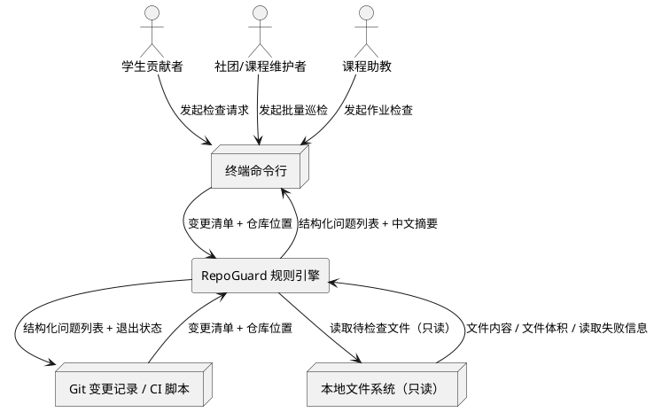
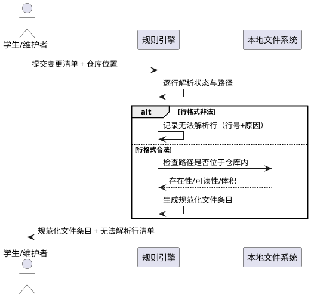
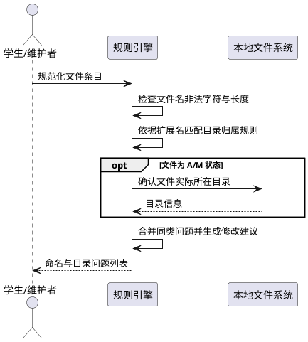
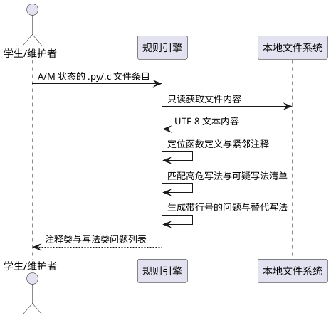
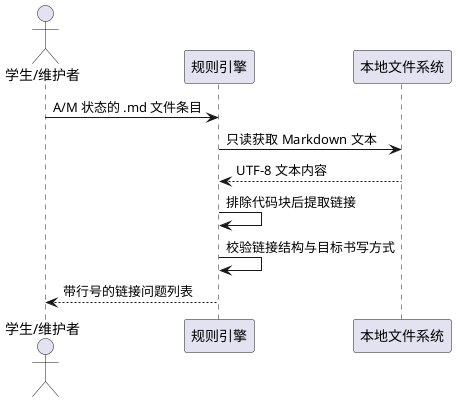
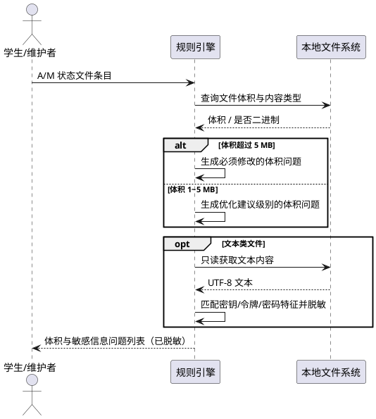

# **1. 组件定位**

本规格描述 RepoGuard 学习仓库质量守护系统中的「规则引擎」组件（feature：rules_engine）。该组件面向高校通信与人工智能学院课程与科创社团共享学习仓库，贡献者以学生新人为主，检查结论以引导改进为目标，不采用企业级强制门禁标准。

## **1.1 核心职责**

本组件负责接收一份变更清单并对其中的新增/修改文件执行命名、代码、链接、敏感信息四项检查，输出按文件分组、分级可执行的结构化问题列表，帮助学生在提交前完成自助修正。

## **1.2 核心输入**

1. **变更清单（主要输入）**：来源为学生本地命令、助教批处理脚本或 CI 脚本；内容为逐行文本，每行格式为「状态 文件路径」，状态 A=新增、M=修改、D=删除。
2. **仓库根目录定位信息**：来源为调用方显式传入或默认取当前工作目录，用于定位被检查文件的真实内容。
3. **规则阈值参数（可选）**：来源为调用方传入的配置，用于覆盖大文件阈值、命名白名单等默认口径；未传入时使用本规格第 4 章与第 6 章的默认值。
4. **审查触发指令**：来源为学生或维护者在终端发起的单次执行命令，不含定时任务与消息订阅。

## **1.3 核心输出**

1. **结构化问题列表（主要输出）**：返回给调用方（终端命令、脚本、后续 Web 服务），按文件分组，每个文件下携带若干条问题；每条问题包含问题级别、文件路径、问题描述、修改建议四个必填信息。
2. **汇总统计信息**：随结构化问题列表一并返回，包含条目总数、必须修改数量、优化建议数量、跳过文件数量、降级模块数量。
3. **人类可读审查摘要**：推送给学生或维护者的终端文本，按文件分组展示问题，必须使用中文并给出可直接照做的修改示例。
4. **异常与降级提示**：当变更清单存在无法解析的行、文件无法读取或某个检查模块执行失败时，在输出中明确列出对应行号/文件/模块及原因，不得静默吞掉。

## **1.4 职责边界**

1. **不负责自动修复**：本组件只给出问题与修改建议，禁止改写、移动、删除、重命名仓库中的任何文件。
2. **不负责 Git 操作**：变更清单由调用方生成并传入，本组件不执行 git 命令、不解析 .git 目录、不判断提交历史。
3. **不负责网络访问**：本组件不联网检测链接可达性、不调用外部 API 校验密钥有效性、不上传任何被扫描内容。
4. **不负责执行或编译代码**：不运行被检查的 .py/.c 文件，不做语法编译、不构建工程。
5. **不覆盖全量静态分析**：不做类型推断、内存泄漏检测、并发竞争检测、代码覆盖率分析，这些不属于本组件范围。
6. **不负责 Web 展示与鉴权**：前端页面、用户登录、权限控制由其他组件承担；本组件只提供结构化数据。
7. **不负责修复建议的强制落地**：本组件不阻塞本地提交，是否作为 CI 门禁由调用方决定。

## **1.5 典型业务场景**

1. **学生提交前自检**：学生完成实验后，将本次改动整理为变更清单交给规则引擎，在终端看到「先改这几条」的清单，避免把中文文件名、缺注释、错放目录的文件推送到共享仓库。
2. **助教批量巡检**：助教对某次作业的变更清单一键执行检查，按文件分组查看必须修改项与优化建议项，用于形成作业反馈。
3. **社团仓库例行体检**：维护者对一批新增文档与示例代码执行检查，重点关注大文件误入与密钥泄露，防止仓库体积膨胀与凭据外泄。
4. **CI 预检预留**：后续流水线可调用同一入口，根据「是否存在必须修改问题」决定是否给出告警；本阶段仅要求提供稳定的结构化输出与退出状态。

# **2. 领域术语**

**规则引擎**
: 规则引擎是接收变更清单、调度四类检查并汇总问题的软件组件，是 RepoGuard 中负责「提交前质量引导」的独立能力单元。

**变更清单**
: 变更清单是一份纯文本，每行描述一个文件的变更状态与仓库内相对路径，是规则引擎唯一必需的输入载体。

**变更状态**
: 变更状态是变更清单行首的单字母标记，A 表示新增、M 表示修改、D 表示删除。
: 备注：小写 a/m/d 视为等价写法。

**检查模块**
: 检查模块是规则引擎中承担单一检查主题的能力单元，包括命名与目录检查、代码检查、链接检查、敏感信息与大文件检查四类。

**问题（Finding）**
: 问题是对某个文件某一处不符合规范或存在风险的具体判定结果，必须携带级别、文件路径、描述与修改建议。

**问题级别**
: 问题级别是问题的处置紧迫度，仅取「必须修改」与「优化建议」两个值。
: 备注：「必须修改」表示存在明确错误或安全风险，建议在推送前处理；「优化建议」表示不影响仓库可用性、但能提升可读性与规范性的改进项。

**必须修改**
: 必须修改是问题级别取值之一，表示该问题违反硬性规则或带来安全、体积、可读性上的明确损害，学生应在提交前修复。

**优化建议**
: 优化建议是问题级别取值之一，表示该问题属于风格或习惯层面的改进项，学生可自主决定是否采纳，不视为错误。

**引导式规则**
: 引导式规则是面向学生新人的检查口径，要求判定结论附带可照做的修改示例，且对非原则性问题优先给出优化建议而非必须修改。

**汇总报告**
: 汇总报告是规则引擎一次执行产出的完整结果，包含统计信息、按文件分组的问题列表、无法解析的输入行与降级说明。

**大文件**
: 大文件是指单个文件体积超过本规格约定阈值的文件，判定只看文件体积，不区分文件内容类型。

**敏感信息**
: 敏感信息是仓库中不应明文出现的凭据类内容，包括私钥、访问令牌、带真实取值的密码与数据库连接串等。

**链接格式异常**
: 链接格式异常是指 Markdown 链接在书写结构上不成立或指向方式不适合仓库协作的情形，不等同于链接目标不可访问。

# **3. 角色与边界**

## **3.1 核心角色**

1. 学生贡献者：向共享学习仓库提交实验代码、实验报告与笔记，使用规则引擎在提交前自查并据此修正文件。
2. 社团/课程维护者：维护仓库目录规范与检查口径，对成批变更执行巡检，根据汇总报告给出统一整改要求。
3. 课程助教：按作业批次执行检查，读取按文件分组的必须修改项与优化建议项，形成面向学生的反馈。

## **3.2 外部系统**

1. 终端命令行：学生或维护者通过它传入变更清单与仓库位置，并接收人类可读审查摘要与退出状态。
2. Git 变更记录/CI 脚本：作为上游调用方生成变更清单并调用规则引擎，读取结构化结果用于告警或流水线状态判定。
3. 本地文件系统：规则引擎从中只读获取被检查文件的内容与体积，不向其写入任何内容。

## **3.3 交互上下文**



# **4. DFX约束**

## **4.1 性能**

1. 单次执行处理 500 条变更条目、其中 100 个可读文件时，端到端耗时必须不超过 10 秒（不含人工等待）。
2. 单个文件的全部检查耗时必须不超过 300 毫秒；超过 5 MB 的文件内容扫描必须不超过 1 秒。
3. 单次执行进程常驻内存峰值必须不超过 200 MB，禁止将视频、压缩包等大文件整体读入内存。
4. 单个检查模块不得重复读取同一个文件内容超过 1 次。

## **4.2 可靠性**

1. 规则引擎必须在任何输入下都返回结构化结果，禁止向调用方抛出未捕获异常导致进程崩溃。
2. 当某个文件读取失败（不存在、无权限、编码不可识别）时，系统必须将该文件标记为「跳过」并继续处理其余文件，跳过数量计入统计。
3. 当某个检查模块整体执行失败时，系统必须记录该模块为「降级」，其余三个模块的检查结果必须照常输出。
4. 相同输入、相同仓库内容在连续两次执行中必须产生相同的问题集合与排序，不得因执行顺序不同而变化。
5. 规则引擎对仓库必须保持只读语义，执行前后被扫描文件的内容与体积必须完全一致。

## **4.3 安全性**

1. 规则引擎必须禁止执行、编译、导入被扫描的代码文件，禁止将其内容拼接到解释器命令中执行。
2. 规则引擎必须默认离线运行，禁止在检查过程中发起任何外部网络请求。
3. 规则引擎必须防止路径越界：变更清单中的相对路径解析后若落在仓库根目录之外，必须拒绝读取并在报告中标记为「非法路径」，禁止读取仓库外文件。
4. 报告中出现的敏感信息必须脱敏展示，只允许保留前 4 个字符并使用固定掩码替代其余字符，禁止完整回显密钥、令牌与密码原文。
5. 规则引擎不得将文件名、文件内容或检查结果写入仓库内任何位置，除非调用方显式指定输出路径。

## **4.4 可维护性**

1. 每条问题必须携带稳定的规则标识（rule_id），同一规则在多次版本迭代中标识不得随意变更，便于统计与追踪。
2. 所有检查阈值（大文件阈值、目录映射、高危写法清单、密钥特征）必须集中配置，修改阈值不得要求改动检查逻辑主体。
3. 面向用户的所有输出文案必须使用简体中文，不得输出英文错误堆栈或英文规则名作为主要提示。
4. 汇总报告必须包含统计信息与降级说明，使维护者在不查看明细时也能判断本次检查是否有效执行。

## **4.5 兼容性**

1. 规则引擎必须在 Windows 与 Linux 环境下产生一致的问题集合，路径分隔符差异不得影响判定。
2. 所有输入文本必须按 UTF-8 解码；带 UTF-8 BOM 的文件必须正确去除 BOM；FFFD 替换字符不得出现在输出路径中。
3. 当文件不是合法 UTF-8 时，系统必须尝试以 GB18030 解码；两种解码均失败时按 4.2 第 2 条标记跳过并提示转码为 UTF-8。
4. 中文文件名、中文目录名、中文 Markdown 内容必须被完整保留与正确检查，禁止转义为乱码或 Unicode 转义序列。
5. 变更清单中的路径必须同时接受 `\` 与 `/` 分隔符，统一以 `/` 形式出现在输出中。

# **5. 核心能力**

## **5.1 变更清单接收与校验**

### **5.1.1 业务规则**

1. **行格式解析**：每行必须按「状态 + 分隔空白 + 文件路径」解析，首个非空白记号作为状态，其后去除前导空白的剩余内容整体作为文件路径。
   a. 验收条件（EARS）：When a line begins with "A" followed by one or more spaces or tabs, the 规则引擎 shall 将状态记为新增并将剩余内容作为文件路径。
2. **状态取值约束**：状态只允许 A、M、D 三种取值（大小写不敏感），其他取值必须判定为非法行。
   a. 验收条件（EARS）：When a line starts with "X", the 规则引擎 shall 将该行放入「无法解析行」列表并注明未知状态。
3. **小写状态兼容**：小写 a/m/d 必须按对应大写状态处理，不得判为非法。
   a. 验收条件（EARS）：When a line starts with "m", the 规则引擎 shall 按修改状态执行与 "M" 完全一致的检查。
4. **路径归一化**：文件路径必须去除 `./` 前缀、将 `\` 统一为 `/`、去除首尾空白，但必须保留中文、大小写与扩展名原样。
   a. 验收条件（EARS）：When the path is ".\lab\uart\uart_demo.c", the 规则引擎 shall 在输出中将其呈现为 "lab/uart/uart_demo.c"。
5. **空行与注释行忽略**：空白行及以 `#` 开头的行必须被忽略，不计入问题统计与非法行统计。
   a. 验收条件（EARS）：When the manifest contains an empty line or a line starting with "#", the 规则引擎 shall 跳过该行且不产生任何问题。
6. **非法行降级**：格式不完整的行（缺少路径、只有状态、仅含空白状态）必须被收集到「无法解析行」，并附带原始行内容与行号，不得中断整体检查。
   a. 验收条件（EARS）：When a line contains a status but no path, the 规则引擎 shall 记录其行号与原因并继续处理后续行。
7. **重复路径合并**：同一路径在清单中出现多次时，必须合并为一个文件条目，其状态以最后一次出现的状态为准，并在该文件条目上注明重复次数。
   a. 验收条件（EARS）：When the same path appears twice with statuses A and M, the 规则引擎 shall 仅输出一个文件条目并以 M 状态执行检查。
8. **删除状态的范围约束**：状态为 D 的文件只允许执行命名与目录归属检查，禁止读取文件内容、禁止执行代码内容扫描、链接检查与体积/敏感信息内容扫描。
   a. 验收条件（EARS）：When an entry has status D, the 规则引擎 shall 仅依据其路径执行命名与目录检查且不发起任何文件读取。
9. **只读约束**：检查过程必须不改变仓库任何文件的状态与内容。
   a. 验收条件（EARS）：When the check finishes, the 规则引擎 shall 保证所有被扫描文件的路径、内容与体积与执行前一致。
10. **禁止项**：禁止把变更清单的业务注释、空行或格式错误行当作文件路径去读取。
    a. 验收条件（EARS）：When a line is unparsable, the 规则引擎 shall 不尝试以任何片段作为路径访问文件系统。

### **5.1.2 交互流程**



### **5.1.3 异常场景**

1. **变更清单为空**
   a. 触发条件：输入为空字符串、仅含空白或仅含注释行。
   b. 系统行为：返回空问题列表与全零统计，并在摘要中提示「未检测到可检查的文件变更」。
   c. 用户感知：提示文案「变更清单为空，请确认是否已生成改动列表」，退出状态为正常。

2. **变更清单整体无法读取**
   a. 触发条件：调用方以文件路径方式提供清单，但文件不存在或无权读取。
   b. 系统行为：不进入文件检查阶段，返回错误说明与建议（检查路径、确认文件已生成）。
   c. 用户感知：中文提示「无法读取变更清单：<路径>，请确认文件存在且可读」。

3. **文件在清单中但磁盘上不存在（状态 A/M）**
   a. 触发条件：清单声明新增或修改，但仓库中不存在对应文件。
   b. 系统行为：将该文件标记为「跳过-文件不存在」，继续执行命名与目录检查，内容类检查全部跳过。
   c. 用户感知：该文件分组下出现一条说明，计入跳过数量而非问题数量。

4. **路径越界**
   a. 触发条件：路径归一化后解析结果位于仓库根目录之外（如包含过多 `../` 或为绝对路径）。
   b. 系统行为：拒绝读取，记录为「非法路径」，不输出文件内容相关信息。
   c. 用户感知：中文提示「路径超出仓库范围，已跳过：<路径>」。

5. **编码不可识别**
   a. 触发条件：文件既非合法 UTF-8 也无法按 GB18030 解码。
   b. 系统行为：跳过内容类检查，保留命名与目录检查结果。
   c. 用户感知：提示「文件编码无法识别，建议另存为 UTF-8 后重试」。

## **5.2 文件命名与目录归属检查**

本能力由 `backend/app/core/rules/naming.py` 承载。检查口径以「推荐做法」为主：中文文件名只给优化建议，不判必须修改。

### **5.2.1 业务规则**

1. **非法字符（必须修改）**：文件名包含 Windows 保留字符 `< > : " | ? *`、控制字符或以点结尾时，必须判定为必须修改。
   a. 验收条件（EARS）：When a file name contains ":" or "*", the 规则引擎 shall 输出必须修改级别问题并给出替换为下划线后的推荐文件名。
2. **超长文件名（必须修改）**：文件名（含扩展名）字符数超过 120 时，必须判定为必须修改。
   a. 验收条件（EARS）：When a file name length exceeds 120 characters, the 规则引擎 shall 输出必须修改级别问题并建议缩短至 60 字符以内。
3. **命名风格（优化建议）**：文件名包含大写字母、空格、连字符、连续下划线或非 ASCII 符号时，应当输出优化建议，推荐「小写英文 + 单下划线」写法。
   a. 验收条件（EARS）：When a file is named "UART Demo-v2.C", the 规则引擎 shall 输出优化建议并给出示例 "uart_demo_v2.c"。
4. **中文文件名（优化建议，禁止报错）**：文件名或路径包含中文时，只允许输出优化建议，建议改为英文或拼音加下划线，并说明中文名在跨平台工具链、命令行与自动化脚本中的不便；禁止判定为必须修改。
   a. 验收条件（EARS）：When a file is named "docs/lab03_串口通信实验.md", the 规则引擎 shall 输出优化建议并给出示例 "docs/lab03_serial_communication.md"，且该问题级别必须为优化建议。
5. **目录归属（必须修改）**：源码文件（.c/.h/.py）位于 `docs/` 下、文档文件（.md）位于源码目录（`backend/`、`src/`、`lab/`）下、测试文件位于 `backend/tests/` 之外时，必须判定为必须修改。
   a. 验收条件（EARS）：When a changed file is "docs/uart_demo.c", the 规则引擎 shall 输出必须修改级别问题并建议移动到 "lab/uart/uart_demo.c"。
6. **目录归属（优化建议）**：源码文件直接位于仓库根目录、图片资源未放入 `assets/` 或 `docs/assets/`、实验报告未放入 `docs/` 时，应当输出优化建议并给出推荐目录。
   a. 验收条件（EARS）：When a changed file is "uart_demo.c" at repository root, the 规则引擎 shall 输出优化建议并建议移动到 "lab/<module>/" 目录。
7. **目录映射口径**：目录归属判定必须依据文件扩展名与路径前缀的对应关系表，映射关系必须覆盖：`.md` 归属 `docs/`；`.c/.h` 归属 `lab/` 或 `src/`；`.py` 归属 `backend/`、`scripts/` 或 `lab/`；图片归属 `docs/assets/` 或 `assets/`；测试代码归属 `backend/tests/`。
   a. 验收条件（EARS）：When a .md file is placed under "backend/app/", the 规则引擎 shall 判定目录归属错误并建议移入 "docs/"。
8. **问题去重与收敛**：同一文件最多输出 1 条命名风格类问题与 1 条目录归属类问题，必须合并同类判定，禁止逐字符重复报错。
   a. 验收条件（EARS）：When a file name contains both uppercase letters and spaces, the 规则引擎 shall 只输出一条合并后的命名优化建议。
9. **建议可执行**：每条命名或目录问题的修改建议必须包含具体的推荐名称或推荐目录，禁止只写「命名不规范」。
   a. 验收条件（EARS）：When any naming issue is reported, the 规则引擎 shall 在修改建议字段中给出可直接采用的示例名称或目标路径。
10. **禁止项**：禁止因文件使用中文名、拼音名或带连字符的英文名而将其判定为必须修改；禁止对同一文件重复输出相同建议。
    a. 验收条件（EARS）：When a purely Chinese file name is checked, the 规则引擎 shall 最多输出一条优化建议且不产生必须修改问题。

### **5.2.2 交互流程**



### **5.2.3 异常场景**

1. **路径无扩展名**
   a. 触发条件：文件路径不含 `.` 或扩展名为空。
   b. 系统行为：只执行非法字符与长度检查，跳过扩展名相关的目录归属判定。
   c. 用户感知：不产生目录类问题，若有非法字符仍正常提示。

2. **扩展名不在映射表内**
   a. 触发条件：文件扩展名无法匹配任何目录映射（如 `.xyz`）。
   b. 系统行为：不输出目录归属问题，仅在命名风格异常时给出优化建议。
   c. 用户感知：该文件仅出现命名类建议，不出现「目录错误」结论。

3. **目录与文件名均含中文**
   a. 触发条件：路径中同时出现中文目录与中文文件名。
   b. 系统行为：合并为一条中文命名优化建议，建议同时调整目录与文件名为英文或拼音。
   c. 用户感知：单条建议中给出完整的目标相对路径。

## **5.3 代码注释与高危写法检查**

本能力由 `backend/app/core/rules/code_scan.py` 承载，核心覆盖 `.py` 与 `.c` 文件；`.h` 文件按 `.c` 同族规则执行，结果只允许为优化建议。

### **5.3.1 业务规则**

1. **扫描范围**：只允许对状态为 A/M 的 `.py` 与 `.c` 文件执行内容扫描，其他扩展名与 D 状态文件必须直接跳过。
   a. 验收条件（EARS）：When a changed file is "lab/uart/uart_demo.c" with status M, the 规则引擎 shall 对其执行注释与高危写法检查。
2. **文件头注释（优化建议）**：Python 文件缺少模块级说明、C 文件开头缺少文件用途注释时，应当输出优化建议，建议用一行中文说明文件用途。
   a. 验收条件（EARS）：When a .py file has no module-level description, the 规则引擎 shall 输出优化建议并示例 "本文件：串口数据收发示例"。
3. **入口与公开函数缺注释（必须修改）**：`.py` 中模块级公开函数与类方法、`.c` 中 `main` 函数及非 static 函数缺少紧邻注释或 docstring 时，必须判定为必须修改。
   a. 验收条件（EARS）：When the "main" function in a .c file has no preceding comment, the 规则引擎 shall 输出必须修改级别问题并建议补充函数用途、参数与返回值说明。
4. **内部短函数缺注释（优化建议）**：非公开或 static 的内部函数、且函数体不超过 10 行时，缺注释只允许输出优化建议。
   a. 验收条件（EARS）：When a static helper function of 8 lines lacks a comment, the 规则引擎 shall 输出优化建议而非必须修改。
5. **注释位置判定口径**：注释必须位于函数声明/定义之前紧邻位置（允许间隔空行），函数体内零散注释不计为函数注释；Python docstring 必须位于函数体第一处语句。
   a. 验收条件（EARS）：When a comment exists only inside a function body, the 规则引擎 shall 判定该函数仍缺少函数注释。
6. **高危写法（必须修改）**：出现以下写法时必须判定为必须修改，并给出安全替代写法：
   - C：`gets`、`strcpy`、`strcat`、`sprintf`、`scanf("%s")` 等无边界保障的输入/拷贝调用；
   - Python：`eval(`、`exec(` 作用于外部输入或变量；
   - 任何语言：以字符串拼接方式构造并执行 shell 命令。
   a. 验收条件（EARS）：When a .c file calls "strcpy", the 规则引擎 shall 输出必须修改问题并建议改用 "snprintf" 或带长度检查的 "strncpy"。
7. **可疑写法（优化建议）**：出现 `while(1)`/`for(;;)` 无限循环、`os.system(`、`subprocess` 调用、裸 `except:`、魔法数字等写法时，只允许输出优化建议并说明适用场景与替代方式。
   a. 验收条件（EARS）：When a .c file contains "while(1)", the 规则引擎 shall 输出优化建议提示确认退出条件并说明嵌入式轮询场景可保留。
8. **行号定位**：每条代码问题必须携带从 1 开始的行号，禁止只给文件级结论。
   a. 验收条件（EARS）：When a high-risk call is found on the 27th line, the 规则引擎 shall 在问题中标注行号 27。
9. **注释语言引导**：注释使用中文或英文均可接受，禁止因注释语言不是英文而报错。
   a. 验收条件（EARS）：When a function has a Chinese comment, the 规则引擎 shall 判定该函数注释已满足要求。
10. **禁止项**：禁止执行、导入、编译被扫描代码；禁止对代码风格（缩进宽度、行长、命名大小写）做必须修改级判定；禁止输出不含行号的高危写法告警。
    a. 验收条件（EARS）：When code scanning runs, the 规则引擎 shall 不产生任何代码执行行为且仅以文本方式读取内容。

### **5.3.2 交互流程**



### **5.3.3 异常场景**

1. **文件为二进制或含不可解码字节**
   a. 触发条件：扩展名为 .py/.c 但内容无法按 UTF-8/GB18030 解码。
   b. 系统行为：跳过内容扫描，记录跳过原因，保留命名类结果。
   c. 用户感知：提示「文件内容无法解码，已跳过代码检查」。

2. **文件体积超过大文件阈值**
   a. 触发条件：待扫描代码文件体积超过 5 MB。
   b. 系统行为：不执行完整内容扫描，仅提示文件过大并建议拆分。
   c. 用户感知：该文件出现一条优化建议，说明已跳过代码内容检查。

3. **函数定义无法可靠识别**
   a. 触发条件：代码结构异常（如宏包裹函数、语法不完整）导致无法确定函数边界。
   b. 系统行为：跳过该片段的函数注释判定，不产生误报。
   c. 用户感知：该文件不出现针对该片段的注释问题。

4. **高危写法出现在注释或字符串中**
   a. 触发条件：`strcpy` 等关键字仅出现在注释、文档字符串或普通字符串字面量中。
   b. 系统行为：不判定为高危写法。
   c. 用户感知：不产生高危告警。
   : 备注：本场景用于约束误报，不得以「可能出现」为由输出必须修改。

## **5.4 Markdown 链接格式检查**

本能力由 `backend/app/core/rules/link_check.py` 承载，只检查链接书写格式与仓库协作适配性，不做可达性验证。

### **5.4.1 业务规则**

1. **扫描范围**：只允许对状态为 A/M 的 `.md` 文件执行链接检查，D 状态与非 Markdown 文件必须跳过。
   a. 验收条件（EARS）：When a changed file is "docs/lab03_serial_communication.md" with status A, the 规则引擎 shall 提取并检查其中的链接。
2. **链接识别范围**：必须识别行内链接 `[文本](目标)`、图片链接 ``、引用式链接 `[文本][标识]` 及对应定义 `[标识]: 目标`、以及裸链接 `http(s)://...`。
   a. 验收条件（EARS）：When a document contains "[实验手册](./lab03.md)", the 规则引擎 shall 将其识别为行内链接并检查目标格式。
3. **空目标（必须修改）**：链接目标为空或仅含空白时，必须判定为必须修改。
   a. 验收条件（EARS）：When a link is written as "[说明]()", the 规则引擎 shall 输出必须修改问题并建议补全目标路径或删除链接。
4. **括号或方括号不闭合（必须修改）**：链接文本括号、目标括号缺失或嵌套错乱导致结构不成立时，必须判定为必须修改。
   a. 验收条件（EARS）：When a link is written as "[说明](./lab03.md", the 规则引擎 shall 输出必须修改问题并标注缺失的右括号位置。
5. **引用式链接缺失定义（必须修改）**：引用式链接的标识在文档中找不到对应定义行时，必须判定为必须修改。
   a. 验收条件（EARS）：When "[说明][ref1]" exists but no "[ref1]:" definition appears, the 规则引擎 shall 输出必须修改问题并建议补充定义或改为行内链接。
6. **本地绝对路径（优化建议）**：链接目标为盘符路径（如 `C:/...`）、`file:///` 或包含本机用户目录时，应当输出优化建议，改为仓库内相对路径。
   a. 验收条件（EARS）：When a link target is "file:///C:/Users/student/lab03.md", the 规则引擎 shall 输出优化建议并建议改为 "./lab03.md"。
7. **目标含未编码空格（必须修改）**：链接目标中存在空格且未使用尖括号 `<...>` 包裹时，必须判定为必须修改。
   a. 验收条件（EARS）：When a link target is "./lab 03.md", the 规则引擎 shall 输出必须修改问题并建议改为 "./lab%2003.md" 或 "./<lab 03.md>"。
8. **协议与地址提示（优化建议）**：使用 `http://` 明文协议、指向 `localhost`/内网 IP、或链接文本为空时，应当输出优化建议。
   a. 验收条件（EARS）：When a link target starts with "http://", the 规则引擎 shall 输出优化建议提示优先使用 https。
9. **中文与锚点容忍（不报错）**：链接目标包含中文、URL 编码字符或 `#锚点` 时，不得判定为错误；若中文路径未编码，最多输出一条优化建议。
   a. 验收条件（EARS）：When a link points to "./实验指导.md#第三部分", the 规则引擎 shall 不输出必须修改问题。
10. **行号与原文定位**：每条链接问题必须携带行号，并在描述中引用出错的链接原文片段（不超过 60 字符）。
    a. 验收条件（EARS）：When a malformed link is found on line 12, the 规则引擎 shall 在问题中标注行号 12 与链接原文。
11. **禁止项**：禁止联网探测链接是否可访问、禁止判断 404、禁止对 `.md` 中代码块内的示例链接报错。
    a. 验收条件（EARS）：When a link-like text appears inside a fenced code block, the 规则引擎 shall 不将其作为链接检查。
    b. 验收条件（EARS）：When link checking runs, the 规则引擎 shall 不发起任何网络请求。

### **5.4.2 交互流程**



### **5.4.3 异常场景**

1. **文档中没有链接**
   a. 触发条件：Markdown 文件不含任何链接结构。
   b. 系统行为：不产生链接问题，文件分组下不出现链接类条目。
   c. 用户感知：无额外提示，正常继续其他检查。

2. **链接跨多行书写**
   a. 触发条件：链接文本或目标被换行拆开。
   b. 系统行为：若换行导致结构不成立，按 5.4.1 第 4 条判必须修改；若属于合法续行，正常解析。
   c. 用户感知：仅在结构确实不成立时提示，并给出合并为一行的建议。

3. **链接指向上级目录超出仓库**
   a. 触发条件：相对链接包含 `../` 且最终路径超出仓库根。
   b. 系统行为：不读取该目标，仅按「仓库外目标」输出优化建议。
   c. 用户感知：提示「链接指向仓库外部，协作环境中可能失效」。

4. **文件中含大量链接**
   a. 触发条件：单个文档链接数量超过 200 条。
   b. 系统行为：继续完成检查，但同类格式问题按文件聚合，避免输出膨胀。
   c. 用户感知：报告显示「该文件共 N 条链接，其中 M 条存在格式问题」。

## **5.5 敏感信息与大文件检查**

本能力由 `backend/app/core/rules/sensitive.py` 承载，覆盖仓库体积风险与凭据泄露风险。

### **5.5.1 业务规则**

1. **体积阈值（优化建议）**：单个文件体积大于 1 MB 且不超过 5 MB 时，应当输出优化建议，说明对大文件入库的顾虑并给出压缩、拆分或使用 Git LFS 的选项。
   a. 验收条件（EARS）：When a changed file size is 2 MB, the 规则引擎 shall 输出优化建议并提示压缩或使用 LFS。
2. **体积阈值（必须修改）**：单个文件体积大于 5 MB 时，必须判定为必须修改。
   a. 验收条件（EARS）：When a changed file size is 8 MB, the 规则引擎 shall 输出必须修改问题并建议移出仓库或改用外部存储链接。
3. **二进制文件口径**：图片、视频、压缩包、可执行文件等二进制内容只按体积判定，禁止对其内容做敏感信息扫描，避免误报。
   a. 验收条件（EARS）：When a .mp4 file is 12 MB, the 规则引擎 shall 只输出体积类必须修改问题，不输出内容类问题。
4. **删除文件跳过**：状态为 D 的文件不读取内容、不统计体积问题（文件已不存在）。
   a. 验收条件（EARS）：When an entry has status D and a large size is implied by name, the 规则引擎 shall 不输出体积或内容问题。
5. **私钥与令牌（必须修改）**：检出 PEM 私钥头、常见云厂商访问密钥前缀、GitHub/代码托管平台令牌格式时，必须判定为必须修改。
   a. 验收条件（EARS）：When a file contains "BEGIN RSA PRIVATE KEY", the 规则引擎 shall 输出必须修改问题并要求立即移除并轮换凭据。
6. **明文密码与连接串（必须修改）**：配置或代码中出现 `password`、`passwd`、`pwd`、`token`、`secret`、`api_key` 等字段且赋值为非空真实字面量，或出现带账号密码的数据库连接串时，必须判定为必须修改。
   a. 验收条件（EARS）：When a .py file contains "password = "123456"", the 规则引擎 shall 输出必须修改问题并建议改为环境变量或配置模板占位。
7. **疑似凭据（优化建议）**：出现长度不少于 32 的高熵字符串、超长十六进制串、或指向凭据的变量赋空值/占位符时，只允许输出优化建议，提示确认是否为真实凭据。
   a. 验收条件（EARS）：When a 40-character hex string is found, the 规则引擎 shall 输出优化建议并提示确认其用途。
8. **教学示例豁免**：当疑似密钥的上下文紧邻「示例」「占位」「demo」「example」「xxxx」等字样时，应当降级为优化建议；但 PEM 私钥头与已知真实令牌格式不适用豁免，仍判定必须修改。
   a. 验收条件（EARS）：When a token-like string follows the text "示例占位", the 规则引擎 shall 最多输出优化建议。
9. **脱敏输出**：问题描述中只允许展示敏感内容的前 4 个字符，其余以固定掩码替代；禁止在描述、建议、日志中出现完整凭据。
   a. 验收条件（EARS）：When a token "ghp_abcdef123456" is detected, the 规则引擎 shall 在报告中展示为 "ghp_****"。
10. **禁止项**：禁止调用任何外部服务验证密钥有效性；禁止把检出内容写入仓库文件；禁止对二进制文件做文本级密钥匹配。
    a. 验收条件（EARS）：When sensitive checking runs, the 规则引擎 shall 不产生任何网络请求与文件写入。

### **5.5.2 交互流程**



### **5.5.3 异常场景**

1. **文件体积无法获取**
   a. 触发条件：文件不存在或无读取权限。
   b. 系统行为：跳过体积与内容检查，记录跳过原因。
   c. 用户感知：该文件提示「无法获取文件信息，已跳过」。

2. **疑似密钥跨越多个样本**
   a. 触发条件：同一文件检出多处疑似凭据。
   b. 系统行为：按文件聚合为一条问题，列出发生行号，最多列出前 3 处，其余以「共 N 处」概括。
   c. 用户感知：单条问题内看到行号清单与脱敏片段。

3. **空文件或仅含空白**
   a. 触发条件：文件体积为 0 或内容全为空白字符。
   b. 系统行为：不产生体积与敏感信息问题。
   c. 用户感知：无额外提示。

4. **超大文件导致读取超时**
   a. 触发条件：单文件内容扫描耗时超过 1 秒。
   b. 系统行为：终止该文件的内容扫描，保留体积结论，并记录为「内容检查未完成」。
   c. 用户感知：该文件提示「文件过大，仅完成体积检查」。

## **5.6 结果汇总与报告输出**

本能力由汇总入口 `backend/app/core/rules/engine.py` 承载，是变更清单进入规则引擎的唯一公共入口。

### **5.6.1 业务规则**

1. **单一入口**：调用方必须能通过一个入口同时传入变更清单与仓库根目录，并获得完整汇总报告，禁止要求调用方自行串联四个检查模块。
   a. 验收条件（EARS）：When a caller provides a manifest and a repository root once, the 规则引擎 shall 返回包含四类检查结果的完整汇总报告。
2. **按文件分组**：汇总报告必须以文件为单位分组，每个文件分组携带该文件的变更状态、该文件检出的全部问题与跳过原因（如有）。
   a. 验收条件（EARS）：When two issues belong to "lab/uart/uart_demo.c", the 规则引擎 shall 在报告中只出现一个文件分组并内含这两条问题。
3. **问题字段完整性**：每条问题必须且只能使用统一结构，必填四项为：问题级别、文件路径、问题描述、修改建议；可选扩展项为规则标识、行号、原始片段。
   a. 验收条件（EARS）：When any issue is emitted, the 规则引擎 shall 保证四个必填字段均非空且级别取值只能是「必须修改」或「优化建议」。
4. **统计口径**：报告必须包含条目总数、问题总数、必须修改数量、优化建议数量、跳过文件数、降级模块数；无法解析行数必须单列。
   a. 验收条件（EARS）：When 3 issues are found with 1 must-fix and 2 suggestions, the 规则引擎 shall 输出与该数量完全一致的统计值。
5. **排序稳定性**：文件分组按路径字典序升序排列；文件内问题必须先「必须修改」后「优化建议」，同级别按行号升序，无行号者排在末尾。
   a. 验收条件（EARS）：When a file has a suggestion on line 3 and a must-fix on line 9, the 规则引擎 shall 先输出第 9 行的必须修改问题。
6. **问题级别排序与提示**：终端摘要必须首先列出必须修改问题，再列出优化建议问题，并对学生给出「先处理必须修改项」的引导语。
   a. 验收条件（EARS）：When the report contains both levels, the 规则引擎 shall 在摘要开头显示必须修改数量与处理建议。
7. **输出载体**：结构化问题列表必须以可被调用方直接消费的内存对象返回，且必须可无损序列化为 JSON（UTF-8、中文不转义）；终端文本为默认的人类可读渲染。
   a. 验收条件（EARS）：When the result is serialized to JSON, the 规则引擎 shall 保留中文原文且不输出 Unicode 转义序列。
8. **退出状态**：命令行使用场景下，存在至少一条必须修改问题时必须返回非零退出状态；仅有优化建议或无问题时返回零；规则引擎自身降级或输入不可读时必须返回区别于「有问题」的独立退出状态，避免故障被误判为通过。
   a. 验收条件（EARS）：When only suggestions exist, the 规则引擎 shall 返回零退出状态。
   b. 验收条件（EARS）：When a check module fails internally, the 规则引擎 shall 返回表示执行异常的独立退出状态并在报告中说明。
9. **空结果表达**：没有任何问题时必须返回结构完整的空报告（含全零统计），禁止返回空值或省略字段。
   a. 验收条件（EARS）：When no issues are found, the 规则引擎 shall 返回文件分组为空列表且统计字段均为 0 的报告。
10. **降级可见**：任一模块降级、任一文件跳过时，报告必须在不查看明细的情况下也能从统计与说明中得知，禁止静默忽略。
    a. 验收条件（EARS）：When link checking fails for all files, the 规则引擎 shall 将链接检查模块列入降级列表并在摘要中提示结果不完整。
11. **禁止项**：禁止在报告中输出英文堆栈、禁止把多个文件的问题合并成一条、禁止在未指定输出路径时写入任何文件。
    a. 验收条件（EARS）：When a module raises an unexpected error, the 规则引擎 shall 捕获并以中文说明记录降级，不向用户输出原始堆栈。

### **5.6.2 交互流程**

```plantuml
@startuml
actor "学生/维护者" as User
participant "汇总入口" as Entry
participant "命名与目录检查" as Naming
participant "代码检查" as Code
participant "链接检查" as Link
participant "敏感信息与大文件检查" as Sensitive

User -> Entry : 变更清单 + 仓库根目录
Entry -> Entry : 解析并规范化变更条目
par 并行执行四类检查
  Entry -> Naming : 文件条目
  Naming --> Entry : 命名/目录问题 + 跳过信息
and
  Entry -> Code : A/M 的 .py/.c 条目
  Code --> Entry : 注释/写法问题 + 跳过信息
and
  Entry -> Link : A/M 的 .md 条目
  Link --> Entry : 链接问题 + 跳过信息
and
  Entry -> Sensitive : A/M 文件条目
  Sensitive --> Entry : 体积/敏感信息问题 + 跳过信息
end
Entry -> Entry : 按文件分组、分级排序、统计、汇总降级
Entry --> User : 结构化问题列表 + 中文摘要 + 退出状态
@enduml
```

### **5.6.3 异常场景**

1. **仓库根目录不存在**
   a. 触发条件：调用方传入的仓库根路径不存在或不是目录。
   b. 系统行为：不执行文件检查，返回输入错误说明；仍解析清单并回报无法解析行。
   c. 用户感知：中文提示「仓库根目录不存在，请检查路径参数」，退出状态为执行异常。

2. **清单条目全部被跳过**
   a. 触发条件：所有文件均因不存在、无权限或编码问题被跳过。
   b. 系统行为：返回空问题列表与跳过统计，并在摘要中说明跳过原因分布。
   c. 用户感知：提示「本次未完成任何文件检查，请确认清单与仓库路径是否匹配」。

3. **单个检查模块崩溃**
   a. 触发条件：某模块在运行中发生未预期异常。
   b. 系统行为：捕获异常，将该模块标记为降级，其余模块结果照常进入汇总。
   c. 用户感知：摘要显示「<模块名> 检查未完成，结果可能不完整」，退出状态为执行异常。

4. **同一文件被多个模块报出同类问题**
   a. 触发条件：硬编码密钥同时被代码检查与敏感信息检查检出。
   b. 系统行为：保留两条问题但规则标识不同，敏感信息检查结果优先展示并脱敏。
   c. 用户感知：同一文件分组下看到两类问题，其中敏感内容已脱敏。

5. **输出序列化失败**
   a. 触发条件：报告中存在无法序列化的内容（如异常对象被误放入结果）。
   b. 系统行为：回退为仅输出必填四字段的最小结构，并记录一条降级说明。
   c. 用户感知：仍能获得可用报告，摘要提示「部分附加信息未能输出」。

# **6. 数据约束**

## **6.1 变更条目（ChangeEntry）**

1. **状态**：必填，取值只能是 A、M、D 之一，输入小写时归一化为大写。
2. **文件路径**：必填，非空，使用 `/` 分隔的相对路径，不得以 `/` 或盘符开头，不得包含 `..` 导致越出仓库根。
3. **行号**：必填，记录该条目在原始变更清单中的行号，从 1 开始。
4. **原始行内容**：可选，保留用于问题定位，长度不超过 500 字符。
5. **重复次数**：可选，同一路径多次出现时记录出现次数，最小为 1。

## **6.2 问题条目（Issue）**

1. **问题级别（level）**：必填，取值只能是「必须修改」或「优化建议」。
2. **文件路径（file_path）**：必填，与该问题所属文件分组的路径完全一致，使用 `/` 分隔。
3. **问题描述（message）**：必填，中文陈述句，说明「哪里不符合什么规范」，长度不少于 8 个字符且不超过 200 个字符。
4. **修改建议（suggestion）**：必填，中文可执行建议，必须包含具体示例、替代写法或目标路径，长度不超过 300 个字符。
5. **规则标识（rule_id）**：可选，稳定字符串，格式为「模块前缀-序号」，如 `naming-001`、`code-004`。
6. **行号（line_no）**：可选，正整数，仅在问题可定位到行时提供。
7. **原始片段（excerpt）**：可选，出问题的原文片段，长度不超过 60 字符，敏感信息必须脱敏。

## **6.3 汇总报告（CheckReport）**

1. **统计信息（summary）**：必填，包含条目总数、问题总数、必须修改数量、优化建议数量、跳过文件数、降级模块数、无法解析行数，各值均为不小于 0 的整数。
2. **文件分组（files）**：必填，列表结构；每个分组包含文件路径、变更状态、问题列表、跳过原因（可空）。
3. **无法解析行（unparsed_lines）**：必填，列表结构；每项包含行号、原始内容、原因说明，无内容时为空列表。
4. **降级模块（degraded_modules）**：必填，列表结构；每项包含模块名称与中文原因说明，无降级时为空列表。
5. **执行状态（status）**：必填，取值只能是「正常」「部分降级」「输入错误」三者之一。

## **6.4 规则配置（RuleConfig）**

1. **大文件警告阈值**：可选，单位 MB，默认 1，取值必须大于 0 且小于失败阈值。
2. **大文件失败阈值**：可选，单位 MB，默认 5，取值必须大于警告阈值。
3. **中文命名口径**：可选，默认「仅建议」，固定允许取值「仅建议」，本版本禁止配置为「必须修改」。
4. **目录映射表**：可选，键为扩展名，值为允许的目录前缀列表，默认覆盖 5.2.1 第 7 条所列映射。
5. **高危写法清单**：可选，默认覆盖 5.3.1 第 6 条所列写法，允许按课程需要追加，但不得删除基础清单。
6. **敏感信息特征清单**：可选，默认覆盖 5.5.1 第 5、6 条所列特征，允许追加自定义特征，禁止关闭私钥与真实令牌的必须修改判定。
7. **输出语言**：可选，固定为简体中文，取值不合法时必须回退为简体中文并给出提示。

# **7. 交付物清单**

本阶段仅确认需求；以下交付物由后续实现阶段产出，路径与名称作为验收依据固定：

1. **命名与目录检查模块**：`backend/app/core/rules/naming.py`，实现 5.2 全部业务规则。
2. **代码检查模块**：`backend/app/core/rules/code_scan.py`，实现 5.3 全部业务规则。
3. **链接检查模块**：`backend/app/core/rules/link_check.py`，实现 5.4 全部业务规则。
4. **敏感信息与大文件检查模块**：`backend/app/core/rules/sensitive.py`，实现 5.5 全部业务规则。
5. **汇总入口**：`backend/app/core/rules/engine.py`，实现 5.1、5.6 全部业务规则，并对外暴露唯一调用入口。
6. **依赖清单**：`backend/requirements.txt`，只包含运行规则引擎所必需的依赖，优先使用 Python 标准库；确有必要引入第三方库时必须写明用途。
7. **样例变更清单**：`backend/tests/fixtures/sample_changes.txt`，UTF-8 编码，覆盖 A/M/D 三种状态、中文文件名、错误目录、缺注释代码、异常链接、大文件与疑似密钥等典型场景，并包含空行与注释行以验证解析容错。
8. **说明文档**：`docs/` 下提供一份中文使用说明，描述如何生成变更清单、如何调用汇总入口、如何阅读两类问题级别。

## **7.1 交付物验收条件**

1. **验收条件（EARS）**：When the deliverables are inspected, the 规则引擎 shall 在 `backend/app/core/rules/` 下同时存在四个检查模块与一个汇总入口共五个文件。
2. **验收条件（EARS）**：When `backend/requirements.txt` is parsed, the 规则引擎 shall 只列出可直接安装的依赖项且不含注释以外的多余说明。
3. **验收条件（EARS）**：When `sample_changes.txt` is fed to the 汇总入口, the 规则引擎 shall 正常完成解析并覆盖全部四个检查模块的问题输出。
4. **验收条件（EARS）**：When the sample manifest is executed twice, the 规则引擎 shall 输出完全一致的问题集合与统计数值（不含时间戳差异）。

## **附录 A：评审迭代记录 — 高风险建议分步化**

> 来源：赛后评审意见「检测建议偏笼统，缺少面向新手的操作步骤」。本附录为阶段 5 交付后的迭代补充，不改变第 5 章规则判定、问题级别、正则特征与替代方向。

### A.1 本轮范围
- 仅将安全类「必须修改」规则的 `suggestion` 由单句改为 ①②③ 分步表述：
  - 敏感信息：`sens-002`（超大文件）、`sens-003`（PEM 私钥）、`sens-004`（令牌/API 密钥）、`sens-005`（明文口令/连接串）；
  - 代码高危写法：`code-004`（C 危险函数）、`code-005`（eval/exec）、`code-006`（命令注入）。
- 链接格式、命名/目录、注释规范类建议，以及建议级规则（`sens-006`、`code-007` 等）本轮保持原文案。

### A.2 落点与基线
- 文案落点：`backend/app/core/rules/sensitive.py` 聚合层建议；`backend/app/core/rules/common/config.py` 中对应 `PatternSpec.suggestion`。
- 上述两文件属冻结清单；改动后按 T21 流程重算 `.codeartsdoer/evidence/stage5/hashes.txt` 中对应两项 SHA-256，其余 13 项冻结哈希不变。
- 分步文案为内联编号纯文本，前端按既有纯文本方式展示，不依赖换行渲染；单条建议 ≤ 300 字符（实测最长 83 字符）。

### A.3 验收
- 后端全量 `unittest discover`：469 条 OK（skipped=4，0 失败）；冻结哈希 15/15；`app.py` 相对 stage6 基线 +2/-0。