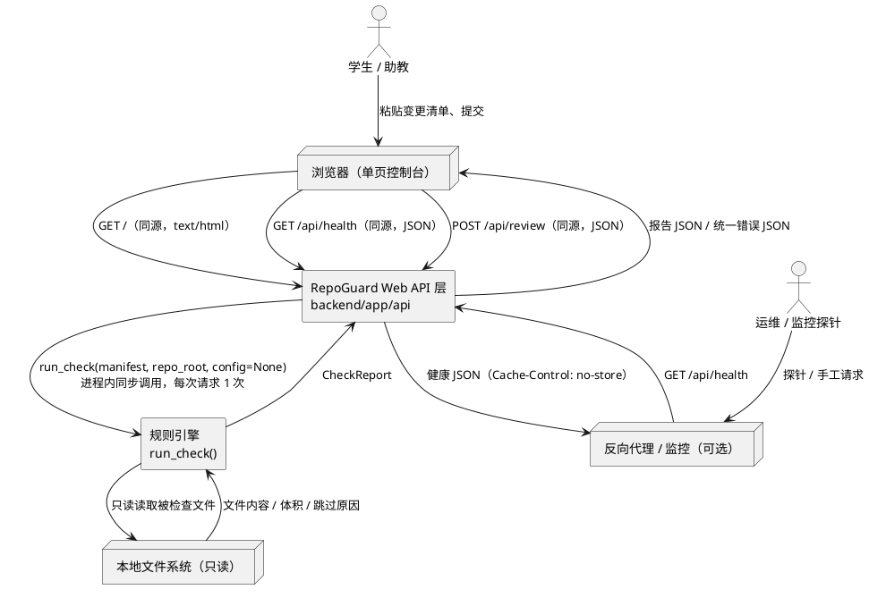
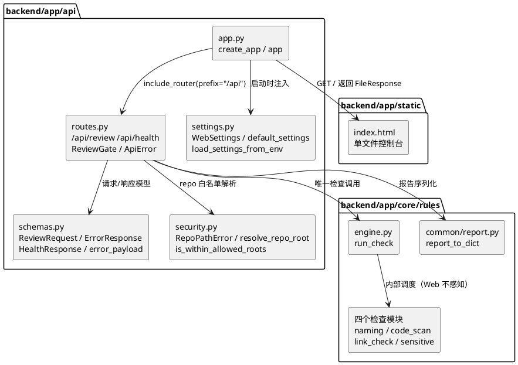
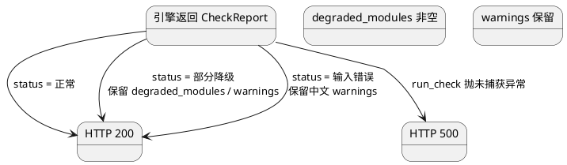
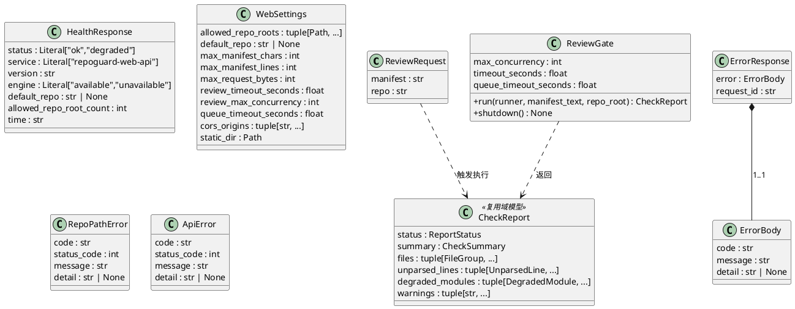
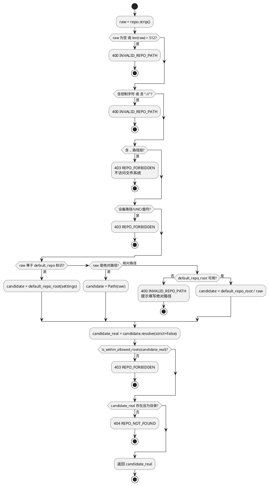
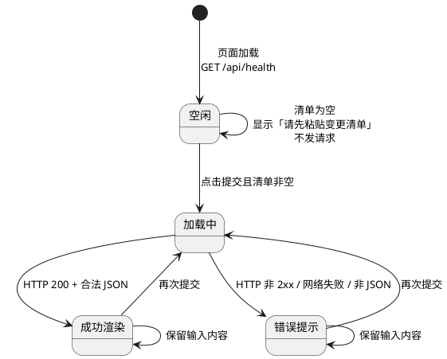
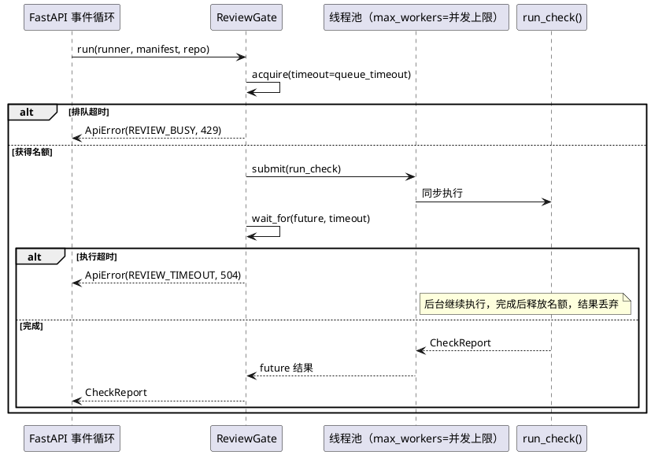
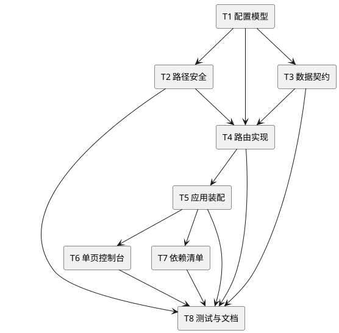

# 一、需求与存量功能关系分析

> 分析依据（本次设计的唯一口径）：
> 1. `.codeartsdoer/specs/web_api/spec.md`（951 行，阶段 2 需求规格）；
> 2. `.codeartsdoer/specs/rules_engine/design.md` 的 2.2（接口设计）、2.4.3（交付文件与函数签名）、2.7（错误处理与退出状态）；
> 3. 现有入口 `backend/app/core/rules/engine.py` 的 `run_check(manifest_text, repo_root, config=None) -> CheckReport`；
> 4. 现有渲染入口 `backend/app/core/rules/common/report.py` 的 `report_to_dict()` / `report_to_json()`；
> 5. 现有测试 `backend/tests/test_engine.py` 的 `test_requirements_txt`、`test_import_direction` 及其所在 `EngineTest` 类。
>
> 本文档只做设计，不包含业务代码、不修改 `requirements.txt`、不修改 `engine.py`、不修改测试文件。

## 1.1 需求功能与存量功能对比

### 1.1.1 已实现功能

阶段 1 已交付的规则引擎完整覆盖了「检查判定」与「报告序列化」两类能力，Web 层只需调用，不需要任何重写。

| 需求功能 | 存量功能 | 代码位置 | 匹配度 |
|---------|---------|---------|--------|
| 对变更清单执行命名、代码、链接、敏感信息四类检查并返回完整报告 | `run_check(manifest_text, repo_root, config=None) -> CheckReport`，内部完成清单解析、条目合并、四模块调度、异常隔离、分组排序与统计 | `backend/app/core/rules/engine.py:149-234` | 100% |
| 从文件读取清单后执行检查（CLI 使用） | `run_check_file(manifest_path, repo_root, config=None) -> CheckReport` | `backend/app/core/rules/engine.py:237-250` | 100% |
| 报告序列化为可 JSON 化的最小字典，六顶层字段 | `report_to_dict(report) -> dict[str, object]` | `backend/app/core/rules/common/report.py:82-125` | 100% |
| 报告序列化为 UTF-8 友好 JSON（中文不转义） | `report_to_json(report) -> str`，`ensure_ascii=False` | `backend/app/core/rules/common/report.py:164-168` | 100% |
| 中文终端摘要（CLI 使用） | `render_text(report) -> str` | `backend/app/core/rules/common/report.py:19-79` | 100% |
| 清单文本逐行解析、状态归一化、非法行记录 | `parse_manifest()` / `parse_manifest_line()` / `merge_entries()` | `backend/app/core/rules/common/manifest.py:38-109` | 100% |
| 报告构造与统计不变量校验 | `build_report()` / `validate_report()` | `backend/app/core/rules/common/models.py:229-300` | 100% |
| 清单内相对路径的沙箱校验与只读文件快照 | `resolve_repo_path()` / `create_snapshot()` / `FileSnapshot` | `backend/app/core/rules/common/file_io.py:54-92`、`219-234` | 100% |
| 稳定公共门面导出 | `run_check`、`report_to_dict` 等惰性再导出 | `backend/app/core/rules/__init__.py:5-58` | 100% |
| CLI 入口、参数、退出码 | `build_arg_parser()` / `main()` / `exit_code_for()` | `backend/app/core/rules/engine.py:253-321` | 100% |
| 规则阈值配置与非法值回退 | `RuleConfig` / `default_config()` / `build_config()` | `backend/app/core/rules/common/config.py` | 100% |

结论：**检查能力与报告结构的匹配度为 100%，Web 层必须 0 行复制判定逻辑。**

### 1.1.2 需要扩展的功能

| 需求功能 | 存量功能 | 差异说明 | 扩展方向 |
|---------|---------|---------|---------|
| 依赖清单同时声明引擎零依赖与 Web 依赖 | `backend/requirements.txt` 当前只有 2 行注释，非注释行为空 | 输入差异：从「仅注释」变为「三段依赖」；约束差异：引擎零第三方依赖不变量必须保留 | 用注释分段：规则引擎段保持为空；Web 运行依赖段固定 `fastapi==0.115.6`、`uvicorn==0.34.0`；仅测试段固定 `httpx==0.28.1` |
| 依赖清单测试断言 | `test_requirements_txt` 断言「过滤注释后为空列表」 | 业务规则差异：原断言只适用于阶段 1；新增依赖后必然失败 | 改为按段断言：引擎段仍为空、Web 段与测试段为精确版本且仅含允许的包名 |
| 导入方向测试断言 | `test_import_direction` 对 `backend/app/**/*.py` 全量套用「仅标准库绝对导入 + 规则模块间禁止反向/横向导入」 | 边界差异：新增 `backend/app/api/**` 必然导入 `fastapi`/`pydantic`/`starlette`，原白名单无法通过 | 按目录分区：`app/core/rules` 子树保持原断言不变；`app/api` 子树使用独立白名单，并新增「禁止导入四个检查模块」断言 |

### 1.1.3 需要新增的功能或接口

以下能力在存量代码中完全没有对应实现，全部为新增。

**A. HTTP 协议适配层（`backend/app/api/`）**

| 功能点 | 输入 | 输出 | 核心逻辑 | 依赖关系 |
|--------|------|------|---------|---------|
| 检查请求接口 | JSON `{manifest, repo}` | `CheckReport` 原样 JSON | Content-Type/大小/字段校验 → 白名单解析 → `run_check()` → `report_to_dict()` | `engine.run_check`、`report.report_to_dict` |
| 健康检查接口 | 无 | 七字段健康 JSON | 读取缓存配置 + 引擎可导入探测，不扫描仓库 | settings、engine 导入探测 |
| 仓库白名单解析 | `repo` 原始字符串 + `WebSettings` | 真实目录 `Path` 或 `RepoPathError` | 格式拒绝 → `..` 拒绝 → 绝对/相对归一 → 真实路径 → 公共前缀比较 → 存在性 | 标准库，禁止依赖 FastAPI |
| 服务配置模型 | 环境变量 / 显式注入 | `WebSettings`（冻结 dataclass） | 解析、范围校验、非法根剔除、默认 `demo-repo` | 标准库 |
| 数据契约 | Pydantic 模型 | 请求/错误/健康结构 | 类型约束；长度与行数业务校验放在路由层以区分 413/422 | `pydantic` |
| 应用装配 | `WebSettings \| None` | `FastAPI` 实例与模块级 `app` | 路由注册、静态挂载、异常处理器、请求上下文中间件、可选 CORS | `fastapi`、`starlette` |
| 统一错误结构 | 业务异常/框架异常 | `{error:{code,message,detail},request_id}` | 稳定错误码、中文文案、脱敏 | 全部路由 |

**B. 单页控制台（`backend/app/static/index.html`）**

| 功能点 | 输入 | 输出 | 核心逻辑 |
|--------|------|------|---------|
| 清单录入与提交 | 文本框内容 | 同源 `POST /api/review` | 空值本地拦截、加载态、按钮禁用、结果渲染 |
| 分级结果渲染 | 报告 JSON | 「必须修改」在前的分组视图 | 文本节点写入，按文件折叠，空结果/降级/无法解析行提示 |

**C. 测试与文档**

| 功能点 | 输入 | 输出 | 核心逻辑 |
|--------|------|------|---------|
| API 单元测试 | 临时仓库 + `TestClient` | T01～T25 断言 | 每例独立临时目录，逐项断言状态码与错误码 |
| 使用文档 | 无 | `docs/web_api_usage.md` | 启动、`REPOGUARD_ALLOWED_REPOS` 完整示例、接口示例、人工验收 |

## 1.2 存量功能详细分析

### 1.2.1 `run_check()` 接口契约

| 维度 | 契约 |
|------|------|
| 签名 | `run_check(manifest_text: str, repo_root: str \| Path, config: RuleConfig \| None = None) -> CheckReport` |
| 入参约束 | `manifest_text` 允许空串、空白行与注释行；`repo_root` 可为 `str` 或 `Path`；`config=None` 时使用 `default_config()` |
| 出参结构 | `CheckReport`：`status`、`summary`、`files`、`unparsed_lines`、`degraded_modules`、`warnings` |
| 业务异常 | 不向调用方抛业务异常；仓库根不存在/非目录时返回 `status="输入错误"` 与中文 `warnings`（`engine.py:156-161`） |
| 模块异常 | 四模块分别包裹，单模块失败进入 `degraded_modules`，其余模块继续（`engine.py:63-84`） |
| 空清单 | 返回 `status="正常"`、统计全零、`warnings=("变更清单为空，请确认是否已生成改动列表",)`（`engine.py:164-171`） |
| 排序确定性 | 文件分组按 `file_path` 排序；同文件内 `必须修改` 优先于 `优化建议`，再按行号、`rule_id`、`message` 排序（`engine.py:53-60`、`87-104`） |
| 副作用 | 只读；不写仓库；不联网；不执行被检查代码 |
| 耗时 | 由引擎既有性能预算约束；Web 层不得重试、不得二次调用 |

**Web 层必须遵守的调用约束：**

1. 每次 HTTP 请求最多调用 1 次，且只以 `config=None` 调用；
2. 传入的 `repo_root` 必须是安全白名单解析后的真实目录 `Path`；
3. 不得对返回的 `CheckReport` 做二次排序、过滤、合并、补全或级别改写；
4. 不得 monkeypatch、包装或替换引擎内部函数（测试注入替身仅通过 FastAPI 依赖覆盖实现）。

### 1.2.2 四模块与 `common/**` 复用边界

| 组件 | 位置 | Web 层使用方式 | 是否允许导入 |
|------|------|---------------|-------------|
| 汇总入口 | `backend/app/core/rules/engine.py` | 唯一检查入口 `run_check` | 允许 |
| 报告渲染 | `backend/app/core/rules/common/report.py` | `report_to_dict` / `report_to_json` | 允许 |
| 数据模型 | `backend/app/core/rules/common/models.py` | 仅类型标注 `CheckReport` | 允许 |
| 命名与目录检查 | `backend/app/core/rules/naming.py` | 不直接调用 | **禁止** |
| 代码检查 | `backend/app/core/rules/code_scan.py` | 不直接调用 | **禁止** |
| 链接检查 | `backend/app/core/rules/link_check.py` | 不直接调用 | **禁止** |
| 敏感信息与大文件检查 | `backend/app/core/rules/sensitive.py` | 不直接调用 | **禁止** |
| 清单解析/路径沙箱/配置 | `backend/app/core/rules/common/{manifest,file_io,config}.py` | 不直接调用；白名单逻辑在 `app/api/security.py` 独立实现 | 不作为 Web 层入口 |

> 设计理由：`common/file_io.resolve_repo_path()` 的语义是「仓库内相对路径」沙箱，输入是已确定的仓库根；Web 层需要的是「仓库根本身」的白名单判定，二者输入域与拒绝语义不同（前者返回 `is_safe` 布尔，后者需要区分 400/403/404）。因此 Web 层独立实现 `app/api/security.py`，不复用也不修改 `file_io.py`，形成 spec 7.4 第 4 条要求的「双重防线」。

### 1.2.3 CLI 冻结基线

| 冻结项 | 基线（零改动） |
|--------|---------------|
| 模块入口 | `python -m app.core.rules.engine`，工作目录 `backend/` |
| 参数 | `--manifest`（必填，`-` 为标准输入）、`--repo`（默认 `.`）、`--format`（默认 `text`）、`--output`、`--config`、`--debug` |
| 退出码 | `0` 正常 / `1` 存在必须修改 / `2` 输入错误 / `3` 降级或执行异常；优先级 `2 > 3 > 1 > 0` |
| stdout | `text` 中文摘要；`json` 与 `report_to_dict()` 同结构 |
| stderr | 仅 `--debug` 输出调试堆栈 |
| 第三方依赖 | `app.core.rules` 子树 0 处 Web 框架导入；未安装 Web 依赖时 CLI 仍可运行 |

**冻结文件清单（本阶段不得产生任何差异）：**

- `backend/app/core/rules/engine.py`
- `backend/app/core/rules/naming.py`、`code_scan.py`、`link_check.py`、`sensitive.py`
- `backend/app/core/rules/common/__init__.py`、`config.py`、`file_io.py`、`manifest.py`、`models.py`、`report.py`
- `backend/app/core/rules/__init__.py`
- `backend/tests/test_cli.py`

### 1.2.4 现有测试基线

对 `backend/tests/test_*.py` 静态统计：

| 测试文件 | `def test_` 数量 | 默认执行 |
|---------|----------------|---------|
| `backend/tests/test_engine.py` | 27 | 26（`test_performance_500` 需 `RULES_PERF=1`） |
| `backend/tests/test_cli.py` | 12 | 12 |
| `backend/tests/test_code_scan.py` | 21 | 21 |
| `backend/tests/test_link_check.py` | 21 | 21 |
| `backend/tests/test_manifest.py` | 16 | 16 |
| `backend/tests/test_naming.py`、`test_sensitive.py` 等 | 38 | 38 |
| **合计** | **135** | **134** |

> 口径说明：基线的 135 个 `def test_` 中，`test_performance_500` 由 `@unittest.skipUnless(os.environ.get("RULES_PERF") == "1", ...)` 默认跳过（`test_engine.py:276`）。因此默认 `pytest -q` 实际执行 **134 条功能用例**，与本次约束「原有 134 条功能用例继续全部通过」一致。

需要调整的两个用例现状：

| 用例 | 位置 | 现有断言 | 调整后是否改变用例数量 |
|------|------|---------|---------------------|
| `test_requirements_txt` | `backend/tests/test_engine.py:240-243` | 过滤注释行后 `lines == []` | 否（仍为 1 个方法） |
| `test_import_direction` | `backend/tests/test_engine.py:251-274` | 遍历 `APP_DIR.rglob("*.py")`，绝对导入必须在标准库白名单；相对导入按 `common`/`engine`/其他规则模块做方向断言 | 否（仍为 1 个方法） |

### 1.2.5 存量约束与结论

1. **唯一入口约束**：`run_check` 已是完整业务入口，Web 层是纯适配层，任何检查判定下沉到 Web 层都属于设计违规。
2. **结构约束**：`CheckReport` 序列化已由 `report_to_dict` 固定六个顶层键，Web 层不得新增 `data`/`result`/`code` 包装。
3. **安全约束**：`common/file_io.resolve_repo_path` 已对清单内路径做沙箱，但其输入是「已认定的仓库根」，不能替代 Web 层对 `repo` 本身的白名单校验。
4. **兼容约束**：`test_import_direction` 以 `APP_DIR.rglob("*.py")` 全量扫描，天然会把新增的 `app/api/**` 纳入原白名单，因此该用例是本次唯一必须同步调整的「结构性断言」。
5. **依赖约束**：`test_requirements_txt` 以「过滤注释后为空」表达引擎零依赖，新增 Web 依赖后必须改为「按段断言」，否则会误伤引擎零依赖不变量。
6. **结论**：新增代码全部落在 `backend/app/api/`、`backend/app/static/`、`backend/tests/test_api.py`、`docs/`，修改仅限 `backend/requirements.txt` 与 `test_engine.py` 的两个用例；引擎、四模块、`common/**` 与 CLI 路径零改动。

---

# 二、增量设计方案

## 2.1 实现模型

### 2.1.1 上下文视图



| 边界 | 协议 | 频率 | 约束 |
|------|------|------|------|
| 浏览器 → Web | 同源 HTTP/1.1，JSON UTF-8 | 用户触发 | 禁止 CDN、禁止跨域默认开启 |
| Web → Engine | 进程内函数调用 | 每请求 1 次 | `config=None`，不重试，不包装 |
| Engine → 文件系统 | 只读打开 | 引擎内部决定 | Web 层不直接读取被检查文件内容 |
| 监控 → Web | HTTP GET | 探针周期 | 100 ms 内返回，不扫描仓库 |

### 2.1.2 服务/组件总体架构



| 组件 | 职责 | 依赖方向 |
|------|------|---------|
| `settings.py` | 环境变量读取、范围校验、允许根过滤、默认 `demo-repo` | 仅标准库 |
| `security.py` | `repo` 字符串拒绝规则、真实路径解析、白名单前缀比较 | 标准库 + `settings`，**禁止导入 fastapi** |
| `schemas.py` | 请求/错误/健康 Pydantic 模型与错误载荷构造 | `pydantic` + 标准库 |
| `routes.py` | 请求校验、并发闸门、超时、调用引擎、序列化、健康状态计算 | `fastapi`、`schemas`、`security`、`settings`、`engine`、`report` |
| `app.py` | 应用工厂、异常处理器、请求上下文中间件、静态挂载、可选 CORS | `fastapi`、`starlette`、`routes`、`settings` |
| `index.html` | 录入、提交、渲染、错误与降级提示 | 仅同源 HTTP，无外部资源 |

**配置集中原则**：允许根、默认仓库、清单上限、行数上限、请求体上限、超时、并发、排队上限、CORS 全部只在 `WebSettings` 中定义；`routes.py` 仅读取 `settings` 字段，禁止散落常量。

### 2.1.3 实现设计文档

#### （1）请求主流程

```plantuml
@startuml
skinparam defaultFontName "Microsoft YaHei"
start
:收到 POST /api/review;
:中间件生成 request_id\n检查 Content-Length;
if (Content-Length > max_request_bytes?) then (是)
  :413 REQUEST_TOO_LARGE;
  stop
endif
:校验 Content-Type;
if (非 application/json?) then (是)
  :415 UNSUPPORTED_MEDIA_TYPE;
  stop
endif
:读取 body → json.loads;
if (非 JSON 对象?) then (是)
  :400 INVALID_JSON;
  stop
endif
:ReviewRequest.model_validate;
if (字段缺失/类型错误?) then (是)
  :422 VALIDATION_ERROR;
  stop
endif
:manifest 字符数/UTF-8 字节数/行数校验;
if (任一超限?) then (是)
  :413 MANIFEST_TOO_LARGE\n不读取仓库、不调用引擎;
  stop
endif
:resolve_repo_root(repo, settings);
if (格式非法?) then (是)
  :400 INVALID_REPO_PATH;
  stop
endif
if (含 .. / 盘符 / UNC / 设备路径 / 越界?) then (是)
  :403 REPO_FORBIDDEN\n不 stat、不遍历;
  stop
endif
if (不存在或非目录?) then (是)
  :404 REPO_NOT_FOUND;
  stop
endif
:ReviewGate.run(run_check, manifest, repo_real);
if (并发已满且排队超时?) then (是)
  :429 REVIEW_BUSY;
  stop
endif
if (执行超过 review_timeout_seconds?) then (是)
  :504 REVIEW_TIMEOUT\n后台继续执行，结果丢弃;
  stop
endif
if (引擎抛未预期异常?) then (是)
  :500 INTERNAL_ERROR\n日志含堆栈，响应不含;
  stop
endif
:report_to_dict(report);
:HTTP 200 + 报告 JSON;
stop
@enduml
```



**流程要点：**

1. 大小与格式校验全部发生在 `run_check()` 之前，任何失败都不触碰仓库；
2. `Content-Type`、非法 JSON、字段类型分别映射 415/400/422，不能合并为 FastAPI 默认的 422；
3. `manifest` 长度校验使用三个口径：字符数、UTF-8 字节数、`splitlines()` 行数，任一超限即 413；
4. 引擎 `status="部分降级"` 或 `"输入错误"` 均为 HTTP 200，只透传，不改写；
5. 全流程对 `run_check()` 的调用次数恰好为 1。

#### （2）报告状态处理（不转换）



| 引擎结果 | HTTP | 响应体 | 处理原则 |
|---------|------|--------|---------|
| `status="正常"` | 200 | 报告原样 | 不新增字段 |
| `status="部分降级"` | 200 | `degraded_modules`、`warnings` 原样 | 禁止映射为 500 |
| `status="输入错误"` | 200 | `warnings` 原样 | 禁止改写为 500 |
| `run_check` 抛异常 | 500 | `INTERNAL_ERROR` | 堆栈仅进服务端日志 |
| `report_to_dict` 抛异常 | 500 | `INTERNAL_ERROR`，提示「检查结果无法返回，请稍后重试」 | 不返回半成品 JSON |

#### （3）异常映射总表

| HTTP | `error.code` | 触发点 | 中文 `message` |
|------|-------------|--------|---------------|
| 400 | `INVALID_JSON` | body 为空、截断、非 JSON 对象 | 请求内容不是合法的 JSON，请检查提交数据 |
| 400 | `INVALID_REPO_PATH` | `repo` 空/超长/控制字符/含 `://`/无默认仓库时的相对路径 | 仓库路径格式不合法 |
| 403 | `REPO_FORBIDDEN` | 含 `..` 段、盘符/UNC/设备路径、真实路径越界、符号链接逃逸 | 仓库路径不在服务端允许范围内 |
| 404 | `REPO_NOT_FOUND` | 白名单内但不存在或不是目录 | 仓库目录不存在或不可用 |
| 405 | `METHOD_NOT_ALLOWED` | 非 POST 访问 review、非 GET 访问 health | 请求方法不被支持 |
| 413 | `MANIFEST_TOO_LARGE` | 字符数/字节数/行数超限 | 变更清单过长，请分批提交 |
| 413 | `REQUEST_TOO_LARGE` | 声明或实际请求体超过上限 | 请求内容过大 |
| 415 | `UNSUPPORTED_MEDIA_TYPE` | Content-Type 非 `application/json` | 请求类型不支持，请使用 JSON |
| 422 | `VALIDATION_ERROR` | 字段缺失、类型错误、body 非对象 | 请求参数不完整或类型错误 |
| 429 | `REVIEW_BUSY` | 并发已满且排队超过 5 秒 | 当前检查请求较多，请稍后重试 |
| 500 | `INTERNAL_ERROR` | 引擎外未预期异常、序列化失败 | 服务内部错误，本次检查未完成，请稍后重试 |
| 503 | `ENGINE_UNAVAILABLE` | 引擎不可导入、允许根为空、默认仓库不可用导致无法执行 | 规则引擎当前不可用 |
| 503 | `STATIC_NOT_FOUND` | `index.html` 缺失 | 页面资源缺失，请检查部署 |
| 504 | `REVIEW_TIMEOUT` | 超过 `review_timeout_seconds` | 检查耗时过长，请缩小变更清单后重试 |

> 说明：`ENGINE_UNAVAILABLE` 在响应体 `error.detail` 中区分「引擎不可用」与「未配置可用的仓库目录」两种中文说明，但错误码保持稳定单一值，符合 spec 6.3 的取值枚举。

#### （4）并发闸门与超时

`run_check()` 是同步阻塞函数，必须与事件循环隔离。设计采用「专用线程池 + 有界信号量」：

| 机制 | 设计 |
|------|------|
| 并发上限 | `ReviewGate` 持有 `ThreadPoolExecutor(max_workers=review_max_concurrency)` 与 `threading.BoundedSemaphore(review_max_concurrency)` |
| 排队上限 | `semaphore.acquire(timeout=queue_timeout_seconds)` 在线程中等待；超时立即 429，不入队 |
| 信号量释放 | `future.add_done_callback` 中释放，**不在请求超时分支释放**，保证后台仍在执行的检查继续占用名额 |
| 执行超时 | `asyncio.wait_for(asyncio.wrap_future(future), review_timeout_seconds)`；超时返回 504，后台线程不强制终止，结果丢弃 |
| 生命周期 | `create_app` 创建 `ReviewGate` 存入 `app.state.review_gate`；`lifespan` 关闭时 `shutdown(wait=False, cancel_futures=False)` |
| 测试注入 | 引擎替身通过 `app.dependency_overrides[get_engine]` 注入，不 monkeypatch 引擎源码 |

#### （5）请求标识与日志

| 项 | 设计 |
|----|------|
| 生成位置 | `RequestContextMiddleware` 入口，`uuid.uuid4().hex`（32 字符，符合 8～64 且仅字母数字） |
| 传递方式 | `request.state.request_id`；响应头 `X-Request-ID`；错误体 `request_id` |
| 日志格式 | 单行 JSON，`ensure_ascii=False`，字段：`request_id`、`method`、`path`、`status_code`、`error_code`、`duration_ms`、`report_status`、`must_fix_count` |
| 脱敏 | 不记录 `manifest` 正文、被检查文件内容、仓库绝对路径；`repo` 只记录相对标识或 8 位哈希 |
| 堆栈 | 仅 500 场景写入服务端日志；响应体禁止出现 `traceback`、异常类名、绝对路径 |

#### （6）响应头与静态资源

| 响应类型 | 响应头 |
|---------|--------|
| 全部响应 | `X-Request-ID`、`X-Content-Type-Options: nosniff` |
| API 响应 | `Cache-Control: no-store` |
| 页面与静态资源 | `X-Frame-Options: DENY`；`Content-Security-Policy: default-src 'self'; script-src 'self' 'unsafe-inline'; style-src 'self' 'unsafe-inline'; img-src 'self' data:; frame-ancestors 'none'` |
| 健康检查 | `Cache-Control: no-store`，每次重新计算 |

> CSP 允许 `'unsafe-inline'` 的原因是单文件页面必须内联样式与脚本（spec 要求零构建、无外链）；同时页面禁止 `innerHTML`，XSS 主防线是文本节点写入，CSP 作为纵深防御。
## 2.2 接口设计

### 2.2.1 总体设计

接口分为三类，全部位于 `backend/app/api/routes.py`，由 `app.py` 统一注册：

| 分类 | 接口 | 使用方 | 稳定性 | 说明 |
|------|------|--------|--------|------|
| 业务 API | `POST /api/review` | 浏览器、脚本 | 稳定 | 唯一的检查入口，返回 `report_to_dict()` 原样结构 |
| 运维 API | `GET /api/health` | 浏览器、探针 | 稳定 | 只读状态，不执行检查 |
| 静态资源 | `GET /`、`GET /static/{path}` | 浏览器 | 稳定 | 单页控制台与同源资源 |

**接口分类依据**：按「是否触发规则引擎」划分。只有 `/api/review` 会触发 `run_check()`；`/api/health` 与静态资源必须与引擎执行完全隔离。

**版本管理策略**：

1. 阶段 2 固定 `service="repoguard-web-api"`、`version="1.0.0"`；
2. 报告 JSON 的版本由规则引擎的 `CheckReport` 结构决定，Web 层不引入第二套版本号；
3. 破坏性变更（字段改名、错误码改名）必须先修改 `spec.md` 与 `rules_engine/design.md`，不得在 Web 层单方面变更；
4. 新增可选字段允许，消费方需容忍未知字段。

**接口清单总览：**

| 方法与路径 | 请求体 | 成功响应 | 失败响应 | 幂等 | 缓存 |
|-----------|--------|---------|---------|------|------|
| `POST /api/review` | `ReviewRequest` | 200 + `CheckReport` 字典 | 4xx/5xx + `ErrorResponse` | 是（只读） | `no-store` |
| `GET /api/health` | 无 | 200 + `HealthResponse` | 503 + `HealthResponse` | 是 | `no-store` |
| `GET /` | 无 | 200 + `text/html` | 503 + `ErrorResponse` | 是 | 静态文件默认缓存头 |
| `GET /static/{path}` | 无 | 200 + 对应资源 | 404 | 是 | 静态文件默认缓存头 |

### 2.2.2 接口清单

#### （1）`POST /api/review`

**接口签名（实现层）：**

```python
async def review(
    request: Request,
    settings: WebSettings = Depends(get_settings),
    runner: CheckRunner = Depends(get_engine),
) -> JSONResponse: ...
```

> 与 spec 8.1 中 `def review(request: ReviewRequest) -> dict[str, object]` 的差异说明：spec 5.1.3 要求「非法 JSON → 400 `INVALID_JSON`」「Content-Type 错误 → 415」，而 FastAPI 对声明式 Body 模型的解析失败会统一返回 422。为满足更具体的验收条件，路由必须接收原始 `Request` 并手工完成 Content-Type、JSON 解析与模型校验三步；`ReviewRequest` 仍然作为唯一请求模型参与 `model_validate()`，字段契约不变。此差异只影响实现签名，不影响任何外部 HTTP 契约。

| 项 | 契约 |
|----|------|
| 方法/路径 | `POST /api/review` |
| 请求头（必需） | `Content-Type: application/json`，允许 `charset=utf-8` |
| 请求头（建议） | `Accept: application/json` |
| 请求体 | JSON 对象，仅识别 `manifest`（字符串）与 `repo`（字符串）；未知字段忽略 |
| 前置条件 | `manifest` 满足字符/字节/行数上限；`repo` 通过白名单解析且存在为目录 |
| 后置条件 | 恰好调用 1 次 `run_check(manifest, repo_real, config=None)`；返回 `report_to_dict()` 结果；不写仓库 |
| 成功响应 | HTTP 200，`Content-Type: application/json; charset=utf-8`，六个顶层字段，无外层包装 |
| 失败响应 | 统一 `ErrorResponse`，含稳定 `error.code`、中文 `error.message`、`request_id` |
| 副作用 | 无。只读文件系统，不执行 git，不执行被检查代码 |
| 调用示例（curl） | `curl -X POST http://127.0.0.1:8000/api/review -H "Content-Type: application/json" -d "{\\"manifest\\":\\"A lab/uart.c\\n\\",\\"repo\\":\\"demo-repo\\"}"` |
| 调用示例（httpx） | `httpx.post("http://127.0.0.1:8000/api/review", json={"manifest": "A lab/uart.c\n", "repo": "demo-repo"}, timeout=35)` |

**请求体判定顺序（不可调换）：**

1. `Content-Length` 声明值超过 `max_request_bytes` → 413 `REQUEST_TOO_LARGE`；
2. `Content-Type` 主类型不是 `application/json` → 415 `UNSUPPORTED_MEDIA_TYPE`；
3. body 为空、无法解析或顶层不是对象 → 400 `INVALID_JSON`；
4. `ReviewRequest.model_validate()` 失败（字段缺失、类型错误） → 422 `VALIDATION_ERROR`；
5. `manifest` 字符数 > `max_manifest_chars`、UTF-8 字节数 > 2 MB、或行数 > `max_manifest_lines` → 413 `MANIFEST_TOO_LARGE`；
6. `repo` 进入 `resolve_repo_root()`。

> 设计理由：把 413 放在 422 之前，是因为超限属于「体量拒绝」而非「字段缺失」；把 Content-Type 放在 JSON 解析之前，避免对 `text/plain` 做无意义的 JSON 解析。

#### （2）`GET /api/health`

**接口签名（实现层）：**

```python
def health(
    request: Request,
    settings: WebSettings = Depends(get_settings),
) -> JSONResponse: ...
```

| 项 | 契约 |
|----|------|
| 方法/路径 | `GET /api/health` |
| 请求体 | 无；出现请求体时忽略 |
| 前置条件 | 无 |
| 后置条件 | 不调用 `run_check()`、不扫描仓库、不写文件；每次重新计算配置与默认仓库状态 |
| 成功响应 | HTTP 200 + `HealthResponse` 七字段，`status="ok"`、`engine="available"` |
| 降级响应 | HTTP 503 + `HealthResponse` 七字段，`status="degraded"`，`engine` 按实际取值 |
| 响应头 | `Cache-Control: no-store` |
| 响应时间 | 正常情况 ≤ 100 ms（仅配置读取与模块导入探测） |
| 敏感信息 | 不返回环境变量原文、绝对路径、依赖清单、文件列表 |

**`status="ok"` 的判定条件（三者同时满足）：**

1. `app.core.rules.engine` 可导入且 `run_check` 可调用；
2. `settings.allowed_repo_roots` 过滤后非空；
3. `default_repo` 标识可在允许根中定位到存在且为目录的路径。

**降级但不阻断的边界**：默认仓库无效时健康状态为 `degraded` + HTTP 503，但 `allowed_repo_roots` 中其他有效根仍可用于 review（absolute path 形式）；`default_repo` 仍返回原标识，便于排查。

#### （3）`GET /`

| 项 | 契约 |
|----|------|
| 方法/路径 | `GET /` |
| 响应 | 200 + `FileResponse(static_dir / "index.html", media_type="text/html; charset=utf-8")` |
| 缺失处理 | `index.html` 不存在 → 503 + `STATIC_NOT_FOUND`，中文提示「页面资源缺失，请检查部署」 |
| 禁止行为 | 返回目录列表、返回 500 堆栈、回退到其他页面 |
| 响应头 | `X-Frame-Options: DENY`、CSP、`X-Content-Type-Options: nosniff` |

#### （4）`GET /static/{path}`

| 项 | 契约 |
|----|------|
| 挂载方式 | `app.mount("/static", StaticFiles(directory=static_dir), name="static")`，仅在 `static_dir` 存在时挂载 |
| 路径解析 | 由 Starlette `StaticFiles` 负责，禁止目录穿越（框架已内置） |
| 404 | 返回 404；不得泄露服务器绝对路径 |
| 缺失目录 | 不挂载；访问 `/static/*` 返回 404，`/` 返回 503 `STATIC_NOT_FOUND` |

#### （5）内部依赖契约

| 依赖函数 | 签名 | 用途 | 测试注入 |
|---------|------|------|---------|
| `get_settings` | `def get_settings(request: Request) -> WebSettings` | 从 `app.state.settings` 读取，禁止全局变量 | 通过 `create_app(settings)` 注入 |
| `get_engine` | `def get_engine() -> CheckRunner` | 返回 `app.core.rules.engine.run_check`；导入失败抛 503 `ENGINE_UNAVAILABLE` | `app.dependency_overrides[get_engine] = fake` |

> 设计理由：用 FastAPI 依赖覆盖注入引擎替身，是 spec 5.5.2 第 4 条允许的测试手段，且不修改引擎源码、不 monkeypatch 生产路径。

## 2.3 数据模型

### 2.3.1 设计目标

1. **与需求术语一致**：`ReviewRequest`、`HealthResponse`、`ErrorResponse`、`WebSettings` 的字段名与 spec 第 6 章逐字对应；
2. **报告不复刻**：`CheckReport` 及子结构完全复用 `app.core.rules.common.models`，Web 层不定义第二套报告模型，避免双份字段漂移；
3. **边界类型安全**：请求边界使用 Pydantic 做类型收窄；配置使用冻结 dataclass；禁止 `Any`；
4. **可测试**：`WebSettings` 可显式构造并注入 `create_app()`，测试不依赖环境变量与本机路径；
5. **兼容存量**：`WebSettings` 与 `RuleConfig` 完全独立，Web 配置不得影响规则阈值。

### 2.3.2 模型实现



**（1）`ReviewRequest` 字段约束**

| 字段 | 类型 | 必填 | 默认 | 长度/格式 | 校验位置 | 失败码 |
|------|------|------|------|----------|---------|--------|
| `manifest` | `str` | 是 | 无 | 0～1,000,000 字符；UTF-8 ≤ 2 MB；≤ 5,000 行 | 路由层（业务上限） | 413 `MANIFEST_TOO_LARGE` |
| `repo` | `str` | 是 | 无 | 去空白后 1～512 字符；无 NUL/控制字符；无 `://` | 路由层 + `security` | 400 `INVALID_REPO_PATH` |

模型级配置：`extra="ignore"`（未知字段忽略且不写日志）；不做 `str_strip_whitespace`（由 `security` 显式去空白，避免改变 `manifest` 原文）。

**（2）`HealthResponse` 字段约束**

| 字段 | 类型 | 取值 | 说明 |
|------|------|------|------|
| `status` | `Literal["ok","degraded"]` | 固定二值 | 降级返回 503 |
| `service` | `Literal["repoguard-web-api"]` | 固定值 | 服务名 |
| `version` | `str` | 阶段 2 固定 `1.0.0` | 语义化版本 |
| `engine` | `Literal["available","unavailable"]` | 固定二值 | 仅导入探测，不执行 |
| `default_repo` | `str \| None` | 相对标识 | 禁止绝对路径 |
| `allowed_repo_root_count` | `int` | ≥ 0 | 有效根数量 |
| `time` | `str` | UTC ISO 8601 | 仅观测，不参与业务判定 |

**（3）`ErrorResponse` 字段约束**

| 字段 | 类型 | 约束 |
|------|------|------|
| `error.code` | `str` | 必须属于 2.1.3（3）的稳定大写枚举 |
| `error.message` | `str` | 简体中文陈述句，不含英文异常类名 |
| `error.detail` | `str \| None` | 只允许字段名、脱敏片段或规则说明；禁止绝对路径、堆栈、文件内容 |
| `request_id` | `str` | 8～64 字符，仅字母、数字、连字符 |

**（4）`WebSettings` 字段约束与默认值**

| 字段 | 类型 | 默认值 | 合法范围 | 非法处理 |
|------|------|--------|---------|---------|
| `allowed_repo_roots` | `tuple[Path, ...]` | 项目根下 `demo-repo/`（若存在） | 每项必须是存在且可读的目录 | 非法项剔除；全空则服务降级 |
| `default_repo` | `str \| None` | `"demo-repo"` | 允许根的相对标识 | 不存在的标识保留原值用于排查，健康降级 |
| `max_manifest_chars` | `int` | `1_000_000` | 1～2,000,000 | 越界回退默认 |
| `max_manifest_lines` | `int` | `5_000` | 1～20,000 | 越界回退默认 |
| `max_request_bytes` | `int` | `2_097_152` | 65,536～16,777,216 | 越界回退默认 |
| `review_timeout_seconds` | `float` | `30.0` | 1～120 | 越界回退默认 |
| `review_max_concurrency` | `int` | `2` | 1～8 | 越界回退默认 |
| `queue_timeout_seconds` | `float` | `5.0` | 0～30 | 越界回退默认 |
| `cors_origins` | `tuple[str, ...]` | `()` | 完整 origin（含协议与端口），禁止 `*` | 非法项剔除；全空则不启用 CORS |
| `static_dir` | `Path` | `backend/app/static` | 目录或不存在 | 不存在时页面 503，API 不受影响 |

**（5）对象生命周期**

| 对象 | 创建时机 | 生命周期 | 销毁 |
|------|---------|---------|------|
| `WebSettings` | 进程启动（`load_settings_from_env`）或测试显式构造 | 应用实例级，不可变 | 进程结束 |
| `ReviewGate` | `create_app()` | 应用实例级 | `lifespan` 关闭 |
| `ReviewRequest` | 每次请求 | 单请求 | 请求结束自动回收 |
| `CheckReport` | 每次 `run_check()` | 单请求 | 序列化后丢弃，不持久化 |
| `RepoPathError` / `ApiError` | 校验失败时 | 单请求 | 异常处理器消费后回收 |

> 本阶段**不持久化任何对象**：不写数据库、不写报告文件、不写缓存到仓库内。`docs/web_api_usage.md` 只记录使用方法，不承载运行数据。
## 2.4 目录与逐文件契约

### 2.4.1 目录结构

```text
RepoGuard/
├── backend/
│   ├── requirements.txt                        # 修改：三段式依赖声明
│   ├── app/
│   │   ├── __init__.py                         # 不变
│   │   ├── api/                                # 新增目录（当前为空）
│   │   │   ├── __init__.py                     # 新增：包标记 + create_app 再导出
│   │   │   ├── settings.py                     # 新增：WebSettings 与环境变量加载
│   │   │   ├── schemas.py                      # 新增：请求/错误/健康模型
│   │   │   ├── security.py                     # 新增：repo 白名单解析（无 fastapi 依赖）
│   │   │   ├── routes.py                       # 新增：两个业务路由 + ReviewGate
│   │   │   └── app.py                          # 新增：应用工厂、中间件、异常处理、静态挂载
│   │   ├── core/
│   │   │   └── rules/                          # 不变（engine.py、四模块、common/**）
│   │   └── static/                             # 新增目录
│   │       └── index.html                      # 新增：单页控制台
│   └── tests/
│       ├── test_engine.py                      # 修改：仅两个用例
│       ├── test_api.py                         # 新增：API 单测与 CLI 回归
│       └── ...                                 # 其余不变
└── docs/
    └── web_api_usage.md                        # 新增：启动、配置、接口示例、人工验收
```

### 2.4.2 逐文件职责与全部公开函数签名

> 统一约定：所有 Python 文件首行 `from __future__ import annotations`；Python 3.10+；禁止 `Any`；仓库相对路径统一用 `/` 表示。

#### （1）`backend/app/api/__init__.py`

| 项 | 内容 |
|----|------|
| 职责 | 声明 `app.api` 包，再导出应用工厂；不承载任何业务逻辑 |
| 公开符号 | `create_app`、`__all__` |
| 允许依赖 | `app.api.app` |
| 禁止依赖 | `app.core.rules`（避免包导入即触发引擎）、任何第三方库 |

```python
from app.api.app import create_app

__all__: tuple[str, ...] = ("create_app",)
```

#### （2）`backend/app/api/settings.py`

| 项 | 内容 |
|----|------|
| 职责 | 定义不可变 `WebSettings`；从环境变量读取并做范围校验；过滤非法允许根；定位默认 `demo-repo`；提供启动摘要 |
| 允许依赖 | 标准库 `dataclasses`、`os`、`pathlib`、`collections.abc`、`hashlib` |
| 禁止依赖 | `fastapi`、`pydantic`、`app.core.rules` |
| 导入方向 | 被 `security.py`、`routes.py`、`app.py` 单向导入 |

```python
PROJECT_ROOT: Path                     # Path(__file__).resolve().parents[3]，即 RepoGuard 仓库根
DEFAULT_STATIC_DIR: Path               # PROJECT_ROOT / "backend" / "app" / "static"
DEFAULT_DEMO_REPO: str = "demo-repo"
ALLOWED_REPOS_ENV: str = "REPOGUARD_ALLOWED_REPOS"
LEGACY_ALLOWED_REPOS_ENV: str = "REPOGUARD_ALLOWED_REPO_ROOTS"

@dataclass(frozen=True, slots=True)
class WebSettings:
    allowed_repo_roots: tuple[Path, ...] = ()
    default_repo: str | None = DEFAULT_DEMO_REPO
    max_manifest_chars: int = 1_000_000
    max_manifest_lines: int = 5_000
    max_request_bytes: int = 2_097_152
    review_timeout_seconds: float = 30.0
    review_max_concurrency: int = 2
    queue_timeout_seconds: float = 5.0
    cors_origins: tuple[str, ...] = ()
    static_dir: Path = DEFAULT_STATIC_DIR

def default_settings() -> WebSettings: ...
def load_settings_from_env(env: Mapping[str, str] | None = None) -> WebSettings: ...
def normalize_settings(settings: WebSettings) -> WebSettings: ...
def parse_allowed_repos(raw: str) -> tuple[Path, ...]: ...
def default_repo_root(settings: WebSettings) -> Path | None: ...
def settings_summary(settings: WebSettings) -> dict[str, object]: ...
def repo_label(path: Path | str, settings: WebSettings | None = None) -> str: ...
```

| 函数 | 输入 | 输出 | 关键行为 |
|------|------|------|---------|
| `default_settings()` | 无 | `WebSettings` | 候选根为 `PROJECT_ROOT / "demo-repo"`；**不做存在性过滤**，交由 `normalize_settings` |
| `load_settings_from_env(env=None)` | 可选 `Mapping`（默认 `os.environ`） | `WebSettings` | 读取 2.7 节环境变量；非法数值回退默认；返回前调用 `normalize_settings` |
| `normalize_settings(settings)` | 任意 `WebSettings` | 新 `WebSettings` | 逐项范围校正；允许根 `resolve()` 后仅保留存在且为目录的项并去重；CORS 过滤 `*` 与非法 origin |
| `parse_allowed_repos(raw)` | 原始字符串 | `tuple[Path, ...]` | 按 `os.pathsep`（兼容 `|`）拆分；去空白与空项；`~` 展开；相对路径基于 `PROJECT_ROOT` |
| `default_repo_root(settings)` | 配置 | 默认仓库真实路径或 `None` | 标识优先匹配允许根末段名，其次按相对路径解析，最后校验存在且为目录 |
| `settings_summary(settings)` | 配置 | 脱敏字典 | 仅含 `allowed_repo_root_count`、`default_repo`、`static_dir_present`、`cors_origin_count`；**不含绝对路径** |
| `repo_label(path, settings=None)` | 路径 | 脱敏标识 | 返回末段目录名；无法取得时返回 `sha256` 前 8 位；禁止返回绝对路径 |

#### （3）`backend/app/api/schemas.py`

| 项 | 内容 |
|----|------|
| 职责 | 请求、错误、健康响应的数据契约；统一错误载荷构造 |
| 允许依赖 | `pydantic`、标准库 `typing` |
| 禁止依赖 | `fastapi`、`app.core.rules`、`app.api.security`（避免循环） |

```python
class ReviewRequest(BaseModel):
    manifest: str
    repo: str
    model_config: ConfigDict = ConfigDict(extra="ignore")

class ErrorBody(BaseModel):
    code: str
    message: str
    detail: str | None = None

class ErrorResponse(BaseModel):
    error: ErrorBody
    request_id: str

class HealthResponse(BaseModel):
    status: Literal["ok", "degraded"]
    service: Literal["repoguard-web-api"]
    version: str
    engine: Literal["available", "unavailable"]
    default_repo: str | None
    allowed_repo_root_count: int
    time: str

def error_payload(
    code: str,
    message: str,
    detail: str | None = None,
    request_id: str | None = None,
) -> dict[str, object]: ...
```

| 函数/类 | 说明 |
|---------|------|
| `ReviewRequest` | 只声明类型；长度、行数、字节数业务上限在 `routes.py` 校验，以保证 413 而非 422 |
| `ErrorBody` / `ErrorResponse` | 仅用于文档与 OpenAPI schema；运行时错误统一走 `error_payload()` |
| `HealthResponse` | 七字段与 spec 6.4 一一对应；`service`、`version` 由路由传入 |
| `error_payload` | `request_id=None` 时生成 32 位 `uuid4().hex`；返回 `{"error": {...}, "request_id": ...}`，`detail` 为空时不输出该键 |

#### （4）`backend/app/api/security.py`

| 项 | 内容 |
|----|------|
| 职责 | `repo` 字符串拒绝规则、绝对/相对归一、真实路径解析、白名单公共前缀比较 |
| 允许依赖 | 标准库 `os`、`pathlib`、`re`、`hashlib`、`app.api.settings` |
| 禁止依赖 | **`fastapi`**、`pydantic`、`app.core.rules`（保证可独立单测） |

```python
MAX_REPO_LENGTH: int = 512
CONTROL_CHAR_MAX: int = 31
CONTROL_CHAR_DEL: int = 127

class RepoPathError(Exception):
    code: str
    status_code: int
    message: str
    detail: str | None
    def __init__(
        self,
        code: str,
        status_code: int,
        message: str,
        detail: str | None = None,
    ) -> None: ...

def resolve_repo_root(raw: str, settings: WebSettings) -> Path: ...
def is_within_allowed_roots(candidate: Path, settings: WebSettings) -> bool: ...
def has_parent_segment(value: str) -> bool: ...
def has_control_chars(value: str) -> bool: ...
def is_device_or_unc_path(value: str) -> bool: ...
def is_absolute_repo_path(value: str) -> bool: ...
```

| 函数 | 输入 | 输出 | 异常 |
|------|------|------|------|
| `resolve_repo_root` | 原始 `repo` + 配置 | 通过校验的真实目录 `Path` | `RepoPathError`（400/403/404） |
| `is_within_allowed_roots` | 已解析候选路径 + 配置 | `bool` | 不抛异常；`os.path.commonpath` 的 `ValueError` 视为不在根内 |
| `has_parent_segment` | 字符串 | `bool` | 先把 `\` 归一为 `/`，任一段等于 `..` 即真 |
| `has_control_chars` | 字符串 | `bool` | `ord < 32` 或 `ord == 127` 即真（含 NUL、`\n`、`\t`） |
| `is_device_or_unc_path` | 字符串 | `bool` | 原始串以 `\\?\`、`\\.\`、`//`、`\\\\` 开头即真 |
| `is_absolute_repo_path` | 字符串 | `bool` | POSIX `/` 开头或 Windows 盘符 `^[A-Za-z]:` |

#### （5）`backend/app/api/routes.py`

| 项 | 内容 |
|----|------|
| 职责 | 请求校验、并发闸门、超时控制、调用 `run_check()`、序列化、健康状态计算 |
| 允许依赖 | `fastapi`、`starlette.responses`、`app.api.schemas`、`app.api.security`、`app.api.settings`、`app.core.rules.engine`、`app.core.rules.common.report`、`app.core.rules.common.models` |
| 禁止依赖 | `app.api.app`（防循环）、四个检查模块、`subprocess`、`os.system` |

```python
SERVICE_NAME: str = "repoguard-web-api"
SERVICE_VERSION: str = "1.0.0"
REVIEW_PATH: str = "/review"
HEALTH_PATH: str = "/health"

router: APIRouter

class CheckRunner(Protocol):
    def __call__(
        self,
        manifest_text: str,
        repo_root: str | Path,
        config: RuleConfig | None = None,
    ) -> CheckReport: ...

class ApiError(Exception):
    code: str
    status_code: int
    message: str
    detail: str | None
    def __init__(
        self,
        code: str,
        status_code: int,
        message: str,
        detail: str | None = None,
    ) -> None: ...

class ReviewGate:
    def __init__(
        self,
        max_concurrency: int,
        timeout_seconds: float,
        queue_timeout_seconds: float,
    ) -> None: ...
    async def run(
        self,
        runner: CheckRunner,
        manifest_text: str,
        repo_root: Path,
    ) -> CheckReport: ...
    def shutdown(self) -> None: ...

def get_settings(request: Request) -> WebSettings: ...
def get_engine() -> CheckRunner: ...
async def review(
    request: Request,
    settings: WebSettings = Depends(get_settings),
    runner: CheckRunner = Depends(get_engine),
) -> JSONResponse: ...
def health(
    request: Request,
    settings: WebSettings = Depends(get_settings),
) -> JSONResponse: ...
```

| 符号 | 说明 |
|------|------|
| `router` | `APIRouter()`，注册 `REVIEW_PATH` 与 `HEALTH_PATH`；由 `app.py` 以 `prefix="/api"` 挂载 |
| `CheckRunner` | 引擎调用协议；与 `run_check` 三参数签名一致，供依赖覆盖 |
| `ApiError` | 业务异常；携带稳定错误码、HTTP 状态码、中文文案与可选脱敏细节 |
| `ReviewGate` | 并发 + 队列 + 超时闸门；`run` 内部不调用引擎以外的任何 I/O |
| `get_settings` | 从 `request.app.state.settings` 返回；**禁止**在模块级缓存配置 |
| `get_engine` | 延迟导入 `app.core.rules.engine.run_check`；失败抛 `ApiError("ENGINE_UNAVAILABLE", 503, ...)` |
| `review` | 见 2.2.2（1）；任何分支都不重试引擎 |
| `health` | 见 2.2.2（2）；只读 `app.state` 与配置，不触碰文件内容 |

**`review` 内部步骤契约（不写实现细节，只固定顺序与出口）：**

| 步骤 | 输入 | 失败出口 |
|------|------|---------|
| 1. 生成/读取 `request_id` | `request.state.request_id` | 无 |
| 2. 校验 Content-Type | `request.headers["content-type"]` | 415 `UNSUPPORTED_MEDIA_TYPE` |
| 3. 读取并解析 body | `await request.body()` + `json.loads` | 400 `INVALID_JSON` |
| 4. 模型校验 | `ReviewRequest.model_validate(data)` | 422 `VALIDATION_ERROR` |
| 5. 清单上限 | `manifest` 字符数、`len(manifest.encode("utf-8"))`、`len(manifest.splitlines())` | 413 `MANIFEST_TOO_LARGE` |
| 6. 仓库白名单 | `resolve_repo_root(payload.repo, settings)` | 400/403/404 |
| 7. 执行 | `await gate.run(runner, manifest, repo_real)` | 429/504/500/503 |
| 8. 序列化 | `report_to_dict(report)` | 500 `INTERNAL_ERROR` |
| 9. 返回 | `JSONResponse(status_code=200, content=data)` | 无 |

#### （6）`backend/app/api/app.py`

| 项 | 内容 |
|----|------|
| 职责 | 应用工厂、生命周期、静态挂载、异常处理器、请求上下文中间件、可选 CORS |
| 允许依赖 | `fastapi`、`starlette.staticfiles`、`starlette.responses`、`app.api.routes`、`app.api.settings`、标准库 `asyncio`、`contextlib`、`logging`、`time`、`uuid`、`json` |
| 禁止依赖 | 四个检查模块、`app.core.rules.engine` 的直接检查调用（只允许经 `routes.get_engine`） |

```python
def create_app(settings: WebSettings | None = None) -> FastAPI: ...

app: FastAPI
```

| 私有符号（不属公开契约，仅说明职责） | 职责 |
|-----------------------------------|------|
| `_configure_middleware(app, settings)` | 注册请求上下文中间件与安全响应头 |
| `_register_exception_handlers(app)` | `ApiError`、`RepoPathError`、`RequestValidationError`、`StarletteHTTPException`、`Exception` |
| `_mount_static(app, settings)` | `GET /` 路由 + `StaticFiles` 挂载 `/static`；目录缺失时不挂载 |
| `_configure_cors(app, settings)` | 仅当 `cors_origins` 非空时启用；方法 `GET`/`POST`，头 `Content-Type` |
| `_build_lifespan(settings, gate)` | 启动日志；关闭时 `gate.shutdown()` |

**工厂行为顺序（固定）：**

1. `settings = normalize_settings(settings or load_settings_from_env())`；
2. 创建 `ReviewGate(settings.review_max_concurrency, settings.review_timeout_seconds, settings.queue_timeout_seconds)`；
3. 创建 `FastAPI(title="RepoGuard Web API", version=SERVICE_VERSION, lifespan=...)`；
4. `app.state.settings = settings`、`app.state.review_gate = gate`、`app.state.static_dir = settings.static_dir`；
5. 注册中间件 → 异常处理器 → `include_router(router, prefix="/api")` → 静态资源；
6. 可选 CORS；
7. 返回 `app` 并赋值模块级 `app = create_app()`。

> 顺序理由：`/api` 路由必须先于静态挂载注册，避免静态资源吞掉 API 路径；静态资源挂载在 `/static` 而非 `/`，避免 `Mount("/")` 把所有未匹配路径（含未知 API）变成 404 HTML。

#### （7）`backend/app/static/index.html`

| 项 | 内容 |
|----|------|
| 职责 | 单文件单页控制台；录入、提交、加载态、错误提示、分级结果与降级/无法解析行展示 |
| 技术约束 | 原生 HTML + CSS + JavaScript；无 npm、无打包、无框架、无 CDN、无外链字体/图片 |
| 体积 | ≤ 64 KB；360 px 宽度无横向滚动 |
| 公开符号 | 无 Python 符号；DOM 契约见 2.6 |

#### （8）`backend/tests/test_api.py`

| 项 | 内容 |
|----|------|
| 职责 | API 单元测试（T01～T25）与 CLI 回归、引擎零 Web 依赖扫描 |
| 允许依赖 | `pytest`/`unittest`、`fastapi.testclient`、`httpx`（由 TestClient 间接使用）、`app.api.app`、`app.api.settings`、`app.core.rules` |
| 跳过策略 | 未安装 Web 依赖时使用 `pytest.importorskip("fastapi.testclient")` 或 `unittest.SkipTest`，引擎用例不得跳过 |

测试类与初始化签名见 2.8.3。

#### （9）`docs/web_api_usage.md`

| 项 | 内容 |
|----|------|
| 职责 | 启动命令、环境变量完整示例（重点 `REPOGUARD_ALLOWED_REPOS`）、接口示例、错误码表、人工验收清单、故障排查 |
| 约束 | 必须给出 Windows `cmd`、PowerShell、Linux/macOS 三种配置示例；示例中不得出现真实凭据 |
| 公开符号 | 不适用 |

#### （10）`backend/requirements.txt`（修改）

| 项 | 内容 |
|----|------|
| 职责 | 分段声明引擎零依赖、Web 运行依赖、仅测试依赖 |
| 约束 | 所有 Web 依赖必须 `==` 精确版本；引擎段不得出现第三方包；不得使用 `>=`、`~=`、`latest` |
| 公开符号 | 不适用 |

**目标内容结构（实现阶段写入，本次不改）：**

```text
# ===== RepoGuard 规则引擎运行依赖（Python >= 3.10，仅标准库，零第三方包）=====

# ===== RepoGuard Web API 运行依赖 =====
fastapi==0.115.6
uvicorn==0.34.0

# ===== 仅 Web API 单元测试使用（TestClient 依赖 httpx）=====
httpx==0.28.1
```

### 2.4.3 导入方向约束

| 编号 | 约束 | 校验方式 |
|------|------|---------|
| D1 | `app/core/rules/**` 禁止导入 `app.api`、`app.services`、`fastapi`、`uvicorn`、`httpx`、`starlette`、`pydantic` | `test_engine.test_import_direction` + T25 |
| D2 | `app/api/**` 允许导入 `app.core.rules.engine`、`app.core.rules.common.report`、`app.core.rules.common.models` | `test_import_direction` 白名单 |
| D3 | `app/api/**` 禁止导入 `naming`、`code_scan`、`link_check`、`sensitive` 四个检查模块 | `test_import_direction` 新增断言 |
| D4 | `app/api/routes.py` 禁止导入 `app.api.app` | 静态扫描 + 人工评审 |
| D5 | `app/api/security.py` 禁止导入 `fastapi`、`pydantic` | 静态扫描 |
| D6 | `app/api/settings.py` 禁止导入 `fastapi`、`pydantic`、`app.core.rules` | 静态扫描 |
| D7 | `app/api/app.py` 单向导入 `routes`；`routes` 不得反向导入 `app` | 依赖图评审 |
| D8 | `index.html` 不得直接访问文件系统，只能同源 HTTP | T23 + 人工验收 |

## 2.5 仓库路径安全设计

### 2.5.1 配置来源与解析格式

| 项 | 约定 |
|----|------|
| 主环境变量 | `REPOGUARD_ALLOWED_REPOS` |
| 兼容变量 | `REPOGUARD_ALLOWED_REPO_ROOTS`（阶段 2 规格旧名）；主变量优先，二者同时存在时忽略后者并记录脱敏 warning |
| 分隔符 | 主分隔符为 `os.pathsep`（Windows `;`，Linux/macOS `:`）；同时接受 `\|` 作为跨平台统一分隔符（出现 `\|` 时优先按 `\|` 拆分） |
| 相对路径基准 | `PROJECT_ROOT`（`RepoGuard/` 仓库根），**不是**当前工作目录 |
| 路径展开 | 支持 `~`；统一 `resolve()` 后去重；Windows 下大小写不敏感 |
| 空值 | 未设置或全部为空 → 允许根为空 → 健康降级、review 返回 503 |
| 非法项 | 不存在、不是目录、不可读的项被剔除；剔除数量写入启动日志（不含绝对路径） |
| 默认值 | 未设置任何变量时，候选根为 `PROJECT_ROOT / "demo-repo"`；该目录不存在则过滤后为空并降级，**严禁放宽为任意路径** |
| 请求可覆盖性 | **禁止**。HTTP 请求、头、查询参数均不能覆盖该配置 |

**完整示例（Windows `cmd`）：**

```bat
cd backend
set REPOGUARD_ALLOWED_REPOS=C:\Users\student\RepoGuard\demo-repo;D:\课程\lab-repo
set REPOGUARD_DEFAULT_REPO=demo-repo
python -m uvicorn app.api.app:app --host 127.0.0.1 --port 8000
```

**完整示例（Windows PowerShell）：**

```powershell
cd backend
$env:REPOGUARD_ALLOWED_REPOS = "C:\Users\student\RepoGuard\demo-repo;D:\课程\lab-repo"
$env:REPOGUARD_DEFAULT_REPO = "demo-repo"
python -m uvicorn app.api.app:app --host 127.0.0.1 --port 8000
```

**完整示例（Linux / macOS bash）：**

```bash
cd backend
export REPOGUARD_ALLOWED_REPOS="/home/student/RepoGuard/demo-repo:/srv/lab-repo"
export REPOGUARD_DEFAULT_REPO="demo-repo"
python -m uvicorn app.api.app:app --host 127.0.0.1 --port 8000
```

**跨平台统一分隔符示例（推荐写入文档）：**

```bash
REPOGUARD_ALLOWED_REPOS="/home/student/RepoGuard/demo-repo|/srv/lab-repo"
```

### 2.5.2 `repo` 解析与白名单匹配算法



**白名单匹配算法（`is_within_allowed_roots`）：**

1. 对每个允许根取 `root_real = root.resolve()`；
2. Windows：两侧 `str(...).casefold()` 后用 `os.path.commonpath([root_text, candidate_text])`；比较结果与 `root_text` 完全相等；
3. POSIX：`os.path.commonpath([str(root_real), str(candidate_real)]) == str(root_real)`；
4. `candidate_real == root_real` 视为合法（允许直接检查允许根本身）；
5. `commonpath` 抛 `ValueError`（跨盘符）视为不合法；
6. **禁止**使用 `str.startswith`，避免 `/demo-repo-evil` 前缀绕过；
7. 任一允许根匹配成功即为通过。

**「标识优先」规则说明：** 页面从 `GET /api/health` 取得 `default_repo="demo-repo"` 并原样提交；若严格按「相对默认仓库」拼接会得到 `demo-repo/demo-repo`。因此规定：`repo` 去尾部 `/` 后与 `default_repo` 标识相等时，直接解析为默认仓库根本身；其余相对路径才相对默认仓库解析。该规则不扩大白名单范围（默认仓库根本身必须在允许根内）。

### 2.5.3 拒绝规则与错误码

| 输入特征 | 示例 | HTTP | 错误码 | 是否访问文件系统 |
|---------|------|------|--------|----------------|
| 空或仅空白 | `""`、`"   "` | 400 | `INVALID_REPO_PATH` | 否 |
| 超长 | 513 个字符 | 400 | `INVALID_REPO_PATH` | 否 |
| 控制字符 | 含 `\x00`、`\n`、`\t` | 400 | `INVALID_REPO_PATH` | 否 |
| URL 形式 | `http://example.com/repo` | 400 | `INVALID_REPO_PATH` | 否（不发起网络请求） |
| 上跳段 | `../demo-repo`、`a/../../b` | 403 | `REPO_FORBIDDEN` | 否 |
| 盘符绝对路径越界 | `C:\Windows` | 403 | `REPO_FORBIDDEN` | 仅 `resolve`，不 `stat` |
| UNC 路径 | `\\server\share\repo` | 403 | `REPO_FORBIDDEN` | 否 |
| 设备路径 | `\\?\C:\repo`、`\\.\PhysicalDrive0` | 403 | `REPO_FORBIDDEN` | 否 |
| 符号链接逃逸 | 允许根内链接指向外部 | 403 | `REPO_FORBIDDEN` | `resolve` 解析链接后拒绝 |
| 白名单内但不存在 | `demo-repo/missing` | 404 | `REPO_NOT_FOUND` | 是（仅 `exists`/`is_dir`） |
| 白名单内但为普通文件 | `demo-repo/README.md` | 404 | `REPO_NOT_FOUND` | 是（仅 `exists`/`is_dir`） |
| 无默认仓库时的相对路径 | `lab-repo` | 400 | `INVALID_REPO_PATH` | 否 |

**脱敏要求：**

1. 错误体 `detail` 只允许出现字段名与用户输入的末段标识，禁止绝对路径；
2. 安全事件日志记录 `request_id`、错误码、`repo_label`（末段目录名或 8 位哈希）；
3. `resolve_repo_root` 返回的真实路径只用于调用 `run_check()`，不得进入响应或日志。
## 2.6 前端 DOM 契约

### 2.6.1 稳定元素 id

页面为单一 `backend/app/static/index.html`，必须包含以下稳定 `id`（供自动化与人工验收使用）：

| id | 元素 | 用途 | 关键属性 |
|----|------|------|---------|
| `manifest-input` | `<textarea>` | 变更清单输入 | `required`、`maxlength="1000000"`、关联 `<label for="manifest-input">` |
| `repo-input` | `<input type="text">` | 可选仓库覆盖 | `maxlength="512"`、`autocomplete="off"` |
| `review-form` | `<form>` | 提交容器 | `novalidate`（校验由脚本完成） |
| `submit-button` | `<button type="submit">` | 提交检查 | 初始可用；请求中 `disabled` |
| `loading-indicator` | `<div>` | 加载态 | `hidden` 初始为真；`aria-live="polite"` |
| `error-box` | `<div>` | 错误显示 | `aria-live="polite"`、`role="alert"` |
| `health-status` | `<div>` | 服务健康状态 | 页面加载时更新 |
| `summary-panel` | `<section>` | 七项统计 | 结果成功前 `hidden` |
| `must-fix-section` | `<section>` | 必须修改分组 | 标题固定为「必须修改」 |
| `suggestion-section` | `<section>` | 优化建议分组 | 标题固定为「优化建议」 |
| `empty-state` | `<div>` | 未发现问题 | 初始 `hidden` |
| `degraded-box` | `<div>` | 降级与 warnings | 初始 `hidden` |
| `unparsed-box` | `<div>` | 无法解析行 | 初始 `hidden` |
| `advanced-settings` | `<details>` | 高级设置折叠区 | 内含 `repo-input` |

> 允许新增辅助容器 id（如 `file-group-must-fix`），但上表 id 不得改名、不得删除、不得改为动态生成。

### 2.6.2 事件与状态机



| 事件 | 前置 | 行为 | 后置 |
|------|------|------|------|
| 页面加载 | 无 | `GET /api/health`；成功则记录内存变量 `defaultRepo` 并显示状态；503/网络失败显示「服务状态异常」 | 页面可用 |
| 点击提交 | `manifest` 去空白为空 | 在 `error-box` 显示「请先粘贴变更清单」 | 不发请求 |
| 点击提交 | `manifest` 非空 | 进入 Loading：`submit-button.disabled=true`、`loading-indicator.hidden=false`、文案「检查中…」、清空上次错误 | 只发一次 `POST /api/review` |
| 请求成功 | HTTP 200 | 解析 JSON；渲染统计、降级提示、两个分组、空状态、无法解析行 | 恢复按钮与加载态 |
| 请求失败 | 非 2xx | 优先显示 `error.message`；缺失时显示 `HTTP <status>` 与通用中文文案 | 恢复按钮；输入内容不清空 |
| 响应非 JSON | 任意 | 显示「服务返回了无法识别的内容，请检查服务状态」 | 不执行任何 HTML 注入 |
| 网络失败 | 任意 | 显示「无法连接服务，请确认服务已启动」 | 恢复按钮 |

**提交请求体固定为：**

```json
{"manifest": "<文本框原文>", "repo": "<repo-input 或 defaultRepo>"}
```

不添加 `user`、`token`、`timestamp` 等任何其他业务字段；`repo` 为空且 `defaultRepo` 为空时，提示「请先在高级设置中填写仓库路径」并阻止提交。

### 2.6.3 结果渲染规则

| 区域 | 数据来源 | 渲染规则 |
|------|---------|---------|
| 统计 `summary-panel` | `summary` 七项 | 固定顺序展示：条目总数、问题总数、必须修改、优化建议、跳过文件、降级模块、无法解析行 |
| 必须修改 `must-fix-section` | `files[].findings[level=="必须修改"]` | **先于**优化建议渲染；组内按 `file_path` 分组，文件名作为可折叠标题 |
| 优化建议 `suggestion-section` | `files[].findings[level=="优化建议"]` | 后于必须修改渲染；组内按 `file_path` 分组 |
| 单条 finding | `line_no`、`message`、`suggestion`、`rule_id`、`excerpt` | 文本形如「第 N 行：<message>」；换行后展示「建议：<suggestion>」「规则：<rule_id>」；`line_no=null` 时不显示行号 |
| 单组为空 | 无对应 level | 该组标题下显示「无」，另一组内容正常展示 |
| 空结果 `empty-state` | `issue_count==0` 且 `skipped_file_count==0` 且 `degraded_module_count==0` | 显示「未发现问题」；不渲染空白页面 |
| 降级 `degraded-box` | `status=="部分降级"` 或 `degraded_modules` 非空或 `warnings` 非空 | 顶部显示「结果可能不完整」；逐条列出 `module：reason` 与 `warnings`；**不清空**已返回的问题列表 |
| 跳过文件 | `files[].skip_reason != null` | 在该文件分组标题上显示 `skip_reason` |
| 无法解析行 `unparsed-box` | `unparsed_lines` | 逐条显示 `line_no`、`raw`（等宽字体、自动换行）、`reason` |

**渲染顺序（固定）：**

1. 先清空结果区（文本节点方式逐个移除）；
2. 渲染降级/警告提示；
3. 渲染统计；
4. 渲染「必须修改」；
5. 渲染「优化建议」；
6. 渲染无法解析行；
7. 若满足空结果条件，显示空状态。

**性能与长文本：**

1. 使用 `DocumentFragment` 批量插入；
2. 单个分组超过 100 条时，每 50 条让出一次主线程（`setTimeout(0)`）后再继续；
3. 每个文件分组默认折叠，仅展开问题数最多的前 3 个文件；
4. 长路径与长消息使用 `overflow-wrap: anywhere`，保证 360 px 无横向滚动。

### 2.6.4 安全与可访问性

| 约束 | 实现要求 |
|------|---------|
| XSS | 所有服务端文本用 `document.createTextNode()` 或 `element.textContent` 写入；**禁止** `innerHTML`、`insertAdjacentHTML`、`document.write`、`eval`、`new Function` |
| 无外链 | 不引用任何 `http://`、`https://`、`//`、CDN、字体、图片、统计脚本；所有样式与脚本内联 |
| 编码 | `<meta charset="utf-8">` |
| 视口 | `<meta name="viewport" content="width=device-width, initial-scale=1">` |
| 表单标签 | 每个输入必须有 `<label for="...">`；按钮必须有可读文本 |
| 动态区域 | `loading-indicator`、`error-box` 使用 `aria-live="polite"`；错误区加 `role="alert"` |
| 键盘 | 原生 `form` + `button` 提交，支持 Enter/Tab；`details` 支持键盘展开 |
| 隐私 | `repo` 不得写入 `localStorage`、`sessionStorage` 或 URL 查询参数；仅保存在当前页面内存变量 |

## 2.7 依赖与启动方式

### 2.7.1 依赖清单分段

`backend/requirements.txt` 按 2.4.2（10）的三段结构写入：

| 段 | 内容 | 安装行为 |
|----|------|---------|
| 规则引擎运行依赖 | 仅注释，非注释行为空 | 不引入任何第三方包；未安装 Web 依赖时引擎与 CLI 仍可运行 |
| Web API 运行依赖 | `fastapi==0.115.6`、`uvicorn==0.34.0` | `pip install -r requirements.txt` 安装；`uvicorn` 的间接依赖由 pip 解析 |
| 仅测试依赖 | `httpx==0.28.1` | `fastapi.testclient.TestClient` 必需；仅测试使用，生产不导入 |

**约束：**

1. 三个版本必须精确 `==`，禁止 `>=`、`~=`、`latest`；
2. 不得加入 `pydantic`、`starlette` 的显式版本（由 FastAPI 约束，避免与固定版本冲突）；
3. 不得加入 `uvicorn[standard]`（会引入 `watchfiles`、`httptools` 等额外二进制依赖，超出本阶段需要）；
4. 内网源缺失固定版本时，必须选择同一主版本下的可用补丁并同步更新 `spec.md` 8.6 与本文档，禁止改用 `latest`。

### 2.7.2 环境变量清单

| 环境变量 | 类型 | 默认 | 取值范围 | 说明 |
|---------|------|------|---------|------|
| `REPOGUARD_ALLOWED_REPOS` | 路径列表 | 项目根 `demo-repo/` | 存在且可读的目录 | 主白名单变量 |
| `REPOGUARD_ALLOWED_REPO_ROOTS` | 路径列表 | — | 同上 | 兼容旧名；主变量优先 |
| `REPOGUARD_DEFAULT_REPO` | 字符串 | `demo-repo` | 允许根的相对标识 | 默认仓库标识 |
| `REPOGUARD_MAX_MANIFEST_CHARS` | 整数 | `1000000` | 1～2,000,000 | 清单字符上限 |
| `REPOGUARD_MAX_MANIFEST_LINES` | 整数 | `5000` | 1～20,000 | 清单行数上限 |
| `REPOGUARD_MAX_REQUEST_BYTES` | 整数 | `2097152` | 65,536～16,777,216 | 请求体上限 |
| `REPOGUARD_REVIEW_TIMEOUT_SECONDS` | 浮点 | `30` | 1～120 | 单次检查超时 |
| `REPOGUARD_REVIEW_MAX_CONCURRENCY` | 整数 | `2` | 1～8 | 并发上限 |
| `REPOGUARD_QUEUE_TIMEOUT_SECONDS` | 浮点 | `5` | 0～30 | 排队上限 |
| `REPOGUARD_CORS_ORIGINS` | origin 列表 | 空 | 含协议与端口的完整 origin，禁止 `*` | 仅跨域部署时配置 |
| `REPOGUARD_STATIC_DIR` | 路径 | `backend/app/static` | 目录路径 | 静态目录覆盖（仅运维用） |

### 2.7.3 启动与访问

| 项 | 命令 / 地址 |
|----|-------------|
| 安装依赖 | `cd backend && python -m pip install -r requirements.txt` |
| 启动服务 | `cd backend && python -m uvicorn app.api.app:app --host 127.0.0.1 --port 8000` |
| 页面 | `http://127.0.0.1:8000/` |
| 健康检查 | `http://127.0.0.1:8000/api/health` |
| 检查接口 | `POST http://127.0.0.1:8000/api/review` |
| CLI（不变） | `cd backend && python -m app.core.rules.engine --manifest tests/fixtures/sample_changes.txt --repo ../demo-repo` |

**启动约束：**

1. 默认只监听 `127.0.0.1:8000`，禁止默认 `0.0.0.0`；
2. 生产启动禁止 `--reload`；
3. 端口被占用时进程启动失败并退出，不自动改端口；
4. 允许根配置缺失/全部非法时**启动成功**，但健康状态 `degraded`、review 返回 503；
5. 启动日志输出：监听地址（文档约定值）、允许根数量、默认仓库标识、被剔除根数量；禁止绝对路径。

### 2.7.4 CORS 默认关闭

| 条件 | 行为 |
|------|------|
| `cors_origins` 为空（默认） | **不注册** `CORSMiddleware`；响应中不出现任何 `Access-Control-*` 头 |
| `cors_origins` 非空 | 注册 `CORSMiddleware`：`allow_origins=<精确列表>`、`allow_methods=["GET","POST"]`、`allow_headers=["Content-Type"]`、`allow_credentials=False` |
| 配置含 `*` | 过滤该值并记录 warning；若过滤后为空则不启用 CORS |

> 同源页面（FastAPI 同时提供页面与 API）不需要 CORS；仅当页面由独立的静态服务器预览时才配置精确 origin，例如 `http://127.0.0.1:5500`。

## 2.8 测试调整方案

### 2.8.1 `test_requirements_txt` 修改前后断言差异

| 项 | 修改前（`test_engine.py:240-243`） | 修改后 |
|----|----------------------------------|--------|
| 断言数量 | 1 条 | 6 条 |
| 断言 1 | 过滤注释行后 `lines == []` | 引擎段非注释行 `engine_lines == []`（保留零第三方依赖不变量） |
| 断言 2 | — | Web 段非注释行等于 `["fastapi==0.115.6", "uvicorn==0.34.0"]` |
| 断言 3 | — | 测试段非注释行等于 `["httpx==0.28.1"]` |
| 断言 4 | — | 三个分段标记注释均存在（「规则引擎」「Web API 运行依赖」「仅 Web API 单元测试」） |
| 断言 5 | — | 所有非注释行匹配 `^[A-Za-z0-9_.-]+==\d+\.\d+\.\d+$`（仅精确版本） |
| 断言 6 | — | 全文不含 `>=`、`~=`、`latest` |
| 失败信息 | 空 | 每条断言必须给出中文失败原因（缺少分段、版本非精确、引擎段出现第三方包） |
| 方法数量 | 1 | 1（不新增/不删除用例） |

**实现要点（不写完整代码）：**

1. 读取 `BACKEND / "requirements.txt"`，按 `#` 注释中的分段关键字切分成 `engine`、`web`、`test` 三块；
2. 每块内过滤空行与注释行得到非注释行；
3. 通过 `self.assertEqual` / `self.assertTrue` 逐条断言；
4. 保持 `unittest` 风格，不引入 `pytest` 专属特性，确保 `python -m unittest tests.test_engine -v` 仍可运行。

### 2.8.2 `test_import_direction` 修改前后断言差异

| 项 | 修改前（`test_engine.py:251-274`） | 修改后 |
|----|----------------------------------|--------|
| 扫描范围 | `APP_DIR.rglob("*.py")` 单一规则 | 同一遍历，按目录分区：`app/api/**` 使用 API 规则，其余沿用原规则 |
| 绝对导入白名单 | 仅标准库 18 项 | `app/api/**`：标准库 18 项 + `fastapi`、`pydantic`、`starlette`；其余：原标准库 18 项 |
| 相对导入规则 | 按 `common` / `engine` / 其他规则模块做方向断言 | `app/core/rules/**` 完全保留原规则；`app/api/**` 允许包内相对导入，但禁止 `app.api.app` 反向被 `routes` 导入 |
| 新增断言 | — | `app/api/**` 中任何 `app.core.rules.<module>` 导入，末段不得属于 `{naming, code_scan, link_check, sensitive}` |
| 新增断言 | — | `app/api/**` 不得导入 `app.core.rules.common.file_io`、`common.manifest`、`common.config`（避免 Web 层复制引擎内部职责） |
| 方法数量 | 1 | 1（不新增/不删除用例） |
| 覆盖不减弱 | 覆盖 `app/**` 全部 `.py` | 仍覆盖 `app/**` 全部 `.py`；`app/__init__.py`、`app/core/__init__.py` 继续走原标准库白名单 |

**分区判定口径：**

- `API_DIR = APP_DIR / "api"`；路径满足 `path.parent == API_DIR` 或 `API_DIR in path.parents` 即属于 API 子树；
- 其余路径（含 `app/__init__.py`、`app/core/**`）走原逻辑；
- API 子树的绝对导入检查使用 `node.level == 0` 分支；
- API 子树的 `app.core.rules.*` 禁用模块检查对 `Import` 与 `ImportFrom` 同时生效（`import app.core.rules.naming` 也要拦截）。

**调整理由：** 原用例把「引擎零 Web 依赖」与「全工程仅标准库」混在一条遍历中；新增 API 层后必须把两个不变量拆成「引擎子树严格 + API 子树受控」。这样既保留阶段 1 的安全断言，又允许 API 层合法使用 FastAPI。

### 2.8.3 新增 `backend/tests/test_api.py` 用例清单

**测试基类签名：**

```python
class ApiTestBase(unittest.TestCase):
    temp_dir: tempfile.TemporaryDirectory[str]
    repo_root: Path
    settings: WebSettings
    client: TestClient

    def setUp(self) -> None: ...
    def tearDown(self) -> None: ...
    def make_repo(self, name: str = "repo") -> Path: ...
    def make_settings(self, **overrides: object) -> WebSettings: ...
    def make_client(self, settings: WebSettings | None = None) -> TestClient: ...
    def post_review(self, client: TestClient, manifest: str, repo: str) -> httpx.Response: ...
```

| 编号 | 用例名 | 前置 | 断言 |
|------|--------|------|------|
| T01 | `test_health_ok` | 1 个有效允许根 + 有效默认仓库 | 200；七字段齐全；`status="ok"`；`engine="available"`；无绝对路径；`Cache-Control: no-store` |
| T02 | `test_health_degraded_no_roots` | 允许根为空 | 503；`status="degraded"`；`allowed_repo_root_count==0` |
| T03 | `test_health_method_not_allowed` | 无 | `POST /api/health` → 405 + `METHOD_NOT_ALLOWED` |
| T04 | `test_review_normal` | 临时仓库含缺注释 `.py` 与中文名 `.md` | 200；`status="正常"`；同时存在必须修改与优化建议；`issue_count == must_fix_count + suggestion_count` |
| T05 | `test_review_empty_manifest` | 合法仓库 | 200；`entry_count==0`；`issue_count==0`；`warnings` 含空清单提示 |
| T06 | `test_review_manifest_missing` | 请求体只有 `repo` | 422；`VALIDATION_ERROR` |
| T07 | `test_review_manifest_too_large` | `max_manifest_chars=10` | 413；`MANIFEST_TOO_LARGE`；引擎替身调用次数为 0 |
| T08 | `test_review_request_too_large` | 请求体超过 `max_request_bytes` | 413；`REQUEST_TOO_LARGE` |
| T09 | `test_review_invalid_json` | body 为 `not-json` | 400；`INVALID_JSON` |
| T10 | `test_review_wrong_content_type` | `Content-Type: text/plain` | 415；`UNSUPPORTED_MEDIA_TYPE` |
| T11 | `test_review_repo_missing` | 允许根内不存在的目录 | 404；`REPO_NOT_FOUND` |
| T12 | `test_review_repo_outside` | 允许根外的临时目录 | 403；`REPO_FORBIDDEN` |
| T13 | `test_review_repo_traversal` | `repo="../demo-repo"` | 403；未发生文件访问 |
| T14 | `test_review_repo_url` | `repo="http://example.com/x"` | 400；`INVALID_REPO_PATH` |
| T15 | `test_review_repo_nul` | `repo` 含 `\x00` | 400；`INVALID_REPO_PATH` |
| T16 | `test_review_repo_symlink_escape` | 允许根内符号链接指向外部（Windows 无权限时跳过并说明原因） | 403；`REPO_FORBIDDEN` |
| T17 | `test_review_engine_degraded` | 注入返回「部分降级」的引擎替身 | 200；`status="部分降级"`；`degraded_modules` 原样 |
| T18 | `test_review_engine_exception` | 注入抛异常替身 | 500；`INTERNAL_ERROR`；响应无 `Traceback`、无绝对路径 |
| T19 | `test_review_timeout` | 引擎替身睡眠超过 `review_timeout_seconds` | 504；`REVIEW_TIMEOUT` |
| T20 | `test_review_response_shape` | 正常 review | 顶层键集合等于 `{status, summary, files, unparsed_lines, degraded_modules, warnings}`，与 `report_to_dict()` 完全一致 |
| T21 | `test_review_no_reordering` | 固定多条问题的报告替身 | findings 顺序与替身返回完全一致 |
| T22 | `test_static_index_served` | 默认静态目录 | `GET /` → 200、`text/html`；包含 `manifest-input`、`submit-button` |
| T23 | `test_static_index_no_external_urls` | 读取 `index.html` | 不存在 `http://`、`https://`、`cdn`、`unpkg`、`jsdelivr` |
| T24 | `test_cli_regression` | 临时仓库与清单 | `subprocess` 运行 `python -m app.core.rules.engine --format json`；退出码与字段与阶段 1 一致 |
| T25 | `test_engine_has_no_web_imports` | 扫描 `backend/app/core/rules/**/*.py` | 0 处 `fastapi`/`uvicorn`/`httpx`/`starlette`/`pydantic` 导入 |

**设计补充用例（不替代 T01～T25，用于覆盖 4.3/4.4 的响应头与调用次数约束）：**

| 编号 | 用例名 | 断言 |
|------|--------|------|
| T26 | `test_review_request_id_header` | 成功与失败响应均含 `X-Request-ID`，长度 8～64，与错误体 `request_id` 一致 |
| T27 | `test_cors_disabled_by_default` | 响应不含任何 `Access-Control-*` 头 |
| T28 | `test_security_headers` | 全部响应含 `X-Content-Type-Options: nosniff`；`GET /` 含防嵌套策略 |
| T29 | `test_review_engine_called_once` | 引擎替身计数器恰好为 1；重试场景不存在 |
| T30 | `test_review_busy` | `review_max_concurrency=1`、`queue_timeout_seconds=0`，并发两个请求时其一返回 429 `REVIEW_BUSY` |

**跳过策略：** 文件顶部 `pytest.importorskip("fastapi.testclient")`；未安装 `httpx` 时同样跳过，并输出明确原因「未安装 Web 测试依赖 httpx==0.28.1」。引擎相关用例（T24、T25）**不得跳过**。

### 2.8.4 证明「原有 134 条功能用例仍全部通过」

| 步骤 | 操作 | 期望结果 |
|------|------|---------|
| P1 | 变更前执行 `cd backend && python -m pytest -q`，保存输出为基线 `baseline.txt` | 记录 `134 passed, 1 skipped`（`test_performance_500` 跳过） |
| P2 | 变更前执行 `python -m pytest --collect-only -q`，保存收集节点清单 | 135 个测试节点 |
| P3 | 变更后执行 `python -m pytest tests/test_engine.py tests/test_cli.py tests/test_code_scan.py tests/test_link_check.py tests/test_manifest.py tests/test_naming.py tests/test_sensitive.py -q` | 仍为 `134 passed, 1 skipped`；测试节点数仍为 135 |
| P4 | 变更后执行 `python -m pytest -q` | `(134 + test_api 用例数) passed, (1 + 环境跳过数) skipped`；无 failed |
| P5 | 比对冻结文件 SHA-256 清单 | `engine.py`、四模块、`common/**`、`rules/__init__.py`、`test_cli.py` 哈希与变更前完全一致 |
| P6 | 执行 `cd backend && python -m pytest tests/test_cli.py -q` | 12 条 CLI 用例全部通过；退出码 0/1/2/3 与阶段 1 一致 |
| P7 | 执行 `python -m pytest tests/test_engine.py -q` | 26 passed、1 skipped；其中调整后的 `test_requirements_txt`、`test_import_direction` 通过 |

**证明逻辑说明：**

1. 只修改 `test_requirements_txt` 与 `test_import_direction` 的断言内容，不新增/删除测试方法，因此测试节点总数不变（135 个，默认执行 134 条）；
2. 其余 133 条用例的输入、断言与执行路径完全未改；
3. `test_api.py` 为新增文件，其用例独立计入，不会稀释或替换原有 134 条；
4. P5 的哈希比对是「引擎零改动」的不可抵赖证据，优于代码评审结论。
## 2.9 错误处理、安全、性能与并发

### 2.9.1 错误处理

| 场景 | 检测层 | 处理 | 用户可见 |
|------|--------|------|---------|
| 请求体超限 | 中间件（`Content-Length`）+ 路由（实际 `len(body)`） | 立即 413，不读取清单、不访问仓库 | `REQUEST_TOO_LARGE` |
| 非法 JSON | 路由 | 不进入模型校验 | `INVALID_JSON` |
| 字段类型错误 | `ReviewRequest.model_validate` | 捕获 `ValidationError`，提取字段名写入 `detail` | `VALIDATION_ERROR` |
| 清单超限 | 路由 | 在引擎调用前终止 | `MANIFEST_TOO_LARGE` |
| 仓库路径非法 | `security` | 抛 `RepoPathError` | 400/403/404 |
| 并发已满 | `ReviewGate` | 排队超时立即返回 | `REVIEW_BUSY` |
| 检查超时 | `ReviewGate` | 返回 504；后台线程继续但不回传 | `REVIEW_TIMEOUT` |
| 引擎不可导入 | `get_engine` | 503 | `ENGINE_UNAVAILABLE` |
| 引擎未预期异常 | 路由 + 兜底处理器 | 记录堆栈到服务端日志；响应仅中文 | `INTERNAL_ERROR` |
| 序列化失败 | 路由 | 不返回半成品 | `INTERNAL_ERROR` |
| 静态文件缺失 | `GET /` | 503 中文提示 | `STATIC_NOT_FOUND` |
| 未知路径 | 兜底处理器 | 404；不返回 HTML 堆栈 | `NOT_FOUND`（HTTP 404） |

**统一原则：**

1. 所有错误体只由 `error_payload()` 生成，禁止各分支自行拼字典；
2. 错误码是稳定常量，中文文案与错误码一一对应；
3. `detail` 只允许字段名、脱敏片段、规则说明；
4. 响应与日志使用同一个 `request_id`；
5. 禁止向调用方返回 `traceback`、异常类名、绝对路径、服务器版本。

### 2.9.2 安全设计

| 威胁 | 防线 |
|------|------|
| 任意路径读取 | `repo` 白名单 + 真实路径公共前缀比较 + `..`/盘符/UNC/设备路径直接拒绝 |
| 符号链接逃逸 | `Path.resolve()` 解析后再比较白名单；链接目标越界即 403 |
| 清单内路径逃逸 | 引擎 `common/file_io.resolve_repo_path()` 既有沙箱（双重防线） |
| 写操作 | Web 层不调用任何写文件 API；日志走 `logging`，不落仓库；测试禁止写入 `demo-repo` |
| 代码执行 | 禁止 `subprocess`、`os.system`、`exec`、`eval`、`compile` 处理用户内容；引擎本身只做 AST/正则分析 |
| 网络访问 | 服务端无出站请求；页面无 CDN；`repo` 含 `://` 直接拒绝且不解析 |
| XSS | 页面只用文本节点；CSP 限制脚本来源；不渲染原始 JSON 为 HTML |
| 信息泄露 | 健康响应只含计数字段；错误与日志脱敏；`repo` 只记录末段或哈希 |
| 跨域滥用 | 默认关闭 CORS；启用时精确 origin、禁止 `*` + credentials |
| 暴露面 | 默认绑定 `127.0.0.1`；无登录体系，对外必须由反向代理鉴权 + TLS |
| 点击劫持 | `X-Frame-Options: DENY` + `frame-ancestors 'none'` |
| 内容嗅探 | `X-Content-Type-Options: nosniff` |

**并发安全：**

1. `run_check()` 为纯只读函数，多请求并发不会产生共享写冲突；
2. 引擎内部使用局部缓存（`snapshot_cache`），不跨请求共享；
3. `WebSettings` 为冻结 dataclass、`ReviewGate` 只在应用生命周期内存在，不使用可变全局状态；
4. 日志 `logging` 线程安全。

### 2.9.3 性能设计

| 指标 | 目标 | 实现手段 |
|------|------|---------|
| `GET /api/health` | ≤ 100 ms | 不扫描仓库；只读内存配置；引擎模块已导入时直接读缓存标志 |
| `POST /api/review` 附加开销 | ≤ 200 ms（不含引擎） | 单次 `report_to_dict()`；不做深拷贝；不做二次排序；`JSONResponse` 直接序列化 |
| 单次检查端到端 | ≤ 10 s（500 条 / 100 文件） | 完全复用引擎性能预算；Web 层不额外读取文件 |
| 页面首屏 | ≤ 1 s | 单文件内联；无网络请求阻塞；`GET /api/health` 异步更新状态 |
| 页面体积 | ≤ 64 KB | 无框架、无图片、无字体 |
| 并发 | 默认 2，排队 ≤ 5 s | `ReviewGate` 信号量 + 线程池 |
| 超时 | 默认 30 s | `asyncio.wait_for` + 专用线程池 |

**避免的性能陷阱：**

1. 不在请求路径执行 `Path.rglob`、目录遍历或文件读取；
2. 健康检查不调用 `run_check()`，不做仓库扫描；
3. 不在 Web 层对 `findings` 做二次排序（既违反契约又增加开销）；
4. 不在日志中序列化完整报告或清单正文。

### 2.9.4 并发模型



| 约束 | 说明 |
|------|------|
| 事件循环不阻塞 | 引擎在同线程池执行，`semaphore.acquire` 通过 `asyncio.to_thread` 等待 |
| 名额真实受限 | 信号量在 future 完成回调中释放；超时请求不会提前释放名额 |
| 无重试 | 一次请求只提交一次任务 |
| 关闭行为 | `shutdown(wait=False, cancel_futures=False)`，不阻塞进程退出 |
| 测试可注入 | `get_engine` 依赖覆盖；`ReviewGate` 支持自定义并发与超时 |

## 2.10 交付文件清单与任务依赖

### 2.10.1 交付文件清单

| 序号 | 仓库相对完整路径 | 动作 | 职责 | 验收要点 |
|------|-----------------|------|------|---------|
| 1 | `backend/app/api/__init__.py` | 新增 | 包标记 + `create_app` 再导出 | `import app.api` 可取得 `create_app` |
| 2 | `backend/app/api/settings.py` | 新增 | `WebSettings`、环境变量加载、允许根过滤、默认 `demo-repo` | 默认配置可构造；非法根被剔除；环境变量可覆盖 |
| 3 | `backend/app/api/schemas.py` | 新增 | `ReviewRequest`、`ErrorBody`、`ErrorResponse`、`HealthResponse`、`error_payload` | 字段与 spec 6.1～6.4 一致 |
| 4 | `backend/app/api/security.py` | 新增 | `RepoPathError`、`resolve_repo_root`、`is_within_allowed_roots` 及辅助判定 | 越界/`..`/URL/NUL/设备路径全部拒绝；无 fastapi 依赖 |
| 5 | `backend/app/api/routes.py` | 新增 | `router`、`ApiError`、`ReviewGate`、`get_settings`、`get_engine`、`review`、`health` | 两个接口正常/异常路径通过；引擎调用恰好 1 次 |
| 6 | `backend/app/api/app.py` | 新增 | `create_app`、模块级 `app`、中间件、异常处理器、静态挂载、可选 CORS | 应用可启动；`/api/*` 与静态不冲突；响应头完整 |
| 7 | `backend/app/static/index.html` | 新增 | 单页控制台 | 人工验收 9 项通过；无外链；360 px 无横向滚动 |
| 8 | `backend/requirements.txt` | 修改 | 三段式依赖声明 | 三个版本精确；引擎段为空；可 `pip install` |
| 9 | `backend/tests/test_api.py` | 新增 | API 单测 T01～T30、CLI 回归、引擎零 Web 依赖扫描 | 全通过；跳过项有明确中文原因 |
| 10 | `docs/web_api_usage.md` | 新增 | 启动、`REPOGUARD_ALLOWED_REPOS` 完整示例、接口示例、错误码、人工验收 | 可照做；示例覆盖 Windows/Linux |
| 11 | `backend/app/core/rules/engine.py` | 不变 | 唯一检查入口 | SHA-256 与基线一致 |
| 12 | `backend/app/core/rules/__init__.py` | 不变 | 公共门面 | SHA-256 一致 |
| 13 | `backend/app/core/rules/naming.py` | 不变 | 命名与目录检查 | SHA-256 一致 |
| 14 | `backend/app/core/rules/code_scan.py` | 不变 | 代码检查 | SHA-256 一致 |
| 15 | `backend/app/core/rules/link_check.py` | 不变 | 链接检查 | SHA-256 一致 |
| 16 | `backend/app/core/rules/sensitive.py` | 不变 | 敏感信息与大文件检查 | SHA-256 一致 |
| 17 | `backend/app/core/rules/common/**` | 不变 | 引擎内部支撑 | 6 个文件 SHA-256 一致 |
| 18 | `backend/tests/test_cli.py` | 不变 | 既有 CLI 测试 | 12 条全部通过 |
| 19 | `backend/tests/test_engine.py` | 修改（仅 2 个用例） | 更新依赖分段断言与导入方向断言 | 27 个方法不变；26 passed + 1 skipped |
| 20 | `.codeartsdoer/specs/web_api/design.md` | 新增 | 本文档 | 首尾完整、11 项要求全覆盖 |

> 除表中「新增」「修改」外，本阶段不得改动仓库内任何其他文件；尤其禁止改动 `backend/app/core/rules/**` 与 `backend/tests/test_cli.py`。

### 2.10.2 逐文件函数签名索引

| 文件 | 公开函数/类签名（完整定义见 2.4.2） |
|------|-----------------------------------|
| `settings.py` | `class WebSettings`；`default_settings() -> WebSettings`；`load_settings_from_env(env: Mapping[str, str] \| None = None) -> WebSettings`；`normalize_settings(settings: WebSettings) -> WebSettings`；`parse_allowed_repos(raw: str) -> tuple[Path, ...]`；`default_repo_root(settings: WebSettings) -> Path \| None`；`settings_summary(settings: WebSettings) -> dict[str, object]`；`repo_label(path: Path \| str, settings: WebSettings \| None = None) -> str` |
| `schemas.py` | `class ReviewRequest`；`class ErrorBody`；`class ErrorResponse`；`class HealthResponse`；`error_payload(code: str, message: str, detail: str \| None = None, request_id: str \| None = None) -> dict[str, object]` |
| `security.py` | `class RepoPathError`；`resolve_repo_root(raw: str, settings: WebSettings) -> Path`；`is_within_allowed_roots(candidate: Path, settings: WebSettings) -> bool`；`has_parent_segment(value: str) -> bool`；`has_control_chars(value: str) -> bool`；`is_device_or_unc_path(value: str) -> bool`；`is_absolute_repo_path(value: str) -> bool` |
| `routes.py` | `router: APIRouter`；`class CheckRunner(Protocol)`；`class ApiError`；`class ReviewGate`（`__init__`、`async run`、`shutdown`）；`get_settings(request: Request) -> WebSettings`；`get_engine() -> CheckRunner`；`async review(...) -> JSONResponse`；`health(...) -> JSONResponse` |
| `app.py` | `create_app(settings: WebSettings \| None = None) -> FastAPI`；`app: FastAPI` |
| `__init__.py` | `create_app`（再导出）、`__all__` |
| `test_api.py` | `class ApiTestBase`（`setUp`、`tearDown`、`make_repo`、`make_settings`、`make_client`、`post_review`）及 T01～T30 用例方法 |

### 2.10.3 任务依赖与实现顺序

| 序号 | 任务 | 依赖 | 产出 | 完成判据（含单元测试要求） |
|------|------|------|------|---------------------------|
| T1 | 配置模型 | 无 | `settings.py` | 默认配置可构造；环境变量覆盖；非法根剔除；`test_settings_*` 单测通过 |
| T2 | 路径安全 | T1 | `security.py` | 越界/`..`/URL/NUL/设备路径用例返回预期错误码；`test_security_*` 通过 |
| T3 | 数据契约 | T1 | `schemas.py` | 字段类型与错误码枚举完整；模型构造/序列化单测通过 |
| T4 | 路由实现 | T1、T2、T3、既有 `engine.run_check` | `routes.py` | 两个接口正常/异常路径可运行；`test_review_*`、`test_health_*` 通过 |
| T5 | 应用装配 | T1、T4 | `app.py`、`__init__.py` | 应用可启动；静态与 API 不冲突；T22/T26/T27/T28 通过 |
| T6 | 单页控制台 | T5 的接口契约 | `index.html` | 人工验收 9 项通过；T23 无外链 |
| T7 | 依赖清单 | T5 | `requirements.txt` | 精确版本可安装；引擎仍可独立运行；调整后的 `test_requirements_txt` 通过 |
| T8 | 测试与文档 | T2～T7 | `test_api.py`、`docs/web_api_usage.md` | T01～T30 通过；CLI 回归通过；134 条基线通过 |

**任务依赖图：**



## 2.11 关键设计决策与风险

### 2.11.1 关键设计决策

| 编号 | 决策 | 备选方案 | 选择理由 |
|------|------|---------|---------|
| D1 | 静态资源用 `GET /` 自定义路由 + `StaticFiles` 挂载 `/static` | 直接 `Mount("/", StaticFiles(html=True))` | `Mount("/")` 会接管所有未匹配路径，未知 API 返回 HTML 404，且 `index.html` 缺失时错误不可控；自定义路由可精确返回 503 中文提示，并保证 `/api/*` 优先 |
| D2 | `repo` 白名单在 `app/api/security.py` 独立实现 | 复用 `common/file_io.resolve_repo_path` | 后者语义是「仓库内相对路径」沙箱，输入是已认定仓库根；Web 层需要「仓库根本身」白名单并区分 400/403/404。独立实现同时形成双重防线 |
| D3 | `repo` 采用「标识优先 + 相对默认仓库」 | 仅相对默认仓库 / 仅相对项目根 | 页面必须原样提交 `default_repo="demo-repo"`；仅相对默认仓库会拼成 `demo-repo/demo-repo`，仅相对项目根则违背 spec「相对默认仓库解析」。标识优先兼顾两者且不扩大白名单 |
| D4 | 路由接收原始 `Request` 并手工解析 JSON | 声明式 `payload: ReviewRequest` | 声明式模型会把非法 JSON 统一变成 422；spec 明确要求非法 JSON → 400、Content-Type 错误 → 415。手工解析可精确映射 |
| D5 | 并发用专用线程池 + 有界信号量 | `asyncio.Semaphore` 直接包裹同步调用 | 同步 `run_check()` 会阻塞事件循环；专用线程池隔离阻塞，信号量在 future 完成回调释放，保证超时后真实并发不超限 |
| D6 | 禁用 `uvicorn[standard]`，仅固定 `uvicorn==0.34.0` | 使用 `[standard]` | 避免 `watchfiles`、`httptools` 等二进制依赖，降低安装失败率；本阶段不需要热重载与高性能解析器 |
| D7 | API 层依赖注入引擎，不 monkeypatch | 直接 import 并在测试中 patch 模块属性 | spec 允许测试替身但禁止修改引擎源码；依赖覆盖只影响 Web 层调用点，生产路径仍是真实 `run_check` |
| D8 | 健康检查每次重新计算，不做缓存 | 启动时计算一次并缓存 | spec 要求 `no-store` 且默认仓库可能被删除；重新计算成本仅为配置读取与模块导入探测，远低于 100 ms |
| D9 | 错误体与日志共用 `request_id`，响应头同时返回 | 仅在错误体返回 | spec 4.4 要求同一请求可关联；响应头便于运维在成功请求中排查 |
| D10 | 页面禁止 `innerHTML`，CSP 允许内联脚本 | 外部脚本 + nonce | 单文件零构建要求内联；XSS 主防线是文本节点，CSP 作为纵深防御 |

### 2.11.2 风险与缓解

| 编号 | 风险 | 影响 | 可能性 | 缓解措施 | 残余风险 |
|------|------|------|--------|---------|---------|
| R1 | 静态文件目录缺失或部署不完整 | 页面 503，API 仍可用 | 中 | `create_app` 检查目录；`GET /` 返回 `STATIC_NOT_FOUND` 中文提示；启动日志记录 `static_dir_present` | 低 |
| R2 | `REPOGUARD_ALLOWED_REPOS` 配置错误（未设置、相对路径理解偏差） | 健康降级、review 503 | 高 | 默认 `demo-repo`；相对路径固定基于项目根；文档给出三种平台完整示例；启动日志输出有效根数量 | 中：用户仍可能配错，需文档与日志引导 |
| R3 | 符号链接逃逸或 Windows 大小写绕过 | 越权读取 | 低 | `resolve()` + `casefold` + `commonpath`；`..` 直接拒绝；专项用例 T16 | 低：依赖操作系统真实路径语义 |
| R4 | 引擎异常导致 500 泄露堆栈 | 信息泄露 | 中 | 路由捕获 + 兜底处理器；堆栈仅服务端日志；T18 断言无 `Traceback` | 低 |
| R5 | 超时后后台线程继续占用资源 | 并发名额被长期占用 | 中 | 信号量在 future 完成回调释放；超时默认 30 s；并发上限默认 2；`shutdown` 不等待 | 中：引擎若长时间不返回，名额会持续占用，需运维关注日志 |
| R6 | `TestClient` 依赖 `httpx` 未安装 | API 测试无法运行 | 中 | `requirements.txt` 固定 `httpx==0.28.1`；`importorskip` 明确跳过原因；引擎用例不跳过 | 低 |
| R7 | 固定版本在内网源不可用 | 无法安装依赖 | 中 | 按 spec 5.5.1 第 5 条选择同主版本可用补丁并回写文档；不使用 `latest` | 中：需实现阶段实际安装验证 |
| R8 | 修改 `test_import_direction` 时削弱引擎断言 | 引擎被污染却测试通过 | 低 | 分区而非放宽：引擎子树保留原白名单；新增 API 子树独立断言；T25 双重校验 | 低 |
| R9 | 修改 `test_requirements_txt` 时误判分段 | 依赖约束失效 | 低 | 按注释关键字切三段并逐段断言；断言精确版本正则；引擎段必须为空 | 低 |
| R10 | 页面渲染大量问题导致卡顿 | 交互迟滞 | 中 | 文件分组折叠；每 50 条让出主线程；统计与分组标题优先渲染 | 低 |
| R11 | 并发测试不稳定（T30） | 偶发失败 | 中 | 使用 `queue_timeout_seconds=0` 与阻塞替身；必要时以「至少一个 429」断言，避免依赖调度顺序 | 中 |
| R12 | CORS 误配置为 `*` | 跨域滥用 | 低 | 配置层过滤 `*`；不启用 credentials；文档明示 | 低 |

### 2.11.3 设计不变量（实现阶段必须逐条自检）

1. `backend/app/core/rules/**` 零改动，SHA-256 与基线一致；
2. `python -m app.core.rules.engine` 参数、退出码 0/1/2/3、stdout/stderr 与阶段 1 逐字节一致；
3. `run_check()` 每次 HTTP 请求恰好调用 1 次，且 `config=None`；
4. 报告响应顶层键集合恒为 `{status, summary, files, unparsed_lines, degraded_modules, warnings}`；
5. 任何错误响应均含 `error.code`、中文 `error.message`、`request_id`；
6. 页面不存在任何第三方域名引用，不存在 `innerHTML` 赋值；
7. 默认监听 `127.0.0.1:8000`，默认无 `Access-Control-*` 响应头；
8. 未安装 `fastapi`/`uvicorn`/`httpx` 时，规则引擎与 CLI 仍可运行。

---

## 附录：本阶段不做什么（边界重申）

| 不做项 | 原因 |
|--------|------|
| 不编写任何业务代码 | 本阶段只交付设计文档，编码由后续阶段执行 |
| 不修改 `requirements.txt` | 依赖变更在实现阶段随 T7 落地 |
| 不修改 `engine.py`、四模块、`common/**` | 阶段 1 冻结契约 |
| 不修改 `test_engine.py` | 测试调整在实现阶段随 T8 落地 |
| 不实现鉴权、多租户、持久化 | 超出本阶段职责边界；对外暴露由反向代理负责 |
| 不实现自动修复、Git 操作、代码执行 | 违反只读与安全边界 |
| 不接受自定义规则阈值 | 避免 Web 层成为第二套配置入口 |