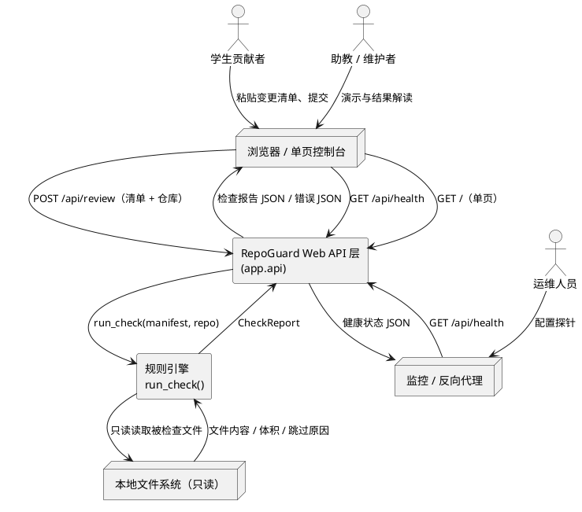
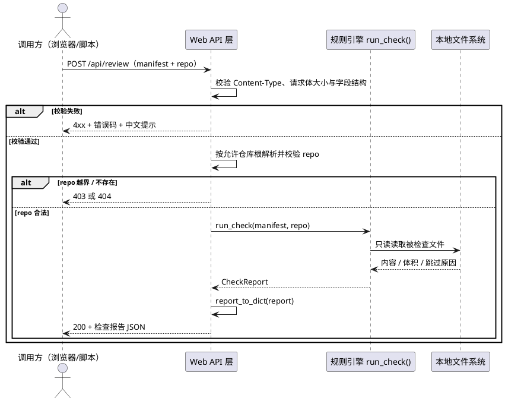
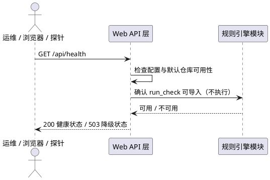
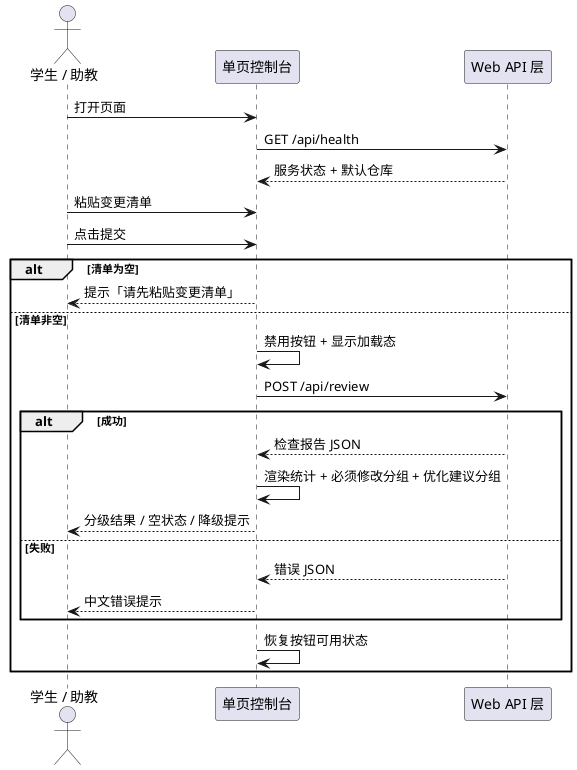
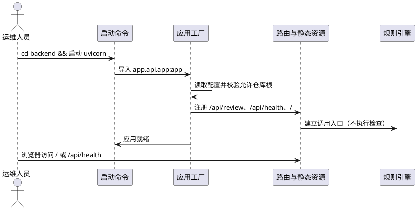

# **1. 组件定位**

本规格描述 RepoGuard 学习仓库质量守护系统中的「Web API 与单页控制台」组件（feature：`web_api`，阶段 2）。该组件建立在已交付的规则引擎（feature：`rules_engine`）之上，只承担 HTTP 协议适配与浏览器页面呈现，不重新实现任何检查规则。

> 复用基线（本次需求的唯一实现依据，禁止偏离）：
> 1. 需求：`.codeartsdoer/specs/rules_engine/spec.md`；
> 2. 设计：`.codeartsdoer/specs/rules_engine/design.md` 的 2.2（接口设计）、2.4.3（交付文件与函数签名）、2.7（错误处理与退出状态）；
> 3. 现有入口：`backend/app/core/rules/engine.py` 的 `run_check(manifest_text, repo_root, config=None) -> CheckReport`；
> 4. 现有 JSON 渲染：`backend/app/core/rules/common/report.py` 的 `report_to_dict(report) -> dict[str, object]` 与 `report_to_json(report) -> str`。

## **1.1 核心职责**

本组件负责把浏览器的检查请求转换为一次 `run_check()` 调用并把 `CheckReport` 原样返回为 JSON，同时提供一个零构建的单页控制台按「必须修改/优化建议」分组展示结果。

## **1.2 核心输入**

1. **检查请求（主要输入）**：来源为浏览器页面或运维脚本；内容为 HTTP `POST /api/review` 的 JSON 请求体，包含变更清单文本 `manifest` 与仓库路径 `repo`。
2. **健康探测请求**：来源为浏览器页面加载、运维监控或负载均衡探针；内容为无请求体的 HTTP `GET /api/health`。
3. **静态页面请求**：来源为浏览器；内容为对 `/` 与 `/api` 之外静态资源的 GET 请求。
4. **服务配置**：来源为进程环境变量或启动参数；内容为允许访问的仓库根白名单、默认仓库、请求大小上限、超时与并发上限、CORS 白名单。

## **1.3 核心输出**

1. **结构化检查报告响应（主要输出）**：返回给调用方的 JSON，字段与取值完全复用 `CheckReport` 的既有序列化结构（`status`、`summary`、`files`、`unparsed_lines`、`degraded_modules`、`warnings`），不新增、不改名、不嵌套包装。
2. **统一错误响应**：以稳定错误码与中文文案返回给调用方，包含 `error.code`、`error.message`、可选 `error.detail` 与 `request_id`，禁止包含堆栈与绝对路径。
3. **健康状态响应**：返回服务名称、版本、引擎可用性、服务状态与默认仓库标识。
4. **单页控制台**：返回给浏览器的 `index.html`，包含变更清单文本框、提交按钮、加载态、错误提示与分级结果区域。
5. **运行日志**：推送给运维的单行结构化日志，包含请求标识、耗时、状态码、错误码与报告统计，不包含清单正文与被检查文件内容。

## **1.4 职责边界**

1. **不复制检查逻辑**：禁止在 `backend/app/api/**` 或 `index.html` 中重新实现命名、代码、链接、敏感信息四类判定；任何检查结论必须来自 `run_check()`。
2. **不修改规则引擎**：禁止修改 `backend/app/core/rules/engine.py`、四个检查模块、`backend/app/core/rules/common/**` 与 `backend/app/core/rules/__init__.py` 的任何内容。
3. **不改变 CLI**：禁止改动 `python -m app.core.rules.engine` 的参数、默认值、退出码、stdout 文本/JSON 格式与 stderr 行为。
4. **不负责自动修复**：Web 层不得改写、移动、删除、重命名仓库中的任何文件。
5. **不负责 Git 操作**：不执行 git 命令、不解析 `.git`、不自行生成变更清单。
6. **不负责鉴权与多租户**：默认仅在回环地址提供服务且不提供登录；如需对外暴露，必须由上游反向代理完成鉴权，Web 层不实现账号体系与权限模型。
7. **不负责持久化**：不保存请求、报告、日志文件或审计库；报告只存在于单次响应中。
8. **不负责执行被检查代码**：不编译、不导入、不运行仓库内文件，不调用子进程执行任何用户内容。
9. **不负责联网**：除浏览器同源请求外，不发起任何外部网络访问，不探测链接可达性。
10. **不负责替代规则引擎的配置体系**：本阶段不接受自定义规则阈值；`config` 固定为默认配置，避免 Web 层成为第二套配置入口。

## **1.5 典型业务场景**

1. **学生提交前自检**：学生在浏览器打开控制台，把本次改动整理为变更清单粘贴到文本框，点击提交，等待检查完成后先看「必须修改」分组逐条修正，再看「优化建议」分组择优采纳。
2. **助教课堂演示**：助教在课堂现场粘贴一份典型错误清单，页面同时展示统计、按文件分组的问题与降级提示，用于讲解提交规范。
3. **运维健康探测**：运维通过监控系统或手动请求 `GET /api/health`，确认服务进程存活、规则引擎可导入、允许仓库根配置有效。
4. **本地接口联调**：下游系统直接调用 `POST /api/review`，按既有 `CheckReport` JSON 结构消费结果，不依赖页面。

# **2. 领域术语**

**Web API 层**
: Web API 层是 RepoGuard 中负责把 HTTP 请求转换为规则引擎调用、并把引擎结果转换为 HTTP 响应的适配层。

**单页控制台**
: 单页控制台是无需构建、由单个 `index.html` 文件构成的浏览器界面，用于粘贴变更清单并查看分级检查结果。

**检查请求**
: 检查请求是调用方发往 `POST /api/review` 的一次 HTTP 请求，必须携带变更清单与仓库路径。
: 备注：本文档中的「请求」若无特别说明，均指检查请求。

**检查报告**
: 检查报告是规则引擎一次执行产出的 `CheckReport`，包含执行状态、七项统计、按文件分组的问题、无法解析行、降级模块与提示信息。

**报告状态**
: 报告状态是检查报告的整体执行状态，仅取「正常」「部分降级」「输入错误」三个值，来源于规则引擎而非 Web 层判定。

**必须修改**
: 必须修改是问题级别取值之一，表示存在明确错误或安全风险，学生应在提交前处理。

**优化建议**
: 优化建议是问题级别取值之一，表示风格或习惯层面的改进项，学生可自主采纳。

**允许的仓库根**
: 允许的仓库根是服务端配置中明确列出、允许 Web 层读取的仓库目录，所有请求中的 `repo` 解析后必须落在其中。

**默认仓库**
: 默认仓库是允许的仓库根中预先指定、供页面在用户未显式填写时使用的仓库标识，响应中只允许出现其相对标识，不得暴露绝对路径。

**仓库相对路径**
: 仓库相对路径是变更清单中描述文件的路径，使用 `/` 分隔且不得以 `/`、盘符或 `..` 越出仓库根。

**路径越界**
: 路径越界是指请求中的 `repo` 或清单内路径解析后落在允许范围之外的情形，属于必须拒绝的安全事件。

**降级**
: 降级是指某个检查模块整体执行失败时，引擎仍返回其余模块结果并在报告中标注「结果可能不完整」的状态。

**请求标识**
: 请求标识是服务端为每次请求生成的短字符串，用于把响应、日志与错误排查关联起来，不包含用户身份信息。

# **3. 角色与边界**

## **3.1 核心角色**

1. 学生贡献者：在浏览器中粘贴变更清单、提交检查、阅读分级结果并在本地修正文件。
2. 课程助教 / 社团维护者：使用同一页面进行课堂演示或批量结果解读。
3. 运维人员：调用健康检查接口、查看运行日志、维护允许仓库根与启动参数配置。

## **3.2 外部系统**

1. 浏览器：承载单页控制台，向 Web API 层发起同源 `GET /`、`GET /api/health`、`POST /api/review` 请求。
2. 规则引擎（`app.core.rules.engine.run_check`）：Web API 层的唯一检查能力提供方，进程内同步调用并返回 `CheckReport`。
3. 本地文件系统（只读）：规则引擎从中读取被检查文件；Web 层不得直接读取被检查文件内容，仅可校验仓库目录存在性与路径归属。
4. 上游监控 / 负载均衡 / 反向代理（可选）：调用健康检查接口，或在对外暴露时提供鉴权与 TLS 终止。
5. 接口调用方（可选）：直接按 JSON 契约调用 `POST /api/review` 的脚本或系统。

## **3.3 交互上下文**



# **4. DFX约束**

## **4.1 性能**

1. `GET /api/health` 在服务正常时响应时间必须不超过 100 毫秒（不含网络传输）。
2. `POST /api/review` 必须复用规则引擎既有的性能预算：500 条变更、100 个可读文件时端到端不超过 10 秒；Web 层自身附加开销（序列化、协议处理）必须不超过 200 毫秒。
3. 单页控制台首屏在本地回环环境必须不超过 1 秒完成渲染，页面文件体积必须不超过 64 KB。
4. 单个服务实例默认最多同时执行 2 个检查请求，其余请求排队等待，排队等待上限 5 秒。
5. 单次检查请求的服务端超时上限默认 30 秒，超过后必须终止等待并返回超时错误。

## **4.2 可靠性**

1. 当规则引擎正常返回时，Web 层必须以 HTTP 200 返回完整报告，且报告内容必须与 `report_to_dict(run_check(...))` 逐字段一致。
2. 当规则引擎返回「部分降级」时，Web 层必须仍返回 HTTP 200，并在响应体中保留 `degraded_modules` 与 `warnings`，不得丢弃或改写。
3. 当规则引擎抛出未预期异常时，Web 层必须捕获并返回 HTTP 500 与中文错误响应，禁止把异常堆栈返回给调用方。
4. 当检查执行超过服务端超时上限时，Web 层必须返回 HTTP 504，不得无限期挂起连接。
5. 相同 `manifest` 与相同仓库内容在连续两次请求中必须产生相同的响应体（`request_id` 与时间字段除外），不得引入随机排序。
6. 健康检查不得调用 `run_check()`，不得扫描仓库文件，不得在仓库内写入任何内容。
7. 服务启动时若允许仓库根配置缺失或不合法，必须启动成功但健康状态为降级，并拒绝所有 review 请求（HTTP 503），不得静默放行任意路径。

## **4.3 安全性**

1. **仓库根白名单**：请求中的 `repo` 解析后必须位于服务端配置的允许仓库根之内，否则必须拒绝，禁止读取允许范围外的任何路径。
2. **路径越界拒绝**：`repo` 中只要出现 `..` 段、盘符路径、UNC 路径、设备路径（`\\?\`、`\\.\`）或指向允许根之外的符号链接，必须拒绝。
3. **只读**：Web 层不得对被检查仓库执行任何写操作；日志与缓存不得落在仓库内。
4. **不执行被检查代码**：禁止调用 `subprocess`、`os.system`、`exec`、`eval` 处理清单内容或文件内容。
5. **不联网**：服务运行时除同源浏览器请求外不得发起外部网络访问；页面不得加载任何外部 CDN、字体或统计脚本。
6. **输出脱敏**：错误响应与日志中不得出现绝对路径、完整凭据或清单正文；敏感信息脱敏由规则引擎完成，Web 层不得重新拼接原文。
7. **XSS 防护**：页面渲染必须使用文本节点赋值，禁止把服务端返回内容拼接进 `innerHTML`；禁止使用 `eval` 与 `new Function`。
8. **跨域限制**：默认不启用 CORS；确需跨域时必须使用精确 origin 白名单，禁止 `*` 与 `allow_credentials=True` 同时出现。
9. **暴露面**：默认只监听 `127.0.0.1`；对外暴露必须由反向代理提供鉴权与 TLS，本组件不内建登录。
10. **响应头**：所有响应必须包含 `X-Content-Type-Options: nosniff`，页面响应必须包含 `frame-ancestors 'none'` 级别的防嵌套策略。

## **4.4 可维护性**

1. 所有面向用户的错误文案必须使用简体中文，错误码使用稳定的大写英文常量，二者一一对应。
2. 每个响应必须携带 `request_id`，同一请求的日志与错误响应使用同一标识。
3. 运行日志必须为单行结构化格式，至少包含 `request_id`、`method`、`path`、`status_code`、`error_code`、`duration_ms`、`report_status`、`must_fix_count`。
4. 日志禁止记录变更清单正文、被检查文件内容、仓库绝对路径与完整凭据；`repo` 仅记录相对标识或哈希。
5. 检查逻辑只允许通过 `run_check()` 一个入口调用；新增检查能力必须先修改规则引擎规格，不得在 Web 层旁路实现。
6. 允许仓库根、默认仓库、请求上限、超时与并发上限必须集中配置，禁止散落在路由处理代码中。

## **4.5 兼容性**

1. **CLI 零变更**：`python -m app.core.rules.engine` 的参数、默认值、退出码（0/1/2/3）、stdout 文本与 JSON 格式、stderr 行为必须与阶段 1 完全一致。
2. **引擎零第三方依赖**：`app.core.rules` 及其子模块不得导入 `fastapi`、`uvicorn`、`httpx` 或任何 Web 依赖；未安装这些依赖时规则引擎与 CLI 必须仍可运行。
3. **Python 版本**：Web 层与规则引擎一致，要求 Python 3.10 及以上。
4. **操作系统**：必须在 Windows 与 Linux 上行为一致；仓库路径比较在 Windows 下必须大小写不敏感，响应中的路径统一使用 `/`。
5. **编码**：请求与响应统一 UTF-8；JSON 响应中文不得转义为 Unicode 序列；带 BOM 的清单由规则引擎按既有规则处理。
6. **浏览器**：支持 Chrome / Edge 最近两个大版本；不要求 IE 与移动端专用适配，但页面不得因小屏宽度产生横向溢出。

# **5. 核心能力**

## **5.1 检查请求处理（POST /api/review）**

### **5.1.1 业务规则**

1. **接口职责单一**：该接口必须只做请求校验、路径安全判定、调用 `run_check()` 与报告序列化，不得包含任何检查判定。
   a. 验收条件：When `POST /api/review` 收到合法请求，the Web API 层 shall 调用一次 `run_check(manifest, repo_root)` 并返回其 `report_to_dict()` 结果。
2. **请求方法限定**：该路径只接受 `POST`，其他方法必须返回 405。
   a. 验收条件：When a `GET /api/review` is received, the Web API 层 shall 返回 HTTP 405 且不执行检查。
3. **Content-Type 约束**：请求必须为 `application/json`（允许带 `charset=utf-8`），其他类型必须返回 415。
   a. 验收条件：When the request `Content-Type` is `text/plain`, the Web API 层 shall 返回 415 与错误码 `UNSUPPORTED_MEDIA_TYPE`。
4. **请求体结构**：请求体必须是 JSON 对象，且必须且只识别 `manifest` 与 `repo` 两个字段；未知字段必须忽略而不报错。
   a. 验收条件：When the request body contains an unknown field, the Web API 层 shall 忽略该字段并继续处理。
5. **manifest 必填与类型**：`manifest` 必须是字符串，缺失或类型错误必须返回 422；空字符串在结构上合法。
   a. 验收条件：When `manifest` is missing, the Web API 层 shall 返回 422 与错误码 `VALIDATION_ERROR`。
6. **manifest 长度上限**：`manifest` 字符数必须不超过 1,000,000，UTF-8 编码后必须不超过 2 MB，行数必须不超过 5,000；任一超限必须返回 413。
   a. 验收条件：When `manifest` exceeds 1,000,000 characters, the Web API 层 shall 返回 413 与错误码 `MANIFEST_TOO_LARGE`，且不得调用 `run_check()`。
7. **请求体大小上限**：整个请求体必须不超过 2 MB；超限必须返回 413，不得部分读取后继续处理。
   a. 验收条件：When `Content-Length` exceeds 2 MB, the Web API 层 shall 返回 413 与错误码 `REQUEST_TOO_LARGE`。
8. **空清单处理**：`manifest` 为空或仅含空白/注释行时，必须返回 HTTP 200，响应 `status` 为「正常」、统计全零，并保留引擎给出的中文提示。
   a. 验收条件：When `manifest` is an empty string, the Web API 层 shall 返回 HTTP 200 且 `summary.entry_count == 0`。
9. **repo 必填**：`repo` 必须是字符串，缺失、类型错误或去空白后为空必须返回 422 或 400。
   a. 验收条件：When `repo` is missing, the Web API 层 shall 返回 422 且不访问文件系统。
10. **repo 长度与控制字符**：`repo` 长度必须不超过 512 字符，且不得包含 NUL 或控制字符；违规必须返回 400。
    a. 验收条件：When `repo` contains a NUL character, the Web API 层 shall 返回 400 与错误码 `INVALID_REPO_PATH`。
11. **repo 拒绝 URL 形式**：`repo` 不得包含 `://`；违规必须返回 400，禁止把 URL 解释为网络路径。
    a. 验收条件：When `repo` is `http://example.com/repo`, the Web API 层 shall 返回 400 且不发起任何网络请求。
12. **repo 白名单约束**：`repo` 为绝对路径时，解析为真实路径后必须位于允许的仓库根之内；为相对路径时，必须相对默认仓库解析并仍位于允许根之内；否则返回 403。
    a. 验收条件：When `repo` resolves outside every allowed repository root, the Web API 层 shall 返回 403 与错误码 `REPO_FORBIDDEN`。
13. **禁止上跳**：`repo` 中只要出现 `..` 路径段，无论最终解析结果是否仍在允许根内，必须直接拒绝并返回 403。
    a. 验收条件：When `repo` is `../demo-repo`, the Web API 层 shall 返回 403 且不访问文件系统。
14. **符号链接防护**：`repo` 解析真实路径后若逃出允许根（含符号链接指向外部），必须返回 403。
    a. 验收条件：When `repo` is a symlink pointing outside the allowed root, the Web API 层 shall 返回 403。
15. **目录存在性**：通过白名单校验后，`repo` 必须存在且为目录，否则返回 404；该检查不得读取目录内任何文件。
    a. 验收条件：When `repo` points to a non-existent directory, the Web API 层 shall 返回 404 与错误码 `REPO_NOT_FOUND`。
16. **报告结构复用**：成功响应体必须与 `report_to_dict()` 的键集合、层级和取值完全一致，禁止外层再包 `data`、`result` 等字段。
    a. 验收条件：When a review succeeds, the Web API 层 shall 返回 `status`、`summary`、`files`、`unparsed_lines`、`degraded_modules`、`warnings` 六个顶层字段且无额外业务字段。
17. **报告状态不转换**：引擎返回「部分降级」时必须仍为 HTTP 200，`status` 保持「部分降级」，禁止映射为 HTTP 500 或删除降级信息。
    a. 验收条件：When the engine returns `status="部分降级"`, the Web API 层 shall 返回 HTTP 200 且保持该 `status` 原值。
18. **输入错误兜底**：若引擎在 Web 层校验后仍返回「输入错误」（如仓库被并发删除），必须返回 HTTP 200 并保留 `status="输入错误"` 与中文 `warnings`；不得改写成 500。
    a. 验收条件：When the engine returns `status="输入错误"`, the Web API 层 shall 返回 HTTP 200 且不丢失 `warnings`。
19. **只调用一次**：一次 HTTP 请求必须最多调用 `run_check()` 一次，禁止重试导致重复扫描。
    a. 验收条件：When a request is processed, the Web API 层 shall 对 `run_check()` 的调用次数恰好为 1。
20. **禁止项**：禁止在 Web 层对 `findings` 重新排序、过滤、合并、补全或改写级别；禁止把必须修改项降级为优化建议。
    a. 验收条件：When the engine returns N findings, the Web API 层 shall 原样返回这 N 条且顺序不变。

### **5.1.2 交互流程**



### **5.1.3 异常场景**

1. **请求体不是合法 JSON**
   a. 触发条件：请求体为空、被截断或无法解析为 JSON 对象。
   b. 系统行为：不进入字段校验与路径校验，不调用规则引擎；记录一条不含正文的告警日志。
   c. 用户感知：HTTP 400，`error.code = INVALID_JSON`，提示「请求内容不是合法的 JSON，请检查提交数据」。

2. **字段类型错误**
   a. 触发条件：`manifest` 或 `repo` 不是字符串，或请求体不是对象。
   b. 系统行为：由请求模型统一拦截，不调用规则引擎。
   c. 用户感知：HTTP 422，`error.code = VALIDATION_ERROR`，提示中说明具体字段名。

3. **清单超限**
   a. 触发条件：`manifest` 字符数、字节数或行数超过上限。
   b. 系统行为：在进入规则引擎前终止，不读取仓库，不产生部分检查结果。
   c. 用户感知：HTTP 413，`error.code = MANIFEST_TOO_LARGE`，提示「变更清单过长，请分批提交」。

4. **仓库路径越界**
   a. 触发条件：`repo` 为绝对路径且不在允许根内、含 `..`、为盘符/UNC/设备路径，或符号链接逃逸。
   b. 系统行为：拒绝并终止，禁止对该路径执行 `stat`、`open` 或目录遍历；记录安全事件日志（不含绝对路径）。
   c. 用户感知：HTTP 403，`error.code = REPO_FORBIDDEN`，提示「仓库路径不在服务端允许范围内」。

5. **仓库不存在或不是目录**
   a. 触发条件：`repo` 通过白名单校验，但路径不存在、已删除或指向普通文件。
   b. 系统行为：终止请求，不调用规则引擎。
   c. 用户感知：HTTP 404，`error.code = REPO_NOT_FOUND`，提示「仓库目录不存在或不可用」。

6. **并发已满**
   a. 触发条件：同时执行的检查请求达到上限，且排队等待超过 5 秒。
   b. 系统行为：不再入队，立即返回，避免连接堆积。
   c. 用户感知：HTTP 429，`error.code = REVIEW_BUSY`，提示「当前检查请求较多，请稍后重试」。

7. **检查超时**
   a. 触发条件：`run_check()` 执行超过服务端超时上限（默认 30 秒）。
   b. 系统行为：停止等待并返回超时响应；后台执行不强制终止，以避免破坏只读语义，但结果丢弃。
   c. 用户感知：HTTP 504，`error.code = REVIEW_TIMEOUT`，提示「检查耗时过长，请缩小变更清单后重试」。

8. **规则引擎未预期异常**
   a. 触发条件：`run_check()` 或其导入过程抛出未捕获异常。
   b. 系统行为：捕获异常，记录带 `request_id` 的服务端日志（含堆栈，仅服务端可见），不向调用方泄露堆栈。
   c. 用户感知：HTTP 500，`error.code = INTERNAL_ERROR`，提示「服务内部错误，本次检查未完成，请稍后重试」。

9. **响应序列化异常**
   a. 触发条件：报告对象无法转换为 JSON（正常情况下不应发生）。
   b. 系统行为：改为返回统一错误响应，不返回半成品 JSON。
   c. 用户感知：HTTP 500，`error.code = INTERNAL_ERROR`，提示「检查结果无法返回，请稍后重试」。

## **5.2 服务健康查询（GET /api/health）**

### **5.2.1 业务规则**

1. **接口职责**：该接口必须只返回服务状态信息，禁止调用 `run_check()`、禁止扫描仓库、禁止读取被检查文件。
   a. 验收条件：When `GET /api/health` is received, the Web API 层 shall 在 100 毫秒内返回且不触发任何文件扫描。
2. **方法限定**：只接受 `GET`，其他方法必须返回 405。
   a. 验收条件：When a `POST /api/health` is received, the Web API 层 shall 返回 HTTP 405。
3. **响应字段**：响应必须包含 `status`、`service`、`version`、`engine`、`default_repo`、`allowed_repo_root_count`、`time` 七个字段。
   a. 验收条件：When the service is healthy, the Web API 层 shall 返回 HTTP 200 与完整七字段。
4. **状态取值**：`status` 只能是 `ok` 或 `degraded`；`engine` 只能是 `available` 或 `unavailable`。
   a. 验收条件：When the engine module can be imported and repository roots are configured, the Web API 层 shall 返回 `status="ok"` 与 `engine="available"`。
5. **降级判定**：引擎导入失败、允许仓库根为空、默认仓库不存在或不是目录时，`status` 必须为 `degraded`。
   a. 验收条件：When no allowed repository root is configured, the Web API 层 shall 返回 `status="degraded"` 与 HTTP 503。
6. **默认仓库标识**：`default_repo` 必须是相对标识或 `null`，禁止返回绝对路径。
   a. 验收条件：When the default repository is `demo-repo`, the Web API 层 shall 返回 `"default_repo": "demo-repo"` 且响应中不出现盘符或绝对路径。
7. **计数口径**：`allowed_repo_root_count` 必须是有效允许根的数量，取值为不小于 0 的整数。
   a. 验收条件：When two valid roots are configured, the Web API 层 shall 返回 `2`。
8. **不缓存**：响应必须包含 `Cache-Control: no-store`，禁止被代理或浏览器缓存。
   a. 验收条件：When health is called twice, the Web API 层 shall 每次都重新计算状态并返回 `no-store`。
9. **时间字段**：`time` 必须是 UTC 的 ISO 8601 字符串，仅用于观测，不参与业务判定。
   a. 验收条件：When health returns, the Web API 层 shall 返回可被标准 ISO 8601 解析的 UTC 时间。
10. **无敏感信息**：响应不得包含环境变量原文、服务器路径、依赖版本清单或仓库文件列表。
    a. 验收条件：When health returns, the Web API 层 shall 不返回任何绝对路径与文件内容。

### **5.2.2 交互流程**



### **5.2.3 异常场景**

1. **引擎导入失败**
   a. 触发条件：规则引擎包缺失、依赖损坏或被误删。
   b. 系统行为：服务仍可启动并响应健康检查；review 请求返回 503。
   c. 用户感知：HTTP 503，`status="degraded"`、`engine="unavailable"`，提示「规则引擎当前不可用」。

2. **允许仓库根配置为空**
   a. 触发条件：未配置任何允许仓库根，或配置的路径全部不存在。
   b. 系统行为：不推断默认路径、不放宽白名单；所有 review 请求被拒绝。
   c. 用户感知：HTTP 503，`status="degraded"`，提示「未配置可用的仓库目录」。

3. **默认仓库不存在**
   a. 触发条件：默认仓库标识指向的目录被删除或改名。
   b. 系统行为：健康状态降级，但允许根中其他仓库仍可用于 review。
   c. 用户感知：HTTP 503 或 200 且 `status="degraded"`，`default_repo` 仍返回原标识以便排查。

## **5.3 检查结果页面呈现（index.html）**

### **5.3.1 业务规则**

1. **单文件零构建**：页面必须是单个 `backend/app/static/index.html`，原生 HTML + CSS + JavaScript，禁止 npm、打包工具、框架运行时与构建产物。
   a. 验收条件：When the page is served, the Web API 层 shall 只返回一个 HTML 文件且不需要任何构建步骤。
2. **无外部依赖**：页面不得引用任何外部 CDN 脚本、样式、字体、图片或统计服务；所有资源必须内联或同源。
   a. 验收条件：When the HTML is inspected, the Web API 层 shall 不存在指向第三方域名的 `src`、`href`、`url()` 或 `fetch`。
3. **核心控件**：页面必须提供变更清单多行文本框与提交按钮，并为文本框设置 1,000,000 字符上限提示。
   a. 验收条件：When the page loads, the Web API 层 shall 渲染可输入的文本框与可点击的提交按钮。
4. **仓库参数入口**：默认不要求用户填写 `repo`；页面必须从 `GET /api/health` 的 `default_repo` 取值，并在「高级设置」折叠区提供可选的仓库覆盖输入。
   a. 验收条件：When `default_repo` is available, the page shall 在用户不填写仓库时使用该默认值提交。
5. **本地空值提示**：文本框为空或仅含空白时，点击提交必须显示「请先粘贴变更清单」且不发起请求。
   a. 验收条件：When the textarea is blank, the page shall 阻止提交并显示中文提示。
6. **提交行为**：点击提交必须向同源 `POST /api/review` 发送 JSON 请求体，字段为 `manifest` 与 `repo`，禁止添加其他业务字段。
   a. 验收条件：When the user submits, the page shall 发起一次同源 `POST /api/review` 请求。
7. **加载态**：请求进行中必须禁用提交按钮、展示「检查中…」提示，并禁止重复提交；请求结束后必须恢复可用状态。
   a. 验收条件：While the request is pending, the page shall 保持按钮禁用且不产生第二次请求。
8. **错误提示**：HTTP 非 2xx、网络失败、响应不是合法 JSON 时，必须在页面顶部显示中文错误信息；优先展示 `error.message`，其次展示 HTTP 状态码与通用文案。
   a. 验收条件：If the server returns 403, the page shall 显示服务端返回的中文提示并恢复提交按钮。
9. **统计展示**：成功响应后必须展示条目总数、问题总数、必须修改数量、优化建议数量、跳过文件数、降级模块数与无法解析行数。
   a. 验收条件：When a report is rendered, the page shall 展示与 `summary` 完全一致的七项统计。
10. **分级分组**：问题必须按「必须修改」与「优化建议」两个分组展示，且「必须修改」组必须位于「优化建议」组之前；分组内部必须按文件路径分组，保留 `line_no`、`message`、`suggestion`、`rule_id`。
    a. 验收条件：When findings contain both levels, the page shall 先渲染必须修改分组，再渲染优化建议分组。
11. **空结果**：报告 `issue_count == 0` 且无跳过、无降级时，必须显示「未发现问题」空状态；不得渲染空白页面。
    a. 验收条件：When no issues are found, the page shall 显示明确的中文空状态提示。
12. **单组为空**：某一分组没有条目时，必须显示「无」或隐藏该组标题下的列表，但不得省略另一组内容。
    a. 验收条件：When only suggestions exist, the page shall 在必须修改组显示「无」并正常列出优化建议。
13. **降级与提示**：`status == "部分降级"`、`degraded_modules` 非空或 `warnings` 非空时，必须在结果顶部显示「结果可能不完整」提示，并列出模块名与原因。
    a. 验收条件：When `degraded_modules` is non-empty, the page shall 显示降级提示且不清空已返回的问题列表。
14. **跳过与无法解析**：文件 `skip_reason` 必须展示在对应文件条目上；`unparsed_lines` 必须单独列出，包含行号、原文与原因。
    a. 验收条件：When `unparsed_lines` is non-empty, the page shall 展示每一项的行号、原文与原因。
15. **安全渲染**：所有来自服务端的文本必须通过文本节点写入，禁止拼接为 HTML；禁止 `innerHTML`、`insertAdjacentHTML`、`document.write`、`eval`、`new Function`。
    a. 验收条件：When a finding contains `<script>alert(1)</script>`, the page shall 以纯文本显示该内容而不执行脚本。
16. **编码与可访问性**：页面必须声明 UTF-8 与 viewport；表单控件必须有可读标签；加载与错误区域必须使用 `aria-live="polite"`；交互必须支持键盘操作。
    a. 验收条件：When the page is inspected, the Web API 层 shall 存在 UTF-8 声明、`label` 关联与 `aria-live` 区域。
17. **响应式基本可用**：在 360 px 宽度下不得出现横向滚动条，长路径与长消息必须自动换行。
    a. 验收条件：When the viewport is 360 px wide, the page shall 不产生水平滚动。
18. **禁止项**：禁止页面直接展示服务端返回的原始 JSON 作为唯一结果；禁止自动轮询 review 接口；禁止把 `repo` 输入写入 localStorage 或 URL 查询参数。
    a. 验收条件：When a review completes, the page shall 以分组视图展示结果且不自动重复提交。

### **5.3.2 交互流程**



### **5.3.3 异常场景**

1. **健康检查失败**
   a. 触发条件：页面加载时 `GET /api/health` 返回 503 或网络失败。
   b. 系统行为：页面仍可手动提交；在顶部显示「服务状态异常」；默认仓库为空时要求用户在高级设置中填写仓库。
   c. 用户感知：页面可继续操作，错误区域显示中文说明。

2. **提交返回 413**
   a. 触发条件：清单超过服务端上限。
   b. 系统行为：保留用户输入内容不清空，恢复按钮可用。
   c. 用户感知：提示「变更清单过长，请分批提交」。

3. **提交返回 403 / 404**
   a. 触发条件：仓库路径越界或目录不存在。
   b. 系统行为：不修改页面中已有结果之外的状态；展示服务端中文提示，引导检查仓库设置。
   c. 用户感知：错误区域显示「仓库路径不在服务端允许范围内」或「仓库目录不存在或不可用」。

4. **响应不是 JSON**
   a. 触发条件：反向代理返回 HTML 错误页或连接被中断。
   b. 系统行为：按文本读取失败处理，不执行任何 HTML 注入。
   c. 用户感知：提示「服务返回了无法识别的内容，请检查服务状态」。

5. **长文本导致渲染卡顿**
   a. 触发条件：单个报告包含大量问题（如超过 500 条）。
   b. 系统行为：页面必须分批追加 DOM 或对同一文件内条目做折叠展示，保证主线程不长时间阻塞。
   c. 用户感知：页面保持可滚动，统计与分组标题优先可见。

## **5.4 服务访问装配**

### **5.4.1 业务规则**

1. **应用工厂**：必须提供 `create_app(settings=None) -> FastAPI` 工厂与模块级 `app` 实例，便于测试注入配置与生产直接启动。
   a. 验收条件：When tests call `create_app(settings)`, the Web API 层 shall 返回一个可处理请求的独立应用实例。
2. **路由前缀**：业务接口必须统一位于 `/api` 前缀下；`/` 与静态资源不得与 `/api/*` 冲突。
   a. 验收条件：When requesting `/api/health`, the Web API 层 shall 命中健康检查而不是静态文件。
3. **静态挂载**：`/` 必须返回 `backend/app/static/index.html`；`/static/*` 必须由静态文件处理返回同目录资源。
   a. 验收条件：When requesting `/`, the Web API 层 shall 返回 `text/html` 且内容为单页控制台。
4. **静态文件缺失**：`index.html` 缺失时必须以中文说明返回 503，禁止返回目录列表或 500 堆栈。
   a. 验收条件：If `index.html` is missing, the Web API 层 shall 返回 503 与中文提示。
5. **默认监听范围**：默认启动参数必须只绑定 `127.0.0.1:8000`；不得默认绑定 `0.0.0.0`。
   a. 验收条件：When started with the documented command, the Web API 层 shall 仅监听回环地址。
6. **CORS 默认关闭**：同源页面场景不得启用 CORS；确需跨域时必须通过配置提供精确 origin 列表。
   a. 验收条件：When no CORS origin is configured, the Web API 层 shall 不返回 `Access-Control-Allow-Origin` 响应头。
7. **CORS 约束**：启用时禁止 `allow_origins=["*"]` 与 `allow_credentials=True` 组合，方法仅允许 `GET`/`POST`，请求头仅允许 `Content-Type`。
   a. 验收条件：When CORS is enabled, the Web API 层 shall 只允许配置中列出的 origin。
8. **统一异常处理**：必须注册请求校验异常、路径校验异常与兜底异常处理器，全部输出统一错误结构。
   a. 验收条件：When any unhandled exception occurs, the Web API 层 shall 返回 `error.code`、`error.message` 与 `request_id`。
9. **请求标识**：每个响应必须生成并返回 `request_id`，同一请求的日志与错误体使用同一值。
   a. 验收条件：When a request completes, the Web API 层 shall 在响应头或错误体中携带同一个 `request_id`。
10. **启动可诊断**：启动日志必须输出监听地址、允许仓库根数量与默认仓库标识，不得输出绝对路径。
    a. 验收条件：When the service starts, the Web API 层 shall 打印可判断配置是否生效的中文启动信息。

### **5.4.2 交互流程**



### **5.4.3 异常场景**

1. **端口被占用**
   a. 触发条件：启动时 8000 端口已被其他进程监听。
   b. 系统行为：进程启动失败并退出，不自动改端口。
   c. 用户感知：启动日志中出现中文说明，运维需更换端口或释放占用。

2. **允许仓库根配置错误**
   a. 触发条件：配置的路径不存在、不是目录或不可读。
   b. 系统行为：启动不失败；该根被视为无效并从可用根中剔除；健康状态降级。
   c. 用户感知：健康检查显示 `status="degraded"`，启动日志列出失效根的数量。

3. **静态目录缺失**
   a. 触发条件：`backend/app/static/` 或 `index.html` 未部署。
   b. 系统行为：API 接口仍可用；页面请求返回 503 中文提示。
   c. 用户感知：浏览器显示「页面资源缺失，请检查部署」。

## **5.5 依赖与兼容性约束**

### **5.5.1 依赖版本约束**

1. **Web 运行依赖**：`backend/requirements.txt` 必须新增 `fastapi` 与 `uvicorn`，并固定到精确版本（形如 `fastapi==0.115.6`、`uvicorn==0.34.0`），禁止使用 `>=`、`~=` 或 `latest`。
   a. 验收条件：When `requirements.txt` is parsed, the Web API 层 shall 发现 fastapi 与 uvicorn 均带 `==` 精确版本号。
2. **测试依赖**：`fastapi.testclient.TestClient` 需要 `httpx`，必须在 `requirements.txt` 的测试依赖段固定版本（建议 `httpx==0.28.1`）并注明仅测试使用。
   a. 验收条件：When running API tests in a clean environment, the Web API 层 shall 能通过 `pip install -r requirements.txt` 获得 TestClient 所需依赖。
3. **分段标注**：`requirements.txt` 必须用注释分段，明显区分「规则引擎（零第三方依赖）」「Web API 运行依赖」「仅测试依赖」。
   a. 验收条件：When the file is inspected, the Web API 层 shall 能一眼区分三类依赖。
4. **引擎零依赖不变量**：规则引擎目录下不得出现任何 `fastapi`、`uvicorn`、`httpx`、`starlette`、`pydantic` 导入。
   a. 验收条件：When scanning `backend/app/core/rules/**/*.py`, the Web API 层 shall 找到 0 处 Web 框架导入。
5. **版本可安装性**：固定版本必须在 Python 3.10+ 的官方 PyPI 源可安装；若内网源缺失该版本，必须选择同一主版本下的可用补丁并更新本文档的版本记录，不得使用未经验证的 `latest`。
   a. 验收条件：When installing from the configured index, the Web API 层 shall 安装成功且 `import fastapi` 可用。

### **5.5.2 与既有规则引擎的兼容约束**

1. **入口不变**：Web 层必须直接导入并调用 `backend/app/core/rules/engine.py` 的 `run_check(manifest_text, repo_root, config=None)`；禁止另建检查入口。
   a. 验收条件：When the API handles a review, the Web API 层 shall 调用 `app.core.rules.engine.run_check`。
2. **禁止修改引擎**：`engine.py`、四个检查模块、`common/**`、`rules/__init__.py` 必须零改动。
   a. 验收条件：When comparing with the phase-1 baseline, the Web API 层 shall 不产生任何引擎文件差异。
3. **CLI 完全不变**：`python -m app.core.rules.engine` 的参数名、必填性、默认值、帮助文案、退出码（0/1/2/3）、stdout 文本/JSON 结构、stderr 行为必须与阶段 1 一致。
   a. 验收条件：When running the phase-1 CLI command after the Web layer is added, the Web API 层 shall 得到逐字节一致的 stdout 与相同退出码。
4. **不 monkeypatch 生产路径**：生产代码禁止替换、包装或改写引擎内部函数；测试仅允许为「降级/超时」用例注入替身，且不得修改引擎源码。
   a. 验收条件：When the service runs normally, the Web API 层 shall 使用真实 `run_check` 执行检查。
5. **配置不旁路**：Web 层不得通过环境变量、请求字段或配置文件改变规则阈值；`config` 参数必须传 `None`（使用引擎默认配置）。
   a. 验收条件：When a review is executed, the Web API 层 shall 以 `config=None` 调用 `run_check()`。

### **5.5.3 兼容性异常场景**

1. **引擎缺失**
   a. 触发条件：`backend/app/core/rules/` 被误删或导入报错。
   b. 系统行为：服务可启动但 review 返回 503，健康检查降级。
   c. 用户感知：`error.code = ENGINE_UNAVAILABLE`，提示「规则引擎当前不可用」。

2. **依赖版本冲突**
   a. 触发条件：环境中 Pydantic 或 Starlette 版本与固定的 FastAPI 不兼容。
   b. 系统行为：启动失败并输出中文依赖说明，不尝试降级运行。
   c. 用户感知：启动日志提示按 `requirements.txt` 重建虚拟环境。

3. **CLI 被间接影响**
   a. 触发条件：新增依赖改变了标准库模块解析或环境变量。
   b. 系统行为：以阶段 1 CLI 回归测试为准，任何差异视为不通过。
   c. 用户感知：`python -m app.core.rules.engine` 输出与退出码必须完全一致。

## **5.6 测试要求**

### **5.6.1 测试原则**

1. 测试必须可在未安装 Web 依赖时跳过 Web 相关用例，但规则引擎测试不得被 Web 依赖阻断。
2. API 测试必须使用临时目录构造仓库，禁止依赖开发者本机路径与 `demo-repo` 的具体内容（可保留一条端到端冒烟用例）。
3. 每个用例必须独立创建与清理临时目录，禁止用例间共享可变状态。
4. 错误码与 HTTP 状态码必须逐项断言，禁止只断言 `status_code >= 400`。
5. 页面验收以人工清单为主，自动测试只校验关键元素存在与无外链。

### **5.6.2 API 单元测试**

1. 健康检查正常、降级、方法不允许。
2. 正常 review（含必须修改与优化建议两类问题）与空清单 review。
3. 非法 repo（越界、`..`、不存在、符号链接逃逸、URL、NUL）。
4. 超大 manifest 与超大请求体。
5. 非法 JSON、错误 Content-Type、字段缺失。
6. 引擎降级、引擎异常、超时的降级行为。
7. 响应结构兼容性：键集合与 `report_to_dict()` 完全一致。
8. CLI 回归：退出码与输出格式不变。
9. 引擎目录零 Web 依赖导入。

### **5.6.3 页面人工验收**

1. 首屏可正常打开，无外部网络请求（开发者工具 Network 面板仅同源）。
2. 空文本框提交被本地拦截。
3. 提交后按钮禁用并显示加载态，完成后恢复。
4. 同时含两类问题时，必须修改分组在前、优化建议分组在后。
5. 无问题时显示明确空状态。
6. 服务端返回 403/413 时显示中文错误，输入内容不丢失。
7. 清单中含 `<script>` 文本时按纯文本展示且不弹窗。
8. 360 px 宽度下无横向滚动。

# **6. 数据约束**

## **6.1 检查请求（ReviewRequest）**

1. **manifest**：必填，字符串；长度 0～1,000,000 字符；UTF-8 编码后不超过 2 MB；行数不超过 5,000；允许空串；不得为 `null`。
2. **repo**：必填，字符串；去首尾空白后长度 1～512 字符；不得含 NUL 或控制字符；不得含 `://`；不得含 `..` 路径段；必须是允许仓库根内的绝对路径或相对默认仓库的相对路径。
3. **未知字段**：允许出现但必须被忽略，不参与处理，不写入日志。
4. **字段顺序**：不要求，JSON 对象顺序不影响行为。
5. **Content-Type**：必须为 `application/json`，可带 `charset=utf-8`。

## **6.2 检查报告响应（CheckReport）**

响应体必须直接复用规则引擎既有序列化结构，字段与约束如下：

1. **status**：必填，字符串，仅取「正常」「部分降级」「输入错误」。
2. **summary**：必填，对象，包含 `entry_count`、`issue_count`、`must_fix_count`、`suggestion_count`、`skipped_file_count`、`degraded_module_count`、`unparsed_line_count` 七项，均为不小于 0 的整数；必须满足 `issue_count == must_fix_count + suggestion_count`。
3. **files**：必填，数组；每项包含 `file_path`、`status`（A/M/D）、`duplicate_count`、`skip_reason`（可为 `null`）、`findings`。
4. **files[].findings**：必填，数组；每项包含 `level`（必须修改/优化建议）、`file_path`、`message`、`suggestion`、`rule_id`、`line_no`（可为 `null`）、`excerpt`（可为 `null`）。
5. **unparsed_lines**：必填，数组；每项包含 `line_no`、`raw`、`reason`；无内容时为空数组。
6. **degraded_modules**：必填，数组；每项包含 `module`、`reason`；无降级时为空数组。
7. **warnings**：必填，字符串数组；无提示时为空数组。
8. **字段完整性**：空结果也必须返回上述六个顶层字段，禁止省略字段或返回 `null` 作为整个响应。
9. **编码**：`ensure_ascii=False` 语义，中文不转义；响应头 `Content-Type: application/json; charset=utf-8`。
10. **禁止项**：禁止新增 `data`、`result`、`code` 等外层包装字段；禁止重命名既有字段。

## **6.3 错误响应（ErrorResponse）**

1. **error**：必填，对象，包含 `code` 与 `message`。
2. **error.code**：必填，稳定大写英文常量，取值为 `INVALID_JSON`、`INVALID_REPO_PATH`、`REPO_FORBIDDEN`、`REPO_NOT_FOUND`、`MANIFEST_TOO_LARGE`、`REQUEST_TOO_LARGE`、`UNSUPPORTED_MEDIA_TYPE`、`VALIDATION_ERROR`、`REVIEW_TIMEOUT`、`REVIEW_BUSY`、`ENGINE_UNAVAILABLE`、`INTERNAL_ERROR` 之一。
3. **error.message**：必填，简体中文陈述句，面向用户可读，不得包含英文异常类名。
4. **error.detail**：可选，字符串或 `null`；只允许包含字段名、用户输入的脱敏片段或规则说明，禁止包含绝对路径、堆栈、文件内容。
5. **request_id**：必填，字符串，长度 8～64，仅含字母、数字与连字符。
6. **禁止项**：禁止返回原始异常对象、`traceback`、SQL/文件系统路径与服务器版本详情。

## **6.4 健康响应（HealthResponse）**

1. **status**：必填，字符串，仅取 `ok` 或 `degraded`。
2. **service**：必填，固定为 `repoguard-web-api`。
3. **version**：必填，字符串，语义化版本，阶段 2 固定为 `1.0.0`。
4. **engine**：必填，字符串，仅取 `available` 或 `unavailable`。
5. **default_repo**：必填，字符串或 `null`；只允许相对标识，不得为绝对路径。
6. **allowed_repo_root_count**：必填，整数，不小于 0。
7. **time**：必填，UTC ISO 8601 字符串。
8. **禁止项**：禁止包含环境变量原文、绝对路径、依赖清单、仓库文件列表。

## **6.5 Web 服务配置（WebSettings）**

1. **allowed_repo_roots**：必填，字符串元组；每项必须是存在且可读的目录；为空时服务降级。
2. **default_repo**：可选，字符串或 `null`；必须是某个允许根的相对标识，且该目录必须存在。
3. **max_manifest_chars**：可选，整数，默认 1,000,000，取值 1～2,000,000。
4. **max_manifest_lines**：可选，整数，默认 5,000，取值 1～20,000。
5. **max_request_bytes**：可选，整数，默认 2,097,152（2 MB），取值 64 KB～16 MB。
6. **review_timeout_seconds**：可选，浮点数，默认 30，取值 1～120。
7. **review_max_concurrency**：可选，整数，默认 2，取值 1～8。
8. **queue_timeout_seconds**：可选，浮点数，默认 5，取值 0～30。
9. **cors_origins**：可选，字符串元组，默认空；每项必须是完整 origin（含协议与端口），禁止 `*`。
10. **static_dir**：可选，字符串，默认为 `backend/app/static` 的解析路径；必须包含 `index.html`。

# **7. 接口契约与状态码映射**

## **7.1 POST /api/review**

| 项 | 约定 |
|----|------|
| 方法与路径 | `POST /api/review` |
| 请求头 | `Content-Type: application/json`（必需）、`Accept: application/json`（建议） |
| 请求体 | `{"manifest": "<变更清单文本>", "repo": "<仓库路径>"}` |
| 成功响应 | HTTP 200，响应体为 `report_to_dict(run_check(...))` 原样结构 |
| 失败响应 | HTTP 4xx/5xx，响应体为统一 `ErrorResponse` |
| 幂等性 | 读操作，同一输入与仓库内容产生相同业务结果 |
| 缓存 | 禁止缓存，响应头 `Cache-Control: no-store` |
| 认证 | 默认无；对外暴露由反向代理负责 |

## **7.2 GET /api/health**

| 项 | 约定 |
|----|------|
| 方法与路径 | `GET /api/health` |
| 请求体 | 无 |
| 成功响应 | HTTP 200，`HealthResponse` |
| 降级响应 | HTTP 503，`HealthResponse` + 统一错误字段说明 |
| 缓存 | `Cache-Control: no-store` |
| 副作用 | 无文件扫描、无引擎执行、无状态变更 |

## **7.3 HTTP 状态码与错误码映射**

| HTTP | error.code | 触发条件 | 中文提示要点 |
|------|-----------|---------|-------------|
| 400 | `INVALID_JSON` | 请求体为空、截断或非 JSON 对象 | 请求内容不是合法的 JSON |
| 400 | `INVALID_REPO_PATH` | `repo` 为空、超长、含 NUL/控制字符、含 `://` | 仓库路径格式不合法 |
| 403 | `REPO_FORBIDDEN` | 越出允许根、含 `..`、盘符/UNC/设备路径、符号链接逃逸 | 仓库路径不在服务端允许范围内 |
| 404 | `REPO_NOT_FOUND` | 白名单内路径不存在或不是目录 | 仓库目录不存在或不可用 |
| 405 | `METHOD_NOT_ALLOWED` | 非 POST 访问 review、非 GET 访问 health | 请求方法不被支持 |
| 413 | `MANIFEST_TOO_LARGE` | 清单字符、字节或行数超限 | 变更清单过长，请分批提交 |
| 413 | `REQUEST_TOO_LARGE` | 请求体超过 2 MB | 请求内容过大 |
| 415 | `UNSUPPORTED_MEDIA_TYPE` | Content-Type 非 application/json | 请求类型不支持，请使用 JSON |
| 422 | `VALIDATION_ERROR` | 字段缺失、类型错误、请求体结构不合法 | 请求参数不完整或类型错误 |
| 429 | `REVIEW_BUSY` | 并发已满且排队超时 | 当前检查请求较多，请稍后重试 |
| 500 | `INTERNAL_ERROR` | 引擎外未预期异常、序列化失败 | 服务内部错误，本次检查未完成 |
| 503 | `ENGINE_UNAVAILABLE` | 引擎不可导入或允许根配置为空 | 规则引擎当前不可用 / 未配置可用仓库目录 |
| 503 | `STATIC_NOT_FOUND` | `index.html` 缺失 | 页面资源缺失，请检查部署 |
| 504 | `REVIEW_TIMEOUT` | 检查超过服务端超时上限 | 检查耗时过长，请缩小变更清单后重试 |

> 说明：规则引擎返回的 `status="输入错误"` 属于业务结果而非 HTTP 故障，统一在 HTTP 200 中返回并保留 `warnings`；Web 层协议与安全校验失败才使用 4xx。此规则用于保证「报告结构 100% 复用」与「降级信息不丢失」。

## **7.4 仓库路径安全约束**

1. **白名单来源**：只允许服务端配置中的 `allowed_repo_roots`，禁止从请求、环境变量以外的隐式当前目录推断。
2. **解析顺序**：去空白 → 拒绝空/超长/控制字符/URL → 拒绝 `..` 段 → 判定绝对或相对 → 相对路径拼接默认仓库 → 取真实路径（解析符号链接）→ 与每个允许根的真实路径做公共前缀比较（Windows 大小写不敏感）→ 校验存在且为目录。
3. **拒绝策略**：任一环节失败立即返回对应 4xx，不执行文件系统读取，不调用规则引擎，不把解析后的绝对路径写入响应。
4. **双重防线**：Web 层校验通过后，规则引擎内部仍会对其清单路径做沙箱校验；Web 层不得因此跳过自身校验。
5. **日志约束**：安全事件日志只记录 `request_id`、错误码、脱敏后的仓库标识（如末段目录名或哈希），禁止记录绝对路径。
6. **禁止项**：禁止使用 `os.path.abspath` 单次比较代替真实路径校验；禁止把 `repo` 直接传给 `run_check` 前不做白名单判定；禁止允许 UNC 与设备路径。

# **8. 服务装配、模块契约与启动方式**

> 本章给出实现阶段的文件级契约，目的是让后续设计/编码阶段无需再次决策路径与公共符号；本章不描述内部算法。

## **8.1 文件级模块契约**

| 仓库相对路径 | 动作 | 职责 | 公开符号（函数/类签名） | 允许依赖 |
|-------------|------|------|----------------------|---------|
| `backend/app/api/__init__.py` | 新增 | 包标记与工厂再导出 | `create_app`（再导出） | `app.api.app` |
| `backend/app/api/settings.py` | 新增 | 读取环境变量、校验允许仓库根、提供默认配置 | `@dataclass(frozen=True, slots=True) class WebSettings`；`def default_settings() -> WebSettings`；`def load_settings_from_env() -> WebSettings` | 标准库 |
| `backend/app/api/schemas.py` | 新增 | 请求与错误/健康响应的数据契约 | `class ReviewRequest(BaseModel)`；`class ErrorBody(BaseModel)`；`class ErrorResponse(BaseModel)`；`class HealthResponse(BaseModel)`；`def error_payload(code: str, message: str, detail: str | None = None, request_id: str | None = None) -> dict[str, object]` | `pydantic`、标准库 |
| `backend/app/api/security.py` | 新增 | 仓库路径白名单解析与拒绝 | `class RepoPathError(Exception)`（含 `code: str`、`status_code: int`、`message: str`）；`def resolve_repo_root(raw: str, settings: WebSettings) -> Path`；`def is_within_allowed_roots(candidate: Path, settings: WebSettings) -> bool` | 标准库、`app.api.settings` |
| `backend/app/api/routes.py` | 新增 | 两个业务路由与依赖注入 | `router: APIRouter`；`def get_settings() -> WebSettings`；`def get_engine() -> Callable[..., object]`；`def review(request: ReviewRequest) -> dict[str, object]`；`def health() -> dict[str, object]` | `fastapi`、`app.api.schemas`、`app.api.security`、`app.api.settings`、`app.core.rules.engine`、`app.core.rules.common.report` |
| `backend/app/api/app.py` | 新增 | 应用工厂、路由注册、静态挂载、异常处理器、CORS、中间件 | `def create_app(settings: WebSettings \| None = None) -> FastAPI`；`app: FastAPI` | `fastapi`、`starlette`、`app.api.routes`、`app.api.settings` |
| `backend/app/static/index.html` | 新增 | 单页控制台 | 无 Python 符号；DOM 契约见 8.4 | 原生 HTML/CSS/JS，无外部资源 |
| `backend/requirements.txt` | 修改 | 分段列出引擎零依赖、Web 运行依赖、测试依赖 | 不适用 | 不适用 |
| `backend/tests/test_api.py` | 新增 | API 单元测试与 CLI 回归 | 测试类与方法见第 10 章 | `pytest`/`unittest`、`fastapi.testclient` |
| `docs/web_api_usage.md` | 新增（建议） | 启动、配置、接口示例与人工验收说明 | 不适用 | 不适用 |

## **8.2 导入方向约束**

1. `backend/app/api/**` 允许导入 `app.core.rules.engine` 与 `app.core.rules.common.report`，禁止导入四个检查模块（`naming`、`code_scan`、`link_check`、`sensitive`）。
2. `backend/app/core/rules/**` 禁止导入 `app.api`、`app.services` 或任何 Web 框架；规则引擎不得感知 Web 层存在。
3. `backend/app/api/routes.py` 不得导入 `app.api.app`，避免循环依赖；`app.py` 单向导入 `routes`。
4. `backend/app/api/security.py` 不得导入 `fastapi`；路径安全能力必须与框架解耦，便于单测。
5. 静态页面不得直接访问文件系统，只能通过同源 HTTP 接口获取数据。

## **8.3 启动与访问方式**

1. **开发启动**：在 `backend/` 目录执行 `python -m uvicorn app.api.app:app --host 127.0.0.1 --port 8000`。
2. **页面访问**：`http://127.0.0.1:8000/`。
3. **接口访问**：`http://127.0.0.1:8000/api/review`、`http://127.0.0.1:8000/api/health`。
4. **CLI 保持不变**：`cd backend && python -m app.core.rules.engine --manifest tests/fixtures/sample_changes.txt --repo ../demo-repo`。
5. **配置来源**：允许仓库根使用环境变量 `REPOGUARD_ALLOWED_REPO_ROOTS`（多个路径使用系统路径分隔符），默认仓库使用 `REPOGUARD_DEFAULT_REPO`，其余上限与超时使用对应环境变量；未配置时使用 `default_settings()`。
6. **默认值建议**：允许根默认指向仓库内 `demo-repo/`；默认仓库标识为 `demo-repo`；未显式配置且该目录不存在时，健康状态为降级而不是放宽白名单。
7. **禁止项**：禁止默认监听 `0.0.0.0`；禁止在启动命令中传入 `--reload` 作为生产启动方式；禁止通过 URL 参数或请求头覆盖配置。

## **8.4 页面 DOM 契约**

为便于自动化校验与后续维护，页面必须包含以下稳定 `id`：

| id | 元素 | 用途 |
|----|------|------|
| `manifest-input` | `<textarea>` | 变更清单输入 |
| `repo-input` | `<input type="text">` | 可选仓库覆盖（高级设置） |
| `submit-button` | `<button type="submit">` | 提交检查 |
| `loading-indicator` | 状态区域 | 加载态 |
| `error-box` | 提示区域 | 错误显示（`aria-live="polite"`） |
| `summary-panel` | 统计区域 | 七项统计 |
| `must-fix-section` | 分组容器 | 必须修改 |
| `suggestion-section` | 分组容器 | 优化建议 |
| `empty-state` | 空状态容器 | 未发现问题 |
| `degraded-box` | 提示容器 | 降级与 warnings |
| `unparsed-box` | 列表容器 | 无法解析行 |

## **8.5 CORS 结论**

1. 单页由同一 FastAPI 实例提供，浏览器请求为同源，**默认不需要 CORS**。
2. 仅当页面与 API 分离部署（如本地静态服务器预览）时，才通过 `REPOGUARD_CORS_ORIGINS` 配置精确 origin，例如 `http://127.0.0.1:5500`。
3. 禁止 `*`；禁止与 `allow_credentials=True` 组合；允许方法仅 `GET`、`POST`；允许请求头仅 `Content-Type`。
4. 未配置时响应不得出现任何 `Access-Control-*` 头，避免无意放开跨域。

## **8.6 依赖与版本记录**

`backend/requirements.txt` 必须包含以下内容（版本以实现阶段可安装性校验为准，校验后回写本节）：

```text
# RepoGuard 规则引擎运行依赖（仅 Python >= 3.10 标准库，零第三方包）

# RepoGuard Web API 运行依赖
fastapi==0.115.6
uvicorn==0.34.0

# 仅 Web API 单元测试使用（TestClient 依赖）
httpx==0.28.1
```

## **8.7 任务依赖与实现顺序**

| 序号 | 任务 | 依赖 | 产出 | 完成判据 |
|------|------|------|------|---------|
| T1 | 配置模型 | 无 | `backend/app/api/settings.py` | 默认配置可构造，环境变量可覆盖，非法根被剔除 |
| T2 | 路径安全 | T1 | `backend/app/api/security.py` | 越界/`..`/URL/不存在用例全部返回预期错误码 |
| T3 | 数据契约 | T1 | `backend/app/api/schemas.py` | 字段类型与错误码枚举完整 |
| T4 | 路由实现 | T1、T2、T3、既有 `engine.run_check` | `backend/app/api/routes.py` | 两个接口正常/异常路径均可运行 |
| T5 | 应用装配 | T1、T4 | `backend/app/api/app.py`、`__init__.py` | 应用可启动，静态与 API 路由不冲突 |
| T6 | 单页控制台 | T5 的接口契约 | `backend/app/static/index.html` | 人工验收清单通过 |
| T7 | 依赖清单 | T5 | `backend/requirements.txt` | 精确版本可安装，引擎仍可独立运行 |
| T8 | 测试 | T2～T7 | `backend/tests/test_api.py` | 第 10 章用例全部通过，CLI 回归通过 |

# **9. 兼容性约束（CLI 冻结）**

## **9.1 冻结范围**

以下内容属于阶段 1 已交付契约，本阶段**必须零改动**：

1. `backend/app/core/rules/engine.py` 全部内容，包括 `run_check`、`run_check_file`、`build_arg_parser`、`main`、`exit_code_for` 与模块底部启动守卫。
2. `backend/app/core/rules/naming.py`、`code_scan.py`、`link_check.py`、`sensitive.py`。
3. `backend/app/core/rules/common/**` 与 `backend/app/core/rules/__init__.py`。
4. `backend/tests/test_cli.py` 的断言与基线行为。

## **9.2 CLI 契约**

1. 命令：`python -m app.core.rules.engine --manifest <清单路径|-> --repo <仓库根> [--format text|json] [--output <路径>] [--config <路径>] [--debug]`。
2. `--manifest` 必填，`-` 表示标准输入；`--repo` 默认 `.`；`--format` 默认 `text`；其余可选。
3. 退出码：`0` 正常（无问题或仅优化建议）、`1` 存在必须修改、`2` 输入错误、`3` 执行降级/异常；优先级 `2 > 3 > 1 > 0`。
4. `--format text` 输出中文摘要；`--format json` 输出与 `report_to_dict()` 同结构的 JSON；`--output` 显式指定时才写文件。
5. `--debug` 才向 stderr 输出调试堆栈；默认不输出英文堆栈。
6. 工作目录必须是 `backend/`，包名必须是 `app.core.rules`。

## **9.3 兼容性验收**

1. 运行 `cd backend && python -m pytest tests/test_cli.py -q` 必须全部通过。
2. 对同一清单与同一仓库，阶段 1 与阶段 2 的 `--format json` 输出必须逐字节一致（不含时间戳，引擎本身已保证）。
3. 退出码必须逐一比对：正常、必须修改、仓库不存在、模块降级四种场景。
4. 引擎目录的第三方依赖导入扫描必须为 0 命中。
5. 任何为接入 Web 而修改引擎源码的方案必须判定为不通过。

# **10. 测试与人工验收要求**

## **10.1 测试环境与执行**

1. 测试框架：兼容 `pytest` 与标准库 `unittest`；测试文件位于 `backend/tests/test_api.py`。
2. 测试客户端：使用 `fastapi.testclient.TestClient`，通过 `create_app(settings)` 注入临时允许根。
3. 执行命令：
   - API 用例：`cd backend && python -m pytest tests/test_api.py -q`
   - 全量回归：`cd backend && python -m pytest -q`
   - unittest 兼容：`cd backend && python -m unittest tests.test_api -v`
4. 隔离要求：每个用例使用 `tempfile.TemporaryDirectory()`；禁止写入真实 `demo-repo`；测试结束必须清理。
5. 跳过策略：未安装 Web 依赖时，Web 用例使用 `unittest.SkipTest` 或 `pytest.importorskip` 跳过，但引擎用例不得跳过。

## **10.2 API 单元测试用例清单**

| 编号 | 用例名 | 前置 | 断言 |
|------|--------|------|------|
| T01 | `test_health_ok` | 配置 1 个有效允许根与默认仓库 | 200；七字段齐全；`status="ok"`；无绝对路径；`Cache-Control: no-store` |
| T02 | `test_health_degraded_no_roots` | 允许根为空 | 503；`status="degraded"`；`allowed_repo_root_count == 0` |
| T03 | `test_health_method_not_allowed` | 无 | `POST /api/health` 返回 405 |
| T04 | `test_review_normal` | 临时仓库含缺注释 `.py` 与中文名 `.md` | 200；`status="正常"`；存在必须修改与优化建议；`issue_count == must_fix_count + suggestion_count` |
| T05 | `test_review_empty_manifest` | 合法仓库 | 200；`entry_count == 0`；`issue_count == 0`；`warnings` 含空清单提示 |
| T06 | `test_review_manifest_missing` | 请求体只有 `repo` | 422；`error.code="VALIDATION_ERROR"` |
| T07 | `test_review_manifest_too_large` | `max_manifest_chars=10` | 413；`error.code="MANIFEST_TOO_LARGE"`；引擎未被调用 |
| T08 | `test_review_request_too_large` | 请求体超过 `max_request_bytes` | 413；`error.code="REQUEST_TOO_LARGE"` |
| T09 | `test_review_invalid_json` | 请求体为 `not-json` | 400；`error.code="INVALID_JSON"` |
| T10 | `test_review_wrong_content_type` | `Content-Type: text/plain` | 415；`error.code="UNSUPPORTED_MEDIA_TYPE"` |
| T11 | `test_review_repo_missing` | 允许根内的不存在目录 | 404；`error.code="REPO_NOT_FOUND"` |
| T12 | `test_review_repo_outside` | 仓库外的临时目录 | 403；`error.code="REPO_FORBIDDEN"` |
| T13 | `test_review_repo_traversal` | `repo="../demo-repo"` | 403；未发生文件访问 |
| T14 | `test_review_repo_url` | `repo="http://example.com/x"` | 400；`error.code="INVALID_REPO_PATH"` |
| T15 | `test_review_repo_nul` | `repo` 含 `\x00` | 400；`error.code="INVALID_REPO_PATH"` |
| T16 | `test_review_repo_symlink_escape` | 允许根内符号链接指向外部（Windows 无权限时跳过） | 403；`error.code="REPO_FORBIDDEN"` |
| T17 | `test_review_engine_degraded` | 注入返回「部分降级」的引擎替身 | 200；`status="部分降级"`；`degraded_modules` 原样保留 |
| T18 | `test_review_engine_exception` | 注入抛异常的引擎替身 | 500；`error.code="INTERNAL_ERROR"`；响应无堆栈 |
| T19 | `test_review_timeout` | 引擎替身睡眠超过 `review_timeout_seconds` | 504；`error.code="REVIEW_TIMEOUT"` |
| T20 | `test_review_response_shape` | 正常 review | 顶层键集合等于 `{status, summary, files, unparsed_lines, degraded_modules, warnings}`；键集合与 `report_to_dict()` 一致 |
| T21 | `test_review_no_reordering` | 使用含多条问题的固定报告替身 | 响应中 findings 顺序与替身返回一致 |
| T22 | `test_static_index_served` | 默认静态目录 | `GET /` 返回 200、`text/html`；包含 `manifest-input` 与 `submit-button` |
| T23 | `test_static_index_no_external_urls` | 读取 `index.html` 文本 | 不存在 `http://`、`https://`、`cdn`、`unpkg`、`jsdelivr` |
| T24 | `test_cli_regression` | 临时仓库与清单 | 通过 `subprocess` 运行 `python -m app.core.rules.engine --format json`；退出码与字段与阶段 1 一致 |
| T25 | `test_engine_has_no_web_imports` | 扫描 `backend/app/core/rules/**/*.py` | 0 处 `fastapi`/`uvicorn`/`httpx`/`starlette`/`pydantic` 导入 |

## **10.3 页面最小人工验收**

1. 打开 `/`，Network 面板中无第三方域名请求。
2. 空文本框点击提交，出现「请先粘贴变更清单」，无网络请求。
3. 粘贴含错误文件名的清单并提交：出现加载态，按钮禁用；完成后按钮恢复。
4. 结果中「必须修改」分组位于「优化建议」分组之前，每条形如「文件路径 + 行号 + 问题描述 + 修改建议 + 规则标识」。
5. 使用全部合法的清单提交，显示「未发现问题」空状态。
6. 将仓库改为越界路径提交，显示中文 403 提示，文本框内容保留。
7. 清单中包含 `` 文本时，页面按纯文本显示且无弹窗。
8. 浏览器窗口缩至 360 px，无横向滚动条。
9. 刷新页面后能看到服务健康状态；服务停止时页面提示服务异常且可重试。

## **10.4 通过标准**

1. 第 10.2 节 T01～T25 全部通过；无法在当前环境执行的用例必须给出明确跳过原因，不得静默跳过。
2. 阶段 1 全量测试（`backend/tests/test_*.py`）全部通过，且 `engine.py` 与相关文件无改动。
3. 人工验收 9 项全部通过，并记录浏览器版本与操作系统。
4. 依赖从零安装（新建虚拟环境后 `pip install -r requirements.txt`）可启动服务并完成一次 review。
5. 未安装 Web 依赖时，`python -m app.core.rules.engine` 仍可正常执行。

# **11. 交付文件路径清单**

| 序号 | 仓库相对完整路径 | 动作 | 说明 | 验收要点 |
|------|-----------------|------|------|---------|
| 1 | `backend/app/api/__init__.py` | 新增 | 包标记，再导出 `create_app` | 可 `import app.api` |
| 2 | `backend/app/api/settings.py` | 新增 | `WebSettings`、默认配置、环境变量加载 | 配置项完整，非法根被剔除 |
| 3 | `backend/app/api/schemas.py` | 新增 | `ReviewRequest`、`ErrorResponse`、`HealthResponse`、错误载荷函数 | 字段与第 6 章一致 |
| 4 | `backend/app/api/security.py` | 新增 | 仓库白名单解析、`RepoPathError` | 越界用例全部拒绝 |
| 5 | `backend/app/api/routes.py` | 新增 | `POST /api/review`、`GET /api/health` | 两个接口契约通过 |
| 6 | `backend/app/api/app.py` | 新增 | `create_app`、静态挂载、异常处理、CORS、中间件 | 应用可启动，路由不冲突 |
| 7 | `backend/app/static/index.html` | 新增 | 单页控制台（原生 HTML+JS，无 CDN） | 人工验收通过，无外链 |
| 8 | `backend/requirements.txt` | 修改 | 新增 `fastapi`、`uvicorn`、测试用 `httpx` 固定版本 | 精确版本、分段注释 |
| 9 | `backend/tests/test_api.py` | 新增 | API 单测与 CLI 回归 | T01～T25 通过 |
| 10 | `docs/web_api_usage.md` | 新增（建议） | 启动、配置、接口示例、人工验收记录 | 文档可照做 |
| 11 | `backend/app/core/rules/engine.py` | 不变 | 唯一检查入口 | 零差异 |
| 12 | `backend/app/core/rules/__init__.py` | 不变 | 公共门面 | 零差异 |
| 13 | `backend/app/core/rules/naming.py` | 不变 | 命名与目录检查 | 零差异 |
| 14 | `backend/app/core/rules/code_scan.py` | 不变 | 代码检查 | 零差异 |
| 15 | `backend/app/core/rules/link_check.py` | 不变 | 链接检查 | 零差异 |
| 16 | `backend/app/core/rules/sensitive.py` | 不变 | 敏感信息与大文件检查 | 零差异 |
| 17 | `backend/app/core/rules/common/**` | 不变 | 引擎内部支撑 | 零差异 |
| 18 | `backend/tests/test_cli.py` | 不变 | 既有 CLI 测试 | 全量通过 |
| 19 | `.codeartsdoer/specs/web_api/spec.md` | 新增 | 本文档 | 首尾完整、章节齐全 |

> 说明：`backend/app/api/` 目录已存在但为空，需要补充 `__init__.py`；`backend/app/static/` 目录当前不存在，需要新建。除表中标注「新增」「修改」的文件外，本阶段不得改动仓库内任何其他文件。

# **12. 需求验收汇总（EARS）**

1. When a valid `POST /api/review` is received, the Web API 层 shall 调用一次 `run_check()` 并以 HTTP 200 返回 `report_to_dict()` 原样结构。
2. When the request `repo` resolves outside configured allowed roots, the Web API 层 shall 返回 HTTP 403 与 `REPO_FORBIDDEN`，且不读取任何文件。
3. When the request `manifest` exceeds configured limits, the Web API 层 shall 返回 HTTP 413 与 `MANIFEST_TOO_LARGE`，且不调用规则引擎。
4. When the engine returns `status="部分降级"`, the Web API 层 shall 保持 HTTP 200 并在响应中保留 `degraded_modules` 与 `warnings`。
5. If the engine raises an unexpected exception, the Web API 层 shall 返回 HTTP 500 与中文 `INTERNAL_ERROR`，且不泄露堆栈。
6. When `GET /api/health` is received, the Web API 层 shall 100 毫秒内返回七字段健康状态且不扫描仓库。
7. Where the browser loads `/`, the Web API 层 shall 返回单文件 `index.html`，且页面不引用任何外部资源。
8. When a report is rendered, the 单页控制台 shall 先展示「必须修改」分组、后展示「优化建议」分组，并对空结果与降级状态给出中文提示。
9. The Web API 层 shall 复用 `backend/app/core/rules/engine.py` 的 `run_check(manifest_text, repo_root, config=None)`，不得复制四类检查逻辑。
10. The Web API 层 shall 保持 `python -m app.core.rules.engine` 的参数、退出码（0/1/2/3）与输出格式完全不变。
11. The `backend/requirements.txt` shall 以精确版本声明 `fastapi`、`uvicorn` 与测试用 `httpx`，同时保证规则引擎在未安装这些依赖时仍可独立运行。
12. The Web API 层 shall 对全部异常输入返回统一错误结构，包含稳定 `error.code`、中文 `error.message` 与 `request_id`。