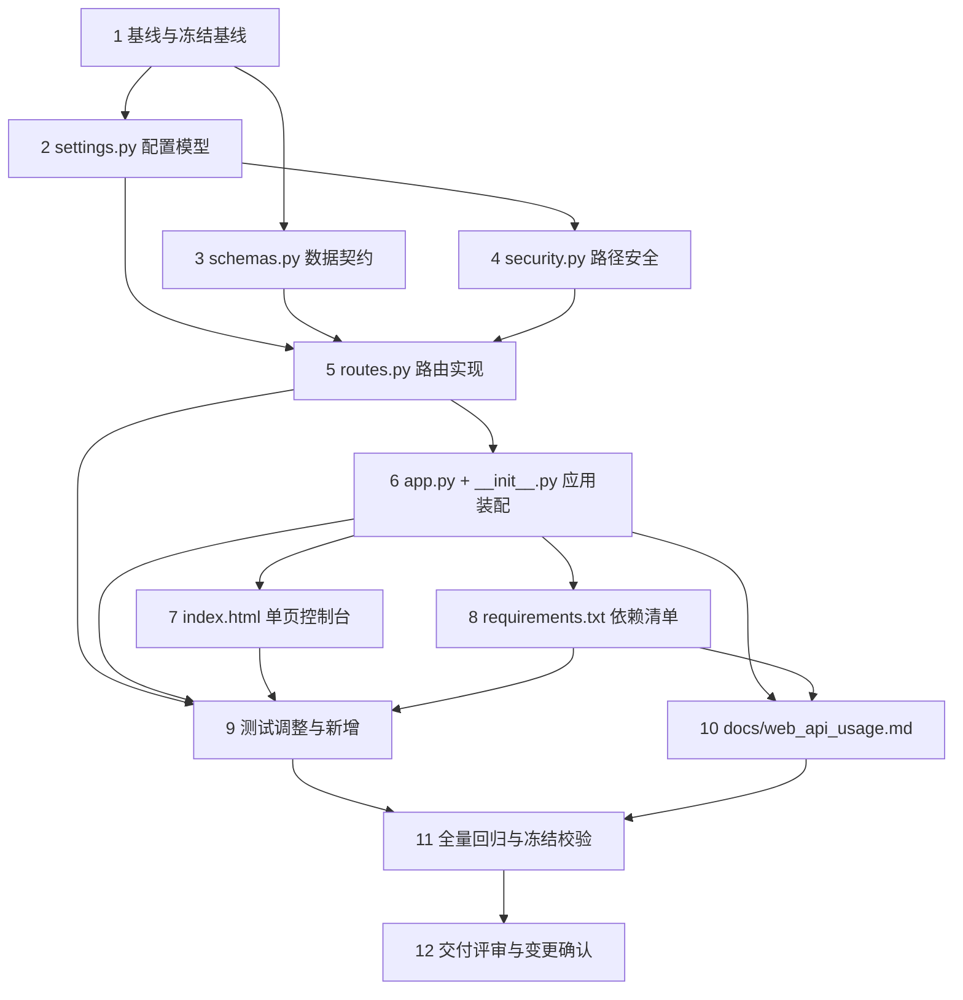

# 阶段 3：编码任务规划（Tasks）—— web_api

> **文件路径**：`.codeartsdoer/specs/web_api/tasks.md`
> **feature**：`web_api`（阶段 2：Web API 与单页控制台）
> **唯一依据**：`.codeartsdoer/specs/web_api/spec.md`（951 行）、`.codeartsdoer/specs/web_api/design.md`（1732 行）
> **测试基线**：`backend/tests/test_engine.py` 的 `test_requirements_txt`、`test_import_direction`；`backend/tests/test_cli.py` 的 12 条用例
> **状态**：待用户确认
> **性质**：本文档只做任务规划，**不含任何实现代码**。所有函数签名逐字对齐 `design.md` 2.4；如需偏离，必须在任务 12 登记偏差并说明理由。

---

## 0. 执行总则（10 条硬约束）

| 编号 | 约束 | 违反判定 |
|------|------|---------|
| C1 | `backend/app/core/rules/**` 与 `backend/tests/test_cli.py` 零改动，以 SHA-256 前后一致为证据 | 任一文件哈希变化即不通过 |
| C2 | `POST /api/review` 每次请求只调用 1 次 `run_check(manifest_text, repo_root, config=None)`，禁止重试、禁止复制四类检查逻辑 | T29 计数 ≠ 1 |
| C3 | 成功响应体必须是 `report_to_dict()` 原样结构，禁止外层包装、禁止二次排序/过滤/改写 | T20/T21 |
| C4 | 静态装配禁止 `Mount("/")`；`GET /` 走自定义路由返回 `index.html`，`/static/*` 由 `StaticFiles` 单独挂载 | 任务 6.5 评审 |
| C5 | `repo` 语义：「标识优先」——`repo` 去尾部 `/` 与 `default_repo` 相等时直接解析为默认仓库根本身；其余相对路径相对默认仓库解析 | 任务 4.3 + T02/T11 |
| C6 | `review()` 接收原始 `Request`，手工完成 Content-Type → 请求体大小 → JSON 解析 → 模型校验，以区分 415/413/400/422；外部 HTTP 契约不变 | 任务 5.4 顺序错乱 |
| C7 | 超时与并发：专用线程池 + `threading.BoundedSemaphore`；超时返回 504，后台继续执行，信号量在 future 完成回调中释放 | 任务 5.2 + T19/T30 |
| C8 | 测试一律使用 `httpx.ASGITransport`（`AsyncClient` 或基于其的同步封装），**禁止启动 uvicorn、禁止真实监听端口** | 任务 9.1 装配评审 |
| C9 | 单页页面零构建、零外链、禁止 `innerHTML`/`insertAdjacentHTML`/`document.write`/`eval`/`new Function` | T23 + 人工验收 |
| C10 | 除交付清单（第 13 章）列明的「新增/修改」文件外，不得改动仓库内任何其他文件；基线文件写入系统临时目录，不入仓库 | 任务 12.3 |

**任务顺序主线（强制）**：
`1 基线` → `2 settings` / `3 schemas` / `4 security` → `5 routes` → `6 app` → `7 index.html` → `8 requirements` → `9 测试调整与新增` → `10 文档` → `11 回归` → `12 评审`。

---

## 1. 任务拓扑与依赖图

### 1.1 主任务清单

| 编号 | 主任务 | 依赖前置 | 主要产物（完整仓库相对路径） | 完成判据（摘要） |
|------|--------|---------|------------------------------|-----------------|
| 1 | 建立变更基线与冻结基线 | 无 | 系统临时目录（不入仓库） | 13 个冻结文件 SHA-256 基线 + 135 节点/134 通过基线 + CLI 12 条基线 |
| 2 | 配置模型 | 1 | `backend/app/api/settings.py` | `WebSettings` 可构造；11 个环境变量可覆盖；非法根剔除；范围越界回退默认 |
| 3 | 数据契约 | 1 | `backend/app/api/schemas.py` | 四模型 + `error_payload` 字段与 spec 第 6 章一致 |
| 4 | 路径安全 | 2 | `backend/app/api/security.py` | 400/403/404 三类拒绝全部就位；不导入 fastapi/pydantic |
| 5 | 路由实现 | 2、3、4 | `backend/app/api/routes.py` | 两接口契约可运行；九步判定顺序正确；`ReviewGate` 并发/超时/429/504 就位 |
| 6 | 应用装配 | 5 | `backend/app/api/app.py`、`backend/app/api/__init__.py` | 应用可构造；`/api/*` 与静态不冲突；异常处理器与响应头齐全；不用 `Mount("/")` |
| 7 | 单页控制台 | 6 | `backend/app/static/index.html` | 14 个 DOM id 齐全；无外链；体积 ≤ 64 KB；人工验收 9 项通过 |
| 8 | 依赖清单 | 6 | `backend/requirements.txt`（修改） | 三段结构；三个精确版本；引擎段为空；引擎独立可运行 |
| 9 | 测试调整与新增 | 5、6、7、8 | `backend/tests/test_api.py`（新增）、`backend/tests/test_engine.py`（仅 2 个用例修改） | T01～T30 全部通过；CLI 12 条回归通过；引擎用例不被跳过 |
| 10 | 使用文档 | 6、8 | `docs/web_api_usage.md` | 启动/配置/接口/错误码/人工验收齐全；`REPOGUARD_ALLOWED_REPOS` 三平台示例可用 |
| 11 | 全量回归与冻结校验 | 9、10 | 系统临时目录（回归证据，不入仓库） | 164 passed + 1 skipped；哈希全一致；零 Web 依赖导入 |
| 12 | 交付评审与变更确认 | 11 | 评审记录（临时目录） | 8 条设计不变量逐条打勾；变更范围与第 13 章一致 |

> 合计：**12 个主任务、63 个子任务、30 条 API 用例**（子任务按 `#### X.Y` 计数：4+6+3+5+6+8+7+2+7+4+8+3）。

### 1.2 依赖图



### 1.3 关键路径

```
1 ── 2 ── 4 ── 5 ── 6 ── 7 ── 9 ── 11 ── 12
                       └─ 8 ──┘
```

- **最长路径（关键路径，9 个主任务）**：任务 1 → 2 → 4 → 5 → 6 → 7 → 9 → 11 → 12。
- **次长路径（等价长度，替换 7 为 8）**：任务 1 → 2 → 4 → 5 → 6 → 8 → 9 → 11 → 12。
- 关键路径上的任何延误直接推迟交付；任务 3 有 1 个任务宽度的松弛（span），任务 10 有 1 个任务宽度的松弛。

### 1.4 可并行组

| 组 | 可并行任务 | 前置条件 | 并行风险 |
|----|-----------|---------|---------|
| G1 | 任务 2（settings）、任务 3（schemas） | 任务 1 完成 | 无（两者无导入关系） |
| G2 | 任务 4（security） | 任务 2 完成 | 无 |
| G3 | 任务 7（页面）、任务 8（依赖清单） | 任务 6 完成 | 页面依赖接口契约，不依赖依赖清单 |
| G4 | 任务 9（测试）、任务 10（文档） | 任务 5～8 完成 | 文档需与最终错误码表保持一致 |
| G5 | T04/T05/T17/T18/T19/T20/T21/T29 用例编写 | 任务 5 完成 | 同一 `test_api.py` 文件内并行编辑需按分组切分 |

> 任务 4 与任务 3 之间无依赖，可交错；但任务 4 必须在任务 5 之前完成，因为 `resolve_repo_root()` 的 400/403/404 语义是 `review()` 的前置出口。

---

## 2. 任务详情（逐任务卡）

> 统一约定：所有 Python 文件首行 `from __future__ import annotations`；Python 3.10+；禁止 `Any`；仓库相对路径统一用 `/` 表示；错误码使用稳定大写英文常量，中文文案一一对应。

### 任务 1 建立变更基线与冻结基线

**依赖**：无
**产物**：系统临时目录 `%TEMP%/repoguard_web_api_baseline/`（Windows）或 `/tmp/repoguard_web_api_baseline/`（Linux/macOS）。**禁止在仓库内新增基线文件**。

#### 1.1 冻结文件 SHA-256 基线
- **路径（只读）**：13 个冻结文件，见第 9 章清单。
- **执行**：采集每个文件的 SHA-256，写入临时目录 `frozen_before.txt`（格式 `哈希  仓库相对路径`，按路径排序）。
- **验收标准**：
  - 13 行，一行一文件，无重复、无缺失；
  - 每行哈希为 64 位小写十六进制；
  - 文件内路径全部为仓库相对路径（以 `backend/` 开头），不含盘符与用户目录。

#### 1.2 测试基线采集
- **执行**：在 `backend/` 下运行 `python -m unittest discover -s tests -v`，输出保存到临时目录 `baseline_unittest.txt`。
- **验收标准**：
  - `baseline_unittest.txt` 末尾记录 `OK (skipped=1)`，并可通过计数得到 `134 passed, 1 skipped`（跳过项为 `test_performance_500`）；
  - 测试方法总数为 135；
  - 逐文件数量与 design 1.2.4 一致：`test_engine.py` 28（默认执行 27 + 1 skipped）、`test_cli.py` 12、`test_code_scan.py` 21、`test_link_check.py` 21、`test_manifest.py` 16、`test_naming.py` 18、`test_sensitive.py` 19，合计 135；
  - 出现任何 failed 时**停止**后续任务，先修复环境。

#### 1.3 CLI 12 条基线采集
- **执行**：`cd backend && python -m unittest tests.test_cli -v`，保存用例名与结果到 `baseline_cli.txt`。
- **验收标准**：
  - 记录 12 条用例名（逐条见第 10 章）且全部 `PASSED`；
  - 额外记录 4 种退出码实测值：正常 `0`、存在必须修改 `1`、仓库不存在 `2`、模块降级 `3`；
  - 记录一条 `--format json` 的 stdout 原始字节（用于任务 11.4 逐字节比对）。

#### 1.4 采集脚本可重复性确认
- **执行**：连续执行两次 1.1 与 1.3。
- **验收标准**：两次哈希清单逐字节一致（排除路径排序差异）；两次 CLI 结果一致；确认采集过程未写入仓库（`git status` 无新增文件）。

---

### 任务 2 配置模型（`backend/app/api/settings.py`）

**依赖**：任务 1
**创建**：`backend/app/api/settings.py`
**允许依赖**：标准库 `dataclasses`、`os`、`pathlib`、`collections.abc`、`hashlib`、`logging`
**禁止依赖**：`fastapi`、`pydantic`、`app.core.rules`

#### 2.1 模块常量与 `WebSettings`
- **签名（与 design 2.4.2(2) 一致）**：
  - `PROJECT_ROOT: Path`
  - `DEFAULT_STATIC_DIR: Path`
  - `DEFAULT_DEMO_REPO: str = "demo-repo"`
  - `ALLOWED_REPOS_ENV: str = "REPOGUARD_ALLOWED_REPOS"`
  - `LEGACY_ALLOWED_REPOS_ENV: str = "REPOGUARD_ALLOWED_REPO_ROOTS"`
  - `@dataclass(frozen=True, slots=True) class WebSettings`，字段顺序与默认值：`allowed_repo_roots: tuple[Path, ...] = ()`、`default_repo: str \| None = DEFAULT_DEMO_REPO`、`max_manifest_chars: int = 1_000_000`、`max_manifest_lines: int = 5_000`、`max_request_bytes: int = 2_097_152`、`review_timeout_seconds: float = 30.0`、`review_max_concurrency: int = 2`、`queue_timeout_seconds: float = 5.0`、`cors_origins: tuple[str, ...] = ()`、`static_dir: Path = DEFAULT_STATIC_DIR`
- **验收标准**：
  - `PROJECT_ROOT` 解析为 `RepoGuard/` 仓库根（`Path(__file__).resolve().parents[3]`）；
  - `DEFAULT_STATIC_DIR` 为 `PROJECT_ROOT / "backend" / "app" / "static"`；
  - 实例不可变（赋值抛 `FrozenInstanceError`）、带 `__slots__`、可哈希；
  - 字段名与 spec 6.5 逐字一致，不得新增配置项。

#### 2.2 `default_settings()` 与 `parse_allowed_repos()`
- **签名**：
  - `def default_settings() -> WebSettings: ...`
  - `def parse_allowed_repos(raw: str) -> tuple[Path, ...]: ...`
- **验收标准**：
  - `default_settings()` 候选根为 `PROJECT_ROOT / "demo-repo"`，**不做存在性过滤**（交由 2.3 归一）；
  - `parse_allowed_repos()` 按 `os.pathsep` 拆分；出现 `|` 时优先按 `|` 拆分；去空白与空项；`~` 展开；相对路径基于 `PROJECT_ROOT` 而非当前工作目录；
  - 解析结果去重且保持输入顺序；
  - 空字符串输入返回 `()`，不抛异常。

#### 2.3 `normalize_settings()`
- **签名**：`def normalize_settings(settings: WebSettings) -> WebSettings: ...`
- **验收标准**：
  - 数值范围校正：`max_manifest_chars` 1～2,000,000、`max_manifest_lines` 1～20,000、`max_request_bytes` 65,536～16,777,216、`review_timeout_seconds` 1～120、`review_max_concurrency` 1～8、`queue_timeout_seconds` 0～30；越界**回退默认值**并记录 warning（日志不含绝对路径）；
  - 允许根逐项 `resolve()`，仅保留「存在且为目录」的项，去重后写回；
  - 非法项剔除数量可由 `settings_summary` 之外的内部计数记录，但**不得**写入响应；
  - `cors_origins` 过滤含 `*`、缺协议、缺端口、含路径的项；
  - 返回新对象，不修改入参；
  - 允许根全空时**不得**回退为当前目录或任意路径。

#### 2.4 `load_settings_from_env()`
- **签名**：`def load_settings_from_env(env: Mapping[str, str] \| None = None) -> WebSettings: ...`
- **验收标准**：
  - `env=None` 时读取 `os.environ`；显式传入 `Mapping` 时只读该映射（测试可注入）；
  - 读取 11 个变量：`REPOGUARD_ALLOWED_REPOS`（主）、`REPOGUARD_ALLOWED_REPO_ROOTS`（兼容）、`REPOGUARD_DEFAULT_REPO`、`REPOGUARD_MAX_MANIFEST_CHARS`、`REPOGUARD_MAX_MANIFEST_LINES`、`REPOGUARD_MAX_REQUEST_BYTES`、`REPOGUARD_REVIEW_TIMEOUT_SECONDS`、`REPOGUARD_REVIEW_MAX_CONCURRENCY`、`REPOGUARD_QUEUE_TIMEOUT_SECONDS`、`REPOGUARD_CORS_ORIGINS`、`REPOGUARD_STATIC_DIR`；
  - 主变量存在时忽略兼容变量，并记录脱敏 warning；
  - 数值非法（非数字、越界）回退默认，不抛异常；
  - 返回前必须调用 `normalize_settings()`；
  - 未设置任何变量时等价于 `normalize_settings(default_settings())`。

#### 2.5 `default_repo_root()`、`settings_summary()`、`repo_label()`
- **签名**：
  - `def default_repo_root(settings: WebSettings) -> Path \| None: ...`
  - `def settings_summary(settings: WebSettings) -> dict[str, object]: ...`
  - `def repo_label(path: Path \| str, settings: WebSettings \| None = None) -> str: ...`
- **验收标准**：
  - `default_repo_root()` 解析顺序：先按「允许根末段名 == `default_repo`」匹配；其次按 `default_repo` 相对路径解析；最后校验存在且为目录；失败返回 `None`；
  - `default_repo_root()` 返回路径必须已通过白名单校验（不得返回允许根之外路径）；
  - `settings_summary()` 仅返回 `allowed_repo_root_count`、`default_repo`、`static_dir_present`、`cors_origin_count` 四项，**不含绝对路径**；
  - `repo_label()` 返回末段目录名；无法取得时返回 `sha256` 前 8 位；任何分支都不返回绝对路径。

#### 2.6 配置层自检（不新增测试方法）
- **验收标准**：
  - 以临时脚本（不落仓库）验证 4 组：默认构造、`|` 与 `os.pathsep` 混合拆分、越界数值回退、CORS 含 `*` 被过滤；
  - 该自检结论在任务 9 由 T01/T02/T07/T08/T30 的 `make_settings(**overrides)` 复核，**不新增测试方法**（保持新增用例恰为 30 条）。

---

### 任务 3 数据契约（`backend/app/api/schemas.py`）

**依赖**：任务 1（可与任务 2 并行）
**创建**：`backend/app/api/schemas.py`
**允许依赖**：`pydantic`、标准库 `typing`、`uuid`
**禁止依赖**：`fastapi`、`app.core.rules`、`app.api.security`

#### 3.1 `ReviewRequest`
- **签名**：`class ReviewRequest(BaseModel)`，字段 `manifest: str`、`repo: str`，`model_config: ConfigDict = ConfigDict(extra="ignore")`
- **验收标准**：
  - 未知字段被忽略且不报错、不写日志；
  - 不做 `str_strip_whitespace`（保留清单原文，去空白由 `security` 负责 `repo`）；
  - 模型层**不设置**长度/行数约束（业务上限在路由层，以保证 413 而非 422）；
  - `manifest=None`、`repo=123` 等类型错误可在后续 `model_validate` 阶段转 422。

#### 3.2 `ErrorBody`、`ErrorResponse`、`HealthResponse`
- **签名**：
  - `class ErrorBody(BaseModel)`：`code: str`、`message: str`、`detail: str \| None = None`
  - `class ErrorResponse(BaseModel)`：`error: ErrorBody`、`request_id: str`
  - `class HealthResponse(BaseModel)`：`status: Literal["ok", "degraded"]`、`service: Literal["repoguard-web-api"]`、`version: str`、`engine: Literal["available", "unavailable"]`、`default_repo: str \| None`、`allowed_repo_root_count: int`、`time: str`
- **验收标准**：
  - 三模型仅用于文档与 OpenAPI schema，运行时错误统一走 3.3；
  - `HealthResponse` 字段顺序与 spec 6.4 一致，共 7 个字段，无额外字段；
  - `ErrorBody.detail` 允许 `None`，序列化时为空不输出该键的行为由 3.3 控制。

#### 3.3 `error_payload()`
- **签名**：`def error_payload(code: str, message: str, detail: str \| None = None, request_id: str \| None = None) -> dict[str, object]: ...`
- **验收标准**：
  - `request_id=None` 时生成 32 位 `uuid4().hex`；
  - 返回结构为 `{"error": {"code": ..., "message": ...}, "request_id": ...}`，`detail` 为空时不输出该键；
  - 传入 `request_id` 时原样使用（保证响应头、错误体、日志同一标识）；
  - `message` 必须为简体中文，不含英文异常类名；
  - `detail` 不得含绝对路径、堆栈、文件内容（由调用方保证，函数内不做脱敏拼接）。

---

### 任务 4 路径安全（`backend/app/api/security.py`）

**依赖**：任务 2
**创建**：`backend/app/api/security.py`
**允许依赖**：标准库 `os`、`pathlib`、`re`、`hashlib`、`app.api.settings`
**禁止依赖**：**`fastapi`**、`pydantic`、`app.core.rules`

#### 4.1 `RepoPathError`
- **签名**：`class RepoPathError(Exception)`，属性 `code: str`、`status_code: int`、`message: str`、`detail: str \| None`；`def __init__(self, code: str, status_code: int, message: str, detail: str \| None = None) -> None: ...`
- **验收标准**：
  - 三个属性均为实例属性且非类变量共享；
  - `str(exc)` 不包含绝对路径；
  - `detail` 仅允许字段名或用户输入末段标识。

#### 4.2 判定辅助函数
- **签名**：
  - `def has_parent_segment(value: str) -> bool: ...`
  - `def has_control_chars(value: str) -> bool: ...`
  - `def is_device_or_unc_path(value: str) -> bool: ...`
  - `def is_absolute_repo_path(value: str) -> bool: ...`
  - 常量：`MAX_REPO_LENGTH: int = 512`、`CONTROL_CHAR_MAX: int = 31`、`CONTROL_CHAR_DEL: int = 127`
- **验收标准**：
  - `has_parent_segment()` 先把 `\` 归一为 `/`，任一段等于 `..` 即为真（`a/../b`、`../demo-repo`、`a\..\b` 均为真）；
  - `has_control_chars()` 对 `ord < 32` 或 `ord == 127` 为真（含 NUL、换行、制表符）；
  - `is_device_or_unc_path()` 对 `\\?\`、`\\.\`、`//`、`\\\\` 开头为真；
  - `is_absolute_repo_path()` 对 POSIX `/` 开头或 Windows 盘符 `^[A-Za-z]:` 为真；
  - 四个函数均不访问文件系统、不抛异常。

#### 4.3 `resolve_repo_root()`
- **签名**：`def resolve_repo_root(raw: str, settings: WebSettings) -> Path: ...`
- **固定判定顺序（不可调换）**：
  1. `strip()` 去空白；
  2. 空或长度 > 512 → `RepoPathError("INVALID_REPO_PATH", 400, "仓库路径格式不合法")`；
  3. 含控制字符或含 `://` → 400 `INVALID_REPO_PATH`（URL 场景不发起任何网络请求）；
  4. 含 `..` 段 → 403 `REPO_FORBIDDEN`（无论最终是否仍在允许根内，且**不访问文件系统**）；
  5. 设备路径 / UNC → 403 `REPO_FORBIDDEN`；
  6. **标识优先**：`raw` 去尾部 `/` 后与 `settings.default_repo` 相等 → `candidate = default_repo_root(settings)`；
  7. 否则若绝对路径 → `candidate = Path(raw)`；
  8. 否则相对路径 → 若 `default_repo_root()` 为 `None`，返回 400 `INVALID_REPO_PATH`（提示填写绝对路径）；可用则 `candidate = default_repo_root(settings) / raw`；
  9. `candidate_real = candidate.resolve(strict=False)`；
  10. `is_within_allowed_roots(candidate_real, settings)` 为假 → 403 `REPO_FORBIDDEN`；
  11. `candidate_real` 不存在或不是目录 → 404 `REPO_NOT_FOUND`；
  12. 返回 `candidate_real`。
- **验收标准**：
  - 允许根为空（`allowed_repo_roots == ()`）时抛 503 语义不由本函数负责（由 `routes.review` 在调用前拦截），本函数对空配置返回 403 `REPO_FORBIDDEN`；
  - 第 4/5 步失败时**不调用** `resolve()`、`exists()`、`stat()`（可用 `unittest.mock.patch` 对 `pathlib.Path.resolve`/`Path.exists` 计数为 0 验证，仅测试侧）；
  - `repo="demo-repo"` 且 `default_repo="demo-repo"` 时解析为默认仓库本身，**不得**拼成 `demo-repo/demo-repo`；
  - `repo="../demo-repo"` 返回 403，不访问文件系统；
  - 任何分支的 `RepoPathError.message` 均为中文，`detail` 不含绝对路径；
  - 返回值只用于 `run_check()`，不得进入响应与日志。

#### 4.4 `is_within_allowed_roots()`
- **签名**：`def is_within_allowed_roots(candidate: Path, settings: WebSettings) -> bool: ...`
- **验收标准**：
  - 对每个允许根取 `root_real = root.resolve()`；
  - Windows 下两侧 `str(...).casefold()` 后以 `os.path.commonpath` 比较，结果与根文本完全相等；
  - POSIX 下 `os.path.commonpath([str(root_real), str(candidate_real)]) == str(root_real)`；
  - `candidate_real == root_real` 视为合法（允许直接检查允许根本身）；
  - `commonpath` 抛 `ValueError`（跨盘符）视为不合法；
  - **禁止**使用 `str.startswith`；`/demo-repo-evil` 前缀目录必须判为越界；
  - 任一允许根匹配成功即为通过；不抛异常。

#### 4.5 安全层自检（不新增测试方法）
- **验收标准**：
  - 以临时脚本覆盖 12 类输入：空、空白、513 字符、`\x00`、`\n`、`http://example.com/x`、`../demo-repo`、`a/../../b`、`\\server\share`、`\\?\C:\repo`、允许根外绝对路径、允许根内不存在目录；
  - 每类输入断言 HTTP 状态码与错误码与 spec 7.3 一致；
  - 该结论由 T12～T16 在 API 层复核（任务 9），保持新增用例恰为 30 条。

---

### 任务 5 路由实现（`backend/app/api/routes.py`）

**依赖**：任务 2、3、4，既有 `app.core.rules.engine.run_check`
**创建**：`backend/app/api/routes.py`
**允许依赖**：`fastapi`、`starlette.responses`、`asyncio`、`concurrent.futures`、`threading`、`json`、`logging`、`time`、`app.api.schemas`、`app.api.security`、`app.api.settings`、`app.core.rules.engine`、`app.core.rules.common.report`、`app.core.rules.common.models`
**禁止依赖**：`app.api.app`（防循环）、四个检查模块、`subprocess`、`os.system`

#### 5.1 常量、`CheckRunner`、`ApiError`、`router`
- **签名**：
  - `SERVICE_NAME: str = "repoguard-web-api"`、`SERVICE_VERSION: str = "1.0.0"`、`REVIEW_PATH: str = "/review"`、`HEALTH_PATH: str = "/health"`
  - `router: APIRouter`
  - `class CheckRunner(Protocol)`：`def __call__(self, manifest_text: str, repo_root: str \| Path, config: RuleConfig \| None = None) -> CheckReport: ...`
  - `class ApiError(Exception)`：`code`、`status_code`、`message`、`detail`；`__init__(self, code: str, status_code: int, message: str, detail: str \| None = None) -> None`
- **验收标准**：
  - `router = APIRouter()`，仅注册 `REVIEW_PATH`（POST）与 `HEALTH_PATH`（GET）；
  - `CheckRunner` 与 `run_check` 三参数签名严格一致（供依赖覆盖）；
  - `ApiError` 三个属性为实例属性，`str(exc)` 不含绝对路径；
  - 模块级不得创建 `FastAPI` 实例（由任务 6 负责）。

#### 5.2 `ReviewGate`
- **签名**：
  - `class ReviewGate`：`def __init__(self, max_concurrency: int, timeout_seconds: float, queue_timeout_seconds: float) -> None: ...`
  - `async def run(self, runner: CheckRunner, manifest_text: str, repo_root: Path) -> CheckReport: ...`
  - `def shutdown(self) -> None: ...`
- **验收标准（逐条对应 C7 与 design 2.1.3(4)）**：
  - 持有 `ThreadPoolExecutor(max_workers=max_concurrency, thread_name_prefix="repoguard-review")` 与 `threading.BoundedSemaphore(max_concurrency)`；**禁止**使用 `asyncio.Semaphore`（避免跨事件循环失效，ASGI transport 测试会多次进入不同 loop）；
  - 名额获取：`await asyncio.to_thread(semaphore.acquire, True, queue_timeout_seconds)`；返回 `False` 时抛 `ApiError("REVIEW_BUSY", 429, "当前检查请求较多，请稍后重试")`，不提交任务；
  - 提交任务：`future = executor.submit(runner, manifest_text, repo_root, None)`，**config 显式传 `None`**；
  - 信号量释放：`future.add_done_callback(lambda _f: semaphore.release())`，**禁止**在 `wait_for` 的超时分支释放；
  - 执行超时：`await asyncio.wait_for(asyncio.wrap_future(future), timeout_seconds)`；`asyncio.TimeoutError` 转 `ApiError("REVIEW_TIMEOUT", 504, "检查耗时过长，请缩小变更清单后重试")`，后台不强制终止、结果丢弃；
  - 引擎异常原样向上抛（由路由转 500），`ReviewGate` 不做吞异常；
  - `shutdown()` 调用 `executor.shutdown(wait=False, cancel_futures=False)`，可重复调用不报错；
  - 一次 `run()` 最多提交 1 个任务，不得重试。

#### 5.3 `get_settings()` 与 `get_engine()`
- **签名**：
  - `def get_settings(request: Request) -> WebSettings: ...`
  - `def get_engine() -> CheckRunner: ...`
- **验收标准**：
  - `get_settings()` 从 `request.app.state.settings` 读取，**禁止**模块级缓存或全局变量；
  - `get_engine()` 延迟导入 `app.core.rules.engine.run_check`（函数体内导入），导入失败或缺少 `run_check` 时抛 `ApiError("ENGINE_UNAVAILABLE", 503, "规则引擎当前不可用")`；
  - 返回值必须是真实 `run_check` 可调用对象，生产路径不得包装或改写；
  - 两个函数均可在测试中通过 `app.dependency_overrides[...]` 或 `create_app(settings)` 注入。

#### 5.4 `review()` 处理顺序
- **签名**：`async def review(request: Request, settings: WebSettings = Depends(get_settings), runner: CheckRunner = Depends(get_engine)) -> JSONResponse: ...`
- **固定九步出口（不可调换，对应 C6）**：

  | 步 | 动作 | 失败出口 |
  |----|------|---------|
  | 1 | 读取 `request.state.request_id` | 无 |
  | 2 | 校验 `Content-Type` 主类型为 `application/json`（允许 `charset=utf-8`） | 415 `UNSUPPORTED_MEDIA_TYPE` |
  | 3 | `await request.body()` + `json.loads` | 400 `INVALID_JSON` |
  | 4 | 校验顶层为 JSON 对象（非数组/字符串/数字） | 400 `INVALID_JSON` |
  | 5 | `ReviewRequest.model_validate(data)` | 422 `VALIDATION_ERROR`（`detail` 含字段名） |
  | 6 | `manifest` 字符数 / UTF-8 字节数（≤ 2 MB）/ `splitlines()` 行数校验 | 413 `MANIFEST_TOO_LARGE` |
  | 7 | 允许根为空拦截 → 503 `ENGINE_UNAVAILABLE`（`detail` 说明「未配置可用的仓库目录」） | 503 `ENGINE_UNAVAILABLE` |
  | 8 | `resolve_repo_root(payload.repo, settings)` | 400 `INVALID_REPO_PATH` / 403 `REPO_FORBIDDEN` / 404 `REPO_NOT_FOUND` |
  | 9 | `await gate.run(runner, payload.manifest, repo_real)` → `report_to_dict(report)` | 429 `REVIEW_BUSY` / 504 `REVIEW_TIMEOUT` / 500 `INTERNAL_ERROR` |

- **验收标准**：
  - 实际请求体大小校验同时覆盖「声明 `Content-Length`」与「实际 `len(body)`」两条口径，超 `settings.max_request_bytes` 返回 413 `REQUEST_TOO_LARGE`，**在 JSON 解析之前**；
  - 第 2 步必须在读取 body 之前，`text/plain` 不做任何 JSON 解析；
  - 第 6 步在调用 `run_check()` 之前，且**不读取仓库、不执行目录遍历**；
  - 第 9 步对 `run_check` 的调用次数恰好 1，`config=None`；
  - 引擎返回 `status="部分降级"` 或 `"输入错误"` 时一律 HTTP 200，原样保留 `degraded_modules` / `warnings`；
  - `report_to_dict()` 抛异常时转 500 `INTERNAL_ERROR`（提示「检查结果无法返回，请稍后重试」），不返回半成品；
  - 成功响应 `JSONResponse(status_code=200, content=data)`，`Content-Type` 为 `application/json; charset=utf-8`，中文不转义（`ensure_ascii=False` 语义）；
  - 所有失败出口只通过 `error_payload()` 构造错误体，禁止各分支自拼字典；
  - 响应头设置 `Cache-Control: no-store`（由任务 6 中间件统一兜底，此处不得覆盖为可缓存）。

#### 5.5 `health()`
- **签名**：`def health(request: Request, settings: WebSettings = Depends(get_settings)) -> JSONResponse: ...`
- **验收标准**：
  - 返回 7 字段：`status`、`service`、`version`（`1.0.0`）、`engine`、`default_repo`、`allowed_repo_root_count`、`time`（UTC ISO 8601）；
  - `status="ok"` 需同时满足：引擎可导入、有效允许根非空、`default_repo` 可定位到存在且为目录；
  - 任一条件不满足 → HTTP 503 + `status="degraded"`；引擎导入失败时 `engine="unavailable"`；
  - `default_repo` 只返回相对标识或 `null`，不存在的标识**保留原值**以便排查；
  - `allowed_repo_root_count` 为归一后有效根数量（≥ 0）；
  - 每次调用重新计算，不缓存；响应头 `Cache-Control: no-store`；
  - **不调用 `run_check()`、不扫描仓库、不读取被检查文件**；响应中不出现绝对路径、环境变量原文、依赖清单；
  - 响应时间 ≤ 100 ms（不含网络）。

#### 5.6 与引擎序列化对接
- **验收标准**：
  - 只导入 `run_check`、`report_to_dict`、`report_to_json`（如需）与 `CheckReport` 类型；
  - **禁止**导入 `naming`、`code_scan`、`link_check`、`sensitive`；
  - **禁止**导入 `app.core.rules.common.file_io`、`common.manifest`、`common.config`；
  - 不对 `findings` 做排序、过滤、合并、补全、级别改写。

---

### 任务 6 应用装配（`backend/app/api/app.py`、`backend/app/api/__init__.py`）

**依赖**：任务 5
**创建**：`backend/app/api/app.py`、`backend/app/api/__init__.py`
**允许依赖**：`fastapi`、`starlette.staticfiles`、`starlette.responses`、`starlette.middleware.cors`、`app.api.routes`、`app.api.settings`、标准库 `asyncio`、`contextlib`、`logging`、`time`、`uuid`、`json`
**禁止依赖**：四个检查模块；不得在 `app.py` 内直接调用 `run_check`（只允许经 `routes.get_engine`）

#### 6.1 `create_app()` 工厂
- **签名**：`def create_app(settings: WebSettings \| None = None) -> FastAPI: ...`；模块级 `app: FastAPI`
- **固定执行顺序（7 步）**：
  1. `settings = normalize_settings(settings or load_settings_from_env())`；
  2. 创建 `ReviewGate(settings.review_max_concurrency, settings.review_timeout_seconds, settings.queue_timeout_seconds)`；
  3. 创建 `FastAPI(title="RepoGuard Web API", version=SERVICE_VERSION, lifespan=...)`；
  4. 写入 `app.state.settings`、`app.state.review_gate`、`app.state.static_dir`；
  5. 注册中间件 → 异常处理器 → `include_router(router, prefix="/api")` → 静态资源；
  6. 可选 CORS；
  7. 返回 `app`；模块级 `app = create_app()`。
- **验收标准**：
  - `create_app(settings)` 每次返回独立实例，实例间无共享 `ReviewGate`、无共享 `WebSettings`；
  - `/api` 路由必须先于静态资源注册；
  - 工厂内**不得**读取环境变量以外的隐式配置，不得把 `settings` 写入模块级可变全局；
  - 模块级 `app` 在导入时构造成功（允许根缺失也不得抛异常）。

#### 6.2 请求上下文中间件
- **私有符号**：`_configure_middleware(app, settings)`
- **验收标准**：
  - 入口生成 `request_id = uuid.uuid4().hex`（32 字符，符合 8～64 且仅字母数字），写入 `request.state.request_id`；
  - 响应头写入 `X-Request-ID`，与错误体 `request_id` 一致；
  - 请求结束后输出单行 JSON 日志（`ensure_ascii=False`），字段至少含：`request_id`、`method`、`path`、`status_code`、`error_code`、`duration_ms`、`report_status`、`must_fix_count`；
  - 日志**禁止**记录 `manifest` 正文、被检查文件内容、仓库绝对路径、完整凭据；`repo` 只记录相对标识或 8 位哈希；
  - 中间件不得吞异常，不得改变响应体。

#### 6.3 安全响应头
- **验收标准**：
  - 全部响应含 `X-Content-Type-Options: nosniff`；
  - 全部 API 响应含 `Cache-Control: no-store`；
  - 页面与静态资源响应含 `X-Frame-Options: DENY` 与 `Content-Security-Policy`，其中必须含 `frame-ancestors 'none'`；
  - CSP 允许内联脚本与样式（`script-src 'self' 'unsafe-inline'`、`style-src 'self' 'unsafe-inline'`），但 `default-src 'self'`；
  - 未配置 CORS 时**不得**出现任何 `Access-Control-*` 头。

#### 6.4 异常处理器
- **私有符号**：`_register_exception_handlers(app)`
- **验收标准**：
  - 注册 5 类：`ApiError`、`RepoPathError`、`RequestValidationError`、`StarletteHTTPException`、`Exception`；
  - 全部输出统一结构 `{error:{code,message,detail}, request_id}`；
  - 映射：`ApiError`/`RepoPathError` 用自带 `status_code` 与 `code`；`RequestValidationError` → 422 `VALIDATION_ERROR`；`StarletteHTTPException` 405 → `METHOD_NOT_ALLOWED`、404 → `NOT_FOUND`（HTTP 404）；`Exception` → 500 `INTERNAL_ERROR`；
  - 500 场景堆栈只写服务端日志（含 `request_id`），响应体禁止出现 `Traceback`、异常类名、绝对路径、服务器版本；
  - 处理器不得二次包装已序列化的 `JSONResponse`。

#### 6.5 静态装配（对应 C4，强制）
- **私有符号**：`_mount_static(app, settings)`
- **验收标准**：
  - `GET /` 注册为**自定义路由**（`@app.get("/")`），返回 `FileResponse(static_dir / "index.html", media_type="text/html; charset=utf-8")`；
  - `index.html` 缺失时返回 503 与 `error.code="STATIC_NOT_FOUND"`、中文提示「页面资源缺失，请检查部署」；**禁止**返回目录列表、500 堆栈、回退其他页面；
  - `/static` 以 `app.mount("/static", StaticFiles(directory=settings.static_dir), name="static")` 单独挂载，且**仅在目录存在时**挂载；
  - **禁止** `app.mount("/", StaticFiles(html=True, ...))`；评审时以源码检索确认无 `Mount("/")` 等价写法；
  - `/static/*` 目录穿越由 `StaticFiles` 内置防护；404 不得泄露绝对路径；
  - 未知路径（如 `/api/unknown`）返回 JSON 404，不得返回 HTML 404 页面。

#### 6.6 可选 CORS
- **私有符号**：`_configure_cors(app, settings)`
- **验收标准**：
  - `settings.cors_origins == ()` 时**不注册** `CORSMiddleware`；
  - 非空时注册：`allow_origins=<精确列表>`、`allow_methods=["GET","POST"]`、`allow_headers=["Content-Type"]`、`allow_credentials=False`；
  - 配置含 `*` 已在任务 2.3 过滤；过滤后为空则不启用；
  - 禁止 `allow_origins=["*"]` 与 `allow_credentials=True` 同时出现。

#### 6.7 生命周期与启动日志
- **私有符号**：`_build_lifespan(settings, gate)`
- **验收标准**：
  - 启动时输出中文日志：监听地址约定值（`127.0.0.1:8000`）、允许根数量、默认仓库标识、被剔除根数量；
  - 日志不含任何绝对路径；
  - 关闭时调用 `gate.shutdown()`，不阻塞进程退出；
  - 允许根为空/全部非法时**启动成功**，健康状态降级、review 返回 503。

#### 6.8 `__init__.py` 再导出
- **签名**：`from app.api.app import create_app`；`__all__: tuple[str, ...] = ("create_app",)`
- **验收标准**：
  - `import app.api` 后可直接取得 `create_app`；
  - 包导入不触发引擎执行、不读取环境变量、不创建应用实例以外的副作用；
  - 不承载任何业务逻辑。

---

### 任务 7 单页控制台（`backend/app/static/index.html`）

**依赖**：任务 6（接口契约已固定）
**创建**：`backend/app/static/index.html`（新建 `backend/app/static/` 目录）
**技术约束**：原生 HTML + CSS + JavaScript；无 npm、无打包、无框架、无 CDN、无外链字体/图片；单文件；体积 ≤ 64 KB

#### 7.1 页面骨架与 DOM 契约
- **验收标准**：必须包含 design 2.6.1 与 spec 8.4 的全部稳定 `id`，逐项见第 6 章表；`<meta charset="utf-8">`、`<meta name="viewport" content="width=device-width, initial-scale=1">` 必须存在。

#### 7.2 表单与提交状态机
- **验收标准**：
  - `review-form` 设 `novalidate`（校验由脚本完成），含 `<label for="manifest-input">` 与 `<label for="repo-input">`；
  - 清单文本框 `maxlength="1000000"`，并展示 1,000,000 字符上限提示；
  - 文本框为空或仅空白时阻止提交，在 `error-box` 显示「请先粘贴变更清单」，**不发起请求**；
  - 提交时 `submit-button.disabled=true`、`loading-indicator.hidden=false`、文案「检查中…」、清空上次错误；
  - 请求结束后恢复按钮与加载态；请求进行中禁止重复提交（仅一次请求）；
  - 请求体固定为 `{"manifest": ..., "repo": ...}`，不添加任何其他业务字段。

#### 7.3 健康检查与默认仓库
- **验收标准**：
  - 页面加载时 `GET /api/health`，成功则把 `default_repo` 存入**内存变量**并渲染 `health-status`；
  - 503 或网络失败时显示「服务状态异常」，页面仍可手动提交；
  - `repo` 输入为空时使用默认仓库；默认仓库也为空时提示「请先在高级设置中填写仓库路径」并阻止提交；
  - **禁止**把 `repo` 写入 `localStorage`、`sessionStorage` 或 URL 查询参数。

#### 7.4 结果渲染
- **固定渲染顺序**：清空结果区（文本节点逐个移除）→ 降级/警告 → 统计 → 必须修改 → 优化建议 → 无法解析行 → 空状态。
- **验收标准**：
  - `summary-panel` 按固定顺序展示七项：条目总数、问题总数、必须修改、优化建议、跳过文件、降级模块、无法解析行；
  - `must-fix-section` 必须早于 `suggestion-section` 渲染；组内按 `file_path` 分组，文件名为可折叠标题；
  - 单条 finding 展示 `line_no`（为 `null` 时不显示行号）、`message`、`suggestion`、`rule_id`，`excerpt` 按需展示；
  - 单组为空时该组显示「无」，另一组正常展示；
  - 空结果判定：`issue_count == 0` 且 `skipped_file_count == 0` 且 `degraded_module_count == 0` → 显示 `empty-state`「未发现问题」；
  - `status == "部分降级"` 或 `degraded_modules` 非空或 `warnings` 非空 → `degraded-box` 显示「结果可能不完整」并逐条列出 `module：reason` 与 `warnings`，**不清空**已返回的问题列表；
  - `files[].skip_reason != null` 在对应文件分组标题上展示；
  - `unparsed-box` 逐条展示 `line_no`、`raw`（等宽字体、自动换行）、`reason`；
  - 长文本处理：`DocumentFragment` 批量插入；单组超过 100 条时每 50 条 `setTimeout(0)` 让出主线程；文件分组默认折叠，仅展开问题数最多的前 3 个。

#### 7.5 错误提示
- **验收标准**：
  - HTTP 非 2xx 时优先展示 `error.message`；缺失时展示 `HTTP <status>` 与通用中文文案；
  - 网络失败显示「无法连接服务，请确认服务已启动」；
  - 响应不是合法 JSON 时显示「服务返回了无法识别的内容，请检查服务状态」，**不执行任何 HTML 注入**；
  - 失败后保留用户输入内容，不清空文本框（尤其 403/404/413 场景）。

#### 7.6 安全渲染与可访问性
- **验收标准（对应 C9）**：
  - 所有服务端文本只经 `document.createTextNode()` 或 `element.textContent` 写入；
  - 源码中**不得出现** `innerHTML`、`insertAdjacentHTML`、`document.write`、`eval`、`new Function`；
  - 不存在指向第三方域名的 `src`、`href`、`url()`、`fetch`；脚本与样式内联；
  - `loading-indicator` 与 `error-box` 有 `aria-live="polite"`，错误区另有 `role="alert"`；
  - 支持 Enter/Tab 与 `details` 键盘展开；
  - 360 px 宽度下无横向滚动；长路径与长消息使用 `overflow-wrap: anywhere`。

#### 7.7 体积与外观
- **验收标准**：文件 ≤ 65,536 字节；无图片与外链字体；页面背景、间距、字号在 360～1440 px 下均可读；统计区与分组标题优先可见。

---

### 任务 8 依赖清单（`backend/requirements.txt`，修改）

**依赖**：任务 6
**修改**：`backend/requirements.txt`

#### 8.1 三段式结构写入
- **目标内容（逐字，引擎段必须为空）**：

```text
# ===== RepoGuard 规则引擎运行依赖（Python >= 3.10，仅标准库，零第三方包）=====

# ===== RepoGuard Web API 运行依赖 =====
fastapi==0.115.6
uvicorn==0.34.0

# ===== 仅 Web API 单元测试使用（TestClient 依赖 httpx）=====
httpx==0.28.1
```

- **验收标准**：
  - 三个分段标记注释均存在，且关键字可被任务 9.4 的切分逻辑识别（「规则引擎」「Web API 运行依赖」「仅 Web API 单元测试」）；
  - 引擎段非注释行为空；
  - Web 段非注释行恰为 `fastapi==0.115.6`、`uvicorn==0.34.0`；
  - 测试段非注释行恰为 `httpx==0.28.1`；
  - 全文不含 `>=`、`~=`、`latest`；不含 `pydantic`、`starlette` 显式版本；不含 `uvicorn[standard]`；
  - 文件编码 UTF-8、换行符与仓库现有文件一致。

#### 8.2 安装与独立性验证
- **验收标准**：
  - `cd backend && python -m pip install -r requirements.txt` 在 Python 3.10+ 环境安装成功，`import fastapi`、`import uvicorn`、`import httpx` 可用；
  - 在同一环境（未额外安装任何包）下 `python -m app.core.rules.engine --help` 可运行；
  - 记录实际安装到的三个包版本，与固定值一致；
  - 若内网源缺失固定版本，**停止**并上报，不得改用 `latest`（按 spec 5.5.1 第 5 条处理）。

---

### 任务 9 测试调整与新增

**依赖**：任务 5、6、7、8
**创建**：`backend/tests/test_api.py`
**修改**：`backend/tests/test_engine.py`（仅 `test_requirements_txt`、`test_import_direction` 两个方法体）
**允许依赖**：`unittest`、`httpx`、`asyncio`、`tempfile`、`pathlib`、`subprocess`、`ast`、`importlib.util`、`app.api.app`、`app.api.settings`、`app.core.rules`

#### 9.1 `test_api.py` 文件骨架与跳过策略
- **模块级要求**：
  - 文件顶部使用 `unittest` + `importlib.util.find_spec` 检测 `httpx`、`fastapi`；未安装时以 `unittest.skipUnless` 跳过 Web 用例，跳过原因必须写明「未安装 Web 测试依赖 httpx==0.28.1」，不得静默跳过；
  - 引擎相关用例（T24、T25）**不得跳过**，因此不得把它们放在 Web 依赖的 skip 条件内（可拆为独立的 `CliRegressionTest` 类，仅依赖标准库 + 引擎）；
  - 全部用例使用 `unittest.TestCase` 与 `TemporaryDirectory`，兼容 `python -m unittest tests.test_api -v`。
- **验收标准**：
  - 文件可被 `python -m unittest tests.test_api -v` 收集，测试方法数恰为 **30**（T01～T30，含 T24/T25）；
  - 未安装 Web 依赖时，Web 用例显示明确 skip 原因，T24/T25 仍执行；
  - 不使用 `fastapi.testclient.TestClient`。

#### 9.2 HTTP 客户端装配（httpx ASGITransport，对应 C8）
- **签名（实现层，替换 design 2.8.3 中的 TestClient 写法；HTTP 契约不变）**：

  ```python
  class ApiTestBase(unittest.TestCase):
      temp_dir: tempfile.TemporaryDirectory[str]
      repo_root: Path
      settings: WebSettings
      app: FastAPI
      client: httpx.Client          # 同步封装，内部走 ASGITransport
      def setUp(self) -> None: ...
      def tearDown(self) -> None: ...
      def make_repo(self, name: str = "repo") -> Path: ...
      def make_settings(self, **overrides: object) -> WebSettings: ...
      def make_app(self, settings: WebSettings | None = None) -> FastAPI: ...
      def make_client(self, settings: WebSettings | None = None) -> httpx.Client: ...
      def post_review(self, client: httpx.Client, manifest: str, repo: str) -> httpx.Response: ...
      async def async_post(self, app: FastAPI, payload: dict[str, object]) -> httpx.Response: ...
  ```

- **装配规范（不给实现代码，仅固定调用序列）**：
  1. `app = create_app(settings or self.make_settings())`，每个用例独立构造，禁止跨用例复用；
  2. `transport = httpx.ASGITransport(app=app, raise_app_exceptions=False)`；`raise_app_exceptions=False` 为必需，保证 500 场景由异常处理器产出 JSON 而非向测试抛异常；
  3. 同步封装：`httpx.Client(transport=transport, base_url="http://testserver", timeout=10.0)`；若本机 httpx 0.28.1 的 `ASGITransport` 不支持同步 `Client`，则 `make_client()` 内部以 `asyncio.run(...)` 调用 `httpx.AsyncClient` 的同名请求方法，对外仍返回 `httpx.Response`，签名不变；
  4. 异步路径：T30 使用 `httpx.AsyncClient(transport=..., base_url=...)` + `asyncio.gather`，在单一事件循环内并发两个请求；
  5. **禁止** `uvicorn.run`、`uvicorn.Server`、`socket.bind`、真实端口、`subprocess` 启动服务；
  6. `tearDown()` 依次：`client.close()`、`app.state.review_gate.shutdown()`、`temp_dir.cleanup()`；
  7. 引擎替身注入：`app.dependency_overrides[get_engine] = fake_runner`，**禁止** monkeypatch `app.core.rules.engine` 模块属性；生产路径不得被替换。
- **验收标准**：
  - 全部用例无真实网络监听（评审检索无 `uvicorn`/`8080`/`8000` 绑定）；
  - 连续执行 3 次结果一致（无端口占用导致的偶发失败）；
  - 每个用例使用独立 `tempfile.TemporaryDirectory()`，结束清理；**禁止**写入真实 `demo-repo`；
  - `base_url` 固定为 `http://testserver`，请求路径全部为相对路径（`/api/review` 等）。

#### 9.3 测试夹具
- **验收标准**：
  - `make_repo(name="repo")` 在 `temp_dir` 下建目录并返回真实路径，默认创建一个能触发「必须修改」的样本（如 `lab/bad.py`，内容取既有 `test_cli.py` 中已证实的缺注释样本）与一个能触发「优化建议」的样本（如中文名 `.md`）；**具体样本必须在用例内先以 `run_check()` 证明两类级别均存在**，再断言 API 结果；
  - `make_settings(**overrides)` 以关键字覆盖构造 `WebSettings`，默认 `allowed_repo_roots=(self.repo_root,)`、`default_repo=self.repo_root.name`、`static_dir` 指向真实 `backend/app/static`；
  - 所有路径比较使用 `Path.resolve()`，Windows 下大小写不敏感；
  - 夹具不得依赖开发者本机路径与 `demo-repo` 具体内容（仅允许一条端到端冒烟）。

#### 9.4 调整 `test_requirements_txt`（`backend/tests/test_engine.py`）
- **修改前后差异（对应 spec 2.8.1）**：

  | 项 | 修改前 | 修改后 |
  |----|--------|--------|
  | 断言数量 | 1 条 | 6 条 |
  | 断言 1 | 过滤注释行后 `lines == []` | 引擎段非注释行 `engine_lines == []` |
  | 断言 2 | — | Web 段非注释行等于 `["fastapi==0.115.6", "uvicorn==0.34.0"]` |
  | 断言 3 | — | 测试段非注释行等于 `["httpx==0.28.1"]` |
  | 断言 4 | — | 三个分段标记注释均存在（含「规则引擎」「Web API 运行依赖」「仅 Web API 单元测试」） |
  | 断言 5 | — | 所有非注释行匹配 `^[A-Za-z0-9_.-]+==\d+\.\d+\.\d+$` |
  | 断言 6 | — | 全文不含 `>=`、`~=`、`latest` |
  | 方法数量 | 1 | 1（不新增/不删除） |
- **验收标准**：
  - 按注释关键字切 `engine`/`web`/`test` 三段，每段内过滤空行与注释行；
  - 失败信息给出中文原因（缺少分段、版本非精确、引擎段出现第三方包）；
  - 保持 `unittest` 风格，`python -m unittest tests.test_engine -v` 仍可运行；
  - 不得放宽为「只要包含三个包即通过」。

#### 9.5 调整 `test_import_direction`（`backend/tests/test_engine.py`）
- **修改前后差异（对应 spec 2.8.2）**：

  | 项 | 修改前 | 修改后 |
  |----|--------|--------|
  | 扫描范围 | `APP_DIR.rglob("*.py")` 单一规则 | 同一遍历，按目录分区：`app/api/**` 用 API 规则，其余沿用原规则 |
  | 绝对导入白名单 | 仅标准库 18 项 | `app/api/**`：标准库 18 项 + `fastapi`、`pydantic`、`starlette`；其余：原 18 项 |
  | 相对导入规则 | 按 `common`/`engine`/其他规则模块断言 | `app/core/rules/**` 完全保留原规则；`app/api/**` 允许包内相对导入，但禁止 `routes` 反向导入 `app.api.app` |
  | 新增断言 1 | — | `app/api/**` 中任何 `app.core.rules.<module>` 导入，末段不得属于 `{naming, code_scan, link_check, sensitive}` |
  | 新增断言 2 | — | `app/api/**` 不得导入 `app.core.rules.common.file_io`、`common.manifest`、`common.config` |
  | 方法数量 | 1 | 1（不新增/不删除） |
  | 覆盖不减弱 | 覆盖 `app/**` 全部 `.py` | 仍覆盖全部；`app/__init__.py`、`app/core/__init__.py` 继续走原标准库白名单 |
- **分区判定口径**：
  - `API_DIR = APP_DIR / "api"`；`path.parent == API_DIR` 或 `API_DIR in path.parents` 即属 API 子树；
  - API 子树的绝对导入检查走 `node.level == 0` 分支；
  - 禁用模块检查对 `Import` 与 `ImportFrom` **同时生效**（`import app.core.rules.naming` 也必须拦截）。
- **验收标准**：
  - 原 `app/core/rules/**` 断言逐条保留，不得因分区而放宽；
  - 新增的两条 API 断言在违规时会失败（可用临时构造的 AST 片段自检，不落仓库）；
  - `python -m unittest tests.test_engine -v` 结果为 27 passed、1 skipped；
  - 测试方法数量保持 28。

#### 9.6 实现 T01～T30（逐条见第 3 章）
- **验收标准**：
  - 30 条方法名严格为 `test_` 前缀，与第 3 章清单一一对应，不得合并或拆分；
  - 每条用例至少断言：HTTP 状态码、`error.code`（失败场景）或顶层字段集合（成功场景）；
  - 失败断言必须逐项精确（禁止只断言 `status_code >= 400`）；
  - 错误码矩阵（第 4 章）中每个错误码至少被 1 条用例覆盖；
  - T02、T22 的分支覆盖见第 3 章说明；
  - 所有用例独立、可单独执行（`python -m unittest tests.test_api.<类名>.<方法名> -v` 可通过）。

#### 9.7 CLI 回归自动化（T24 + 全量 `test_cli.py`）
- **验收标准**：
  - T24 以 `subprocess.run([sys.executable, "-m", "app.core.rules.engine", "--manifest", <tmp>, "--repo", <tmp>, "--format", "json"], cwd=BACKEND, capture_output=True, text=True, encoding="utf-8")` 运行；
  - 断言退出码、stdout 可解析、顶层键集合与 API 成功响应一致、中文不出现 `\u`；
  - 与任务 1.3 采集的基线 stdout 做逐字节比对（基线缺失时退化为结构等价断言，并在测试输出中注明原因）；
  - 不修改 `backend/tests/test_cli.py`；由任务 11.4 单独执行其 12 条用例；
  - T25 扫描 `backend/app/core/rules/**/*.py` 的 AST，断言 0 处 `fastapi`/`uvicorn`/`httpx`/`starlette`/`pydantic` 与 `app.api` 导入。

---

### 任务 10 使用文档（`docs/web_api_usage.md`）

**依赖**：任务 6、8
**创建**：`docs/web_api_usage.md`

#### 10.1 安装与启动
- **验收标准**：
  - 给出 `cd backend && python -m pip install -r requirements.txt` 与 `python -m uvicorn app.api.app:app --host 127.0.0.1 --port 8000`；
  - 明确默认只监听 `127.0.0.1:8000`，生产禁止 `--reload`；
  - 给出页面 `http://127.0.0.1:8000/`、健康 `http://127.0.0.1:8000/api/health`、检查 `POST http://127.0.0.1:8000/api/review`；
  - 给出 CLI 不变命令：`cd backend && python -m app.core.rules.engine --manifest tests/fixtures/sample_changes.txt --repo ../demo-repo`。

#### 10.2 `REPOGUARD_ALLOWED_REPOS` 配置格式（重点，必须完整）
- **验收标准**：
  - 说明分隔符：主分隔符 `os.pathsep`（Windows `;`，Linux/macOS `:`），同时接受 `|` 作为跨平台统一分隔符（出现 `|` 时优先按 `|` 拆分）；
  - 说明相对路径基准是 **RepoGuard 仓库根**（不是当前工作目录）；支持 `~` 展开；不存在/非目录项被剔除且不进白名单；
  - 说明兼容变量 `REPOGUARD_ALLOWED_REPO_ROOTS` 与主变量优先级（主变量优先，同时存在时忽略后者）；
  - 说明未配置时的默认值 `demo-repo/`，以及该目录缺失时健康降级而非放宽白名单；
  - 明确 HTTP 请求、请求头、查询参数**不能**覆盖该配置；
  - **必须给出三种平台完整示例，每例含设置变量 + 启动命令，且示例路径不含真实凭据**：
    - **Windows `cmd`**：`set REPOGUARD_ALLOWED_REPOS=C:\Users\student\RepoGuard\demo-repo;D:\课程\lab-repo` 与 `set REPOGUARD_DEFAULT_REPO=demo-repo`，随后 `python -m uvicorn app.api.app:app --host 127.0.0.1 --port 8000`；
    - **Windows PowerShell**：`$env:REPOGUARD_ALLOWED_REPOS = "C:\Users\student\RepoGuard\demo-repo;D:\课程\lab-repo"` 与 `$env:REPOGUARD_DEFAULT_REPO = "demo-repo"`；
    - **Linux / macOS bash**：`export REPOGUARD_ALLOWED_REPOS="/home/student/RepoGuard/demo-repo:/srv/lab-repo"` 与 `export REPOGUARD_DEFAULT_REPO="demo-repo"`；
  - 额外给出 `|` 统一分隔符示例：`REPOGUARD_ALLOWED_REPOS="/home/student/RepoGuard/demo-repo|/srv/lab-repo"`；
  - 给出其余 10 个环境变量的一览表（名称、默认、范围、说明），与 design 2.7.2 一致。

#### 10.3 接口示例与错误码表
- **验收标准**：
  - `POST /api/review` 给出 `curl` 与 `httpx` 两种示例（含 `Content-Type: application/json`、`repo` 使用相对标识 `demo-repo`）；
  - `GET /api/health` 给出成功（200）与降级（503）响应示例；
  - 给出成功响应六顶层字段的 JSON 片段（`status`、`summary`、`files`、`unparsed_lines`、`degraded_modules`、`warnings`），并注明「不得外层包装」；
  - 给出完整错误码表（HTTP、`error.code`、触发条件、中文提示），与第 4 章矩阵一致，含 405 与 `STATIC_NOT_FOUND`；
  - 给出 `X-Request-ID`、`Cache-Control: no-store`、`X-Content-Type-Options: nosniff` 的说明。

#### 10.4 人工验收与故障排查
- **验收标准**：
  - 收录第 6 章 9 项人工验收步骤，并留出「浏览器版本 / 操作系统 / 结果」记录栏；
  - 给出常见故障表：允许根为空（503 `ENGINE_UNAVAILABLE`）、默认仓库被删除（health degraded）、`index.html` 缺失（503 `STATIC_NOT_FOUND`）、端口被占用（启动失败）、未安装 Web 依赖（引擎与 CLI 仍可用）；
  - 全部示例不得包含真实凭据、绝对路径泄露示例或未脱敏日志样例。

---

### 任务 11 全量回归与冻结校验

**依赖**：任务 9、10
**产物**：系统临时目录内的回归证据（不入仓库）

#### 11.1 全量测试
- **执行**：`cd backend && python -m unittest discover -s tests -v`
- **验收标准**：
  - 结果恰为 **164 passed, 1 skipped**（134 原有 + 30 新增；跳过项仍为 `test_performance_500`）；
  - 无 failed、无 error；
  - 测试方法总数为 **165**（135 + 30）；
  - 逐文件复核：原有 7 个测试文件仍为 134 通过，且 `test_engine.py` 保持 28 个方法（27 passed + 1 skipped）。

#### 11.2 性能用例（按开关）
- **执行**：Windows：`cd backend && set RULES_PERF=1 && python -m unittest tests.test_engine -v`；Linux/macOS：`RULES_PERF=1 python -m unittest tests.test_engine -v`
- **验收标准**：
  - `test_performance_500` 实际执行并通过（500 条清单 / 100 个可读文件，耗时 < 20 s 的既有断言）；
  - 整文件结果为 **28 passed**（无 skipped）；也可单条执行 `python -m unittest tests.test_engine.EngineTest.test_performance_500 -v`，结果为 1 passed；
  - 未设置 `RULES_PERF=1` 时该用例保持 skipped，不得改为默认执行；
  - 单独记录 `POST /api/review` 在 100 文件样例下的端到端耗时（目标 ≤ 10 s），Web 层附加开销 ≤ 200 ms（可通过健康请求对比测量，记录即可，不作硬断言）。

#### 11.3 冻结文件 SHA-256 比对（见第 9 章）
- **验收标准**：
  - 13 个文件执行前后哈希逐一致；差异文件数为 0；
  - 比对结果写入临时目录 `frozen_after.txt` 与 `frozen_diff.txt`（后者为空即通过）；
  - 若存在差异：**停止**，回滚差异文件后重跑 11.1；不得以「评审认为无害」放行。

#### 11.4 CLI 12 条回归（见第 10 章）
- **验收标准**：
  - `cd backend && python -m unittest tests.test_cli -v` → **12 passed**；
  - 12 条用例逐条通过，名称与基线一致；
  - 4 种退出码 0/1/2/3 实测值与基线一致，优先级 `2 > 3 > 1 > 0` 未被破坏；
  - `--format json` 的 stdout 与基线逐字节一致；
  - `tests/test_cli.py` 哈希与任务 1.1 基线一致。

#### 11.5 引擎零 Web 依赖扫描
- **验收标准**：
  - 对 `backend/app/core/rules/**/*.py` 做 AST 扫描，`fastapi`/`uvicorn`/`httpx`/`starlette`/`pydantic`/`app.api` 命中数为 **0**；
  - 在仅安装标准库的环境（或临时 venv 不安装 Web 依赖）下 `python -m app.core.rules.engine --help` 与一次实际检查均可成功；
  - 该结论与 T25 互相印证，二者不得一过一败。

#### 11.6 静态资源与响应头复核
- **验收标准**：
  - `GET /` 返回 200 与 `text/html`，含 14 个 DOM id 中的全部必需 id；
  - `index.html` 体积 ≤ 65,536 字节；
  - 源码检索：`innerHTML`、`insertAdjacentHTML`、`document.write`、`eval(`、`new Function`、`http://`、`https://`、`cdn`、`unpkg`、`jsdelivr` 命中均为 0；
  - `GET /`、`GET /api/health`、`POST /api/review`（成功与失败）均含 `X-Content-Type-Options: nosniff`；API 响应含 `Cache-Control: no-store`；`GET /` 含 `X-Frame-Options: DENY` 与 `frame-ancestors 'none'`。

#### 11.7 人工验收（9 项，逐项见第 6 章）
- **验收标准**：9 项全部通过并填写记录（浏览器版本、操作系统、时间）；任一项不通过时不得进入任务 12。

#### 11.8 从零安装验证
- **验收标准**：
  - 新建虚拟环境后 `pip install -r requirements.txt` 成功；
  - 启动服务并完成一次真实 `POST /api/review`（`repo="demo-repo"`），HTTP 200 且六顶层字段齐全；
  - 同一 venv 内 `python -m app.core.rules.engine --version` 等价命令（`--help`）可运行。

---

### 任务 12 交付评审与变更确认

**依赖**：任务 11

#### 12.1 代码审查
- **验收标准**：
  - 逐文件审查 6 个新增 Python 文件 + 1 个 HTML + 1 个测试文件；
  - 检查项：九步判定顺序、信号量释放位置（完成回调）、无 `Mount("/")`、无第四类检查逻辑复制、无 `subprocess`/`eval`/`exec` 处理用户内容、错误体统一来自 `error_payload()`；
  - 审查意见逐条记录，未关闭项必须列出负责人与关闭时间。

#### 12.2 设计一致性与偏差登记
- **验收标准**：逐条核对 design 2.11.3 的 8 条不变量，并登记本阶段 4 条实现层偏差：

  | 偏差 | 内容 | 原因 | 影响 |
  |------|------|------|------|
  | B1 | 测试客户端由 `fastapi.testclient.TestClient` 改为 `httpx.ASGITransport` + `AsyncClient`/同步封装 | 用户强制要求，且避免真实端口 | 不影响任何 HTTP 契约；`httpx==0.28.1` 已在依赖清单 |
  | B2 | T02 增加 `POST /api/review` → 503 `ENGINE_UNAVAILABLE` 分支 | 错误码矩阵要求 503 有明确用例编号 | 用例方法数仍为 30；health 断言不变 |
  | B3 | settings/security 的独立单测由 T01/T02/T07/T08/T12～T16/T30 承担 | 保持新增用例恰为 30 条 | 覆盖不减弱；不新增测试方法 |
  | B4 | `requirements.txt` 任务排在页面之后、测试之前 | 满足用户指定的任务顺序 | 无功能影响；测试需先装依赖 |

- 同时确认 C4（静态挂载）与 C5（`repo` 标识优先）两条已确认设计决策在实现与测试中均有对应证据（任务 6.5、任务 4.3、T22、T02、T11）。

#### 12.3 变更范围确认
- **验收标准**：
  - `git status`（或等价目录比对）显示变更仅限第 13 章清单的 9 个新增 + 2 个修改；
  - `backend/app/core/rules/**` 与 `backend/tests/test_cli.py` 无任何改动；
  - 仓库内无基线文件、回归输出、临时脚本残留；
  - 变更清单、SHA-256 比对结果、测试汇总三份证据归档到临时目录，并在交付说明中给出路径。

---

## 3. T01～T30 用例逐条清单

> 全部用例使用 `httpx.ASGITransport`（第 5 章），不启动 uvicorn。`manifest` 默认使用 `"A lab/bad.py\n"`（或用例指定值），`repo` 默认使用允许根内的临时仓库标识。

### 3.1 T01～T15（健康检查、正常路径、请求体与基础路径错误）

| 编号 | 用例名 | 覆盖场景与前置 | 请求 | 预期 HTTP / 错误码 / 字段断言 |
|------|--------|---------------|------|------------------------------|
| T01 | `test_health_ok` | 1 个有效允许根 + 有效默认仓库 | `GET /api/health` | **200**；七字段齐全；`status=="ok"`；`engine=="available"`；`service=="repoguard-web-api"`；`version=="1.0.0"`；`allowed_repo_root_count==1`；`default_repo` 为相对标识（不含盘符/`/` 绝对前缀）；`time` 可被 ISO 8601 解析；响应头 `Cache-Control: no-store` 与 `X-Request-ID` |
| T02 | `test_health_degraded_no_roots` | `allowed_repo_roots=()`；同一 settings 复用于 review 分支 | A：`GET /api/health`；B：`POST /api/review`（合法 manifest + `repo="repo"`） | A：**503**；`status=="degraded"`；`allowed_repo_root_count==0`；`default_repo` 保留原标识；`Cache-Control: no-store`。B：**503**；`error.code=="ENGINE_UNAVAILABLE"`；中文 `error.message`；`error.detail` 说明「未配置可用的仓库目录」；`request_id` 长度 8～64；引擎替身调用次数 **0** |
| T03 | `test_health_method_not_allowed` | 无 | `POST /api/health` | **405**；`error.code=="METHOD_NOT_ALLOWED"`；中文 message；引擎调用次数 0 |
| T04 | `test_review_normal` | 临时仓库含可触发「必须修改」的 `.py` 与可触发「优化建议」的中文名 `.md`；**用例内先用 `run_check()` 证明两类级别均存在** | `POST /api/review`，`Content-Type: application/json; charset=utf-8`，`{"manifest": ..., "repo": "<repo 标识>"}` | **200**；`status=="正常"`；`must_fix_count>0` 且 `suggestion_count>0`；`issue_count == must_fix_count + suggestion_count`；`files[].findings` 顺序与 `report_to_dict(run_check(...))` 完全一致；无外层包装键 |
| T05 | `test_review_empty_manifest` | 合法仓库；`manifest=""` | `POST /api/review` | **200**；`entry_count==0`；`issue_count==0`；`status=="正常"`；`files==[]`；`warnings` 含「变更清单为空，请确认是否已生成改动列表」；`unparsed_lines==[]` |
| T06 | `test_review_manifest_missing` | 请求体只有 `repo`；同一用例追加类型错误分支 `{"manifest": 123, "repo": "repo"}` | `POST /api/review` | 两分支均 **422**；`error.code=="VALIDATION_ERROR"`；`error.message` 为中文；`error.detail` 含字段名 `manifest`（或 `repo`）；引擎调用次数 0；`request_id` 存在 |
| T07 | `test_review_manifest_too_large` | A：`max_manifest_chars=10`；B：`max_manifest_lines=1` 且 manifest 为两行 | `POST /api/review` | 两分支均 **413**；`error.code=="MANIFEST_TOO_LARGE"`；中文 message；引擎替身调用次数 **0**；未读取仓库（目录内文件未被访问） |
| T08 | `test_review_request_too_large` | `max_request_bytes=65_536`，请求体约 70 KB | `POST /api/review`（`content=` 大字节串） | **413**；`error.code=="REQUEST_TOO_LARGE"`；中文 message；引擎调用次数 0；响应体不含清单正文与绝对路径 |
| T09 | `test_review_invalid_json` | A：`body=b"not-json"`；B：空 body；C：顶层为 `[]` | `POST /api/review`，`Content-Type: application/json` | 三分支均 **400**；`error.code=="INVALID_JSON"`；中文 message 含「JSON」；引擎调用次数 0；不进入字段校验与路径校验 |
| T10 | `test_review_wrong_content_type` | A：`Content-Type: text/plain`（body 为合法 JSON 文本）；B：`application/x-www-form-urlencoded` | `POST /api/review` | 两分支均 **415**；`error.code=="UNSUPPORTED_MEDIA_TYPE"`；中文 message；引擎调用次数 0；对照分支 `application/json; charset=utf-8` 应返回 200（放在 T04 验证） |
| T11 | `test_review_repo_missing` | 允许根内不存在的目录 `repo/missing`；追加分支：指向普通文件 `repo/<已存在文件>` | `POST /api/review` | 两分支均 **404**；`error.code=="REPO_NOT_FOUND"`；中文 message；引擎调用次数 0；已通过白名单校验后才判定存在性 |
| T12 | `test_review_repo_outside` | 另建允许根之外的临时目录；追加分支：同前缀兄弟目录 `<repo>-evil` | `POST /api/review`，`repo` 为越界绝对路径 | 两分支均 **403**；`error.code=="REPO_FORBIDDEN"`；中文 message；引擎调用次数 0；响应体不含该绝对路径；证明未使用 `startswith` 前缀比较 |
| T13 | `test_review_repo_traversal` | A：`repo="../demo-repo"`；B：`repo="a/../../b"` | `POST /api/review` | 两分支均 **403**；`error.code=="REPO_FORBIDDEN"`；**未发生文件访问**（测试侧以 `patch` 监视 `pathlib.Path.resolve`/`Path.exists` 调用次数为 0）；引擎调用次数 0 |
| T14 | `test_review_repo_url` | `repo="http://example.com/x"`；追加分支 `repo="https://example.com/repo"` | `POST /api/review` | 两分支均 **400**；`error.code=="INVALID_REPO_PATH"`；中文 message；不发起任何网络请求（测试侧断言无 socket 连接）；引擎调用次数 0 |
| T15 | `test_review_repo_nul` | A：`repo="repo\x00evil"`；B：`repo=""`；C：`repo="   "`；D：`repo` 为 513 字符 | `POST /api/review` | 四分支均 **400**；`error.code=="INVALID_REPO_PATH"`；中文 message；引擎调用次数 0；`detail` 不含绝对路径 |

### 3.2 T16～T30（符号链接、引擎异常、响应结构、静态页、CLI、响应头、并发）

| 编号 | 用例名 | 覆盖场景与前置 | 请求 | 预期 HTTP / 错误码 / 字段断言 |
|------|--------|---------------|------|------------------------------|
| T16 | `test_review_repo_symlink_escape` | 允许根内创建符号链接指向允许根之外目录；创建失败（Windows 权限不足）时 `skipTest("当前平台无法创建符号链接：<原因>")` 并输出明确中文原因 | `POST /api/review`，`repo` 为链接路径 | **403**；`error.code=="REPO_FORBIDDEN"`；中文 message；引擎调用次数 0；`resolve()` 后比较白名单 |
| T17 | `test_review_engine_degraded` | 注入替身返回 `status="部分降级"`、非空 `degraded_modules` 与 `warnings`（`build_report` 构造） | `POST /api/review`（合法 manifest/repo） | **200**；`status=="部分降级"`；`degraded_modules` 逐字段原样（`module`/`reason`）；`warnings` 原样；非 500；六顶层字段齐全 |
| T18 | `test_review_engine_exception` | 注入替身 `raise RuntimeError("boom")` | `POST /api/review` | **500**；`error.code=="INTERNAL_ERROR"`；中文 message；响应体不含 `Traceback`、`RuntimeError`、`repo_root` 绝对路径；`request_id` 与 `X-Request-ID` 一致；引擎调用次数 1 |
| T19 | `test_review_timeout` | `review_timeout_seconds=1`；替身 `time.sleep(2)` 后返回 | `POST /api/review` | **504**；`error.code=="REVIEW_TIMEOUT"`；中文 message；请求耗时 < 2 s（例如 < 1.8 s）；后台线程继续但不回传；名额在完成回调释放（可用后续请求验证名额最终恢复） |
| T20 | `test_review_response_shape` | 正常 review（真实引擎） | `POST /api/review` | **200**；顶层键集合 `== {"status","summary","files","unparsed_lines","degraded_modules","warnings"}`；与 `report_to_dict(run_check(...))` 的键集合/层级/取值逐一相等；无 `data`/`result`/`code` 外层键；`Content-Type` 含 `application/json` 与 `charset=utf-8`；响应文本不含 `\u` 转义中文 |
| T21 | `test_review_no_reordering` | 替身返回刻意非默认顺序的多条 findings（如 必须修改、优化建议、必须修改 交错，且跨两个文件） | `POST /api/review` | **200**；响应 `findings` 顺序与替身返回**完全一致**（逐项比对 `level`/`file_path`/`line_no`/`rule_id`/`message`）；不做排序、过滤、合并、级别改写 |
| T22 | `test_static_index_served` | A：默认静态目录；B：`static_dir` 指向空临时目录（`index.html` 缺失）；C：`/static` 下存在资源时访问 | A：`GET /`；B：`GET /`；C：`GET /static/<资源>` | A：**200**；`Content-Type` 含 `text/html`；正文含 `id="manifest-input"` 与 `id="submit-button"`；含 `<meta charset="utf-8">`；`X-Frame-Options: DENY`；CSP 含 `frame-ancestors 'none'`。B：**503**；`error.code=="STATIC_NOT_FOUND"`；中文「页面资源缺失，请检查部署」；不返回目录列表与 500 堆栈。C：**200** 或目录不存在时 **404**（不泄露绝对路径） |
| T23 | `test_static_index_no_external_urls` | 直接读取 `backend/app/static/index.html` 文本（不经 HTTP） | 文件读取 | 不含 `http://`、`https://`、`cdn`、`unpkg`、`jsdelivr`；不含 `innerHTML`、`insertAdjacentHTML`、`document.write`、`eval(`、`new Function`；文件字节数 ≤ 65,536；含 `<meta name="viewport"` 与至少一个 `aria-live="polite"` |
| T24 | `test_cli_regression` | 临时仓库与临时清单；`cwd=backend` | `subprocess`：`python -m app.core.rules.engine --manifest <tmp> --repo <tmp> --format json` | 退出码 **0**；stdout 可被 `json.loads`；顶层键集合与 API 成功响应一致；中文不出现 `\u`；与任务 1.3 基线 stdout 逐字节一致（基线缺失时退化为结构等价并注明）；stderr 为空 |
| T25 | `test_engine_has_no_web_imports` | 扫描 `backend/app/core/rules/**/*.py` | AST 扫描 | `fastapi`/`uvicorn`/`httpx`/`starlette`/`pydantic`/`app.api` 命中数均为 **0**；不得因跳过 Web 依赖而跳过本用例 |
| T26 | `test_review_request_id_header` | A：成功请求；B：403 失败请求 | `GET /api/health`、`POST /api/review`×2 | 两响应均含 `X-Request-ID`；长度 8～64；字符集 `[A-Za-z0-9-]`；失败体 `request_id` 与响应头一致；两次请求的 id 不相同 |
| T27 | `test_cors_disabled_by_default` | A：默认 settings，带 `Origin: http://evil.example`；B：`cors_origins=("http://127.0.0.1:5500",)` 并带该 Origin 预检 | A：`GET /api/health`、`POST /api/review`；B：`OPTIONS /api/review` | A：响应不含任何 `Access-Control-*` 头。B：仅允许配置中的 origin；允许方法仅 `GET`/`POST`；允许头仅 `Content-Type`；无 `Access-Control-Allow-Credentials: true` |
| T28 | `test_security_headers` | 覆盖 4 类响应：`GET /`、`GET /api/health`、成功 review、403 review | 同左 | 全部含 `X-Content-Type-Options: nosniff`；API 响应含 `Cache-Control: no-store`；`GET /` 含 `X-Frame-Options: DENY` 且 CSP 含 `frame-ancestors 'none'` |
| T29 | `test_review_engine_called_once` | 计数替身：A：正常返回；B：抛异常 | `POST /api/review`×2 | 两分支计数均 **恰好为 1**（不因 500 重试）；`config` 实参为 `None`（替身记录入参并断言） |
| T30 | `test_review_busy` | `review_max_concurrency=1`、`queue_timeout_seconds=0.0`、`review_timeout_seconds=5`；`AsyncClient` + `asyncio.gather` 并发两请求；替身首个请求阻塞约 300 ms 后返回（`threading.Event`，`finally` 中释放） | 并发两个 `POST /api/review` | 至少一个响应 **429**；其 `error.code=="REVIEW_BUSY"`；另一个为合法结果（200 或非 429 的明确错误）；整个用例 < 5 s 且不挂起；信号量最终恢复（用例结束时再发一个请求可成功） |

> **用例数量核对**：T01～T15 共 15 条，T16～T30 共 15 条，合计 **30 条**。T02 含 2 个请求分支、T22 含 3 个分支，但均属同一测试方法，不新增节点。

---

## 4. 错误码矩阵（每个错误码至少 1 条用例）

| HTTP | `error.code` | 触发条件 | 覆盖用例 | 必断言 |
|------|-------------|---------|---------|--------|
| 400 | `INVALID_JSON` | body 为空、截断、非 JSON、顶层非对象 | **T09** | 状态码 400 + code + 引擎 0 次 |
| 400 | `INVALID_REPO_PATH` | `repo` 空/仅空白/超长（>512）/含控制字符/含 `://`/无默认仓库时的相对路径 | **T14、T15** | 状态码 400 + code + 不联网 |
| 403 | `REPO_FORBIDDEN` | 含 `..` 段、盘符/UNC/设备路径、真实路径越界、符号链接逃逸 | **T12、T13、T16** | 状态码 403 + code + 不访问文件系统 |
| 404 | `REPO_NOT_FOUND` | 通过白名单但不存在或不是目录 | **T11** | 状态码 404 + code + 引擎 0 次 |
| 405 | `METHOD_NOT_ALLOWED` | 非 POST 访问 review、非 GET 访问 health | **T03**（附加） | 状态码 405 + code |
| 413 | `MANIFEST_TOO_LARGE` | 清单字符数 / UTF-8 字节数（>2 MB）/ 行数超限 | **T07** | 状态码 413 + code + 引擎 0 次 |
| 413 | `REQUEST_TOO_LARGE` | 请求体超过 `max_request_bytes` | **T08** | 状态码 413 + code + 引擎 0 次 |
| 415 | `UNSUPPORTED_MEDIA_TYPE` | `Content-Type` 主类型非 `application/json` | **T10** | 状态码 415 + code + 不解析 body |
| 422 | `VALIDATION_ERROR` | 字段缺失、类型错误、请求体结构不合法 | **T06** | 状态码 422 + code + `detail` 含字段名 |
| 429 | `REVIEW_BUSY` | 并发已满且排队超时 | **T30** | 状态码 429 + code + 不挂起 |
| 500 | `INTERNAL_ERROR` | 引擎未预期异常、序列化失败 | **T18** | 状态码 500 + code + 无堆栈 |
| 503 | `ENGINE_UNAVAILABLE` | 引擎不可导入、允许根为空（无法执行 review） | **T02**（review 分支） | 状态码 503 + code + `detail` 含中文原因 |
| 503 | `STATIC_NOT_FOUND` | `index.html` 缺失 | **T22**（B 分支，附加） | 状态码 503 + code + 中文提示 |
| 504 | `REVIEW_TIMEOUT` | 超过 `review_timeout_seconds` | **T19** | 状态码 504 + code + 耗时上界 |

**矩阵自检结论**：用户要求的 10 类状态码（400/403/404/413/415/422/429/500/503/504）全部有明确用例编号；400 两个错误码分别由 T09 与 T14/T15 覆盖；413 两个错误码分别由 T07 与 T08 覆盖；503 由 T02（review）与 T22（static）覆盖。矩阵行数 14，覆盖用例编号 13 个（T02/T03/T06～T14/T15/T16/T18/T19/T22/T30）。

---

## 5. httpx ASGI transport 测试装配规范

> 本节固定 `test_api.py` 的装配方式，确保**不启动 uvicorn、不监听真实端口、结果稳定可重复**。

### 5.1 装配原则

| 项 | 约定 |
|----|------|
| 传输层 | `httpx.ASGITransport(app=app, raise_app_exceptions=False)` |
| 基地址 | `base_url="http://testserver"`（不解析 DNS，不建 socket） |
| 同步封装 | `httpx.Client(transport=transport, base_url=..., timeout=10.0)`；若当前 httpx 版本的 `ASGITransport` 不支持同步 `Client`，则 `make_client()` 内部用 `asyncio.run()` 驱动 `AsyncClient`，对外仍返回 `httpx.Response` |
| 并发热点 | T30 使用 `httpx.AsyncClient` + `asyncio.gather`，在单一事件循环内并发 |
| 异常策略 | `raise_app_exceptions=False`，让 500 由异常处理器产出 JSON |
| 应用实例 | 每个用例独立 `create_app(...)`，不共享 `ReviewGate` |
| 生命期 | `ASGITransport` 不触发 lifespan；`ReviewGate` 在 `create_app()` 内构造，`tearDown()` 显式 `gate.shutdown()` |
| 禁止 | `uvicorn.run` / `uvicorn.Server` / `socket.bind` / 真实端口 / `subprocess` 启服务；`TestClient` |
| 引擎替身 | `app.dependency_overrides[get_engine] = fake_runner`；禁止 monkeypatch `app.core.rules.engine` |

### 5.2 装配步骤（逐条验收）

1. `setUp()`：创建 `TemporaryDirectory` → `make_repo()` → `make_settings()` → `make_app()` → `make_client()`。
2. `make_app()`：`create_app(settings)`，随后按需设置依赖覆盖；返回同一 `FastAPI` 实例。
3. `make_client()`：构造 `ASGITransport` 与 `httpx.Client`，断言 `client.base_url == "http://testserver"`。
4. 请求统一使用相对路径：`client.get("/api/health")`、`client.post("/api/review", json=...)`。
5. 需要原始字节/自定义 `Content-Type` 时使用 `content=` 与 `headers=`，不得另起连接。
6. `tearDown()`：`client.close()` → `gate.shutdown()` → `temp_dir.cleanup()`；异常路径也必须执行。
7. 全文件检索确认无 `uvicorn`、无 `:8000`/`:8080` 端口绑定。

### 5.3 稳定性验收

- 连续执行 `python -m unittest tests.test_api -v` **3 次**，结果完全一致（无偶发失败）。
- 单条用例可独立执行：`python -m unittest tests.test_api.<类名>.<方法名> -v`。
- 并发用例 T30 允许「至少一个 429」的断言口径，避免依赖调度顺序（design R11）。
- T19 与 T30 的超时/阻塞替身必须在 `finally` 中释放事件与线程，单条用例耗时上限 5 s。

---

## 6. 前端 DOM 契约与人工验收

### 6.1 DOM 契约（14 个稳定 id，不得改名/删除/动态生成）

| id | 元素 | 用途 | 关键属性 |
|----|------|------|---------|
| `manifest-input` | `<textarea>` | 变更清单输入 | `required`、`maxlength="1000000"`、`<label for>` |
| `repo-input` | `<input type="text">` | 可选仓库覆盖 | `maxlength="512"`、`autocomplete="off"` |
| `review-form` | `<form>` | 提交容器 | `novalidate` |
| `submit-button` | `<button type="submit">` | 提交检查 | 初始可用；请求中 `disabled` |
| `loading-indicator` | `<div>` | 加载态 | 初始 `hidden`；`aria-live="polite"`；文案「检查中…」 |
| `error-box` | `<div>` | 错误显示 | `aria-live="polite"`、`role="alert"` |
| `health-status` | `<div>` | 服务健康状态 | 页面加载时更新 |
| `summary-panel` | `<section>` | 七项统计 | 成功前 `hidden` |
| `must-fix-section` | `<section>` | 必须修改分组 | 标题固定「必须修改」 |
| `suggestion-section` | `<section>` | 优化建议分组 | 标题固定「优化建议」 |
| `empty-state` | `<div>` | 未发现问题 | 初始 `hidden` |
| `degraded-box` | `<div>` | 降级与 warnings | 初始 `hidden` |
| `unparsed-box` | `<div>` | 无法解析行 | 初始 `hidden` |
| `advanced-settings` | `<details>` | 高级设置折叠区 | 内含 `repo-input` |

### 6.2 人工验收 9 步（必须逐项记录结果）

| 步骤 | 操作 | 通过标准 |
|------|------|---------|
| M1 | 打开 `/`，查看开发者工具 Network 面板 | 仅同源请求；无第三方域名；无 CDN/字体/图片/统计请求 |
| M2 | 空文本框点击提交 | 出现「请先粘贴变更清单」；Network 面板无 `POST /api/review` |
| M3 | 粘贴含错误文件名的清单并提交 | 出现「检查中…」；按钮禁用；完成后按钮恢复；无第二次请求 |
| M4 | 同时含两类问题的清单提交 | 「必须修改」分组在「优化建议」之前；每条含文件路径 + 行号 + 描述 + 建议 + 规则标识 |
| M5 | 全部合法清单提交 | 显示「未发现问题」空状态；不出现空白页面 |
| M6 | 高级设置填写越界仓库后提交 | 显示中文 403 提示；文本框内容保留；按钮恢复 |
| M7 | 清单含 `` 文本 | 按纯文本显示；无弹窗；无脚本执行 |
| M8 | 窗口缩至 360 px | 无横向滚动条；长路径与长消息自动换行 |
| M9 | 刷新页面；随后停止服务再刷新 | 刷新可见健康状态；服务停止时提示服务异常且可重试 |

> 记录栏必须包含：浏览器名称与版本、操作系统、执行时间、每步结果（通过/不通过 + 截图或说明）。

---

## 7. `backend/requirements.txt` 变更任务

### 7.1 变更内容

| 段 | 变更前 | 变更后 | 约束 |
|----|--------|--------|------|
| 规则引擎段 | 2 行注释，无非注释行 | 保持仅注释，**非注释行为空** | 引擎零第三方依赖不变量 |
| Web API 运行段 | 不存在 | `fastapi==0.115.6`、`uvicorn==0.34.0` | 精确 `==`；不得 `uvicorn[standard]` |
| 仅测试段 | 不存在 | `httpx==0.28.1` | 精确 `==`；注明仅测试使用 |

### 7.2 验收标准

- 三段注释标记可被任务 9.4 的切分逻辑识别；
- 全文非注释行恰为 3 行，与上表一致；
- 全文不含 `>=`、`~=`、`latest`、`pydantic`、`starlette`；
- `pip install -r requirements.txt` 成功，且未额外安装包时引擎与 CLI 仍可运行；
- 文件哈希变化属于**预期变更**，不计入冻结文件比对（requirements.txt 不在 13 个冻结文件内）。

---

## 8. 测试调整任务与调整前后断言差异

### 8.1 `test_requirements_txt`（`backend/tests/test_engine.py`，现有第 240～243 行）

| 项 | 调整前 | 调整后 |
|----|--------|--------|
| 输入 | `(BACKEND / "requirements.txt").read_text(encoding="utf-8")` | 同 |
| 处理 | 过滤注释与空行后取单一列表 | 按注释关键字切三段（engine / web / test），各段内过滤注释与空行 |
| 断言 1 | `assertEqual(lines, [])` | `assertEqual(engine_lines, [])` |
| 断言 2 | — | `assertEqual(web_lines, ["fastapi==0.115.6", "uvicorn==0.34.0"])` |
| 断言 3 | — | `assertEqual(test_lines, ["httpx==0.28.1"])` |
| 断言 4 | — | 三个分段标记注释均存在 |
| 断言 5 | — | 所有非注释行匹配 `^[A-Za-z0-9_.-]+==\d+\.\d+\.\d+$` |
| 断言 6 | — | 全文不含 `>=`、`~=`、`latest` |
| 失败信息 | 无（仅默认差异） | 每条断言给出中文原因 |
| 方法数 | 1 | 1（不变） |

**实现要点（任务级要求，不含代码）**：保持 `unittest` 风格；不得引入 pytest 专属特性；切分关键字必须与任务 8.1 写入的注释一致。

### 8.2 `test_import_direction`（`backend/tests/test_engine.py`，现有第 251～274 行）

| 项 | 调整前 | 调整后 |
|----|--------|--------|
| 遍历 | `APP_DIR.rglob("*.py")` | 同（覆盖不减弱） |
| 分区 | 无 | `path.parent == APP_DIR/"api"` 或 `APP_DIR/"api" in path.parents` → API 子树；其余走原逻辑 |
| 绝对导入白名单 | 18 项标准库 | API 子树：18 项 + `fastapi`、`pydantic`、`starlette`；其余：原 18 项 |
| 相对导入 | `common` 禁反向；`engine.py` 禁 `app`/`rules`；其他规则模块禁横向 | 引擎子树完全保留；API 子树允许包内相对导入，但禁止 `routes` 导入 `app.api.app` |
| 新增断言 1 | — | API 子树不得导入 `app.core.rules.{naming, code_scan, link_check, sensitive}`（`Import` 与 `ImportFrom` 双路径） |
| 新增断言 2 | — | API 子树不得导入 `app.core.rules.common.{file_io, manifest, config}` |
| 失败信息 | 英文模板（如 `引入第三方包 {module}`） | 保持中文，且新增断言也使用中文说明 |
| 方法数 | 1 | 1（不变） |
| 结果 | 27 passed + 1 skipped | 27 passed + 1 skipped（不变） |

**风险控制（对应 design R8）**：分区不是放宽——引擎子树断言逐条保留；新增 API 断言与 T25 双重校验；实现后必须确认「故意在 `security.py` 中加一行 `fastapi` 导入会使测试失败」的自检结论（自检后回滚，不落提交）。

---

## 9. 冻结文件 SHA-256 比对任务

### 9.1 冻结文件清单（13 个，执行前后必须逐一致）

| 序号 | 仓库相对路径 | 说明 |
|------|-------------|------|
| 1 | `backend/app/core/rules/engine.py` | 唯一检查入口（`run_check`/`run_check_file`/`build_arg_parser`/`main`/`exit_code_for` 与启动守卫） |
| 2 | `backend/app/core/rules/naming.py` | 命名与目录检查 |
| 3 | `backend/app/core/rules/code_scan.py` | 代码检查 |
| 4 | `backend/app/core/rules/link_check.py` | 链接检查 |
| 5 | `backend/app/core/rules/sensitive.py` | 敏感信息与大文件检查 |
| 6 | `backend/app/core/rules/common/__init__.py` | 引擎内部支撑 |
| 7 | `backend/app/core/rules/common/config.py` | 引擎内部支撑 |
| 8 | `backend/app/core/rules/common/file_io.py` | 引擎内部支撑 |
| 9 | `backend/app/core/rules/common/manifest.py` | 引擎内部支撑 |
| 10 | `backend/app/core/rules/common/models.py` | 引擎内部支撑 |
| 11 | `backend/app/core/rules/common/report.py` | 引擎内部支撑 |
| 12 | `backend/app/core/rules/__init__.py` | 公共门面 |
| 13 | `backend/tests/test_cli.py` | 既有 CLI 测试（12 条） |

### 9.2 执行方式

| 平台 | 命令（示例） |
|------|-------------|
| 通用（推荐） | `python -c` 脚本，`hashlib.sha256` 逐个读取，输出 `哈希  仓库相对路径` 并排序 |
| Windows PowerShell | `Get-FileHash -Algorithm SHA256 -Path <文件清单>` |
| git-bash / Linux / macOS | `sha256sum <文件清单>` |

### 9.3 验收标准

1. 任务 1.1 采集 `frozen_before.txt`（13 行），任务 11.3 采集 `frozen_after.txt`（13 行）；
2. 两文件逐行比对，差异行数为 **0**；`frozen_diff.txt` 为空；
3. 任一文件哈希变化：**立即停止**，回滚该文件，重跑任务 11.1 与 11.3；
4. 比对证据与命令原文归档到临时目录，在任务 12.3 的交付说明中给出路径；
5. 哈希比对结果不得以「代码评审通过」替代；`git status` 中 `backend/app/core/rules/**` 必须无变更。

---

## 10. CLI 12 条回归任务

### 10.1 用例逐条清单（`backend/tests/test_cli.py`，文件本身零改动）

| 序号 | 用例名 | 覆盖点 | 回归断言 |
|------|--------|--------|---------|
| 1 | `test_exit_codes` | 四种退出码 | `0` 正常、`1` 必须修改、`2` 仓库不存在、`3` 模块降级，全部与基线一致 |
| 2 | `test_format_text` | 文本输出 | 退出码 0；stdout 含「RepoGuard 规则检查结果」 |
| 3 | `test_format_json` | JSON 输出 | 退出码 0；可 `json.loads`；含 `status`；中文不转义（无 `\u`） |
| 4 | `test_output` | `--output` 写文件 | 退出码 0；文件存在且为合法 JSON；不带 `--output` 时不产生新文件 |
| 5 | `test_stdin_manifest` | `--manifest -` | 退出码 0；stdout 含「RepoGuard」 |
| 6 | `test_default_repo` | `--repo` 默认 `.` | 退出码 0；stdout 含「RepoGuard」 |
| 7 | `test_config_fallback` | 非法配置文件回退 | 退出码 0；stdout 含「配置文件」 |
| 8 | `test_config_override` | `--config` 覆盖阈值 | 退出码 1；stdout 含 `sens-002` |
| 9 | `test_debug_no_secret` | `--debug` 不泄露凭据 | 退出码 3；stdout + stderr 不含 `ghp_abcdef123456` |
| 10 | `test_no_stack_trace` | 默认不输出堆栈 | stdout + stderr 不含 `Traceback` |
| 11 | `test_output_unwritable` | 输出路径不可写 | 退出码 3；stdout 含「无法写入输出文件」 |
| 12 | `test_help` | `--help` | `SystemExit.code == 0` |

### 10.2 执行与验收

- **命令**：`cd backend && python -m unittest tests.test_cli -v`
- **通过标准**：
  - **12 passed**，0 failed、0 skipped；
  - 用例名称与任务 1.3 基线逐条一致（不得改名）；
  - 4 种退出码实测值与基线一致；
  - `--format json` 的 stdout 与基线逐字节一致；
  - `backend/tests/test_cli.py` 的 SHA-256 与任务 1.1 基线一致（属于 13 个冻结文件之一）；
  - **任何为通过测试而修改 `test_cli.py` 的方案一律判定不通过**。

---

## 11. 全量回归与性能验收

### 11.1 全量回归口径

| 项 | 变更前 | 变更后 | 备注 |
|----|--------|--------|------|
| `python -m unittest discover -s tests -v` | 134 passed, 1 skipped | **164 passed, 1 skipped** | 134 原有 + 30 新增 |
| 测试方法数 | 135 | **165** | 仅新增 `test_api.py` 的 30 条 |
| `test_engine.py` | 28 方法 / 27 passed + 1 skipped | 同 | 两处断言调整，不改方法数 |
| `test_cli.py` | 12 passed | 12 passed | 文件零改动 |
| 其余 6 个引擎测试文件 | 107 passed | 107 passed | 零改动 |
| 性能用例 | skipped（默认） | skipped（默认） | `RULES_PERF=1` 时执行 |

> 数字自检：`test_engine.py` 27 + `test_cli.py` 12 + `test_code_scan.py` 21 + `test_link_check.py` 21 + `test_manifest.py` 16 + `test_naming.py` 18 + `test_sensitive.py` 19 = **134**；加新增 30 = **164**。

### 11.2 性能用例（按开关执行）

- 默认：`test_performance_500` 保持 `skipped`（不得改为默认执行）；
- 开关：`RULES_PERF=1` 时执行，整文件结果 **28 passed**（单条执行 `test_performance_500` 为 1 passed）；
- 记录 `POST /api/review` 在「500 条清单 / 100 个可读文件」样例下的端到端耗时（目标 ≤ 10 s）；
- 记录 Web 层附加开销（序列化 + 协议处理，目标 ≤ 200 ms）；
- 记录 `GET /api/health` 响应时间（目标 ≤ 100 ms，不含网络）；
- 记录 `index.html` 体积（≤ 64 KB）与首屏渲染耗时（≤ 1 s，本地回环）。

### 11.3 回归证据清单（归档到临时目录）

1. `baseline_unittest.txt`（任务 1.2）；
2. `baseline_cli.txt` + CLI JSON 基线字节（任务 1.3）；
3. `frozen_before.txt` / `frozen_after.txt` / `frozen_diff.txt`（任务 9.3 / 11.3）；
4. `after_unittest.txt`（任务 11.1）；
5. `after_perf.txt`（任务 11.2）；
6. `manual_acceptance.md`（任务 11.7 的 9 项记录）。

---

## 12. 文档任务详表（`docs/web_api_usage.md`）

| 章节 | 必含内容 | 验收要点 |
|------|---------|---------|
| 1. 快速开始 | 安装、启动、三条访问地址、CLI 不变命令 | 可照做；默认 `127.0.0.1:8000` |
| 2. 配置 | `REPOGUARD_ALLOWED_REPOS` 格式（`os.pathsep` 与 `\|`）、相对路径基准、`~` 展开、非法项剔除、兼容变量优先级、默认 `demo-repo`、请求不可覆盖 | 与任务 2.2/2.3 行为一致 |
| 3. 三平台示例 | Windows `cmd`、Windows PowerShell、Linux/macOS bash（各含设置变量 + 启动命令） | 逐字可复制；无真实凭据 |
| 4. 环境变量表 | 11 个变量：名称、默认、范围、说明 | 与 design 2.7.2 一致 |
| 5. 接口示例 | `POST /api/review`（curl + httpx）、`GET /api/health`（200/503） | 含 `Content-Type` 与相对 `repo` |
| 6. 响应契约 | 六顶层字段示例；禁止外层包装；中文不转义 | 与 spec 6.2 一致 |
| 7. 错误码表 | HTTP + `error.code` + 触发条件 + 中文提示（14 行） | 与第 4 章矩阵一致 |
| 8. 响应头 | `X-Request-ID`、`Cache-Control: no-store`、`X-Content-Type-Options: nosniff`、`X-Frame-Options: DENY`、CSP | 与任务 6.3 一致 |
| 9. 人工验收 | 第 6 章 9 步 + 记录栏 | 9 步齐全 |
| 10. 故障排查 | 允许根为空、默认仓库被删、`index.html` 缺失、端口占用、未装 Web 依赖 | 每项给出症状 + 处理 |

---

## 13. 交付文件清单与变更边界

### 13.1 新增（9 个）

| 序号 | 仓库相对路径 | 任务 |
|------|-------------|------|
| 1 | `backend/app/api/__init__.py` | 6.8 |
| 2 | `backend/app/api/settings.py` | 2.1～2.5 |
| 3 | `backend/app/api/schemas.py` | 3.1～3.3 |
| 4 | `backend/app/api/security.py` | 4.1～4.4 |
| 5 | `backend/app/api/routes.py` | 5.1～5.6 |
| 6 | `backend/app/api/app.py` | 6.1～6.7 |
| 7 | `backend/app/static/index.html`（含新建 `static/` 目录） | 7.1～7.7 |
| 8 | `backend/tests/test_api.py` | 9.1～9.7 |
| 9 | `docs/web_api_usage.md` | 10.1～10.4 |

### 13.2 修改（2 个）

| 序号 | 仓库相对路径 | 修改范围 |
|------|-------------|---------|
| 10 | `backend/requirements.txt` | 三段式依赖声明（新增 3 个非注释行） |
| 11 | `backend/tests/test_engine.py` | 仅 `test_requirements_txt`、`test_import_direction` 两个方法体 |

### 13.3 冻结（13 个，零改动）

见第 9 章清单；`backend/tests/test_cli.py` 同时在冻结清单与「既有测试」中，不得修改。

### 13.4 禁止改动

- `backend/app/__init__.py`、`backend/app/core/__init__.py`；
- 任何 `backend/tests/test_*.py`（除 `test_engine.py` 的两个方法体）；
- `frontend/`、`scripts/`、`ppt/`、`video/`、`demo-repo/` 内任何文件；
- `.codeartsdoer/specs/**`（除本文档 `tasks.md`）。

---

## 14. 完成定义（DoD）

全部满足方可判定阶段 3 任务规划执行完毕：

- [ ] 12 个主任务、63 个子任务全部勾选完成；
- [ ] T01～T30 共 30 条用例全部通过，无静默跳过；跳过项均有明确中文原因；
- [ ] 错误码矩阵 14 行全部有对应用例编号，10 类 HTTP 状态码全覆盖；
- [ ] `python -m unittest discover -s tests -v` = 164 passed, 1 skipped；`RULES_PERF=1` 时 `tests.test_engine` 为 28 passed；
- [ ] CLI 12 条全部通过，退出码 0/1/2/3 与阶段 1 一致；
- [ ] 13 个冻结文件 SHA-256 前后一致，差异文件数为 0；
- [ ] 引擎目录 Web 框架导入命中数为 0；
- [ ] 页面 9 项人工验收全部通过并记录浏览器与操作系统；
- [ ] `docs/web_api_usage.md` 含 `REPOGUARD_ALLOWED_REPOS` 三平台示例；
- [ ] 变更范围与第 13 章完全一致，无越界改动；
- [ ] 4 条实现层偏差（B1～B4）已在任务 12.2 登记并说明影响。

---

> **本文档边界**：仅任务规划，不含实现代码；不定义新需求、不修改 spec/design 的任何契约。所有实现由后续编码阶段执行。