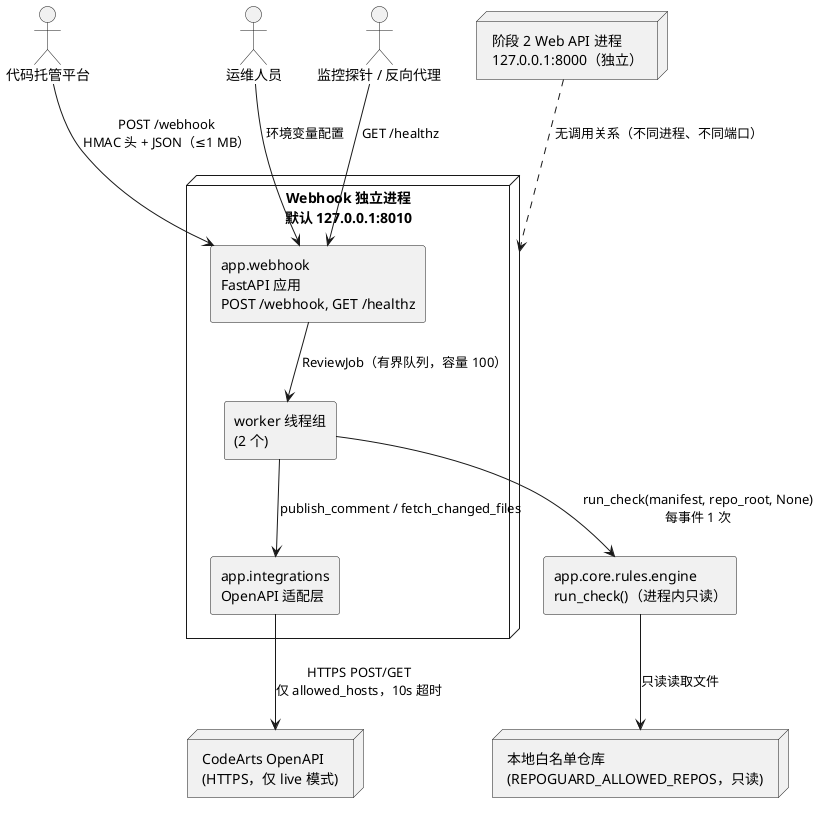
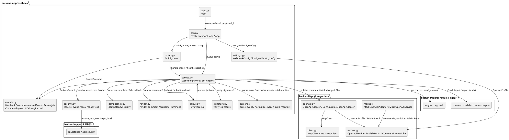
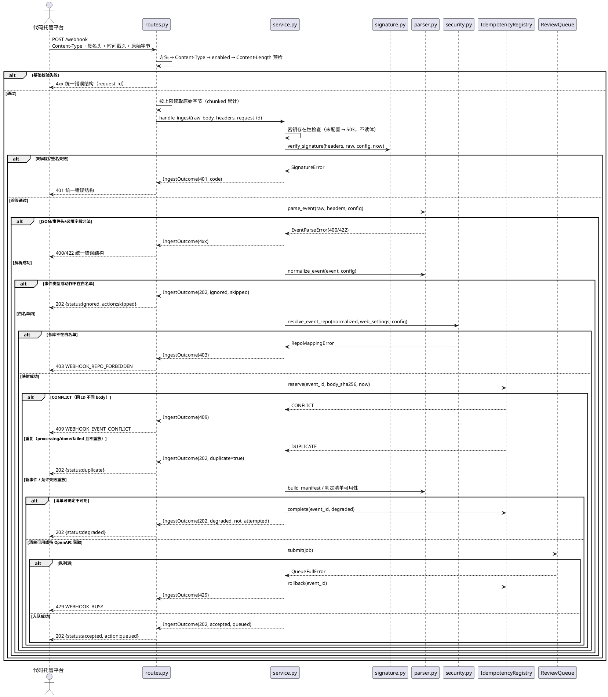
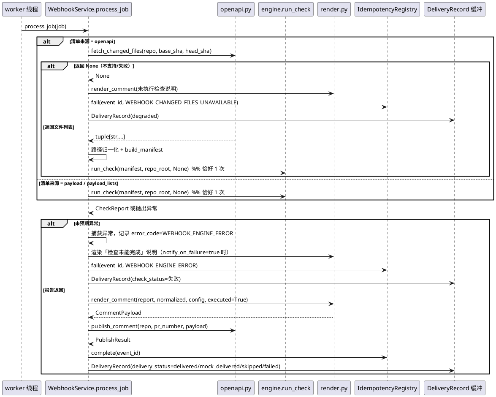
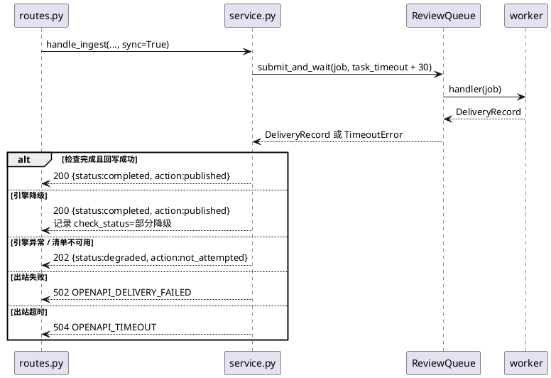
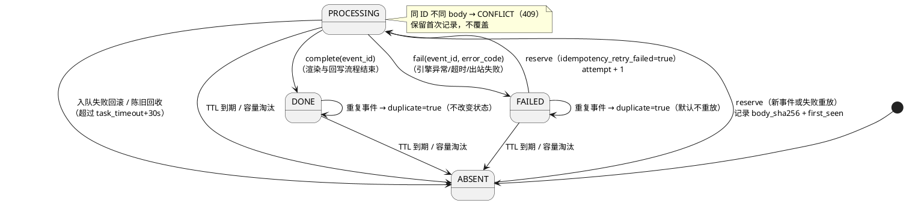
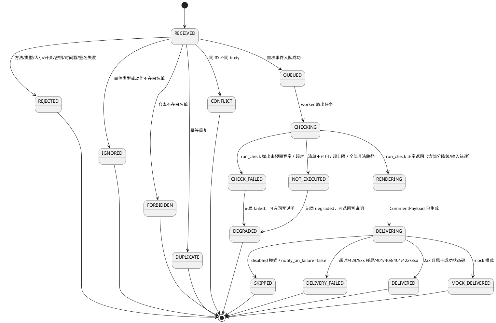
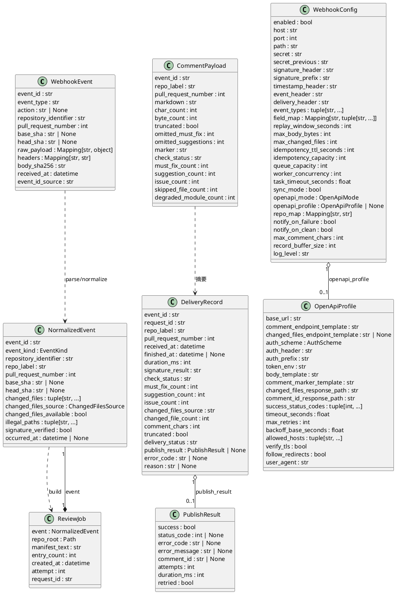

# 一、需求与存量功能关系分析

> 唯一需求依据：`.codeartsdoer/specs/webhook_openapi/spec.md`（1807 行）。
> 唯一实现基线：`backend/app/core/rules/**`（阶段 1，13 个冻结文件）、`backend/app/api/**`（阶段 2）、`backend/app/health/**`、`backend/app/readme/**`、`backend/app/shared/**`（阶段 3）、`backend/requirements.txt`。
> 本文只描述「如何实现」，不包含可直接粘贴的产品代码，不修改任何既有文件；所有产品源码落在 `backend/app/webhook/` 与 `backend/app/integrations/` 两个新包内。

## 1.1 需求功能与存量功能对比

### 1.1.1 已实现功能

下表只列「能力完全或高度可用、本阶段只做导入与调用」的存量功能。匹配度判定依据是「存量函数签名与语义是否可直接支撑需求，无需改变其实现」。

| 需求功能 | 存量功能 | 代码位置 | 匹配度 |
|---------|---------|---------|--------|
| 自动检查的唯一执行入口 | `run_check(manifest_text, repo_root, config=None) -> CheckReport` | `backend/app/core/rules/engine.py:149-153` | 100% |
| 清单为空、仓库不存在、模块异常的降级语义 | `run_check` 在根目录非法时返回 `INPUT_ERROR`；单模块异常写入 `degraded_modules`；空清单返回 `OK` + 中文 `warnings` | `backend/app/core/rules/engine.py:154-171`、`engine.py:63-84` | 100% |
| 问题级别与报告状态语义 | `IssueLevel`（必须修改/优化建议）、`ReportStatus`（正常/部分降级/输入错误） | `backend/app/core/rules/common/models.py:28-37` | 100% |
| 文件分组、组内排序、同类合并 | `FileGroup`、`merge_findings`、`build_report` | `backend/app/core/rules/common/models.py:110-145,179-267` | 100% |
| 报告字段读取与统计一致性 | `report_to_dict` 输出 `status/summary/files/unparsed_lines/degraded_modules/warnings` | `backend/app/core/rules/common/report.py:82-125` | 100% |
| 单条问题的完整字段 | `Finding`：`level/file_path/message/suggestion/rule_id/line_no/excerpt` | `backend/app/core/rules/common/models.py:83-107` | 100% |
| 跳过的文件与降级模块原因 | `FileGroup.skip_reason`、`DegradedModule(module, reason)` | `backend/app/core/rules/common/models.py:110-143` | 100% |
| 仓库白名单与路径逃逸防护 | `resolve_repo_root(raw, settings) -> Path`，非法时抛 `RepoPathError(code, status_code, message, detail)` | `backend/app/api/security.py:71-110` | 100% |
| 白名单配置的解析与范围校验 | `WebSettings`、`load_settings_from_env(env=None)`、`normalize_settings(settings)` | `backend/app/api/settings.py:29-41,115-220` | 100% |
| 仓库脱敏标识 | `repo_label(path, settings=None) -> str`（白名单内取末段目录名） | `backend/app/api/settings.py:274-285` | 100% |
| 并发闸门与超时的既有语义 | `ReviewGate`：`ThreadPoolExecutor` + `threading.BoundedSemaphore`，`asyncio.to_thread` 排队，超时 504 | `backend/app/api/routes.py:56-115` | 75% |
| 引擎可用性探测的「零参数 provider」模式 | `get_engine()` 在函数体内延迟导入 `run_check`，导入失败抛 503 语义 | `backend/app/api/routes.py:118-130` | 100% |
| ASGI 进程内测试装配模式 | `SyncASGIClient` 以 `httpx.ASGITransport` + `AsyncClient` 驱动，`asyncio.run` 同步封装，`raise_app_exceptions=False` | `backend/tests/test_api.py:88-112` | 100% |
| 固定依赖版本 | `fastapi==0.115.6`、`uvicorn==0.34.0`、`httpx==0.28.1` | `backend/requirements.txt:4-8` | 100% |
| 单行 JSON 日志与请求上下文中间件模式 | `request_id` 生成、`Cache-Control: no-store`、统一异常处理器 | `backend/app/api/app.py:37-119` | 75% |

**结论**：检查能力、报告语义、白名单与配置来源四类能力在存量中 100% 就绪，本阶段不得复制其中任何判定逻辑。

### 1.1.2 需要扩展的功能

| 需求功能 | 存量功能 | 差异说明 | 扩展方向 |
|---------|---------|---------|---------|
| 有界任务队列 + 多 worker + 背压 | `ReviewGate`（信号量 + 单次提交，超时后 future 继续运行） | 输入输出差异：`ReviewGate.run()` 在请求内等待一次检查；需求要求「入队即返回 202」并支持队列容量、worker 数、停机预算；边界差异：队列满必须回滚占位，而非 429 后丢弃 | 新建 `webhook/queue.py`，采用 `queue.Queue(maxsize)` + 固定 worker 线程 + 独立检查执行器；不复用 `ReviewGate` 类，只复用其「BoundedSemaphore + future 完成回调释放名额」的并发原则 |
| 引擎调用入口 | `api/routes.get_engine()` 零参数延迟导入 | 输入输出差异：Webhook 需要可注入替身以证明「恰好调用 1 次」，且导入失败要映射到健康降级 | 在 `webhook/service.py` 提供同形态的 `get_engine() -> EngineRunner`，并允许 `WebhookService(..., runner=...)` 注入；生产默认仍调用真实 `run_check` |
| 仓库标识到白名单根 | `resolve_repo_root` 只接受用户输入的仓库字符串 | 输入差异：事件给的是 `owner/repo` 全名、短名或映射表键，需先归一为白名单标识；边界差异：任何映射失败都必须统一 403，不得泄露仓库是否存在 | `webhook/security.py` 只做「事件标识 → 候选 token」的映射，最终解析仍委托 `resolve_repo_root`；禁止自建第二套白名单判断 |
| 仓库脱敏标识 | `settings.repo_label(path, settings)` | 输入差异：需要在尚未解析出路径前用于日志；输出差异：需要固定长度或末段名 | 复用 `repo_label(path, settings)` 作为最终标识；映射失败阶段使用 8 位 SHA-256 前缀，二者都不含绝对路径 |
| 请求上下文与统一错误结构 | `api/app.py` 的中间件与异常处理器 | 输出差异：Webhook 错误结构固定为 `{status, error{code,message,detail}, request_id}`，且必须带 `Cache-Control: no-store`；阶段 2 结构不能复用代码，只能复用形态 | `webhook/routes.py` 内独立实现等价中间件与异常处理器；不导入 `app.api.app`、`app.api.schemas` |
| ASGI 测试装配 | `SyncASGIClient`（仅 GET/POST 与 JSON） | 输入差异：需要发送原始 `bytes` 与自定义签名头；输出差异：需要读取 `Response.content` 验证 UTF-8 中文不转义 | `backend/tests/webhook_helpers.py` 提供 `WebhookASGIClient`，沿用 `httpx.ASGITransport` + `AsyncClient` + `asyncio.run` 的装配方式，不修改阶段 2 测试文件 |
| 健康检查 | `GET /api/health` 的七字段只读响应 | 字段差异：需求要求 13 个字段（含 `recent_delivery_failures`）、独立服务名 `repoguard-webhook`、503 降级语义 | 新建独立路由，只读 `WebhookService` 的内存状态；不得调用引擎、不得扫描仓库 |

### 1.1.3 需要新增的功能与接口

按业务模块分组。每个功能点标注输入、输出、核心逻辑与依赖关系。

**（1）入站安全（`webhook/signature.py`）**

| 功能点 | 输入 | 输出 | 核心逻辑 | 依赖 |
|--------|------|------|---------|------|
| 签名头解析 | `headers: Mapping[str,str]`、`config` | `SignatureHeader(value, present)` | 去空白 → 校验前缀 → 校验 64 位十六进制 → 转小写 | 标准库 `re`/`hmac`/`hashlib` |
| 时间戳解析与窗口校验 | 时间戳头字符串、`replay_window_seconds`、`now` | `TimestampResult(seconds, skew_seconds, unit)` 或 `SignatureError` | 纯数字校验 → 10 位按秒、13 位按毫秒 → 与服务器 UTC 比较 → 绝对值 ≤ 窗口；超前超窗与过期分别映射 | 标准库 `time` |
| HMAC 校验 | 原始字节、时间戳头原文、当前/上一版本密钥 | `SignatureResult(ok, used_previous)` 或 `SignatureError` | `HMAC-SHA256(secret, f"{ts}.{raw}")` → `hmac.compare_digest`；先当前后上一版本 | 标准库 `hmac`/`hashlib` |
| 常量时间与失败统一 | 期望值、提供值 | 布尔 | 只使用 `compare_digest`；错误文案、状态码、响应结构完全一致 | 无 |

**（2）解析与归一化（`webhook/parser.py`）**

| 功能点 | 输入 | 输出 | 核心逻辑 | 依赖 |
|--------|------|------|---------|------|
| JSON 解析 | 原始字节 | `dict[str, object]` 或 `EventParseError(400)` | 按 UTF-8 严格解码 → `json.loads` → 顶层必须是对象 | 标准库 `json` |
| 事件类型识别 | 请求头、payload、`field_map` | `event_type: str` 或 `EventParseError(422)` | 事件头优先 → payload 路径回退 → 仍失败 422 | 标准库 |
| 事件类型白名单 | `event_type`、`event_types`、`event_kind_map` | `EventKind(created/updated)` 或 `skipped` | 不在白名单直接 ignored；无法判定 created/updated 则 422 | 无 |
| 事件标识回退 | payload、投递头、内容上下文 | `event_id`、`event_id_source` | payload 字段 → 投递头 → 稳定内容哈希（事件类型+仓库+PR+提交区间+原始字节） | 标准库 `hashlib` |
| 字段映射 | payload、`field_map` 的路径列表 | 必填字段与可选字段 | 逐条路径取值；类型不符不强制转换；必填缺失 422 | 无 |
| 变更文件提取 | payload | `tuple[str,...]` 或「不可用」 | `changed_files`（全 M）→ `added/modified/removed_files`（A/M/D）→ 交由编排层走 OpenAPI | 无 |
| 路径归一化 | 原始路径字符串 | `NormalizedPath(path)` 或 `IllegalPath(raw, reason)` | 去空白 → `\`→`/` → 去 `./` → 折叠 `//` → 去尾 `/`；剔除绝对/盘符/UNC/`..`/控制字符/超长 | 标准库 `re` |
| 清单构造 | 归一化路径与状态 | `(manifest_text, entry_count)` | 每行「状态 + 空格 + 相对路径」；去重保序；上限由编排层判定 | 无 |

**（3）仓库映射（`webhook/security.py`）**

| 功能点 | 输入 | 输出 | 核心逻辑 | 依赖 |
|--------|------|------|---------|------|
| 事件仓库映射 | `repository_identifier`、`repo_map`、`WebSettings` | 允许仓库根 `Path` | 显式映射表 → 全名末段 → 短名 → 调 `resolve_repo_root`；全部失败统一 `RepoMappingError(403)` | `..api.settings`、`..api.security` |
| 脱敏标识 | 路径或标识 | `repo_label` | 白名单内取目录末段；否则 8 位哈希 | `..api.settings.repo_label` |
| 统一脱敏 | 文本、密钥清单、绝对根清单 | 脱敏文本 | 命中密钥值、`Bearer ` 片段、盘符/UNC/用户目录 → `****` | 标准库 `re` |

**（4）幂等（`webhook/idempotency.py`）**

| 功能点 | 输入 | 输出 | 核心逻辑 | 依赖 |
|--------|------|------|---------|------|
| 原子占位 | `event_id`、`body_sha256`、`now` | `ReservationResult(state, retry_allowed)` | 锁内查表 → 过期/不存在则新建 `PROCESSING`；同 body 按状态返回重复；不同 body 返回 `CONFLICT` | 标准库 `threading`/`time` |
| 完成/失败登记 | `event_id`、错误码 | 无 | 锁内状态迁移；失败保留错误码与时间 | 无 |
| 回滚 | `event_id`、占位前状态 | 无 | 新建记录删除；重放记录恢复 `FAILED` | 无 |
| TTL 与容量 | `ttl_seconds`、`capacity`、`now` | 淘汰计数 | 惰性清理过期；超容量按最近最少使用淘汰，处理中记录延后淘汰 | 标准库 `collections.OrderedDict` |

**（5）队列与编排（`webhook/queue.py`、`webhook/service.py`）**

| 功能点 | 输入 | 输出 | 核心逻辑 | 依赖 |
|--------|------|------|---------|------|
| 有界入队 | `ReviewJob` | 无 或 `QueueFullError` | `put_nowait`；满则立即失败，由路由回滚占位并返回 429 | 标准库 `queue` |
| worker 循环 | 队列、`handler`、`concurrency` | 后台 `DeliveryRecord` | 固定 worker 线程取任务；每任务提交检查执行器并按剩余预算等待 | 标准库 `threading`/`concurrent.futures` |
| 单次引擎调用 | `ReviewJob`、`EngineRunner` | `CheckReport` 或异常 | 先做仓库映射与清单可用性判定；只有「可用」分支调用 1 次 `run_check(..., config=None)`；任何重试都不重复调用 | `..core.rules.engine` |
| 降级与异常透传 | 引擎异常、`INPUT_ERROR`、超时 | `DeliveryRecord` + 评论说明 | 异常捕获后记录 `WEBHOOK_ENGINE_ERROR`；超时记录 `timeout`；不得输出「未发现问题」 | 无 |
| 评论渲染与回写 | `CheckReport`、`NormalizedEvent`、`config` | `CommentPayload`、`PublishResult` | 单入口渲染 → 模式分流（disabled/mock/live）→ 记录投递状态 | `render.py`、`..integrations.openapi` |
| 投递记录 | 事件与结果 | `DeliveryRecord` | 环形缓冲，容量 `record_buffer_size`，最旧淘汰 | 标准库 `collections.deque` |

**（6）出站（`integrations/**`）**

| 功能点 | 输入 | 输出 | 核心逻辑 | 依赖 |
|--------|------|------|---------|------|
| 配置化适配器 | `OpenApiProfile`、`HttpClient` | `PublishResult` / `tuple[str,...] \| None` | endpoint/认证/模板全部来自 profile；URL 与主机校验；超时、重试、退避；401/403/404/422/3xx 不重试 | `httpx`（`import httpx`） |
| HTTP 客户端抽象 | 方法、URL、头、内容、超时 | `HttpResponse` | Protocol 化，生产实现包装 `httpx.Client`，测试注入 `httpx.MockTransport` | `httpx` |
| 内存 mock | `CommentPayload` | `PublishResult` | 记录收到的评论；可编排响应结果；线程安全 | 标准库 |
| 进程内 mock 服务 | ASGI 请求 | 201/200 JSON | 独立 FastAPI 应用，路由前缀 `/mock`，记录请求；不监听端口 | `fastapi` |

**（7）启动与健康（`webhook/__main__.py`、`webhook/routes.py`、`webhook/app.py`）**

| 功能点 | 输入 | 输出 | 核心逻辑 | 依赖 |
|--------|------|------|---------|------|
| 应用工厂 | `WebhookConfig \| None` | `FastAPI` | 装配配置、服务、路由、中间件、异常处理器、生命周期；模块级 `app` | `fastapi` |
| 独立监听入口 | 环境变量 | 进程 | `python -m app.webhook` → `uvicorn.run(app, host, port)`；端口占用退出、`0.0.0.0` 中文警告 | `uvicorn` |
| 健康检查 | 无 | 13 字段 JSON | 只读内存与配置；密钥/引擎/live 配置/白名单/开关异常时 503 degraded | 无 |
| 统一错误响应 | 异常 | JSON | 稳定错误码 + 中文文案 + `request_id`；`Cache-Control: no-store` | `starlette.responses` |

## 1.2 存量功能详细分析

### 1.2.1 `run_check()` 的接口契约与约束

| 维度 | 事实 | 对 Webhook 的约束 |
|------|------|------------------|
| 入参 | `manifest_text: str`、`repo_root: str \| Path`、`config: RuleConfig \| None = None` | 只传内存清单与已解析的白名单根；`config` 必须显式传 `None` |
| 出参 | 冻结 `CheckReport`，含 `status/summary/files/unparsed_lines/degraded_modules/warnings` | 原样使用，不重建报告、不改写级别、不合并问题 |
| 异常边界 | 根目录缺失 → `INPUT_ERROR`；单模块异常 → `PARTIAL_DEGRADED` + `degraded_modules`；其余未预期异常仍可能向上抛 | 编排层必须外层 `try/except`，异常不得吞掉后伪装成功 |
| 副作用 | 只读磁盘；内部 `snapshot_cache` 为局部变量 | 不得并发复用同一事件结果；不得写入被检查仓库 |
| 调用次数 | 一次调用完成一次完整检查 | 每事件恰好 1 次；失败重放也是一次新的「恰好 1 次」 |
| 性能 | 500 条变更 / 100 个可读文件 ≤ 10 秒（阶段 1 预算） | Webhook 层附加开销 ≤ 500 毫秒；不得在请求内执行 |

### 1.2.2 `CheckReport` 与 `report_to_dict()` 的语义基线

1. `report.files` 已按 `file_path` 升序，组内「必须修改在前 → 有行号在前 → 行号升序 → `rule_id` → `message`」排序（`engine.py:53-104`）。
2. `summary` 的七个计数由 `build_report` 统一计算，与 `files` 强一致；`validate_report` 可复核（`common/models.py:270-300`）。
3. `report_to_dict` 只读，不重排、不改字段（`common/report.py:82-125`）；评论渲染必须复用该顺序语义，不得二次排序。
4. `ReportStatus.INPUT_ERROR` 属于「检查未完成」，评论必须说明，禁止当作通过。
5. `degraded_modules` 与 `warnings` 必须原样出现在投递记录与评论中。

### 1.2.3 配置与白名单的复用边界

| 对象 | 可复用部分 | 禁止部分 |
|------|-----------|---------|
| `WebSettings` | 字段结构、`allowed_repo_roots`、`default_repo` | 不得修改默认值、不得新增字段 |
| `load_settings_from_env()` | 作为唯一白名单来源，启动时调用一次并缓存于应用状态 | 禁止在 Webhook 内自建 `REPOGUARD_ALLOWED_REPOS` 解析 |
| `normalize_settings()` | 过滤不存在/重复根、范围回退 | 禁止放宽白名单或把空白名单视为「允许全部」 |
| `resolve_repo_root()` | 绝对/相对归一、`..`/UNC 拒绝、公共前缀比较、存在性检查 | 禁止绕过、禁止拼接字符串后直接 `Path()` |
| `repo_label()` | 白名单内末段目录名 | 禁止把绝对路径写入日志、评论、记录 |
| `RepoPathError` | 捕获后统一映射为 `403 WEBHOOK_REPO_FORBIDDEN` | 禁止把 `code/message/detail` 原样透出（会泄露仓库存在性） |

### 1.2.4 `ReviewGate` 的可借鉴点与不可复用点

- **可借鉴**：`threading.BoundedSemaphore` 而非 `asyncio.Semaphore`（ASGI 测试会多次进入不同事件循环，跨循环信号量失效，阶段 2 已验证）；名额在 future 完成回调中释放；超时只放弃等待，不强杀线程。
- **不可复用**：`ReviewGate.run()` 在请求协程内等待，无法支撑「入队即 202」；其超时返回 504 仅供同步检查语义；其信号量不包含队列容量与背压回滚。
- **结论**：新建 `ReviewQueue`，并发与超时原则照搬，接口与状态机完全独立。

### 1.2.5 导入方向的机械断言（本阶段最大硬约束）

`backend/tests/test_engine.py:295-351` 的 `test_import_direction` 对 `backend/app/**/*.py` 全量遍历，**本阶段不得修改该方法体与白名单**。新增包（`webhook/`、`integrations/`）不属于 `api` 子树，走「严格分支」：

1. 严格分支**只检查 `ast.ImportFrom`**；`ast.Import`（如 `import fastapi`、`import httpx`、`import hashlib`、`import threading`、`import queue`、`import datetime`、`import urllib.parse`、`import logging`、`import uvicorn`）不参与断言。
2. 绝对导入（`node.level == 0`）的根模块必须属于固定 18 项：`__future__`、`argparse`、`ast`、`collections`、`dataclasses`、`enum`、`ipaddress`、`json`、`math`、`os`、`pathlib`、`re`、`sys`、`time`、`traceback`、`types`、`typing`、`unittest`。
3. 相对导入（`node.level >= 1` 且非包 `__init__.py`）只检查首段，不得为 `naming`、`code_scan`、`link_check`、`sensitive`、`engine`。
4. 因此：
   - `from fastapi import ...`、`from httpx import ...`、`from starlette.responses import ...`、`from hashlib import ...`、`from hmac import ...`、`from threading import ...`、`from queue import ...`、`from datetime import ...`、`from urllib.parse import ...`、`from logging import ...` **一律禁止**；
   - `from ..core.rules.engine import run_check`、`from ..api.settings import WebSettings`、`from ..api.security import resolve_repo_root`、`from .models import ...`、`from ..integrations.models import ...` **允许**（首段分别为 `core`/`api`/`models`/`integrations`）；
   - `from pathlib import Path`、`from dataclasses import dataclass`、`from enum import Enum`、`from typing import Protocol`、`from collections.abc import Mapping`、`from collections import OrderedDict`、`from re import ...` **允许**（根在白名单）。

**推论**：本设计对每个新增文件给出逐条导入清单（见 2.6），任何一条越界都会直接破坏既有测试。

### 1.2.6 复用基线与冻结红线

| 基线项 | 当前值 | 本阶段要求 |
|--------|--------|-----------|
| 既有测试总数 | 310 条（307 passed + 3 skipped：1 条性能用例 + 2 条 Windows 符号链接平台用例） | 不得减少；不得新增 failed/error；跳过原因不变 |
| CLI 回归 | `python -m app.core.rules.engine` 12 passed | 参数、退出码 0/1/2/3、stdout/stderr 逐字节不变 |
| 13 个冻结文件 | `engine.py`、`naming.py`、`code_scan.py`、`link_check.py`、`sensitive.py`、`common/{__init__,config,file_io,manifest,models,report}.py`、`rules/__init__.py`、`tests/test_cli.py` | SHA-256 前后差异必须为 0 |
| 阶段 2 资产 | `backend/app/api/**`、`backend/app/static/index.html` | 零改动；路由集合不含 `/webhook`、`/healthz` |
| 阶段 3 资产 | `backend/app/health/**`、`readme/**`、`shared/**` | 零改动、零导入 |
| 依赖清单 | `requirements.txt` 三段式 | 零新增、零改行；`test_requirements_txt` 通过 |
| 引擎纯净性 | `app/core/rules/**` 不出现 `fastapi/uvicorn/httpx/starlette/pydantic` | 保持 |

**红线（违反即停止）**：

1. 不在 `backend/app/` 之外新增产品源码；产品源码只允许落在两个新包。
2. 不复制四个检查模块的正则、阈值、级别判定与建议文案；只允许 `run_check()` 一个入口。
3. 不执行 `git clone/fetch/pull/ls-remote`，不调用 `subprocess` 执行 git。
4. 不写被检查仓库；不把请求体、评论正文写入文件。
5. 不在日志、响应、错误详情、评论、投递记录中出现密钥/令牌原文、签名原文、绝对路径、请求体原文。
6. 不引入数据库、Redis、消息队列、`requests`、`aiohttp`、`cryptography` 等新依赖。
7. 不提供「跳过验签」的运行时开关；测试通过注入密钥与正确签名通过校验。
8. 不注册到阶段 2 应用；不导入 `app.api.app`、`app.api.routes`、`app.health.*`、`app.readme.*`、`app.shared.*`。

# 二、增量设计方案

## 2.1 实现模型

### 2.1.1 上下文视图



**交互说明**：

| 关系 | 协议/方式 | 频率 | 约束 |
|------|----------|------|------|
| 平台 → 接收端 | HTTPS（由反向代理终止 TLS）→ HTTP 本机 | 每次 PR/MR 创建或更新 | 入站请求体 ≤ 1 MB；返回 ≤ 200 ms（P95） |
| 探针 → `/healthz` | HTTP GET | 探针周期（可秒级） | 只读内存，≤ 100 ms，无副作用 |
| 接收端 → 引擎 | 进程内同步函数调用 | 每事件 1 次 | 只传内存清单 + 白名单根 + `config=None` |
| worker → 出站 | HTTPS（`httpx`） | 每事件 1 次评论；清单缺失时 1 次查询 | 仅 `allowed_hosts`；不跟随重定向；默认 disabled 不发请求 |
| 阶段 2 ↔ 接收端 | 无 | — | 独立进程、独立应用、独立端口 |

### 2.1.2 服务/组件总体架构



**依赖方向（只允许自左向右、自上向下）**：

```text
routes/app → service → {signature, parser, security, idempotency, queue, render}
service → integrations.openapi → integrations.client → integrations.models
service → core.rules.engine / core.rules.common.*
security → api.settings / api.security
settings → integrations.models（仅 dataclass 类型）
```

**禁止反向**：`signature/parser/security/idempotency/render/queue/models/settings` 不得导入 `service/routes/app`；`integrations/**` 不得导入 `webhook.service/routes/app/queue`；`core.rules/**` 不得导入任何新包。

### 2.1.3 线程、队列与背压模型

| 组件 | 承载者 | 数量 | 生命周期 | 说明 |
|------|--------|------|---------|------|
| HTTP 请求处理 | FastAPI 事件循环 | 由服务器决定 | 应用生命周期 | 只做传输层校验、验签、解析、占位、入队；不执行检查 |
| 有界队列 | `queue.Queue(maxsize=queue_capacity)` | 1 | 应用生命周期 | 默认容量 100；`put_nowait` 满即失败 |
| worker | `threading.Thread(daemon=True)` | `worker_concurrency`（默认 2） | `start()` 至 `shutdown()` | 循环取任务，提交检查执行器并等待预算 |
| 检查执行器 | `concurrent.futures.ThreadPoolExecutor` | `worker_concurrency` | 应用生命周期 | 隔离「超时但仍在运行」的任务；超时不强杀 |
| 去重表 | `threading.Lock` + `OrderedDict` | 1 | 应用生命周期 | 原子占位；TTL 与容量淘汰 |
| 投递记录缓冲 | `collections.deque(maxlen=record_buffer_size)` | 1 | 应用生命周期 | 最旧淘汰，默认 500 |
| 出站客户端 | `httpx.Client`（同步） | 每个适配器 1 个 | 适配器生命周期 | 连接池复用；`follow_redirects=False` |

**关键决策与理由**：

1. **入队即返回 202**：入站路径只做内存操作，避免检查耗时影响平台超时；对应 spec 5.1.1 第 6 条。
2. **固定 worker + 有界队列**：容量与并发在 `WebhookConfig` 集中配置；队列满时立即 429 并回滚占位，避免无界内存增长（spec 4.1 第 7 条、7.4）。
3. **检查执行器与 worker 分离**：worker 可以用 `future.result(timeout=remaining)` 放弃等待超时任务，而不会永久阻塞取下一个任务；代价是超时任务仍占用一个执行器线程（spec 5.3.3 第 5 条允许「不强制终止、结果丢弃」）。
4. **同步模式复用同一队列**：`submit_and_wait()` 入队后等待 `threading.Event`，保证同步与异步走同一条检查路径，`run_check()` 仍然只调用 1 次。
5. **不使用 `asyncio.Semaphore`**：ASGI 传输测试会多次进入不同事件循环，跨循环信号量会失效（阶段 2 已证实）；统一使用 `threading` 原语。

### 2.1.4 时序图

**（1）入站接收与快速返回**



**（2）后台检查、渲染与回写**



**（3）同步模式**



**（4）失败与降级路径**

```plantuml
@startuml
skinparam defaultFontName "Microsoft YaHei"
participant "WebhookService" as S
participant "IdempotencyRegistry" as I
participant "DeliveryRecord" as D
participant "日志" as L

S -> S : 任一步骤失败
alt 入站前置失败（验签/解析/白名单）
  S -> L : 记录 error_code + request_id（无 event_id 时为空）
  note right：不占位、不回评
else 已占位且入队失败
  S -> I : rollback(event_id)
  S -> L : error_code=WEBHOOK_BUSY，记录回滚
else 已占位且检查/出站失败
  S -> I : fail(event_id, error_code)
  S -> D : 写入失败记录（含中文 reason）
  S -> L : 记录 delivery_status=failed/degraded
  note right：已返回的 202 不回改；\n禁止补写「回评成功」日志
end
@enduml
```

### 2.1.5 状态图

**（1）幂等记录状态机**



**（2）单事件处理状态机**



**状态与 `delivery_status` 映射**：

| 处理终态 | `check_status` | `delivery_status` | 是否回评 |
|---------|---------------|------------------|---------|
| `NOT_EXECUTED` | 未执行 | `degraded`（默认回写说明）或 `not_attempted` | 仅降级说明 |
| `CHECK_FAILED` | 失败/超时 | `degraded`（默认回写失败说明）或 `not_attempted` | 仅失败说明 |
| `DELIVERED` | 正常/部分降级/输入错误 | `delivered` | 已回写 |
| `MOCK_DELIVERED` | 同上 | `mock_delivered` | 写入本地 mock |
| `SKIPPED` | 同上 | `skipped` | 不回写（disabled 或通知关闭） |
| `DELIVERY_FAILED` | 同上 | `failed` | 未成功回写 |
## 2.2 接口设计

### 2.2.1 总体设计

| 分类 | 接口 | 使用方 | 稳定性 | 版本/变更策略 |
|------|------|--------|--------|--------------|
| HTTP 入站 | `POST {config.path}`（默认 `/webhook`） | 代码托管平台 | 稳定 | 路径可配置；响应字段只增不改；错误码只增不改 |
| HTTP 运维 | `GET /healthz`（固定） | 监控探针 / 反向代理 | 稳定 | 字段只增不改；`status` 只取 `ok/degraded` |
| 内部编排 | `WebhookService.handle_ingest()`、`handle_ingest_sync()`、`process_job()`、`shutdown()`、`health_snapshot()` | 路由、队列、测试 | 稳定（包内） | 仅供本包与测试使用，不对外承诺 |
| 出站适配 | `OpenApiAdapter`（Protocol） | `WebhookService` | 稳定 | 两个方法签名固定；新增能力以可选方法或新 Protocol 扩展 |
| HTTP 客户端 | `HttpClient`（Protocol） | `ConfigurableOpenApiAdapter`、测试 | 稳定 | 单一 `request()` 方法；实现可替换 |
| 注入点 | `EngineRunner`（Protocol）、`clock`、`sleeper`、`adapter`、`runner` | 测试与生产装配 | 稳定 | 构造参数均为可选；缺省使用生产实现 |

**接口粒度决策**：

1. **HTTP 与内部接口分离**：路由只做传输层校验与响应映射，业务全部在 `WebhookService`，避免把签名、白名单、队列逻辑写进路由（spec 4.4 第 6 条「单一渲染入口」与 5.6.1 第 4 条「配置集中」）。
2. **出站用 Protocol 而非继承基类**：`OpenApiAdapter`、`HttpClient` 均为结构化协议，`MockOpenApiAdapter`、`httpx.MockTransport` 无需继承任何基类即可替换。
3. **不提供「跳过验签」参数**：`verify_signature()` 无 `enabled` 开关；测试通过正确密钥与签名通过校验（spec 4.3 第 1 条）。
4. **错误码与文案分离**：内部抛 `WebhookError(code, status_code, message, detail)` 子类；路由统一映射为响应体，禁止分支各自拼字典。

### 2.2.2 接口清单

#### （1）HTTP：`POST {config.path}`

```python
# 路由注册形态（设计签名，不是完整实现）
def build_router(service: "WebhookService", config: "WebhookConfig") -> "fastapi.APIRouter": ...

# 处理器（由 build_router 内部注册，async）
async def receive_webhook(request: "fastapi.Request") -> "starlette.responses.JSONResponse": ...
```

| 项 | 约定 |
|----|------|
| 方法/路径 | `POST` + `config.path`（默认 `/webhook`，必须以 `/` 开头、1～64 字符、不含 `..` 与控制字符） |
| 请求头 | `Content-Type: application/json`（允许 `; charset=utf-8`）；签名头/时间戳头/事件头/投递头（头名全部来自配置） |
| 请求体 | 原始 JSON 字节；上限 `max_body_bytes`（默认 1,048,576） |
| 成功响应 | 异步模式 202；同步模式 200；降级 202；重复 202；忽略 202 |
| 失败响应 | 400/401/403/404/405/409/413/415/422/429/500/502/503/504 |
| 缓存 | 所有响应带 `Cache-Control: no-store` |
| 认证 | HMAC-SHA256；不依赖 IP 白名单与平台账号 |
| 幂等 | 事件标识去重；重复返回 202 且不重复回评 |

**前置条件**：服务 `enabled=true`；签名密钥已配置；实际读取字节数不超过上限。
**后置条件**：首次事件完成幂等占位并入队（异步）或在预算内完成检查与回写（同步）；响应体不含清单、报告、评论、绝对路径。
**副作用**：仅内存写入（占位表、队列、投递记录）；不写文件、不访问网络（disabled 模式）。
**异常映射**：见 2.7。

**成功响应体**（字段固定，不追加内部字段）：

```json
{
  "status": "accepted",
  "event_id": "<事件标识>",
  "duplicate": false,
  "action": "queued",
  "reason": null,
  "request_id": "<请求标识>"
}
```

**统一错误响应体**：

```json
{
  "status": "rejected",
  "error": {"code": "<稳定大写常量>", "message": "<中文提示>", "detail": null},
  "request_id": "<请求标识>"
}
```

**调用示例**（测试辅助层的真实调用形态）：

```python
headers = make_headers(secret="test-secret-<random>", raw_body=raw, event_type="pr.created", event_id="evt-001")
response = client.post("/webhook", content=raw, headers=headers)
assert response.status_code == 202
assert response.json()["status"] == "accepted"
assert response.json()["action"] == "queued"
```

#### （2）HTTP：`GET /healthz`

```python
async def healthz(request: "fastapi.Request") -> "starlette.responses.JSONResponse": ...
```

| 项 | 约定 |
|----|------|
| 方法/路径 | `GET /healthz`（固定，不随 `config.path` 改变） |
| 请求体 | 无；带请求体时忽略，不读取 |
| 成功 | 200，`status="ok"` |
| 降级 | 503，`status="degraded"` |
| 缓存 | `Cache-Control: no-store` |
| 副作用 | 无引擎执行、无文件扫描、无出站请求、无锁等待 |

**响应字段（13 项，顺序固定）**：

```json
{
  "status": "ok",
  "service": "repoguard-webhook",
  "version": "1.0.0",
  "secret_configured": true,
  "signature_algorithm": "HMAC-SHA256",
  "openapi_mode": "disabled",
  "engine": "available",
  "queue_depth": 0,
  "queue_capacity": 100,
  "dedup_size": 0,
  "allowed_repo_count": 1,
  "recent_delivery_failures": 0,
  "time": "2026-11-07T00:00:00+00:00"
}
```

**降级判定（任一命中即 503）**：

1. `config.enabled == false`；
2. `config.secret` 为空；
3. 引擎不可导入（启动时探测结果为 `unavailable`）；
4. `web_settings.allowed_repo_roots` 为空；
5. `openapi_mode == "live"` 且 profile 校验缺失项；
6. `queue_capacity <= 0`（仅在显式注入且未归一化时出现）。

#### （3）内部：`EngineRunner`

```python
class EngineRunner(Protocol):
    def __call__(
        self,
        manifest_text: str,
        repo_root: "str | Path",
        config: "RuleConfig | None" = None,
    ) -> "CheckReport": ...
```

- **业务说明**：`run_check()` 的结构化类型；`WebhookService` 只通过该协议调用引擎。
- **前置条件**：`manifest_text` 已由 `build_manifest()` 构造，行数 ≤ `max_changed_files`；`repo_root` 已通过 `resolve_repo_root()`。
- **后置条件**：返回不可变 `CheckReport`；`config` 实参必须为 `None`。
- **异常映射**：异常由 `process_job()` 统一捕获，映射为 `WEBHOOK_ENGINE_ERROR`，不重复调用。
- **调用示例（生产默认实现）**：

```python
def get_engine() -> EngineRunner:
    from ..core.rules.engine import run_check

    if not callable(run_check):
        raise EngineUnavailableError("规则引擎当前不可用")
    return run_check
```

#### （4）内部：`OpenApiAdapter`

```python
class OpenApiAdapter(Protocol):
    def fetch_changed_files(
        self, repo: str, base_sha: str, head_sha: str
    ) -> "tuple[str, ...] | None": ...

    def publish_comment(
        self, repo: str, pr_number: int, payload: "CommentPayloadLike"
    ) -> "PublishResult": ...
```

- **业务说明**：把「获取变更清单」与「提交 PR 评论」抽象为两个方法；平台细节全部来自 `OpenApiProfile`。
- **前置条件**：`repo` 为已脱敏可用的仓库标识（白名单内 token）；`pr_number` 为正整数；`base_sha`/`head_sha` 在调用 `fetch_changed_files` 时均非空。
- **后置条件**：`publish_comment` 必须返回 `PublishResult`，不得抛异常后返回成功；`fetch_changed_files` 返回 `None` 表示「不支持或无法获取」，不得用空元组伪装成功。
- **异常映射**：适配器内部把 HTTP 失败转为 `PublishResult(success=False, error_code=...)`；未预期异常允许向上抛，由 `process_job()` 统一转为失败记录。
- **调用示例**：

```python
adapter = ConfigurableOpenApiAdapter(profile, client=HttpxHttpClient(transport=mock_transport))
result = adapter.publish_comment("demo-repo", 12, payload)
assert result.success is False
assert result.error_code == "OPENAPI_AUTH_FAILED"
assert result.attempts == 1
```

#### （5）内部：`HttpClient`

```python
@dataclass(frozen=True, slots=True)
class HttpResponse:
    status_code: int
    headers: "Mapping[str, str]"
    content: bytes
    elapsed_ms: float

class HttpClient(Protocol):
    def request(
        self,
        method: str,
        url: str,
        *,
        headers: "Mapping[str, str]",
        content: bytes | None,
        timeout: float,
    ) -> HttpResponse: ...
```

- **业务说明**：出站单次请求的最小抽象；实现必须禁用重定向、禁用 Cookie、限制响应体读取。
- **前置条件**：`url` 已通过 scheme/host/凭据校验；`timeout` 为正数。
- **后置条件**：返回状态码、头、原始字节与耗时；网络异常（连接失败、超时）向上抛，由适配器分类。
- **异常映射**：`httpx.TimeoutException` → `OPENAPI_TIMEOUT`；`httpx.ConnectError`/`httpx.TransportError` → `OPENAPI_UNAVAILABLE`。
- **调用示例**：

```python
transport = httpx.MockTransport(handler)
client = HttpxHttpClient(transport=transport)
adapter = ConfigurableOpenApiAdapter(profile, client=client, sleeper=lambda _: None)
```

#### （6）内部：`WebhookService`

```python
@dataclass(frozen=True, slots=True)
class IngestOutcome:
    status_code: int
    body: "dict[str, object]"
    error_code: str | None = None

@dataclass(frozen=True, slots=True)
class HealthSnapshot:
    status: str
    service: str
    version: str
    secret_configured: bool
    signature_algorithm: str
    openapi_mode: str
    engine: str
    queue_depth: int
    queue_capacity: int
    dedup_size: int
    allowed_repo_count: int
    recent_delivery_failures: int
    time: str

class WebhookService:
    def __init__(
        self,
        config: "WebhookConfig",
        web_settings: "WebSettings",
        *,
        runner: "EngineRunner | None" = None,
        adapter: "OpenApiAdapter | None" = None,
        registry: "IdempotencyRegistry | None" = None,
        queue: "ReviewQueue | None" = None,
        clock: "Callable[[], float] | None" = None,
        sleeper: "Callable[[float], None] | None" = None,
    ) -> None: ...

    def start(self) -> None: ...
    def shutdown(self, timeout: float | None = None) -> None: ...
    def handle_ingest(
        self, raw_body: bytes, headers: "Mapping[str, str]", request_id: str
    ) -> IngestOutcome: ...
    def handle_ingest_sync(
        self, raw_body: bytes, headers: "Mapping[str, str]", request_id: str
    ) -> IngestOutcome: ...
    def process_job(self, job: "ReviewJob") -> "DeliveryRecord": ...
    def health_snapshot(self) -> HealthSnapshot: ...
    def recent_records(self, limit: int = 50) -> "tuple[DeliveryRecord, ...]": ...
```

- **业务说明**：唯一编排入口；负责验签、解析、归一化、仓库映射、幂等占位、入队/同步执行、检查、渲染、回写、记录与健康快照。
- **前置条件**：`raw_body` 已按上限读取；`headers` 只包含配置声明的四类头（其他头被 `routes` 丢弃）。
- **后置条件**：返回与响应体一致的 `IngestOutcome`；已占位事件最终进入 `done` 或 `failed`；`process_job()` 恰好调用 1 次 `run_check()`（清单可用时）。
- **异常映射**：业务异常在内部转为 `IngestOutcome`；未预期异常由路由兜底映射为 `500 WEBHOOK_INTERNAL_ERROR`，不得泄露堆栈。
- **调用示例**：

```python
service = WebhookService(config, web_settings, runner=fake_runner, adapter=MockOpenApiAdapter())
app = create_webhook_app(config, service=service)
outcome = service.handle_ingest(raw, headers, request_id="req-001")
assert outcome.status_code == 202
assert outcome.body["action"] == "queued"
```

#### （7）测试注入接口

| 注入点 | 形态 | 用途 |
|--------|------|------|
| `create_webhook_app(config, *, service=None, runner=None, adapter=None, clock=None, sleeper=None)` | 关键字参数 | 全应用替换；测试构造独立应用实例 |
| `WebhookService(..., runner=fake)` | 构造参数 | 计数引擎调用次数、模拟异常/降级/超时 |
| `ConfigurableOpenApiAdapter(profile, client=..., sleeper=..., clock=...)` | 构造参数 | `httpx.MockTransport` 编排响应序列；sleep 替身避免真实等待 |
| `MockOpenApiAdapter(...)` | 实现 `OpenApiAdapter` | 纯内存回写，断言评论内容与调用次数 |
| `MockOpenApiService(...)` | 独立 ASGI 应用 | 验证 mock 服务路由契约与请求记录 |

## 2.3 数据模型

### 2.3.1 设计目标

1. **与 spec 第 6 章逐字对齐**：六个业务模型（`WebhookEvent`、`NormalizedEvent`、`ReviewJob`、`CommentPayload`、`PublishResult`、`DeliveryRecord`）字段名、取值范围、必填性不得改名、不得少字段。
2. **配置集中**：`WebhookConfig` 与 `OpenApiProfile` 承载全部平台差异；路由、队列、适配器不得出现未登记的默认值。
3. **不可变优先**：所有数据模型为冻结 dataclass + `slots=True`；集合字段使用 `tuple`/只读映射；避免跨线程共享可变状态。
4. **不复制报告模型**：`CheckReport` 及其子结构完全复用 `app.core.rules.common.models`；Webhook 只新增「事件/任务/评论/记录/配置」模型。
5. **可测试**：`clock`/`sleeper` 可注入；`body_sha256` 与 `event_id` 的生成是纯函数。
6. **辅助结构最小化**：`IngestOutcome`、`HealthSnapshot`、`ReservationResult`、`QueueFullError` 等仅服务于编排与测试，不进入评论正文与对外响应。

### 2.3.2 模型实现



### 2.3.3 字段定义

**（1）`WebhookEvent`（spec 6.1，12 字段）**

| 字段 | 类型 | 必填 | 约束 | 来源/用途 |
|------|------|------|------|----------|
| `event_id` | `str` | 是 | 1～200 字符 | payload 字段 → 投递头 → 内容哈希 |
| `event_type` | `str` | 是 | 1～100 字符 | 事件头 → payload 路径 |
| `action` | `str \| None` | 否 | ≤ 50 字符 | payload `action` 路径 |
| `repository_identifier` | `str` | 是 | 1～300 字符 | payload 仓库字段 |
| `pull_request_number` | `int` | 是 | 正整数 | payload PR 字段 |
| `base_sha` | `str \| None` | 否 | 7～64 位十六进制 | payload 基线提交 |
| `head_sha` | `str \| None` | 否 | 7～64 位十六进制 | payload 头提交 |
| `raw_payload` | `Mapping[str, object]` | 是 | 只读映射 | 仅内存使用，禁止入日志/文件 |
| `headers` | `Mapping[str, str]` | 是 | 只保留四类头 | 禁止保留 `Authorization`/`Cookie` |
| `body_sha256` | `str` | 是 | 64 位小写十六进制 | 冲突检测与内容哈希 |
| `received_at` | `datetime` | 是 | UTC | 观测 |
| `event_id_source` | `str` | 是 | `payload`/`delivery_header`/`content_hash` | 幂等键来源标记 |

**（2）`NormalizedEvent`（spec 6.2，13 字段）**

| 字段 | 类型 | 必填 | 约束 | 说明 |
|------|------|------|------|------|
| `event_id` | `str` | 是 | 同 `WebhookEvent` | 幂等键 |
| `event_kind` | `EventKind` | 是 | `created`/`updated` | 决定动作语义 |
| `repository_identifier` | `str` | 是 | 原始标识 | 映射后不覆盖原值 |
| `repo_label` | `str` | 是 | 末段目录名或 8 位哈希 | 日志/评论脱敏 |
| `pull_request_number` | `int` | 是 | 正整数 | 评论目标 |
| `base_sha` | `str \| None` | 否 | — | OpenAPI 查询 |
| `head_sha` | `str \| None` | 否 | — | OpenAPI 查询 |
| `changed_files` | `tuple[str, ...]` | 是 | 已归一化、已剔除非法 | 可为空 |
| `changed_files_source` | `ChangedFilesSource` | 是 | `payload`/`payload_lists`/`openapi`/`none` | 来源 |
| `changed_files_available` | `bool` | 是 | `false` 时禁止调用引擎 | 降级开关 |
| `illegal_paths` | `tuple[str, ...]` | 否 | 原文截断 ≤ 200 字符/条 | 只入日志/记录 |
| `signature_verified` | `bool` | 是 | 固定 `True` | 归一化只能在验签后 |
| `occurred_at` | `datetime \| None` | 否 | UTC | payload 或接收时间 |

**（3）`ReviewJob`（spec 6.3，7 字段）**

| 字段 | 类型 | 必填 | 约束 | 说明 |
|------|------|------|------|------|
| `event` | `NormalizedEvent` | 是 | — | 任务输入 |
| `repo_root` | `Path` | 是 | 绝对路径，仅内存 | 禁止入日志/评论/记录 |
| `manifest_text` | `str` | 是 | 行数 ≤ `max_changed_files` | 内存清单 |
| `entry_count` | `int` | 是 | ≥ 0，与行数一致 | 统计 |
| `created_at` | `datetime` | 是 | UTC | 排队耗时计算 |
| `attempt` | `int` | 是 | ≥ 1，默认 1 | 仅失败重放递增 |
| `request_id` | `str` | 是 | 8～64 字符 | 贯穿日志 |

**（4）`CommentPayload`（spec 6.4，16 字段）**

| 字段 | 类型 | 必填 | 约束 |
|------|------|------|------|
| `event_id` | `str` | 是 | 与事件一致 |
| `repo_label` | `str` | 是 | 不得为绝对路径 |
| `pull_request_number` | `int` | 是 | 正整数 |
| `markdown` | `str` | 是 | 1～`max_comment_chars`，不得为空 |
| `char_count` | `int` | 是 | `len(markdown)` |
| `byte_count` | `int` | 是 | UTF-8 字节数 |
| `truncated` | `bool` | 是 | 是否截断 |
| `omitted_must_fix` | `int` | 是 | 被截断的必须修改条目数 |
| `omitted_suggestions` | `int` | 是 | 被截断的优化建议条目数 |
| `marker` | `str` | 是 | 必须出现在正文末尾 |
| `check_status` | `str` | 是 | 正常/部分降级/输入错误/未执行/超时/失败 |
| `must_fix_count` | `int` | 是 | 与 `summary` 一致 |
| `suggestion_count` | `int` | 是 | 与 `summary` 一致 |
| `issue_count` | `int` | 是 | 与 `summary` 一致 |
| `skipped_file_count` | `int` | 是 | 与 `summary` 一致 |
| `degraded_module_count` | `int` | 是 | 与 `summary` 一致 |

**（5）`PublishResult`（spec 6.5，8 字段）**

| 字段 | 类型 | 必填 | 约束 |
|------|------|------|------|
| `success` | `bool` | 是 | 仅在状态码属于 `success_status_codes` 时为真 |
| `status_code` | `int \| None` | 否 | 平台 HTTP 状态码 |
| `error_code` | `str \| None` | 否 | 失败时必为稳定大写常量 |
| `error_message` | `str \| None` | 否 | 中文，无令牌/请求体/堆栈 |
| `comment_id` | `str \| None` | 否 | 平台返回的评论标识 |
| `attempts` | `int` | 是 | ≥ 1，含首次 |
| `duration_ms` | `int` | 是 | ≥ 0，含重试 |
| `retried` | `bool` | 是 | 是否发生重试 |

**（6）`DeliveryRecord`（spec 6.6，18 字段）**

| 字段 | 类型 | 必填 | 约束 |
|------|------|------|------|
| `event_id` | `str` | 是 | — |
| `request_id` | `str` | 是 | — |
| `repo_label` | `str` | 是 | 脱敏 |
| `pull_request_number` | `int` | 是 | 正整数 |
| `received_at` | `datetime` | 是 | UTC |
| `finished_at` | `datetime \| None` | 否 | 未完成时为空 |
| `duration_ms` | `int` | 是 | ≥ 0 |
| `signature_result` | `str` | 是 | `ok`/`missing`/`invalid`/`expired`/`secret_unconfigured` |
| `check_status` | `str` | 是 | 六态中文 |
| `must_fix_count` | `int` | 是 | ≥ 0 |
| `suggestion_count` | `int` | 是 | ≥ 0 |
| `issue_count` | `int` | 是 | ≥ 0 |
| `changed_files_source` | `str` | 是 | 四态 |
| `changed_file_count` | `int` | 是 | ≥ 0 |
| `comment_chars` | `int` | 是 | 未渲染为 0 |
| `truncated` | `bool` | 是 | — |
| `delivery_status` | `str` | 是 | `delivered`/`mock_delivered`/`skipped`/`skipped_duplicate`/`failed`/`degraded`/`not_attempted` |
| `publish_result` | `PublishResult \| None` | 否 | 未尝试为空 |
| `error_code` | `str \| None` | 否 | 顶层失败码 |
| `reason` | `str \| None` | 否 | 失败/降级必须提供中文说明 |

**（7）`WebhookConfig`（spec 6.7 的 30 字段 + 4 个设计补充字段）**

| # | 字段 | 类型 | 默认值 | 约束 |
|---|------|------|--------|------|
| 1 | `enabled` | `bool` | `True` | — |
| 2 | `host` | `str` | `"127.0.0.1"` | 合法 IPv4/IPv6/主机名；禁止默认 `0.0.0.0` |
| 3 | `port` | `int` | `8010` | 1～65535 |
| 4 | `path` | `str` | `"/webhook"` | `/` 开头、1～64、无 `..`/控制字符 |
| 5 | `secret` | `str` | `""` | 空则降级；不得入日志 |
| 6 | `secret_previous` | `str` | `""` | 轮换用 |
| 7 | `signature_header` | `str` | `"X-RepoGuard-Signature"` | 头名可配置 |
| 8 | `signature_prefix` | `str` | `"sha256="` | 空表示接受裸十六进制 |
| 9 | `timestamp_header` | `str` | `"X-RepoGuard-Timestamp"` | — |
| 10 | `event_header` | `str` | `"X-RepoGuard-Event"` | — |
| 11 | `delivery_header` | `str` | `"X-RepoGuard-Delivery"` | — |
| 12 | `event_types` | `tuple[str, ...]` | `("pr.created","pr.updated","mr.created","mr.updated")` | 大小写不敏感匹配 |
| 13 | `field_map` | `Mapping[str, tuple[str, ...]]` | 见 2.5.2 | 路径列表，按序回退 |
| 14 | `replay_window_seconds` | `int` | `300` | 30～900 |
| 15 | `max_body_bytes` | `int` | `1_048_576` | 65,536～8,388,608 |
| 16 | `max_changed_files` | `int` | `5_000` | 1～20,000 |
| 17 | `idempotency_ttl_seconds` | `int` | `86_400` | 60～604,800 |
| 18 | `idempotency_capacity` | `int` | `10_000` | 100～100,000 |
| 19 | `queue_capacity` | `int` | `100` | 1～1,000 |
| 20 | `worker_concurrency` | `int` | `2` | 1～8 |
| 21 | `task_timeout_seconds` | `float` | `120.0` | 30～300 |
| 22 | `sync_mode` | `bool` | `False` | — |
| 23 | `openapi_mode` | `OpenApiMode` | `OpenApiMode.DISABLED` | `disabled`/`mock`/`live` |
| 24 | `openapi_profile` | `OpenApiProfile \| None` | `None` | live 必填 |
| 25 | `repo_map` | `Mapping[str, str]` | 空映射 | 键/值大小写不敏感 |
| 26 | `notify_on_failure` | `bool` | `True` | 引擎异常/清单缺失时是否回写说明 |
| 27 | `notify_on_clean` | `bool` | `True` | 无问题时是否回写 |
| 28 | `max_comment_chars` | `int` | `60_000` | 1,000～100,000 |
| 29 | `record_buffer_size` | `int` | `500` | 10～10,000 |
| 30 | `log_level` | `str` | `"INFO"` | `DEBUG`/`INFO`/`WARNING`/`ERROR` |
| 31 | `idempotency_retry_failed` | `bool` | `False` | **设计补充**：spec 7.4/8.4 要求「显式开启失败重放」，6.7 未列字段 |
| 32 | `stop_timeout_seconds` | `float` | `10.0` | **设计补充**：spec 5.6.1 第 7 条优雅停机预算 |
| 33 | `duplicate_comment_check` | `bool` | `False` | **设计补充**：spec 8.4 第 8.2 条「可配置的重复评论检测」 |
| 34 | `event_kind_map` | `Mapping[str, str]` | 空映射 | **设计补充**：自定义事件类型到 `created`/`updated` 的显式映射，避免猜测 |

**（8）`OpenApiProfile`（spec 6.8，19 字段）**

| # | 字段 | 类型 | 默认值 | 约束 |
|---|------|------|--------|------|
| 1 | `base_url` | `str` | 无（live 必填） | 仅 https；`http://127.0.0.1`/`http://localhost` 仅本地 mock；无用户名密码/查询/片段 |
| 2 | `comment_endpoint_template` | `str` | 无（live 必填） | 必须含 `{repo}` 与 `{pr_number}` |
| 3 | `changed_files_endpoint_template` | `str \| None` | `None` | 含 `{repo}`/`{base_sha}`/`{head_sha}`；空表示不支持 |
| 4 | `auth_scheme` | `AuthScheme` | `BEARER` | `bearer`/`header`/`none` |
| 5 | `auth_header` | `str` | `"Authorization"` | `header` 模式使用 |
| 6 | `auth_prefix` | `str` | `"Bearer "` | `header` 模式可为空 |
| 7 | `token_env` | `str` | `"REPOGUARD_OPENAPI_TOKEN"` | 只存变量名 |
| 8 | `body_template` | `str` | 无（live 必填） | 必须含 `{markdown}`；替换后必须是合法 JSON 对象 |
| 9 | `comment_marker_template` | `str` | `"<!-- repoguard:event:{event_id} -->"` | 必须含 `{event_id}` |
| 10 | `changed_files_response_path` | `str` | `"data.changed_files"` | 点分路径 |
| 11 | `comment_id_response_path` | `str` | `"data.id"` | 点分路径 |
| 12 | `success_status_codes` | `tuple[int, ...]` | `(200, 201)` | 非空 |
| 13 | `timeout_seconds` | `float` | `10.0` | 1～60 |
| 14 | `max_retries` | `int` | `2` | 0～5 |
| 15 | `backoff_base_seconds` | `float` | `0.5` | 0.1～5 |
| 16 | `allowed_hosts` | `tuple[str, ...]` | 无（live 必填） | 非空、精确匹配、无 `*`、必须包含 `base_url` 主机 |
| 17 | `verify_tls` | `bool` | `True` | 仅 loopback 允许 `False` |
| 18 | `follow_redirects` | `bool` | `False` | 固定 False；配置 True 视为非法 |
| 19 | `user_agent` | `str` | `"RepoGuard-Webhook/1.0"` | 不含凭据 |

**（9）枚举与内部辅助类型**

| 类型 | 取值 | 用途 |
|------|------|------|
| `EventKind` | `created`、`updated` | 归一化事件动作 |
| `ChangedFilesSource` | `payload`、`payload_lists`、`openapi`、`none` | 清单来源 |
| `OpenApiMode` | `disabled`、`mock`、`live` | 出站模式 |
| `AuthScheme` | `bearer`、`header`、`none` | 认证方式 |
| `ReservationState` | `NEW`、`DUPLICATE_PROCESSING`、`DUPLICATE_DONE`、`DUPLICATE_FAILED`、`CONFLICT`、`RETRY_ALLOWED` | 幂等占位结果 |
| `CheckOutcome` | `正常`、`部分降级`、`输入错误`、`未执行`、`超时`、`失败` | 检查状态 |
| `IngestOutcome` | `status_code`、`body`、`error_code` | 路由响应载体 |
| `HealthSnapshot` | 13 字段 | 健康响应载体 |
| `CommentPayloadLike` | Protocol，字段与 `CommentPayload` 一致 | 出站适配器的结构化类型，避免反向导入 `webhook.models` |
## 2.4 逐文件设计

> 约定：所有文件首行 `from __future__ import annotations`；所有公开类型使用 `dataclass(frozen=True, slots=True)` 或 `Enum`；不使用 `Any`；集合优先 `tuple`/`Mapping`；所有异常类继承 `models.WebhookError`（出站异常继承 `integrations.models.OpenApiError`）。完整导入清单见 2.6。

### 2.4.1 `backend/app/webhook/`（13 个文件）

#### （1）`backend/app/webhook/__init__.py`

| 项 | 内容 |
|----|------|
| 职责 | 包标记与稳定公共符号再导出；不创建应用实例、不启动线程、无环境变量读取副作用 |
| 输入 | 无 |
| 输出 | `__all__` 元组 |
| 异常 | 导入失败时仅标准 `ImportError`，不做兜底吞异常 |
| 允许依赖 | `.app`、`.settings` |

```python
__all__: tuple[str, ...] = (
    "create_webhook_app",
    "app",
    "WebhookConfig",
    "WebhookService",
    "load_webhook_config",
)
```

**注意**：`from .app import app` 会执行 `create_webhook_app()`（读取环境变量、构造配置与服务），但**不会启动 worker 线程**（见 `app.py`），因此 `import app.webhook` 不产生线程与网络副作用。

#### （2）`backend/app/webhook/__main__.py`

| 项 | 内容 |
|----|------|
| 职责 | 启动入口：读取环境变量 → 构造应用 → 调用 uvicorn 监听配置地址与端口；输出中文启动信息 |
| 输入 | `argv: Sequence[str] \| None = None`（保留形参，不解析命令行选项） |
| 输出 | `int` 退出码：`0` 正常返回（仅在测试替换启动器时），`1` 端口占用/启动失败 |
| 异常 | 捕获 `OSError`（端口占用、地址不可用）→ 中文日志 → 返回 `1`；配置非法不抛异常（由 `settings` 回退并告警） |
| 允许依赖 | `sys`、`os`、`logging`、`uvicorn`（模块导入）、`.app`、`.settings` |

```python
def main(argv: "Sequence[str] | None" = None) -> int: ...

if __name__ == "__main__":
    raise SystemExit(main())
```

**启动序列**：

1. `config = load_webhook_config()`；
2. `application = create_webhook_app(config)`；
3. 若 `config.host == "0.0.0.0"`，输出中文安全警告「已对外暴露，必须由反向代理提供 TLS 与访问控制」；
4. `uvicorn.run(application, host=config.host, port=config.port, log_level=config.log_level.lower())`；
5. `OSError` → 日志「Webhook 监听失败：端口可能已被占用，请更换端口或释放占用」→ 返回 `1`。

**禁止**：`--reload`、自动改端口、绑定 `0.0.0.0` 作为默认、输出密钥/令牌/绝对路径。

#### （3）`backend/app/webhook/settings.py`

| 项 | 内容 |
|----|------|
| 职责 | 定义 `WebhookConfig`；从环境变量加载并做范围校验、非法回退与中文告警；加载 `OpenApiProfile`；提供脱敏配置摘要 |
| 输入 | `env: Mapping[str, str] \| None`（`None` 时读 `os.environ`） |
| 输出 | 归一化后的 `WebhookConfig`、`OpenApiProfile \| None`、摘要字典 |
| 异常 | **不向外抛配置异常**；安全相关缺失（密钥为空、live 缺项）保留为空并在健康检查降级，不回退为「放行」 |
| 允许依赖 | `os`、`json`、`re`、`dataclasses`、`typing`、`collections.abc`、`.models`、`..integrations.models` |

```python
class ConfigError(Exception):
    field: str
    message: str

def default_config() -> WebhookConfig: ...

def normalize_config(config: WebhookConfig) -> WebhookConfig: ...

def load_webhook_config(env: "Mapping[str, str] | None" = None) -> WebhookConfig: ...

def load_openapi_profile(env: "Mapping[str, str] | None" = None) -> "OpenApiProfile | None": ...

def validate_webhook_path(path: str) -> str: ...

def config_summary(config: WebhookConfig) -> "dict[str, object]": ...
```

**输入输出与规则**：

| 函数 | 输入 | 输出 | 核心规则 |
|------|------|------|---------|
| `default_config()` | 无 | 全默认值 | 与 spec 6.7 完全一致 |
| `normalize_config()` | 非归一化配置 | 新配置 | 数值越界回退默认并 `logging.warning` 中文；`path` 非法回退 `/webhook`；`host` 非法回退 `127.0.0.1`；`port` 非法回退 `8010`；`openapi_mode` 非法回退 `disabled`；`max_comment_chars` 越界回退 60,000；`worker_concurrency` 越界回退 2 |
| `load_webhook_config()` | 环境映射 | 归一化配置 | 逐字段读取 `REPOGUARD_WEBHOOK_*`；布尔值只接受 `1/0/true/false/yes/no`（大小写不敏感）；`field_map`/`repo_map`/`event_kind_map` 用 JSON 对象；解析失败回退默认并告警 |
| `load_openapi_profile()` | 环境映射 | profile 或 `None` | 仅当 `openapi_mode != disabled` 时构造；缺失必填项仍返回 profile（字段为空），由 `validate_profile()` 判定缺失，便于健康检查列出缺失项名称 |
| `validate_webhook_path()` | 原始路径 | 合法路径 | `/` 开头、长度 1～64、无 `..` 段、无控制字符、不以 `//` 开头；非法返回默认并告警 |
| `config_summary()` | 配置 | 摘要字典 | 只含 `enabled/host/port/path/openapi_mode/replay_window/queue_capacity/worker_concurrency/max_body_bytes/secret_configured/token_configured`；**不含密钥、令牌、模板原文** |

**扩展字段的读取**（spec 6.7 未列但 7.4/8.4 要求）：`REPOGUARD_WEBHOOK_IDEMPOTENCY_RETRY_FAILED`、`REPOGUARD_WEBHOOK_STOP_TIMEOUT_SECONDS`、`REPOGUARD_WEBHOOK_DUPLICATE_COMMENT_CHECK`、`REPOGUARD_WEBHOOK_EVENT_KIND_MAP`。

#### （4）`backend/app/webhook/models.py`

| 项 | 内容 |
|----|------|
| 职责 | 全部 Webhook 数据结构、枚举、统一异常基类与构造期校验；纯数据，无 I/O、无业务判定 |
| 输入 | 构造参数 |
| 输出 | 冻结实例 |
| 异常 | `ValueError`（构造期字段非法）、`WebhookError`（业务异常基类） |
| 允许依赖 | `dataclasses`、`enum`、`typing`、`pathlib`、`datetime`、`..integrations.models`（仅 `PublishResult` 类型） |

```python
class WebhookError(Exception):
    def __init__(self, code: str, status_code: int, message: str, detail: str | None = None) -> None: ...
    code: str
    status_code: int
    message: str
    detail: str | None

class EventKind(Enum):
    CREATED = "created"
    UPDATED = "updated"

class ChangedFilesSource(Enum):
    PAYLOAD = "payload"
    PAYLOAD_LISTS = "payload_lists"
    OPENAPI = "openapi"
    NONE = "none"

class CheckOutcome(Enum):
    OK = "正常"
    PARTIAL_DEGRADED = "部分降级"
    INPUT_ERROR = "输入错误"
    NOT_EXECUTED = "未执行"
    TIMEOUT = "超时"
    FAILED = "失败"

class DeliveryStatus(Enum):
    DELIVERED = "delivered"
    MOCK_DELIVERED = "mock_delivered"
    SKIPPED = "skipped"
    SKIPPED_DUPLICATE = "skipped_duplicate"
    FAILED = "failed"
    DEGRADED = "degraded"
    NOT_ATTEMPTED = "not_attempted"

@dataclass(frozen=True, slots=True)
class WebhookEvent: ...
@dataclass(frozen=True, slots=True)
class NormalizedEvent: ...
@dataclass(frozen=True, slots=True)
class ReviewJob: ...
@dataclass(frozen=True, slots=True)
class CommentPayload: ...
@dataclass(frozen=True, slots=True)
class DeliveryRecord: ...
@dataclass(frozen=True, slots=True)
class IngestOutcome: ...
@dataclass(frozen=True, slots=True)
class HealthSnapshot: ...

def utc_now() -> "datetime": ...
def format_utc(value: "datetime") -> str: ...
```

**构造期校验（`__post_init__`）**：

| 类型 | 校验 | 失败行为 |
|------|------|---------|
| `WebhookEvent` | `1 <= len(event_id) <= 200`；`1 <= len(event_type) <= 100`；`action` ≤ 50；`1 <= len(repository_identifier) <= 300`；PR > 0；`body_sha256` 匹配 `^[0-9a-f]{64}$`；`event_id_source` 属于三值 | `ValueError`（由解析层转为 422） |
| `NormalizedEvent` | `event_kind` 为枚举；`changed_files_source` 属于四值；`signature_verified is True`；`repo_label` 不含 `/`、`\`、`:` | `ValueError` |
| `ReviewJob` | `entry_count == len([行 for 行 in manifest_text.splitlines() if 行])`；`attempt >= 1`；`1 <= len(request_id) <= 64` | `ValueError` |
| `CommentPayload` | `1 <= len(markdown) <= 100_000`；计数非负；`marker` 必须在 `markdown` 末尾；统计五项与报告一致由渲染层保证 | `ValueError` |
| `DeliveryRecord` | 六态 `check_status`、七态 `delivery_status`；`duration_ms >= 0` | `ValueError` |
| `IngestOutcome` | `status_code` 为合法 HTTP 码 | `ValueError` |
| `HealthSnapshot` | `status` 仅 `ok/degraded`；`service == "repoguard-webhook"`；`version == "1.0.0"` | `ValueError` |

#### （5）`backend/app/webhook/signature.py`

| 项 | 内容 |
|----|------|
| 职责 | 解析签名头与时间戳头、计算 HMAC-SHA256、常量时间比较、密钥轮换选择 |
| 输入 | 请求头映射、原始字节、配置、可控时钟 |
| 输出 | `SignatureResult` |
| 异常 | `SignatureError`（继承 `WebhookError`），`code` 与 HTTP 状态码见下表 |
| 允许依赖 | `hmac`（模块导入）、`hashlib`（模块导入）、`re`、`time`、`typing`、`collections.abc`、`.models`、`.settings` |

```python
class SignatureError(WebhookError): ...

@dataclass(frozen=True, slots=True)
class SignatureResult:
    ok: bool
    used_previous: bool
    timestamp_seconds: int
    skew_seconds: int
    timestamp_unit: str

def build_signature(secret: str, timestamp_header_value: str, raw_body: bytes) -> str: ...

def parse_signature_header(value: str | None, prefix: str) -> str: ...

def parse_timestamp(
    value: str | None, now: float, window_seconds: int
) -> "tuple[int, int, str]": ...

def verify_signature(
    headers: "Mapping[str, str]",
    raw_body: bytes,
    config: WebhookConfig,
    now: float | None = None,
) -> SignatureResult: ...
```

**`verify_signature()` 固定步骤与错误映射**：

| 步骤 | 条件 | 结果 |
|------|------|------|
| 1 | `config.secret` 为空或仅空白 | `SignatureError("WEBHOOK_SECRET_NOT_CONFIGURED", 503, "服务未配置签名密钥，暂不可接收事件")`；**不读取请求体**（由调用方在读取前先调用 `secret_configured()` 检查，见 2.5.1） |
| 2 | 签名头缺失或空白 | `SignatureError("WEBHOOK_SIGNATURE_MISSING", 401, "请求缺少签名，已拒绝")` |
| 3 | 时间戳头缺失或空白 | `SignatureError("WEBHOOK_TIMESTAMP_MISSING", 401, "请求缺少时间戳，已拒绝")` |
| 4 | 时间戳非纯数字、为负、非 10/13 位、超前超过窗口 | `SignatureError("WEBHOOK_TIMESTAMP_INVALID", 401, "请求时间戳不合法")` |
| 5 | 时间戳落后超过窗口 | `SignatureError("WEBHOOK_TIMESTAMP_EXPIRED", 401, "请求已过期，请重新投递")` |
| 6 | 签名值前缀不符、长度非 64、含非十六进制字符 | `SignatureError("WEBHOOK_SIGNATURE_INVALID", 401, "请求签名校验未通过")` |
| 7 | 当前密钥与上一版本密钥均不匹配 | `SignatureError("WEBHOOK_SIGNATURE_INVALID", 401, "请求签名校验未通过")` |
| 8 | 全部通过 | `SignatureResult(ok=True, used_previous=..., timestamp_seconds=..., skew_seconds=..., timestamp_unit="seconds"/"milliseconds")` |

**辅助函数**：

```python
def secret_configured(config: WebhookConfig) -> bool: ...
def has_control_chars(value: str) -> bool: ...
```

**约束**：只用 `hmac.compare_digest()` 比较；不记录期望签名、不记录密钥、不区分「当前密钥不匹配」与「上一版本不匹配」；上一版本匹配只允许在服务端日志记录 `used_previous_secret=true` 的告警，不含密钥指纹以外的信息。

#### （6）`backend/app/webhook/parser.py`

| 项 | 内容 |
|----|------|
| 职责 | JSON 解码、事件头识别、字段映射、事件标识回退、动作判定、变更清单提取、路径归一化、清单构造 |
| 输入 | 原始字节、请求头、配置 |
| 输出 | `WebhookEvent`、`NormalizedEvent`、`(manifest_text, entry_count)` |
| 异常 | `EventParseError`（继承 `WebhookError`）：400 `WEBHOOK_INVALID_JSON` 或 422 `WEBHOOK_EVENT_INVALID` |
| 允许依赖 | `json`、`re`、`hashlib`（模块导入）、`typing`、`collections.abc`、`pathlib`、`.models`、`.settings` |

```python
class EventParseError(WebhookError): ...

def decode_json_object(raw_body: bytes) -> "Mapping[str, object]": ...

def read_field(
    payload: "Mapping[str, object]", paths: "Sequence[str]"
) -> object | None: ...

def detect_event_type(
    headers: "Mapping[str, str]",
    payload: "Mapping[str, object]",
    config: WebhookConfig,
) -> str: ...

def classify_event_kind(
    event_type: str, config: WebhookConfig
) -> "EventKind | None": ...

def is_action_allowed(action: str | None, kind: EventKind) -> bool: ...

def compute_event_id(
    payload: "Mapping[str, object]",
    headers: "Mapping[str, str]",
    body_sha256: str,
    config: WebhookConfig,
) -> "tuple[str, str]": ...

def parse_event(
    raw_body: bytes,
    headers: "Mapping[str, str]",
    config: WebhookConfig,
) -> WebhookEvent: ...

def normalize_event(
    event: WebhookEvent, config: WebhookConfig, repo_label: str
) -> NormalizedEvent: ...

def extract_changed_files(
    payload: "Mapping[str, object]", config: WebhookConfig
) -> "tuple[tuple[str, ...], ChangedFilesSource]": ...

def normalize_changed_path(raw: str) -> "tuple[str | None, str | None]": ...

def build_manifest(
    paths: "Sequence[str]", statuses: "Mapping[str, str] | None" = None
) -> "tuple[str, int]": ...

def content_hash(
    event_type: str,
    repository_identifier: str,
    pull_request_number: int,
    base_sha: str | None,
    head_sha: str | None,
    raw_body: bytes,
) -> str: ...

def should_fetch_via_openapi(
    normalized: NormalizedEvent, config: WebhookConfig
) -> bool: ...
```

**`parse_event()` 固定步骤**：

1. `body_sha256 = hashlib.sha256(raw_body).hexdigest()`；
2. `decode_json_object()`：空体、截断、非 UTF-8、非 JSON、顶层非对象 → 400 `WEBHOOK_INVALID_JSON`；
3. `detect_event_type()`：事件头去空白 → 非空即用；否则按 `field_map["event_type"]` 回退；仍失败 → 422；
4. `compute_event_id()`：`field_map["event_id"]` → 投递头 → `content_hash()`；记录来源；
5. 字段映射取仓库标识、PR 编号、`base_sha`、`head_sha`、`action`；
6. 必填校验：仓库标识必须是非空字符串；PR 必须是非布尔正整数；SHA 若存在必须是 7～64 位十六进制；`action` 若存在必须是字符串 → 否则 422，`detail` 只写字段名；
7. `headers` 只保留配置声明的四类头（按头名大小写不敏感匹配），其余丢弃；
8. 返回 `WebhookEvent`，`received_at = utc_now()`。

**`normalize_event()` 固定步骤**：

1. `classify_event_kind()`：`event_kind_map` 优先；否则按事件类型最后一段判定 `created/opened/reopened → created`、`updated/edited/synchronize/synchronized → updated`；无法判定 → 422；
2. `is_action_allowed()`：`None` 允许；`opened/created/updated/edited/synchronize/synchronized/reopened/ready_for_review` 允许；`closed/merged/deleted/removed/locked` 及其他 → 返回 `ignored`（由调用方映射 202）；
3. `extract_changed_files()`：按 2.5.2 的优先级；
4. 逐条 `normalize_changed_path()`：合法路径进入 `changed_files`（去重保序），非法进入 `illegal_paths`；
5. `changed_files_available = len(changed_files) > 0`；但若来源为 `none` 且 `should_fetch_via_openapi()` 为真，保留 `available=False` 待 worker 获取；
6. `signature_verified=True`，`occurred_at` 取 payload 的 `timestamp/created_at/updated_at`（若可解析为 UTC）否则为 `None`。

**`normalize_changed_path()` 规则**：

| 输入形态 | 结果 | 原因 |
|---------|------|------|
| `""`、纯空白 | `(None, "路径为空")` | 剔除 |
| `./lab/a.py` | `("lab/a.py", None)` | 去 `./` |
| `lab\\sub\\a.py` | `("lab/sub/a.py", None)` | `\` → `/` |
| `//server/share/a.py`、`\\\\?\\C:\\a.py` | `(None, "UNC 或设备路径")` | 剔除 |
| `/etc/passwd`、`C:\\repo\\a.py` | `(None, "绝对路径或盘符路径")` | 剔除 |
| `a/../b.py`、`../secret.txt` | `(None, "包含上级目录段")` | 剔除 |
| 含 NUL 或其他控制字符 | `(None, "包含控制字符")` | 剔除 |
| 长度 > 512 | `(None, "路径过长")` | 剔除 |
| `lab/my file.py` | `("lab/my file.py", None)` | 空格原样保留 |

**`build_manifest()` 规则**：每行「`A`/`M`/`D` + 一个空格 + 路径」；无注释、无空行、无额外字段；`statuses` 缺省时全部为 `M`；`entry_count` 等于行数；路径内空格不转义、不引号包裹。

#### （7）`backend/app/webhook/security.py`

| 项 | 内容 |
|----|------|
| 职责 | 事件仓库标识到白名单根的映射；仓库脱敏标识；统一文本脱敏；请求头白名单过滤 |
| 输入 | 仓库标识、`WebSettings`、`WebhookConfig`、文本 |
| 输出 | `Path`、脱敏字符串、头映射 |
| 异常 | `RepoMappingError`（继承 `WebhookError`，403 `WEBHOOK_REPO_FORBIDDEN`） |
| 允许依赖 | `pathlib`、`re`、`typing`、`collections.abc`、`..api.settings`、`..api.security`、`.models`、`.settings` |

```python
class RepoMappingError(WebhookError): ...

def candidate_repo_tokens(identifier: str) -> "tuple[str, ...]": ...

def resolve_event_repo(
    identifier: str,
    web_settings: "WebSettings",
    config: WebhookConfig,
) -> "Path": ...

def safe_repo_label(identifier: str) -> str: ...

def redact_text(
    text: str,
    secrets: "Sequence[str]" = (),
    absolute_roots: "Sequence[str]" = (),
) -> str: ...

def redact_headers(
    headers: "Mapping[str, str]", keep: "Sequence[str]"
) -> "Mapping[str, str]": ...
```

**映射顺序（大小写不敏感）**：

1. `config.repo_map` 的键匹配 `identifier`（整串）或 `identifier` 末段 → 取值为候选 token；
2. `identifier` 的末段（`owner/repo` → `repo`）；
3. `identifier` 原值（允许平台直接给目录名）；
4. 对每个候选 token 依次调用 `resolve_repo_root(token, web_settings)`；成功即返回；
5. 全部 `RepoPathError` → `RepoMappingError("WEBHOOK_REPO_FORBIDDEN", 403, "仓库不在服务端允许范围内")`，`detail=None`。

**禁止**：自行比较 `Path` 公共前缀、自行 `Path(token).resolve()`、把 `RepoPathError` 的 `code/message/detail` 透出、在映射失败时尝试下载仓库。

**`safe_repo_label()`**：取 `identifier` 末段；若为空或含路径分隔符/控制字符 → `hashlib.sha256(identifier.encode("utf-8")).hexdigest()[:8]`。最终日志与评论使用 `repo_label(resolved_path, web_settings)` 的返回值。

**`redact_text()` 替换规则（命中即替换为 `****`）**：

| 目标 | 匹配方式 |
|------|---------|
| 密钥/令牌值 | 对 `secrets` 中长度 ≥ 4 的非空值做字面量替换（长值优先，避免子串互相破坏） |
| Bearer 片段 | `(?i)bearer\s+[A-Za-z0-9._~+/=-]+` |
| Windows 绝对路径 | `[A-Za-z]:[\\/][^\s"'<>|]*` |
| UNC/设备路径 | `\\\\[^\s"'<>|]+`、`\\\\\?\\[^\s]+` |
| 用户主目录 | `(?i)(/home/|/users/)[^\s/]+`、`[A-Za-z]:[\\/]Users[\\/][^\s\\/]+` |
| 已知绝对根 | 对 `absolute_roots` 中的路径做字面量替换（长值优先） |

#### （8）`backend/app/webhook/idempotency.py`

| 项 | 内容 |
|----|------|
| 职责 | 单进程内存去重：原子占位、状态迁移、TTL、容量淘汰、陈旧处理回收、并发安全 |
| 输入 | `event_id`、`body_sha256`、开关、当前时间 |
| 输出 | `ReservationResult`、规模与淘汰计数 |
| 异常 | 不抛业务异常；非法参数抛 `ValueError` |
| 允许依赖 | `threading`（模块导入）、`time`、`collections`、`dataclasses`、`enum`、`typing` |

```python
class ReservationState(Enum):
    NEW = "new"
    RETRY_ALLOWED = "retry_allowed"
    DUPLICATE_PROCESSING = "duplicate_processing"
    DUPLICATE_DONE = "duplicate_done"
    DUPLICATE_FAILED = "duplicate_failed"
    CONFLICT = "conflict"

class ReservationResult:
    state: ReservationState
    attempt: int
    first_seen: float
    body_sha256: str
    previous_state: str | None
    error_code: str | None

class IdempotencyRegistry:
    def __init__(
        self,
        ttl_seconds: int,
        capacity: int,
        *,
        stale_after_seconds: float = 150.0,
        clock: "Callable[[], float] | None" = None,
    ) -> None: ...

    @property
    def size(self) -> int: ...

    @property
    def evicted_count(self) -> int: ...

    def reserve(
        self,
        event_id: str,
        body_sha256: str,
        *,
        allow_retry_failed: bool = False,
    ) -> ReservationResult: ...

    def complete(self, event_id: str) -> None: ...

    def fail(self, event_id: str, error_code: str) -> None: ...

    def rollback(self, event_id: str, previous_state: str | None) -> None: ...

    def purge(self) -> int: ...

    def snapshot(self) -> "dict[str, int]": ...
```

**`reserve()` 判定表**：

| 现状 | body 相同 | `allow_retry_failed` | 结果 |
|------|----------|---------------------|------|
| 不存在 / 已过期 / 陈旧 `PROCESSING` | — | — | 新建 `PROCESSING`，`NEW` |
| `PROCESSING` | 是 | — | `DUPLICATE_PROCESSING` |
| `DONE` | 是 | — | `DUPLICATE_DONE` |
| `FAILED` | 是 | `False` | `DUPLICATE_FAILED` |
| `FAILED` | 是 | `True` | 迁移到 `PROCESSING`，`attempt += 1`，`RETRY_ALLOWED` |
| 任意状态 | **否** | — | `CONFLICT`，保留首次记录 |

**TTL 与容量**：

- `expires_at = first_seen + ttl_seconds`；`reserve()` 与 `purge()` 惰性清理过期项；
- 陈旧 `PROCESSING`：`now - updated_at > stale_after_seconds`（默认 `task_timeout + 30`）视为可重新处理；
- 超容量：按 `OrderedDict` 访问顺序淘汰最旧项；**优先淘汰非 `PROCESSING`**；若候选全部为 `PROCESSING` 且未陈旧，则本轮不淘汰，允许临时超过 `capacity` 并累加 `overflow` 计数（在 `snapshot()` 暴露）；容量回落后按同一规则补淘汰；
- 淘汰不改变业务结果，只记录 `evicted_count`；`/healthz` 的 `dedup_size` 反映当前条目数。

**并发**：所有读写在同一 `threading.Lock` 内完成；`reserve()` 是唯一「检查 + 写入」原子操作；`complete/fail/rollback` 在锁内迁移状态。

#### （9）`backend/app/webhook/queue.py`

| 项 | 内容 |
|----|------|
| 职责 | 有界任务队列、固定 worker 线程、并发闸门、任务超时、同步等待、优雅停机 |
| 输入 | `capacity`、`concurrency`、`handler`、`task_timeout_seconds`、`clock` |
| 输出 | 无（异步）或 `DeliveryRecord`（同步） |
| 异常 | `QueueFullError`（429 `WEBHOOK_BUSY`）、`TaskTimeoutError`（内部，映射为 `check_status="超时"`） |
| 允许依赖 | `queue`（模块导入）、`threading`（模块导入）、`concurrent.futures`（模块导入）、`time`、`logging`、`typing`、`.models` |

```python
class QueueFullError(Exception):
    code: str = "WEBHOOK_BUSY"
    status_code: int = 429

class TaskTimeoutError(Exception): ...

class ReviewQueue:
    def __init__(
        self,
        capacity: int,
        concurrency: int,
        handler: "Callable[[ReviewJob], DeliveryRecord]",
        *,
        task_timeout_seconds: float,
        clock: "Callable[[], float] | None" = None,
        logger: "logging.Logger | None" = None,
    ) -> None: ...

    def start(self) -> None: ...
    def submit(self, job: ReviewJob) -> None: ...
    def run_now(self, job: ReviewJob, timeout: float | None = None) -> DeliveryRecord: ...
    def depth(self) -> int: ...
    def shutdown(self, timeout: float | None = None) -> None: ...
```

**模型**：

- `_queue = queue.Queue(maxsize=capacity)`；
- `_semaphore = threading.BoundedSemaphore(concurrency)`；
- `_executor = concurrent.futures.ThreadPoolExecutor(max_workers=concurrency, thread_name_prefix="repoguard-webhook")`；
- `_workers = [threading.Thread(target=self._worker, daemon=True) ...]`；
- `_stop = threading.Event()`。

**`submit()`**：`put_nowait(job)`；`queue.Full` → `QueueFullError`。不等待、不重试。

**`_worker()`**：循环 `get(timeout=0.2)`；`queue.Empty` 且 `_stop` → 退出；取出后调用 `_execute(job)`；任何异常在 `_execute` 内捕获并转为失败记录，worker 不退出。

**`_execute(job)`**：

1. 计算剩余预算：`deadline = job.created_at + task_timeout_seconds`；
2. 若 `now >= deadline` → 直接返回超时记录，**不调用引擎**；
3. `semaphore.acquire(blocking=True, timeout=remaining)`；失败 → 超时记录；
4. `future = executor.submit(handler, job)`；`future.add_done_callback(release)`；
5. `future.result(timeout=remaining)`；`TimeoutError` → 超时记录（后台线程继续运行，结果丢弃）；
6. 返回 `DeliveryRecord`。

**`run_now()`**：同步模式复用同一 `_execute()`，但**不经过队列**；并发名额与执行器共享，保证不与 worker 并行超出 `concurrency`；`QueueFullError` 仅在无法在 `timeout` 内取得名额时抛出（由路由映射 429）。

**`shutdown(timeout)`**：置 `_stop`；`join` 每个 worker 直到 `timeout`（默认 `config.stop_timeout_seconds=10`）；`executor.shutdown(wait=False, cancel_futures=False)`；已入队但未执行的任务不再执行（记录为 `not_attempted` 由服务层在停机时补齐，见 2.5.3）。

#### （10）`backend/app/webhook/service.py`

| 项 | 内容 |
|----|------|
| 职责 | 唯一编排：验签 → 解析 → 归一化 → 仓库映射 → 幂等 → 队列/同步 → 检查 → 渲染 → 回写 → 记录 → 健康快照 |
| 输入 | 原始字节、头、`request_id`、`ReviewJob` |
| 输出 | `IngestOutcome`、`DeliveryRecord`、`HealthSnapshot` |
| 异常 | 业务异常转为 `IngestOutcome`/`DeliveryRecord`；`EngineUnavailableError`（503）；未预期异常由路由兜底 |
| 允许依赖 | `pathlib`、`logging`、`json`、`time`、`typing`、`collections`、`.models`、`.settings`、`.signature`、`.parser`、`.security`、`.idempotency`、`.queue`、`.render`、`..core.rules.engine`、`..core.rules.common.models`、`..core.rules.common.report`、`..core.rules.common.config`（仅 `RuleConfig` 类型）、`..api.settings`、`..integrations.*` |

```python
class EngineUnavailableError(Exception):
    code: str = "ENGINE_UNAVAILABLE"
    status_code: int = 503

def get_engine() -> "EngineRunner": ...

class WebhookService:
    def __init__(
        self,
        config: WebhookConfig,
        web_settings: "WebSettings",
        *,
        runner: "EngineRunner | None" = None,
        adapter: "OpenApiAdapter | None" = None,
        registry: "IdempotencyRegistry | None" = None,
        queue: "ReviewQueue | None" = None,
        clock: "Callable[[], float] | None" = None,
        sleeper: "Callable[[float], None] | None" = None,
    ) -> None: ...

    def start(self) -> None: ...
    def shutdown(self, timeout: float | None = None) -> None: ...

    def handle_ingest(
        self, raw_body: bytes, headers: "Mapping[str, str]", request_id: str
    ) -> IngestOutcome: ...

    def handle_ingest_sync(
        self, raw_body: bytes, headers: "Mapping[str, str]", request_id: str
    ) -> IngestOutcome: ...

    def process_job(self, job: ReviewJob) -> DeliveryRecord: ...

    def health_snapshot(self) -> HealthSnapshot: ...

    def recent_records(self, limit: int = 50) -> "tuple[DeliveryRecord, ...]": ...
```

**`handle_ingest()` 固定顺序（与 2.5.1 的入站顺序一致）**：

1. `enabled=false` → 503 `WEBHOOK_DISABLED`；
2. 密钥未配置 → 503 `WEBHOOK_SECRET_NOT_CONFIGURED`（路由在读取体前已调用 `secret_configured()`，此处为二次保护）；
3. `verify_signature()` → 401 分类；
4. `parse_event()` → 400/422；
5. `normalize_event()`：类型不在白名单或动作不允许 → 202 `ignored`，`action="skipped"`，不占位；
6. `resolve_event_repo()` → 403；
7. `registry.reserve()` → `CONFLICT` 409；`DUPLICATE_*` 202 duplicate；`NEW`/`RETRY_ALLOWED` 继续；
8. 清单可用性判定：
   - `changed_files_available=True` → 构造 `ReviewJob` 入队；
   - `should_fetch_via_openapi=True` → 构造 `ReviewJob`，`changed_files_source="openapi"`，入队，worker 内获取；
   - 两者皆否 → 直接 `registry.complete()`，返回 202 `status="degraded"`、`action="not_attempted"`，并在后台回写降级说明（`notify_on_failure` 控制）；
9. `queue.submit()`；`QueueFullError` → `registry.rollback(event_id, reservation.previous_state)` → 429；
10. 成功 → 202 `accepted`、`action="queued"`。

**`process_job()` 固定顺序（引擎只调用 1 次）**：

1. 若 `changed_files_source == openapi`：`adapter.fetch_changed_files()`；`None` 或 `()` → 标记未执行 + 降级说明；成功 → 归一化 → `build_manifest()`；
2. 若 `entry_count == 0` 或 `entry_count > max_changed_files` → 未执行，不调用引擎；
3. `run_check(job.manifest_text, job.repo_root, None)` **仅此一次**；整个 `process_job()` 中只有这一个调用点，重试/重放都通过新的 `ReviewJob` 重新进入本方法；
4. 捕获 `Exception` → `check_status="失败"`，`error_code="WEBHOOK_ENGINE_ERROR"`，渲染失败说明（`notify_on_failure=true`），`registry.fail()`；
5. 报告 → `check_status` 映射：`OK → 正常`、`PARTIAL_DEGRADED → 部分降级`、`INPUT_ERROR → 输入错误`；
6. `render_comment()` → `CommentPayload`；
7. 模式分流：
   - `disabled` → `delivery_status="skipped"`，`reason="OpenAPI 未启用"`，`action="not_attempted"`；
   - `mock` → `MockOpenApiAdapter.publish_comment()` → `mock_delivered`；
   - `live` → `ConfigurableOpenApiAdapter.publish_comment()`；`success=True` → `delivered`；失败 → `failed` + `PublishResult.error_code`；
8. `registry.complete()` 或 `registry.fail()`；
9. 写入环形缓冲与单行 JSON 日志。

**降级/失败评论开关**：`notify_on_failure=false` 时，未执行/失败不渲染、不回写，`delivery_status="not_attempted"`；`notify_on_clean=false` 时，`issue_count=0` 且执行成功不回写，`delivery_status="skipped"`。

**`health_snapshot()`**：只读内存；`engine` 在构造时探测一次并缓存；`recent_delivery_failures` 为环形缓冲中 `delivery_status in {failed, degraded}` 的计数；`time = format_utc(utc_now())`。

#### （11）`backend/app/webhook/render.py`

| 项 | 内容 |
|----|------|
| 职责 | 从 `CheckReport` 生成唯一评论正文；分级排序、统计头、降级/失败/未执行说明、截断、来源标记、二次脱敏 |
| 输入 | `CheckReport \| None`、`NormalizedEvent`、`WebhookConfig`、执行状态、脱敏上下文 |
| 输出 | `CommentPayload` |
| 异常 | `RenderError`（内部；空评论、统计不一致、marker 缺失） |
| 允许依赖 | `re`、`typing`、`collections.abc`、`..core.rules.common.models`、`..core.rules.common.report`、`.models`、`.settings`、`.security` |

```python
class RenderError(Exception): ...

def render_comment(
    report: "CheckReport | None",
    event: NormalizedEvent,
    config: WebhookConfig,
    *,
    executed: bool = True,
    status_reason: str | None = None,
    illegal_paths: "tuple[str, ...]" = (),
    absolute_roots: "tuple[str, ...]" = (),
    sensitive_values: "tuple[str, ...]" = (),
) -> CommentPayload: ...

def render_groups(
    report: "CheckReport",
) -> "tuple[tuple[Finding, ...], tuple[Finding, ...]]": ...

def truncate_comment(
    text: str, limit: int, marker: str
) -> "tuple[str, int, int, bool]": ...

def apply_marker(text: str, marker: str) -> str: ...

def redact_comment(
    text: str,
    secrets: "Sequence[str]" = (),
    absolute_roots: "Sequence[str]" = (),
) -> str: ...
```

**渲染结构（固定顺序）**：

```text
## RepoGuard 检查结果

- 仓库：<repo_label>
- PR/MR：#<pr_number>
- 检查状态：<正常|部分降级|输入错误|未执行|超时|失败>
- 变更文件：<n> 个（来源：<payload|payload_lists|openapi|none>）
- 问题统计：必须修改 <a> 个 / 优化建议 <b> 个 / 合计 <c> 个
- 跳过文件：<d> 个 / 降级模块：<e> 个 / 无法解析行：<f> 行

### 必须修改（<a>）
#### <file_path>（<A|M|D>）
- 第 <line_no> 行：<message>（规则标识：<rule_id>）
  - 修改建议：<suggestion>

### 优化建议（<b>）
（同上结构）

### 未完成检查（如有）
- <file_path>：<skip_reason>
- 模块 <module>：<reason>（结果可能不完整）

### 降级说明（如有）
- 结果可能不完整：<degraded_modules 与 warnings 的逐条中文原因>

### 提示
- <warnings>
- 本次检查未发现问题（仅当 executed=True 且 issue_count=0 且 notify_on_clean=True）
- 本次未执行检查：<status_reason>（未执行/失败/超时时必须出现，且不得同时出现「未发现问题」）

<!-- repoguard:event:<event_id> -->
```

**分级排序算法**：

1. 遍历 `report.files`（已按 `file_path` 升序）与组内 `findings`（引擎已保证必须修改在前），**不重新排序**；
2. 第一次遍历收集 `IssueLevel.MUST_FIX`，第二次遍历收集 `IssueLevel.SUGGESTION`；两次遍历都保持原始相对顺序；
3. 统计头直接取 `report.summary` 的七项，不重算；
4. `degraded_modules`、`warnings`、`skip_reason` 原样输出；`INPUT_ERROR` 追加「输入存在错误，本次检查未完整执行」；
5. 未执行/失败/超时：`report=None` 或 `executed=False` 时只输出标题、统计零值、`status_reason` 与 marker，**绝不输出「未发现问题」**。

**长度与截断算法**：

1. `limit = config.max_comment_chars`；
2. 固定头尾（标题、统计、未完成/降级说明、提示、marker）预留上限 `min(2000, limit // 3)`；若固定部分已超 `limit`，按「保留标题 + 统计 + marker」的顺序裁剪提示与说明；
3. 剩余预算 `remaining = limit - len(fixed)`；
4. 必须修改条目优先，最多使用 `remaining` 的 70%；条目按文件与行号的原始顺序追加；未用满时优化建议使用剩余部分；
5. **单条为最小单位**：一条 `file_path + line_no + message + suggestion + rule_id` 拼成的完整块要么整体加入，要么整体不加入；禁止截断 `message`/`suggestion` 半句；
6. 超出条目计入 `omitted_must_fix` / `omitted_suggestions`，并输出「另有 N 条必须修改未展示」「另有 M 条优化建议未展示」；
7. 若预算不足以容纳任何必须修改条目，但至少能容纳 1 条完整条目，则强制加入「排序后的第一条必须修改」并输出提示；若连 1 条也容纳不下，则不加入条目，输出「长度预算不足，未展示任何问题条目」并计数（**优先满足 `limit` 上限，禁止因强制条目突破上限**）；
8. 截断后重新检查 `len(markdown) <= limit`；marker 始终保留在末尾；
9. `char_count = len(markdown)`；`byte_count = len(markdown.encode("utf-8"))`；`truncated` 为「是否发生过条目省略或文本裁剪」。

**二次脱敏**：在拼装完成后调用 `redact_comment()`；替换规则与 `security.redact_text()` 一致，额外替换 `absolute_roots` 与 `sensitive_values`（OpenAPI 令牌、签名密钥、`repo_root` 绝对路径）。替换发生在 marker 追加之前，marker 本身不含敏感值。

**空结果与未执行区分**：

| 条件 | 输出 | 禁止 |
|------|------|------|
| `executed=True`、`issue_count=0`、`notify_on_clean=True` | 「本次检查未发现问题」 | — |
| `executed=True`、`issue_count=0`、`notify_on_clean=False` | 不生成 `CommentPayload`（回写阶段 `skipped`） | 不得输出「未发现问题」到平台 |
| `executed=False`（清单缺失/超上限/全部非法路径） | 「本次未执行检查：<原因>」 | 不得输出「未发现问题」 |
| 引擎异常 | 「检查未能完成：<中文原因>」 | 不得输出「未发现问题」 |
| 超时 | 「检查超时：<原因>」 | 不得输出「未发现问题」 |

#### （12）`backend/app/webhook/routes.py`

| 项 | 内容 |
|----|------|
| 职责 | 注册 `/webhook` 与 `/healthz`；传输层校验（方法/Content-Type/开关/长度/读取上限）；`request_id` 中间件；统一异常处理器与错误响应 |
| 输入 | `WebhookService`、`WebhookConfig`、`fastapi.Request` |
| 输出 | `fastapi.APIRouter`、`starlette.responses.JSONResponse` |
| 异常 | 业务异常由处理器统一映射；未预期异常 → 500 `WEBHOOK_INTERNAL_ERROR` |
| 允许依赖 | `fastapi`（模块导入）、`starlette.responses`（模块导入）、`starlette.exceptions`（模块导入）、`json`、`logging`、`time`、`uuid`、`typing`、`.models`、`.service`、`.settings` |

```python
def build_router(service: WebhookService, config: WebhookConfig) -> "fastapi.APIRouter": ...

def install_middleware(app: "fastapi.FastAPI", config: WebhookConfig) -> None: ...

def install_exception_handlers(app: "fastapi.FastAPI") -> None: ...

def error_response(
    request: "fastapi.Request",
    code: str,
    status_code: int,
    message: str,
    detail: str | None = None,
) -> "starlette.responses.JSONResponse": ...
```

**`POST` 处理器固定顺序**：

1. 方法限定由路由注册保证（仅 `POST`）；其他方法由 `StarletteHTTPException` 处理器返回 405；
2. `Content-Type`：取首段小写比较，必须为 `application/json`，否则 415 `WEBHOOK_UNSUPPORTED_MEDIA_TYPE`，**不读取请求体**；
3. `enabled=false` → 503 `WEBHOOK_DISABLED`，**不读取请求体**；
4. `Content-Length` 预检：若存在且 > `max_body_bytes` → 413，不读取；
5. 读取：`async for chunk in request.stream()` 累计字节，超过上限立即停止并 413；禁止 `request.body()` 无界读取；
6. `secret_configured()` 为假 → 503，不读取体（本步骤在读取前执行，见 2.5.1 偏差说明）；
7. 调用 `service.handle_ingest()` 或 `handle_ingest_sync()`；
8. 返回 `IngestOutcome.body`，状态码 `IngestOutcome.status_code`，头 `Content-Type: application/json; charset=utf-8`、`Cache-Control: no-store`、`X-Request-ID`。

**`GET /healthz`**：只调用 `service.health_snapshot()`；`status=="ok"` → 200，否则 503；`Cache-Control: no-store`。

**中间件**：

- 生成 `request_id = uuid.uuid4().hex`（32 位，满足 8～64）；
- 记录开始时间；响应后写单行 JSON 日志（字段见 2.8.3）；
- 设置 `X-Request-ID`、`Cache-Control: no-store`、`X-Content-Type-Options: nosniff`；
- 日志写入异常不得影响响应。

**异常处理器**：

| 异常 | 映射 |
|------|------|
| `WebhookError` 子类 | 使用其 `code/status_code/message/detail` |
| `starlette.exceptions.HTTPException` 404 | `NOT_FOUND` / 404 / 「请求的地址不存在」 |
| 同上 405 | `METHOD_NOT_ALLOWED` / 405 / 「请求方法不被支持」 |
| `Exception` | `WEBHOOK_INTERNAL_ERROR` / 500 / 「服务内部错误，请稍后重试」；服务端日志记录异常类名，不记录堆栈到响应 |

#### （13）`backend/app/webhook/app.py`

| 项 | 内容 |
|----|------|
| 职责 | 应用工厂与模块级 `app`；装配配置、服务、路由、中间件、异常处理器、生命周期；启动日志 |
| 输入 | `config`、可注入 `service/runner/adapter/clock/sleeper/web_settings` |
| 输出 | `fastapi.FastAPI` |
| 异常 | 构造失败向上抛出；配置非法不抛（由 `settings` 回退）；引擎不可用不阻止应用构造（健康降级） |
| 允许依赖 | `fastapi`（模块导入）、`contextlib`、`logging`、`typing`、`.service`、`.routes`、`.settings`、`.models`、`..api.settings`、`..integrations.*` |

```python
SERVICE_NAME: str = "repoguard-webhook"
SERVICE_VERSION: str = "1.0.0"

def create_webhook_app(
    config: WebhookConfig | None = None,
    *,
    service: WebhookService | None = None,
    web_settings: "WebSettings | None" = None,
    runner: "EngineRunner | None" = None,
    adapter: "OpenApiAdapter | None" = None,
    clock: "Callable[[], float] | None" = None,
    sleeper: "Callable[[float], None] | None" = None,
) -> "fastapi.FastAPI": ...

app = create_webhook_app()
```

**装配顺序**：

1. `effective = normalize_config(config or load_webhook_config())`；
2. `settings = web_settings or load_settings_from_env()`（只读复用阶段 2 白名单）；
3. `svc = service or WebhookService(effective, settings, runner=runner, adapter=adapter, clock=clock, sleeper=sleeper)`；
4. `application = fastapi.FastAPI(title="RepoGuard Webhook", version=SERVICE_VERSION, lifespan=...)`；
5. `application.state.webhook_config = effective`、`application.state.webhook_service = svc`、`application.state.request_started = ...`；
6. `install_middleware()`、`install_exception_handlers()`；
7. `application.include_router(build_router(svc, effective))`（不设前缀，`/webhook` 与 `/healthz` 为绝对路径）；
8. `lifespan`：startup 调 `svc.start()` 并输出启动日志；shutdown 调 `svc.shutdown(effective.stop_timeout_seconds)`。

**启动日志（中文、单行、脱敏）**：

```text
RepoGuard Webhook 启动：监听 {host}:{port}，路径={path}，签名算法=HMAC-SHA256，
OpenAPI 模式={mode}，允许仓库数={n}，队列容量={q}，签名密钥={已配置|未配置}，
OpenAPI 令牌={已配置|未配置}
```

**禁止**：输出密钥/令牌/绝对路径/模板原文；默认 `0.0.0.0`；把 Webhook 路由注册到阶段 2 应用。

### 2.4.2 `backend/app/integrations/`（5 个文件）

#### （1）`backend/app/integrations/__init__.py`

| 项 | 内容 |
|----|------|
| 职责 | 包标记与公共符号再导出；不导入 `mock.py`（避免在仅需配置模型时引入 `fastapi`） |
| 输入/输出 | 无 / `__all__` |
| 异常 | 仅标准 `ImportError` |
| 允许依赖 | `.models`、`.openapi` |

```python
__all__: tuple[str, ...] = (
    "OpenApiAdapter",
    "ConfigurableOpenApiAdapter",
    "OpenApiProfile",
    "OpenApiMode",
    "AuthScheme",
    "PublishResult",
    "CommentPayloadLike",
    "OpenApiError",
    "OpenApiConfigError",
)
```

#### （2）`backend/app/integrations/models.py`

| 项 | 内容 |
|----|------|
| 职责 | 出站配置 `OpenApiProfile`、结果 `PublishResult`、结构化评论协议 `CommentPayloadLike`、配置校验与点分路径解析 |
| 输入 | 构造参数、profile、响应 JSON |
| 输出 | 冻结实例、缺失字段名元组、字段值 |
| 异常 | `OpenApiConfigError`（缺失/非法配置，含字段名列表）；`OpenApiError` 基类 |
| 允许依赖 | `dataclasses`、`enum`、`typing`、`collections.abc`、`ipaddress`（如需 loopback 判断）、`urllib.parse`（模块导入） |

```python
class OpenApiError(Exception):
    code: str
    status_code: int
    message: str
    detail: str | None

class OpenApiConfigError(OpenApiError):
    missing_fields: "tuple[str, ...]"

class OpenApiMode(Enum):
    DISABLED = "disabled"
    MOCK = "mock"
    LIVE = "live"

class AuthScheme(Enum):
    BEARER = "bearer"
    HEADER = "header"
    NONE = "none"

class CommentPayloadLike(Protocol):
    event_id: str
    repo_label: str
    pull_request_number: int
    markdown: str
    char_count: int
    byte_count: int
    truncated: bool
    omitted_must_fix: int
    omitted_suggestions: int
    marker: str
    check_status: str
    must_fix_count: int
    suggestion_count: int
    issue_count: int
    skipped_file_count: int
    degraded_module_count: int

@dataclass(frozen=True, slots=True)
class OpenApiProfile: ...

@dataclass(frozen=True, slots=True)
class PublishResult:
    success: bool
    status_code: int | None = None
    error_code: str | None = None
    error_message: str | None = None
    comment_id: str | None = None
    attempts: int = 1
    duration_ms: int = 0
    retried: bool = False

def validate_profile(
    profile: OpenApiProfile | None, mode: OpenApiMode
) -> "tuple[str, ...]": ...

def is_loopback_host(host: str) -> bool: ...

def read_dot_path(payload: object, path: str) -> object | None: ...
```

**`validate_profile()` 返回缺失/非法字段名（中文列表，不含值）**：

| 模式 | 必填 | 额外校验 |
|------|------|---------|
| `disabled` | 无 | 忽略 profile |
| `mock` | 无 | profile 可为 `None` |
| `live` | `base_url`、`comment_endpoint_template`、`body_template`、`allowed_hosts`、令牌值 | scheme 必须 https（loopback 例外）；`base_url` 无用户名密码/查询/片段；`allowed_hosts` 非空、无 `*`、包含 `base_url` 主机；`verify_tls=False` 仅 loopback；`follow_redirects` 必须为 False；`body_template` 含 `{markdown}`；endpoint 含 `{repo}`/`{pr_number}`；`timeout/max_retries/backoff` 在范围内 |

**`is_loopback_host()`**：`127.0.0.1`、`::1`、`localhost`（大小写不敏感）为真；其他为假。不解析 DNS。

**`read_dot_path()`**：按 `.` 分段；每段只接受字符串键的映射与整数索引的序列；失败返回 `None`，不抛异常。

#### （3）`backend/app/integrations/client.py`

| 项 | 内容 |
|----|------|
| 职责 | `HttpClient` 协议、`HttpResponse`、基于 `httpx` 的默认实现；禁用重定向、限制响应体、最小请求头 |
| 输入 | 方法、URL、头、内容、超时 |
| 输出 | `HttpResponse` |
| 异常 | 网络异常向上抛（`httpx` 异常类型），由适配器分类；参数非法抛 `ValueError` |
| 允许依赖 | `httpx`（模块导入）、`dataclasses`、`typing`、`collections.abc`、`.models` |

```python
@dataclass(frozen=True, slots=True)
class HttpResponse:
    status_code: int
    headers: "Mapping[str, str]"
    content: bytes
    elapsed_ms: float
    content_truncated: bool = False

class HttpClient(Protocol):
    def request(
        self,
        method: str,
        url: str,
        *,
        headers: "Mapping[str, str]",
        content: bytes | None,
        timeout: float,
    ) -> HttpResponse: ...

class HttpxHttpClient:
    def __init__(
        self,
        *,
        transport: "httpx.BaseTransport | None" = None,
        verify_tls: bool = True,
        user_agent: str = "RepoGuard-Webhook/1.0",
    ) -> None: ...

    def request(
        self,
        method: str,
        url: str,
        *,
        headers: "Mapping[str, str]",
        content: bytes | None,
        timeout: float,
    ) -> HttpResponse: ...

    def close(self) -> None: ...

def build_http_client(
    profile: OpenApiProfile, *, transport: "httpx.BaseTransport | None" = None
) -> HttpClient: ...
```

**实现约束**：

1. 构造 `httpx.Client(verify=profile.verify_tls, follow_redirects=False, timeout=..., transport=transport)`；
2. 每次请求只发送 `Content-Type`、`User-Agent`、认证头、必要的 `Accept`；不发送 `Cookie`/`Referer`；
3. 读取响应后若 `len(content) > 65_536`，截断为前 65,536 字节并置 `content_truncated=True`；
4. `status_code` 与 `headers` 原样返回；`elapsed_ms` 由 `time.perf_counter()` 计算（`import time`）；
5. `httpx.MockTransport` 通过 `transport` 注入；生产不传 `transport`；
6. `close()` 释放连接池；不抛异常。

#### （4）`backend/app/integrations/openapi.py`

| 项 | 内容 |
|----|------|
| 职责 | 默认可配置适配器：URL/认证/请求体模板渲染、主机白名单与 SSRF 校验、超时、有限重试、退避抖动、结果分类 |
| 输入 | `OpenApiProfile`、`HttpClient`、`clock`、`sleeper`、`env` |
| 输出 | `PublishResult`、`tuple[str, ...] \| None` |
| 异常 | 构造期 `OpenApiConfigError`；运行期不抛异常，一律转为 `PublishResult`/`None`；URL 越界转为 `PublishResult(OPENAPI_HOST_FORBIDDEN)` |
| 允许依赖 | `urllib.parse`（模块导入）、`json`、`ipaddress`、`random`（模块导入）、`time`、`os`、`dataclasses`、`typing`、`collections.abc`、`.client`、`.models` |

```python
class OpenApiAdapter(Protocol):
    def fetch_changed_files(
        self, repo: str, base_sha: str, head_sha: str
    ) -> "tuple[str, ...] | None": ...

    def publish_comment(
        self, repo: str, pr_number: int, payload: CommentPayloadLike
    ) -> PublishResult: ...

class ConfigurableOpenApiAdapter:
    def __init__(
        self,
        profile: OpenApiProfile,
        *,
        client: "HttpClient | None" = None,
        clock: "Callable[[], float] | None" = None,
        sleeper: "Callable[[float], None] | None" = None,
        env: "Mapping[str, str] | None" = None,
        token: str | None = None,
    ) -> None: ...

    def fetch_changed_files(
        self, repo: str, base_sha: str, head_sha: str
    ) -> "tuple[str, ...] | None": ...

    def publish_comment(
        self, repo: str, pr_number: int, payload: CommentPayloadLike
    ) -> PublishResult: ...

    def close(self) -> None: ...
```

**构造期**：

1. `validate_profile(profile, OpenApiMode.LIVE)`；缺失 → `OpenApiConfigError(code="OPENAPI_NOT_CONFIGURED", status_code=503, missing_fields=...)`；
2. 令牌：`token` 参数优先；否则从 `env`（默认 `os.environ`）读取 `profile.token_env`；`auth_scheme != none` 且为空 → `OpenApiConfigError`（缺失字段 `token_env`）；
3. 令牌只保存在实例私有属性；`__repr__` 不输出令牌；不写入日志。

**URL 渲染与校验**：

1. `urljoin(base_url.rstrip("/") + "/", template)`；
2. 模板占位：`{repo}` 用 `urllib.parse.quote(repo, safe="/")`，`{pr_number}` 用十进制字符串；禁止把 `repo` 原样拼入路径；
3. `urlsplit()`：scheme 必须 `https`，或 `http` 且 host 为 loopback；`username/password` 必须为空；`query`/`fragment` 在 `base_url` 中必须为空；
4. `hostname` 必须精确命中 `allowed_hosts`（大小写不敏感，去首尾空白，禁止后缀匹配与 `*`）；
5. 若 host 是 IP 字面量：拒绝 `ipaddress.ip_address(host).is_private`、`is_loopback`（loopback 且 http/https 允许）、`is_link_local`、`is_multicast`、`is_reserved`；`169.254.169.254` 直接拒绝；
6. 任何失败 → `PublishResult(success=False, error_code="OPENAPI_HOST_FORBIDDEN", error_message="出站目标不在允许范围内")`，`attempts=1`。

**请求体渲染**：

1. 必须含 `{markdown}`；否则构造期已拒绝；
2. 用 `json.dumps(payload.markdown, ensure_ascii=False)` 得到带引号的 JSON 字符串，再替换模板中的 `{markdown}`；
3. `json.loads(rendered)` 必须是对象；否则 `PublishResult(success=False, error_code="OPENAPI_NOT_CONFIGURED", error_message="评论请求体模板不合法")`（不发起请求）；
4. 替换后的字节用 UTF-8 编码；模板中的其他占位（如 `{event_id}`）按同一规则替换，未知占位保持字面量。

**认证头**：

| `auth_scheme` | 请求头 |
|--------------|--------|
| `bearer` | `Authorization: Bearer <token>`（`auth_header` 可覆盖头名，前缀固定 `Bearer `） |
| `header` | `<auth_header>: <auth_prefix><token>` |
| `none` | 不发送认证头 |

**重试与超时**：

1. `attempts = profile.max_retries + 1`；总预算 `deadline = clock() + 30.0`；
2. 每次请求 `timeout = min(profile.timeout_seconds, max(0.1, deadline - clock()))`；剩余 ≤ 0 → `OPENAPI_TIMEOUT`；
3. 可重试：连接错误、TLS 错误、超时、HTTP 429、HTTP 5xx；
4. 不重试：3xx（`OPENAPI_REDIRECT_FORBIDDEN`，设计补充码）、400/413（`OPENAPI_COMMENT_TOO_LONG`）、401/403（`OPENAPI_AUTH_FAILED`）、404（`OPENAPI_NOT_FOUND`）、其他 4xx（`OPENAPI_DELIVERY_FAILED`）；
5. 退避：`base * 2 ** (n-1)`，带 `±20%` 抖动（`random.uniform(0.8, 1.2)`）；`sleeper(seconds)`；sleep 前再次检查 deadline；
6. 重试复用同一 `CommentPayload` 与同一请求体字节，不重新渲染。

**成功判定与响应解析**：

1. `status_code in profile.success_status_codes` → `success=True`；
2. 解析 JSON：`json.loads(content)`；失败或 `content_truncated` → 仍为成功，但 `comment_id=None`，日志中文警告「响应体无法解析，已按已提交记录」；
3. `comment_id = read_dot_path(data, profile.comment_id_response_path)`；非字符串或空 → `None`；
4. 失败时 `error_message` 为固定中文，不含平台响应体全文、不含令牌。

**`fetch_changed_files()`**：

1. `changed_files_endpoint_template` 为空、`base_sha`/`head_sha` 为空 → 返回 `None`（不发起请求）；
2. GET + 认证头 + 单次请求（不重试），超时取 `min(timeout_seconds, 10)`；
3. 非 2xx、超时、连接失败、JSON 解析失败、`content_truncated`、响应路径缺失或类型不符 → `None`；
4. 成功：返回 `tuple(str(item) for item in 列表)`；空数组 → `()`（表示成功但无变更，由服务层降级）。

#### （5）`backend/app/integrations/mock.py`

| 项 | 内容 |
|----|------|
| 职责 | 内存模拟适配器（不经 HTTP）与进程内模拟 ASGI 服务（不监听端口）；记录请求与评论，供断言 |
| 输入 | 预置变更清单、预置 `PublishResult` 序列、ASGI 请求 |
| 输出 | `PublishResult`、`tuple[str, ...] \| None`、请求记录、评论记录 |
| 异常 | 构造期非法参数抛 `ValueError`；运行期不抛业务异常 |
| 允许依赖 | `fastapi`（模块导入）、`json`、`threading`（模块导入）、`dataclasses`、`typing`、`collections.abc`、`httpx`（仅 `ASGITransport` 类型）、`.models` |

```python
@dataclass(frozen=True, slots=True)
class MockRequest:
    method: str
    url: str
    headers: "Mapping[str, str]"
    body: bytes

class MockOpenApiAdapter:
    def __init__(
        self,
        *,
        changed_files: "tuple[str, ...] | None" = None,
        publish_results: "Sequence[PublishResult] | None" = None,
        clock: "Callable[[], float] | None" = None,
    ) -> None: ...

    def fetch_changed_files(
        self, repo: str, base_sha: str, head_sha: str
    ) -> "tuple[str, ...] | None": ...

    def publish_comment(
        self, repo: str, pr_number: int, payload: CommentPayloadLike
    ) -> PublishResult: ...

    @property
    def comments(self) -> "tuple[CommentPayloadLike, ...]": ...

    @property
    def requests(self) -> "tuple[MockRequest, ...]": ...

class MockOpenApiService:
    def __init__(self, profile: OpenApiProfile | None = None) -> None: ...

    @property
    def app(self) -> "fastapi.FastAPI": ...

    @property
    def requests(self) -> "tuple[MockRequest, ...]": ...

    def transport(self) -> "httpx.ASGITransport": ...

def build_mock_service(profile: OpenApiProfile | None = None) -> MockOpenApiService: ...
```

**`MockOpenApiAdapter` 行为**：

1. `changed_files=None` → `fetch_changed_files()` 返回 `None`；`changed_files=()` → 返回 `()`；否则返回预置元组；
2. `publish_results` 为空 → 默认 `PublishResult(success=True, status_code=201, comment_id=f"mock-comment-{n}")`；否则按调用顺序消费；序列耗尽后重复最后一个；
3. 每次调用追加 `MockRequest`（方法、URL、头名集合、请求体长度或正文）；评论按顺序保存；
4. 线程安全：`threading.Lock` 保护列表与游标。

**`MockOpenApiService` 路由**（独立 `fastapi.FastAPI`，不注册到 Webhook 应用）：

| 方法/路径 | 响应 |
|-----------|------|
| `POST /mock/repos/{repo:path}/pulls/{pr_number}/comments` | 201 `{"data":{"id":"mock-comment-<n>"}}` |
| `GET /mock/repos/{repo:path}/compare?base=<sha>&head=<sha>` | 200 `{"data":{"changed_files":[...]}}` |

**约束**：`transport()` 返回 `httpx.ASGITransport(app=self.app)`，供 `httpx.AsyncClient` 在测试中驱动；**不监听任何真实端口**；`profile` 仅用于把 endpoint 模板映射到 `/mock` 前缀（若提供）；请求记录包含方法、URL、头名（不记录认证头值）、请求体长度。

### 2.4.3 测试与文档文件（单列，不属于产品源码）

| 完整路径 | 动作 | 职责 | 主要断言 |
|---------|------|------|---------|
| `backend/tests/test_webhook_signature.py` | 新增 | 签名、时间戳、重放窗口、密钥缺失与轮换 | W01～W12 |
| `backend/tests/test_webhook_parser.py` | 新增 | JSON、事件头、字段映射、事件标识回退、变更清单、路径归一化、清单构造 | W13～W28 |
| `backend/tests/test_webhook_service.py` | 新增 | 仓库映射、清单构造、`run_check()` 次数、异常/降级/输入错误、超时、队列满、无远程 clone、无四模块导入 | W29～W38 |
| `backend/tests/test_webhook_idempotency.py` | 新增 | 重复、并发、冲突、TTL、容量、失败重放 | W39～W44 |
| `backend/tests/test_webhook_comment.py` | 新增 | 结构、分级顺序、统计、截断、marker、二次脱敏、空结果与未执行 | W45～W49 |
| `backend/tests/test_webhook_openapi.py` | 新增 | 配置化、超时、重试、退避、401/404 不重试、失败不伪装、disabled、live 校验、主机白名单、无重定向 | W50～W59 |
| `backend/tests/test_webhook_api.py` | 新增 | ASGI 传输集成、状态码矩阵、`/healthz`、路由隔离、无网络 | W60～W65 |
| `backend/tests/test_webhook_e2e_offline.py` | 新增 | 签名 → 接收 → 队列 → 检查 → 渲染 → mock 回写 → 记录 | W66 |
| `backend/tests/webhook_helpers.py` | 新增 | `make_signature`、`make_headers`、`make_payload`、`freeze_clock`、`WebhookASGIClient`、临时仓库构造 | 被 8 个测试文件复用 |
| `backend/tests/fixtures/webhook_pr_created.json` | 新增 | PR 创建样例（`changed_files` 形式） | 无真实密钥/仓库名 |
| `backend/tests/fixtures/webhook_pr_updated.json` | 新增 | PR 更新样例（`added/modified/removed_files` 形式） | 同上 |
| `backend/tests/fixtures/webhook_mr_created.json` | 新增 | MR 创建样例（`project.path_with_namespace` 映射） | 同上 |
| `backend/tests/fixtures/webhook_changed_files_missing.json` | 新增 | 缺失变更清单样例（触发 OpenAPI/降级路径） | 同上 |
| `docs/webhook_openapi_usage.md` | 新增（建议） | 启动、环境变量、签名示例、mock/live 切换、故障排查、已知局限、假设复述 | 可照做，无真实凭据 |

**测试辅助函数签名**：

```python
def make_signature(secret: str, timestamp: str, raw_body: bytes) -> str: ...
def make_headers(
    secret: str,
    raw_body: bytes,
    event_type: str = "pr.created",
    event_id: str = "evt-001",
    *,
    timestamp: str | None = None,
    signature_prefix: str = "sha256=",
    delivery_id: str | None = None,
) -> "dict[str, str]": ...
def make_payload(
    *,
    repo: str = "demo-repo",
    pr_number: int = 12,
    base_sha: str = "a" * 40,
    head_sha: str = "b" * 40,
    changed_files: "list[str] | None" = None,
    added_files: "list[str] | None" = None,
    modified_files: "list[str] | None" = None,
    removed_files: "list[str] | None" = None,
    action: str = "opened",
) -> "dict[str, object]": ...
class FrozenClock:
    def __init__(self, seconds: float) -> None: ...
    def __call__(self) -> float: ...
    def advance(self, seconds: float) -> None: ...
class WebhookASGIClient:
    def __init__(self, app: "fastapi.FastAPI", timeout: float = 10.0) -> None: ...
    def get(self, path: str, **kwargs: object) -> "httpx.Response": ...
    def post(self, path: str, **kwargs: object) -> "httpx.Response": ...
    def close(self) -> None: ...
```
## 2.5 关键技术方案

### 2.5.1 入站验签与原始字节处理

**（1）签名算法（固定，不提供配置）**

| 项 | 定义 |
|----|------|
| 算法 | `HMAC-SHA256` |
| 密钥 | UTF-8 编码的共享密钥字节 |
| 签名串 | `timestamp_header_value.trim() + "." + raw_body_bytes` |
| 输出 | 64 位小写十六进制 |
| 签名头格式 | 默认 `X-RepoGuard-Signature: sha256=<64 位小写 hex>` |
| 头名 | `config.signature_header`（默认 `X-RepoGuard-Signature`） |
| 前缀 | `config.signature_prefix`（默认 `sha256=`；显式配置为空时接受裸十六进制） |
| 比较 | `hmac.compare_digest(expected, provided)`，只此一种比较方式 |

**签名串使用请求头中的时间戳原文**（去首尾空白后），不做数值重格式化。13 位毫秒时间戳按原样参与签名，这样「秒/毫秒识别」只影响窗口校验，不影响签名结果。

**（2）头解析与格式校验**

1. 取头值：按 `config.signature_header` 大小写不敏感查找；缺失或空白 → `WEBHOOK_SIGNATURE_MISSING`；
2. 去首尾空白；
3. 若 `signature_prefix` 非空：必须以该前缀开头（大小写敏感，前缀原文来自配置）；否则 `WEBHOOK_SIGNATURE_INVALID`；
4. 去除前缀后必须是 64 个字符且全部匹配 `[0-9a-fA-F]`；否则 `WEBHOOK_SIGNATURE_INVALID`；
5. 转小写后比较。

**要求**：不对签名值做 URL 解码、Base64 解码或其他「猜测性」转换；不把长度、字符集、期望值写入响应或日志。

**（3）时间戳识别与重放窗口**

| 步骤 | 规则 | 失败码 |
|------|------|--------|
| 取值 | 按 `config.timestamp_header` 查找；缺失/空白 | `WEBHOOK_TIMESTAMP_MISSING` |
| 字符集 | 去除首尾空白后必须是纯数字（`re.fullmatch(r"\d+", value)`） | `WEBHOOK_TIMESTAMP_INVALID` |
| 长度 | 10 位 → 秒；13 位 → 毫秒（除以 1000 取整秒）；其他长度 | `WEBHOOK_TIMESTAMP_INVALID` |
| 数值 | 必须 > 0；13 位毫秒换算后必须 > 0 | `WEBHOOK_TIMESTAMP_INVALID` |
| 偏差 | `skew = timestamp_seconds - server_utc_seconds` | — |
| 超前 | `skew > window` | `WEBHOOK_TIMESTAMP_INVALID` |
| 过期 | `skew < -window` | `WEBHOOK_TIMESTAMP_EXPIRED` |
| 通过 | `abs(skew) <= window` | — |

`window = config.replay_window_seconds`（默认 300，范围 30～900）。服务器时间取 `time.time()` 的整数秒；测试通过 `now` 参数注入（`FrozenClock`）。

**（4）密钥轮换（current + previous）**

| 步骤 | 规则 |
|------|------|
| 1 | 先使用 `config.secret` 计算期望值并比较 |
| 2 | 当前密钥不匹配且 `config.secret_previous` 非空时，使用上一版本密钥再比较一次 |
| 3 | 任一匹配即通过；上一版本匹配时 `SignatureResult.used_previous=True` |
| 4 | 两次都不匹配 → `WEBHOOK_SIGNATURE_INVALID`（响应不区分当前/上一版本） |
| 5 | 日志只记录 `used_previous_secret=true` 告警与 `event_id`；不记录密钥片段、长度、指纹以外的信息 |
| 6 | `/healthz` 的 `secret_configured` 只反映当前密钥是否非空，不暴露上一版本状态 |

**轮换操作流程（文档化，代码不自动执行）**：

1. 平台侧把新密钥配置为「待用」；
2. 运维先设置 `REPOGUARD_WEBHOOK_SECRET_PREVIOUS=<旧密钥>`、`REPOGUARD_WEBHOOK_SECRET=<新密钥>` 并重启；
3. 观察日志出现 `used_previous_secret=true` 的请求比例，直到降为 0；
4. 清空 `REPOGUARD_WEBHOOK_SECRET_PREVIOUS` 并再次重启。

**（5）环境变量命名（密钥类）**

| 变量 | 用途 | 允许出现的位置 |
|------|------|---------------|
| `REPOGUARD_WEBHOOK_SECRET` | 当前签名密钥 | 仅进程环境变量与 HMAC 计算 |
| `REPOGUARD_WEBHOOK_SECRET_PREVIOUS` | 上一版本签名密钥 | 仅进程环境变量与 HMAC 计算 |
| `REPOGUARD_OPENAPI_TOKEN`（变量名可由 `token_env` 覆盖） | OpenAPI 令牌 | 仅出站认证头 |

**（6）请求体读取与上限（关键实现约束）**

1. **先查 `Content-Length`**：若存在且不是合法非负整数 → 415? 否；按 400 `WEBHOOK_INVALID_JSON`? 设计选择：非法 `Content-Length` 由服务器层拒绝，本层不做特殊处理；若数值 > `max_body_bytes` → 413，不读取；
2. **分块读取**：`async for chunk in request.stream()`，累计 `total += len(chunk)`；一旦 `total > max_body_bytes` 立即停止迭代并返回 413（chunked 无 `Content-Length` 也受同一上限保护）；
3. **禁止** `await request.body()` 先读全量再判断；
4. **禁止** 截断后继续处理；超限一律拒绝，不调用引擎、不占位；
5. 读到的字节**只使用一次**：同一份 `raw_body` 用于 `body_sha256`、验签与 JSON 解析，禁止重新序列化；
6. 请求体不写文件、不回显、不入日志。

**（7）校验顺序与两处顺序偏差**

spec 5.2.1 第 9 条给出的顺序是「方法 → Content-Type → 请求体上限 → 读取原始字节 → 密钥存在性 → 时间戳 → 签名 → JSON 解析 → 事件头 → 字段映射」。本设计采用：

```text
方法 → Content-Type → enabled 总开关 → Content-Length 预检 → 密钥存在性
     → 读取原始字节（累计上限）→ 时间戳 → 签名 → JSON 解析 → 事件头 → 字段映射
```

偏差与理由（登记在 2.10）：

| 偏差 | 依据 | 影响 |
|------|------|------|
| `enabled` 检查前移到读取之前 | spec 5.1.1 第 8 条要求关闭时「不得静默接收」；无体可读更安全 | 关闭时不消耗请求体，不泄露任何解析行为 |
| 密钥存在性前移到读取之前 | spec 5.2.3 第 5 条与 W11 明确「不读取请求体」 | 与 5.2.1 第 9 条的文字顺序略有差异，但满足更强的安全要求；签名本身的校验仍在读取之后 |

**（8）验签失败的统一响应**

401 类错误使用同一结构、同一中文模板（仅 `code` 不同），响应时间不因密钥是否匹配而产生可观察差异；不返回期望签名、密钥长度、头部原文。

### 2.5.2 解析与归一化

**（1）多平台字段映射（默认值均为可配置假设，不是官方契约）**

```text
field_map: Mapping[str, tuple[str, ...]]
```

| 逻辑字段 | 默认路径（按序回退） | 说明/假设编号 |
|---------|---------------------|--------------|
| `event_id` | `event_id` → `id` → `delivery_id` | A10 |
| `event_type` | `event_type` → `object_kind` → `event_name` | A07/A08；头部优先 |
| `repository` | `repository.full_name` → `repository.name` → `repo` → `project.path_with_namespace` | A11 |
| `pull_request_number` | `pull_request.number` → `merge_request.iid` → `number` | A12 |
| `base_sha` | `pull_request.base.sha` → `base_sha` → `object_attributes.target.sha` | A14 |
| `head_sha` | `pull_request.head.sha` → `head_sha` → `object_attributes.last_commit.id` | A14 |
| `action` | `action` → `object_attributes.action` → `pull_request.action` | 动作判定 |
| `changed_files` | `changed_files` | A13 |
| `added_files` | `added_files` | A13 |
| `modified_files` | `modified_files` | A13 |
| `removed_files` | `removed_files` | A13 |

**映射实现规则**：

1. 路径用 `.` 分段；每段只接受字符串键的映射与整数下标的序列；
2. 浮点数、布尔值、`None` 不参与「类型正确」判定；字符串去首尾空白后为空视为缺失；
3. 必填字段（`repository`、`pull_request_number`）缺失或类型错误 → 422，`detail` 只含字段名（如 `"字段：pull_request_number"`）；
4. `base_sha`/`head_sha` 若存在必须是 7～64 位十六进制（大小写不敏感，归一化小写）；
5. 不猜测、不强制 `str()` 转换、不从 URL 或其他字段推导。

**（2）事件类型白名单与动作**

| 层级 | 规则 | 失败/结果 |
|------|------|----------|
| 事件类型识别 | 事件头去空白后非空即用；否则 payload 路径回退；都失败 | 422 `WEBHOOK_EVENT_INVALID` |
| 白名单匹配 | `event_type.casefold()` 必须命中 `config.event_types`（同样 casefold） | 未命中 → 202 `ignored`、`action="skipped"`、`reason="事件类型不在处理范围"`、不占位 |
| 动作判定 | `action` 为空视为允许；允许集合：`opened`、`created`、`updated`、`edited`、`synchronize`、`synchronized`、`reopened`、`ready_for_review` | 不允许 → 202 `ignored`、`reason="事件动作不在处理范围"`、不占位 |
| 事件种类 | `event_kind_map` 显式映射优先；否则按事件类型最后一段：`created/opened/reopened → created`，`updated/edited/synchronize/synchronized → updated` | 无法判定 → 422；**不猜测** |

**白名单与动作的判定顺序**：先类型、后动作；两者都不满足时只返回「类型不在处理范围」，避免暴露平台动作细节。

**（3）事件标识回退（幂等键）**

| 顺序 | 来源 | `event_id_source` | 约束 |
|------|------|-------------------|------|
| 1 | payload 的 `event_id`/`id`/`delivery_id` | `payload` | 1～200 字符；非空白 |
| 2 | 投递标识头 `config.delivery_header` | `delivery_header` | 1～200 字符；去空白 |
| 3 | 稳定内容哈希 | `content_hash` | 64 位小写十六进制 |

**内容哈希输入（按固定顺序、固定分隔符）**：

```text
sha256(
  event_type + "\n" +
  repository_identifier + "\n" +
  str(pull_request_number) + "\n" +
  (base_sha or "") + "\n" +
  (head_sha or "") + "\n" +
  raw_body_bytes
)
```

同一 payload 两次到达必须生成相同 `event_id`；不同 body 必须生成不同值。

**（4）变更清单来源优先级（前一步成功则不执行后一步）**

| 优先级 | 来源 | 状态行 | `changed_files_source` | 是否调用 OpenAPI |
|--------|------|--------|------------------------|-----------------|
| 1 | payload `changed_files` 非空且至少 1 条合法 | 全部 `M` | `payload` | 否 |
| 2 | payload `added_files`/`modified_files`/`removed_files` 至少 1 条合法 | `A`/`M`/`D` | `payload_lists` | 否 |
| 3 | 上述字段存在但全部路径非法 | 无有效条目 → 降级 | 对应来源 | 否（不猜测） |
| 4 | 上述字段缺失，且 `changed_files_endpoint_template` 已配置、`base_sha`/`head_sha` 均存在、模式非 `disabled` | 待获取 | `openapi` | 是（worker 内一次） |
| 5 | 以上都不可用 | 无 | `none` | 否 |

**判定规则**：

1. `changed_files` 是空数组 → 视为「缺失」，继续下一优先级；
2. 同一文件同时出现在 `added_files` 与 `modified_files` → 以首次出现为准，去重保序；
3. 全部路径非法 → `changed_files_available=False`，`illegal_paths` 记录原文（截断），降级，不调用引擎；
4. 有效条目数 > `max_changed_files`（默认 5,000）→ 不调用引擎，记录「变更过多」，降级；
5. 空清单（`entry_count=0`）禁止判为「无变更通过」，必须降级，评论说明「未执行检查」；
6. OpenAPI 返回 `None`（不支持/失败）→ 降级；返回 `()`（成功但无变更）→ 同样降级（不把空清单当通过）；
7. OpenAPI 返回的文件列表同样逐条归一化与上限校验。

**（5）路径归一化与越界拒绝**

| 步骤 | 操作 |
|------|------|
| 1 | 去首尾空白 |
| 2 | 判断 UNC/设备路径（`//`、`\\\\`、`\\\\?\\`）→ 非法 |
| 3 | `\` 全部替换为 `/` |
| 4 | 去除开头的 `./`（可重复） |
| 5 | 折叠连续 `/`（保留一个） |
| 6 | 去除末尾 `/` |
| 7 | 判断绝对路径（以 `/` 开头）或盘符（`^[A-Za-z]:`）→ 非法 |
| 8 | 按 `/` 分段，任一段为 `..` → 非法 |
| 9 | 任一段为空或为 `.` → 非法（折叠后不应出现） |
| 10 | 含 `ord(char) < 32`、`0x7f`、NUL → 非法 |
| 11 | 长度 > 512 → 非法 |
| 12 | 通过 → 小写化盘符以外保持原样；路径中的空格保留 |

**越界拒绝保证**：非法路径不进入 `manifest_text`、不传给 `run_check()`、不出现在评论正文；只以「非法路径数量 + 前 3 条原文（可在配置中关闭）」进入日志/记录，原文长度截断 200 字符。

**（6）清单构造**

```text
M lab/a.py
A lab/b.py
D lab/c.py
```

- 行分隔符固定 `\n`；末尾保留一个换行（与阶段 1 CLI 清单习惯一致，`parse_manifest` 容忍无末尾换行）；
- 每行只有「状态 + 一个空格 + 路径」；
- 路径内空格原样保留，不加引号（阶段 1 `parse_manifest` 以首个空格后的全部内容为路径）；
- 清单行数 = `entry_count`；上限在构造前判定。

**（7）仓库标识映射**

| 顺序 | 规则 | 示例（假设） |
|------|------|-------------|
| 1 | `config.repo_map` 键匹配整串或末段（casefold） | `acme/lab-01 → lab-01` |
| 2 | 全名末段 | `acme/lab-01 → lab-01` |
| 3 | 原值 | `lab-01 → lab-01` |
| 4 | 逐候选调用 `resolve_repo_root(token, web_settings)` | 命中白名单根则返回真实 `Path` |
| 5 | 全部失败 | `403 WEBHOOK_REPO_FORBIDDEN` |

**不做远程操作**：不执行 `git clone/fetch/pull/ls-remote`，不调用 `subprocess`、`os.system`、`os.popen`；映射失败直接拒绝，禁止尝试下载。

### 2.5.3 编排：队列、线程、背压与一次调用

**（1）容量与并发**

| 参数 | 默认 | 范围 | 作用 |
|------|------|------|------|
| `queue_capacity` | 100 | 1～1,000 | 等待执行的任务上限 |
| `worker_concurrency` | 2 | 1～8 | worker 线程数与检查执行器线程数 |
| `task_timeout_seconds` | 120 | 30～300 | 单任务从入队到结束的总预算 |
| `stop_timeout_seconds` | 10 | 1～60 | 停机等待预算 |
| `record_buffer_size` | 500 | 10～10,000 | 投递记录环形缓冲 |

**（2）背压与 429**

1. `queue.Queue(maxsize=capacity)`，入队使用 `put_nowait`；
2. 满 → `QueueFullError` → `registry.rollback(event_id, previous_state)` → 429 `WEBHOOK_BUSY`；
3. 429 响应体与其他错误结构一致；`retry_after` 头可选（设计不强制，避免新增契约）；
4. 已占位事件不得被静默丢弃：回滚后平台可重试；
5. 回滚是原子操作：只在 `reservation.state in {NEW, RETRY_ALLOWED}` 且记录仍属于本次占位时执行；`DUPLICATE_*` 分支不占位也不回滚。

**（3）异步模式（默认）**

1. 请求内完成：传输层校验 → 验签 → 解析 → 归一化 → 仓库映射 → 占位 → 清单可用性判定 → 入队；
2. 立即返回 202，**不等待**检查与回写；
3. 后台失败不回改 202；通过日志与 `DeliveryRecord` 观测；
4. 入站路径禁止调用 `run_check()`、禁止出站（除「确定不可用」判定所需的配置读取）。

**（4）同步模式（`sync_mode=true`，默认关闭）**

1. 复用同一 `WebhookService.process_job()` 与同一执行器/并发闸门，**不重复入队、不重复执行**；
2. 请求内等待 `task_timeout + 30` 秒；
3. 状态码：
   - 检查完成且回写成功 → 200 `status="completed"`、`action="published"`；
   - 引擎部分降级/输入错误但回写成功 → 200 `completed`，记录 `check_status` 为实际值；
   - 引擎异常、清单不可用、超时 → 202 `status="degraded"`、`action="not_attempted"`（不谎报完成）；
   - 出站失败 → 502 `OPENAPI_DELIVERY_FAILED`；
   - 出站超时 → 504 `OPENAPI_TIMEOUT`；
   - 队列/并发名额已满 → 429 `WEBHOOK_BUSY`；
   - disabled 模式 → 200 `completed`、`action="not_attempted"`，记录 `skipped`。

**（5）`run_check()` 只调用一次保证**

| 保证手段 | 说明 |
|---------|------|
| 单一调用点 | `service.process_job()` 内只有一处 `self._runner(job.manifest_text, job.repo_root, None)`；其他方法不得调用 |
| 前置判定 | 清单不可用、条目为 0、超上限、路径全非法时**不进入调用点** |
| 不重试检查 | 引擎异常/超时后直接记录失败，不再次调用；出站重试不重新触发检查 |
| 失败重放 | 通过新事件（`attempt+1`）重新走 `process_job()`；同一事件在同一 job 内仍只调用 1 次 |
| 结果不复用 | 不使用缓存；不同事件独立调用 |
| 测试证明 | W32 注入计数 runner，断言两条分支（正常/异常）均 `calls == 1`，且 `config is None` |

**（6）引擎异常与降级透传**

| 引擎结果 | `check_status` | `error_code` | 评论内容 | 是否回写 |
|---------|---------------|-------------|---------|---------|
| `ReportStatus.OK`，`issue_count>0` | 正常 | — | 完整分组 | 是 |
| `ReportStatus.OK`，`issue_count=0` | 正常 | — | 「未发现问题」（`notify_on_clean` 控制） | 是/跳过 |
| `ReportStatus.PARTIAL_DEGRADED` | 部分降级 | — | 保留 `degraded_modules`、`warnings` 与「结果可能不完整」 | 是 |
| `ReportStatus.INPUT_ERROR` | 输入错误 | — | 「输入存在错误，本次检查未完整执行」+ `warnings` | 是 |
| 未预期异常 | 失败 | `WEBHOOK_ENGINE_ERROR` | 「检查未能完成」+ 中文原因（不含堆栈） | 按 `notify_on_failure` |
| 超过 `task_timeout_seconds` | 超时 | `WEBHOOK_TASK_TIMEOUT` | 「检查超时」+ 中文原因 | 按 `notify_on_failure` |

**禁止**：把异常报告改写为 `OK`；把 `INPUT_ERROR` 显示为「未发现问题」；在异常分支输出英文堆栈。

**（7）停机**

1. uvicorn 收到终止信号后停止接收新连接；
2. `service.shutdown(timeout)`：置队列停止标志 → 不再取新任务 → `join` worker 至多 `timeout`；
3. 已入队未执行的任务：记录 `not_attempted`，`reason="服务停机，任务未执行"`；
4. 在途任务：等待至预算；超时后 `executor.shutdown(wait=False)`，结果丢弃；
5. 停机日志中文单行，含队列剩余数与在途数；不输出密钥/令牌/路径。

### 2.5.4 幂等去重

**（1）数据结构**

```text
IdempotencyRegistry
  _lock: threading.Lock
  _entries: collections.OrderedDict[str, _Entry]      # 按最近访问排序
  _ttl_seconds: int
  _capacity: int
  _stale_after_seconds: float
  _clock: Callable[[], float]
  _evicted_count: int
  _overflow_count: int

_Entry（内部，非公开）
  event_id: str
  body_sha256: str
  state: "processing" | "done" | "failed"
  first_seen: float
  updated_at: float
  expires_at: float
  attempt: int
  error_code: str | None
  previous_state: str | None
```

**（2）TTL、容量与淘汰**

| 机制 | 规则 |
|------|------|
| TTL | `expires_at = first_seen + ttl_seconds`（默认 86,400 秒，24 小时）；`reserve()`/`purge()` 惰性清理 |
| 陈旧处理中 | `now - updated_at > stale_after_seconds`（默认 `task_timeout + 30`）→ 视为可重新处理 |
| 容量 | 默认 10,000；超容量按 LRU 淘汰 |
| 淘汰优先级 | 先淘汰 `done`/`failed` 中最久未访问者；再淘汰陈旧 `processing`；全部为活跃 `processing` 时不淘汰，允许临时超出并累加 `overflow_count` |
| 计数 | `evicted_count`、`overflow_count` 只在 `snapshot()` 与日志中暴露，不进入响应 |
| 淘汰与幂等 | 淘汰不改变已写入的 `DeliveryRecord`；被淘汰事件再次到达视为新事件（可能重复回评），属已声明局限 |

**（3）占位/完成/失败/回滚**

| 操作 | 前置 | 行为 | 原子性 |
|------|------|------|--------|
| `reserve()` | 锁内 | 查表 → 过期/陈旧处理 → 同 body 分支 → 新建 `PROCESSING` | 「检查 + 写入」整体原子 |
| `complete()` | 记录存在且 `PROCESSING` | `state=done`、`updated_at=now` | 锁内 |
| `fail()` | 记录存在且 `PROCESSING` | `state=failed`、`error_code`、`updated_at=now` | 锁内 |
| `rollback()` | 记录属于本次占位 | `NEW` → 删除；`RETRY_ALLOWED` → 恢复 `FAILED`、`attempt-1` | 锁内；`previous_state` 由 `ReservationResult` 携带 |

**（4）并发与冲突语义**

| 场景 | 结果 | 入站响应 | 是否检查 | 是否回评 |
|------|------|---------|---------|---------|
| 两个相同事件同时到达 | 一个 `NEW`，一个 `DUPLICATE_PROCESSING` | 202 accepted / 202 duplicate | 仅一个 | 仅一次 |
| 已完成事件再次到达 | `DUPLICATE_DONE` | 202 duplicate | 否 | 否 |
| 失败事件再次到达（默认） | `DUPLICATE_FAILED` | 202 duplicate | 否 | 否 |
| 失败事件再次到达（`idempotency_retry_failed=true`） | `RETRY_ALLOWED` | 202 accepted | 是 | 是（若本次成功） |
| 同 ID 不同 body | `CONFLICT` | 409 `WEBHOOK_EVENT_CONFLICT` | 否 | 否 |
| 占位后入队失败 | 回滚 | 429 `WEBHOOK_BUSY` | 否 | 否 |

**（5）多实例与重启局限（必须写入用户文档）**

1. 去重表只在当前进程内有效；
2. 两个实例同时收到同一事件 → 可能各自检查并各回写一次；
3. 实例重启后去重表清空 → 平台重试同一事件会重复检查与重复评论；
4. 负载均衡把同一事件分发到不同实例时去重完全失效；
5. 本阶段不引入 Redis/数据库共享去重；如未来需要，必须单独立项并确认依赖；
6. 缓解：评论来源标记可人工识别；`duplicate_comment_check`（默认关闭）可在回写前查询同标记；生产建议单实例或按仓库粘性路由；`/healthz` 暴露 `dedup_size`。
### 2.5.5 评论渲染

**（1）模板（单一入口，结构固定）**

```markdown
## RepoGuard 检查结果

- 仓库：{repo_label}
- PR/MR：#{pr_number}
- 检查状态：{check_status}
- 变更文件：{changed_file_count} 个（来源：{source}）
- 问题统计：必须修改 {must_fix} 个 / 优化建议 {suggestion} 个 / 合计 {issue} 个
- 跳过文件：{skipped} 个 / 降级模块：{degraded} 个 / 无法解析行：{unparsed} 行

### 必须修改（{must_fix}）

#### {file_path}（{status}）
- 第 {line_no} 行：{message}（规则标识：{rule_id}）
  - 修改建议：{suggestion}

### 优化建议（{suggestion}）

#### {file_path}（{status}）
- 第 {line_no} 行：{message}（规则标识：{rule_id}）
  - 修改建议：{suggestion}

### 未完成检查
- {file_path}：{skip_reason}
- 模块 {module}：{reason}（结果可能不完整）

### 降级说明
- 结果可能不完整：{degraded_reason}

### 提示
- {warning}

<!-- repoguard:event:{event_id} -->
```

**（2）分级排序（不重排、不合并、不过滤）**

1. `report.files` 已按 `file_path` 升序，组内必须修改在前；渲染只做「两次顺序遍历」：
   - 第一遍只取 `IssueLevel.MUST_FIX`；
   - 第二遍只取 `IssueLevel.SUGGESTION`；
2. 组内相对顺序与 `report_to_dict()` 一致，不按严重度二次排序、不按规则聚合、不补全缺失建议；
3. 每条问题必须包含「文件路径 + 可选行号 + 问题描述 + 修改建议 + 规则标识」；
4. 敏感信息使用引擎给出的 `message`/`suggestion`/`excerpt` 原文（引擎已脱敏），不得二次拼接原文；
5. 统计头直接取 `report.summary`，禁止重新计数（避免与报告不一致）。

**（3）长度上限与截断策略**

| 步骤 | 规则 |
|------|------|
| 1 | `limit = config.max_comment_chars`（默认 60,000，范围 1,000～100,000） |
| 2 | 固定区域：标题、统计头、未完成/降级说明、提示、marker；预留 `min(2_000, limit // 3)` |
| 3 | `remaining = limit - len(fixed)`；必须修改组最多使用 `remaining * 70%`；未用满的剩余额度给优化建议 |
| 4 | 最小截断单位是「一条完整问题块」（路径 + 行号 + message + suggestion + rule_id）；禁止半句 |
| 5 | 省略条目计数：`omitted_must_fix`、`omitted_suggestions`；输出「另有 N 条必须修改未展示」「另有 M 条优化建议未展示」 |
| 6 | 若没有任何完整条目可容纳，但至少能容纳 1 条，则强制加入按原始顺序的第一条必须修改，并输出「受长度限制，仅展示 1 条必须修改」 |
| 7 | 若连 1 条完整条目也容纳不下，则不加条目，输出「长度预算不足，未展示任何问题条目」并计数 |
| 8 | 任何情况下最终 `len(markdown) <= limit`；marker 必须在末尾；不得静默丢弃（必须输出未展示数量） |
| 9 | 强制加入条目后若超限，回退该条目并改用第 7 条策略（`limit` 优先于「至少 1 条」） |

**（4）二次脱敏**

1. 拼装完成后调用 `redact_comment(text, secrets, absolute_roots)`；
2. 必替换：`config.secret`、`config.secret_previous`、OpenAPI 令牌值、`repo_root` 绝对路径、盘符/UNC/用户主目录；
3. 替换为固定 `****`；不保留长度信息；
4. marker 在脱敏之后追加，marker 只含 `event_id`（已限制字符集）；
5. 若脱敏后正文为空或仅剩 marker → `RenderError`，不发送空评论。

**（5）空结果 / 未执行 / 失败的可区分文案**

| 场景 | `check_status` | 文案 | marker | 回写 |
|------|---------------|------|--------|------|
| 执行成功、`issue_count=0`、`notify_on_clean=true` | 正常 | 「本次检查未发现问题」 | 是 | 是 |
| 执行成功、`issue_count=0`、`notify_on_clean=false` | 正常 | 不生成 payload | — | `skipped` |
| 清单缺失/为空/全非法 | 未执行 | 「本次未执行检查：无法获取有效变更清单」 | 是 | 是（`notify_on_failure`） |
| 变更条目超过上限 | 未执行 | 「本次未执行检查：变更文件数量超过上限（{n} > {max}）」 | 是 | 是（`notify_on_failure`） |
| 引擎抛异常 | 失败 | 「检查未能完成：规则引擎执行异常」 | 是 | 是（`notify_on_failure`） |
| 检查超时 | 超时 | 「检查超时：任务超过 {timeout} 秒预算」 | 是 | 是（`notify_on_failure`） |
| 引擎返回 `INPUT_ERROR` | 输入错误 | 「输入存在错误，本次检查未完整执行」+ 引擎 `warnings` | 是 | 是 |
| 引擎返回 `PARTIAL_DEGRADED` | 部分降级 | 正常分组 + 「结果可能不完整」+ 模块原因 | 是 | 是 |

**（6）来源标记**

1. `marker = profile.comment_marker_template.replace("{event_id}", event_id)`；默认模板 `<!-- repoguard:event:{event_id} -->`；
2. marker 必须出现在 `markdown` 末尾（允许末尾一个换行）；
3. marker 不含令牌、路径、仓库全名；
4. `duplicate_comment_check=true` 时，适配层可在回写前查询同 marker（平台支持时）；存在 → `delivery_status="skipped_duplicate"`，不视为失败。

### 2.5.6 出站 OpenAPI 适配

**（1）配置来源与 fail-closed**

| `openapi_mode` | 构造行为 | 出站 | 记录 |
|---------------|---------|------|------|
| `disabled`（默认） | 不构造适配器 | 无任何连接 | `delivery_status="skipped"`、`reason="OpenAPI 未启用"` |
| `mock` | 构造 `MockOpenApiAdapter`（或测试注入 `MockOpenApiService` 通道） | 仅进程内/`MockTransport` | `mock_delivered` |
| `live` | `validate_profile()` 全部通过才构造 `ConfigurableOpenApiAdapter` | 仅 `allowed_hosts` 的 HTTPS | `delivered`/`failed` |

**live 缺失必填项**：`validate_profile()` 返回缺失字段名列表 → 健康 `degraded`、`openapi_mode` 仍为 `live`、所有投递直接返回 `PublishResult(success=False, error_code="OPENAPI_NOT_CONFIGURED", error_message="评论回写配置不完整：<字段名列表>")`；**禁止**回退到 `mock` 或 `disabled` 而不告知。

**（2）endpoint 与请求体模板**

| 项 | 规则 |
|----|------|
| URL | `urljoin(base_url.rstrip("/") + "/", comment_endpoint_template)` |
| 占位 | `{repo}` → `urllib.parse.quote(repo, safe="/")`；`{pr_number}` → 十进制字符串；未知占位保持字面量 |
| 请求体 | `body_template` 中用 `json.dumps(markdown, ensure_ascii=False)` 的**带引号字符串**替换 `{markdown}`，替换后必须 `json.loads` 为对象 |
| 示例模板（仅形态示意，非官方契约） | `{"body": {markdown}}` 或 `{"body": {"content": {markdown}}}` |
| 校验 | 模板必须含 `{markdown}`；替换后非合法 JSON → `OPENAPI_NOT_CONFIGURED`，不发请求 |

**为什么用 `json.dumps` 替换而不是字符串拼接**：评论正文可能含引号、反斜杠、换行与中文；直接拼接会产出非法 JSON 或注入额外字段。`{markdown}` 的语义固定为「JSON 字符串字面量位置」，文档与配置示例必须一致。

**（3）认证头**

| `auth_scheme` | 头 | 令牌来源 |
|--------------|----|---------|
| `bearer`（默认） | `Authorization: Bearer <token>` | `profile.token_env` 指向的环境变量，构造时读取一次 |
| `header` | `<auth_header>: <auth_prefix><token>` | 同上 |
| `none` | 不发送 | 不读取令牌 |

**（4）主机白名单与 SSRF 防护**

1. `allowed_hosts` 必须非空、无 `*`、无后缀通配；必须包含 `base_url` 主机；
2. 只允许 `https`；`http` 仅允许 `127.0.0.1`、`::1`、`localhost`（本地 mock）；
3. `base_url` 不得含用户名/密码、查询、片段；
4. 不跟随重定向（`follow_redirects=False`）；3xx 直接失败；
5. IP 字面量拒绝私网/RFC1918、链路本地、多播、保留地址与 `169.254.169.254`；
6. 不发送 `Cookie`/`Referer`/`Origin`；
7. 响应体读取上限 64 KB，超出截断并视为「响应不可解析」；
8. 主机名校验只做白名单精确匹配，不做 DNS 解析（避免额外网络与 DNS rebinding 放大）；**残留风险**：白名单主机若被 DNS 污染，仍可能连到非预期地址——由运维保证白名单主机可信，登记在 2.10。

**（5）超时、重试与退避**

| 项 | 规则 |
|----|------|
| 单次超时 | `min(profile.timeout_seconds, 剩余总预算)`；默认 10 秒 |
| 总预算 | 30 秒（固定上限，不随重试放大） |
| 总尝试次数 | `max_retries + 1`，默认 3 |
| 可重试 | 连接错误、TLS 错误、超时、429、5xx |
| 不重试 | 3xx（`OPENAPI_REDIRECT_FORBIDDEN`）、400/413（`OPENAPI_COMMENT_TOO_LONG`）、401/403（`OPENAPI_AUTH_FAILED`）、404（`OPENAPI_NOT_FOUND`）、其他 4xx（`OPENAPI_DELIVERY_FAILED`） |
| 退避 | `base * 2 ** (n-1)`，默认 0.5s、1.0s；抖动 ±20%；sleep 可注入 |
| 复现性 | 重试复用同一 `CommentPayload` 与同一请求体字节，不重新渲染 |
| 预算耗尽 | 剩余 ≤ 0 → `OPENAPI_TIMEOUT`，不再发起 |

**`PublishResult` 映射表**：

| 结果 | `success` | `error_code` | `attempts` | 记录状态 |
|------|-----------|-------------|-----------|---------|
| 状态码 ∈ `success_status_codes` | `True` | `None` | 实际次数 | `delivered` |
| 401/403 | `False` | `OPENAPI_AUTH_FAILED` | 1 | `failed` |
| 404 | `False` | `OPENAPI_NOT_FOUND` | 1 | `failed` |
| 3xx | `False` | `OPENAPI_REDIRECT_FORBIDDEN` | 1 | `failed` |
| 400/413 | `False` | `OPENAPI_COMMENT_TOO_LONG` | 1 | `failed` |
| 429/5xx 重试耗尽 | `False` | `OPENAPI_UNAVAILABLE` | 3（默认） | `failed` |
| 超时/预算耗尽 | `False` | `OPENAPI_TIMEOUT` | ≤3 | `failed` |
| 连接/DNS/TLS 失败 | `False` | `OPENAPI_UNAVAILABLE` | 3 | `failed` |
| 目标主机越界 | `False` | `OPENAPI_HOST_FORBIDDEN` | 1 | `failed` |
| 配置不完整 | `False` | `OPENAPI_NOT_CONFIGURED` | 1 | `failed` |
| 2xx 但响应体不可解析 | `True` | `None`（`comment_id=None`） | 实际次数 | `delivered` + 警告 |

**（6）`httpx` 复用折中与风险**

1. `requirements.txt` 中 `httpx==0.28.1` 当前位于「仅 Web API 单元测试」段；本阶段**在运行时复用**该版本；
2. 为保证既有 `test_requirements_txt` 的三个分段断言不被破坏，**不修改** `requirements.txt`；
3. 风险：若部署只安装「运行依赖段」而不安装「测试依赖段」，`live`/`mock` 出站会因缺少 `httpx` 导入失败；缓解：部署必须安装完整 `requirements.txt`，启动时若 `openapi_mode != disabled` 则探测 `httpx` 可导入，不可导入 → 健康降级、投递失败 `OPENAPI_NOT_CONFIGURED`，并在启动日志输出中文原因；
4. 待确认项：下阶段是否把 `httpx` 上移到运行依赖段（需同步调整 `test_requirements_txt`），本阶段不动。

**（7）`httpx.MockTransport` 用法（唯一允许的出站测试通道）**

```python
def handler(request: httpx.Request) -> httpx.Response:
    seen.append(request)
    if request.headers.get("Authorization") == "Bearer invalid":
        return httpx.Response(401, json={"message": "unauthorized"})
    return httpx.Response(201, json={"data": {"id": "c-1"}})

transport = httpx.MockTransport(handler)
client = HttpxHttpClient(transport=transport)
adapter = ConfigurableOpenApiAdapter(profile, client=client, sleeper=lambda _: None)
```

**约束**：`handler` 只返回内存响应；不解析真实 DNS、不建 socket；测试注入 `sleeper` 避免真实等待。

### 2.5.7 mock 适配器与进程内 mock 服务

**（1）`MockOpenApiAdapter`（纯内存，不经 HTTP）**

| 项 | 设计 |
|----|------|
| 用途 | 编排层、评论渲染、幂等与记录测试；`openapi_mode="mock"` 的生产演示 |
| 变更清单 | 构造参数 `changed_files`；`None` → 不支持，`()` → 成功但无变更，非空 → 预置列表 |
| 回写结果 | 构造参数 `publish_results` 序列；耗尽后重复最后一个；默认成功 201 + `mock-comment-<n>` |
| 记录 | `requests`（方法、URL、头名集合、请求体长度）、`comments`（`CommentPayloadLike` 序列） |
| 线程安全 | `threading.Lock` 保护列表、游标与计数 |
| 副作用 | 无网络、无文件、无端口 |

**（2）`MockOpenApiService`（进程内 ASGI 应用，不监听端口）**

| 项 | 设计 |
|----|------|
| 用途 | 验证 mock 服务的路由契约、请求记录、离线 E2E 的「真实 HTTP 语义」替身 |
| 路由前缀 | `/mock`；`POST /mock/repos/{repo:path}/pulls/{pr_number}/comments`；`GET /mock/repos/{repo:path}/compare` |
| 成功响应 | 201 `{"data":{"id":"mock-comment-<n>"}}`；200 `{"data":{"changed_files":[...]}}` |
| 记录 | 方法、URL、头名（**不记录认证头值**）、请求体长度；内存列表 |
| 驱动方式 | `transport()` 返回 `httpx.ASGITransport(app=self.app)`，测试用 `AsyncClient` 驱动；**不调用 `uvicorn.run`、不绑定端口** |
| 失败注入 | 可选构造参数 `forced_status`/`forced_body`，用于验证非 2xx 分支 |

**（3）离线 E2E 流程（W66）**

```text
临时仓库 + 合法 payload
  → make_signature / make_headers
  → WebhookASGIClient.post("/webhook", content=raw, headers=headers)
  → 202 accepted
  → 显式 service.start()（若用例需要后台消费）
  → worker 取任务 → run_check(真实临时仓库) → render_comment
  → MockOpenApiAdapter.publish_comment
  → 断言 comments[0].markdown 含 marker、统计与报告一致
  → 断言 DeliveryRecord.delivery_status == "mock_delivered"
  → 断言 run_check 调用次数 == 1
  → 全程 patch("socket.socket", side_effect=AssertionError)
```

**（4）可选回环 E2E（默认跳过）**

- 环境变量 `REPOGUARD_WEBHOOK_E2E_LOOPBACK=1` 时，才允许在 `127.0.0.1:0`（操作系统分配随机端口）启动一个本地回环 ASGI 服务线程；
- 未设置该变量时，用例必须 `skipTest("回环 E2E 需显式开启 REPOGUARD_WEBHOOK_E2E_LOOPBACK=1")`；
- 回环只允许 `127.0.0.1`，禁止 `0.0.0.0`、禁止固定公网端口、禁止公网 DNS；
- 该用例不属于默认验收门禁，失败不得阻塞主流程。

### 2.5.8 启动入口与环境变量

**（1）启动入口**

| 项 | 设计 |
|----|------|
| 命令 | `cd backend && python -m app.webhook` |
| 入口 | `app/webhook/__main__.py::main()` → `load_webhook_config()` → `create_webhook_app()` → `uvicorn.run()` |
| 默认绑定 | `127.0.0.1:8010`（阶段 2 为 8000，二者可同时运行） |
| 端口占用 | 启动失败并退出；不自动改端口；中文日志 |
| `0.0.0.0` | 允许但必须显式配置；启动日志输出中文安全警告「已对外暴露，必须由反向代理提供 TLS 与访问控制」 |
| 非法端口/地址 | 回退默认并输出中文警告；不以非法值监听 |
| 优雅停机 | `stop_timeout_seconds` 默认 10 秒；关闭 worker 与执行器 |
| 独立应用 | 不注册到 `app.api.app:app`；阶段 2 路由集合不变 |

**（2）环境变量总表**

**A. 服务与接收**

| 变量 | 默认 | 范围/取值 | 说明 |
|------|------|----------|------|
| `REPOGUARD_WEBHOOK_ENABLED` | `true` | 布尔 | 总开关；false 时 `/webhook` 503、`/healthz` 降级 |
| `REPOGUARD_WEBHOOK_HOST` | `127.0.0.1` | IPv4/IPv6/主机名 | 监听地址 |
| `REPOGUARD_WEBHOOK_PORT` | `8010` | 1～65535 | 监听端口 |
| `REPOGUARD_WEBHOOK_PATH` | `/webhook` | `/` 开头、1～64 | 接收路径 |
| `REPOGUARD_WEBHOOK_SECRET` | 空 | 非控制字符 | 当前签名密钥；空则降级 |
| `REPOGUARD_WEBHOOK_SECRET_PREVIOUS` | 空 | 非控制字符 | 上一版本签名密钥 |
| `REPOGUARD_WEBHOOK_SIGNATURE_HEADER` | `X-RepoGuard-Signature` | HTTP 头名 | 签名头名 |
| `REPOGUARD_WEBHOOK_SIGNATURE_PREFIX` | `sha256=` | 可为空 | 签名前缀 |
| `REPOGUARD_WEBHOOK_TIMESTAMP_HEADER` | `X-RepoGuard-Timestamp` | HTTP 头名 | 时间戳头名 |
| `REPOGUARD_WEBHOOK_EVENT_HEADER` | `X-RepoGuard-Event` | HTTP 头名 | 事件类型头名 |
| `REPOGUARD_WEBHOOK_DELIVERY_HEADER` | `X-RepoGuard-Delivery` | HTTP 头名 | 投递标识头名 |

**B. 事件与解析**

| 变量 | 默认 | 说明 |
|------|------|------|
| `REPOGUARD_WEBHOOK_EVENT_TYPES` | `pr.created|pr.updated|mr.created|mr.updated` | 分隔符 `|` 或 `,`；大小写不敏感 |
| `REPOGUARD_WEBHOOK_EVENT_KIND_MAP` | 空 JSON 对象 | 自定义类型 → `created`/`updated` |
| `REPOGUARD_WEBHOOK_FIELD_MAP` | 空 JSON 对象 | 覆盖默认字段路径；值为字符串数组 |
| `REPOGUARD_WEBHOOK_REPO_MAP` | 空 JSON 对象 | 事件标识 → 白名单标识 |
| `REPOGUARD_WEBHOOK_REPLAY_WINDOW_SECONDS` | `300` | 30～900 |
| `REPOGUARD_WEBHOOK_MAX_BODY_BYTES` | `1048576` | 65,536～8,388,608 |
| `REPOGUARD_WEBHOOK_MAX_CHANGED_FILES` | `5000` | 1～20,000 |

**C. 幂等、队列与检查**

| 变量 | 默认 | 范围 | 说明 |
|------|------|------|------|
| `REPOGUARD_WEBHOOK_IDEMPOTENCY_TTL_SECONDS` | `86400` | 60～604,800 | 去重 TTL |
| `REPOGUARD_WEBHOOK_IDEMPOTENCY_CAPACITY` | `10000` | 100～100,000 | 去重容量 |
| `REPOGUARD_WEBHOOK_IDEMPOTENCY_RETRY_FAILED` | `false` | 布尔 | 失败重放开关 |
| `REPOGUARD_WEBHOOK_QUEUE_CAPACITY` | `100` | 1～1,000 | 队列容量 |
| `REPOGUARD_WEBHOOK_WORKER_CONCURRENCY` | `2` | 1～8 | worker 数 |
| `REPOGUARD_WEBHOOK_TASK_TIMEOUT_SECONDS` | `120` | 30～300 | 单任务预算 |
| `REPOGUARD_WEBHOOK_STOP_TIMEOUT_SECONDS` | `10` | 1～60 | 停机预算 |
| `REPOGUARD_WEBHOOK_SYNC_MODE` | `false` | 布尔 | 同步/异步 |
| `REPOGUARD_WEBHOOK_NOTIFY_ON_FAILURE` | `true` | 布尔 | 失败/降级是否回写 |
| `REPOGUARD_WEBHOOK_NOTIFY_ON_CLEAN` | `true` | 布尔 | 无问题是否回写 |
| `REPOGUARD_WEBHOOK_MAX_COMMENT_CHARS` | `60000` | 1,000～100,000 | 评论长度上限 |
| `REPOGUARD_WEBHOOK_RECORD_BUFFER_SIZE` | `500` | 10～10,000 | 投递记录容量 |
| `REPOGUARD_WEBHOOK_LOG_LEVEL` | `INFO` | DEBUG/INFO/WARNING/ERROR | 日志级别 |
| `REPOGUARD_ALLOWED_REPOS` | 阶段 2 默认 | 阶段 2 格式 | **只读复用**，不新增第二套白名单 |
| `REPOGUARD_DEFAULT_REPO` | 阶段 2 默认 | 阶段 2 格式 | **只读复用** |

**D. OpenAPI 出站**

| 变量 | 默认 | 说明 |
|------|------|------|
| `REPOGUARD_OPENAPI_MODE` | `disabled` | `disabled`/`mock`/`live` |
| `REPOGUARD_OPENAPI_BASE_URL` | 空 | live 必填；仅 https（loopback 例外） |
| `REPOGUARD_OPENAPI_COMMENT_ENDPOINT` | 空 | live 必填；含 `{repo}`/`{pr_number}` |
| `REPOGUARD_OPENAPI_CHANGED_FILES_ENDPOINT` | 空 | 含 `{repo}`/`{base_sha}`/`{head_sha}` |
| `REPOGUARD_OPENAPI_BODY_TEMPLATE` | 空 | live 必填；含 `{markdown}` |
| `REPOGUARD_OPENAPI_AUTH_SCHEME` | `bearer` | `bearer`/`header`/`none` |
| `REPOGUARD_OPENAPI_AUTH_HEADER` | `Authorization` | 认证头名 |
| `REPOGUARD_OPENAPI_AUTH_PREFIX` | `Bearer ` | 认证前缀 |
| `REPOGUARD_OPENAPI_TOKEN_ENV` | `REPOGUARD_OPENAPI_TOKEN` | 令牌变量名 |
| `REPOGUARD_OPENAPI_TOKEN` | 空 | live 必填；只由环境变量提供 |
| `REPOGUARD_OPENAPI_ALLOWED_HOSTS` | 空 | live 必填；逗号/`|` 分隔；无 `*` |
| `REPOGUARD_OPENAPI_TIMEOUT_SECONDS` | `10` | 1～60 |
| `REPOGUARD_OPENAPI_MAX_RETRIES` | `2` | 0～5 |
| `REPOGUARD_OPENAPI_BACKOFF_BASE_SECONDS` | `0.5` | 0.1～5 |
| `REPOGUARD_OPENAPI_SUCCESS_STATUS_CODES` | `200,201` | 逗号分隔整数 |
| `REPOGUARD_OPENAPI_VERIFY_TLS` | `true` | 仅 loopback 允许 false |
| `REPOGUARD_OPENAPI_MARKER_TEMPLATE` | `<!-- repoguard:event:{event_id} -->` | 来源标记 |
| `REPOGUARD_OPENAPI_CHANGED_FILES_RESPONSE_PATH` | `data.changed_files` | 点分路径 |
| `REPOGUARD_OPENAPI_COMMENT_ID_RESPONSE_PATH` | `data.id` | 点分路径 |
| `REPOGUARD_OPENAPI_DUPLICATE_COMMENT_CHECK` | `false` | 重复评论检测开关 |

**E. 测试专用**

| 变量 | 默认 | 说明 |
|------|------|------|
| `REPOGUARD_WEBHOOK_E2E_LOOPBACK` | 未设置 | 仅 `1` 时允许可选回环 E2E；默认跳过 |

**（3）默认模式语义**

| 模式 | 入站 | 检查 | 出站 | 记录 |
|------|------|------|------|------|
| `disabled`（默认） | 正常工作 | 正常执行 | **零出站** | `skipped` + 中文原因 |
| `mock` | 正常工作 | 正常执行 | 内存 mock | `mock_delivered` |
| `live` | 正常工作 | 正常执行 | 配置主机的 HTTPS | `delivered`/`failed` |

**（4）配置校验规则**

1. 数值越界 → 回退默认 + 中文告警；
2. 布尔非法 → 回退默认 + 中文告警；
3. JSON 配置解析失败 → 回退默认 + 中文告警；
4. `host` 含控制字符或空 → 回退 `127.0.0.1`；
5. `port` 非整数或越界 → 回退 8010；
6. `path` 非法 → 回退 `/webhook`；
7. `secret`/`token` 含控制字符 → 视为未配置（安全相关不回退为放行）；
8. `live` 缺项 → **不静默回退**，健康降级，投递失败。