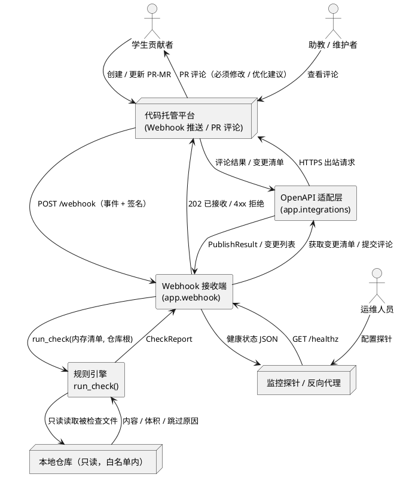
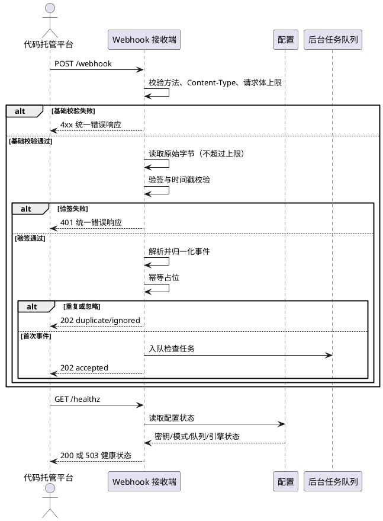
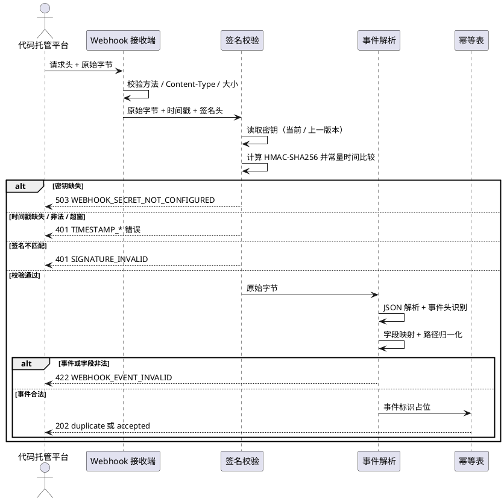
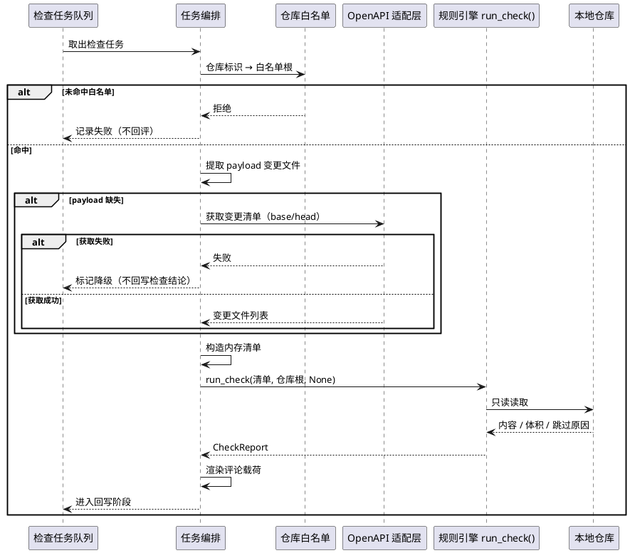
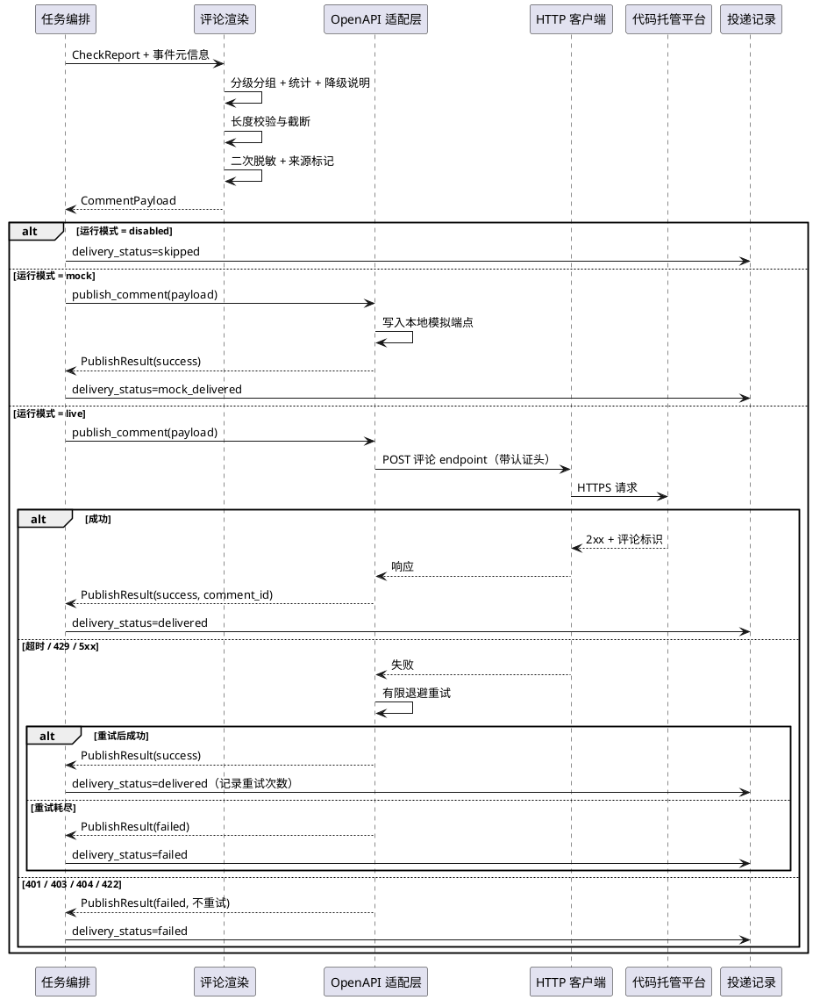
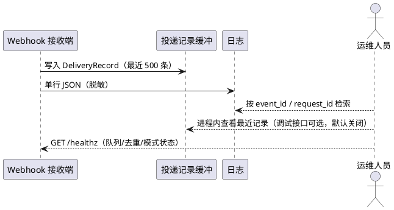
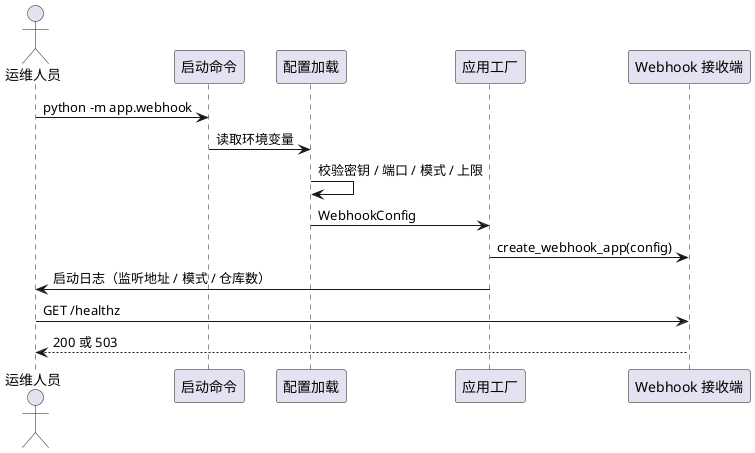

# RepoGuard Webhook 自动触发与 CodeArts OpenAPI 回写需求规格

> feature：`webhook_openapi`（阶段 4）
> 唯一实现基线：
> 1. 需求：`.codeartsdoer/specs/rules_engine/spec.md`、`.codeartsdoer/specs/web_api/spec.md`、`.codeartsdoer/specs/repo_health_readme/spec.md`；
> 2. 设计：`.codeartsdoer/specs/rules_engine/design.md`、`.codeartsdoer/specs/web_api/design.md`、`.codeartsdoer/specs/repo_health_readme/design.md`；
> 3. 现有实现：`backend/app/core/rules/engine.py` 的 `run_check()`、`backend/app/api/**`、`backend/app/health/**`、`backend/app/readme/**`、`backend/app/shared/**`、`backend/app/static/index.html`、`backend/requirements.txt`。
>
> 本文档只描述「做什么」与交付契约，不包含业务代码，不修改任何现有文件；实现方案、算法细节与测试代码由后续阶段产出。

# **1. 组件定位**

本规格描述 RepoGuard 学习仓库质量守护系统中的第四阶段能力：接收代码托管平台推送的 PR/MR 创建与更新事件，校验签名后自动触发既有规则引擎检查，并通过 CodeArts OpenAPI 把检查结论回写为 PR 评论。

本阶段首次引入「监听端口」「出站 HTTPS」「运行时密钥」三项此前被明确禁止的能力，因此必须在规格层面把边界、密钥管理、失败降级与离线可测性写死，避免为接入外部平台而侵蚀前三阶段已冻结的检查语义。

## **1.1 核心职责**

本组件负责接收并验签代码托管平台的 PR/MR 创建与更新事件，将其归一化为检查任务并调用一次既有 `run_check()`，再把检查结论渲染为 PR 评论并通过可配置的 OpenAPI 适配层回写。

## **1.2 核心输入**

1. **Webhook 推送事件（主要输入）**：来源为代码托管平台（CodeArts 等）；内容为 `POST /webhook` 的原始 HTTP 请求体（JSON）与签名、时间戳、事件类型、投递标识等请求头。
2. **Webhook 运行配置**：来源为进程环境变量或启动参数；内容为绑定地址与端口、签名密钥、重放窗口、请求体上限、事件类型白名单、幂等 TTL 与容量、队列与并发上限、任务超时。
3. **OpenAPI 适配配置**：来源为环境变量或显式注入的 `OpenApiProfile`；内容为 OpenAPI 基地址、评论 endpoint 模板、认证方式与令牌来源、请求体模板、超时与重试参数、允许主机白名单、运行模式（`disabled`/`mock`/`live`）。
4. **仓库白名单配置**：来源为阶段 2 已定义的 `REPOGUARD_ALLOWED_REPOS` 与 `REPOGUARD_DEFAULT_REPO`；本阶段只读复用，不新增第二套白名单。
5. **变更清单（派生输入）**：优先来自事件 payload 的 `changed_files`；缺失时由 OpenAPI 适配层按 `base_sha`/`head_sha` 获取；两者都不可用时进入明确降级。
6. **运维探测请求**：来源为监控探针；内容为无请求体的 `GET /healthz`。

## **1.3 核心输出**

1. **Webhook 接收响应**：返回给代码托管平台的 JSON，包含 `status`（`accepted`/`duplicate`/`ignored`/`completed`/`degraded`）、`event_id`、`duplicate`、`action`、可选 `error` 与 `request_id`；禁止包含签名、密钥、清单正文与绝对路径。
2. **PR 评论（主要业务输出）**：回写给代码托管平台 PR/MR 的 Markdown 文本，沿用阶段 1 报告的「必须修改 / 优化建议」结构，带统一来源标记与截断说明。
3. **投递记录**：返回给运维与后续阶段的内存记录 `DeliveryRecord`，包含事件标识、检查状态、统计、评论长度、截断情况、投递结果、错误码、尝试次数与耗时；本阶段不持久化。
4. **健康状态响应**：返回服务名、版本、密钥是否配置、签名算法、OpenAPI 模式、队列深度、去重表规模、引擎可用性与时间。
5. **运行日志**：推送给运维的单行结构化日志，包含 `request_id`、`event_id`、`event_type`、仓库脱敏标识、PR 编号、状态码、错误码、检查状态、投递状态、重试次数与耗时；不含任何密钥、签名原文、清单正文与评论正文。

## **1.4 职责边界**

1. **不复制检查逻辑**：禁止在 `backend/app/webhook/**`、`backend/app/integrations/**` 中重新实现命名、代码、链接、敏感信息四类判定；任何检查结论必须来自 `run_check()`。
2. **不直接调用四个检查模块**：新增包禁止导入 `naming.py`、`code_scan.py`、`link_check.py`、`sensitive.py`。
3. **不修改规则引擎**：`engine.py`、四个检查模块、`common/**`、`rules/__init__.py` 必须零改动。
4. **不修改阶段 2 Web API**：`backend/app/api/**`、`backend/app/static/index.html` 必须零改动；阶段 2 的 `GET /`、`GET /api/health`、`POST /api/review` 行为、路由集合与错误码不得变化。
5. **不修改阶段 3 能力**：`backend/app/health/**`、`backend/app/readme/**`、`backend/app/shared/**` 必须零改动。
6. **不改变既有 CLI**：`python -m app.core.rules.engine` 与 `python -m app.health.cli`、`python -m app.readme.cli` 的参数、退出码与输出格式必须不变。
7. **不远程 clone**：事件中的仓库标识只能映射到服务端已配置的本地白名单目录，禁止执行 `git clone`、`git fetch`、`git pull` 或任何远程仓库访问。
8. **不写被检查仓库**：不得在仓库内创建、修改、删除、重命名任何文件；不得在仓库内生成缓存、日志或评论草稿。
9. **不执行被检查代码**：不导入、不编译、不运行被检查仓库中的 `.py`/`.c` 文件。
10. **不持久化**：本阶段不引入数据库、Redis、消息队列中间件；幂等表、任务队列与投递记录均只存在于单进程内存。
11. **不负责代码托管平台的账号体系与权限模型**：不实现登录、OAuth、用户授权；平台侧权限由平台自身保证。
12. **不自动修复代码**：评论只给出问题与建议，禁止提交代码、创建分支、修改 PR 内容。
13. **不代理其他平台的 Webhook**：不为 GitLab/GitHub 等平台分别实现专属协议；统一走「可配置头名 + 可配置字段映射 + 可配置事件类型」的适配方式。
14. **不推断无法核实的官方协议细节**：凡本环境无法核实的签名头名、事件头名、评论 endpoint、认证头与 payload 模板，一律收敛为可配置项，并在第 13 章标注为假设。

## **1.5 与前三阶段的复用与隔离**

| 对象 | 关系 | 约束 |
|------|------|------|
| `app.core.rules.engine.run_check(manifest_text, repo_root, config=None)` | 自动检查的**唯一执行入口** | 每次事件最多调用 1 次；`config` 传 `None`，不新增阈值体系 |
| `app.core.rules.common.models.CheckReport` / `IssueLevel` / `ReportStatus` | 评论内容与状态映射的**唯一语义来源** | 级别、统计、降级信息原样使用，不重新判定 |
| `app.core.rules.common.report.report_to_dict()` | 评论渲染的结构参照 | 只读取字段，不改写、不重排、不合并问题 |
| `app.api.settings.load_settings_from_env()` / `WebSettings` | 仓库白名单与默认仓库来源 | 只读复用；禁止自建 `REPOGUARD_ALLOWED_REPOS` 解析逻辑 |
| `app.api.security.resolve_repo_root()` / `RepoPathError` | 仓库标识到本地目录的白名单映射与路径安全 | 只读复用；禁止绕过白名单直接拼路径 |
| `app.api.routes.ReviewGate`（可选） | 并发闸门与超时语义参照 | 允许复用或实现等价机制；不得修改该类 |
| `app.api.**` 其他模块 | 阶段 2 Web 适配层 | 不导入路由、不注册到阶段 2 应用、不修改任何文件 |
| `app.health.**`、`app.readme.**`、`app.shared.**` | 阶段 3 能力 | 不导入、不修改、不复用其 CLI 编排 |
| `backend/tests/test_*.py`（17 个文件） | 既有测试基线 | 零改动；新增测试必须与既有测试共存并通过 |

**隔离结论**：本阶段新增代码全部位于 `backend/app/webhook/` 与 `backend/app/integrations/` 两个新包，以及新增测试与样例数据；对前三阶段只做「导入并调用」，不做任何修改。

## **1.6 本阶段相对前三阶段的约束变化**

| 维度 | 阶段 1～3 | 阶段 4 | 变化理由与限制 |
|------|-----------|--------|----------------|
| 监听端口 | 明确禁止（阶段 3 规格写死「不监听任何端口」） | **允许**，仅限 Webhook 接收端独立应用 | 默认只绑 `127.0.0.1:8010`；对外暴露必须由反向代理提供 TLS 与来源控制 |
| 出站网络 | 明确禁止（不联网、不探测链接） | **允许出站 HTTPS**，仅限 OpenAPI 回写与变更清单获取 | 仅允许配置中显式声明的主机；默认 `disabled` 模式不发起任何出站请求 |
| 密钥 | 不需要 | **必须**：Webhook HMAC 密钥 + OpenAPI 令牌 | 只允许环境变量提供；禁止入库、禁止入日志、禁止入响应 |
| 持久化 | 不持久化 | 仍**不持久化**（幂等与投递记录仅内存） | 多实例与重启后的去重局限必须在文档中声明 |
| 检查逻辑 | `run_check()` 唯一入口 | **不变** | 100% 复用，不复制四模块，不改 13 个冻结文件 |
| 既有行为 | CLI / Web API / 阶段 3 CLI | **不变** | 310 条既有测试不得减少或破坏 |

## **1.7 本阶段必须直接回答的问题索引**

| 编号 | 问题 | 回答位置 |
|------|------|---------|
| Q1 | 能力边界是什么、哪些红线仍保持 | 1.1～1.6 |
| Q2 | 签名/HMAC 如何校验，各类非法请求用哪个状态码 | 5.2、7.3、8.1 |
| Q3 | 密钥与令牌如何管理、日志如何脱敏 | 8.2、8.6 |
| Q4 | 出站调用的超时、重试、失败降级口径 | 5.4、7.3、10.6 |
| Q5 | 事件 ID 幂等去重如何做、多实例局限是什么 | 5.3、7.4、8.4 |
| Q6 | 绑定地址与端口如何配置、默认值是什么 | 5.1、5.6、8.5 |
| Q7 | OpenAPI 契约（endpoint/认证/payload）是什么、哪些是假设 | 7.5、7.6、13 |
| Q8 | 如何在不联网环境中测试、如何切换 mock/live | 9.1～9.5 |
| Q9 | 是否新增依赖、为什么 | 9.5 |
| Q10 | 包结构、数据模型、错误码矩阵、DFX 与降级口径 | 4、6、7、10、11 |
| Q11 | 变更清单从哪来、取不到怎么办 | 5.3.1、7.4 |
| Q12 | 回评内容结构、长度上限与截断规则 | 5.4.1、6.4 |
| Q13 | 重复事件返回 200 还是 202、是否重复回评 | 7.3、7.4 |
| Q14 | 测试计划与 310 条既有测试不被破坏的证明 | 9.6、9.7、10.4 |
| Q15 | 待确认项与假设清单 | 13 |

# **2. 领域术语**

**Webhook 接收端**
: Webhook 接收端是 RepoGuard 中独立运行、监听配置端口、只接收代码托管平台 PR/MR 事件的 HTTP 服务，与阶段 2 的单页控制台服务是不同的应用实例。

**Webhook 事件**
: Webhook 事件是代码托管平台在一次 PR/MR 创建或更新时推送给 Webhook 接收端的一次 HTTP 请求，包含原始 JSON 请求体与签名相关请求头。

**事件类型**
: 事件类型是事件头中表示本次动作种类的字符串，本规格只关心「PR/MR 创建」与「PR/MR 更新」两类，取值可在配置中声明。

**事件标识**
: 事件标识是平台为一次推送分配的唯一字符串，用于幂等去重；缺失时按事件内容哈希生成稳定替代值。

**投递标识**
: 投递标识是平台为一次投递尝试分配的唯一字符串，与事件标识可能相同也可能不同，仅作为事件标识的次级来源。

**事件签名**
: 事件签名是平台使用共享密钥对「时间戳 + 请求体」计算的 HMAC 摘要，用于证明请求来自持有同一密钥的发送方且请求体未被篡改。

**签名密钥**
: 签名密钥是 Webhook 接收端与代码托管平台共享的对称密钥，只允许通过环境变量提供。

**重放窗口**
: 重放窗口是允许请求时间戳偏离服务端当前时间的最大秒数，超出窗口的请求必须被拒绝，用于抵御重放攻击。

**归一化事件**
: 归一化事件是把平台差异字段映射为统一结构的中间结果，包含事件标识、动作、仓库标识、PR 编号、基线提交、头提交与变更文件列表。

**变更文件列表**
: 变更文件列表是本次 PR/MR 涉及的文件路径集合，可直接来自事件 payload，也可通过 OpenAPI 适配层按提交区间获取。

**检查任务**
: 检查任务是归一化事件与本地仓库根、内存变更清单的组合，是进入规则引擎的最小工作单元。

**自动触发检查**
: 自动触发检查是在没有人工点击提交的情况下，由 Webhook 事件驱动对本地仓库执行一次 `run_check()` 的行为。

**回写**
: 回写是把检查结论通过 OpenAPI 提交为 PR/MR 评论的动作，不等同于「检查成功」。

**评论载荷**
: 评论载荷是待回写的 Markdown 文本及其长度、截断与来源标记等元信息。

**投递结果**
: 投递结果是 OpenAPI 适配层返回的回写结论，包含是否成功、HTTP 状态、错误码、评论标识、尝试次数与耗时。

**投递记录**
: 投递记录是对一个事件从接收到回写结束的完整结果摘要，只保存在进程内存中。

**幂等占位**
: 幂等占位是在开始检查之前，以事件标识在内存去重表中登记「处理中」状态的行为，用于阻止同一事件被并发或重复处理。

**OpenAPI 适配层**
: OpenAPI 适配层是把「获取变更文件列表」与「提交 PR 评论」抽象为方法、并把 endpoint、认证方式、请求体模板全部外部化的可替换组件。

**OpenApiProfile**
: OpenApiProfile 是 OpenAPI 适配层的一份配置，包含基地址、endpoint 模板、认证方式、令牌来源、请求体模板、超时与重试参数与允许主机清单。

**运行模式**
: 运行模式决定 OpenAPI 适配层的行为，仅取 `disabled`（不发请求）、`mock`（写入本地模拟端点）与 `live`（真实调用）三者。

**降级**
: 降级是本阶段因依据不足或外部依赖不可用而无法给出完整结论的状态，必须在响应、投递记录或评论中明确说明，禁止伪装为成功。

**忽略**
: 忽略是事件被验签接收但因类型、动作或仓库不匹配而不执行检查的处理结果，必须返回可区分于「已排队」的状态语义。

**来源标记**
: 来源标记是嵌入评论正文的不可见注释，形如 `<!-- repoguard:event:<event_id> -->`，用于人工识别评论来源并辅助平台侧去重。

**允许的仓库根**
: 允许的仓库根是阶段 2 已定义的 `REPOGUARD_ALLOWED_REPOS` 白名单目录；事件中的仓库标识必须映射到其中之一。

**本地模拟 OpenAPI**
: 本地模拟 OpenAPI 是仅在测试或 `mock` 模式下使用的进程内服务或内存适配器，不监听公网，不依赖真实网络。

# **3. 角色与边界**

## **3.1 核心角色**

1. **代码托管平台（系统角色）**：在 PR/MR 创建或更新时向 Webhook 接收端推送事件，并在验签通过后接收「已接收」响应。
2. **学生贡献者**：创建或更新 PR/MR 后，在平台上直接看到 RepoGuard 的检查评论，并据此修正文件。
3. **课程助教 / 社团维护者**：通过评论快速判断本次变更是否存在必须修改项，必要时手工触发复查。
4. **运维人员**：配置签名密钥、OpenAPI 令牌、白名单与端口；查看 `/healthz`、运行日志与投递记录。

## **3.2 外部系统**

1. **代码托管平台 Webhook 推送方**：向 `POST /webhook` 推送 JSON 事件，携带签名、时间戳、事件类型与投递标识请求头。
2. **CodeArts OpenAPI**：接收「获取变更文件列表」与「提交 PR 评论」两类出站请求；本环境无法核实其官方契约细节，因此按可配置适配层处理。
3. **规则引擎（`app.core.rules.engine.run_check`）**：进程内同步调用，提供唯一检查能力。
4. **本地文件系统（只读）**：规则引擎从中读取被检查文件；Webhook 接收端只校验仓库目录存在性与白名单归属。
5. **阶段 2 配置来源（环境变量）**：提供 `REPOGUARD_ALLOWED_REPOS` 与 `REPOGUARD_DEFAULT_REPO`，本阶段只读复用。
6. **监控探针 / 反向代理（可选）**：调用 `/healthz`；对外暴露时提供 TLS 终止与来源控制。

## **3.3 交互上下文**



# **4. DFX约束**

## **4.1 性能**

1. `POST /webhook` 从收到请求到返回响应的耗时（验签 + 解析 + 幂等占位 + 入队，不含后台检查与回写）P95 必须不超过 200 毫秒，上限必须不超过 500 毫秒。
2. `GET /healthz` 在服务正常时响应时间必须不超过 100 毫秒，且不得调用 `run_check()`、不得扫描仓库。
3. 单次检查任务必须复用阶段 1 的性能预算：500 条变更、100 个可读文件时检查部分不超过 10 秒；Webhook 层附加开销（清单构造、渲染）必须不超过 500 毫秒。
4. 单任务端到端（检查 + 渲染 + 回写）默认预算必须不超过 120 秒；超时必须终止等待并记录超时，不得无限挂起。
5. 出站单次请求超时默认 10 秒；含重试的总预算默认不超过 30 秒。
6. 单实例进程常驻内存峰值必须不超过 300 MB；不得把大文件整体读入内存（沿用阶段 1 与阶段 3 口径）。
7. 队列容量默认 100 条，并发 worker 默认 2 个；队列满时必须立即拒绝而不是无限堆积。

## **4.2 可靠性**

1. 验签通过且首次出现的事件必须被接收并最终形成一个可追溯的投递记录；处理失败必须明确标注失败原因，禁止标记为成功。
2. 相同事件标识在幂等 TTL 内重复到达时，必须返回重复语义且不得重复回写评论。
3. 单次事件最多调用 `run_check()` 1 次；重试只允许发生在出站回写与幂等开关显式允许的失败重放场景，不得因重试重复扫描。
4. 规则引擎返回「部分降级」时，评论必须保留降级说明，不得丢弃或改写为正常。
5. 规则引擎抛出未预期异常时，必须捕获并记录，评论若回写则只允许回写「检查未能完成」的明确说明，禁止回写「未发现问题」。
6. OpenAPI 不可用、超时或返回非成功状态时，投递记录必须为失败，日志必须告警，禁止伪造成功；入站响应已返回 202 时不得再向平台谎报完成。
7. 服务重启后内存中的幂等表与队列内容丢失，属于已知局限；必须通过启动日志与文档明确声明，不得暗示持久化保证。
8. 任一外部依赖异常都不得导致接收端崩溃；`/healthz` 必须始终可响应。

## **4.3 安全性**

1. **强制验签**：除 `GET /healthz` 外，所有入站请求必须通过签名校验；不得提供「跳过验签」的运行时开关（测试通过注入密钥与签名来通过校验）。
2. **密钥来源**：签名密钥与 OpenAPI 令牌只允许来自环境变量或显式注入的配置对象；禁止写入仓库文件、配置文件、日志、响应、评论、投递记录与测试快照。
3. **常量时间比较**：签名比较必须使用常量时间算法，禁止逐字符提前返回。
4. **重放防护**：必须校验时间戳并限制在配置窗口内；时间戳缺失、格式非法、过期或超前都必须拒绝。
5. **请求体一致性**：签名必须对「实际读取到的原始字节」计算；禁止先解析 JSON 再重新序列化后验签。
6. **请求体上限**：读取必须在配置上限处截断并拒绝，禁止无界读入。
7. **出站最小化**：出站只允许访问配置中显式声明的 HTTPS 主机；禁止跟随重定向；禁止访问私网地址（loopback 仅允许本地 mock）；禁止 URL 携带用户名密码。
8. **令牌不泄露**：出站请求头中的令牌不得出现在日志、异常、投递记录与评论中；重定向与错误响应体不得回显。
9. **日志脱敏**：日志只允许记录「是否配置」「指纹前 8 位」与请求头名，禁止记录密钥、令牌、签名原文与请求体。
10. **暴露面**：默认只监听 `127.0.0.1`；绑定 `0.0.0.0` 必须显式配置并在启动日志输出中文警告；对外暴露必须由反向代理提供 TLS 与来源控制。
11. **响应最小化**：错误响应不得包含堆栈、内部路径、签名期望值、密钥长度或平台原始错误体全文。
12. **只读**：Webhook 接收端不得对白名单仓库执行任何写操作。

## **4.4 可维护性**

1. 所有面向用户的错误文案必须使用简体中文，错误码使用稳定大写英文常量，二者一一对应。
2. 每个请求必须生成并返回 `request_id`，同一请求的日志与错误响应使用同一标识。
3. 运行日志必须为单行 JSON，至少包含 `request_id`、`event_id`、`event_type`、`repo_label`、`pr_number`、`status_code`、`error_code`、`duplicate`、`queue_depth`、`check_status`、`must_fix_count`、`delivery_status`、`retry_count`、`duration_ms`。
4. 头名、字段映射、事件类型、endpoint、认证方式与请求体模板必须集中配置；修改这些差异不得要求改动编排逻辑主体。
5. 检查逻辑只允许通过 `run_check()` 一个入口调用；新增检查能力必须先修改规则引擎规格。
6. 评论结构必须由单一渲染入口生成；禁止在路由、队列、适配层各写一份渲染逻辑。

## **4.5 兼容性**

1. **CLI 零变更**：`python -m app.core.rules.engine` 的参数、默认值、退出码（0/1/2/3）、stdout 文本/JSON 与 stderr 行为必须与阶段 1 逐字节一致。
2. **阶段 2 Web API 零变更**：`GET /`、`GET /api/health`、`POST /api/review` 的路径、方法、状态码、响应结构与错误码必须完全不变；阶段 2 应用不得注册本阶段路由。
3. **阶段 3 CLI 零变更**：`python -m app.health.cli` 与 `python -m app.readme.cli` 的参数与退出码不变。
4. **引擎零 Web 依赖不变量**：`app.core.rules/**` 不得导入 `fastapi`、`uvicorn`、`httpx`、`starlette`、`pydantic`。
5. **导入方向约束**：新增包必须满足既有 `test_import_direction` 的机械断言，详见 10.5；不得以修改该测试为代价。
6. **Python 版本**：与前三阶段一致，要求 Python 3.10 及以上。
7. **操作系统**：Windows 与 Linux 行为一致；路径比较在 Windows 下大小写不敏感；评论与日志中的路径统一使用 `/`。
8. **编码**：请求与响应统一 UTF-8；JSON 响应中文不转义；评论正文中文不转义。
9. **平台差异**：PR 与 MR 的命名差异只通过配置表达，不在代码中硬编码平台分支。

# **5. 核心能力**

## **5.1 Webhook 接收端（监听与路由）**

### **5.1.1 业务规则**

1. **独立应用**：Webhook 接收端必须是独立 FastAPI 应用，由 `create_webhook_app(config)` 构造；禁止注册到阶段 2 的 `app.api.app:app`。
   a. 验收条件（EARS）：When the webhook service starts, the Webhook 接收端 shall 使用独立应用实例且阶段 2 应用的路由集合保持不变。
2. **接收入口**：必须提供 `POST /webhook`（路径可配置，默认 `/webhook`）；路径必须为以 `/` 开头的绝对路径，长度 1～64，不含 `..` 与控制字符。
   a. 验收条件（EARS）：When a signed `POST /webhook` is received, the Webhook 接收端 shall 进入验签与事件处理流程。
3. **方法限定**：`/webhook` 只接受 `POST`，其他方法必须返回 405；`/healthz` 只接受 `GET`，其他方法必须返回 405。
   a. 验收条件（EARS）：When a `GET /webhook` is received, the Webhook 接收端 shall 返回 HTTP 405 且不进入验签。
4. **内容类型**：`/webhook` 请求必须为 `application/json`（允许带 `charset=utf-8`）；其他类型必须返回 415，且不读入请求体。
   a. 验收条件（EARS）：When the content type is `text/plain`, the Webhook 接收端 shall 返回 415 与 `WEBHOOK_UNSUPPORTED_MEDIA_TYPE`。
5. **请求体上限**：请求体默认不超过 1 MB（可配置 64 KB～8 MB）；`Content-Length` 超限必须立即返回 413，实际读取字节数超限也必须返回 413，禁止截断后继续处理。
   a. 验收条件（EARS）：When the request body exceeds `max_body_bytes`, the Webhook 接收端 shall 返回 413 与 `WEBHOOK_PAYLOAD_TOO_LARGE`，且不调用规则引擎。
6. **快速返回**：默认异步模式下，验签、解析、幂等占位与入队完成后必须立即返回 202，不得在请求内等待检查与回写完成。
   a. 验收条件（EARS）：When a valid first-time event is received, the Webhook 接收端 shall 在 200 毫秒内返回 202。
7. **同步模式（可选）**：配置 `sync_mode=true` 时，可在请求内完成检查与回写，成功返回 200，出站失败返回 502，出站超时返回 504；默认关闭。
   a. 验收条件（EARS）：Where `sync_mode` is enabled and the delivery fails, the Webhook 接收端 shall 返回 502 且不返回 200。
8. **总开关**：配置 `enabled=false` 时，`/webhook` 必须返回 503 `WEBHOOK_DISABLED`，`/healthz` 报告降级；不得静默接收。
   a. 验收条件（EARS）：When the service is disabled, the Webhook 接收端 shall 拒绝所有事件并返回 503。
9. **健康检查**：`GET /healthz` 必须返回 `status`、`service`、`version`、`secret_configured`、`signature_algorithm`、`openapi_mode`、`engine`、`queue_depth`、`queue_capacity`、`dedup_size`、`allowed_repo_count`、`time` 十二个字段，且响应带 `Cache-Control: no-store`。
   a. 验收条件（EARS）：When `GET /healthz` is received, the Webhook 接收端 shall 在 100 毫秒内返回且不触发文件扫描与引擎执行。
10. **降级判定**：密钥未配置、引擎不可导入、白名单为空、OpenAPI 模式为 `live` 但配置不完整、队列容量为 0 时，`status` 必须为 `degraded`，HTTP 状态必须为 503。
    a. 验收条件（EARS）：When no signature secret is configured, the Webhook 接收端 shall 返回 `status="degraded"` 与 HTTP 503。
11. **绑定范围**：默认只监听 `127.0.0.1:8010`；地址与端口必须可通过环境变量配置；禁止默认绑定 `0.0.0.0`。
    a. 验收条件（EARS）：When started with defaults, the Webhook 接收端 shall 仅监听 127.0.0.1 的 8010 端口。
12. **启动可诊断**：启动日志必须输出监听地址、端口、签名算法、OpenAPI 模式、允许仓库数量与队列容量；禁止输出密钥、令牌与绝对路径。
    a. 验收条件（EARS）：When the service starts, the Webhook 接收端 shall 输出可判断配置是否生效的中文启动信息。
13. **禁止项**：禁止在 `/webhook` 内直接执行检查；禁止把请求体写入文件；禁止把原始请求体回显到响应或日志。

### **5.1.2 交互流程**



### **5.1.3 异常场景**

1. **端口被占用**
   a. 触发条件：启动时配置端口已被其他进程监听。
   b. 系统行为：进程启动失败并退出，不自动改端口。
   c. 用户感知：启动日志出现中文说明，运维需更换端口或释放占用。

2. **配置端口非法**
   a. 触发条件：端口不是 1～65535 的整数，或地址不是合法 IPv4/IPv6/主机名。
   b. 系统行为：回退默认 `127.0.0.1:8010` 并输出中文警告，不静默使用非法值。
   c. 用户感知：启动日志显示「端口配置非法，已使用默认端口」。

3. **健康检查被高频探测**
   a. 触发条件：探针每秒多次调用 `/healthz`。
   b. 系统行为：只读内存状态，不触发文件系统与引擎执行。
   c. 用户感知：响应稳定，耗时不超过 100 毫秒。

4. **请求体为分块传输且无 `Content-Length`**
   a. 触发条件：客户端使用 chunked 编码。
   b. 系统行为：按实际读取字节数累计上限，超限立即终止并返回 413。
   c. 用户感知：413 `WEBHOOK_PAYLOAD_TOO_LARGE`。

## **5.2 签名校验与事件解析**

### **5.2.1 业务规则**

1. **算法与签名串**：签名算法固定为 HMAC-SHA256；签名串必须为「时间戳 + `.` + 原始请求体字节」；结果以十六进制小写表示。
   a. 验收条件（EARS）：When the signature is computed over `timestamp + "." + raw_body`, the Webhook 接收端 shall 校验通过。
2. **签名头**：默认头名 `X-RepoGuard-Signature`，格式 `sha256=<hex>`；头名、前缀必须可配置；裸十六进制仅在配置显式允许时接受。
   a. 验收条件（EARS）：When the signature header is missing, the Webhook 接收端 shall 返回 401 与 `WEBHOOK_SIGNATURE_MISSING`。
3. **时间戳头**：默认头名 `X-RepoGuard-Timestamp`，支持 10 位 Unix 秒与 13 位毫秒；头名可配置。
   a. 验收条件（EARS）：When the timestamp header is missing, the Webhook 接收端 shall 返回 401 与 `WEBHOOK_TIMESTAMP_MISSING`。
4. **重放窗口**：服务端时间与请求时间戳之差的绝对值必须不超过配置窗口，默认 300 秒（范围 30～900）；超出必须拒绝。
   a. 验收条件（EARS）：When the timestamp is older than the replay window, the Webhook 接收端 shall 返回 401 与 `WEBHOOK_TIMESTAMP_EXPIRED`。
5. **时间戳格式与时钟偏移**：时间戳无法解析、为负数或超前超过窗口时，必须返回 401 `WEBHOOK_TIMESTAMP_INVALID`。
   a. 验收条件（EARS）：When the timestamp is not a valid integer, the Webhook 接收端 shall 返回 401 与 `WEBHOOK_TIMESTAMP_INVALID`。
6. **签名不匹配**：签名与期望值不一致时，必须返回 401 `WEBHOOK_SIGNATURE_INVALID`，不得返回期望值或长度信息。
   a. 验收条件（EARS）：When the body is modified after signing, the Webhook 接收端 shall 返回 401 与 `WEBHOOK_SIGNATURE_INVALID`。
7. **密钥未配置**：签名密钥为空时，必须返回 503 `WEBHOOK_SECRET_NOT_CONFIGURED`，健康检查降级；禁止以「空密钥」参与计算。
   a. 验收条件（EARS）：When the secret is not configured, the Webhook 接收端 shall 返回 503 且不读取请求体。
8. **密钥轮换**：允许同时配置当前密钥与上一版本密钥，任一匹配即通过；两个密钥都不得出现在日志与响应中。
   a. 验收条件（EARS）：When the previous secret matches, the Webhook 接收端 shall 校验通过并记录「使用了上一版本密钥」的告警。
9. **校验顺序**：必须按「方法 → Content-Type → 请求体上限 → 读取原始字节 → 密钥存在性 → 时间戳 → 签名 → JSON 解析 → 事件头 → 字段映射」的顺序执行，前一步失败不得进入下一步。
   a. 验收条件（EARS）：When JSON is invalid but the signature is also invalid, the Webhook 接收端 shall 返回 401 而不是 400。
10. **校验时机**：签名必须在 JSON 解析之前完成，且必须对原始字节计算；禁止「先解析再重新序列化」。
    a. 验收条件（EARS）：When the raw body is signed, the Webhook 接收端 shall 使用同一份字节完成验签与解析。
11. **事件类型识别**：优先从事件类型头（默认 `X-RepoGuard-Event`）读取；缺失时按配置的 payload 字段路径回退；仍无法识别时必须返回 422 `WEBHOOK_EVENT_INVALID`。
    a. 验收条件（EARS）：When the event header is absent but payload contains a valid event type, the Webhook 接收端 shall 从 payload 回退识别。
12. **事件类型白名单**：只处理配置中声明的事件类型与动作；不在白名单内的类型必须返回 202 `ignored`，不执行检查、不回评。
    a. 验收条件（EARS）：When the event type is not in the allow list, the Webhook 接收端 shall 返回 202 且 `action="skipped"`。
13. **字段映射可配置**：事件标识、仓库标识、PR 编号、基线提交、头提交、变更文件列表与新增/修改/删除文件列表的字段路径必须可配置，默认值见 7.6。
    a. 验收条件（EARS）：When a field mapping is configured to a custom path, the Webhook 接收端 shall 从该路径取值。
14. **事件标识回退**：事件标识按「payload 标识字段 → 投递标识头 → 内容哈希」顺序取值；内容哈希必须基于事件类型、仓库标识、PR 编号、提交区间与原始字节生成稳定值。
    a. 验收条件（EARS）：When no event id exists, the Webhook 接收端 shall 生成稳定的事件标识并记录来源为 `content_hash`。
15. **必填字段**：仓库标识、PR 编号必须存在且类型正确；缺失或类型错误必须返回 422 `WEBHOOK_EVENT_INVALID`，不得猜测。
    a. 验收条件（EARS）：When the PR number is missing, the Webhook 接收端 shall 返回 422 且不执行检查。
16. **变更文件提取**：必须按 5.3.1 第 4 条的优先级提取变更文件，并记录来源为 `payload`、`payload_lists`、`openapi` 或 `none`。
    a. 验收条件（EARS）：When the payload contains `changed_files`, the Webhook 接收端 shall 使用该列表且不调用 OpenAPI。
17. **路径归一化**：变更文件路径必须去除 `./` 前缀、`\` 统一为 `/`、去除首尾空白；绝对路径、盘符路径与含 `..` 段的路径必须被剔除并计入「非法路径」统计，不得送入 `run_check()`。
    a. 验收条件（EARS）：When a changed path is `..\secret.txt`, the Webhook 接收端 shall 剔除该路径并记录中文原因。
18. **禁止项**：禁止信任请求中的签名头格式而不做长度与字符集校验；禁止对同一请求重复读取请求体；禁止把平台原始错误体写入响应。

### **5.2.2 交互流程**



### **5.2.3 异常场景**

1. **缺少签名头**
   a. 触发条件：请求头中不存在配置的签名头。
   b. 系统行为：不解析请求体，不执行检查。
   c. 用户感知：HTTP 401，`error.code = WEBHOOK_SIGNATURE_MISSING`，提示「请求缺少签名，已拒绝」。

2. **签名头格式非法**
   a. 触发条件：签名头不是 `sha256=<hex>` 形式，或十六进制长度不等于 64，或含非十六进制字符。
   b. 系统行为：按「签名无效」处理，不进行 HMAC 计算。
   c. 用户感知：HTTP 401，`error.code = WEBHOOK_SIGNATURE_INVALID`。

3. **签名无效**
   a. 触发条件：HMAC 计算结果与请求头不一致。
   b. 系统行为：拒绝，记录一条不含签名原文的安全日志。
   c. 用户感知：HTTP 401，`error.code = WEBHOOK_SIGNATURE_INVALID`，提示「请求签名校验未通过」。

4. **时间戳过期或超前**
   a. 触发条件：时间戳与服务器时间差超过重放窗口（含过去与未来）。
   b. 系统行为：拒绝，不进入解析；记录 `skew_seconds` 但不记录签名。
   c. 用户感知：HTTP 401，`error.code = WEBHOOK_TIMESTAMP_EXPIRED` 或 `WEBHOOK_TIMESTAMP_INVALID`。

5. **密钥未配置**
   a. 触发条件：`REPOGUARD_WEBHOOK_SECRET` 未设置或为空。
   b. 系统行为：拒绝所有事件，健康检查降级；禁止用空字符串计算签名。
   c. 用户感知：HTTP 503，`error.code = WEBHOOK_SECRET_NOT_CONFIGURED`，提示「服务未配置签名密钥，暂不可接收事件」。

6. **请求体不是合法 JSON**
   a. 触发条件：验签通过但请求体为空、被截断、非 UTF-8 或不是 JSON 对象。
   b. 系统行为：不进入字段映射与检查。
   c. 用户感知：HTTP 400，`error.code = WEBHOOK_INVALID_JSON`。

7. **事件类型未知**
   a. 触发条件：事件头与 payload 都无法识别事件类型，或类型不在白名单。
   b. 系统行为：前者返回 422；后者返回 202 ignored。
   c. 用户感知：422 `WEBHOOK_EVENT_INVALID` 或 202 `action="skipped"`。

8. **字段类型错误**
   a. 触发条件：仓库标识不是字符串、PR 编号不是正整数、提交字段不是字符串。
   b. 系统行为：不猜测、不强制转换；终止处理。
   c. 用户感知：HTTP 422，`error.code = WEBHOOK_EVENT_INVALID`，`detail` 只说明字段名。

9. **事件类型为删除或关闭动作**
   a. 触发条件：事件头表示 PR 关闭、合并、删除等非创建/更新动作。
   b. 系统行为：返回 202 ignored，不执行检查、不回评。
   c. 用户感知：202，`action="skipped"`，`reason="事件动作不在处理范围"`。

## **5.3 自动触发检查**

### **5.3.1 业务规则**

1. **唯一入口**：检查必须且只能通过 `app.core.rules.engine.run_check(manifest_text, repo_root, config=None)` 执行；一次事件最多调用 1 次。
   a. 验收条件（EARS）：When an event is processed, the Webhook 接收端 shall 对 `run_check()` 的调用次数恰好为 1。
2. **禁止旁路**：新增包不得导入四个检查模块，不得复制规则正则、阈值、级别判定与建议文案。
   a. 验收条件（EARS）：When the new packages are statically scanned, the Webhook 接收端 shall 命中 0 次检查模块导入与 0 处规则常量副本。
3. **任务入队**：默认异步模式下，归一化事件必须被转换为检查任务并入有界队列；队列满时必须返回 429 `WEBHOOK_BUSY`，不得丢弃已占位事件。
   a. 验收条件（EARS）：When the queue is full, the Webhook 接收端 shall 返回 429 并回滚本次幂等占位。
4. **变更清单来源优先级**：必须按以下顺序获取变更文件，前一步成功则不执行后一步：
   1. payload 顶层 `changed_files`（字符串数组）；
   2. payload 中的 `added_files` / `modified_files` / `removed_files` 三个列表；
   3. OpenAPI 适配层按 `repo` + `base_sha` + `head_sha` 获取；
   4. 以上都不可用 → 标记 `changed_files_available=false` 并进入降级。
   a. 验收条件（EARS）：When payload provides `added_files` and `modified_files`, the Webhook 接收端 shall 构造 `A`/`M` 清单行且不调用 OpenAPI。
5. **状态推断**：仅有 `changed_files` 时，状态统一记为 `M`；有新增/修改/删除列表时，分别记为 `A`、`M`、`D`；删除文件只保留路径检查语义（由引擎既有行为决定）。
   a. 验收条件（EARS）：When a file appears in `added_files`, the Webhook 接收端 shall 生成 `A <path>` 清单行。
6. **清单构造**：清单必须为逐行文本，每行「状态 + 一个空格 + 归一化相对路径」；不得包含注释行、空行或额外字段；路径中的空格必须原样保留。
   a. 验收条件（EARS）：When a changed path contains a space, the Webhook 接收端 shall 生成可被引擎正确解析的清单行。
7. **清单上限**：单次事件的变更条目默认不超过 5,000 条；超限必须降级，不调用引擎，并回写明确的「变更过多」说明。
   a. 验收条件（EARS）：When the changed file count exceeds 5,000, the Webhook 接收端 shall 不调用 `run_check()` 并记录降级原因。
8. **仓库映射**：事件中的仓库标识必须按以下顺序映射：显式映射表（`REPOGUARD_WEBHOOK_REPO_MAP`）→ 仓库全名匹配 → 仓库短名匹配白名单根目录名；匹配必须大小写不敏感。
   a. 验收条件（EARS）：When the repository full name maps to an allowed root, the Webhook 接收端 shall 得到该根的真实路径。
9. **白名单强制**：映射结果必须通过阶段 2 的白名单解析（复用 `resolve_repo_root`）；未命中必须返回 403 `WEBHOOK_REPO_FORBIDDEN`，不执行检查、不回评。
   a. 验收条件（EARS）：When the repository is not in the allowed roots, the Webhook 接收端 shall 返回 403 且不访问文件系统。
10. **不做远程操作**：禁止执行 `git clone`、`git fetch`、`git pull`、`git ls-remote` 或任何网络仓库访问；禁止调用 `subprocess` 执行 git 命令。
    a. 验收条件（EARS）：When the repository mapping fails, the Webhook 接收端 shall 直接拒绝而不是尝试下载仓库。
11. **幂等占位**：必须在入队前完成占位；占位状态必须包含「处理中」「已完成」「失败」三态与首次接收时间。
    a. 验收条件（EARS）：When two identical events arrive concurrently, the Webhook 接收端 shall 只允许一个进入检查。
12. **配置不透传**：调用 `run_check()` 时 `config` 必须为 `None`，不得通过 Webhook 配置改变规则阈值。
    a. 验收条件（EARS）：When the check runs, the Webhook 接收端 shall 以 `config=None` 调用引擎。
13. **状态映射**：`CheckReport.status` 必须原样用于评论与投递记录；「部分降级」必须保留 `degraded_modules` 与 `warnings`；「输入错误」必须视为检查失败并明确说明原因。
    a. 验收条件（EARS）：When the engine returns `status="部分降级"`, the Webhook 接收端 shall 在评论中保留降级说明。
14. **结果不复用**：不同事件必须独立调用引擎，不得缓存并复用其他事件的检查报告。
    a. 验收条件（EARS）：When two different events target the same repository, the Webhook 接收端 shall 分别调用引擎。
15. **禁止项**：禁止把空清单当作「无变更」直接判定为检查通过；禁止在未取得变更清单时回写「未发现问题」。

### **5.3.2 交互流程**



### **5.3.3 异常场景**

1. **变更清单缺失且无法获取**
   a. 触发条件：payload 无变更文件，且 OpenAPI 适配层不可用、超时或返回空。
   b. 系统行为：不调用 `run_check()`；标记 `changed_files_available=false`；投递记录为 `degraded`；允许回写一条明确的「无法获取变更清单」说明（可通过配置关闭）。
   c. 用户感知：入站 202 `status="degraded"`；评论（若启用）明确说明未执行检查，不给出通过结论。

2. **仓库不在白名单**
   a. 触发条件：仓库标识未映射到 `REPOGUARD_ALLOWED_REPOS` 的任何目录。
   b. 系统行为：拒绝，不访问文件系统，不调用引擎，不回评。
   c. 用户感知：HTTP 403，`error.code = WEBHOOK_REPO_FORBIDDEN`。

3. **仓库目录被删除**
   a. 触发条件：映射成功但目录在检查前被删除。
   b. 系统行为：`run_check()` 会返回「输入错误」；Webhook 层必须保留该状态并记录失败原因。
   c. 用户感知：投递记录 `check_status="输入错误"`；评论（若回写）说明仓库不可用。

4. **规则引擎异常**
   a. 触发条件：`run_check()` 抛出未捕获异常或引擎无法导入。
   b. 系统行为：捕获异常，记录 `request_id` 与事件标识；投递记录失败；可回写「检查未能完成」说明（默认开启，可通过 `notify_on_failure` 关闭）。
   c. 用户感知：绝不出现「未发现问题」；`error.code = WEBHOOK_ENGINE_ERROR`。

5. **检查超时**
   a. 触发条件：单任务检查耗时超过配置预算（默认 120 秒）。
   b. 系统行为：停止等待并标记超时；后台执行不强制终止，结果丢弃；不重复扫描。
   c. 用户感知：投递记录 `check_status="timeout"`；评论（若回写）说明超时。

6. **队列已满**
   a. 触发条件：队列长度达到容量上限。
   b. 系统行为：立即返回 429，回滚幂等占位，允许平台按自身策略重试。
   c. 用户感知：HTTP 429，`error.code = WEBHOOK_BUSY`，提示「当前事件较多，请稍后重试」。

7. **同一事件并发到达**
   a. 触发条件：两个相同事件标识的请求几乎同时到达。
   b. 系统行为：只有第一个能占位成功；第二个返回 202 duplicate。
   c. 用户感知：第二次请求 `duplicate=true` 且不重复回评。

8. **变更条目超过上限**
   a. 触发条件：变更文件数超过 5,000。
   b. 系统行为：不调用引擎；标记降级；回写明确说明。
   c. 用户感知：投递记录 `delivery_status="degraded"`。

9. **变更文件全部为非法路径**
   a. 触发条件：所有路径都被归一化规则剔除。
   b. 系统行为：视为「无法获得有效变更清单」，降级处理，不调用引擎，不回写通过结论。
   c. 用户感知：评论（若回写）说明路径不合法且未执行检查。

## **5.4 评论渲染与 OpenAPI 回写**

### **5.4.1 业务规则**

1. **渲染单一入口**：评论必须由单一渲染函数从 `CheckReport` 生成，禁止在路由、队列与适配层分别拼接。
   a. 验收条件（EARS）：When a report is rendered, the Webhook 接收端 shall 只调用一次渲染入口。
2. **结构复用**：评论必须沿用阶段 1 的语义与顺序：标题 → 统计 → 必须修改分组 → 优化建议分组 → 未完成检查 → 降级说明 → 提示；不得新增检查级别或改写问题级别。
   a. 验收条件（EARS）：When the report contains both levels, the Webhook 接收端 shall 先输出必须修改分组、后输出优化建议分组。
3. **条目格式**：每条问题必须包含「文件路径 + 可选行号 + 问题描述 + 修改建议 + 规则标识」；敏感内容必须保持引擎给出的脱敏结果，不得二次拼接原文。
   a. 验收条件（EARS）：When a finding has `rule_id="code-004"`, the Webhook 接收端 shall 在评论中输出该规则标识。
4. **重排禁止**：禁止对问题重新排序、过滤、合并或补全；必须按 `report_to_dict()` 的顺序呈现；仅在截断时按「必须修改优先」保留前缀。
   a. 验收条件（EARS）：When the report contains N findings, the Webhook 接收端 shall 在未截断时完整输出这 N 条且顺序不变。
5. **统计头**：评论必须包含条目总数、问题总数、必须修改数、优化建议数；存在跳过文件、降级模块或无法解析行时必须分别给出数量。
   a. 验收条件（EARS）：When the report has 3 must-fix and 2 suggestions, the Webhook 接收端 shall 输出与统计一致的 3 与 2。
6. **降级提示**：`status="部分降级"` 或 `degraded_modules` 非空时，评论必须包含「结果可能不完整」与模块原因；禁止省略。
   a. 验收条件（EARS）：When a module is degraded, the Webhook 接收端 shall 在评论中列出该模块与原因。
7. **长度上限**：评论默认不超过 60,000 字符（可配置 1,000～100,000）；该默认值属于假设，见 7.6。
   a. 验收条件（EARS）：When the rendered comment exceeds the limit, the Webhook 接收端 shall 执行截断规则且保留来源标记。
8. **截断规则**：超限时必须按以下顺序处理：
   1. 固定保留标题、统计头、来源标记与必要的降级提示（预留不超过 2,000 字符）；
   2. 必须修改条目优先，最多使用剩余预算的 70%；未用满时优化建议可使用剩余部分；
   3. 以「单条问题」为最小截断单位，禁止把单条 `message`/`suggestion` 截成半句；
   4. 超出部分必须输出「另有 N 条必须修改未展示」「另有 M 条优化建议未展示」，禁止静默丢弃；
   5. 若预算小到无法容纳任何必须修改条目，必须保留 1 条最关键条目（按文件路径与行号排序后的第一条）并输出提示；
   6. 截断后仍必须满足长度上限，且必须保留来源标记。
   a. 验收条件（EARS）：When the comment is truncated, the Webhook 接收端 shall 输出未展示条目数量与来源标记。
9. **空结果与无变更区分**：`issue_count=0` 且检查确实执行时，评论输出「未发现问题」；未执行检查（清单缺失、降级）时不得输出该文案，必须输出「未执行检查」类说明。
   a. 验收条件（EARS）：When the check is skipped due to missing changed files, the Webhook 接收端 shall 不输出「未发现问题」。
10. **来源标记**：评论末尾必须包含 `<!-- repoguard:event:<event_id> -->`；模板可配置；标记不得包含敏感信息。
    a. 验收条件（EARS）：When a comment is published, the Webhook 接收端 shall 在正文末尾包含来源标记。
11. **二次脱敏**：渲染后必须扫描并替换配置中登记的令牌与密钥值、绝对路径（盘符、UNC、用户主目录）为固定掩码；命中即替换，不得回显。
    a. 验收条件（EARS）：When the comment accidentally contains the OpenAPI token, the Webhook 接收端 shall 以 `****` 替换后再发送。
12. **可配置适配层**：回写必须通过 `OpenApiAdapter` 接口完成；默认适配器的 endpoint、认证头、请求体模板必须全部来自 `OpenApiProfile`，不得硬编码任何平台的固定值。
    a. 验收条件（EARS）：When no `OpenApiProfile` is supplied in live mode, the Webhook 接收端 shall 拒绝出站并标记配置不完整。
13. **运行模式**：`disabled` 模式不得发起任何出站请求，投递记录必须为 `skipped` 并说明「OpenAPI 未启用」；`mock` 模式只写入本地模拟端点；`live` 模式才允许真实 HTTPS 请求。
    a. 验收条件（EARS）：When the mode is `disabled`, the Webhook 接收端 shall 不产生任何出站连接。
14. **live 前置校验**：`live` 模式必须在启动时校验基地址、评论 endpoint 模板、请求体模板、令牌与允许主机；任一缺失必须健康降级，所有投递必须失败并记录 `OPENAPI_NOT_CONFIGURED`。
    a. 验收条件（EARS）：When live mode lacks a comment endpoint, the Webhook 接收端 shall 拒绝出站并输出中文配置原因。
15. **超时**：单次出站请求默认 10 秒（可配置 1～60）；超过必须终止并记录超时。
    a. 验收条件（EARS）：When the OpenAPI does not respond within the timeout, the Webhook 接收端 shall 记录 `OPENAPI_TIMEOUT`。
16. **有限重试**：默认最多重试 2 次（总尝试 3 次）；退避为 0.5 秒、1.0 秒，并带不超过 ±20% 的抖动；仅对连接错误、超时、HTTP 429 与 5xx 重试；401/403/404/422 与 3xx 禁止重试。
    a. 验收条件（EARS）：When the OpenAPI returns 401, the Webhook 接收端 shall 不重试并立即记录失败。
17. **失败不伪装成功**：任何非成功结果都必须使 `PublishResult.success=false` 且 `DeliveryRecord.delivery_status="failed"`；禁止把失败记录为 `delivered`，禁止在日志中输出「回评成功」。
    a. 验收条件（EARS）：When all retries fail, the Webhook 接收端 shall 记录失败状态且不写成功日志。
18. **不重复回评**：同一事件标识只允许成功回写一次；重复事件、占位冲突与事件冲突都不得再次回写。
    a. 验收条件（EARS）：When a duplicate event arrives after a successful delivery, the Webhook 接收端 shall 不发起第二次回写。
19. **评论去重辅助**：来源标记必须可用于平台侧人工排查；若适配层支持查询已有评论（可配置），必须在回写前检查同一标记是否已存在，存在则跳过回写并记录 `skipped_duplicate`。
    a. 验收条件（EARS）：Where duplicate-comment detection is enabled and the marker exists, the Webhook 接收端 shall 跳过回写并记录原因。
20. **禁止项**：禁止把 `CheckReport` 原始 JSON 直接作为评论；禁止在评论中输出英文堆栈；禁止在评论中输出仓库绝对路径；禁止回写空评论。

### **5.4.2 交互流程**



### **5.4.3 异常场景**

1. **OpenAPI 不可用**
   a. 触发条件：DNS 失败、连接拒绝、TLS 握手失败。
   b. 系统行为：按重试策略尝试；耗尽后记录失败；不回写评论；入站仍为 202（异步模式）。
   c. 用户感知：平台侧无评论；运维在日志看到 `OPENAPI_UNAVAILABLE`；`/healthz` 的 `openapi_mode` 仍为 `live`，但可通过最近失败计数观测。

2. **OpenAPI 超时**
   a. 触发条件：单次请求超过 10 秒或总预算超过 30 秒。
   b. 系统行为：终止请求；按策略重试；耗尽后记录 `OPENAPI_TIMEOUT`。
   c. 用户感知：投递记录 `delivery_status="failed"`，`error_code="OPENAPI_TIMEOUT"`。

3. **OpenAPI 限流**
   a. 触发条件：返回 429 或等价限流错误。
   b. 系统行为：按退避重试；重试耗尽后失败；不得无限重试。
   c. 用户感知：投递记录失败并记录重试次数。

4. **认证失败**
   a. 触发条件：返回 401 或 403。
   b. 系统行为：不重试（避免锁定账号）；记录 `OPENAPI_AUTH_FAILED`；不输出令牌。
   c. 用户感知：投递失败；运维检查令牌配置。

5. **评论 endpoint 返回 404**
   a. 触发条件：PR 不存在、endpoint 模板错误或权限不足导致的隐藏 404。
   b. 系统行为：不重试；记录 `OPENAPI_NOT_FOUND`；不猜测替代 endpoint。
   c. 用户感知：投递失败。

6. **响应体无法解析**
   a. 触发条件：返回 2xx 但响应不是 JSON，或缺少可配置的评论标识字段。
   b. 系统行为：仍视为「已提交」但不记录评论标识；输出警告；禁止因解析失败而重试导致重复评论。
   c. 用户感知：投递状态 `delivered`（无评论标识），日志包含中文警告。

7. **评论超长被平台拒绝**
   a. 触发条件：返回 400 或 413（平台侧长度限制低于配置上限）。
   b. 系统行为：不重试；记录 `OPENAPI_COMMENT_TOO_LONG`；提示运维下调 `max_comment_chars`。
   c. 用户感知：投递失败；不产生部分评论。

8. **重复评论已存在**
   a. 触发条件：启用了重复评论检测且平台返回已有相同来源标记的评论。
   b. 系统行为：跳过回写，记录 `skipped_duplicate`；不视为失败。
   c. 用户感知：投递记录 `delivery_status="skipped_duplicate"`。

9. **模式配置不完整**
   a. 触发条件：`live` 模式缺少基地址、endpoint、模板或令牌。
   b. 系统行为：启动时健康降级；所有投递失败并记录 `OPENAPI_NOT_CONFIGURED`；禁止回退到 `mock` 或 `disabled` 而不告知。
   c. 用户感知：`/healthz` 显示 `status="degraded"`，启动日志给出缺失项名称（不含值）。

## **5.5 结果记录与可观测性**

### **5.5.1 业务规则**

1. **投递记录字段**：每个事件必须产生一条 `DeliveryRecord`，字段见 6.6；本阶段只保存在内存环形缓冲（默认容量 500）。
   a. 验收条件（EARS）：When an event finishes, the Webhook 接收端 shall 生成一条含事件标识与最终状态的投递记录。
2. **不持久化**：不得写入文件、数据库或仓库；进程重启后记录丢失。
   a. 验收条件（EARS）：When the process restarts, the Webhook 接收端 shall 不承诺恢复任何投递记录。
3. **日志脱敏**：日志必须满足 8.6 的脱敏规则；签名只记录「present/absent」，令牌只记录「configured/unset」。
   a. 验收条件（EARS）：When logging an event, the Webhook 接收端 shall 不输出任何密钥或令牌原文。
4. **事件可追踪**：`request_id` 与 `event_id` 必须贯穿接收、检查、渲染、回写四个阶段；同一事件的日志必须可通过 `event_id` 关联。
   a. 验收条件（EARS）：When the same event is processed, the Webhook 接收端 shall 在所有阶段日志中携带同一 `event_id`。
5. **健康检查不产生副作用**：不得调用引擎、不得访问文件系统、不得发起出站请求。
   a. 验收条件（EARS）：When `/healthz` is called, the Webhook 接收端 shall 只读取内存与配置状态。
6. **观测指标**：至少暴露以下可计算量：接收总数、验签失败数、重复事件数、忽略事件数、检查成功/降级/失败数、回写成功/失败/跳过数、平均检查耗时、平均回写耗时、队列深度。本阶段不要求 Prometheus 端点，可通过日志聚合与 `/healthz` 摘要提供。
   a. 验收条件（EARS）：When an event completes, the Webhook 接收端 shall 在日志中记录可用于上述统计的字段。

### **5.5.2 交互流程**



### **5.5.3 异常场景**

1. **日志写入失败**
   a. 触发条件：日志后端不可用。
   b. 系统行为：不影响事件处理；不得因此回滚幂等占位或重复回评。
   c. 用户感知：业务结果不受影响。

2. **投递记录缓冲溢出**
   a. 触发条件：短时间内事件数超过缓冲容量。
   b. 系统行为：按最旧优先淘汰；保留计数；不得因记录淘汰改变幂等行为。
   c. 用户感知：可通过日志检索历史事件。

3. **`/healthz` 在出站故障时**
   a. 触发条件：OpenAPI 连续失败。
   b. 系统行为：健康状态可保持 `ok`（服务本身可接收事件），但必须提供最近失败计数或警告字段；不得谎报投递正常。
   c. 用户感知：响应中可见失败计数与 `openapi_mode`。

## **5.6 运行与配置**

### **5.6.1 业务规则**

1. **应用工厂**：必须提供 `create_webhook_app(config: WebhookConfig | None = None)` 与模块级 `app` 实例，便于测试注入配置与生产直接启动。
   a. 验收条件（EARS）：When tests call `create_webhook_app(config)`, the Webhook 接收端 shall 返回可独立处理请求的应用实例。
2. **启动方式**：必须支持 `cd backend && python -m app.webhook`；模块入口必须读取环境变量并通过 `uvicorn.run()` 启动，主机与端口取自配置。
   a. 验收条件（EARS）：When the documented command runs, the Webhook 接收端 shall 在配置的地址与端口监听。
3. **配置来源**：只允许环境变量与显式注入；禁止通过请求头、URL 参数或请求体覆盖配置。
   a. 验收条件（EARS）：When a request carries a configuration-like header, the Webhook 接收端 shall 忽略该头。
4. **配置集中**：头名、事件类型、字段映射、超时、重试、队列、TTL、上限必须集中在 `WebhookConfig` 与 `OpenApiProfile`；禁止散落在路由与适配层。
   a. 验收条件（EARS）：When a default value is inspected, the Webhook 接收端 shall 能在配置模型中定位到该值。
5. **非法值回退**：数值配置非法时必须回退默认值并输出中文警告；安全相关配置（密钥为空、live 配置缺失）不得回退为「放行」。
   a. 验收条件（EARS）：When `queue_capacity` is 0, the Webhook 接收端 shall 回退默认值并输出警告。
6. **与阶段 2 端口隔离**：默认端口必须为 8010，不得与阶段 2 的 8000 冲突；两者可同时运行。
   a. 验收条件（EARS）：When both services run, the Webhook 接收端 shall 监听 8010 且不影响 8000。
7. **优雅停机**：收到终止信号时必须停止接收新事件、等待在途任务不超过配置的停机预算（默认 10 秒），并关闭线程池。
   a. 验收条件（EARS）：When the service shuts down, the Webhook 接收端 shall 在 10 秒内停止并输出中文停机日志。

### **5.6.2 交互流程**



### **5.6.3 异常场景**

1. **密钥未配置**
   a. 触发条件：启动时 `REPOGUARD_WEBHOOK_SECRET` 缺失。
   b. 系统行为：服务仍启动并监听，但 `/webhook` 返回 503，`/healthz` 降级；不静默接收未验签事件。
   c. 用户感知：启动日志与健康检查均提示「未配置签名密钥」。

2. **端口被占用**
   a. 触发条件：8010 已被监听。
   b. 系统行为：启动失败并退出，不自动改端口。
   c. 用户感知：中文错误日志。

3. **live 配置缺失**
   a. 触发条件：`REPOGUARD_OPENAPI_MODE=live` 但缺少基地址、endpoint 或令牌。
   b. 系统行为：服务启动但健康降级；投递全部失败并记录 `OPENAPI_NOT_CONFIGURED`。
   c. 用户感知：健康检查与日志列出缺失项名称。

4. **环境变量包含控制字符**
   a. 触发条件：密钥或令牌含换行、NUL 等控制字符。
   b. 系统行为：视为配置非法并拒绝启动验签（降级），日志不输出原文。
   c. 用户感知：中文配置错误提示。

# **6. 数据约束**

## **6.1 WebhookEvent**

表示一次原始推送事件的解析结果，只在内存中短暂存在。

1. **event_id**：必填，字符串，1～200 字符；来自 payload 字段、投递标识头或内容哈希。
2. **event_type**：必填，字符串，1～100 字符；来自事件类型头或 payload 字段。
3. **action**：可选，字符串，1～50 字符；表示创建、更新、关闭等动作。
4. **repository_identifier**：必填，字符串，1～300 字符；仓库全名或短名。
5. **pull_request_number**：必填，正整数。
6. **base_sha**：可选，字符串，7～64 位十六进制。
7. **head_sha**：可选，字符串，7～64 位十六进制。
8. **raw_payload**：必填，JSON 对象；只在内存中使用，禁止写入日志与文件。
9. **headers**：必填，字符串到字符串的映射；只保留签名、时间戳、事件、投递四类头，禁止保留 `Authorization`、`Cookie` 等无关头。
10. **body_sha256**：必填，64 位小写十六进制；用于冲突检测与内容哈希。
11. **received_at**：必填，UTC 时间；只用于观测。
12. **event_id_source**：必填，仅取 `payload`、`delivery_header`、`content_hash`。

## **6.2 NormalizedEvent**

表示跨平台归一化后的事件，是检查任务的输入。

1. **event_id**：必填，字符串；与 `WebhookEvent` 一致。
2. **event_kind**：必填，仅取 `created` 或 `updated`。
3. **repository_identifier**：必填，字符串；原始仓库标识。
4. **repo_label**：必填，字符串；用于日志与评论的脱敏标识，只允许末段目录名或 8 位哈希。
5. **pull_request_number**：必填，正整数。
6. **base_sha**、**head_sha**：可选，字符串；OpenAPI 获取变更清单时使用。
7. **changed_files**：必填，字符串元组；已归一化、已剔除非法路径；可为空。
8. **changed_files_source**：必填，仅取 `payload`、`payload_lists`、`openapi`、`none`。
9. **changed_files_available**：必填，布尔；为 `false` 时禁止调用引擎。
10. **illegal_paths**：可选，字符串元组；被剔除的路径原文，仅用于日志与投递记录，禁止进入评论正文。
11. **signature_verified**：必填，固定为 `true`；归一化只能发生在验签之后。
12. **occurred_at**：可选，UTC 时间；来自 payload 或接收时间。

## **6.3 ReviewJob**

表示一个待执行的检查任务。

1. **event**：必填，`NormalizedEvent`。
2. **repo_root**：必填，本地绝对路径；只在内存中使用，禁止写入日志、评论与投递记录。
3. **manifest_text**：必填，字符串；已构造的内存变更清单；行数不超过 5,000。
4. **entry_count**：必填，非负整数；与清单行数一致。
5. **created_at**：必填，UTC 时间。
6. **attempt**：必填，正整数，默认 1；仅在允许失败重放时递增。
7. **request_id**：必填，8～64 位字符串；与接收请求一致。

## **6.4 CommentPayload**

表示待回写的评论内容。

1. **event_id**：必填，字符串。
2. **repo_label**：必填，字符串；不得为绝对路径。
3. **pull_request_number**：必填，正整数。
4. **markdown**：必填，字符串；长度 1～`max_comment_chars`；不得为空。
5. **char_count**：必填，非负整数；等于 `markdown` 的字符数。
6. **byte_count**：必填，非负整数；等于 UTF-8 字节数。
7. **truncated**：必填，布尔。
8. **omitted_must_fix**：必填，非负整数；被截断的必须修改条目数。
9. **omitted_suggestions**：必填，非负整数；被截断的优化建议条目数。
10. **marker**：必填，字符串；形如 `<!-- repoguard:event:<event_id> -->`，必须出现在 `markdown` 末尾。
11. **check_status**：必填，仅取「正常」「部分降级」「输入错误」「未执行」「超时」「失败」。
12. **must_fix_count**、**suggestion_count**、**issue_count**、**skipped_file_count**、**degraded_module_count**：必填，非负整数；必须与 `CheckReport.summary` 一致。

## **6.5 PublishResult**

表示一次回写尝试的最终结果。

1. **success**：必填，布尔；只有平台返回可配置的成功状态码时才为 `true`。
2. **status_code**：可选，整数；平台返回的 HTTP 状态码。
3. **error_code**：可选，字符串；失败时必须为稳定大写常量。
4. **error_message**：可选，字符串；简体中文，不得包含令牌、请求体原文与堆栈。
5. **comment_id**：可选，字符串；平台返回的评论标识。
6. **attempts**：必填，正整数；总尝试次数（含首次）。
7. **duration_ms**：必填，非负整数；含重试的总耗时。
8. **retried**：必填，布尔。

## **6.6 DeliveryRecord**

表示一个事件的完整处理摘要。

1. **event_id**：必填，字符串。
2. **request_id**：必填，字符串。
3. **repo_label**：必填，字符串；脱敏。
4. **pull_request_number**：必填，正整数。
5. **received_at**：必填，UTC 时间。
6. **finished_at**：可选，UTC 时间；未完成时为空。
7. **duration_ms**：必填，非负整数。
8. **signature_result**：必填，仅取 `ok`、`missing`、`invalid`、`expired`、`secret_unconfigured`。
9. **check_status**：必填，仅取「正常」「部分降级」「输入错误」「未执行」「超时」「失败」。
10. **must_fix_count**、**suggestion_count**、**issue_count**：必填，非负整数。
11. **changed_files_source**：必填，同 6.2 第 8 条。
12. **changed_file_count**：必填，非负整数。
13. **comment_chars**：必填，非负整数；未渲染时为 0。
14. **truncated**：必填，布尔。
15. **delivery_status**：必填，仅取 `delivered`、`mock_delivered`、`skipped`、`skipped_duplicate`、`failed`、`degraded`、`not_attempted`。
16. **publish_result**：可选，`PublishResult`；未尝试回写时为空。
17. **error_code**：可选，字符串；顶层失败码。
18. **reason**：可选，中文说明；失败或降级时必须提供。

## **6.7 WebhookConfig**

服务运行配置，全部字段必须有默认值或显式必填标记。

1. **enabled**：可选，布尔，默认 `true`。
2. **host**：可选，字符串，默认 `127.0.0.1`；禁止默认 `0.0.0.0`。
3. **port**：可选，整数，默认 `8010`，取值 1～65535。
4. **path**：可选，字符串，默认 `/webhook`；必须以 `/` 开头，长度 1～64，不含 `..` 与控制字符。
5. **secret**：可选，字符串，默认空；为空时服务降级；不得写入日志。
6. **secret_previous**：可选，字符串，默认空；用于轮换。
7. **signature_header**：可选，字符串，默认 `X-RepoGuard-Signature`。
8. **signature_prefix**：可选，字符串，默认 `sha256=`；允许为空以接受裸十六进制。
9. **timestamp_header**：可选，字符串，默认 `X-RepoGuard-Timestamp`。
10. **event_header**：可选，字符串，默认 `X-RepoGuard-Event`。
11. **delivery_header**：可选，字符串，默认 `X-RepoGuard-Delivery`。
12. **event_types**：可选，字符串元组，默认 `("pr.created", "pr.updated", "mr.created", "mr.updated")`。
13. **field_map**：可选，字符串到字符串元组的映射；默认见 7.6。
14. **replay_window_seconds**：可选，整数，默认 300，取值 30～900。
15. **max_body_bytes**：可选，整数，默认 1,048,576，取值 65,536～8,388,608。
16. **max_changed_files**：可选，整数，默认 5,000，取值 1～20,000。
17. **idempotency_ttl_seconds**：可选，整数，默认 86,400，取值 60～604,800。
18. **idempotency_capacity**：可选，整数，默认 10,000，取值 100～100,000。
19. **queue_capacity**：可选，整数，默认 100，取值 1～1,000。
20. **worker_concurrency**：可选，整数，默认 2，取值 1～8。
21. **task_timeout_seconds**：可选，浮点数，默认 120，取值 30～300。
22. **sync_mode**：可选，布尔，默认 `false`。
23. **openapi_mode**：可选，字符串，仅取 `disabled`、`mock`、`live`，默认 `disabled`。
24. **openapi_profile**：可选，`OpenApiProfile` 或 `None`；`live` 模式必填。
25. **repo_map**：可选，字符串到字符串的映射；默认空。
26. **notify_on_failure**：可选，布尔，默认 `true`；引擎异常或清单缺失时是否回写说明。
27. **notify_on_clean**：可选，布尔，默认 `true`；无问题时是否回写「未发现问题」。
28. **max_comment_chars**：可选，整数，默认 60,000，取值 1,000～100,000。
29. **record_buffer_size**：可选，整数，默认 500，取值 10～10,000。
30. **log_level**：可选，字符串，默认 `INFO`。

## **6.8 OpenApiProfile**

OpenAPI 适配层的可替换配置；本阶段不内置任何平台的官方默认值。

1. **base_url**：`live` 模式必填，字符串；必须为 https（`http://127.0.0.1` 或 `http://localhost` 仅允许本地 mock）；不得包含用户名或密码；不得包含查询与片段。
2. **comment_endpoint_template**：`live` 模式必填，字符串；必须包含 `{repo}` 与 `{pr_number}` 占位；相对 `base_url` 解析。
3. **changed_files_endpoint_template**：可选，字符串；包含 `{repo}`、`{base_sha}`、`{head_sha}` 占位；为空表示不支持通过 OpenAPI 获取清单。
4. **auth_scheme**：必填，仅取 `bearer`、`header`、`none`；默认 `bearer`。
5. **auth_header**：可选，字符串，默认 `Authorization`。
6. **auth_prefix**：可选，字符串，默认 `Bearer `；`header` 模式下可为空。
7. **token_env**：可选，字符串，默认 `REPOGUARD_OPENAPI_TOKEN`；只存变量名，不存令牌值。
8. **body_template**：`live` 模式必填，字符串；评论请求体 JSON 模板，必须包含 `{markdown}` 占位；`live` 模式下不得为空。
9. **comment_marker_template**：可选，字符串，默认 `<!-- repoguard:event:{event_id} -->`。
10. **changed_files_response_path**：可选，字符串，默认 `data.changed_files`；用于从响应中提取文件列表。
11. **comment_id_response_path**：可选，字符串，默认 `data.id`；用于提取评论标识。
12. **success_status_codes**：可选，整数元组，默认 `(200, 201)`。
13. **timeout_seconds**：可选，浮点数，默认 10，取值 1～60。
14. **max_retries**：可选，整数，默认 2，取值 0～5。
15. **backoff_base_seconds**：可选，浮点数，默认 0.5，取值 0.1～5。
16. **allowed_hosts**：`live` 模式必填，字符串元组；必须非空，且必须包含 `base_url` 的主机；禁止通配符 `*`。
17. **verify_tls**：可选，布尔，默认 `true`；仅在 loopback 主机允许配置为 `false`。
18. **follow_redirects**：可选，布尔，固定为 `false`；不得配置为 `true`。
19. **user_agent**：可选，字符串，默认 `RepoGuard-Webhook/1.0`。

# **7. 接口契约与错误码矩阵**

## **7.1 POST /webhook**

| 项 | 约定 |
|----|------|
| 方法与路径 | `POST /webhook`（路径可配置） |
| 请求头 | `Content-Type: application/json`（必需）；签名头、时间戳头、事件类型头、投递标识头（按配置） |
| 请求体 | 平台原始 JSON；上限 1 MB |
| 成功响应 | 默认 202，响应体见 7.2；同步模式为 200 |
| 失败响应 | 4xx/5xx 统一错误结构 |
| 幂等性 | 以事件标识去重；重复事件返回 202 且不重复回评 |
| 缓存 | `Cache-Control: no-store` |
| 认证 | HMAC 签名；不依赖 IP 白名单与平台账号 |

**成功响应体结构：**

```json
{
  "status": "accepted",
  "event_id": "<事件标识>",
  "duplicate": false,
  "action": "queued",
  "reason": null,
  "request_id": "<请求标识>"
}
```

1. `status` 仅取 `accepted`、`duplicate`、`ignored`、`completed`、`degraded`。
2. `action` 仅取 `queued`、`skipped`、`published`、`not_attempted`。
3. `reason` 可选，简体中文；不得包含内部路径、密钥或请求体。
4. 响应不得包含 `changed_files` 列表、引擎报告、评论正文或仓库绝对路径。

**统一错误响应结构：**

```json
{
  "status": "rejected",
  "error": {"code": "<稳定大写常量>", "message": "<中文提示>", "detail": null},
  "request_id": "<请求标识>"
}
```

## **7.2 GET /healthz**

| 项 | 约定 |
|----|------|
| 方法与路径 | `GET /healthz` |
| 请求体 | 无 |
| 成功响应 | 200，`status="ok"` |
| 降级响应 | 503，`status="degraded"` |
| 缓存 | `Cache-Control: no-store` |
| 副作用 | 无引擎执行、无文件扫描、无出站请求 |

响应字段：`status`、`service`（固定 `repoguard-webhook`）、`version`（`1.0.0`）、`secret_configured`（布尔）、`signature_algorithm`（固定 `HMAC-SHA256`）、`openapi_mode`、`engine`（`available`/`unavailable`）、`queue_depth`、`queue_capacity`、`dedup_size`、`allowed_repo_count`、`recent_delivery_failures`、`time`（UTC ISO 8601）。

## **7.3 错误码矩阵**

| HTTP | error.code | 触发条件 | 是否回评 | 中文提示要点 |
|------|-----------|---------|---------|-------------|
| 202 | — | 首次事件已接收并入队；重复事件；白名单外事件类型；降级接收 | 由后台决定 | 已接收 / 已忽略 / 重复事件 |
| 200 | — | 同步模式下检查与回写全部成功 | 是 | 处理完成 |
| 400 | `WEBHOOK_INVALID_JSON` | 验签通过但请求体为空、截断、非 UTF-8 或非 JSON 对象 | 否 | 事件内容不是合法的 JSON |
| 400 | `WEBHOOK_INVALID_PATH` | 接收路径配置非法导致的启动期拒绝（不对外服务） | 否 | 服务路径配置不合法 |
| 401 | `WEBHOOK_SIGNATURE_MISSING` | 缺少签名头 | 否 | 请求缺少签名，已拒绝 |
| 401 | `WEBHOOK_SIGNATURE_INVALID` | 签名不匹配、格式非法、十六进制长度错误 | 否 | 请求签名校验未通过 |
| 401 | `WEBHOOK_TIMESTAMP_MISSING` | 缺少时间戳头 | 否 | 请求缺少时间戳，已拒绝 |
| 401 | `WEBHOOK_TIMESTAMP_INVALID` | 时间戳非整数、为负、超前超过窗口 | 否 | 请求时间戳不合法 |
| 401 | `WEBHOOK_TIMESTAMP_EXPIRED` | 时间戳落后超过重放窗口 | 否 | 请求已过期，请重新投递 |
| 403 | `WEBHOOK_REPO_FORBIDDEN` | 仓库标识未映射到允许仓库白名单 | 否 | 仓库不在服务端允许范围内 |
| 403 | `OPENAPI_HOST_FORBIDDEN` | live 模式目标主机不在允许主机白名单，或为非 HTTPS 非 loopback | 否 | 出站目标不在允许范围内 |
| 404 | `NOT_FOUND` | 访问不存在的路径 | 否 | 请求的地址不存在 |
| 405 | `METHOD_NOT_ALLOWED` | 非 POST 访问 `/webhook`、非 GET 访问 `/healthz` | 否 | 请求方法不被支持 |
| 409 | `WEBHOOK_EVENT_CONFLICT` | 同一事件标识在 TTL 内携带不同请求体 | 否 | 事件标识与内容冲突 |
| 413 | `WEBHOOK_PAYLOAD_TOO_LARGE` | 请求体超过上限（含 chunked 实际读取超限） | 否 | 事件内容过大 |
| 415 | `WEBHOOK_UNSUPPORTED_MEDIA_TYPE` | Content-Type 非 JSON | 否 | 事件内容类型不支持 |
| 422 | `WEBHOOK_EVENT_INVALID` | 事件类型无法识别、必填字段缺失或类型错误 | 否 | 事件结构不完整或类型错误 |
| 429 | `WEBHOOK_BUSY` | 队列已满 | 否 | 当前事件较多，请稍后重试 |
| 500 | `WEBHOOK_INTERNAL_ERROR` | 未预期异常（非引擎、非出站） | 否 | 服务内部错误 |
| 502 | `OPENAPI_DELIVERY_FAILED` | 同步模式下出站回写失败 | 失败已发生 | 检查完成但评论回写失败 |
| 503 | `WEBHOOK_DISABLED` | 服务总开关关闭 | 否 | 服务当前未启用 |
| 503 | `WEBHOOK_SECRET_NOT_CONFIGURED` | 签名密钥未配置 | 否 | 服务未配置签名密钥，暂不可接收事件 |
| 503 | `ENGINE_UNAVAILABLE` | 规则引擎不可导入 | 否 | 规则引擎当前不可用 |
| 503 | `OPENAPI_NOT_CONFIGURED` | live 模式配置不完整 | 否 | 评论回写配置不完整 |
| 504 | `OPENAPI_TIMEOUT` | 同步模式下出站超时 | 失败已发生 | 检查完成但评论回写超时 |

**补充约定：**

1. `403 WEBHOOK_REPO_FORBIDDEN` 与 `401` 类错误的响应体必须一致，不得因为错误码不同而泄露仓库是否存在。
2. 异步模式下的后台失败（引擎异常、出站失败、超时）不会改变已经返回的 202，必须通过日志与投递记录观测；这是「回写失败不伪装成功」的边界说明。
3. 同一事件重试时，平台可能重复收到 4xx；服务端必须保持幂等与稳定错误码，不得因重试改变判定。

## **7.4 状态码与幂等语义**

| 场景 | 入站响应 | 是否执行检查 | 是否回评 | 幂等占位 |
|------|---------|-------------|---------|---------|
| 首次合法事件 | 202 `accepted` | 是 | 是（按模式） | 占用 |
| 首次事件但队列满 | 429 `WEBHOOK_BUSY` | 否 | 否 | 回滚 |
| 重复事件（处理中/已完成） | 202 `duplicate` | 否 | 否 | 保持 |
| 重复事件（上次失败，默认） | 202 `duplicate` | 否 | 否 | 保持 |
| 重复事件（上次失败且允许重放） | 202 `accepted` | 是 | 是（若本次成功） | 保持 |
| 同一事件标识但内容不同 | 409 `WEBHOOK_EVENT_CONFLICT` | 否 | 否 | 保持原记录 |
| 事件类型不在白名单 | 202 `ignored` | 否 | 否 | 不占用 |
| 动作不在创建/更新 | 202 `ignored` | 否 | 否 | 不占用 |
| 仓库不在白名单 | 403 `WEBHOOK_REPO_FORBIDDEN` | 否 | 否 | 不占用 |
| 变更清单缺失且无法获取 | 202 `degraded` | 否 | 仅降级说明（默认） | 占用 |
| 变更条目超过上限 | 202 `degraded` | 否 | 仅降级说明（默认） | 占用 |
| 引擎异常 | 202 `accepted` | 是（尝试） | 失败说明（默认） | 占用 |
| 引擎返回「输入错误」 | 202 `accepted` | 是 | 输入错误说明 | 占用 |
| 检查超时 | 202 `accepted` | 是（超时终止） | 超时说明（默认） | 占用 |
| OpenAPI 不可用/超时/限流（异步） | 202 `accepted` | 是 | 否（技术失败） | 占用 |
| OpenAPI 不可用/超时/限流（同步） | 502 / 504 | 是 | 否 | 占用 |
| OpenAPI 模式 `disabled` | 202 `accepted` | 是 | 否（明确记录 skipped） | 占用 |

**幂等语义细则：**

1. 重复事件必须返回 202 而非 409 或 500，避免平台无意义重试；`duplicate=true` 是唯一重复标志。
2. 「不重复回评」优先于「重试失败」：默认失败事件不再自动重放，必须由运维显式开启 `idempotency_retry_failed`。
3. 占位成功但入队失败（队列满、内部异常）必须回滚占位，使平台重试可以重新处理。
4. 事件冲突（同 ID 不同内容）必须保留首次记录，不得覆盖。

## **7.5 出站 OpenAPI 契约（可配置适配层）**

### **7.5.1 接口定义**

```text
OpenApiAdapter（Protocol）
  fetch_changed_files(repo: str, base_sha: str, head_sha: str) -> tuple[str, ...] | None
  publish_comment(repo: str, pr_number: int, payload: CommentPayload) -> PublishResult
```

1. 两个方法都必须允许抛出任一异常，由编排层统一捕获并转换为 `PublishResult`/降级；适配层不得自行吞掉异常后返回成功。
2. `fetch_changed_files` 返回 `None` 表示「不支持或无法获取」，不得返回空元组来伪装成功。
3. `publish_comment` 必须幂等友好：同一 `event_id` 的重复调用应尽量由来源标记与平台侧检测避免重复。

### **7.5.2 评论请求（可配置）**

| 项 | 约定 | 来源 |
|----|------|------|
| 方法 | `POST`（固定） | 本规格 |
| URL | `base_url` + `comment_endpoint_template`，模板含 `{repo}`、`{pr_number}` | 配置，默认值属于假设 |
| 认证 | `bearer`（默认）或 `header` 或 `none`；头名、前缀、令牌变量名可配置 | 配置，默认值属于假设 |
| 请求头 | `Content-Type: application/json`、`User-Agent`、认证头 | 本规格 + 配置 |
| 请求体 | `body_template` 渲染，必须包含 `{markdown}` 占位；默认无模板 | 配置，默认值属于假设 |
| 成功判定 | HTTP 状态属于 `success_status_codes`（默认 200/201） | 配置 |
| 评论标识 | 从 `comment_id_response_path` 提取，可缺失 | 配置，默认值属于假设 |
| 超时 | `timeout_seconds`（默认 10） | 配置 |
| 重试 | `max_retries`（默认 2）+ 退避 + 抖动 | 本规格 + 配置 |
| 重定向 | 禁止跟随 | 本规格 |

### **7.5.3 变更清单请求（可配置）**

| 项 | 约定 | 来源 |
|----|------|------|
| 方法 | `GET`（固定） | 本规格 |
| URL | `base_url` + `changed_files_endpoint_template`，模板含 `{repo}`、`{base_sha}`、`{head_sha}` | 配置，默认值属于假设 |
| 认证 | 与评论请求相同 | 配置 |
| 响应解析 | 从 `changed_files_response_path` 提取字符串数组 | 配置，默认值属于假设 |
| 失败语义 | 超时、非 2xx、解析失败均返回 `None` | 本规格 |

### **7.5.4 适配器实现约束**

1. 必须提供 `ConfigurableOpenApiAdapter` 作为默认适配器，其所有平台细节均来自 `OpenApiProfile`。
2. 必须提供 `MockOpenApiAdapter`（内存）与 `MockOpenApiService`（进程内 ASGI 应用），仅在 `mock` 模式与测试使用。
3. 必须提供 `HttpClient` Protocol，默认实现基于已固定的 `httpx==0.28.1`；测试必须可注入 `httpx.MockTransport`，禁止测试依赖真实网络。
4. 默认适配器不得包含任何「官方 endpoint 猜测值」；`live` 模式缺少 `comment_endpoint_template` 或 `body_template` 时必须拒绝出站。
5. 适配器不得读取或打印令牌原文；令牌只从 `token_env` 指向的环境变量读取一次并保存在内存。

## **7.6 假设清单（本环境无法核实官方资料）**

> 说明：以下各项均**没有**在本环境中核实到官方文档，因此一律作为「可配置默认值」处理，不作为硬编码契约。实现阶段不得把它们写成不可覆盖的常量。

| 编号 | 假设项 | 默认值 | 可配置项 | 影响 |
|------|--------|--------|---------|------|
| A01 | 签名头名 | `X-RepoGuard-Signature` | `signature_header` | 头名不符时全部请求 401 |
| A02 | 签名值格式 | `sha256=<64 位小写 hex>` | `signature_prefix` | 格式不符时 401 |
| A03 | 签名串 | `timestamp + "." + raw_body` | 不支持配置（如需变更须改规格） | 平台算法不同则无法验签 |
| A04 | 签名算法 | HMAC-SHA256 | 仅允许 `sha256` | 平台使用 SHA1 时需新增规格 |
| A05 | 时间戳头名 | `X-RepoGuard-Timestamp` | `timestamp_header` | 头名不符时 401 |
| A06 | 时间戳单位 | 10 位秒或 13 位毫秒 | 自动识别 | 其他单位视为非法 |
| A07 | 事件类型头名 | `X-RepoGuard-Event` | `event_header` | 缺失时回退 payload 字段 |
| A08 | 事件类型取值 | `pr.created`、`pr.updated`、`mr.created`、`mr.updated` | `event_types` | 取值不符时 202 ignored |
| A09 | 投递标识头名 | `X-RepoGuard-Delivery` | `delivery_header` | 仅影响事件标识回退 |
| A10 | 事件标识字段 | `event_id` → `id` → `delivery_id` | `field_map.event_id` | 影响幂等键 |
| A11 | 仓库标识字段 | `repository.full_name` → `repository.name` → `repo` → `project.path_with_namespace` | `field_map.repository` | 影响白名单映射 |
| A12 | PR 编号字段 | `pull_request.number` → `merge_request.iid` → `number` | `field_map.pull_request_number` | 影响评论目标 |
| A13 | 变更文件字段 | `changed_files` → `added_files`/`modified_files`/`removed_files` | `field_map.changed_files` 等 | 影响清单构造 |
| A14 | 基线/头提交字段 | `pull_request.base.sha` / `pull_request.head.sha`，MR 对应 `base_sha`/`head_sha` | `field_map.base_sha` / `head_sha` | 影响 OpenAPI 获取清单 |
| A15 | 评论 endpoint | 无默认值，`live` 必填 | `comment_endpoint_template` | 缺失则拒绝出站 |
| A16 | 变更清单 endpoint | 无默认值，未配置表示不支持 | `changed_files_endpoint_template` | 缺失则只能依赖 payload |
| A17 | 认证方式 | `bearer` + `Authorization: Bearer <token>` | `auth_scheme`/`auth_header`/`auth_prefix`/`token_env` | 认证不符则 401 |
| A18 | 评论请求体模板 | 无默认值，`live` 必填 | `body_template` | 缺失则拒绝出站 |
| A19 | 评论标识响应路径 | `data.id` | `comment_id_response_path` | 仅影响记录，不影响成功判定 |
| A20 | 变更清单响应路径 | `data.changed_files` | `changed_files_response_path` | 解析失败视为获取失败 |
| A21 | 评论长度上限 | 60,000 字符 | `max_comment_chars` | 平台上限更低时需下调 |
| A22 | 平台成功状态码 | 200、201 | `success_status_codes` | 其他 2xx 视为失败（可配置） |
| A23 | 平台限流状态码 | 429 | 固定 | 与 5xx 一同重试 |

# **8. 安全设计**

## **8.1 入站签名校验规则**

1. **校验对象**：原始请求体字节，不包含任何重新编码、重新序列化或空白归一化。
2. **签名串**：`lower_hex(timestamp_string) + "." + raw_body_bytes`；时间戳字符串按请求头原样使用（去除首尾空白后）。
3. **计算**：`HMAC-SHA256(secret.encode("utf-8"), signing_bytes)`，输出 64 位小写十六进制。
4. **比较**：`hmac.compare_digest(expected, provided)`；不得使用 `==`。
5. **头解析**：去空白 → 校验前缀（若配置）→ 校验长度 64 → 校验字符集 `[0-9a-fA-F]` → 转小写。
6. **时间戳**：去空白 → 纯数字校验 → 按长度判定秒/毫秒 → 与服务器 UTC 时间比较 → 偏差绝对值 ≤ 窗口。
7. **密钥选择**：先试当前密钥；失败后若配置了上一版本密钥再试一次；两次都失败返回 401；不得在响应中区分「密钥不匹配」与「上一版本不匹配」。
8. **失败响应统一**：401 类错误的 `message` 与响应时间必须尽量一致，避免通过差异探测密钥。
9. **禁止项**：禁止在开发模式下跳过验签；禁止把期望签名写入日志或响应；禁止接受长度不足或超长的签名。

## **8.2 密钥与令牌管理**

| 对象 | 环境变量 | 必填性 | 存储位置 | 允许出现在 |
|------|---------|--------|---------|-----------|
| Webhook 签名密钥 | `REPOGUARD_WEBHOOK_SECRET` | 生产必填 | 进程环境变量 | 仅 HMAC 计算 |
| 上一版本签名密钥 | `REPOGUARD_WEBHOOK_SECRET_PREVIOUS` | 可选 | 进程环境变量 | 仅 HMAC 计算 |
| OpenAPI 令牌 | `REPOGUARD_OPENAPI_TOKEN`（变量名可配置） | `live` 必填 | 进程环境变量 | 仅出站请求头 |
| OpenAPI 基地址 | `REPOGUARD_OPENAPI_BASE_URL` | `live` 必填 | 进程环境变量 | 日志（脱敏后仅主机） |
| 评论 endpoint | `REPOGUARD_OPENAPI_COMMENT_ENDPOINT` | `live` 必填 | 进程环境变量 | 日志（脱敏后仅路径模板） |
| 请求体模板 | `REPOGUARD_OPENAPI_BODY_TEMPLATE` | `live` 必填 | 进程环境变量 | 不允许写入日志 |

**硬性规则：**

1. 禁止把上述值写入仓库内任何文件（含 `.env`、示例配置、测试快照、文档示例的真实值）。
2. 禁止在响应体、错误 `detail`、异常消息、堆栈、评论正文、投递记录中出现原文。
3. 测试必须使用一次性假值（如 `test-secret-<random>`），不得使用生产值；测试结束后不得保留。
4. 启动日志只允许输出「已配置 / 未配置」与变量名。
5. 密钥轮换期间允许双密钥并存，但健康检查只报告当前密钥状态。

## **8.3 出站安全**

1. **仅 HTTPS**：`base_url` 必须为 `https://`；仅 `http://127.0.0.1` 与 `http://localhost` 允许用于本地 mock。
2. **主机白名单**：`allowed_hosts` 必须非空且包含目标主机；禁止 `*`、禁止后缀通配。
3. **禁止私网直连**：除 loopback 外，禁止解析到 RFC1918、链路本地、回环 IPv6、云元数据地址（如 `169.254.169.254`）。
4. **禁止重定向**：`follow_redirects=False`；3xx 直接视为失败，防止令牌被带到其他主机。
5. **禁止 URL 凭据**：URL 中不得包含 `user:pass@`。
6. **TLS 校验**：`verify_tls=True` 为默认；仅 loopback 允许关闭。
7. **请求头最小化**：只发送 `Content-Type`、`User-Agent`、认证头与必要的 `Accept`；禁止发送 Cookie、Referer。
8. **响应体上限**：读取响应体不超过 64 KB；超出截断并视为解析失败。
9. **超时与重试**：遵循 5.4.1 第 15、16 条；重试必须复用同一 `CommentPayload`，不得重新渲染导致内容漂移。
10. **失败不降级到不安全通道**：禁止在 HTTPS 失败后回退 HTTP；禁止在认证失败后回退无认证。

## **8.4 幂等去重与多实例局限**

1. **去重键**：事件标识；来源优先级见 5.2.1 第 14 条。
2. **状态机**：`processing` → `done` 或 `failed`；`processing` 超过任务超时 + 30 秒仍未完成视为陈旧记录，可按 TTL 清理。
3. **TTL**：默认 24 小时；过期后同一事件标识可被重新处理（平台重放窗口通常短于该值，属可接受风险）。
4. **容量**：默认 10,000 条；超容量按最近最少使用淘汰，并记录淘汰计数。
5. **线程安全**：去重表必须支持多 worker 并发访问；占位必须是原子操作。
6. **单实例语义**：去重只在当前进程内有效。
7. **多实例局限（必须写入文档）**：
   1. 两个实例同时收到同一事件时，可能各自执行检查并各回写一次评论；
   2. 实例重启后去重表清空，平台重试同一事件会导致重复检查与重复评论；
   3. 负载均衡将同一事件分发到不同实例时，去重完全失效；
   4. 本阶段不引入 Redis/数据库共享去重；如未来需要，必须单独立项并确认依赖。
8. **缓解措施**：
   1. 评论来源标记可用于人工与平台侧识别重复评论；
   2. 启用 `duplicate_comment_check` 时，适配层可在回写前查询同标记评论并跳过；
   3. 生产部署建议单实例或按仓库粘性路由；
   4. `/healthz` 暴露 `dedup_size`，便于观测。

## **8.5 绑定地址与端口**

1. 默认 `host=127.0.0.1`、`port=8010`。
2. `host` 只允许合法 IPv4、IPv6 或主机名；禁止空字符串与包含控制字符的值。
3. 配置 `0.0.0.0` 时必须输出中文安全警告，提示「已对外暴露，必须由反向代理提供 TLS 与访问控制」。
4. 端口冲突时启动失败，不自动切换端口。
5. 不得与阶段 2 的 8000 端口复用同一进程；必须独立进程、独立应用。
6. 禁止在启动命令中使用 `--reload` 作为生产运行方式。

## **8.6 日志脱敏规则**

| 数据 | 允许记录 | 禁止记录 | 脱敏方式 |
|------|---------|---------|---------|
| 签名密钥 | 是否配置 | 任何片段 | 仅 `secret_configured=true/false` |
| OpenAPI 令牌 | 是否配置、变量名 | 任何片段、长度、前缀 | 仅 `token_configured=true/false` |
| 签名头 | `present`/`absent` | 实际值 | 仅存在性 |
| 时间戳 | 偏差秒数 | — | 数值范围可用于排查 |
| 请求体 | 大小、事件类型 | 原文 | 仅长度与类型 |
| 变更文件列表 | 数量、来源 | 完整列表 | 仅数量；必要时记录前 3 个文件名（可选，默认关闭） |
| 仓库标识 | 脱敏标识 | 绝对路径 | 末段目录名或 8 位哈希 |
| 评论正文 | 字符数、是否截断 | 全文 | 仅长度 |
| 异常 | 异常类名（服务端） | 消息中的令牌/路径 | 统一中文错误码对外 |
| 平台响应体 | 状态码 | 全文 | 仅状态码与可配置错误码字段 |

1. 所有日志必须经过统一 `redact()` 处理；禁止各模块自行拼接敏感字段。
2. 日志中出现的任何 `Bearer ` 片段必须被视为违规；测试必须包含该断言。
3. 日志写入失败不得影响业务结果。

# **9. 可测试性与离线方案**

## **9.1 沙箱限制与测试结论**

1. 本环境无法接收代码托管平台的真实 Webhook 推送，也无法访问真实 CodeArts OpenAPI。
2. 因此本阶段的验收必须在**纯离线**条件下完成：入站使用进程内 ASGI 客户端，出站使用 `httpx.MockTransport` 或进程内模拟适配器。
3. 任何测试都不得依赖公网 DNS、真实域名、真实令牌与真实平台账号。
4. `live` 模式只做「配置校验与失败关闭」测试，不做真实调用测试。
5. 允许的可选离线 E2E：绑定 `127.0.0.1:0`（随机端口）的本地回环服务；必须通过环境变量显式开启，默认跳过。

## **9.2 本地构造事件 payload**

1. 必须提供测试辅助模块（建议 `backend/tests/webhook_helpers.py`），包含：
   - `make_signature(secret, timestamp, raw_body) -> str`：按 8.1 生成签名头值；
   - `make_headers(secret, raw_body, event_type, event_id) -> dict[str, str]`：生成完整标准头；
   - `make_payload(...) -> dict`：构造创建/更新事件的最小合法 payload；
   - `freeze_clock(seconds)`：注入可控时钟，避免时间戳漂移导致用例不稳定。
2. 必须提供样例 payload 文件（新增，UTF-8、无真实仓库名）：
   - `backend/tests/fixtures/webhook_pr_created.json`；
   - `backend/tests/fixtures/webhook_pr_updated.json`；
   - `backend/tests/fixtures/webhook_mr_created.json`；
   - `backend/tests/fixtures/webhook_changed_files_missing.json`；
   - `backend/tests/fixtures/webhook_invalid_signature.json`（仅用于说明，不存放真实密钥）。
3. 样例 payload 必须覆盖：`changed_files` 形式、`added_files`/`modified_files` 形式、含非法路径、含超过上限条目（可由测试动态生成，不落大文件）、缺失变更文件。
4. 测试必须显式断言「同一 payload 在签名后被篡改一个字节 → 401」。

## **9.3 本地模拟 OpenAPI 服务**

1. **默认方式（推荐）**：`httpx.MockTransport` + `ConfigurableOpenApiAdapter`，完全进程内，无 socket。
   - 必须可编排响应序列（成功、超时、429、500、401、404、坏 JSON）；
   - 必须记录收到的请求（方法、URL、头名、请求体），供断言；
   - 必须断言「重试次数」与「退避被调用」（可用注入的 sleep 替身）。
2. **内存适配器**：`MockOpenApiAdapter` 直接实现 `OpenApiAdapter`，用于编排层与评论渲染测试，不经过 HTTP。
3. **进程内模拟服务**：`MockOpenApiService` 为独立 ASGI 应用，路由由测试配置的 endpoint 模板决定；默认实现：
   - `POST /mock/repos/{repo}/pulls/{pr}/comments` → 201 `{"data":{"id":"mock-comment-1"}}`；
   - `GET /mock/repos/{repo}/compare?base=...&head=...` → 200 `{"data":{"changed_files":[...]}}`；
   - 记录所有请求到内存列表。
4. **可选回环 E2E**：`REPOGUARD_WEBHOOK_E2E_LOOPBACK=1` 时启动 `127.0.0.1:0` 的 uvicorn 线程，端口由操作系统分配；测试结束后关闭。默认跳过，并在跳过原因中注明「回环 E2E 需显式开启」。
5. 禁止 mock 服务监听 `0.0.0.0`，禁止使用固定公网端口。

## **9.4 live / mock 切换矩阵**

| 配置 | 行为 | 出站网络 | 适用场景 |
|------|------|---------|---------|
| `REPOGUARD_OPENAPI_MODE=disabled`（默认） | 不调适配器；记录 `skipped` | 无 | 本地开发、默认部署 |
| `REPOGUARD_OPENAPI_MODE=mock` | 使用 `MockOpenApiAdapter` 或回环 mock | 仅进程内或 loopback | 演示、离线 E2E |
| `REPOGUARD_OPENAPI_MODE=live` | 使用 `ConfigurableOpenApiAdapter` | 仅配置主机 HTTPS | 生产 |
| `REPOGUARD_WEBHOOK_ENABLED=false` | 拒绝所有入站 | 无 | 维护窗口 |

1. 模式只能通过环境变量或注入配置设置；禁止通过请求头切换。
2. 测试默认使用 `mock` 或 `disabled`；任何用例都不得因未配置 `live` 而失败。
3. `live` 模式下若配置不完整，必须 fail-closed，不得自动回退 `mock`。

## **9.5 依赖决策**

| 依赖 | 版本 | 状态 | 用途 | 结论 |
|------|------|------|------|------|
| `fastapi` | `0.115.6` | 已固定 | Webhook 接收端应用与路由 | **复用，不新增** |
| `uvicorn` | `0.34.0` | 已固定 | 独立进程启动 | **复用，不新增** |
| `httpx` | `0.28.1` | 已固定（当前位于测试依赖段） | 出站 HTTP 客户端与 `MockTransport` | **复用，不新增** |
| Python 标准库 | 3.10+ | 内置 | HMAC、哈希、JSON、线程、队列、时间、日志 | **复用，不新增** |

**结论与约束：**

1. 本阶段**不新增任何第三方依赖**；`backend/requirements.txt` 不修改，保持既有三段式结构。
2. `httpx` 目前声明在「仅 Web API 单元测试」段；本阶段在运行时复用同一固定版本。这是为不破坏既有 `test_requirements_txt` 断言而做的折中，需在第 13 章作为待确认项记录。
3. 禁止引入 `requests`、`aiohttp`、`redis`、`celery`、`pydantic-settings`、`python-jose`、`cryptography` 等新库。
4. HMAC 与哈希必须使用标准库 `hmac`、`hashlib`；不得自行实现密码学算法。
5. 若未来确需新增依赖，必须单独立项，逐项说明用途、版本、可安装性与对既有测试的影响。

## **9.6 测试文件与用例矩阵**

### **9.6.1 新增测试文件**

| 文件 | 覆盖范围 |
|------|---------|
| `backend/tests/test_webhook_signature.py` | 签名算法、头解析、时间戳、重放窗口、密钥缺失、轮换、常量时间、篡改 |
| `backend/tests/test_webhook_parser.py` | 事件头、字段映射、事件类型白名单、变更清单来源优先级、路径归一化、非法路径 |
| `backend/tests/test_webhook_service.py` | `run_check()` 调用次数、白名单映射、清单构造、引擎异常/降级/输入错误、无远程 clone、无四模块导入 |
| `backend/tests/test_webhook_idempotency.py` | 重复事件、并发占位、事件冲突、TTL、容量淘汰、失败重放开关 |
| `backend/tests/test_webhook_comment.py` | 评论结构、分级顺序、统计一致性、截断、来源标记、二次脱敏、空结果与未执行区分 |
| `backend/tests/test_webhook_openapi.py` | 适配器配置化、超时、重试次数与退避、401 不重试、404 不重试、失败不伪装、disabled 不发请求、live 配置校验 |
| `backend/tests/test_webhook_api.py` | httpx ASGITransport 集成（禁止 TestClient）：202/200/400/401/403/404/405/409/413/415/422/429/500/503/504、`/healthz`、路由隔离、无网络 |
| `backend/tests/test_webhook_e2e_offline.py` | 离线 E2E：签名 → 接收 → 队列 → 检查 → 渲染 → mock 回写 → 投递记录；可选回环（默认 skip） |
| `backend/tests/webhook_helpers.py` | 签名与 payload 构造辅助（非测试用例文件） |

### **9.6.2 用例矩阵（编号供任务阶段引用）**

| 编号 | 用例名 | 断言要点 |
|------|--------|---------|
| W01 | `test_signature_ok` | 正确签名返回 202 |
| W02 | `test_signature_missing` | 401 `WEBHOOK_SIGNATURE_MISSING`，不读 body |
| W03 | `test_signature_invalid` | 401 `WEBHOOK_SIGNATURE_INVALID` |
| W04 | `test_signature_body_tampered` | 篡改 1 字节 → 401 |
| W05 | `test_signature_prefix_optional` | 裸 hex 仅在允许时通过 |
| W06 | `test_signature_wrong_length` | 长度非 64 → 401 |
| W07 | `test_timestamp_missing` | 401 `WEBHOOK_TIMESTAMP_MISSING` |
| W08 | `test_timestamp_expired` | 401 `WEBHOOK_TIMESTAMP_EXPIRED` |
| W09 | `test_timestamp_future` | 超前超窗 → 401 `WEBHOOK_TIMESTAMP_INVALID` |
| W10 | `test_timestamp_millis` | 13 位毫秒被正确识别 |
| W11 | `test_secret_unconfigured` | 503 `WEBHOOK_SECRET_NOT_CONFIGURED` |
| W12 | `test_secret_rotation_previous` | 上一版本密钥可通过并告警 |
| W13 | `test_json_invalid` | 验签通过但 JSON 非法 → 400 |
| W14 | `test_content_type_rejected` | 415 |
| W15 | `test_payload_too_large_content_length` | 413，不读 body |
| W16 | `test_payload_too_large_chunked` | 413（实际读取超限） |
| W17 | `test_event_type_allowed` | 合法类型进入队列 |
| W18 | `test_event_type_ignored` | 202 `ignored`，不检查不回评 |
| W19 | `test_event_invalid_missing_pr` | 422 |
| W20 | `test_field_map_custom` | 自定义字段路径生效 |
| W21 | `test_event_id_fallback_delivery_header` | 使用投递头作为幂等键 |
| W22 | `test_event_id_fallback_content_hash` | 生成稳定哈希，两次一致 |
| W23 | `test_changed_files_from_payload` | 来源 `payload`，不调 OpenAPI |
| W24 | `test_changed_files_from_lists` | `A`/`M`/`D` 状态正确 |
| W25 | `test_changed_files_from_openapi` | 来源 `openapi` |
| W26 | `test_changed_files_unavailable` | 降级、不调用引擎、不回写通过结论 |
| W27 | `test_illegal_paths_filtered` | `..`、绝对路径被剔除并统计 |
| W28 | `test_manifest_construction` | 每行格式、空格路径、上限 5,000 |
| W29 | `test_repo_mapping_allowed` | 全名/短名/映射表均命中 |
| W30 | `test_repo_forbidden` | 403，不访问文件系统 |
| W31 | `test_no_remote_clone` | 静态扫描无 `git clone`/`subprocess` 调用；白名单外不做下载 |
| W32 | `test_run_check_called_once` | patch 断言恰好 1 次，`config=None` |
| W33 | `test_no_module_imports` | 新增包无四模块导入 |
| W34 | `test_engine_degraded_passthrough` | 评论保留降级模块与原因 |
| W35 | `test_engine_exception` | 记录失败，不输出「未发现问题」 |
| W36 | `test_engine_input_error` | 保留「输入错误」并说明 |
| W37 | `test_task_timeout` | 超时终止并记录 |
| W38 | `test_queue_full` | 429 `WEBHOOK_BUSY`，占位回滚 |
| W39 | `test_duplicate_event` | 202 `duplicate`，不重复回评 |
| W40 | `test_concurrent_duplicate` | 并发同 ID 仅一个进入检查 |
| W41 | `test_event_conflict` | 409，保留首次记录 |
| W42 | `test_idempotency_ttl_expired` | TTL 后可重新处理 |
| W43 | `test_idempotency_capacity_eviction` | 超容量淘汰且计数正确 |
| W44 | `test_retry_failed_disabled_by_default` | 失败事件重复到达不重放 |
| W45 | `test_comment_structure` | 必须修改在前、优化建议在后、含统计 |
| W46 | `test_comment_truncation` | 截断保留必须修改优先、输出未展示数量、保留 marker |
| W47 | `test_comment_marker` | marker 出现在正文末尾 |
| W48 | `test_comment_redaction` | 令牌与绝对路径被替换 |
| W49 | `test_comment_empty_vs_not_executed` | 空结果显示「未发现问题」；未执行不显示该文案 |
| W50 | `test_openapi_disabled_no_request` | 无出站，`skipped` |
| W51 | `test_openapi_mock_delivered` | mock 记录到评论 |
| W52 | `test_openapi_timeout_retry` | 超时重试 2 次后失败，`attempts=3` |
| W53 | `test_openapi_429_retry` | 429 重试后成功 |
| W54 | `test_openapi_5xx_retry_then_fail` | 5xx 重试耗尽失败，不伪装成功 |
| W55 | `test_openapi_401_no_retry` | 401 不重试，`attempts=1` |
| W56 | `test_openapi_404_no_retry` | 404 不重试 |
| W57 | `test_openapi_live_incomplete` | 503/`OPENAPI_NOT_CONFIGURED`，健康降级 |
| W58 | `test_openapi_host_forbidden` | 403/`OPENAPI_HOST_FORBIDDEN` |
| W59 | `test_openapi_no_redirect` | 3xx 视为失败 |
| W60 | `test_health_ok` | 200，十二字段齐全，`no-store` |
| W61 | `test_health_degraded` | 503（密钥/引擎/live 配置缺失） |
| W62 | `test_health_method_not_allowed` | 405 |
| W63 | `test_phase2_routes_unchanged` | 阶段 2 app 路由集合与行为不变 |
| W64 | `test_cli_regression` | `python -m app.core.rules.engine` 12 passed 且输出不变 |
| W65 | `test_no_network_outside_mock` | patch `socket.socket` 抛错，除 mock 注入外无连接 |
| W66 | `test_offline_e2e` | 签名 → 接收 → 同步 worker → mock 回写 → 记录完整 |

## **9.7 既有 310 条测试不被破坏的证明方法**

1. **基线记录**：在改动前后分别执行 `cd backend && python -m unittest discover -s tests -v`，记录用例总数与结果；阶段 3 已核验基线为 310 条、307 passed + 3 skipped（1 条性能用例 + 2 条 Windows 符号链接平台用例）。新增用例只允许增加总数，不得减少或改变既有用例结果。当前沙箱若无符号链接权限导致既有用例波动，以“310 条不减少、无新增 failed”为红线，并在执行记录中注明平台原因。
2. **跳过原因核对**：3 条 skipped 的 `reason` 必须与阶段 3 一致，禁止新增跳过掩盖失败。
3. **冻结文件哈希**：对 13 个冻结文件执行 SHA-256 前后比对，差异文件数必须为 0。
4. **阶段 2 零改动**：`backend/app/api/**` 与 `backend/app/static/index.html` 的文件哈希前后一致；`GET /`、`GET /api/health`、`POST /api/review` 的既有测试全部通过。
5. **CLI 回归**：`python -m unittest tests.test_cli -v` 必须为 12 passed；`--format json` 输出与基线逐字节一致（不含时间字段）。
6. **导入方向**：`tests/test_engine.py::test_import_direction` 必须原样通过；新增包不得使用 `from fastapi import ...`、`from httpx import ...`、`from app...` 等会触发白名单断言的写法。
7. **零网络断言**：新增测试中除显式 mock/loopback 外，必须使用 `patch("socket.socket", side_effect=AssertionError)` 包裹，证明无外部连接。
8. **配置零改动**：`backend/requirements.txt` 哈希不变；`tests/test_engine.py::test_requirements_txt` 通过。
9. **服务隔离**：新增测试必须断言阶段 2 应用的 `app.routes` 路径集合不包含 `/webhook` 与 `/healthz`（阶段 2 自有 `/api/health` 不受影响）。

## **9.8 测试隔离与数据约束**

1. 每个用例必须使用 `tempfile.TemporaryDirectory()` 构造仓库根，禁止依赖 `demo-repo` 的真实内容（可保留 1 条只读冒烟用例）。
2. 测试中的密钥、令牌必须为随机假值，且只存在于用例作用域。
3. 测试不得写入仓库根之外的非临时路径；不得修改 `backend/app/static/`。
4. 并发用例必须使用显式同步原语控制时序，禁止依赖 `sleep` 猜测。
5. 时间相关用例必须注入可控时钟，禁止依赖真实当前时间导致偶发失败。
6. 重试与退避用例必须注入 sleep 替身，禁止真实等待数秒。

# **10. 包结构与逐文件职责**

## **10.1 目录结构**

```text
backend/
├── app/
│   ├── api/                      # 阶段 2，零改动
│   ├── core/rules/               # 阶段 1，零改动（13 个冻结文件所在）
│   ├── health/                   # 阶段 3，零改动
│   ├── readme/                   # 阶段 3，零改动
│   ├── shared/                   # 阶段 3，零改动
│   ├── static/                   # 阶段 2，零改动
│   ├── webhook/                  # 新增：Webhook 接收端
│   │   ├── __init__.py
│   │   ├── __main__.py
│   │   ├── settings.py
│   │   ├── models.py
│   │   ├── signature.py
│   │   ├── parser.py
│   │   ├── security.py
│   │   ├── idempotency.py
│   │   ├── queue.py
│   │   ├── service.py
│   │   ├── render.py
│   │   ├── routes.py
│   │   └── app.py
│   └── integrations/             # 新增：OpenAPI 适配层
│       ├── __init__.py
│       ├── models.py
│       ├── client.py
│       ├── openapi.py
│       └── mock.py
├── requirements.txt              # 零改动
└── tests/
    ├── test_webhook_signature.py
    ├── test_webhook_parser.py
    ├── test_webhook_service.py
    ├── test_webhook_idempotency.py
    ├── test_webhook_comment.py
    ├── test_webhook_openapi.py
    ├── test_webhook_api.py
    ├── test_webhook_e2e_offline.py
    ├── webhook_helpers.py
    └── fixtures/
        ├── webhook_pr_created.json
        ├── webhook_pr_updated.json
        ├── webhook_mr_created.json
        └── webhook_changed_files_missing.json
```

> 说明：`backend/app/` 下已存在空的 `db/`、`models/`、`services/` 目录；本阶段不得占用，避免与未来规划冲突。

## **10.2 `backend/app/webhook/` 逐文件职责**

| 完整路径 | 职责 | 关键公开符号 | 允许依赖 |
|---------|------|-------------|---------|
| `backend/app/webhook/__init__.py` | 包标记与公共符号再导出 | `create_webhook_app`、`WebhookConfig` | `app.webhook.app`、`app.webhook.settings` |
| `backend/app/webhook/__main__.py` | 读取环境变量并启动 uvicorn | `main(argv=None) -> int` | `uvicorn`、`app.webhook.app`、`app.webhook.settings` |
| `backend/app/webhook/settings.py` | 环境变量解析、默认值、校验与回退 | `WebhookConfig`、`load_webhook_config(env=None) -> WebhookConfig`、`normalize_config(config) -> WebhookConfig` | 标准库、`app.integrations.models` |
| `backend/app/webhook/models.py` | 事件、任务、评论、记录数据结构 | `WebhookEvent`、`NormalizedEvent`、`ReviewJob`、`CommentPayload`、`DeliveryRecord`、`DeliveryStatus`、`CheckOutcome`、`EventKind` | 标准库 |
| `backend/app/webhook/signature.py` | HMAC 计算、头解析、时间戳窗口、常量时间比较 | `SignatureError`、`verify_signature(headers, raw_body, config, now=None) -> SignatureResult`、`build_signature(secret, timestamp, raw_body) -> str` | 标准库（`hmac`、`hashlib` 模块导入） |
| `backend/app/webhook/parser.py` | 事件头识别、JSON 解析、字段映射、变更清单提取、路径归一化、清单构造 | `EventParseError`、`parse_event(raw_body, headers, config) -> WebhookEvent`、`normalize_event(event, config) -> NormalizedEvent`、`build_manifest(normalized, config) -> tuple[str, int]` | 标准库、`app.webhook.models` |
| `backend/app/webhook/security.py` | 仓库标识到白名单根的映射、仓库脱敏标识 | `RepoMappingError`、`resolve_event_repo(normalized, web_settings, config) -> Path`、`repo_label(path, web_settings) -> str` | 标准库、`app.api.settings`、`app.api.security` |
| `backend/app/webhook/idempotency.py` | 内存去重表、TTL、容量、并发原子占位 | `IdempotencyRegistry`、`ReservationResult`、`ReservationState` | 标准库（`threading`、`collections` 模块导入） |
| `backend/app/webhook/queue.py` | 有界任务队列、worker 线程、优雅停机 | `ReviewQueue`、`QueueFullError`、`submit(job) -> None`、`shutdown(timeout) -> None` | 标准库（`queue`、`concurrent.futures`、`threading` 模块导入） |
| `backend/app/webhook/service.py` | 编排：映射 → 清单 → `run_check()` → 渲染 → 回写 → 记录 | `WebhookService`、`process_job(job, adapter) -> DeliveryRecord` | 标准库、`app.core.rules.engine`、`app.core.rules.common.models`、`app.webhook.*`、`app.integrations.*` |
| `backend/app/webhook/render.py` | 评论渲染、截断、来源标记、二次脱敏 | `render_comment(report, normalized, config) -> CommentPayload`、`truncate_comment(text, limit) -> tuple[str, int, int]` | 标准库、`app.core.rules.common.report`、`app.webhook.models` |
| `backend/app/webhook/routes.py` | `/webhook` 与 `/healthz` 路由、请求校验、错误映射 | `build_router(service, config) -> APIRouter`（或等价路由注册函数） | `fastapi`（模块导入）、标准库 |
| `backend/app/webhook/app.py` | 应用工厂、状态注入、生命周期、优雅停机 | `create_webhook_app(config=None) -> FastAPI`、`app` | `fastapi`（模块导入）、`app.webhook.*` |

## **10.3 `backend/app/integrations/` 逐文件职责**

| 完整路径 | 职责 | 关键公开符号 | 允许依赖 |
|---------|------|-------------|---------|
| `backend/app/integrations/__init__.py` | 包标记与公共符号再导出 | `OpenApiAdapter`、`ConfigurableOpenApiAdapter`、`OpenApiProfile`、`PublishResult` | `app.integrations.openapi`、`app.integrations.models` |
| `backend/app/integrations/models.py` | OpenAPI 配置与投递结果数据结构 | `OpenApiProfile`、`PublishResult`、`OpenApiMode`、`AuthScheme` | 标准库 |
| `backend/app/integrations/client.py` | HTTP 客户端抽象与 httpx 默认实现 | `HttpClient`（Protocol）、`HttpResponse`、`HttpxHttpClient`、`build_http_client(profile) -> HttpClient` | `httpx`（模块导入）、标准库 |
| `backend/app/integrations/openapi.py` | 可配置适配器：endpoint、认证、模板、超时、重试、主机校验 | `OpenApiAdapter`（Protocol）、`ConfigurableOpenApiAdapter`、`OpenApiError`、`OpenApiConfigError` | 标准库、`app.integrations.client`、`app.integrations.models` |
| `backend/app/integrations/mock.py` | 内存模拟适配器与进程内模拟 ASGI 服务 | `MockOpenApiAdapter`、`MockOpenApiService`、`build_mock_service(profile) -> object` | `fastapi`（模块导入）、标准库、`app.integrations.models` |

## **10.4 测试与文档文件**

| 完整路径 | 动作 | 职责 |
|---------|------|------|
| `backend/tests/test_webhook_signature.py` | 新增 | 签名与时间戳用例 W01～W12 |
| `backend/tests/test_webhook_parser.py` | 新增 | 解析与清单用例 W13～W28 |
| `backend/tests/test_webhook_service.py` | 新增 | 编排与引擎用例 W29～W38 |
| `backend/tests/test_webhook_idempotency.py` | 新增 | 幂等用例 W39～W44 |
| `backend/tests/test_webhook_comment.py` | 新增 | 评论用例 W45～W49 |
| `backend/tests/test_webhook_openapi.py` | 新增 | 出站用例 W50～W59 |
| `backend/tests/test_webhook_api.py` | 新增 | 接口与健康用例 W60～W65 |
| `backend/tests/test_webhook_e2e_offline.py` | 新增 | 离线 E2E 用例 W66 |
| `backend/tests/webhook_helpers.py` | 新增 | 签名与 payload 构造辅助 |
| `backend/tests/fixtures/webhook_*.json` | 新增 | 事件样例，无真实密钥 |
| `docs/webhook_openapi_usage.md` | 新增（建议） | 启动、环境变量、签名示例、mock/live 切换、故障排查、已知局限 |

## **10.5 导入方向与依赖约束（硬性）**

> 本节不是风格建议，而是既有 `backend/tests/test_engine.py::test_import_direction` 的机械断言要求。违反将直接破坏既有测试。

1. **新增包（`app/webhook/**`、`app/integrations/**`）走严格分支**，该分支只检查 `ast.ImportFrom`：
   - `node.level == 0`（绝对导入）时，根模块必须属于固定白名单：`__future__`、`argparse`、`ast`、`collections`、`dataclasses`、`enum`、`ipaddress`、`json`、`math`、`os`、`pathlib`、`re`、`sys`、`time`、`traceback`、`types`、`typing`、`unittest`。
   - `node.level >= 1`（相对导入）时，首段不得为 `naming`、`code_scan`、`link_check`、`sensitive`、`engine`。
2. **因此必须遵守以下写法约束**：

| 需要的能力 | 禁止写法 | 必须写法 |
|-----------|---------|---------|
| FastAPI | `from fastapi import FastAPI, APIRouter` | `import fastapi` → `fastapi.FastAPI(...)` |
| Starlette 响应 | `from starlette.responses import JSONResponse` | `import starlette.responses` → `starlette.responses.JSONResponse` |
| httpx | `from httpx import Client, MockTransport` | `import httpx` → `httpx.Client(...)` |
| HMAC / 哈希 | `from hmac import new` / `from hashlib import sha256` | `import hmac` / `import hashlib` |
| 线程 / 队列 | `from threading import Lock` / `from queue import Queue` | `import threading` / `import queue` |
| 并发 | `from concurrent.futures import ThreadPoolExecutor` | `import concurrent.futures` |
| 日期时间 | `from datetime import datetime, timezone` | `import datetime` |
| URL 解析 | `from urllib.parse import urlsplit` | `import urllib.parse` |
| 应用内模块 | `from app.core.rules.engine import run_check` | `from ..core.rules.engine import run_check` |
| 阶段 2 配置 | `from app.api.settings import WebSettings` | `from ..api.settings import WebSettings` |
| 阶段 3 无关能力 | 任意 | 不得导入 |
3. **允许的相对导入**：`..core.rules.engine`、`..core.rules.common.models`、`..core.rules.common.report`、`..api.settings`、`..api.security`、包内 `..integrations.*`、`.models`、`.service` 等。
4. **禁止的相对导入首段**：`naming`、`code_scan`、`link_check`、`sensitive`、`engine` 作为「首段」出现；正确写法是 `..core.rules.engine`，首段为 `core`，允许。
5. **禁止导入**：`app.health.*`、`app.readme.*`、`app.shared.*`、`app.api.routes`（除 `ReviewGate` 复用场景需单独评估，默认不导入）、`app.api.app`。
6. **引擎零 Web 依赖**：`app/core/rules/**` 不得出现 `fastapi`、`uvicorn`、`httpx`、`starlette`、`pydantic`。
7. **不得修改** `backend/tests/test_engine.py` 的白名单来为新增包「开绿灯」。

## **10.6 不修改文件清单（零改动）**

**13 个冻结文件（SHA-256 前后必须一致）：**

1. `backend/app/core/rules/engine.py`
2. `backend/app/core/rules/naming.py`
3. `backend/app/core/rules/code_scan.py`
4. `backend/app/core/rules/link_check.py`
5. `backend/app/core/rules/sensitive.py`
6. `backend/app/core/rules/common/__init__.py`
7. `backend/app/core/rules/common/config.py`
8. `backend/app/core/rules/common/file_io.py`
9. `backend/app/core/rules/common/manifest.py`
10. `backend/app/core/rules/common/models.py`
11. `backend/app/core/rules/common/report.py`
12. `backend/app/core/rules/__init__.py`
13. `backend/tests/test_cli.py`

**其他零改动对象：**

1. `backend/app/api/**`（阶段 2 全量）。
2. `backend/app/static/index.html`。
3. `backend/app/health/**`、`backend/app/readme/**`、`backend/app/shared/**`（阶段 3 全量）。
4. `backend/requirements.txt`（本阶段不新增依赖行，保持三段式）。
5. `backend/tests/` 下既有 17 个测试文件（含 `test_engine.py`、`test_api.py`）。
6. `.codeartsdoer/specs/rules_engine/**`、`.codeartsdoer/specs/web_api/**`、`.codeartsdoer/specs/repo_health_readme/**`（历史规格与设计只读）。

# **11. 实现顺序与任务依赖（供任务阶段引用）**

| 序号 | 任务 | 依赖 | 产出 | 完成判据 |
|------|------|------|------|---------|
| T1 | 集成层数据模型与配置 | 无 | `integrations/models.py` | `OpenApiProfile` 与 `PublishResult` 字段完整，默认值可构造 |
| T2 | HTTP 客户端抽象 | T1 | `integrations/client.py` | Protocol 可注入；httpx 默认实现可替换为 MockTransport |
| T3 | 可配置 OpenAPI 适配器 | T1、T2 | `integrations/openapi.py` | endpoint/认证/模板全部来自 profile；超时与重试符合 5.4.1 |
| T4 | 模拟适配器与服务 | T3 | `integrations/mock.py` | 内存与 ASGI 两种 mock 可用，无真实网络 |
| T5 | Webhook 配置模型 | T1 | `webhook/settings.py` | 环境变量可覆盖，非法值回退，密钥缺失降级 |
| T6 | Webhook 数据模型 | 无 | `webhook/models.py` | 六个模型字段与第 6 章一致 |
| T7 | 签名校验 | T5、T6 | `webhook/signature.py` | W01～W12 通过 |
| T8 | 事件解析与清单构造 | T5、T6 | `webhook/parser.py` | W13～W28 通过 |
| T9 | 仓库映射 | T5、阶段 2 白名单 | `webhook/security.py` | W29～W31 通过 |
| T10 | 幂等去重 | T6 | `webhook/idempotency.py` | W39～W44 通过 |
| T11 | 有界队列与 worker | T6 | `webhook/queue.py` | W38、W66 通过 |
| T12 | 评论渲染与截断 | T6、阶段 1 报告 | `webhook/render.py` | W45～W49 通过 |
| T13 | 任务编排 | T7～T12、阶段 1 `run_check` | `webhook/service.py` | W32～W37、W66 通过 |
| T14 | 路由与应用工厂 | T5、T13 | `webhook/routes.py`、`webhook/app.py`、`__init__.py` | W60～W63 通过 |
| T15 | 启动入口 | T14 | `webhook/__main__.py` | 默认监听 127.0.0.1:8010，非法配置有中文警告 |
| T16 | 测试与样例 | T1～T15 | 第 10.4 节测试文件与 fixtures | W01～W66 全部通过或明确跳过 |
| T17 | 基线回归 | T16 | 无新增产品代码 | 310 条基线不减少、13 个冻结文件 0 差异、CLI 12 passed |

# **12. 需求验收汇总（EARS）**

1. When a signed PR/MR event is received, the Webhook 接收端 shall 在 200 毫秒内返回 202，并在后台调用一次 `run_check()`。
2. When the signature header is missing, the Webhook 接收端 shall 返回 401 与 `WEBHOOK_SIGNATURE_MISSING`，且不回写评论。
3. When the signature does not match the raw body, the Webhook 接收端 shall 返回 401 与 `WEBHOOK_SIGNATURE_INVALID`，且不解析请求体。
4. When the timestamp is outside the replay window, the Webhook 接收端 shall 返回 401 与 `WEBHOOK_TIMESTAMP_EXPIRED`。
5. When the signature secret is not configured, the Webhook 接收端 shall 返回 503 与 `WEBHOOK_SECRET_NOT_CONFIGURED`，并将健康状态置为 `degraded`。
6. When the event repository is not in `REPOGUARD_ALLOWED_REPOS`, the Webhook 接收端 shall 返回 403 与 `WEBHOOK_REPO_FORBIDDEN`，且不访问文件系统、不回写评论。
7. When the same event id arrives again within the TTL, the Webhook 接收端 shall 返回 202 且 `duplicate=true`，并保证不重复回写评论。
8. When the payload contains `changed_files`, the Webhook 接收端 shall 使用该列表构造清单且不调用 OpenAPI。
9. When the changed file list is unavailable from both payload and OpenAPI, the Webhook 接收端 shall 标记降级、不调用引擎，并禁止输出「未发现问题」。
10. When the engine returns `status="部分降级"`, the Webhook 接收端 shall 在评论中保留降级模块与中文原因。
11. When the engine raises an unexpected exception, the Webhook 接收端 shall 记录失败且不把结果伪装为通过。
12. When the rendered comment exceeds the configured limit, the Webhook 接收端 shall 按「必须修改优先」截断，并输出未展示条目数量与来源标记。
13. When the OpenAPI returns 401, the Webhook 接收端 shall 不重试并记录 `OPENAPI_AUTH_FAILED`。
14. When the OpenAPI times out, the Webhook 接收端 shall 按配置重试，耗尽后记录 `OPENAPI_TIMEOUT` 且不标记为成功。
15. When the mode is `live` but the profile is incomplete, the Webhook 接收端 shall 拒绝出站、健康降级并记录缺失项名称。
16. When the mode is `disabled`, the Webhook 接收端 shall 不产生任何出站连接，并记录 `delivery_status="skipped"`。
17. The Webhook 接收端 shall 100% 复用 `app.core.rules.engine.run_check()`，不得导入或复制四个检查模块的判定逻辑。
18. The Webhook 接收端 shall 默认只监听 `127.0.0.1:8010`，且不得改变阶段 2 的 `GET /`、`GET /api/health`、`POST /api/review` 行为。
19. The Webhook 接收端 shall 保持 `python -m app.core.rules.engine`、`python -m app.health.cli`、`python -m app.readme.cli` 的参数、退出码与输出格式不变。
20. The Webhook 接收端 shall 不修改 13 个冻结文件与 `backend/app/api/**`，且既有 310 条测试不得减少或破坏。
21. The Webhook 接收端 shall 仅在环境变量中读取密钥与令牌，并在日志、响应、评论与投递记录中执行脱敏。
22. The Webhook 接收端 shall 支持离线测试：入站用 ASGI 客户端、出站用 MockTransport 或进程内 mock，默认不访问真实网络。
23. The Webhook 接收端 shall 不新增第三方依赖，复用已固定的 `fastapi==0.115.6`、`uvicorn==0.34.0`、`httpx==0.28.1`。
24. The Webhook 接收端 shall 对无法核实的平台细节一律使用可配置默认值，并在规格第 7.6 节标注为假设。

# **13. 待确认项与假设清单**

| 编号 | 类型 | 事项 | 本规格的处理方式 | 需要确认的问题 |
|------|------|------|-----------------|---------------|
| R1 | 假设 | Webhook 签名头名与签名串格式无法核实 | 默认为 `X-RepoGuard-Signature` + `sha256(timestamp + "." + body)`，全部可配置 | 是否已取得 CodeArts 官方签名算法与头名？若有请替换默认值 |
| R2 | 假设 | 事件类型头名与取值无法核实 | 默认 `X-RepoGuard-Event` 与 `pr.created/pr.updated/mr.created/mr.updated`，可配置 | 平台实际事件名是什么？是否需要支持更多动作 |
| R3 | 假设 | 评论 endpoint、认证头、请求体结构无法核实 | 无内置默认，`live` 模式必须显式配置；缺失即 fail-closed | 是否提供官方 endpoint 与认证文档 |
| R4 | 假设 | 评论长度上限未知 | 默认 60,000 字符，可配置 1,000～100,000 | 平台实际上限是多少 |
| R5 | 假设 | 变更文件字段结构未知 | 多种字段路径可配置，按优先级回退 | 平台推送是否包含 `changed_files` |
| R6 | 决策 | Webhook 是否挂到阶段 2 应用 | **不挂**，使用独立应用与独立端口 8010 | 是否接受两个进程分别运行 |
| R7 | 决策 | 默认运行模式 | `disabled`（不发任何出站请求） | 是否希望默认 `mock` 便于演示 |
| R8 | 决策 | 失败事件是否自动重放 | 默认不重放，需显式开启 `idempotency_retry_failed` | 是否接受平台重试被 202 duplicate 吸收 |
| R9 | 决策 | 仓库不在白名单时的状态码 | 403，不回评 | 是否改为 202 ignored 以减少平台重试 |
| R10 | 决策 | 队列满时状态码 | 429 | 是否改为 503 |
| R11 | 局限 | 多实例幂等失效 | 本阶段单实例内存去重，文档声明局限 | 生产是否要求多实例？若是需另立阶段引入共享存储 |
| R12 | 局限 | 重启后去重与队列丢失 | 不持久化，文档声明 | 是否接受重启后可能重复回评 |
| R13 | 依赖 | `httpx` 位于测试依赖段但被运行时复用 | `requirements.txt` 保持不动，避免破坏既有断言 | 是否允许下阶段把 `httpx` 上移到运行依赖段（需同步调整 `test_requirements_txt`） |
| R14 | 假设 | 时间戳为秒还是毫秒 | 自动识别 10 位与 13 位 | 平台实际单位 |
| R15 | 假设 | 平台限流状态码 | 默认 429 | 是否为其他码 |
| R16 | 假设 | 成功状态码 | 默认 200/201 | 是否返回 204/202 |
| R17 | 决策 | 评论是否包含降级与失败说明 | 默认包含（`notify_on_failure=true`） | 是否希望失败时静默仅在日志告警 |
| R18 | 决策 | 无问题时是否回评 | 默认回评「未发现问题」（`notify_on_clean=true`） | 是否希望仅在有必须修改时回评 |
| R19 | 安全 | 是否启用入站 IP 白名单 | 默认关闭，以 HMAC 为准；可选配置 | 平台出口 IP 是否固定 |
| R20 | 决策 | 是否提供调试接口查看最近投递记录 | 默认关闭 | 是否需要只读调试端点 |
| R21 | 假设 | 平台是否支持查询已有评论 | 默认关闭重复评论检测 | 是否提供查询评论 API |
| R22 | 决策 | 是否允许 `verify_tls=false` | 仅 loopback 允许 | 内网自签证书场景如何处理 |
| R23 | 性能 | 单任务 120 秒预算是否足够 | 默认 120 秒，可配置 30～300 | 课程仓库规模下是否需调整 |
| R24 | 范围 | 是否需要失败重投队列或人工重放命令 | 本阶段不做 | 是否下阶段规划 |

**假设使用原则：**

1. 所有假设必须有配置项，不得成为不可覆盖的硬编码。
2. 所有假设必须在实现文档与用户文档中重复声明，避免被误认为官方契约。
3. 若获得官方资料，只需修改默认配置值与本章表格，不得改变编排逻辑与数据结构。

# **14. 交付文件路径清单**

| 序号 | 仓库相对完整路径 | 动作 | 说明 | 验收要点 |
|------|-----------------|------|------|---------|
| 1 | `backend/app/webhook/__init__.py` | 新增 | 包标记与公共符号 | 可 `import app.webhook` |
| 2 | `backend/app/webhook/__main__.py` | 新增 | 启动入口 | `python -m app.webhook` 可启动 |
| 3 | `backend/app/webhook/settings.py` | 新增 | `WebhookConfig` 与环境变量 | 默认值与回退符合第 6.7 节 |
| 4 | `backend/app/webhook/models.py` | 新增 | 六个数据模型 | 字段与第 6 章一致 |
| 5 | `backend/app/webhook/signature.py` | 新增 | HMAC 与时间戳校验 | W01～W12 通过 |
| 6 | `backend/app/webhook/parser.py` | 新增 | 事件解析与清单构造 | W13～W28 通过 |
| 7 | `backend/app/webhook/security.py` | 新增 | 仓库白名单映射 | W29～W31 通过 |
| 8 | `backend/app/webhook/idempotency.py` | 新增 | 内存去重 | W39～W44 通过 |
| 9 | `backend/app/webhook/queue.py` | 新增 | 有界队列与 worker | W38 通过 |
| 10 | `backend/app/webhook/service.py` | 新增 | 任务编排 | W32～W37 通过 |
| 11 | `backend/app/webhook/render.py` | 新增 | 评论渲染与截断 | W45～W49 通过 |
| 12 | `backend/app/webhook/routes.py` | 新增 | `/webhook` 与 `/healthz` | W60～W63 通过 |
| 13 | `backend/app/webhook/app.py` | 新增 | 应用工厂 | 独立应用可启动 |
| 14 | `backend/app/integrations/__init__.py` | 新增 | 包标记与再导出 | 可 `import app.integrations` |
| 15 | `backend/app/integrations/models.py` | 新增 | `OpenApiProfile`、`PublishResult` | 字段与第 6.5、6.8 节一致 |
| 16 | `backend/app/integrations/client.py` | 新增 | `HttpClient` 与 httpx 实现 | 可注入 MockTransport |
| 17 | `backend/app/integrations/openapi.py` | 新增 | 可配置适配器 | 无硬编码 endpoint/auth/body |
| 18 | `backend/app/integrations/mock.py` | 新增 | 内存与 ASGI mock | 不监听公网、不依赖真实网络 |
| 19 | `backend/tests/test_webhook_signature.py` | 新增 | 签名用例 | W01～W12 |
| 20 | `backend/tests/test_webhook_parser.py` | 新增 | 解析用例 | W13～W28 |
| 21 | `backend/tests/test_webhook_service.py` | 新增 | 编排用例 | W29～W38 |
| 22 | `backend/tests/test_webhook_idempotency.py` | 新增 | 幂等用例 | W39～W44 |
| 23 | `backend/tests/test_webhook_comment.py` | 新增 | 评论用例 | W45～W49 |
| 24 | `backend/tests/test_webhook_openapi.py` | 新增 | 出站用例 | W50～W59 |
| 25 | `backend/tests/test_webhook_api.py` | 新增 | 接口用例 | W60～W65 |
| 26 | `backend/tests/test_webhook_e2e_offline.py` | 新增 | 离线 E2E | W66 |
| 27 | `backend/tests/webhook_helpers.py` | 新增 | 测试辅助 | 签名与 payload 构造可用 |
| 28 | `backend/tests/fixtures/webhook_pr_created.json` | 新增 | 创建事件样例 | 无真实密钥与真实仓库名 |
| 29 | `backend/tests/fixtures/webhook_pr_updated.json` | 新增 | 更新事件样例 | 同上 |
| 30 | `backend/tests/fixtures/webhook_mr_created.json` | 新增 | MR 事件样例 | 同上 |
| 31 | `backend/tests/fixtures/webhook_changed_files_missing.json` | 新增 | 缺失变更清单样例 | 触发降级路径 |
| 32 | `docs/webhook_openapi_usage.md` | 新增（建议） | 使用与配置说明 | 可照做，含假设声明与局限 |
| 33 | `backend/app/core/rules/**` | 不变 | 13 个冻结文件 | 零差异 |
| 34 | `backend/app/api/**` | 不变 | 阶段 2 全量 | 零差异 |
| 35 | `backend/app/static/index.html` | 不变 | 单页控制台 | 零差异 |
| 36 | `backend/app/health/**`、`readme/**`、`shared/**` | 不变 | 阶段 3 全量 | 零差异 |
| 37 | `backend/requirements.txt` | 不变 | 依赖声明 | 零新增、三段式保持 |
| 38 | `backend/tests/test_*.py`（既有 17 个） | 不变 | 既有测试 | 全部通过，310 条基线不减少 |

> 说明：除表中标注「新增」的文件外，本阶段不得改动仓库内任何其他文件。`backend/app/api/` 已存在且包含阶段 2 实现，本阶段不得在其中新增路由文件。