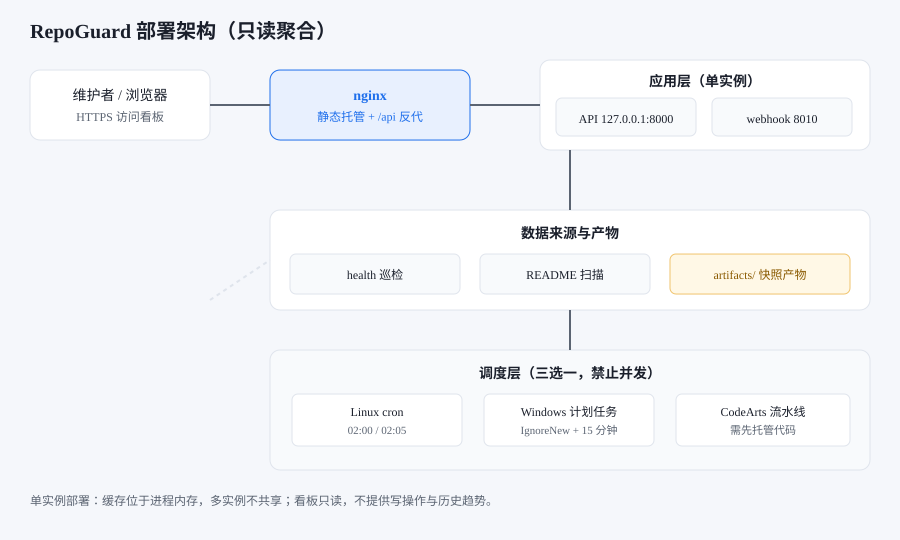
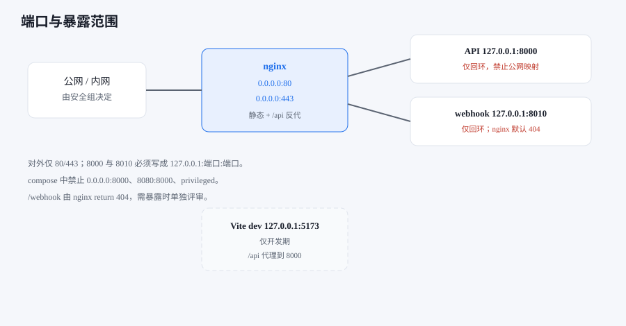
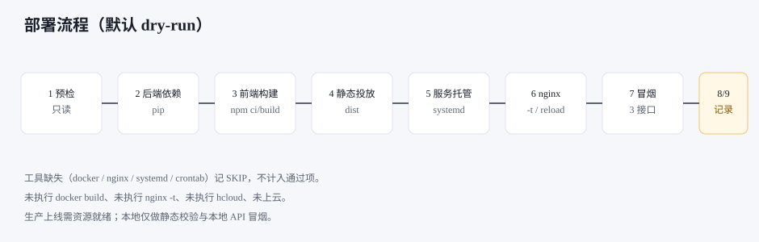
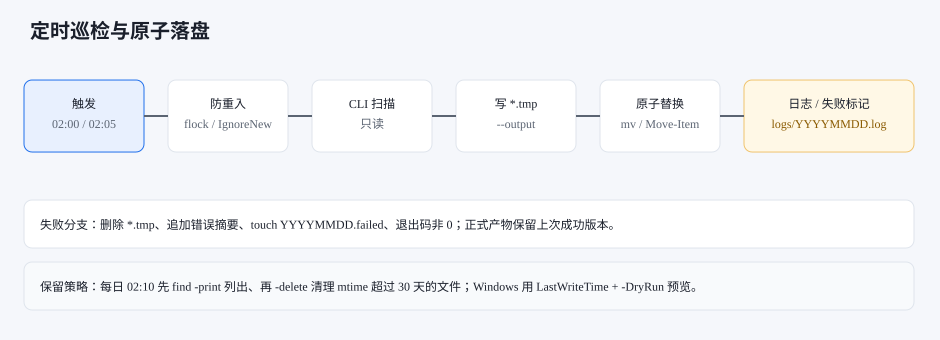

# RepoGuard 部署手册（只读看板）

> **事实声明（摘要）**：本机无 `docker`、无 `nginx`、无 `hcloud`、无 `crontab`；本手册对应的产物**只做过静态校验**，未执行 `docker build`、未执行 `docker compose config`、未执行 `nginx -t`、未执行 systemd 启动、未注册计划任务、未安装 cron、**未上云**。CodeArts 流水线 YAML **schema 未核实**，以控制台可视化配置为准。

---

## 1. 架构总览



| 层 | 组件 | 职责 | 说明 |
|---|---|---|---|
| 边缘 | nginx | 托管 `frontend/dist`、`/api` 反向代理 | 对外仅 80/443；证书由部署环境提供 |
| 应用 | Web API | 既有 `create_app()` + dashboard 路由 | 仅监听 `127.0.0.1:8000` |
| 应用 | webhook | 阶段 4 独立进程 | 仅监听 `127.0.0.1:8010`，nginx 默认不代理 |
| 数据 | health / readme | 复用既有只读巡检能力 | 不重写规则、不复制规则 |
| 产物 | `artifacts/` | 定时快照、日志、失败标记 | 保留 30 天，原子落盘 |
| 调度 | cron / 计划任务 / CodeArts | 触发每日巡检 | 禁止并发，三选一 |

**单实例说明**：看板缓存位于 API 进程内存（TTL 60 秒、LRU 8）。多实例部署会导致各实例缓存不一致，本阶段只支持单实例。

**只读边界**：看板只聚合当前扫描快照，不提供写操作、不提供历史趋势、不做自动修复。

---

## 2. 端口与拓扑



| 组件 | 监听地址 | 端口 | 暴露范围 | 备注 |
|---|---|---|---|---|
| nginx HTTP | `0.0.0.0` | 80 | 公网/内网，由安全组决定 | 静态 + `/api` 反代 |
| nginx HTTPS | `0.0.0.0` | 443 | 同上 | 证书由部署环境提供，本阶段未验证 |
| Web API | `127.0.0.1` | 8000 | **仅回环** | compose 必须写 `127.0.0.1:8000:8000` |
| webhook | `127.0.0.1` | 8010 | **仅回环** | compose 必须写 `127.0.0.1:8010:8010` |
| Vite dev | `127.0.0.1` | 5173 | 仅开发期 | `strictPort`，`/api` 代理到 8000 |
| 前端静态 | — | — | 由 nginx 提供 | `frontend/dist/`，不入库 |

**硬约束**：禁止 `0.0.0.0:8000`、禁止 `8080:8000`、禁止 `privileged: true`；`/webhook` 由 nginx `return 404`，需要对外暴露时必须单独评审。

---

## 3. 前置条件

### 3.1 运行时（目标机）

- Python ≥ 3.10（建议在目标机创建独立 `.venv`）
- nginx（托管静态与反代）
- systemd（托管 API 与 webhook）
- 低权限用户 `repoguard` 与目录 `/opt/repoguard/{backend,deploy,artifacts}`
- 磁盘：`artifacts/` 至少预留 30 天日志与快照空间

### 3.2 构建机

- Node ≥ 22.12（本机实测 v24.19.0 / npm 11.17.0；用户口径为 v22.23.2 / 10.9.8，以 `package.json` 的 `engines.node >= 22.12` 为准）
- 可访问 npm 源；`frontend/package-lock.json` 必须入库
- 构建完成后仅投放 `frontend/dist/`，不需要在目标机安装 Node

### 3.3 配置与凭证

- 从 `deploy/env.example` 复制为 `deploy/.env`，填写目标机真实路径与 webhook 密钥
- `deploy/.env` 已被根 `.gitignore` 忽略，**禁止提交**
- 本手册不包含任何真实密钥、真实域名或证书路径

---

## 4. 本地校验步骤（无需 Docker / nginx）



命令按场景区分：

| 场景 | 用途 | 是否写系统 |
|---|---|---|
| 开发 | `cd frontend && npm run dev` 调试看板 | 否 |
| 本地校验 | `bash -n`、PowerShell 解析、`npm ci && npm run build`、`preflight` | 否（预检只读） |
| 生产上线 | 安装 systemd、投放静态、配置 nginx、注册定时 | 是，需资源就绪 |

### 4.1 脚本语法（Linux）

```bash
bash -n deploy/preflight.sh
bash -n deploy/deploy.sh
bash -n deploy/smoke.sh
```

### 4.2 脚本语法（Windows PowerShell）

```powershell
$errs = $null
[System.Management.Automation.Language.Parser]::ParseFile(
  (Resolve-Path deploy/preflight.ps1), [ref]$null, [ref]$errs) | Out-Null
@($errs).Count
```

对 `deploy/preflight.ps1`、`deploy/deploy.ps1`、`deploy/smoke.ps1`、`deploy/schedule/*.ps1` 逐个执行，期望输出 `0`。

### 4.3 后端语法

```bash
python -m py_compile backend/app/dashboard/*.py
```

### 4.4 前端依赖与构建

```bash
cd frontend
npm ci
npm run build
```

构建成功后检查 `frontend/dist/index.html` 与 `frontend/dist/assets/*.js`、`*.css`；`dist/` 与 `node_modules/` 均不入库。

### 4.5 预检与 dry-run

```bash
bash deploy/preflight.sh
bash deploy/deploy.sh --dry-run
```

`preflight` 输出 `[PASS]/[WARN]/[SKIP]/[FAIL]`，存在 `FAIL` 时退出码为 1。`deploy.sh` 默认即为 dry-run，只打印命令，不写系统；Windows 等价命令为 `powershell -File deploy/deploy.ps1 -DryRun`。

### 4.6 本地替代验证

- 后端：按第 5.1 节启动本地 API（`127.0.0.1:8000`），再运行 `bash deploy/smoke.sh`
- 前端：`cd frontend && npm run dev`（5173），或用本地静态服务器指向 `dist/`
- **说明**：本地替代验证不等于容器、nginx 或云上验证

---

## 5. 资源就绪后的上线步骤（8 步）

> 以下命令标注 **生产上线**，需目标机资源与权限就绪；本阶段未执行。

1. **同步代码**（生产上线）：将仓库同步到 `/opt/repoguard`，确认 `deploy/.env` 未入库。
2. **准备配置**（生产上线）：`cp deploy/env.example deploy/.env`，填写 `REPOGUARD_ALLOWED_REPOS`、`REPOGUARD_DEFAULT_REPO`、`REPOGUARD_WEBHOOK_SECRET` 等。
3. **创建虚拟环境**（生产上线）：
   ```bash
   python3 -m venv /opt/repoguard/.venv
   /opt/repoguard/.venv/bin/python -m pip install -r /opt/repoguard/backend/requirements.txt
   ```
4. **安装服务单元**（生产上线）：
   ```bash
   cp deploy/systemd/repoguard-api.service /etc/systemd/system/
   cp deploy/systemd/repoguard-webhook.service /etc/systemd/system/
   systemctl daemon-reload
   systemctl enable --now repoguard-api repoguard-webhook
   ```
5. **构建并投放前端**（生产上线）：在构建机执行 `cd frontend && npm ci && npm run build`，将 `frontend/dist/` 同步到 nginx 静态目录（默认 `/usr/share/nginx/html`）。
6. **配置 nginx**（生产上线）：将 `deploy/nginx/repoguard.conf` 放入 nginx 配置目录，执行 `nginx -t` 后 `systemctl reload nginx`；HTTPS/HSTS 由独立 server 块与证书提供。
7. **冒烟**（生产上线）：`bash deploy/smoke.sh`，校验 `/api/health`、`/api/dashboard/repos`、`/api/dashboard/overview`。
8. **配置定时与归档**（生产上线）：按第 7 节三选一；禁止同日同时启用多种调度。

可选容器路径（生产上线，需 Docker）：`docker compose -f deploy/docker-compose.yml up -d --build`。**本机未执行**。

---

## 6. 回滚步骤

1. 保留上一版 `frontend/dist/` 与 `.venv`（发布前打时间戳副本）。
2. 静态回滚：切回上一版 `dist/`，无需重启 nginx。
3. 后端回滚：恢复上一版 `.venv` 或代码目录，执行 `systemctl restart repoguard-api repoguard-webhook`。
4. 配置回滚：恢复上一版 `deploy/.env` 与 nginx 配置，执行 `nginx -t && systemctl reload nginx`。
5. 无数据库、无数据迁移；`artifacts/` 为只读历史产物，回滚不删除。
6. 定时回滚：`unregister_windows_tasks.ps1` 或注释 crontab 行；CodeArts 在控制台停用定时触发。

---

## 7. 定时与流水线



### 7.1 三种方式（三选一，禁止并发）

| 方式 | 产物路径 | 触发 | 状态 |
|---|---|---|---|
| Linux cron | `deploy/cron/repoguard-daily.cron` | 每日 02:00 / 02:05 / 02:10 清理 | 模板已交付，**未安装 cron** |
| Windows 计划任务 | `deploy/schedule/register_windows_tasks.ps1`、`deploy/schedule/unregister_windows_tasks.ps1` | 每日 02:00 / 02:05 | 脚本已交付，**未注册计划任务** |
| CodeArts 流水线 | `deploy/codearts/pipeline.yml` | 每日 02:00（时区以控制台为准） | 模板草案，**schema 未核实** |

### 7.2 Linux cron

- 安装前执行：`mkdir -p /opt/repoguard/artifacts/{health,readme,logs}`
- `%` 已按 cron 规则转义为 `\%`；两个任务使用不同锁文件（`/tmp/repoguard-health.lock`、`/tmp/repoguard-readme.lock`）
- 时区：cron 使用系统本地时区；执行 `timedatectl` 核对，容器内 cron 默认 UTC，需显式设置 `TZ`
- 清理：02:10 先 `find ... -print` 列出，再 `-delete` 删除超过 30 天且非 `*.tmp` 的文件

### 7.3 Windows 计划任务

```powershell
powershell -File deploy/schedule/register_windows_tasks.ps1 -DryRun
powershell -File deploy/schedule/unregister_windows_tasks.ps1 -DryRun
```

- 设置：`-MultipleInstances IgnoreNew`、`-StartWhenAvailable`、`-ExecutionTimeLimit (New-TimeSpan -Minutes 15)`、`-RunLevel Limited`、`-LogonType Interactive`
- **日期格式假设**：脚本使用 `cmd.exe` 的 `%DATE:~0,4%%DATE:~5,2%%DATE:~8,2%`，依赖目标机区域日期格式 `YYYY-MM-DD`（或等效前缀）。若区域格式不同导致解析异常，改用 PowerShell 生成日期（`Get-Date -Format yyyyMMdd`），或先统一系统区域格式。
- **清理开关**：`unregister_windows_tasks.ps1` 支持可选 `-CleanupArtifacts -OlderThanDays 30`，**默认关闭**；`-DryRun` 只列出将删除的文件，不删除 `artifacts` 目录本身，不新增默认文件。

### 7.4 CodeArts 流水线前置（9 步）

当前工作区**不是 Git 仓库**，流水线无法直接拉取代码。上线前必须完成：

1. `git init`（先确认根 `.gitignore` 生效）
2. 首次提交（确认 `.env`、`node_modules/`、`dist/`、`artifacts/` 未入库）
3. 控制台创建 CodeArts Repo 空仓库
4. 关联远端并推送（凭据不写入本仓库）
5. 新建流水线，代码源选择该 Repo
6. 导入 `deploy/codearts/pipeline.yml`，或按控制台可视化配置逐步创建（**schema 未核实**）
7. 配置变量 `REPOGUARD_REPO_ROOT`、`REPOGUARD_ALLOWED_REPOS`
8. 配置每日 02:00 定时（时区以控制台为准）
9. 配置归档 `artifacts/**`，保留 30 天或 30 次

**明确声明**：未初始化 Git 或未托管 Repo 时，定时触发**不会生效**；本阶段未执行上述任何命令。

### 7.5 原子落盘与失败可见

- CLI `--output` 先写 `*.tmp`，退出码 0 后由调度包装重命名为正式文件
- 失败时删除 `*.tmp`、追加日志、写入 `artifacts/logs/YYYYMMDD.failed`、退出码非 0
- 正式产物保留上次成功版本；同日重复执行原子覆盖同一文件，不堆积

---

## 8. 故障排查

| 现象 | 排查 | 处理 |
|---|---|---|
| 端口占用 | `ss -ltnp` / `Get-NetTCPConnection` | 释放端口或调整映射；8000/8010 不得改为公网 |
| 看板 503 | 检查 `REPOGUARD_ALLOWED_REPOS` 与引擎可用性 | 修正白名单；查看 API 日志中的 `request_id` |
| 看板 504 | 扫描超过 `REPOGUARD_DASHBOARD_SCAN_TIMEOUT_SECONDS` | 缩小巡检范围或提高超时；晚到结果被丢弃 |
| `/webhook` 返回 404 | **预期行为**：nginx 默认不代理 | 需要暴露时单独评审，不直接改 `return 404` |
| `artifacts` 无权限 | 检查 `ReadWritePaths` 与目录属主 | `chown -R repoguard:repoguard /opt/repoguard/artifacts` |
| npm 源不可达 | `npm ci` 失败 | 配置镜像源或离线缓存；不得跳过 lock 校验 |
| Node 版本不足 | `node -v` | 使用 ≥ 22.12；构建机与目标机版本口径见第 9 节 |
| 定时未触发 | 检查 cron/计划任务是否安装、时区是否正确 | 先用 `-DryRun` 或手动执行 CLI 验证 |

---

## 9. 事实声明

- 本机 `docker` 不可用，**未执行 docker build / docker compose config**。
- 本机 `nginx` 不可用，**未执行 nginx -t / reload**。
- 本机 `hcloud` 不可用，**未执行 hcloud**，**未上云**。
- 本机无 `crontab`，**未安装 cron**；**未注册 Windows 计划任务**；**未触发 CodeArts 流水线**。
- CodeArts 流水线 YAML **schema 未核实**，字段与层级以控制台为准；导入失败时按控制台逐步创建。
- Node 版本口径：本机实测 **v24.19.0 / npm 11.17.0**；用户口径为 v22.23.2 / 10.9.8；工程以 `engines.node >= 22.12` 为兼容目标。
- 看板只展示当前扫描快照，**不提供历史趋势**；不提供写操作与自动修复。
- 本手册所有图片均为本地相对路径 SVG，无外链图片、无外部字体、无脚本。